# 📚 Bài 1: Framework & ước lượng

> "Ước lượng sai 2 lần thì không sao. Sai 1000 lần thì bạn đang thiết kế một hệ thống khác." - một senior engineer giấu tên

Thứ Sáu, 14h. Bạn vào phòng phỏng vấn. Người phỏng vấn nói đúng một câu: *"Thiết kế cho mình một ứng dụng chat như Zalo."* Rồi im lặng, chờ.

Có hai kiểu ứng viên.

**Kiểu A** cầm bút vẽ ngay: "Mình có client, có WebSocket server, có Kafka, có Cassandra, có Redis..." Sau 25 phút, bảng trắng kín hộp và mũi tên. Người phỏng vấn hỏi: "Một server WebSocket giữ được bao nhiêu kết nối? Cần bao nhiêu server?" Ứng viên A khựng lại. "Chắc... vài chục cái?" Hỏi tiếp: "Tin nhắn nhóm 500 người thì sao?" Ứng viên A phải xóa một nửa bảng.

**Kiểu B** hỏi trước: "Mình tập trung vào chat 1-1 và nhóm, hay cả gọi video? Nhóm tối đa bao nhiêu người? Bao nhiêu người dùng hoạt động mỗi ngày? Có cần lưu lịch sử vĩnh viễn không?" Sau 6 phút, B viết lên góc bảng: *20M DAU, 40 tin/người/ngày → ~9K tin/s trung bình, ~46K lúc đỉnh; 6M kết nối đồng thời → ~120 gateway server; 160 GB tin nhắn mỗi ngày.* Rồi mới vẽ. Và khi vẽ, B nói: "Con số 6 triệu kết nối cho thấy **nút thắt là số kết nối**, không phải QPS - nên mình sẽ dành phần deep dive cho gateway."

B không giỏi hơn A về công nghệ. B có **một quy trình** và **biết dùng con số để chọn chỗ đào sâu**. Bài này dạy bạn đúng hai thứ đó.

## 🎯 Mục tiêu bài học

- Nắm một **framework 6 giai đoạn có timebox** cho buổi phỏng vấn 45-60 phút, sâu hơn [quy trình 7 bước ở Backend Bài 10](../backend/10-system-design.md)
- Biết cách **dẫn dắt cuộc hội thoại**: hỏi gì, khi nào dừng hỏi, xử lý gợi ý và phản biện của người phỏng vấn
- Biến yêu cầu thành **NFR có con số**: SLO, availability, p99 latency, durability, consistency, RPO/RTO
- Thuộc các **con số nền**: lũy thừa của 2, bảng độ trễ, năng lực của một máy
- Ước lượng thành thạo: **QPS & peak**, **storage tăng trưởng**, **bandwidth**, **cache (80/20)**, **số server**, **số kết nối đồng thời** (Little's law)
- Làm **4 drill ước lượng** với đầy đủ phép tính, và một **script estimator** Go/Python để tự kiểm tra
- Tránh các **sai lầm ước lượng** phổ biến và **trình bày trade-off** một cách thuyết phục

!!! note "Liên hệ với các bài trước"
    [Backend Bài 10 §2](../backend/10-system-design.md) đã giới thiệu quy trình 7 bước và ví dụ ước lượng dịch vụ rút gọn link. [Systems Thinking Bài 6](../systems-thinking/06-idea-to-architecture.md) dạy quy trình từ ý tưởng đến kiến trúc trong dự án thật. Bài này **chuyên sâu cho bối cảnh phỏng vấn và thiết kế quy mô lớn**: timebox từng phút, NFR định lượng, và ước lượng nhiều chiều (không chỉ QPS).

---

## 📖 1. Người phỏng vấn thực sự chấm gì?

Một bài system design 45 phút **không thể** ra được một thiết kế hoàn chỉnh. Người phỏng vấn biết điều đó. Thứ họ chấm là **tín hiệu (signal)** về cách bạn làm việc:

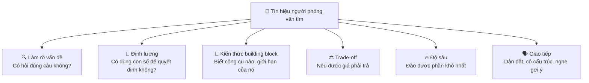

| Level | Kỳ vọng điển hình |
|---|---|
| Junior / Mid | Đi hết luồng chính, kiến trúc hợp lý, biết các block cơ bản. Người phỏng vấn dẫn dắt nhiều. |
| Senior | **Tự dẫn dắt**, ước lượng đúng bậc, deep dive 1-2 phần khó với ≥2 phương án, nói về failure. |
| Staff+ | Thấy trước vấn đề vận hành, chi phí, tiến hóa hệ thống qua thời gian, ảnh hưởng tổ chức (team nào sở hữu gì). |

Hệ quả quan trọng: **im lặng vẽ 10 phút là lãng phí**, dù bạn vẽ đúng. Người phỏng vấn không đọc được suy nghĩ của bạn. Bạn phải **nghĩ thành tiếng (think out loud)**.

---

## 📖 2. Framework 6 giai đoạn có timebox

Quy trình 7 bước ở [Backend Bài 10](../backend/10-system-design.md) là "làm gì". Ở đây ta thêm **bao lâu** và **sản phẩm của mỗi giai đoạn** - vì lỗi phổ biến nhất không phải thiếu kiến thức mà là **hết giờ trước khi tới phần quan trọng**.

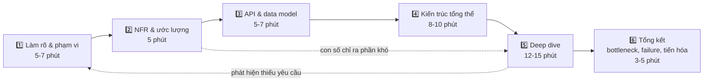

```mermaid
gantt
    title Phân bổ thời gian buổi phỏng vấn 45 phút
    dateFormat mm
    axisFormat %M
    section Định hình
    Làm rõ yêu cầu và phạm vi    :a1, 00, 6m
    NFR và ước lượng             :a2, after a1, 5m
    section Thiết kế
    API và data model            :a3, after a2, 6m
    Kiến trúc tổng thể           :a4, after a3, 9m
    section Đào sâu
    Deep dive 1-2 phần khó        :a5, after a4, 14m
    Tổng kết và failure           :a6, after a5, 5m
```

### 2.1. Giai đoạn 1 - Làm rõ & chốt phạm vi (5-7 phút)

**Sản phẩm**: 3-5 use case chính, danh sách **out of scope**, quy mô người dùng.

Câu hỏi theo 4 nhóm (đừng hỏi hết - chọn 5-8 câu quan trọng nhất):

| Nhóm | Câu hỏi mẫu | Vì sao quan trọng |
|---|---|---|
| **Người dùng & quy mô** | Bao nhiêu DAU? Phân bố địa lý? Tăng trưởng mỗi năm? | Quyết định có cần sharding, multi-region |
| **Chức năng** | 3 tính năng quan trọng nhất là gì? Cái gì ngoài phạm vi? | Tránh thiết kế cả vũ trụ |
| **Hành vi** | Tỉ lệ đọc/ghi? Dữ liệu lớn cỡ nào (text, ảnh, video)? Có đỉnh đột biến không? | Quyết định cache, storage, queue |
| **Ràng buộc** | Cần realtime không? Mất dữ liệu có chấp nhận được không? Có yêu cầu pháp lý (lưu dữ liệu trong nước)? | Quyết định consistency, region |

!!! tip "Khi người phỏng vấn trả lời 'bạn tự giả định đi'"
    Đây là tình huống rất phổ biến. Đừng hoảng. Đưa ra **giả định hợp lý, nói to, ghi lên bảng**: *"Mình giả định 20 triệu DAU, chủ yếu ở Việt Nam, nhóm tối đa 500 người. Nếu sai anh/chị cứ sửa nhé."* Người phỏng vấn đánh giá **giả định có hợp lý không**, không phải bạn có đoán trúng không.

### 2.2. Giai đoạn 2 - NFR & ước lượng (5 phút)

**Sản phẩm**: một bảng nhỏ ở góc bảng trắng mà bạn sẽ **nhìn lại suốt buổi**:

```text
DAU 20M | write 9K/s (peak 46K) | read 14K/s (peak 69K)
storage 160 GB/ngày, ~0.5 PB/3 năm (x3 replica)
kết nối đồng thời 6M → ~120 gateway
p99 gửi tin < 300 ms | availability 99.99% | không mất tin đã ack
```

Chi tiết ở [mục 4](#4-yeu-cau-nfr-bang-con-so) và [mục 5](#5-uoc-luong-back-of-the-envelope-chuyen-sau). Mẹo: **làm tròn mạnh tay**, mục tiêu là **bậc độ lớn** (order of magnitude), không phải 4 chữ số thập phân.

### 2.3. Giai đoạn 3 - API & data model (5-7 phút)

**Sản phẩm**: 3-6 endpoint/event chính, 2-4 bảng/collection với khóa chính và khóa partition.

```text
POST /v1/messages        {conversation_id, client_msg_id, body}  -> {message_id, created_at}
GET  /v1/conversations/{id}/messages?before=<cursor>&limit=50
WS   event "message.new" {conversation_id, message_id, sender_id, body, seq}

messages(conversation_id PK-partition, seq CK, message_id, sender_id, body, created_at)
```

Hai chi tiết nhỏ nhưng "ăn điểm": **idempotency key** (`client_msg_id`) cho thao tác ghi có thể retry, và **cursor pagination** thay vì offset. Xem [Backend Bài 3 - API design](../backend/03-api-design.md).

### 2.4. Giai đoạn 4 - Kiến trúc tổng thể (8-10 phút)

**Sản phẩm**: một sơ đồ đi được **end-to-end** cho 1-2 luồng chính. Vẽ **đơn giản trước**, chỉ thêm hộp khi có lý do.

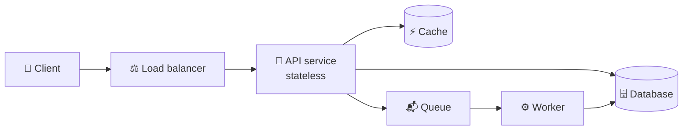

Rồi **đi qua sơ đồ bằng lời** theo một request cụ thể: "Khi Lan gửi tin, request đi qua LB tới API, API ghi vào DB với `client_msg_id` để chống trùng, rồi đẩy event vào queue, worker fan-out tới các WebSocket gateway đang giữ kết nối của người nhận..."

### 2.5. Giai đoạn 5 - Deep dive (12-15 phút)

**Sản phẩm**: 1-2 phần khó được phân tích với **≥2 phương án** và **bảng trade-off**.

Chọn phần nào? Có 3 nguồn:

1. **Con số ở giai đoạn 2** chỉ ra nút thắt (6M kết nối → gateway; 250K ghi/s → storage vị trí).
2. **Phần "đặc trưng" của bài toán** (chat → thứ tự & giao tin; ví → không mất tiền; flash sale → tồn kho nóng).
3. **Người phỏng vấn gợi ý** - luôn ưu tiên nguồn này: *"Anh/chị muốn mình đào sâu phần nào, hay để mình chọn phần gateway?"*

### 2.6. Giai đoạn 6 - Tổng kết (3-5 phút)

**Sản phẩm**: 3 câu về **nút thắt tiếp theo**, **failure mode** quan trọng nhất và cách giảm thiểu, **hướng tiến hóa** (nếu quy mô x10 thì đổi gì).

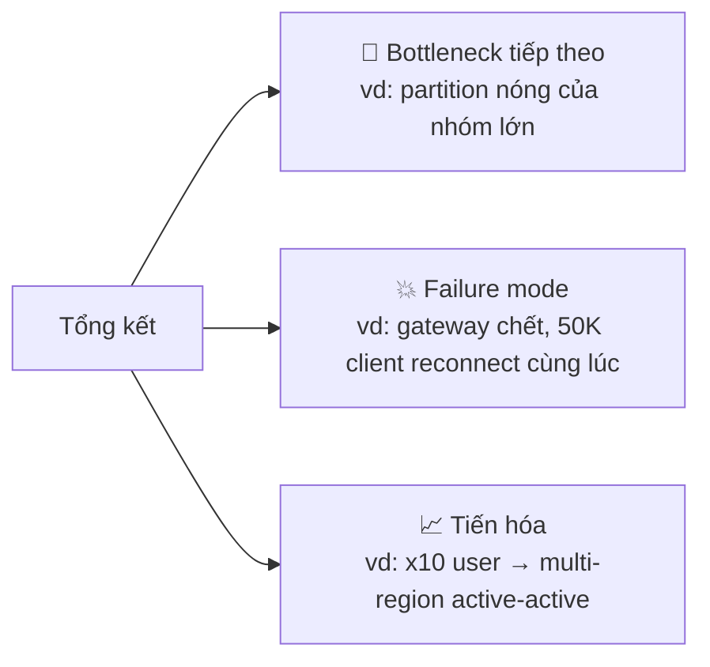

---

## 📖 3. Dẫn dắt cuộc hội thoại

Phỏng vấn system design giống **đi khám bệnh với bác sĩ giỏi**: bác sĩ hỏi vài câu có chủ đích, tóm tắt lại triệu chứng, đưa ra chẩn đoán sơ bộ, giải thích vì sao chọn phác đồ này - và luôn hỏi "anh thấy thế nào?". Bác sĩ không im lặng viết đơn 10 phút rồi đưa cho bạn.

### 3.1. Kịch bản hội thoại mẫu (giai đoạn 1)

> **Người phỏng vấn**: Thiết kế hệ thống chia sẻ ảnh như Instagram.
>
> **Bạn**: Để chốt phạm vi, mình tập trung vào: đăng ảnh, xem feed ảnh của người mình follow, và like. Comment, story, tin nhắn, tìm kiếm để ngoài phạm vi nhé?
>
> **Người phỏng vấn**: Được, bỏ story và tin nhắn. Comment thì có thể nói sơ qua.
>
> **Bạn**: Quy mô khoảng bao nhiêu người dùng hoạt động mỗi ngày ạ?
>
> **Người phỏng vấn**: Bạn tự giả định.
>
> **Bạn**: Mình giả định 50 triệu DAU, mỗi người đăng trung bình 0,2 ảnh/ngày và xem khoảng 100 ảnh/ngày. Như vậy đọc nhiều gấp ~500 lần ghi - hệ thống **thiên về đọc**, nên CDN và cache sẽ là trọng tâm. Feed có cần realtime tuyệt đối không, hay trễ vài giây là chấp nhận được?
>
> **Người phỏng vấn**: Trễ vài giây không sao.
>
> **Bạn**: Tốt, vậy feed có thể **eventual consistency**. Nhưng ảnh đã đăng thành công thì **không được mất** - durability cao. Mình tóm tắt: [đọc lại 3 use case + 3 NFR]. Mình chuyển sang ước lượng nhé.

Để ý những gì "Bạn" làm: **đề xuất phạm vi** thay vì hỏi trống; **giả định có số**; **rút ra hệ quả thiết kế ngay** từ mỗi câu trả lời; **tóm tắt và xin chuyển giai đoạn** (checkpoint).

### 3.2. Những câu nói hữu ích

| Tình huống | Câu nói (Việt / English) |
|---|---|
| Chốt phạm vi | "Mình tập trung vào X, Y, Z; còn W để ngoài phạm vi nhé?" / *"I'll focus on X, Y, Z and leave W out of scope - does that work?"* |
| Giả định | "Mình giả định ... Nếu thực tế khác, thiết kế sẽ đổi ở chỗ ..." |
| Checkpoint | "Trước khi đi tiếp, anh/chị có muốn mình làm rõ chỗ nào không?" |
| Chưa chắc | "Mình chưa chắc con số chính xác, nhưng bậc độ lớn là ..., mình sẽ dùng số đó." |
| Parking lot | "Phần này quan trọng, mình ghi vào góc bảng và quay lại ở deep dive." |
| Trade-off | "Chọn A thì được ..., mất ... Mình chọn A vì yêu cầu ... Nếu yêu cầu đổi thành ... thì B tốt hơn." |
| Bị phản biện | "Đúng, đó là điểm yếu của cách này. Có hai cách xử lý: ..." |

### 3.3. Xử lý gợi ý và phản biện

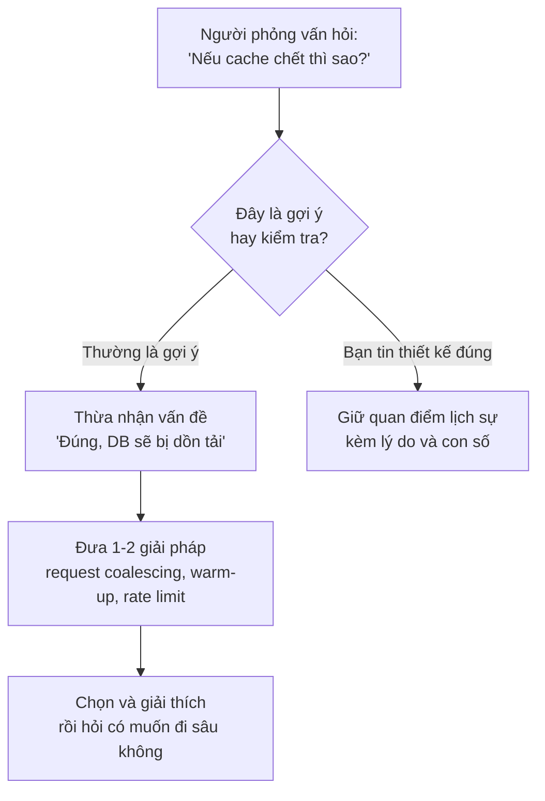

!!! warning "Đừng cãi, đừng đầu hàng ngay"
    Hai phản ứng tệ: (1) **cãi** - "không, cách của em đúng"; (2) **đầu hàng ngay** - xóa thiết kế và làm theo gợi ý mà không hiểu vì sao. Phản ứng tốt: **phân tích cùng người phỏng vấn**. Nhiều câu "nếu... thì sao?" chỉ để xem bạn có biết điểm yếu của chính thiết kế mình không.

### 3.4. Bảng trắng: bố cục giúp bạn không bị lạc

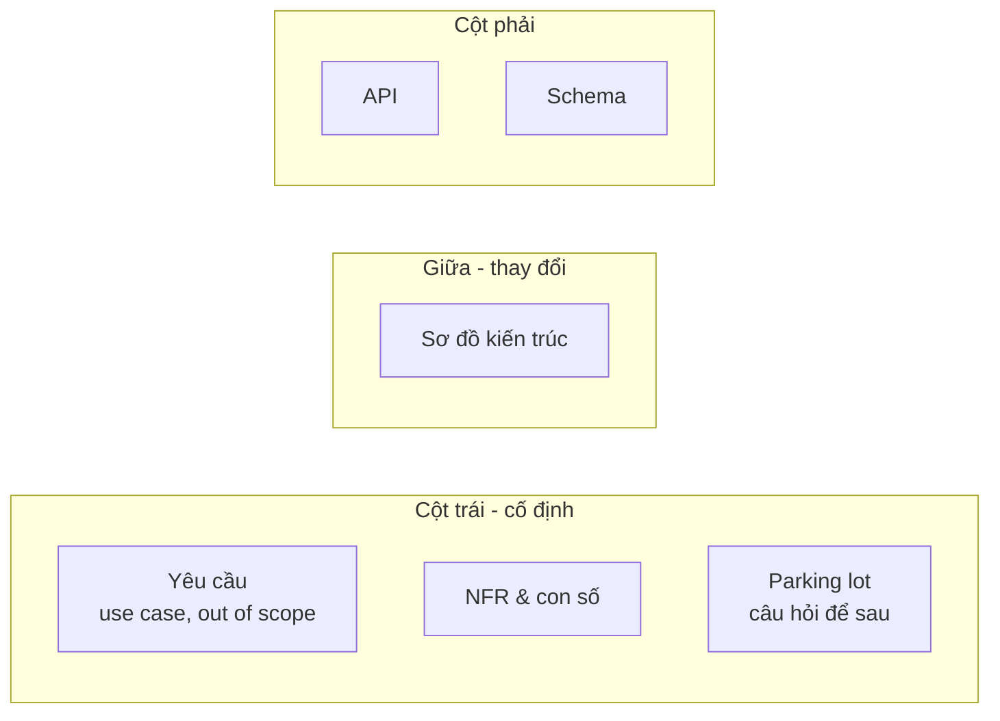

Bố cục này giúp bạn (và người phỏng vấn) **liếc lại con số** khi ra quyết định: "Nhìn lại góc trái - 46K ghi/s lúc đỉnh, một Postgres primary không chịu nổi, nên..."

---

## 📖 4. Yêu cầu → NFR bằng con số

"Hệ thống phải nhanh, ổn định, scale tốt" là câu **vô dụng** - không ai phản bác được, và không giúp ra quyết định nào. NFR (non-functional requirement) tốt là NFR **đo được**.

| Mơ hồ | Đo được |
|---|---|
| "Nhanh" | p99 latency API đọc feed < 200 ms, đo tại load balancer |
| "Ổn định" | Availability 99.95% mỗi tháng cho API đăng ảnh |
| "Không mất dữ liệu" | Ảnh đã trả 201 thì durability 99.999999999%; RPO = 0 cho giao dịch tiền |
| "Scale tốt" | Chịu 3x peak hiện tại mà không thay kiến trúc; scale ngang bằng cách thêm node |
| "Nhất quán" | Người đăng thấy ảnh của mình ngay (read-your-writes); người khác thấy trong < 5 s |

### 4.1. SLI, SLO, SLA và error budget

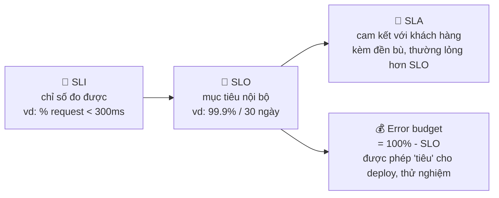

Chi tiết về SLO và error budget đã có ở [Backend Bài 11](../backend/11-observability-reliability.md). Trong system design, bạn cần **thuộc bảng sau** để cảm nhận "mấy con số 9":

| Availability | Downtime / năm | Downtime / tháng (30 ngày) | Downtime / ngày |
|---|---|---|---|
| 99% | 3,65 ngày | 7,2 giờ | 14,4 phút |
| 99,9% | 8,76 giờ | 43,2 phút | 1,44 phút |
| 99,95% | 4,38 giờ | 21,6 phút | 43,2 giây |
| 99,99% | 52,6 phút | 4,32 phút | 8,64 giây |
| 99,999% | 5,26 phút | 25,9 giây | 0,86 giây |

Cách nhớ: **99,9% ≈ 43 phút/tháng**; mỗi số 9 thêm vào **chia 10** thời gian downtime.

Hệ quả thiết kế: 99,99% nghĩa là **4 phút/tháng**. Không con người nào kịp nhận alert, mở laptop, SSH vào server và sửa trong 4 phút. Vậy muốn 99,99% thì failover phải **tự động**, deploy phải **không downtime**, và phải có **redundancy ở mọi tầng**. Mỗi số 9 thêm vào thường làm chi phí tăng đáng kể.

!!! note "Availability nối tiếp và song song"
    Ôn lại [Backend Bài 10 §9](../backend/10-system-design.md): service phụ thuộc **nối tiếp** thì availability **nhân nhau** (3 service 99,9% nối tiếp → 99,7%); có **dự phòng song song** thì xác suất **cùng chết** nhân nhau. Đây là lý do mỗi dependency đồng bộ (synchronous) bạn thêm vào luồng chính đều làm giảm availability.

### 4.2. Latency: luôn nói percentile, không nói trung bình

Trung bình **che giấu** những người dùng đang chịu khổ. Nếu 99 request mất 10 ms và 1 request mất 5 giây, trung bình là ~60 ms - trông ổn, nhưng cứ 100 lần bấm thì một lần người dùng chờ 5 giây.

- **p50** (median): trải nghiệm "điển hình"
- **p99**: 1% request chậm nhất - thường rơi vào **khách hàng quan trọng nhất** (người có nhiều dữ liệu nhất, giỏ hàng lớn nhất)
- **p99.9**: quan trọng với hệ thống có fan-out lớn

**Tail latency khuếch đại khi fan-out.** Nếu một request của người dùng phải gọi song song tới N backend, và mỗi backend có 1% xác suất chậm (vượt p99), thì xác suất request đó chậm là:

```text
P(chậm) = 1 - 0.99^N
N = 1    →  1%
N = 10   →  9.6%
N = 100  →  63.4%   ← đa số request bị kéo chậm bởi "đuôi" của một backend nào đó
```

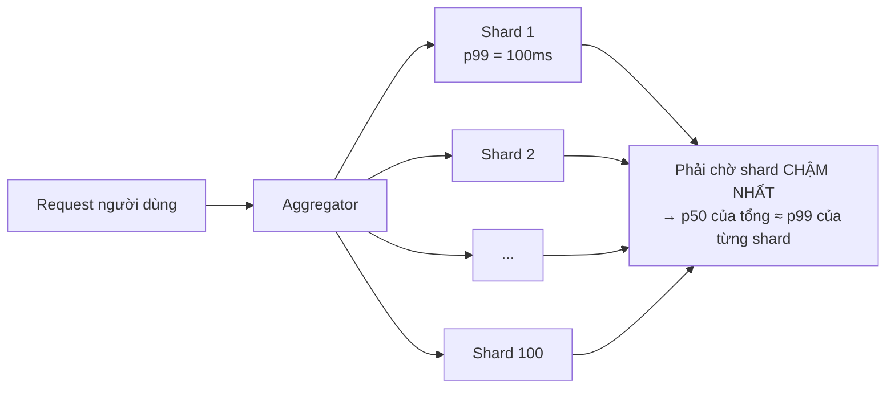

Cách giảm: **hedged request** (gửi bản sao sau một ngưỡng, lấy kết quả về trước), giảm fan-out, timeout + trả kết quả một phần (partial results), tách tải nặng ra khỏi đường nóng.

### 4.3. Durability vs availability

Hai khái niệm hay bị nhầm:

- **Availability**: hệ thống **trả lời được** không (ngay bây giờ)?
- **Durability**: dữ liệu đã xác nhận ghi có **còn đó** không (sau 1 năm)?

Một hệ thống có thể **available nhưng không durable** (cache trả lời nhanh nhưng mất dữ liệu khi restart) hoặc **durable nhưng tạm không available** (S3 đang có sự cố, dữ liệu vẫn an toàn nhưng tạm không đọc được).

Durability "11 số 9" (99,999999999%/năm) nghĩa là: với **10 triệu object**, kỳ vọng mất **1 object mỗi 10.000 năm** (10^7 × 10^-11 = 10^-4 object/năm).

### 4.4. Consistency: hỏi theo từng tính năng

Đừng nói "hệ thống cần strong consistency". Hãy **hỏi theo từng tính năng** - vì mỗi tính năng có giá khác nhau:

| Tính năng | Mức nhất quán cần | Lý do |
|---|---|---|
| Số dư ví, trừ tồn kho | **Strong / linearizable** | Sai là mất tiền, bán vượt |
| Người đăng xem bài của chính mình | **Read-your-writes** | Đăng xong không thấy → tưởng lỗi, đăng lại |
| Feed của người khác | **Eventual** (trễ vài giây) | Không ai biết bạn thấy bài trễ 3 giây |
| Số like, lượt xem | **Eventual**, có thể xấp xỉ | "1,2K like" không cần chính xác từng đơn vị |
| Thứ tự tin nhắn trong 1 cuộc chat | **Causal / thứ tự theo cuộc hội thoại** | Câu trả lời không được hiện trước câu hỏi |

Các mức này được giải thích kỹ ở [Bài 4](./04-consistency-consensus.md).

### 4.5. RPO và RTO

- **RPO** (Recovery Point Objective): chấp nhận **mất bao nhiêu dữ liệu** (tính bằng thời gian) khi thảm họa xảy ra. RPO = 5 phút → có thể mất tối đa 5 phút dữ liệu cuối.
- **RTO** (Recovery Time Objective): chấp nhận **mất bao lâu** để phục hồi dịch vụ.

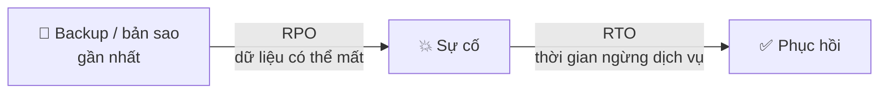

| Hệ thống | RPO | RTO | Hệ quả thiết kế |
|---|---|---|---|
| Ví điện tử | 0 | phút | Replication đồng bộ sang AZ/region khác |
| Mạng xã hội - bài đăng | giây | phút | Async replication + failover tự động |
| Báo cáo nội bộ | 24 giờ | 1 ngày | Backup hằng đêm là đủ |

Chi tiết ở [Bài 4 - Multi-region & DR](./04-consistency-consensus.md).

### 4.6. Mẫu bảng NFR dùng cho mọi bài

```text
| Thuộc tính       | Mục tiêu                                   | Đo ở đâu            |
|------------------|--------------------------------------------|---------------------|
| Quy mô           | 50M DAU, tăng 30%/năm                      | analytics           |
| Throughput       | 60K read QPS avg, 180K peak                | LB metrics          |
| Latency          | p99 đọc feed < 200ms, p99 đăng ảnh < 1s    | LB / tracing        |
| Availability     | 99.95%/tháng cho đọc, 99.9% cho ghi        | synthetic + SLI     |
| Durability       | ảnh đã ack không mất (11 nines)            | object store        |
| Consistency      | read-your-writes cho tác giả, eventual <5s | test + metric lag   |
| RPO / RTO        | RPO < 1 phút, RTO < 15 phút                | DR drill            |
| Chi phí / ràng buộc | dữ liệu người dùng VN lưu tại VN         | compliance          |
```

---

## 📖 5. Ước lượng back-of-the-envelope chuyên sâu

Ước lượng không phải để ra con số đẹp. Nó để trả lời những câu hỏi **có/không** quyết định kiến trúc:

- Dữ liệu có **vừa một máy** không? (Nếu có - đừng shard!)
- Working set có **vừa RAM** không? (Quyết định cache)
- Một DB primary có **chịu nổi lượng ghi** không? (Quyết định sharding, queue)
- Băng thông có phải **chi phí chính** không? (Quyết định CDN, nén)
- Nút thắt là **QPS, kết nối, storage, hay băng thông**? (Quyết định chỗ deep dive)

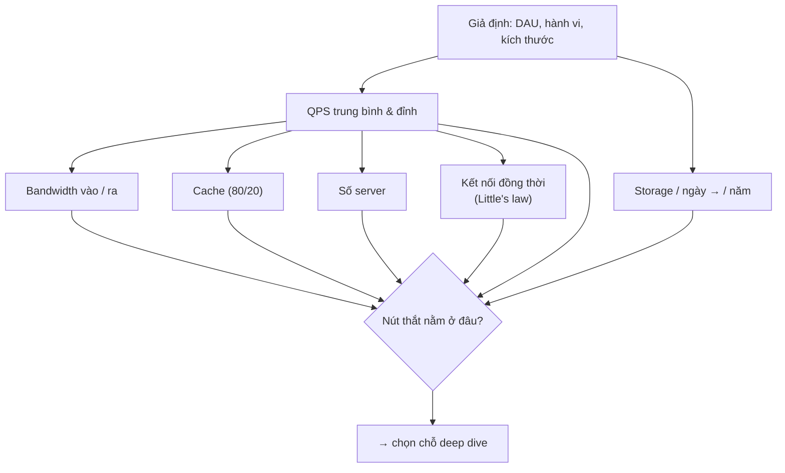

### 5.1. Lũy thừa của 2 và các con số cần thuộc

| Lũy thừa | Giá trị chính xác | Xấp xỉ | Đơn vị |
|---|---|---|---|
| 2^10 | 1.024 | 1 nghìn (10^3) | 1 KB |
| 2^16 | 65.536 | 65 nghìn | số port TCP, uint16 |
| 2^20 | 1.048.576 | 1 triệu (10^6) | 1 MB |
| 2^30 | 1.073.741.824 | 1 tỉ (10^9) | 1 GB |
| 2^32 | 4.294.967.296 | 4,3 tỉ | IPv4, uint32 |
| 2^40 | ~1,1 × 10^12 | 1 nghìn tỉ | 1 TB |
| 2^50 | ~1,1 × 10^15 | 10^15 | 1 PB |
| 2^63 | ~9,2 × 10^18 | | int64 lớn nhất |

Thêm vài con số "đổi đơn vị" dùng liên tục:

| Đại lượng | Giá trị | Mẹo nhớ |
|---|---|---|
| Giây trong 1 ngày | 86.400 | **≈ 10^5** (sai 15%, chấp nhận được) |
| Giây trong 1 tháng | ~2,6 triệu | ≈ 2,5 × 10^6 |
| Giây trong 1 năm | ~31,5 triệu | ≈ 3 × 10^7 |
| 1 triệu request/ngày | ≈ 12 QPS | chia 86.400 |
| 1 tỉ request/ngày | ≈ 12K QPS | |
| 1 byte | 8 bit | **băng thông mạng tính bằng bit!** |
| Base62, 7 ký tự | 62^7 ≈ 3,5 × 10^12 | đủ cho URL shortener |

!!! tip "Dùng thập phân cho nhanh"
    Trong phỏng vấn, coi 1 KB = 1.000 byte, 1 GB = 10^9 byte. Sai số 2,4%-7% (so với 1.024^n) không làm thay đổi quyết định nào. Script ở mục 7 cũng dùng thập phân.

### 5.2. Bảng độ trễ - "cảm giác" về tốc độ

Các con số dưới đây là **xấp xỉ bậc độ lớn** trên phần cứng server phổ biến, dựa trên bảng "Latency numbers every programmer should know" (Jeff Dean, sau đó được cộng đồng cập nhật). Chúng thay đổi theo phần cứng; điều cần nhớ là **tỉ lệ giữa các hàng**.

| Thao tác | Thời gian xấp xỉ | Nếu 1 ns = 1 giây thì... |
|---|---|---|
| Tham chiếu L1 cache | ~1 ns | 1 giây |
| Tham chiếu L2 cache | ~4 ns | 4 giây |
| Lock/unlock mutex (không tranh chấp) | ~20 ns | 20 giây |
| Truy cập RAM | ~100 ns | gần 2 phút |
| Nén 1 KB bằng thuật toán nhanh (Snappy, LZ4) | ~1-3 µs | ~1 giờ |
| Gửi 1 KB qua mạng 10 Gbps | ~1 µs | ~15 phút |
| Đọc ngẫu nhiên 4 KB từ NVMe SSD | ~20-100 µs | 6 giờ - 1 ngày |
| Đọc tuần tự 1 MB từ RAM | ~10-50 µs | vài giờ |
| Đọc tuần tự 1 MB từ NVMe SSD | ~100-300 µs | 1-3 ngày |
| Round trip trong cùng datacenter | ~0,1-0,5 ms | 1-6 ngày |
| Round trip giữa 2 AZ cùng region | ~1-2 ms | 2-3 tuần |
| Đọc tuần tự 1 MB từ HDD | ~5 ms | 2 tháng |
| HDD seek | ~5-10 ms | 2-4 tháng |
| TP.HCM ↔ Hà Nội (round trip) | ~20-40 ms | ~1 năm |
| Việt Nam ↔ Singapore (round trip) | ~30-50 ms | ~1,5 năm |
| Việt Nam ↔ Bờ Tây Mỹ (round trip) | ~150-200 ms | ~5-6 năm |

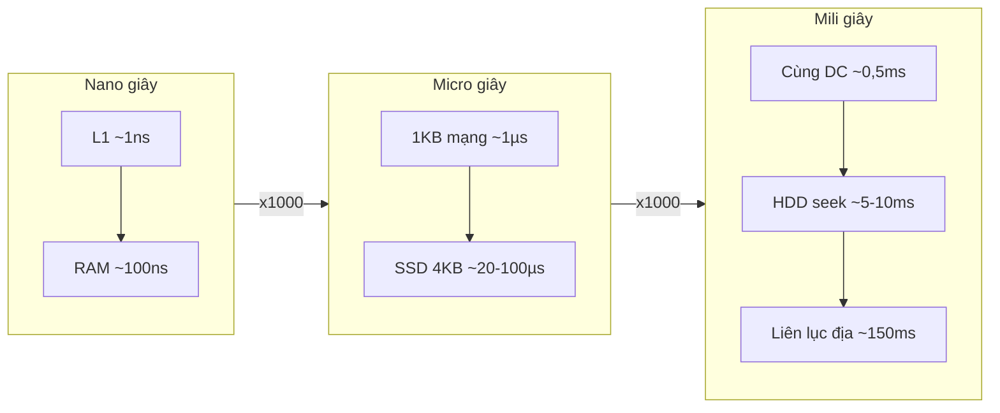

Những bài học rút ra từ bảng:

1. **RAM nhanh hơn SSD ~1000 lần** đối với truy cập ngẫu nhiên nhỏ → cache trong RAM đáng giá.
2. **Mạng trong datacenter nhanh hơn đọc HDD** → đọc từ RAM của máy khác (Redis) thường nhanh hơn đọc đĩa của máy mình.
3. **Liên lục địa ~150 ms là định luật vật lý** (ánh sáng trong cáp quang ~200.000 km/s). Không tối ưu code nào vượt qua được → muốn nhanh cho người dùng toàn cầu thì phải **đưa dữ liệu lại gần** (CDN, multi-region).
4. Một request cần **5 round trip liên lục địa tuần tự** đã tốn gần **1 giây**. Đây là lý do gộp request (batch), HTTP/2, và tránh "chatty API" quan trọng.

### 5.3. Năng lực của một máy - bậc độ lớn để luyện tập

!!! warning "Đây là con số để luyện tập, không phải benchmark"
    Năng lực thật phụ thuộc phần cứng, cấu hình, kích thước dữ liệu, độ phức tạp query. Trong dự án thật, **luôn load test**. Trong phỏng vấn, dùng các bậc độ lớn này và **nói rõ là giả định**.

| Thành phần | Bậc độ lớn thường dùng để ước lượng |
|---|---|
| App server stateless (JSON, logic đơn giản) | ~1.000-10.000 RPS / instance |
| PostgreSQL / MySQL, đọc theo primary key, data vừa RAM | ~10.000-50.000 QPS / node |
| PostgreSQL / MySQL, ghi có transaction | ~vài nghìn - 10.000+ TPS / primary |
| Redis (1 instance) | ~100.000+ ops/s |
| Kafka broker | ~hàng trăm MB/s |
| WebSocket server (đã tune) | ~50.000 - vài trăm nghìn kết nối / máy |
| NIC server | 10-25 Gbps (≈ 1,2-3 GB/s) |
| RAM server phổ biến | 64-512 GB |
| SSD / server | vài TB đến vài chục TB |

### 5.4. QPS và hệ số đỉnh (peak factor)

```text
QPS trung bình = (DAU × số thao tác / người / ngày) / 86.400
QPS đỉnh       = QPS trung bình × peak factor
```

Traffic **không phẳng**. Nó có nhịp ngày - đêm, và có đột biến:

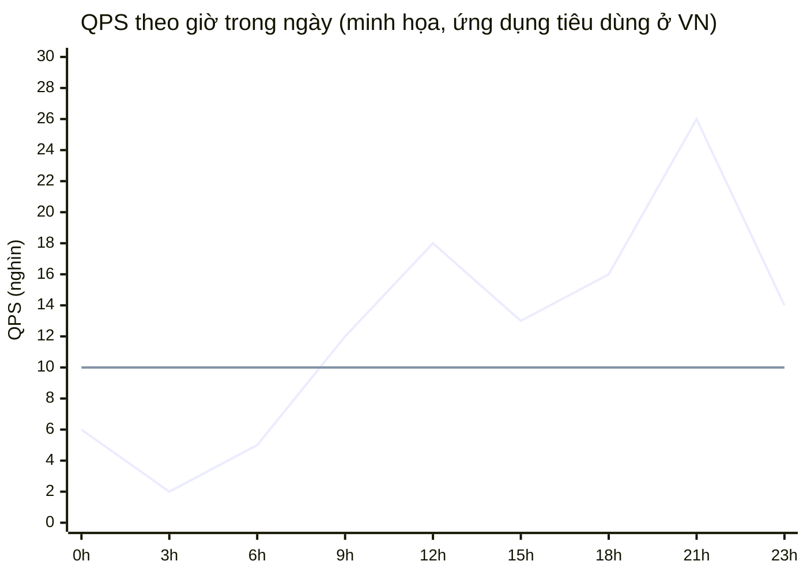

Đường phẳng là **trung bình** (10K). Đỉnh 21h là **2,6 lần** trung bình. Nếu bạn cấp phát theo trung bình, hệ thống sập mỗi tối.

| Loại traffic | Peak factor thường dùng |
|---|---|
| Ứng dụng tiêu dùng, một múi giờ (VN) | 2-3x |
| Toàn cầu, nhiều múi giờ | 1,5-2x (các đỉnh bù nhau) |
| Hệ thống nội bộ doanh nghiệp (giờ hành chính) | 3-5x |
| Chat, mạng xã hội buổi tối | 3-5x |
| Sự kiện: flash sale 12/12, mở bán vé concert, giao thừa | **10-100x** trong vài phút |
| Máy-sinh-ra (metrics, IoT, vị trí GPS) | 1-2x (ổn định) |

!!! tip "Hỏi về sự kiện đột biến"
    "Có những thời điểm traffic tăng đột biến không?" là câu hỏi giá trị cao. Với flash sale, peak factor quyết định **toàn bộ** kiến trúc (hàng đợi ảo, pre-scale, rate limit) - xem [Bài 14](./14-ticket-flash-sale.md).

### 5.5. Storage và tăng trưởng

```text
Storage / ngày = số bản ghi mới / ngày × kích thước 1 bản ghi
Storage tổng   = Storage / ngày × 365 × số năm × hệ số replication × hệ số overhead
```

**Ước lượng kích thước 1 bản ghi** bằng cách cộng từng trường:

| Trường | Kiểu | Byte |
|---|---|---|
| `message_id` | int64 / Snowflake | 8 |
| `conversation_id` | int64 | 8 |
| `sender_id` | int64 | 8 |
| `created_at` | timestamp | 8 |
| `body` | text, trung bình 100 ký tự UTF-8 (tiếng Việt có dấu ~1,3 byte/ký tự) | ~130 |
| metadata (trạng thái, cờ) | | ~20 |
| **Tổng dữ liệu** | | **~180 → làm tròn 200 B** |

Rồi nhân các hệ số "hay bị quên":

| Hệ số | Giá trị thường dùng | Ghi chú |
|---|---|---|
| Index | x1,2 - x2 | mỗi index phụ là một bản copy một phần dữ liệu |
| Replication | x3 (3 replica) / x1,5 (erasure coding cho object storage) | |
| Overhead lưu trữ (page, fragmentation, compaction LSM) | x1,2 - x1,5 | |
| Nén | /2 - /10 | text nén tốt, ảnh/video đã nén thì không |
| Tăng trưởng | (1 + g)^năm | 30%/năm → sau 3 năm gấp 2,2 lần |

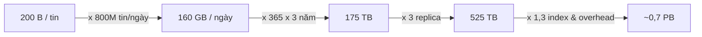

### 5.6. Bandwidth - nhớ nhân 8

```text
Ingress (vào)  = write QPS × kích thước request
Egress  (ra)   = read QPS × kích thước response
Gbps           = (byte/s × 8) / 10^9
```

Hai điều dễ sai: **byte vs bit** (NIC 10 Gbps chỉ chuyển ~1,25 GB/s), và **quên egress mới là thứ tốn tiền** (cloud thường tính phí dữ liệu đi ra internet, dữ liệu đi vào thường miễn phí). Với hệ thống ảnh/video, egress thường là **khoản chi phí lớn nhất** → CDN và nén ảnh/video là quyết định kinh tế, không chỉ kỹ thuật.

### 5.7. Cache sizing - quy tắc 80/20

Truy cập trong thực tế thường theo **phân phối Zipf**: một phần nhỏ dữ liệu nhận phần lớn traffic. Quy tắc ngón tay cái: **20% dữ liệu nhận 80% request**.

```text
Cache memory ≈ 20% × (số item được đọc / ngày) × kích thước item     (cận trên, kiểu Alex Xu)
             ≈ 20% × (số item unique) × kích thước item               (sát hơn nếu biết số unique)
```

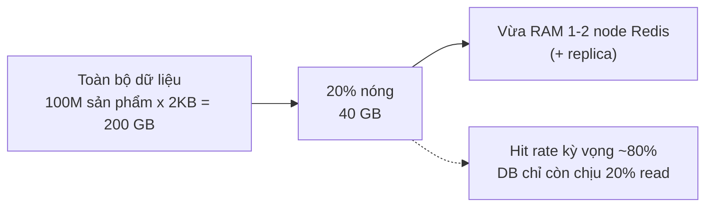

Câu hỏi quan trọng hơn "cache bao nhiêu GB" là: **hit rate kỳ vọng bao nhiêu, và DB có chịu được phần miss không?** Nếu read QPS đỉnh là 100K và hit rate 80%, DB vẫn phải chịu 20K QPS. Nếu cache chết và hit rate về 0, DB phải chịu 100K - có thể sập dây chuyền. Chi tiết ở [Bài 3](./03-building-blocks-data.md).

### 5.8. Số server và số kết nối đồng thời

**Theo QPS:**

```text
Số server = QPS đỉnh / (năng lực 1 server × utilization mục tiêu)
```

Utilization mục tiêu thường **50-70%**, không phải 100%. Lý do: (1) latency tăng vọt khi gần 100% (hàng đợi - xem [Systems Thinking Bài 4](../systems-thinking/04-mental-models.md)); (2) cần chỗ trống khi một server/AZ chết; (3) đỉnh thật cao hơn đỉnh ước lượng.

**Theo CPU** (khi biết thời gian CPU mỗi request):

```text
Request tốn 5 ms CPU → 1 core xử lý ~200 RPS
Server 16 core → ~3.200 RPS ở 100% → ~1.900 RPS ở 60%
```

**Theo redundancy giữa các AZ:**

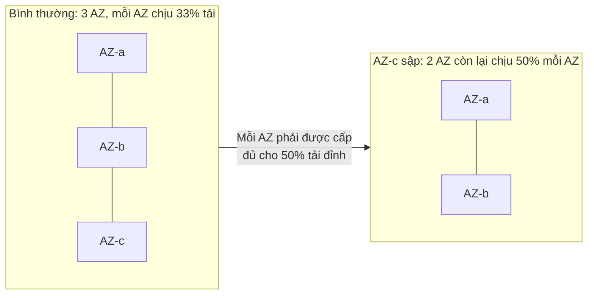

→ Tổng năng lực cần cấp = **150% tải đỉnh** nếu muốn sống sót khi mất 1 trong 3 AZ.

**Theo Little's law** (số thứ đang "ở trong hệ thống"):

```text
L = λ × W
L: số request đồng thời (concurrency)
λ: tốc độ đến (QPS)
W: thời gian mỗi request ở trong hệ thống (latency)

10.000 QPS × 0,2 s = 2.000 request đang được xử lý cùng lúc
```

Little's law cho bạn: số **thread/goroutine** cần, kích thước **connection pool** tới DB, số **kết nối WebSocket** đồng thời (với kết nối dài: L = số người online). Ví dụ: 2.000 request đồng thời, mỗi request giữ 1 kết nối DB trong 20 ms của 200 ms → cần ~2.000 × 0,1 = **200 kết nối DB**. Nếu pool chỉ 50 → request xếp hàng chờ kết nối, latency tăng vọt.

### 5.9. Kiểm tra lại (sanity check)

Sau khi tính, luôn hỏi 3 câu:

1. **So sánh với thứ đã biết**: "250K ghi/s - gấp ~25 lần một Postgres primary → chắc chắn cần cách khác."
2. **Đơn vị**: byte hay bit? Mỗi giây hay mỗi ngày? Trước hay sau replication?
3. **Số có "nói" điều gì không**: nếu con số không làm thay đổi quyết định nào, đừng mất thời gian tính chính xác hơn.

---

## 📖 6. Bốn drill ước lượng (tính tay đầy đủ)

Hãy tự làm từng drill trên giấy **trước khi đọc lời giải**. Sau đó so với output của script ở mục 7.

### 6.1. Drill 1 - Snapgram: mạng xã hội chia sẻ ảnh

**Giả định**: 50M DAU; mỗi người đăng 0,2 ảnh/ngày (2 MB sau nén, gồm cả các bản resize); xem 100 ảnh/ngày (mỗi ảnh hiển thị ~200 KB); peak factor 3; lưu 5 năm; object storage dùng erasure coding (hệ số 1,5); cache metadata ảnh 1 KB/item; app server 2.000 RPS.

<details markdown="1">
<summary>Lời giải</summary>

**QPS**

```text
Upload/ngày = 50M × 0,2           = 10M
Write QPS   = 10^7 / 86.400       ≈ 116      → peak × 3 ≈ 347
View/ngày   = 50M × 100           = 5 × 10^9
Read QPS    = 5×10^9 / 86.400     ≈ 57.900   → peak × 3 ≈ 173.600
Đọc : ghi   ≈ 500 : 1   → hệ thống thiên về đọc
```

**Storage**

```text
/ngày  = 10M × 2 MB               = 20 TB
/năm   = 20 TB × 365              = 7,3 PB
5 năm  = 36,5 PB × 1,5 (EC)       ≈ 54,8 PB
```

**Bandwidth**

```text
Ingress TB = 116 × 2 MB = 232 MB/s × 8      ≈ 1,9 Gbps
Egress đỉnh = 173.600 × 200 KB = 34,7 GB/s × 8 ≈ 278 Gbps
```

**Cache** (metadata, cận trên): 20% × 5×10^9 × 1 KB = **1 TB** → ~16 node Redis 64 GB (chưa tính replica). Thực tế số ảnh unique được xem mỗi ngày nhỏ hơn nhiều, nên đây là cận trên.

**Server**: (347 + 173.600) / (2.000 × 0,6) ≈ **145** app server.

**Kết luận dùng để thiết kế**:

1. Egress 278 Gbps → **bắt buộc CDN**; với cache hit ~95% ở CDN, origin chỉ còn ~14 Gbps.
2. 55 PB → **object storage**, không phải database. DB chỉ giữ metadata (10M bản ghi/ngày × ~1 KB = 10 GB/ngày - nhỏ).
3. 116 upload/s là ít → upload không phải nút thắt; **đọc feed** mới là nút thắt → deep dive vào feed & cache.

</details>

### 6.2. Drill 2 - Chat 20M DAU

**Giả định**: 20M DAU; mỗi người gửi 40 tin/ngày, đọc (tải về) 60 tin/ngày; tin 200 B khi lưu, 300 B trên đường truyền (kèm header, metadata); peak factor 5 (buổi tối); lưu 3 năm, 3 replica; 30% DAU online cùng lúc lúc đỉnh; một gateway giữ 50.000 kết nối; app server 5.000 RPS.

<details markdown="1">
<summary>Lời giải</summary>

**QPS**

```text
Tin gửi/ngày = 20M × 40         = 800M      → 800×10^6 / 86.400 ≈ 9.260/s   → peak ×5 ≈ 46.300/s
Tin đọc/ngày = 20M × 60         = 1,2 tỉ    → ≈ 13.900/s                    → peak ≈ 69.400/s
```

**Storage**

```text
/ngày = 800M × 200 B            = 160 GB
3 năm = 160 GB × 365 × 3        = 175 TB → × 3 replica ≈ 526 TB
```

**Bandwidth**: ingress 9.260 × 300 B × 8 ≈ **22 Mbps** - rất nhỏ. Egress đỉnh 69.400 × 200 B × 8 ≈ **111 Mbps**.

**Cache** (tin gần đây): 20% × 1,2 tỉ × 200 B = **48 GB** → vừa 1 node lớn, hoặc vài node nhỏ.

**Kết nối đồng thời**: 20M × 30% = **6M kết nối** → 6M / 50.000 = **120 gateway server**.

**App server**: (46.300 + 69.400) / (5.000 × 0,6) ≈ **39**.

**Kết luận**: bandwidth và storage **không phải** vấn đề. Nút thắt là **số kết nối dài (6M)** và việc **định tuyến tin nhắn tới đúng gateway** đang giữ kết nối người nhận → deep dive vào gateway, registry "user nào ở gateway nào", và xử lý reconnect storm khi một gateway chết (50K client kết nối lại cùng lúc). Xem [Bài 8](./08-chat-presence.md).

</details>

### 6.3. Drill 3 - Gọi xe: cập nhật vị trí tài xế

**Giả định**: 2M tài xế hoạt động/ngày, trung bình online 6 giờ, gửi vị trí mỗi 4 giây (100 B trên đường truyền, 50 B khi lưu lịch sử); 10M lượt khách tìm xe/ngày (response 2 KB); peak 2; lưu lịch sử 1 năm, 3 replica; 50% tài xế online lúc đỉnh; server xử lý vị trí 10.000 RPS.

<details markdown="1">
<summary>Lời giải</summary>

**QPS ghi vị trí**

```text
Mỗi tài xế: 6 × 3.600 / 4        = 5.400 cập nhật/ngày
Tổng:       2M × 5.400           = 10,8 tỉ/ngày
Write QPS:  10,8×10^9 / 86.400   = 125.000/s   → peak ×2 = 250.000/s
```

**QPS tìm xe**: 10M / 86.400 ≈ **116/s**, peak ≈ 231/s. → Tỉ lệ ghi : đọc ≈ **1000 : 1** - ngược với đa số hệ thống!

**Storage**

```text
Vị trí HIỆN TẠI: 2M tài xế × ~100 B         = 200 MB   ← vừa RAM của MỘT máy
Lịch sử/ngày:    10,8 tỉ × 50 B             = 540 GB
1 năm × 3 replica                           ≈ 591 TB
```

**Bandwidth**: 125.000 × 100 B × 8 = **100 Mbps** - nhỏ.

**Server**: 250.000 / (10.000 × 0,6) ≈ **42**. Kết nối: 1M tài xế online / 50.000 = **20 gateway**.

**Kết luận**: 250K ghi/s mà mỗi lần ghi vào một DB có transaction và index không gian → **không ổn**. Nhưng dữ liệu hiện tại chỉ 200 MB → giữ **vị trí hiện tại trong bộ nhớ** (Redis geo, hoặc in-memory index sharded theo vùng), còn lịch sử thì **ghi tuần tự vào log/stream** (Kafka) rồi lưu xuống storage rẻ, có thể **lấy mẫu** (sample) bớt. Deep dive: chỉ mục không gian và hot partition ở trung tâm thành phố. Xem [Bài 12](./12-ride-hailing-proximity.md).

</details>

### 6.4. Drill 4 - Hệ thống metrics

**Giả định**: 10.000 host, mỗi host 500 time series, gửi 1 điểm mỗi 10 giây; mỗi điểm ~60 B trên đường truyền (tên metric, label), lưu sau nén ~2 B/điểm; 1M query dashboard/ngày (response 50 KB); peak 1,5; giữ 1 năm, 3 replica; một ingest server xử lý 50.000 điểm/s.

<details markdown="1">
<summary>Lời giải</summary>

**QPS ghi (điểm dữ liệu)**

```text
Số series:   10.000 × 500             = 5M series
Điểm/series/ngày: 86.400 / 10         = 8.640
Tổng:        5M × 8.640               = 43,2 tỉ điểm/ngày
Write QPS:   43,2×10^9 / 86.400       = 500.000 điểm/s   → peak ×1,5 = 750.000/s
```

**Storage**

```text
Nén (~2 B/điểm):  43,2 tỉ × 2 B   = 86,4 GB/ngày  → 1 năm × 3 replica ≈ 94,6 TB
Không nén (16 B: timestamp 8 B + value 8 B) = 691 GB/ngày  → gấp 8 lần!
```

→ Nén kiểu delta-of-delta cho timestamp và XOR cho giá trị (ý tưởng từ paper Gorilla của Facebook) là **quyết định kiến trúc**, không phải tối ưu vặt. Xem [Bài 6](./06-specialized-storage.md).

**Bandwidth**: 500.000 × 60 B × 8 = **240 Mbps** ingress.

**Server**: (500.000 + 12) × 1,5 / (50.000 × 0,6) = 25,0006 → làm tròn lên **26** (hoặc 25 nếu làm tròn kiểu "bậc độ lớn" - đều được).

**Kết luận**: đọc gần như không đáng kể (12 query/s), nhưng **ghi rất cao và đều**. Thứ đáng lo khác: **cardinality** - 5M series, mỗi series cần một mục trong index (giả sử ~1 KB) → ~5 GB index trong RAM; nếu một team gắn label `user_id` vào metric, số series có thể nhảy lên hàng tỉ và làm sập hệ thống. Xem [Bài 16](./16-metrics-aggregation.md).

</details>

### 6.5. So sánh bốn drill - nút thắt khác nhau hoàn toàn

| Drill | Nút thắt chính | Hệ quả thiết kế |
|---|---|---|
| Snapgram | **Egress bandwidth** (278 Gbps) & storage (55 PB) | CDN, object storage, cache feed |
| Chat | **Số kết nối đồng thời** (6M) | Gateway WebSocket, routing, reconnect |
| Gọi xe | **Write QPS** (250K/s) với dữ liệu nhỏ | In-memory geo index, stream cho lịch sử |
| Metrics | **Write QPS đều** & **cardinality** | TSDB chuyên dụng, nén, giới hạn label |

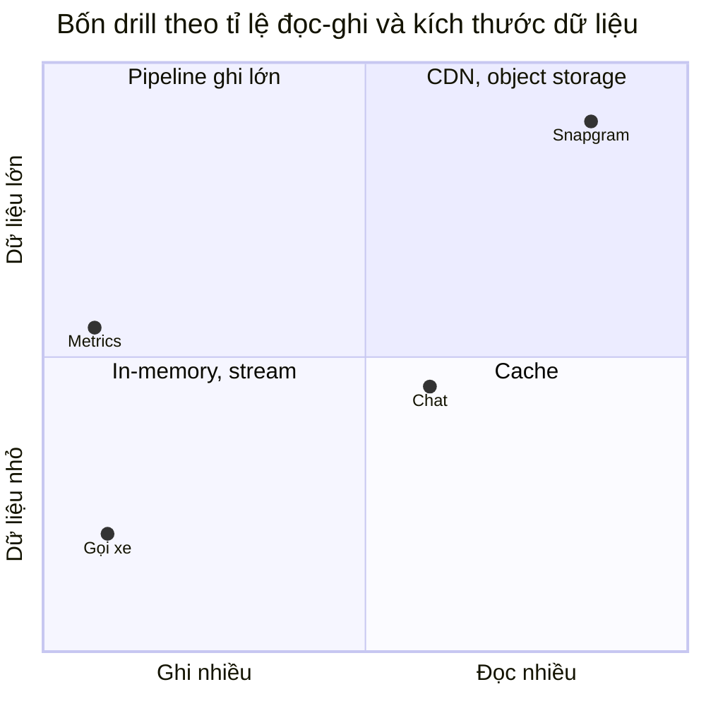

Đây là bài học lớn nhất của mục này: **cùng một "công thức ước lượng", mỗi bài toán lộ ra một nút thắt khác nhau**. Nếu bạn bỏ qua ước lượng, bạn sẽ deep dive nhầm chỗ.

---

## 📖 7. Script estimator - tự kiểm tra phép tính

Script dưới đây gói các công thức ở mục 5 thành một hàm. Mỗi drill là một bộ giả định. Bạn có thể sửa giả định (ví dụ DAU gấp đôi) và xem con số nào thay đổi đáng kể.

=== "Go"

    ```go
    package main

    import (
    	"fmt"
    	"math"
    )

    const day = 86_400.0 // giây/ngày

    type Workload struct {
    	Name            string
    	WritesPerDay    float64 // tổng số lần ghi/ngày
    	ReadsPerDay     float64 // tổng số lần đọc/ngày
    	WriteWireBytes  float64 // kích thước 1 lần ghi trên đường truyền
    	WriteStoreBytes float64 // kích thước lưu trữ của 1 lần ghi
    	ReadBytes       float64 // kích thước 1 response đọc
    	PeakFactor      float64 // đỉnh / trung bình
    	RetentionYears  float64
    	Replication     float64 // 3 bản = 3, erasure coding ~1.5
    	CacheItemBytes  float64
    	QPSPerServer    float64 // năng lực 1 server (đo bằng load test)
    	PeakConns       float64 // kết nối đồng thời lúc đỉnh (0 = không có)
    	ConnsPerServer  float64
    }

    func human(x float64) string {
    	for _, s := range []string{"", "K", "M", "B", "T"} {
    		if math.Abs(x) < 1000 {
    			if s == "" {
    				return fmt.Sprintf("%.0f", x)
    			}
    			return fmt.Sprintf("%.1f%s", x, s)
    		}
    		x /= 1000
    	}
    	return fmt.Sprintf("%.1fQ", x)
    }

    func humanUnit(x float64, units []string) string {
    	for _, u := range units[:len(units)-1] {
    		if math.Abs(x) < 1000 {
    			return fmt.Sprintf("%.1f %s", x, u)
    		}
    		x /= 1000
    	}
    	return fmt.Sprintf("%.1f %s", x, units[len(units)-1])
    }

    func humanBytes(b float64) string {
    	return humanUnit(b, []string{"B", "KB", "MB", "GB", "TB", "PB", "EB", "ZB"})
    }

    func humanBits(b float64) string {
    	return humanUnit(b, []string{"bps", "Kbps", "Mbps", "Gbps", "Tbps", "Pbps"})
    }

    func row(label string, value any) { fmt.Printf("  %-22s: %v\n", label, value) }

    func estimate(w Workload) {
    	const targetUtil, hotRatio = 0.6, 0.2
    	wq := w.WritesPerDay / day
    	rq := w.ReadsPerDay / day
    	storeDay := w.WritesPerDay * w.WriteStoreBytes
    	storeTotal := storeDay * 365 * w.RetentionYears * w.Replication
    	ingress := wq * w.WriteWireBytes * 8 // bit/s trung bình
    	egressPeak := rq * w.PeakFactor * w.ReadBytes * 8
    	cache := hotRatio * w.ReadsPerDay * w.CacheItemBytes
    	peakTotal := (wq + rq) * w.PeakFactor
    	servers := int(math.Ceil(peakTotal / (w.QPSPerServer * targetUtil)))

    	fmt.Printf("== %s ==\n", w.Name)
    	row("Write QPS avg / peak", human(wq)+" / "+human(wq*w.PeakFactor))
    	row("Read QPS avg / peak", human(rq)+" / "+human(rq*w.PeakFactor))
    	row("Storage per day", humanBytes(storeDay))
    	row(fmt.Sprintf("Storage %gy x%g", w.RetentionYears, w.Replication), humanBytes(storeTotal))
    	row("Ingress avg", humanBits(ingress))
    	row("Egress peak", humanBits(egressPeak))
    	row("Cache (20% of reads)", humanBytes(cache))
    	row("App servers @60%", servers)
    	if w.PeakConns > 0 {
    		row("Connection servers", int(math.Ceil(w.PeakConns/w.ConnsPerServer)))
    	}
    }

    func main() {
    	drills := []Workload{
    		// Drill 1: chia sẻ ảnh. 50M DAU, 0.2 ảnh đăng/người/ngày, xem 100 ảnh/người/ngày
    		{"Drill 1 - Snapgram (ảnh)", 50e6 * 0.2, 50e6 * 100,
    			2e6, 2e6, 200e3, 3, 5, 1.5, 1e3, 2000, 0, 1},
    		// Drill 2: chat. 20M DAU, gửi 40 tin, đọc 60 tin/người/ngày; 30% online lúc đỉnh
    		{"Drill 2 - Chat", 20e6 * 40, 20e6 * 60,
    			300, 200, 200, 5, 3, 3, 200, 5000, 20e6 * 0.3, 50_000},
    		// Drill 3: gọi xe. 2M tài xế, online 6h, gửi vị trí mỗi 4s; 10M lượt tìm xe/ngày
    		{"Drill 3 - Ride-hailing (vị trí)", 2e6 * 6 * 3600 / 4, 10e6,
    			100, 50, 2e3, 2, 1, 3, 100, 10000, 2e6 * 0.5, 50_000},
    		// Drill 4: metrics. 10k host x 500 series, mỗi 10s một điểm; 1M query/ngày
    		{"Drill 4 - Metrics", 10_000 * 500 * day / 10, 1e6,
    			60, 2, 50e3, 1.5, 1, 3, 50e3, 50000, 0, 1},
    	}
    	for _, d := range drills {
    		estimate(d)
    	}
    }

    // Output:
    // == Drill 1 - Snapgram (ảnh) ==
    //   Write QPS avg / peak  : 116 / 347
    //   Read QPS avg / peak   : 57.9K / 173.6K
    //   Storage per day       : 20.0 TB
    //   Storage 5y x1.5       : 54.8 PB
    //   Ingress avg           : 1.9 Gbps
    //   Egress peak           : 277.8 Gbps
    //   Cache (20% of reads)  : 1.0 TB
    //   App servers @60%      : 145
    // == Drill 2 - Chat ==
    //   Write QPS avg / peak  : 9.3K / 46.3K
    //   Read QPS avg / peak   : 13.9K / 69.4K
    //   Storage per day       : 160.0 GB
    //   Storage 3y x3         : 525.6 TB
    //   Ingress avg           : 22.2 Mbps
    //   Egress peak           : 111.1 Mbps
    //   Cache (20% of reads)  : 48.0 GB
    //   App servers @60%      : 39
    //   Connection servers    : 120
    // == Drill 3 - Ride-hailing (vị trí) ==
    //   Write QPS avg / peak  : 125.0K / 250.0K
    //   Read QPS avg / peak   : 116 / 231
    //   Storage per day       : 540.0 GB
    //   Storage 1y x3         : 591.3 TB
    //   Ingress avg           : 100.0 Mbps
    //   Egress peak           : 3.7 Mbps
    //   Cache (20% of reads)  : 200.0 MB
    //   App servers @60%      : 42
    //   Connection servers    : 20
    // == Drill 4 - Metrics ==
    //   Write QPS avg / peak  : 500.0K / 750.0K
    //   Read QPS avg / peak   : 12 / 17
    //   Storage per day       : 86.4 GB
    //   Storage 1y x3         : 94.6 TB
    //   Ingress avg           : 240.0 Mbps
    //   Egress peak           : 6.9 Mbps
    //   Cache (20% of reads)  : 10.0 GB
    //   App servers @60%      : 26
    ```

=== "Python"

    ```python
    import math
    from dataclasses import dataclass

    DAY = 86_400  # giây/ngày


    @dataclass
    class Workload:
        name: str
        writes_per_day: float     # tổng số lần ghi/ngày
        reads_per_day: float      # tổng số lần đọc/ngày
        write_wire_bytes: float   # kích thước 1 lần ghi trên đường truyền
        write_store_bytes: float  # kích thước lưu trữ của 1 lần ghi
        read_bytes: float         # kích thước 1 response đọc
        peak_factor: float        # đỉnh / trung bình
        retention_years: float
        replication: float        # hệ số nhân bản (3 bản = 3, erasure coding ~1.5)
        cache_item_bytes: float   # kích thước 1 item trong cache
        qps_per_server: float     # năng lực 1 server (đo bằng load test)
        peak_conns: float = 0     # số kết nối đồng thời lúc đỉnh (0 = không có)
        conns_per_server: float = 1


    def human(x, unit=""):
        for suffix in ["", "K", "M", "B", "T"]:
            if abs(x) < 1000:
                return f"{x:.1f}{suffix}{unit}" if suffix else f"{x:.0f}{unit}"
            x /= 1000
        return f"{x:.1f}Q{unit}"


    def human_bytes(b):
        for suffix in ["B", "KB", "MB", "GB", "TB", "PB", "EB"]:
            if abs(b) < 1000:
                return f"{b:.1f} {suffix}"
            b /= 1000
        return f"{b:.1f} ZB"


    def human_bits(bps):
        for suffix in ["bps", "Kbps", "Mbps", "Gbps", "Tbps"]:
            if abs(bps) < 1000:
                return f"{bps:.1f} {suffix}"
            bps /= 1000
        return f"{bps:.1f} Pbps"


    def row(label, value):
        print(f"  {label:<22}: {value}")


    def estimate(w: Workload, target_util=0.6, hot_ratio=0.2):
        wq = w.writes_per_day / DAY
        rq = w.reads_per_day / DAY
        store_day = w.writes_per_day * w.write_store_bytes
        store_total = store_day * 365 * w.retention_years * w.replication
        ingress = wq * w.write_wire_bytes * 8            # bit/s trung bình
        egress_peak = rq * w.peak_factor * w.read_bytes * 8
        cache = hot_ratio * w.reads_per_day * w.cache_item_bytes
        peak_total = (wq + rq) * w.peak_factor
        servers = math.ceil(peak_total / (w.qps_per_server * target_util))
        print(f"== {w.name} ==")
        row("Write QPS avg / peak", f"{human(wq)} / {human(wq * w.peak_factor)}")
        row("Read QPS avg / peak", f"{human(rq)} / {human(rq * w.peak_factor)}")
        row("Storage per day", human_bytes(store_day))
        row(f"Storage {w.retention_years:g}y x{w.replication:g}", human_bytes(store_total))
        row("Ingress avg", human_bits(ingress))
        row("Egress peak", human_bits(egress_peak))
        row("Cache (20% of reads)", human_bytes(cache))
        row("App servers @60%", servers)
        if w.peak_conns:
            row("Connection servers", math.ceil(w.peak_conns / w.conns_per_server))


    drills = [
        # Drill 1: chia sẻ ảnh. 50M DAU, 0.2 ảnh đăng/người/ngày, xem 100 ảnh/người/ngày
        Workload("Drill 1 - Snapgram (ảnh)", 50e6 * 0.2, 50e6 * 100,
                 2e6, 2e6, 200e3, 3, 5, 1.5, 1e3, 2000),
        # Drill 2: chat. 20M DAU, gửi 40 tin, đọc 60 tin/người/ngày; 30% online lúc đỉnh
        Workload("Drill 2 - Chat", 20e6 * 40, 20e6 * 60,
                 300, 200, 200, 5, 3, 3, 200, 5000,
                 peak_conns=20e6 * 0.3, conns_per_server=50_000),
        # Drill 3: gọi xe. 2M tài xế, online 6h, gửi vị trí mỗi 4s; 10M lượt tìm xe/ngày
        Workload("Drill 3 - Ride-hailing (vị trí)", 2e6 * 6 * 3600 / 4, 10e6,
                 100, 50, 2e3, 2, 1, 3, 100, 10000,
                 peak_conns=2e6 * 0.5, conns_per_server=50_000),
        # Drill 4: metrics. 10k host x 500 series, mỗi 10s một điểm; 1M query/ngày
        Workload("Drill 4 - Metrics", 10_000 * 500 * DAY / 10, 1e6,
                 60, 2, 50e3, 1.5, 1, 3, 50e3, 50000),
    ]

    for d in drills:
        estimate(d)

    # Output:
    # == Drill 1 - Snapgram (ảnh) ==
    #   Write QPS avg / peak  : 116 / 347
    #   Read QPS avg / peak   : 57.9K / 173.6K
    #   Storage per day       : 20.0 TB
    #   Storage 5y x1.5       : 54.8 PB
    #   Ingress avg           : 1.9 Gbps
    #   Egress peak           : 277.8 Gbps
    #   Cache (20% of reads)  : 1.0 TB
    #   App servers @60%      : 145
    # == Drill 2 - Chat ==
    #   Write QPS avg / peak  : 9.3K / 46.3K
    #   Read QPS avg / peak   : 13.9K / 69.4K
    #   Storage per day       : 160.0 GB
    #   Storage 3y x3         : 525.6 TB
    #   Ingress avg           : 22.2 Mbps
    #   Egress peak           : 111.1 Mbps
    #   Cache (20% of reads)  : 48.0 GB
    #   App servers @60%      : 39
    #   Connection servers    : 120
    # == Drill 3 - Ride-hailing (vị trí) ==
    #   Write QPS avg / peak  : 125.0K / 250.0K
    #   Read QPS avg / peak   : 116 / 231
    #   Storage per day       : 540.0 GB
    #   Storage 1y x3         : 591.3 TB
    #   Ingress avg           : 100.0 Mbps
    #   Egress peak           : 3.7 Mbps
    #   Cache (20% of reads)  : 200.0 MB
    #   App servers @60%      : 42
    #   Connection servers    : 20
    # == Drill 4 - Metrics ==
    #   Write QPS avg / peak  : 500.0K / 750.0K
    #   Read QPS avg / peak   : 12 / 17
    #   Storage per day       : 86.4 GB
    #   Storage 1y x3         : 94.6 TB
    #   Ingress avg           : 240.0 Mbps
    #   Egress peak           : 6.9 Mbps
    #   Cache (20% of reads)  : 10.0 GB
    #   App servers @60%      : 26
    ```

!!! tip "Dùng script để luyện cảm giác, không phải để thay tư duy"
    Trong phỏng vấn bạn không có script. Hãy làm drill **bằng tay trước**, rồi chạy script để kiểm tra. Sau 10-15 lần, bạn sẽ tính nhẩm được "1 tỉ/ngày ≈ 12K/s" mà không cần nghĩ.

Thử nghiệm gợi ý:

- Drill 1: đổi peak factor từ 3 thành 10 (sự kiện viral). Số server và egress tăng thế nào?
- Drill 2: đổi `conns_per_server` từ 50.000 thành 500.000 (gateway được tune kỹ). Nút thắt chuyển sang đâu?
- Drill 4: đổi `write_store_bytes` từ 2 thành 16 (không nén). Storage 1 năm là bao nhiêu?

---

## 📖 8. Sai lầm ước lượng thường gặp

| Sai lầm | Ví dụ | Cách tránh |
|---|---|---|
| **Nhầm bit và byte** | "NIC 10 Gbps chuyển được 10 GB/s" | Bandwidth mạng luôn × 8; 10 Gbps ≈ 1,25 GB/s |
| **Chỉ tính trung bình** | Cấp phát cho 10K QPS, tối nào cũng sập lúc 26K | Luôn có peak factor, hỏi về sự kiện đột biến |
| **Quên replication & index** | "Storage 175 TB" trong khi thực tế ~0,7 PB | Nhân hệ số replica, index, overhead |
| **Quên tăng trưởng** | Thiết kế vừa đủ cho hôm nay | Tính cho 2-3 năm; 30%/năm → x2,2 sau 3 năm |
| **Nhầm DAU và MAU / tổng user** | Lấy 100M người đăng ký làm DAU | Hỏi rõ; DAU thường chỉ 10-50% MAU |
| **Tính chính xác vô ích** | Mất 5 phút tính 57.870,37 QPS | Làm tròn: ~60K |
| **Tính xong rồi bỏ đó** | Ra con số nhưng không rút ra kết luận | Mỗi con số phải kết thúc bằng "→ vì vậy ..." |
| **Coi utilization 100%** | 100K QPS / 2K mỗi server = 50 server | Chia thêm cho 0,5-0,7; cộng dự phòng AZ |
| **Bỏ qua kết nối đồng thời** | Chat chỉ tính QPS | Dùng Little's law / tỉ lệ online cho kết nối dài |
| **Một request = một query DB** | Feed 1 request nhưng gọi 50 query | Ước lượng **fan-out** nội bộ |
| **Sai đơn vị thời gian** | Chia cho 3.600 thay vì 86.400 | Viết rõ đơn vị bên cạnh mỗi con số |

!!! warning "Sai lầm nguy hiểm nhất: ước lượng để 'trình diễn'"
    Ước lượng mà không dẫn tới **quyết định** là lãng phí thời gian phỏng vấn. Mỗi con số nên kết thúc bằng một câu như: *"→ vừa RAM một máy, không cần shard"*, *"→ cần CDN"*, *"→ một primary không chịu nổi, cần partition"*.

---

## 📖 9. Trình bày trade-off

Mọi quyết định thiết kế đều có giá. Người phỏng vấn muốn nghe bạn **chủ động nói ra giá** trước khi họ hỏi.

### 9.1. Công thức 4 phần

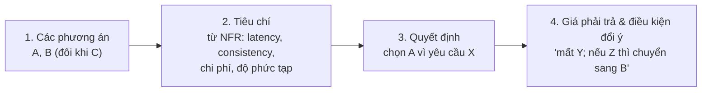

**Ví dụ**: lưu tin nhắn chat.

| Tiêu chí | A. PostgreSQL shard theo `conversation_id` | B. Wide-column (Cassandra/ScyllaDB) |
|---|---|---|
| Ghi 46K/s lúc đỉnh | Cần nhiều shard, tự quản lý shard | Thiết kế cho ghi nhiều, scale ngang dễ |
| Đọc "50 tin mới nhất của cuộc chat" | Tốt với index `(conversation_id, seq)` | Rất tốt: partition key + clustering key |
| Transaction nhiều bảng | Có | Hạn chế |
| Đội ngũ đã quen | Thường có | Có thể chưa |
| Vận hành | Quen thuộc, nhưng resharding đau | Cần kinh nghiệm riêng (compaction, repair) |

> *"Mình chọn **B** vì access pattern chủ yếu là ghi append và đọc theo cuộc hội thoại, không cần transaction nhiều bảng, và 46K ghi/s lúc đỉnh với tăng trưởng 30%/năm sẽ khiến việc tự shard Postgres tốn công vận hành. **Giá phải trả**: team cần học vận hành Cassandra, và các truy vấn ad-hoc (thống kê) phải đẩy sang kho dữ liệu riêng. **Nếu** quy mô chỉ 1M DAU, mình sẽ chọn Postgres - đơn giản hơn nhiều."*

Câu cuối - **"nếu ... thì mình chọn khác"** - là dấu hiệu rõ nhất của tư duy senior: bạn hiểu quyết định **phụ thuộc vào yêu cầu**, không phải "công nghệ X tốt hơn Y".

### 9.2. Các trục trade-off kinh điển

| Trục | Một đầu | Đầu kia |
|---|---|---|
| Consistency ↔ Availability/Latency | Strong, đọc luôn mới | Eventual, nhanh, chịu được phân vùng mạng |
| Push ↔ Pull | Tính trước khi ghi (fan-out on write) | Tính khi đọc (fan-out on read) |
| Đơn giản ↔ Linh hoạt | Monolith, 1 DB | Microservices, nhiều storage |
| Chi phí ↔ Hiệu năng | Ít server, latency cao hơn | Nhiều cache/replica, tốn tiền |
| Độ chính xác ↔ Tốc độ | Đếm chính xác | Đếm xấp xỉ (HyperLogLog, sampling) |
| Normalize ↔ Denormalize | Một nguồn sự thật, join khi đọc | Copy dữ liệu, đọc nhanh, khó cập nhật |
| Sync ↔ Async | Đơn giản, biết kết quả ngay | Chịu tải đỉnh tốt, phức tạp hơn, eventual |

### 9.3. ADR thu nhỏ trên bảng trắng

Khi có quyết định quan trọng, viết một dòng ở góc bảng:

```text
ADR-1: Lưu tin nhắn ở wide-column store
  vì: ghi nhiều, đọc theo partition, không cần join
  mất: transaction đa bảng, query ad-hoc
  xem lại khi: cần tìm kiếm full-text trong tin nhắn (→ thêm search index)
```

Trong dự án thật, đây chính là **Architecture Decision Record** - xem [Systems Thinking Bài 6](../systems-thinking/06-idea-to-architecture.md).

---

## 🌍 Ứng dụng thực tế

- **Capacity planning hằng quý**: các team hạ tầng làm đúng những phép tính ở mục 5, nhưng với số liệu thật từ metrics (QPS đỉnh thực tế, tăng trưởng thực tế), để quyết định mua/thuê thêm bao nhiêu máy trước mùa cao điểm (Tết, 11/11, 12/12).
- **Design doc / RFC**: hầu hết công ty công nghệ có template design doc với mục "Requirements", "Non-goals", "Capacity estimates", "Alternatives considered". Framework ở bài này chính là template đó, rút gọn cho 45 phút.
- **Dự toán chi phí cloud**: storage và egress ước lượng ở drill 1 dịch thẳng thành tiền. Khi egress hàng trăm Gbps, quyết định dùng CDN, nén ảnh định dạng mới (WebP/AVIF), hay giảm chất lượng ảnh thumbnail có thể tiết kiệm rất lớn.
- **Viết SLO**: các NFR có số ở mục 4 trở thành SLO, gắn với alert và error budget ([Backend Bài 11](../backend/11-observability-reliability.md)).
- **Phỏng vấn**: hầu hết vòng system design ở công ty product đánh giá theo các tín hiệu ở mục 1. Bài 17 có rubric chi tiết theo level.

---

## ⚠️ Sai lầm thường gặp

1. **Vẽ trước, hỏi sau**: thiết kế cho bài toán bạn tưởng tượng, không phải bài toán được hỏi.
2. **Hỏi quá nhiều**: 15 phút hỏi yêu cầu, không còn thời gian thiết kế. Chọn 5-8 câu quan trọng, phần còn lại **tự giả định**.
3. **NFR không có số**: "hệ thống cần highly available" - không giúp quyết định gì.
4. **Một mức consistency cho cả hệ thống**: "toàn bộ dùng strong consistency" → đắt và chậm không cần thiết; hoặc "toàn bộ eventual" → sai cho số dư ví.
5. **Ước lượng không dẫn tới kết luận**: tính xong không dùng.
6. **Deep dive phần dễ**: dành 15 phút giải thích load balancer round robin, né phần fan-out cho người có 10M follower.
7. **Không quản lý thời gian**: tới phút 40 vẫn đang vẽ kiến trúc tổng thể. Đeo đồng hồ, hoặc hỏi người phỏng vấn "còn khoảng bao nhiêu phút ạ?".
8. **Liệt kê công nghệ thay vì giải thích**: "dùng Kafka, Redis, Cassandra, Kubernetes" mà không nói **vì sao** và **thay được bằng gì**.
9. **Chỉ nói ưu điểm**: không nêu giá phải trả của lựa chọn → người phỏng vấn sẽ tự hỏi, và bạn mất điểm chủ động.
10. **Im lặng**: suy nghĩ trong đầu 3 phút. Hãy nói "mình đang cân nhắc giữa A và B, để mình nghĩ thành tiếng..."

---

## 🏋️ Bài tập

### Bài 1 (Dễ) - Đổi availability ra downtime

SLO của API thanh toán là 99,95%/tháng. Trong tháng này đã có một sự cố kéo dài 15 phút. Hỏi còn bao nhiêu error budget (phút)? Có nên deploy một thay đổi lớn rủi ro cao vào cuối tháng không?

<details markdown="1">
<summary>Đáp án</summary>

Error budget / tháng (30 ngày) = 0,05% × 43.200 phút = **21,6 phút**. Đã dùng 15 phút → còn **~6,6 phút**.

Một thay đổi lớn có rủi ro gây downtime vài phút có thể "đốt" hết budget. Theo chính sách error budget thông thường: **hoãn** thay đổi rủi ro cao sang đầu tháng sau, hoặc triển khai rất thận trọng (canary nhỏ, rollback tự động, feature flag). Đây đúng là mục đích của error budget: biến "có nên deploy không" thành quyết định dựa trên số.

</details>

### Bài 2 (Dễ) - QPS từ request/ngày

Một dịch vụ nhận 300 triệu request/ngày, peak factor 4. Tính QPS trung bình và đỉnh, bằng (a) phép chia chính xác cho 86.400 và (b) xấp xỉ 10^5. Sai số của (b) có làm thay đổi quyết định không?

<details markdown="1">
<summary>Đáp án</summary>

(a) 3×10^8 / 86.400 ≈ **3.472 QPS**, đỉnh ≈ **13.900 QPS**.

(b) 3×10^8 / 10^5 = **3.000 QPS**, đỉnh **12.000 QPS**.

Sai số ~14%. Không làm thay đổi quyết định: cả hai đều nói "vài nghìn QPS trung bình, hơn 10K lúc đỉnh → vài chục app server, một DB primary có thể chịu nếu phần lớn đọc được cache". Trong phỏng vấn, dùng (b) cho nhanh và nói rõ là xấp xỉ.

</details>

### Bài 3 (Trung bình) - Little's law và connection pool

Một service nhận 8.000 QPS lúc đỉnh, latency trung bình 120 ms. Trong mỗi request, service giữ kết nối DB trung bình 30 ms. Service chạy 20 instance.

1. Có bao nhiêu request đồng thời trên toàn hệ thống? Trên mỗi instance?
2. Cần tổng cộng bao nhiêu kết nối DB đang được dùng cùng lúc? Pool mỗi instance nên đặt khoảng bao nhiêu?
3. DB chỉ cho phép tối đa 500 kết nối. Có vấn đề gì không?

<details markdown="1">
<summary>Đáp án</summary>

1. L = 8.000 × 0,12 = **960** request đồng thời; mỗi instance ≈ 48.
2. Kết nối DB bận cùng lúc = 8.000 × 0,03 = **240** tổng; mỗi instance ≈ 12. Đặt pool ~ **20-25/instance** để có khoảng đệm cho dao động (traffic không đều, latency DB tăng khi tải cao).
3. 20 instance × 25 = 500 - **vừa chạm giới hạn**. Nếu autoscale lên 30 instance, tổng pool = 750 > 500 → lỗi kết nối. Giải pháp: dùng **connection pooler** (PgBouncer) đứng giữa, giảm pool mỗi instance, hoặc tính lại pool theo số instance tối đa. Đây là lỗi production rất phổ biến khi autoscaling.

</details>

### Bài 4 (Trung bình) - Storage cho hệ thống bình luận

Một trang tin tức có 10M DAU, mỗi người viết trung bình 0,5 bình luận/ngày, mỗi bình luận trung bình 300 B dữ liệu. Có 2 index phụ (hệ số index ×1,4), 3 replica, tăng trưởng 40%/năm. Ước lượng storage cần cho 3 năm.

<details markdown="1">
<summary>Đáp án</summary>

```text
Bình luận/ngày năm 1 = 10M × 0,5 = 5M
/ngày = 5M × 300 B = 1,5 GB  → năm 1 ≈ 1,5 × 365 ≈ 548 GB
Năm 2 ≈ 548 × 1,4 ≈ 767 GB ; Năm 3 ≈ 767 × 1,4 ≈ 1.074 GB
Tổng dữ liệu 3 năm ≈ 548 + 767 + 1.074 ≈ 2,4 TB
× 1,4 (index) × 3 (replica) ≈ 10 TB
```

**Kết luận**: ~10 TB sau 3 năm (cả replica) → mỗi replica ~3,3 TB. Vẫn vừa **một cụm PostgreSQL** (1 primary + 2 replica) với SSD lớn - **chưa cần sharding**. Có thể partition bảng theo thời gian để dễ archive bình luận cũ.

</details>

### Bài 5 (Trung bình) - Tail latency với fan-out

Trang chủ e-commerce gọi song song 20 service (gợi ý, giỏ hàng, khuyến mãi...). Mỗi service có p99 = 80 ms, p50 = 15 ms. Trang phải chờ tất cả service.

1. Xác suất một lần tải trang có ít nhất một service vượt 80 ms?
2. Đề xuất 3 cách giảm.

<details markdown="1">
<summary>Đáp án</summary>

1. 1 - 0,99^20 ≈ **18,2%** - gần 1/5 lượt tải trang bị kéo chậm bởi đuôi của ít nhất một service.
2. Cách giảm:
    - **Timeout + degrade**: service không quan trọng (gợi ý) quá 50 ms thì bỏ qua, hiển thị khối mặc định.
    - **Hedged request**: với service quan trọng có replica, gửi bản sao thứ hai nếu sau ~p95 chưa có trả lời.
    - **Giảm fan-out**: gộp dữ liệu ít thay đổi vào cache tổng hợp (một lần gọi thay vì 5), hoặc render phần ít quan trọng sau (lazy load phía client).
    - Giảm tail của chính từng service (GC pause, cold cache, noisy neighbor).

</details>

### Bài 6 (Khó) - Flash sale

Một sàn TMĐT mở bán 10.000 điện thoại giá sốc lúc 12:00. Dự kiến 2 triệu người mở app trong 60 giây đầu, mỗi người bấm "Mua" trung bình 3 lần (bấm lại khi chậm), mỗi lần bấm app gọi 2 API (kiểm tra tồn kho, đặt hàng). Ngày thường hệ thống chịu 5.000 QPS.

1. Ước lượng QPS đỉnh trong phút đầu. Gấp bao nhiêu lần ngày thường?
2. Bao nhiêu request trong số đó là "có ích"?
3. Con số này gợi ý gì về kiến trúc?

<details markdown="1">
<summary>Đáp án</summary>

1. 2M × 3 × 2 = 12M request trong 60 s → trung bình **200.000 QPS** trong phút đầu (và giây đầu còn cao hơn nhiều vì mọi người bấm đúng 12:00:00). Gấp **40 lần** ngày thường - và đỉnh tức thời có thể gấp 100+ lần.
2. Chỉ có **10.000** đơn thành công. Tỉ lệ request có ích ≈ 10.000 / 12M ≈ **0,08%**.
3. Gợi ý:
    - **Không** cho 200K QPS chạm vào DB tồn kho. Chặn từ sớm: **hàng đợi ảo (virtual waiting room)**, rate limit theo user, CDN/edge trả trang tĩnh.
    - **Tồn kho nóng** (1 SKU = 1 hot key): trừ trong bộ nhớ (Redis với thao tác nguyên tử) hoặc chia tồn kho thành nhiều "bucket", rồi ghi bền vững bất đồng bộ.
    - Khi hết hàng, trả "hết hàng" **ngay ở edge** để cắt 99,9% traffic vô ích.
    - **Idempotency** cho nút "Mua" vì người dùng bấm lại nhiều lần.
    - Pre-scale trước 12:00, không trông vào autoscaling (quá chậm cho đỉnh vài giây).
    Xem chi tiết ở [Bài 14](./14-ticket-flash-sale.md).

</details>

### Bài 7 (Khó) - Tìm lỗi trong bản ước lượng

Một ứng viên ước lượng cho dịch vụ video ngắn như sau. Tìm ít nhất 4 lỗi.

```text
100M người dùng đăng ký → DAU = 100M
Mỗi người xem 30 video/ngày, mỗi video 10 MB
Read QPS = 100M × 30 / 3.600 = 833K
Egress = 833K × 10 MB = 8,3 TB/s = 8,3 Tbps
Storage: 1M video upload/ngày × 10 MB = 10 TB/ngày → 3,6 PB/năm. Xong.
Cần 833K / 1.000 = 833 server.
```

<details markdown="1">
<summary>Đáp án</summary>

1. **DAU = số đăng ký**: sai; DAU thường chỉ 10-50% tổng đăng ký. Phải hỏi hoặc giả định (vd 30M DAU).
2. **Chia 3.600** (giây/giờ) thay vì **86.400** (giây/ngày) → QPS sai 24 lần.
3. **Byte → bit**: 8,3 TB/s = **66 Tbps**, không phải 8,3 Tbps (nếu con số gốc đúng).
4. **Không có peak factor**.
5. **Storage quên replication / nhiều độ phân giải**: video thường được transcode ra nhiều bitrate (vd 4-6 bản) → storage gấp vài lần; cộng replication/erasure coding.
6. **Server tính trên egress video**: video được phục vụ từ **CDN**, không phải từ app server; app server chỉ phục vụ API (metadata, feed). Phải tách "API QPS" và "bytes qua CDN".
7. **Không có kết luận**: không nói con số dẫn đến quyết định gì (CDN, chi phí egress, transcoding pipeline).

</details>

### Bài 8 (Khó) - Viết bảng NFR

Viết bảng NFR (theo mẫu mục 4.6) cho một **ứng dụng giao đồ ăn** ở Việt Nam: 3M DAU, giờ cao điểm trưa (11h-13h) và tối (18h-20h). Phân biệt mức consistency cho ít nhất 4 tính năng.

<details markdown="1">
<summary>Đáp án (một phương án)</summary>

| Thuộc tính | Mục tiêu |
|---|---|
| Quy mô | 3M DAU, ~1,5M đơn/ngày, tăng 25%/năm |
| Throughput | Đặt đơn: 1,5M/86.400 ≈ 17/s TB; peak trưa ×6 ≈ 100/s. Xem menu/tìm quán: ~50 lượt/người → ~1.700 QPS TB, ~10K peak |
| Latency | p99 tìm quán < 300 ms; p99 đặt đơn < 1 s (gồm gọi cổng thanh toán); vị trí shipper cập nhật trên bản đồ < 3 s |
| Availability | Đặt đơn 99,95% trong giờ cao điểm; xem menu 99,9% (có thể phục vụ từ cache khi DB lỗi) |
| Durability | Đơn hàng và giao dịch đã xác nhận: không mất (RPO = 0) |
| RPO / RTO | Đơn hàng RPO 0, RTO < 15 phút; vị trí shipper RPO vài giây (mất cũng không sao) |
| Ràng buộc | Dữ liệu cá nhân lưu tại VN; tích hợp ví điện tử và cổng thanh toán nội địa |

Consistency theo tính năng:

| Tính năng | Mức |
|---|---|
| Thanh toán, trạng thái đơn (đã nhận / đã hủy) | Strong (một nguồn sự thật, transaction) |
| Gán shipper cho đơn | Strong - không được gán 2 shipper cho 1 đơn, hoặc 1 shipper nhận 2 đơn trùng giờ quá giới hạn |
| Người đặt xem đơn của mình | Read-your-writes |
| Menu, giá món | Eventual (cập nhật trong vài phút chấp nhận được), nhưng **giá tại lúc đặt** phải chốt trong đơn |
| Vị trí shipper | Eventual, chỉ cần bản mới nhất |
| Đánh giá, số sao của quán | Eventual |

</details>

---

## ✅ Checklist

- [ ] Tôi kể được 6 giai đoạn và timebox cho buổi 45 phút
- [ ] Tôi biết chốt phạm vi bằng cách **đề xuất** thay vì hỏi trống, và tự đưa giả định có số khi được bảo "tự giả định"
- [ ] Tôi viết được NFR có số: p99, availability, durability, RPO/RTO, consistency theo tính năng
- [ ] Tôi đổi được 99,9% / 99,99% ra downtime/tháng mà không cần tra
- [ ] Tôi giải thích được tại sao fan-out làm tail latency tệ hơn (1 - 0,99^N)
- [ ] Tôi thuộc: 86.400 ≈ 10^5, 1 tỉ/ngày ≈ 12K/s, 2^10/2^20/2^30/2^32, RAM vs SSD vs mạng vs liên lục địa
- [ ] Tôi ước lượng được QPS đỉnh, storage (có replica, index, tăng trưởng), bandwidth (nhân 8), cache (80/20), số server (utilization 60%, dự phòng AZ)
- [ ] Tôi dùng Little's law để tính concurrency và connection pool
- [ ] Tôi làm được 4 drill bằng tay và chạy script estimator để kiểm tra
- [ ] Mỗi con số tôi tính đều kết thúc bằng một **kết luận thiết kế**
- [ ] Tôi trình bày trade-off theo công thức: phương án → tiêu chí → quyết định → giá phải trả & khi nào đổi ý

---

**Bài tiếp theo**: [Bài 2: Building blocks - mạng, LB, CDN, gateway](./02-building-blocks-network.md)
