# 📚 Bài 2: Building blocks - mạng, LB, CDN, gateway

> "Mạng là đáng tin cậy, độ trễ bằng 0, băng thông vô hạn..." - ba trong tám **"ngộ nhận về hệ phân tán"** (Fallacies of Distributed Computing, L. Peter Deutsch và các đồng nghiệp ở Sun)

Tối thứ Bảy, chị Mai ở Hà Nội mở app xem phim, bấm vào một bộ phim mới. Trong khoảng 300 ms trước khi poster và đoạn giới thiệu hiện ra, request của chị đã đi qua:

1. Một **DNS resolver** để biết `api.phim.vn` là địa chỉ IP nào - và nhờ **GeoDNS**, chị nhận IP của cụm máy ở Hà Nội chứ không phải TP.HCM.
2. Một **CDN edge** gần nhà chị đã có sẵn poster - không cần đi về origin.
3. Một **load balancer L4** nhận kết nối TCP, rồi một **API gateway** (L7) kiểm tra token, rate limit, định tuyến `/v1/movies/*` tới service phim.
4. Service phim tìm địa chỉ của service gợi ý qua **service discovery**, gọi nó qua một **kết nối HTTP/2 đã mở sẵn**.

Mỗi "hộp" ở trên có cách hỏng riêng, giới hạn riêng, và trade-off riêng. Bài này mổ xẻ từng hộp - đủ sâu để bạn **chọn đúng** và **giải thích được** trong phỏng vấn lẫn khi vận hành thật.

## 🎯 Mục tiêu bài học

- Vẽ được **đường đi đầy đủ của một request** từ người dùng tới service và biết mỗi tầng làm gì
- Hiểu **DNS** sâu hơn mức "tên → IP": TTL trade-off, GeoDNS, latency/weighted routing, giới hạn của DNS failover
- Phân biệt **L4 vs L7 load balancer** ở mức cơ chế (NAT, DSR, TLS termination, cân bằng theo request vs theo kết nối)
- So sánh các **thuật toán cân bằng tải** bằng **mô phỏng chạy được**: round robin, random, least connections, power of two choices, consistent hash
- Thiết kế **health check** không gây sập dây chuyền; hiểu sticky session, connection draining
- Hiểu **global load balancing**, **anycast**
- Dùng **CDN** đúng: push vs pull, cache key, Cache-Control, invalidation, edge compute
- Phân biệt **reverse proxy, API gateway, BFF, service mesh**
- Quản lý **kết nối**: keep-alive, HTTP/2 multiplexing, gRPC và vấn đề L4, **WebSocket kết nối dài** và load balancer
- Hiểu **service discovery** client-side vs server-side

!!! note "Kiến thức nền"
    [Backend Bài 1](../backend/01-how-the-web-works.md) đã giải thích DNS, TCP, TLS, HTTP/1.1/2/3 ở mức cơ bản. [Backend Bài 10 §5-6](../backend/10-system-design.md) giới thiệu L4/L7 và CDN. Bài này **không nhắc lại định nghĩa**, mà tập trung vào cơ chế, giới hạn và trade-off ở quy mô lớn.

---

## 📖 1. Bức tranh tổng thể: một request đi qua những đâu?

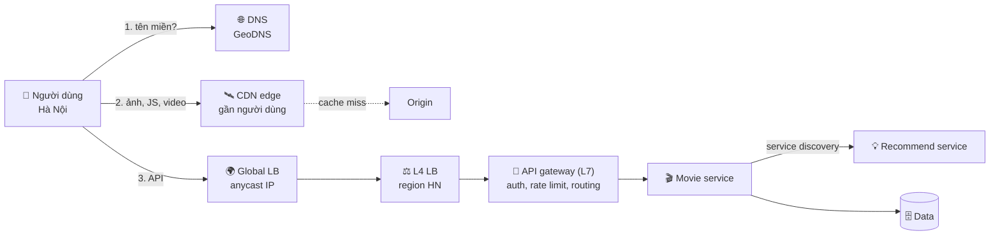

Chia theo hướng traffic:

| Loại traffic | Mô tả | Thành phần điển hình |
|---|---|---|
| **North-south** | Từ internet vào hệ thống | DNS, CDN, global LB, L4/L7 LB, API gateway, WAF |
| **East-west** | Giữa các service bên trong | Service discovery, client-side LB, service mesh (sidecar) |

Mỗi tầng tồn tại vì một lý do cụ thể. Nếu không có lý do - **bỏ tầng đó đi**. Mỗi hop thêm vào là thêm latency, thêm một thứ có thể hỏng, thêm chi phí.

---

## 📖 2. DNS - danh bạ điện thoại của internet

### 2.1. Quá trình phân giải và những chỗ cache

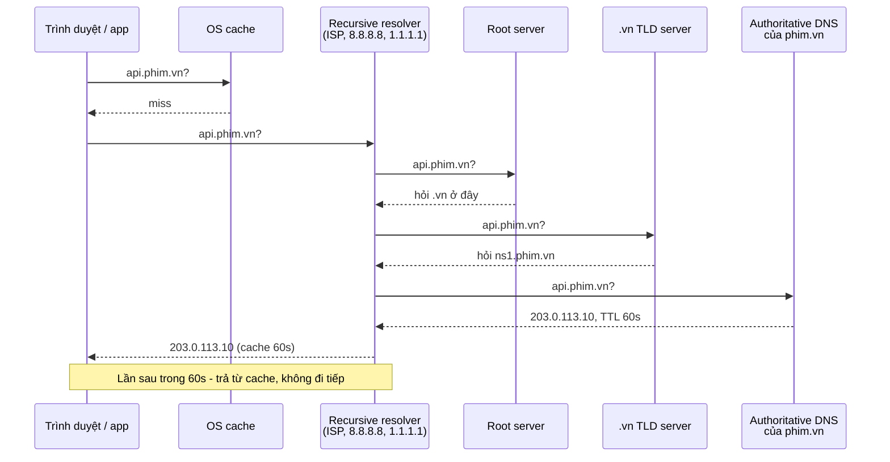

Có **ít nhất 4 tầng cache**: trình duyệt, OS, recursive resolver, (đôi khi) app/thư viện HTTP. Điều này quan trọng cho failover: khi bạn đổi bản ghi DNS, **bạn không kiểm soát được** lúc nào mọi client thấy giá trị mới.

### 2.2. TTL - đánh đổi giữa tốc độ failover và tải/độ trễ

| TTL | Ưu điểm | Nhược điểm | Dùng khi |
|---|---|---|---|
| Ngắn (30-60 s) | Failover / đổi IP nhanh | Nhiều query DNS hơn (thêm latency cho lần đầu, thêm chi phí), phụ thuộc DNS provider nhiều hơn | Endpoint cần failover, đang migrate |
| Dài (1-24 h) | Ít query, nhanh hơn, chịu được DNS provider sập tạm thời | Đổi IP mất hàng giờ mới lan hết | Bản ghi ổn định (MX, NS) |

!!! warning "TTL không phải lời hứa"
    Một số resolver và client **không tôn trọng TTL** (cache lâu hơn, hoặc ứng dụng tự cache vô hạn - một số phiên bản JVM cũ mặc định cache DNS rất lâu). Vì vậy **DNS failover không bao giờ tức thì** - hãy coi nó là cơ chế "phút", không phải "giây". Muốn failover trong vài giây, dùng **anycast** hoặc LB có IP cố định đứng trước.

**Mẹo khi migrate**: vài ngày trước khi đổi IP, **hạ TTL** từ 1 giờ xuống 60 giây; đổi IP; theo dõi; sau khi ổn định thì **nâng TTL** trở lại.

### 2.3. Các kiểu định tuyến bằng DNS

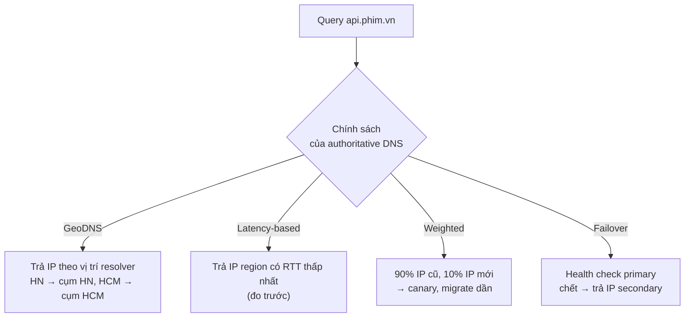

| Kiểu | Dùng cho | Lưu ý |
|---|---|---|
| **GeoDNS** | Đưa người dùng về region gần nhất, **data residency** (người dùng EU → region EU) | Dựa vào vị trí **resolver**, không phải người dùng (xem dưới) |
| **Latency-based** | Đa region, tối ưu tốc độ | Cần dữ liệu đo RTT |
| **Weighted** | Canary hạ tầng, migrate dần giữa hai hệ thống | Tỉ lệ không chính xác do cache |
| **Failover** | DR active-passive | Chậm (TTL + cache) |
| **Multi-value / round robin** | Phân tải thô giữa nhiều IP | Không biết tải thực tế; client có thể dính một IP |

**Vấn đề "vị trí resolver"**: người dùng ở Hà Nội dùng resolver công cộng có máy chủ ở Singapore → GeoDNS nghĩ người dùng ở Singapore. Extension **EDNS Client Subnet (ECS)** cho phép resolver gửi kèm một phần IP của client để authoritative DNS đoán đúng hơn (không phải resolver nào cũng hỗ trợ, và có cân nhắc về quyền riêng tư).

### 2.4. DNS là một single point of failure

Nếu nhà cung cấp DNS của bạn sập (đã từng xảy ra với các DDoS lớn vào nhà cung cấp DNS), **toàn bộ** dịch vụ của bạn "biến mất" dù server vẫn chạy. Giảm thiểu:

- Dùng **hai nhà cung cấp DNS** (bản ghi NS trỏ tới cả hai), đồng bộ zone tự động.
- TTL đủ dài cho các bản ghi ổn định để client sống sót qua sự cố ngắn.
- Giám sát DNS từ bên ngoài (synthetic check từ nhiều nơi).

---

## 📖 3. Load balancing

### 3.1. L4 vs L7 - ở mức cơ chế

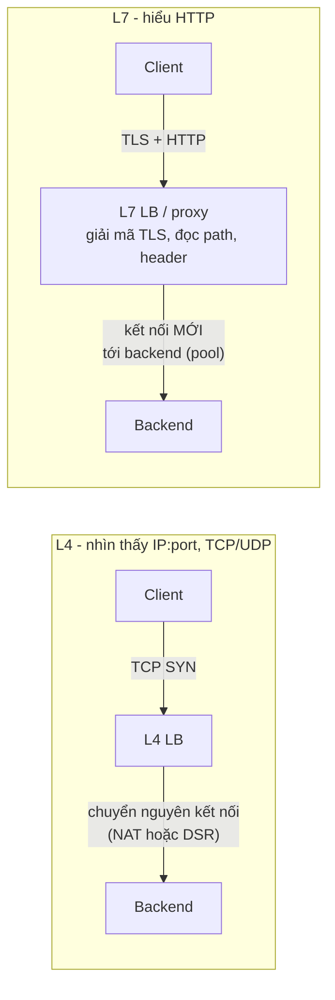

| Khía cạnh | L4 | L7 |
|---|---|---|
| Thấy được gì | IP, port, giao thức | URL, header, cookie, method, body |
| Đơn vị cân bằng | **Kết nối** (connection) | **Request** |
| TLS | Thường pass-through (backend giải mã) | Thường terminate tại LB |
| Hiệu năng | Rất cao (hàng triệu kết nối, có thể chạy trong kernel / phần cứng) | Thấp hơn (parse HTTP, TLS), nhưng vẫn rất cao |
| Định tuyến theo nội dung | Không | Có: `/api/*` → A, `/img/*` → B, header `x-canary` → C |
| Retry, timeout per request | Không | Có |
| Ví dụ | AWS NLB, LVS/IPVS, Maglev (Google), Katran (Meta) | Nginx, Envoy, HAProxy (mode http), AWS ALB |

**NAT vs DSR (Direct Server Return)** ở L4:

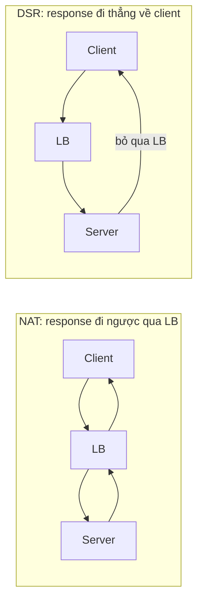

Response thường lớn hơn request rất nhiều (request 1 KB, response 1 MB). Với DSR, LB chỉ xử lý chiều vào → chịu được lưu lượng lớn hơn nhiều. Các L4 LB quy mô lớn thường dùng DSR hoặc biến thể của nó.

**Kiến trúc phổ biến**: L4 ở ngoài cùng (nhận traffic khổng lồ, scale ngang bằng ECMP), L7 ở sau (định tuyến thông minh).

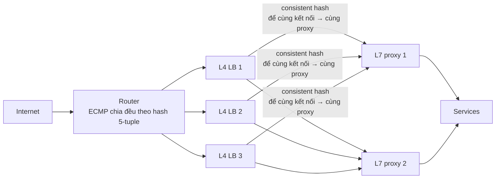

Vì sao L4 dùng **consistent hash** chọn L7 proxy? Nếu một L4 LB chết, router chuyển các gói tin của cùng kết nối sang L4 LB khác. LB mới phải chọn **đúng proxy cũ** cho kết nối đó - nếu không, kết nối TCP bị đứt. Consistent hash (ví dụ Maglev hashing) đảm bảo mọi L4 LB cùng đưa ra một lựa chọn mà **không cần chia sẻ trạng thái**.

### 3.2. Thuật toán cân bằng tải

| Thuật toán | Cách làm | Ưu | Nhược |
|---|---|---|---|
| **Round robin** | Lần lượt 1, 2, 3, 1, 2, 3... | Đơn giản, đều về **số lượng** | Không biết server nào đang chậm/bận; request nặng nhẹ khác nhau |
| **Weighted RR** | RR theo trọng số (máy mạnh nhận nhiều) | Phù hợp phần cứng không đồng nhất | Trọng số tĩnh |
| **Random** | Chọn ngẫu nhiên | Không cần trạng thái | Dao động lớn, có lúc dồn cục |
| **Least connections** | Chọn server có ít request đang xử lý nhất | Tự thích nghi với server chậm | Cần biết trạng thái chính xác; nhiều LB cùng chọn một server "rảnh" → **herd** |
| **Least response time / EWMA** | Chọn theo latency gần đây | Thích nghi tốt | Phức tạp hơn; dễ dao động |
| **Power of two choices (P2C)** | Chọn ngẫu nhiên **2** server, lấy cái ít tải hơn | Gần tốt như least-conn, **không herd**, chịu được thông tin cũ | Không tối ưu tuyệt đối |
| **Consistent hash** | hash(key) → server | Cùng key → cùng server (cache locality, sticky) | Phân bố theo **key**, không theo **tải** → hot key làm nóng 1 server |
| **IP hash** | hash(IP client) | Sticky đơn giản | NAT/proxy dồn nhiều user vào 1 IP |

**Vì sao P2C hay được dùng?** Least connections cần trạng thái **chính xác và toàn cục**. Khi có 50 LB (hoặc 500 client-side LB) cùng nhìn thấy "server 7 đang rảnh nhất", tất cả cùng dồn vào server 7 trong cùng một khoảnh khắc → server 7 quá tải (hiệu ứng **bầy đàn - herd**). P2C chỉ so sánh 2 lựa chọn ngẫu nhiên: các LB khác nhau gần như không bao giờ chọn cùng một cặp, nên tránh được herd, mà vẫn tránh được server quá tải (vì server quá tải gần như luôn thua trong phép so sánh). Kết quả lý thuyết nổi tiếng ("The Power of Two Choices in Randomized Load Balancing", Mitzenmacher): tải tối đa giảm **theo cấp số mũ** so với random - chỉ nhờ thêm **một** lựa chọn.

### 3.3. Mô phỏng: so sánh các thuật toán

Mô phỏng 10 server, mỗi server xử lý tuần tự (1 worker). **Server 0 bị chậm** (chỉ còn 70% tốc độ - ví dụ do "hàng xóm ồn ào" trên cùng máy vật lý). Request: 90% nhẹ (10 ms), 10% nặng (100 ms). Tổng tải 60% năng lực. Với consistent hash, mỗi request thuộc về một user, và user theo phân phối **Zipf** (vài user rất nóng) - giống thực tế.

Đo: latency trung bình, p50, p99, độ dài hàng đợi lớn nhất (`maxQ`), % request vào server chậm (`slow`), % request vào server bận nhất (`busiest`).

=== "Go"

    ```go
    package main

    import (
    	"container/heap"
    	"crypto/md5"
    	"encoding/binary"
    	"fmt"
    	"math/rand"
    	"sort"
    )

    const (
    	nServers = 10
    	nReq     = 200_000
    	load     = 0.6              // 60% tổng năng lực
    	meanSvc  = 0.9*10 + 0.1*100 // ms: 90% request 10ms, 10% request 100ms
    )

    var speed = [nServers]float64{0.7, 1, 1, 1, 1, 1, 1, 1, 1, 1} // server 0 chỉ còn 70% tốc độ

    // minHeap chứa thời điểm hoàn thành của các request đang xử lý
    type minHeap []float64

    func (h minHeap) Len() int           { return len(h) }
    func (h minHeap) Less(i, j int) bool { return h[i] < h[j] }
    func (h minHeap) Swap(i, j int)      { h[i], h[j] = h[j], h[i] }
    func (h *minHeap) Push(x any)        { *h = append(*h, x.(float64)) }
    func (h *minHeap) Pop() any {
    	old := *h
    	x := old[len(old)-1]
    	*h = old[:len(old)-1]
    	return x
    }

    func hash(s string) uint64 {
    	sum := md5.Sum([]byte(s))
    	return binary.BigEndian.Uint64(sum[:8])
    }

    // Ring: consistent hashing với 100 virtual node / server
    type Ring struct {
    	keys  []uint64
    	owner map[uint64]int
    }

    func NewRing(n, vnodes int) *Ring {
    	r := &Ring{owner: map[uint64]int{}}
    	for i := 0; i < n; i++ {
    		for v := 0; v < vnodes; v++ {
    			k := hash(fmt.Sprintf("s%d#%d", i, v))
    			r.keys = append(r.keys, k)
    			r.owner[k] = i
    		}
    	}
    	sort.Slice(r.keys, func(a, b int) bool { return r.keys[a] < r.keys[b] })
    	return r
    }

    func (r *Ring) Get(key string) int {
    	h := hash(key)
    	i := sort.Search(len(r.keys), func(i int) bool { return r.keys[i] > h }) % len(r.keys)
    	return r.owner[r.keys[i]]
    }

    func simulate(policy string, seed int64) {
    	rnd := rand.New(rand.NewSource(seed))
    	zipf := rand.NewZipf(rnd, 1.1, 1, 9_999) // vài user rất "nóng"
    	totalSpeed := 0.0
    	for _, s := range speed {
    		totalSpeed += s
    	}
    	rate := load * totalSpeed / meanSvc // request / ms
    	ring := NewRing(nServers, 100)
    	var freeAt [nServers]float64
    	inflight := make([]minHeap, nServers)
    	var count [nServers]int
    	lat := make([]float64, 0, nReq)
    	maxQ, rr, now := 0, 0, 0.0

    	for i := 0; i < nReq; i++ {
    		now += rnd.ExpFloat64() / rate
    		svc := 100.0
    		if rnd.Float64() < 0.9 {
    			svc = 10.0
    		}
    		user := zipf.Uint64()
    		for s := range inflight { // dọn request đã xong
    			for inflight[s].Len() > 0 && inflight[s][0] <= now {
    				heap.Pop(&inflight[s])
    			}
    		}
    		var s int
    		switch policy {
    		case "round-robin":
    			s = rr % nServers
    			rr++
    		case "random":
    			s = rnd.Intn(nServers)
    		case "least-conn":
    			for j := 1; j < nServers; j++ {
    				if inflight[j].Len() < inflight[s].Len() {
    					s = j
    				}
    			}
    		case "p2c": // power of two choices
    			a := rnd.Intn(nServers)
    			b := (a + 1 + rnd.Intn(nServers-1)) % nServers
    			s = a
    			if inflight[b].Len() < inflight[a].Len() {
    				s = b
    			}
    		default: // consistent hash theo user
    			s = ring.Get(fmt.Sprintf("user%d", user))
    		}
    		start := max(now, freeAt[s])
    		done := start + svc/speed[s]
    		freeAt[s] = done
    		heap.Push(&inflight[s], done)
    		maxQ = max(maxQ, inflight[s].Len())
    		lat = append(lat, done-now)
    		count[s]++
    	}
    	sort.Float64s(lat)
    	p := func(q float64) float64 { return lat[int(q*float64(len(lat)-1))] }
    	sum, busiest := 0.0, 0
    	for _, l := range lat {
    		sum += l
    	}
    	for _, c := range count {
    		busiest = max(busiest, c)
    	}
    	fmt.Printf("%-15s mean=%8.1fms p50=%7.1fms p99=%8.1fms maxQ=%5d slow=%4.1f%% busiest=%4.1f%%\n",
    		policy, sum/float64(len(lat)), p(.5), p(.99), maxQ,
    		100*float64(count[0])/nReq, 100*float64(busiest)/nReq)
    }

    func main() {
    	for _, pol := range []string{"round-robin", "random", "least-conn", "p2c", "consistent-hash"} {
    		simulate(pol, 42)
    	}
    }

    // Output:
    // round-robin     mean=    53.7ms p50=   10.0ms p99=   384.9ms maxQ=   29 slow=10.0% busiest=10.0%
    // random          mean=    81.3ms p50=   26.5ms p99=   604.2ms maxQ=   62 slow=10.1% busiest=10.2%
    // least-conn      mean=    22.2ms p50=   10.0ms p99=   142.9ms maxQ=    4 slow=10.9% busiest=14.6%
    // p2c             mean=    33.0ms p50=   10.0ms p99=   181.3ms maxQ=    7 slow= 8.4% busiest=10.3%
    // consistent-hash mean=  8727.7ms p50=   81.6ms p99= 82667.0ms maxQ= 4582 slow= 9.4% busiest=19.7%
    ```

=== "Python"

    ```python
    import bisect
    import hashlib
    import heapq
    import random

    N_SERVERS = 10
    SPEED = [0.7] + [1.0] * (N_SERVERS - 1)  # server 0 chỉ còn 70% tốc độ (noisy neighbor)
    N_REQ = 200_000
    LOAD = 0.6                               # 60% tổng năng lực
    MEAN_SVC = 0.9 * 10 + 0.1 * 100          # ms, 90% request 10ms, 10% request 100ms
    RATE = LOAD * sum(SPEED) / MEAN_SVC      # request / ms


    def h(s):
        return int.from_bytes(hashlib.md5(s.encode()).digest()[:8], "big")


    class Ring:  # consistent hashing với 100 virtual node / server
        def __init__(self, n, vnodes=100):
            pts = sorted((h(f"s{i}#{v}"), i) for i in range(n) for v in range(vnodes))
            self.keys = [p[0] for p in pts]
            self.owner = [p[1] for p in pts]

        def get(self, key):
            i = bisect.bisect(self.keys, h(key)) % len(self.keys)
            return self.owner[i]


    def simulate(policy, seed=42):
        rnd = random.Random(seed)
        users = list(range(10_000))
        weights = [1 / (u + 1) ** 1.1 for u in users]  # Zipf: vài user rất "nóng"
        cum = []
        acc = 0.0
        for w in weights:
            acc += w
            cum.append(acc)
        ring = Ring(N_SERVERS)
        free_at = [0.0] * N_SERVERS          # thời điểm server rảnh (FIFO, 1 worker)
        inflight = [[] for _ in range(N_SERVERS)]  # heap thời điểm hoàn thành
        lat, max_q, count, rr = [], 0, [0] * N_SERVERS, 0
        now = 0.0
        for _ in range(N_REQ):
            now += rnd.expovariate(RATE)
            svc = 10.0 if rnd.random() < 0.9 else 100.0
            user = bisect.bisect(cum, rnd.random() * acc)
            for q in inflight:                # dọn request đã xong
                while q and q[0] <= now:
                    heapq.heappop(q)
            if policy == "round-robin":
                s = rr % N_SERVERS
                rr += 1
            elif policy == "random":
                s = rnd.randrange(N_SERVERS)
            elif policy == "least-conn":
                s = min(range(N_SERVERS), key=lambda i: len(inflight[i]))
            elif policy == "p2c":             # power of two choices
                a, b = rnd.sample(range(N_SERVERS), 2)
                s = a if len(inflight[a]) <= len(inflight[b]) else b
            else:                             # consistent hash theo user
                s = ring.get(f"user{user}")
            start = max(now, free_at[s])
            done = start + svc / SPEED[s]
            free_at[s] = done
            heapq.heappush(inflight[s], done)
            max_q = max(max_q, len(inflight[s]))
            lat.append(done - now)
            count[s] += 1
        lat.sort()
        p = lambda q: lat[int(q * (len(lat) - 1))]
        print(f"{policy:<15} mean={sum(lat)/len(lat):8.1f}ms p50={p(.5):7.1f}ms "
              f"p99={p(.99):8.1f}ms maxQ={max_q:5d} slow={count[0]/N_REQ:5.1%} "
              f"busiest={max(count)/N_REQ:5.1%}")


    for pol in ["round-robin", "random", "least-conn", "p2c", "consistent-hash"]:
        simulate(pol)

    # Output:
    # round-robin     mean=    54.0ms p50=   10.0ms p99=   380.6ms maxQ=   29 slow=10.0% busiest=10.0%
    # random          mean=    78.0ms p50=   25.0ms p99=   599.4ms maxQ=   62 slow=10.0% busiest=10.1%
    # least-conn      mean=    22.0ms p50=   10.0ms p99=   142.9ms maxQ=    4 slow=11.1% busiest=14.8%
    # p2c             mean=    33.0ms p50=   10.0ms p99=   180.6ms maxQ=    7 slow= 8.4% busiest=10.3%
    # consistent-hash mean=  9646.1ms p50=   78.0ms p99= 89885.4ms maxQ= 4846 slow= 9.3% busiest=19.8%
    ```

**Đọc kết quả** (hai ngôn ngữ dùng bộ sinh số ngẫu nhiên khác nhau nên số hơi khác, nhưng **thứ hạng giống hệt**):

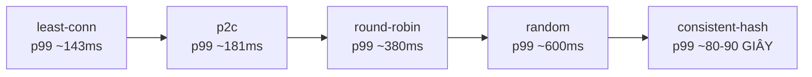

1. **Round robin chia đều số lượng (đúng 10%) nhưng không biết server 0 chậm** → hàng đợi ở server 0 dài, p99 gấp ~2,7 lần least-conn.
2. **Random tệ hơn round robin**: ngoài server chậm, còn có lúc vài request nặng dồn vào cùng một server do may rủi.
3. **Least connections tốt nhất** trong mô phỏng này vì có **thông tin chính xác, tức thì** (chỉ 1 LB). Để ý `busiest` 14-15%: khi hòa, code chọn server có chỉ số nhỏ nhất → lệch nhẹ. Trong thực tế với nhiều LB và thông tin trễ, least-conn mất lợi thế này và dễ bị herd.
4. **P2C gần bằng least-conn** chỉ với 2 phép so sánh, và **tự động gửi ít hơn vào server chậm** (8,4% thay vì 10%) mà không cần ai cấu hình trọng số.
5. **Consistent hash thảm họa** khi key bị lệch: user nóng nhất một mình chiếm ~15% toàn bộ traffic, cộng thêm các user khác trên cùng server → server bận nhất nhận ~20% traffic, tức **gấp đôi** mức trung bình → vượt 100% năng lực → hàng đợi tăng vô hạn (p99 hàng chục **giây**). Đây chính là **hot key** - chủ đề lớn của [Bài 3](./03-building-blocks-data.md).

!!! tip "Bài học"
    Consistent hash dùng khi bạn **cần** cùng key về cùng server (cache locality, stateful) - và khi đó phải có **kế hoạch cho hot key** (bounded-load consistent hashing, tách key nóng, cache cục bộ). Nếu backend stateless, dùng **P2C / least-request** (ví dụ Envoy mặc định dùng thuật toán least request dựa trên P2C).

### 3.4. Health check - và cách nó làm sập cả hệ thống

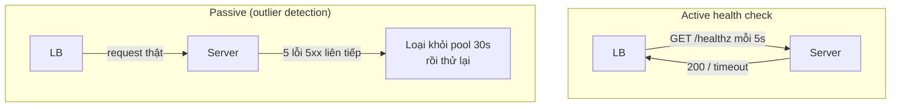

| Loại check | Hỏi gì | Hành động khi fail |
|---|---|---|
| **Liveness** | Process còn sống không? (không deadlock) | Restart container |
| **Readiness** | Sẵn sàng nhận traffic chưa? (đã warm cache, đã kết nối DB) | Ngừng gửi traffic, **không** restart |
| **Passive / outlier** | Request thật có đang lỗi nhiều không? | Tạm loại khỏi pool |

**Thông số quan trọng**: interval (5-10 s), timeout (< interval), `unhealthy_threshold` (2-3 lần fail liên tiếp mới loại - tránh **flapping**), `healthy_threshold` (2-3 lần ok mới nhận lại).

!!! warning "Health check sâu gây sập dây chuyền"
    Nếu `/healthz` của **mọi** server kiểm tra luôn kết nối DB, thì khi DB chậm 10 giây, **toàn bộ** server bị đánh dấu unhealthy cùng lúc → LB không còn backend nào → 100% lỗi, kể cả các API không cần DB. Quy tắc:

    - Liveness: **chỉ** kiểm tra chính process.
    - Readiness: kiểm tra dependency **bắt buộc** một cách thận trọng.
    - Nhiều LB có cơ chế **"panic mode / fail open"**: nếu quá X% backend unhealthy, LB **bỏ qua** health check và gửi tới tất cả - vì nhiều khả năng health check sai chứ không phải mọi server cùng chết.

**Connection draining (graceful shutdown)** khi deploy:

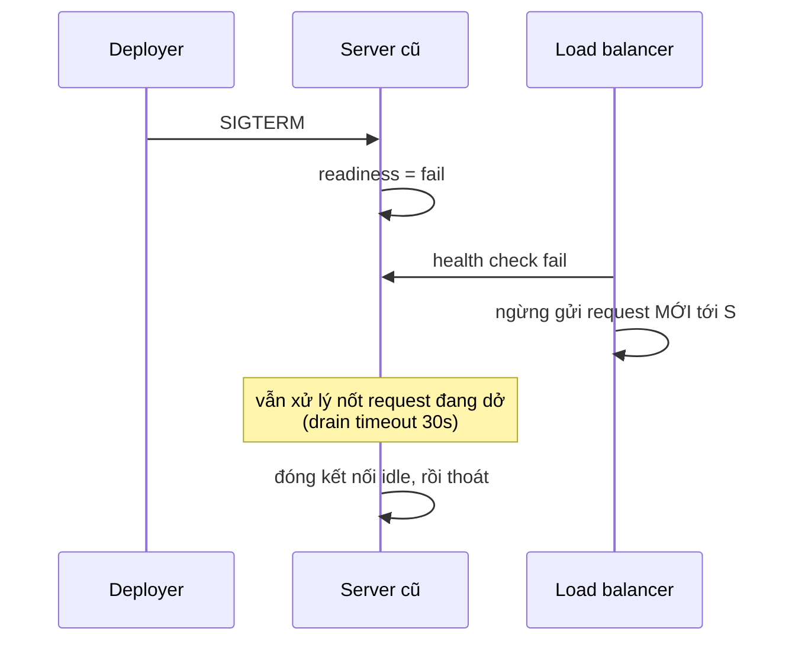

Thiếu bước này, mỗi lần deploy sẽ có một loạt lỗi 502/503 - dù code hoàn toàn đúng.

### 3.5. Sticky session

Sticky session (session affinity): LB gắn client với một server cố định, thường qua cookie (`SERVERID=s3`) hoặc hash IP.

| Ưu | Nhược |
|---|---|
| Server giữ được state cục bộ (session trong RAM, cache cục bộ) | Phân tải không đều (user "nặng" dính một server) |
| Ít phải truy vấn session store | Server chết → mất session của mọi user trên đó |
| | Khó scale in/out, deploy (phải drain lâu) |

**Khuyến nghị**: thiết kế service **stateless** ([Backend Bài 10 §4](../backend/10-system-design.md)), lưu session ở Redis hoặc dùng token. Chỉ dùng sticky khi có lý do thật sự (WebSocket - bản chất đã "sticky" theo kết nối; cache cục bộ rất đắt để dựng lại; hoặc một số hệ thống stateful như game server).

### 3.6. Bản thân load balancer cũng phải HA

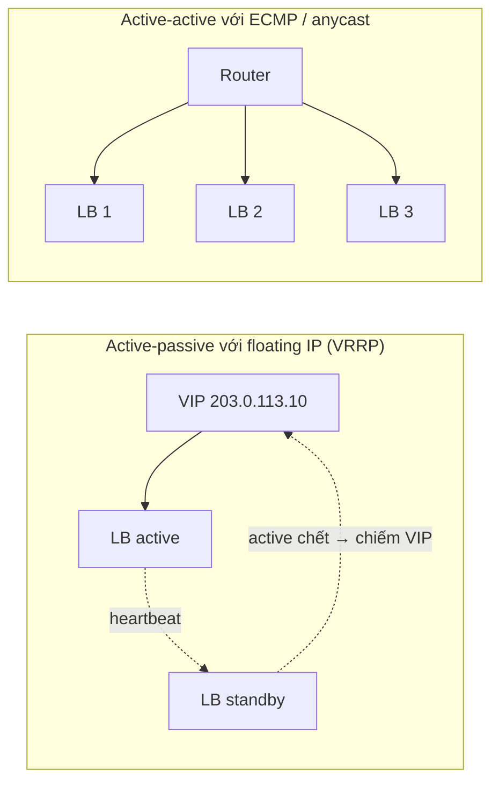

Active-passive đơn giản nhưng lãng phí một nửa và giới hạn ở năng lực một máy. Active-active (ECMP, anycast) scale ngang được - là cách các LB quy mô lớn vận hành. Trên cloud, LB managed (ALB/NLB, Cloud Load Balancing) đã lo phần này cho bạn.

### 3.7. Global load balancing & anycast

**Anycast**: **cùng một địa chỉ IP** được quảng bá (BGP) từ nhiều địa điểm trên thế giới. Mạng internet tự đưa gói tin tới địa điểm "gần nhất" theo định tuyến BGP.

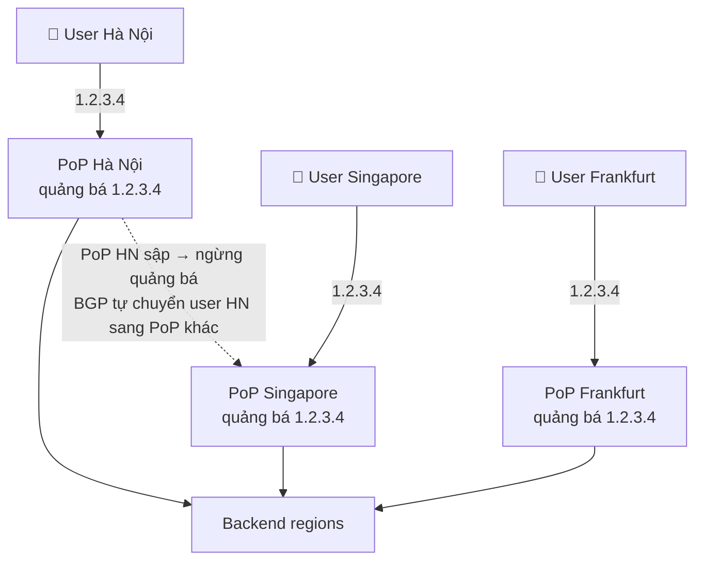

| | DNS-based GSLB | Anycast |
|---|---|---|
| Failover | Phút (TTL, cache) | Giây (BGP hội tụ) |
| Độ chính xác "gần nhất" | Theo vị trí resolver | Theo đường mạng (BGP), không luôn là gần nhất về địa lý |
| Kết nối dài (TCP) | Ổn định | Đường BGP thay đổi giữa chừng có thể làm đứt kết nối (thường hiếm) |
| Ai dùng | Hầu hết hệ thống đa region | CDN, DNS công cộng (1.1.1.1, 8.8.8.8), global LB của cloud lớn |

Thực tế thường **kết hợp**: anycast IP cho edge (CDN/global LB), edge kết thúc TCP+TLS gần người dùng rồi chuyển request về region backend qua mạng riêng (backbone) của nhà cung cấp.

---

## 📖 4. CDN - mang nội dung đến gần người dùng

### 4.1. Kiến trúc CDN nhiều tầng

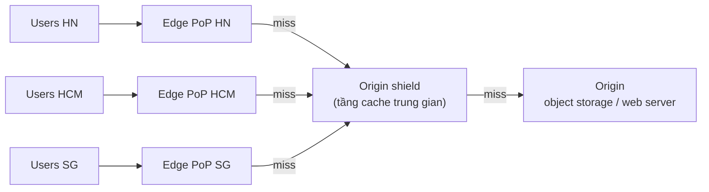

**Origin shield** (tiered cache) gom miss từ nhiều edge: nếu 50 PoP cùng miss một file mới, origin chỉ nhận **1** request thay vì 50. Đây là một dạng **request coalescing** ở tầng CDN.

**Toán hit ratio**: origin chịu `(1 - hit ratio)` traffic. Với egress 278 Gbps ở [Bài 1 - Drill 1](./01-framework-estimation.md):

| CDN hit ratio | Origin egress |
|---|---|
| 90% | 27,8 Gbps |
| 95% | 13,9 Gbps |
| 99% | 2,8 Gbps |

Tăng hit ratio từ 95% lên 99% **giảm 5 lần** tải origin. Vì vậy các team vận hành CDN quan tâm từng phần trăm hit ratio.

### 4.2. Push vs Pull CDN

| | Pull (phổ biến nhất) | Push |
|---|---|---|
| Cách hoạt động | Edge miss → tự kéo từ origin, cache theo TTL | Bạn chủ động upload nội dung lên CDN trước |
| Ưu | Đơn giản, chỉ cache thứ được yêu cầu | Không có "cú miss đầu tiên", kiểm soát chính xác |
| Nhược | Request đầu tiên chậm; nội dung hot mới ra có thể gây **dồn miss về origin** | Phải tự quản lý upload/xóa; tốn storage cho thứ ít ai xem |
| Dùng cho | Website, ảnh người dùng, API cache | File lớn biết trước (bản cập nhật game, video phát hành theo lịch) |

**Pre-warming** là kiểu lai: dùng pull CDN nhưng chủ động gửi request kéo trước những file biết chắc sẽ hot (trailer phim sắp ra mắt, banner flash sale).

### 4.3. Cache key - CDN phân biệt hai request thế nào?

Mặc định cache key thường là `host + path + query string`. Những sai lầm kinh điển:

| Vấn đề | Ví dụ | Hậu quả | Cách sửa |
|---|---|---|---|
| Query string vô nghĩa | `?utm_source=fb`, `?_=1699999` | Mỗi biến thể một bản cache → hit ratio thảm | Bỏ tham số tracking khỏi cache key, sắp xếp query param |
| `Vary` quá rộng | `Vary: User-Agent` | Hàng nghìn biến thể User-Agent | Chuẩn hóa thành vài nhóm (mobile/desktop) |
| Cookie trong key | Cache theo cookie session | Không bao giờ hit | Không cache response cá nhân hóa, hoặc bỏ cookie khỏi key |
| **Cache nhầm dữ liệu riêng tư** | `/api/me` bị cache public | **Lộ dữ liệu người A cho người B** | `Cache-Control: private, no-store` cho mọi response cá nhân |

!!! warning "Rò rỉ dữ liệu qua CDN"
    Một trong những sự cố nghiêm trọng nhất với CDN là cache nhầm response chứa thông tin cá nhân. Luôn đặt mặc định **"không cache"** cho API, và chỉ **bật cache có chủ đích** cho từng đường dẫn.

### 4.4. Cache-Control - nói chuyện với CDN và trình duyệt

```text
Cache-Control: public, max-age=60, s-maxage=600, stale-while-revalidate=30, stale-if-error=86400
```

| Directive | Ý nghĩa |
|---|---|
| `max-age=60` | Trình duyệt cache 60 s |
| `s-maxage=600` | Cache **dùng chung** (CDN) cache 600 s - ghi đè `max-age` cho CDN |
| `stale-while-revalidate=30` | Hết hạn rồi vẫn trả bản cũ thêm 30 s, **đồng thời** lấy bản mới ở nền → người dùng không phải chờ |
| `stale-if-error=86400` | Origin lỗi → trả bản cũ tới 1 ngày. **Cứu bạn khi origin sập** |
| `private` | Chỉ trình duyệt được cache, CDN không được |
| `no-store` | Không ai được lưu |
| `immutable` | Nội dung không bao giờ đổi (dùng với URL có version) |

### 4.5. Invalidation - "chỉ có hai việc khó trong khoa học máy tính"

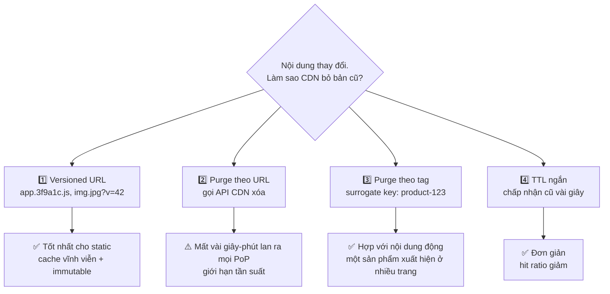

**Quy tắc thực dụng**: asset tĩnh (JS, CSS, ảnh đã upload) → **versioned URL + cache rất dài + `immutable`**. Không bao giờ cần purge. Nội dung động (trang sản phẩm) → TTL ngắn + `stale-while-revalidate` + purge theo tag khi có thay đổi quan trọng (đổi giá).

### 4.6. CDN cho nội dung động và edge compute

CDN không chỉ cho file tĩnh:

- **Dynamic acceleration**: request API vẫn đi qua edge; edge giữ **kết nối đã warm sẵn** (TCP + TLS) tới origin qua backbone tốt → giảm đáng kể latency cho người dùng ở xa, dù không cache gì.
- **TLS termination ở edge**: bắt tay TLS (1-2 RTT) diễn ra với PoP cách 5 ms thay vì origin cách 150 ms.
- **WAF, chống DDoS, chặn bot** tại edge - trước khi traffic xấu chạm vào hạ tầng của bạn.
- **Edge compute** (Cloudflare Workers, Lambda@Edge, Fastly Compute...): chạy code nhỏ tại edge.

| Dùng edge compute cho | Không nên |
|---|---|
| A/B test, redirect, rewrite header | Logic nghiệp vụ phức tạp cần DB trung tâm |
| Xác thực token (JWT verify), chặn request sớm | Ghi dữ liệu cần nhất quán mạnh |
| Resize ảnh theo thiết bị | Tác vụ CPU nặng, chạy lâu |
| Hàng đợi ảo (waiting room) cho flash sale | |
| Cá nhân hóa nhẹ (ngôn ngữ, tiền tệ) | |

---

## 📖 5. Reverse proxy, API gateway, BFF, service mesh

Bốn khái niệm hay bị dùng lẫn lộn. Chúng **chồng lấn** nhau, khác nhau ở **trọng tâm**.

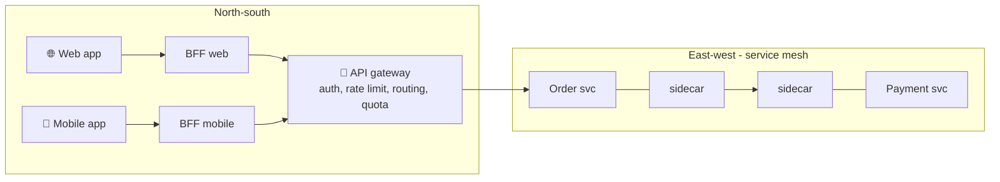

| Thành phần | Trọng tâm | Việc điển hình |
|---|---|---|
| **Reverse proxy** | Đứng trước server, chuyển tiếp request | TLS termination, nén, cache, phục vụ file tĩnh, cân bằng tải (Nginx, HAProxy, Envoy) |
| **API gateway** | **Cửa ngõ API** cho client bên ngoài | Xác thực (verify JWT/API key), rate limit & quota, routing theo version, chuyển đổi giao thức (REST → gRPC), logging/metrics tập trung, API key cho đối tác |
| **BFF** (Backend for Frontend) | API **may đo cho một loại client** | Gộp nhiều lời gọi thành một response vừa đủ cho màn hình mobile; mỗi team frontend sở hữu BFF của mình |
| **Service mesh** | Giao tiếp **giữa các service** | mTLS tự động, retry/timeout/circuit breaker, client-side LB, tracing - qua sidecar proxy (Istio, Linkerd) hoặc thư viện |

**Vì sao BFF?** Màn hình "chi tiết đơn hàng" trên mobile cần dữ liệu từ 5 service. Nếu app mobile tự gọi 5 API qua mạng 4G (mỗi RTT 50-100 ms), trải nghiệm rất chậm và tốn pin. BFF gọi 5 service **trong datacenter** (mỗi RTT < 1 ms), gộp lại, cắt bớt trường không cần, trả **một** response. Giá phải trả: thêm một service để vận hành, và nguy cơ logic nghiệp vụ "rò" vào BFF.

!!! warning "Gateway là điểm nghẽn tiềm năng"
    API gateway nằm trên **mọi** request. Nó phải: (1) stateless và scale ngang, (2) **không chứa logic nghiệp vụ**, (3) có timeout chặt với backend để một service chậm không giữ hết kết nối của gateway (bulkhead - xem [Backend Bài 10 §11](../backend/10-system-design.md)), (4) được deploy cẩn thận - một cấu hình sai ở gateway có thể làm sập toàn bộ sản phẩm.

---

## 📖 6. Quản lý kết nối

### 6.1. Chi phí của một kết nối mới

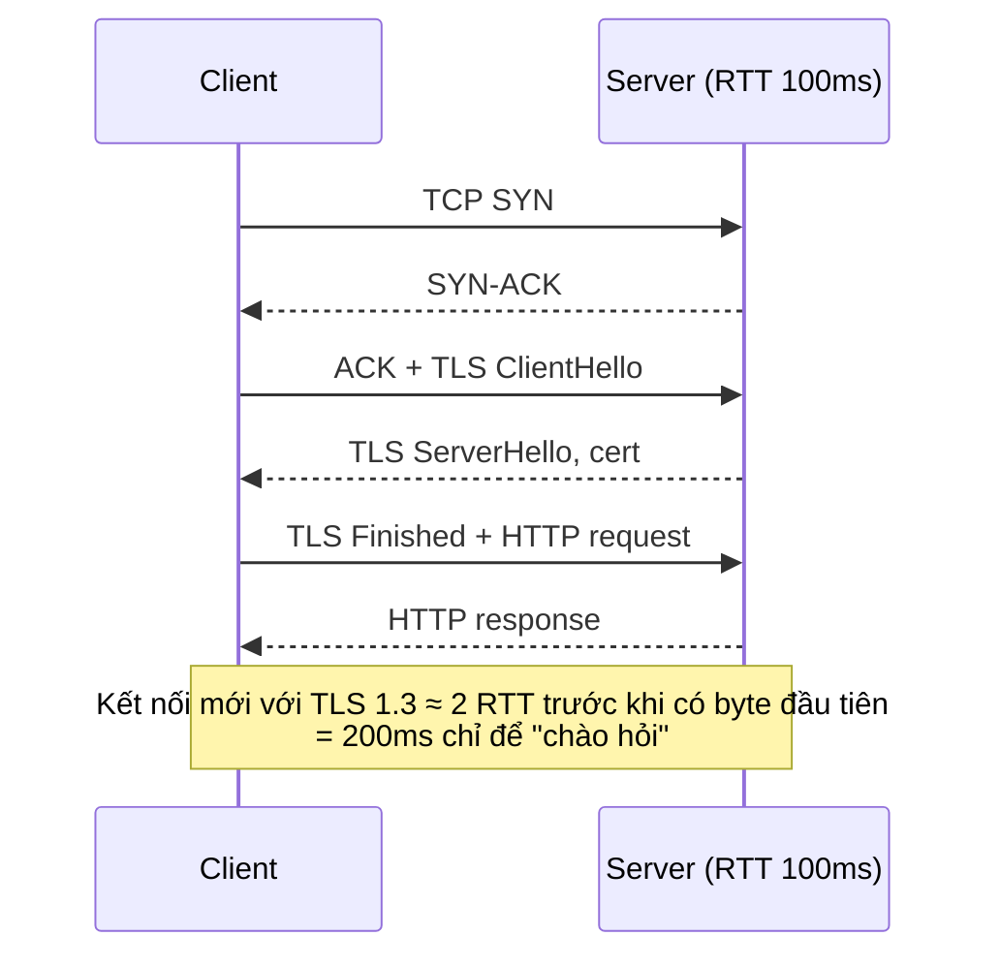

Với RTT 100 ms, một kết nối mới tốn **~200 ms** trước khi có dữ liệu (TCP 1 RTT + TLS 1.3 1 RTT; TLS 1.2 thêm 1 RTT nữa). Vì vậy:

- **Keep-alive / connection pooling**: tái sử dụng kết nối cho nhiều request. Giữa các service, luôn dùng pool.
- **TLS session resumption / 0-RTT** (TLS 1.3): giảm chi phí khi kết nối lại (0-RTT có rủi ro replay, chỉ dùng cho request idempotent).
- **Terminate TLS gần người dùng** (CDN edge) để RTT bắt tay ngắn.

### 6.2. HTTP/1.1 vs HTTP/2 vs HTTP/3

| | HTTP/1.1 | HTTP/2 | HTTP/3 (QUIC) |
|---|---|---|---|
| Request song song trên 1 kết nối | Không (1 request tại một thời điểm) | **Có - multiplexing** nhiều stream | Có |
| Head-of-line blocking | Ở tầng HTTP | Hết ở HTTP, nhưng **còn ở TCP** (mất 1 gói → mọi stream chờ) | **Hết** (mỗi stream độc lập trên UDP) |
| Số kết nối trình duyệt mở | ~6 / domain | 1 / domain | 1, có thể chuyển mạng (Wi-Fi → 4G) không đứt |
| Bắt tay | TCP + TLS | TCP + TLS | Gộp: 1 RTT, có thể 0-RTT |

HTTP/3 có lợi nhất trên **mạng di động chập chờn** - đúng với nhiều người dùng ở Việt Nam.

### 6.3. Bẫy: gRPC / HTTP/2 + L4 load balancer

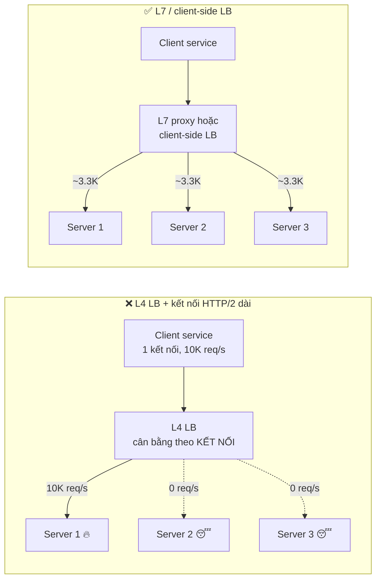

gRPC dùng HTTP/2: **một kết nối dài**, multiplex hàng nghìn request. L4 LB chỉ cân bằng **lúc mở kết nối** → toàn bộ request của client đó dính vào một server. Thêm server mới cũng không giúp gì vì kết nối cũ không chuyển. Giải pháp: **L7 LB hiểu HTTP/2** (Envoy, Linkerd), hoặc **client-side LB** (client tự mở kết nối tới nhiều server và chia request), cộng thêm **giới hạn tuổi kết nối** (max connection age) để kết nối định kỳ được mở lại và phân bố lại.

### 6.4. Kết nối dài: WebSocket, SSE, long polling

| | Short polling | Long polling | SSE | WebSocket |
|---|---|---|---|---|
| Hướng | Client hỏi định kỳ | Client hỏi, server giữ tới khi có dữ liệu | Server → client | **Hai chiều** |
| Độ trễ | Bằng chu kỳ poll | Thấp | Thấp | Thấp nhất |
| Chi phí | Nhiều request rỗng | Vừa | 1 kết nối HTTP | 1 kết nối, frame nhỏ |
| Qua proxy/firewall | Dễ nhất | Dễ | Dễ (HTTP thường) | Đôi khi bị chặn |
| Dùng cho | Dashboard đơn giản | Fallback | Thông báo, giá cổ phiếu, stream token AI | Chat, game, cộng tác realtime, vị trí tài xế |

**WebSocket và load balancer** - những điều cần thiết kế:

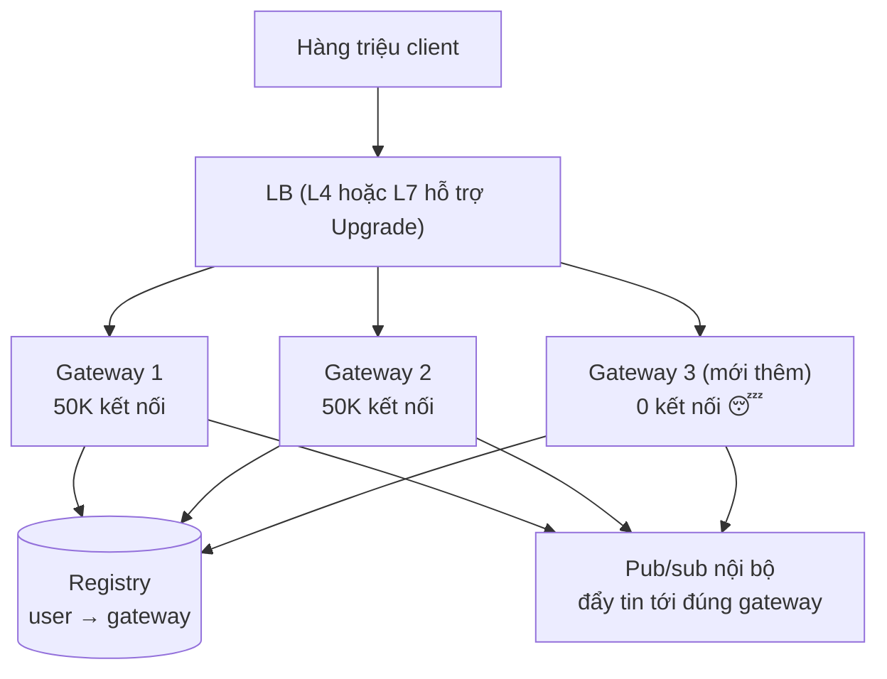

1. **Idle timeout**: LB và NAT thường đóng kết nối im lặng sau 60-350 s → client và server phải gửi **heartbeat/ping** (ví dụ 30 s).
2. **Phân bố không đều sau khi scale out**: gateway mới thêm vào có 0 kết nối, gateway cũ vẫn đầy - vì kết nối cũ không tự di chuyển. Giải pháp: cân bằng theo **least connections** cho kết nối mới, và cho gateway quá tải **chủ động đóng bớt** một phần kết nối (client sẽ reconnect sang nơi khác).
3. **Deploy = ngắt kết nối**: mỗi lần deploy gateway, 50K client mất kết nối. Phải drain từ từ (đóng dần trong vài phút), không đóng một lúc.
4. **Reconnect storm**: một gateway chết → 50K client reconnect **trong cùng một giây** → dồn tải vào LB, auth service, registry. Client bắt buộc phải **reconnect với exponential backoff + jitter** (xem [Backend Bài 10 §11.2](../backend/10-system-design.md)).
5. **Giới hạn mỗi máy**: mỗi kết nối tốn file descriptor (tăng `ulimit -n`), bộ nhớ cho buffer (vài KB - vài chục KB mỗi kết nối) → 500K kết nối × 20 KB ≈ 10 GB RAM chỉ cho buffer. Port nguồn **không** phải giới hạn phía server (server chỉ dùng 1 port lắng nghe), nhưng là giới hạn phía **proxy** khi proxy mở kết nối tới backend (~64K port nguồn mỗi cặp IP nguồn-đích).
6. **Routing tin nhắn**: server muốn gửi tin cho user X phải biết X đang kết nối ở gateway nào → **registry** (Redis: `user:X → gateway-17`) hoặc pub/sub. Chi tiết ở [Bài 8](./08-chat-presence.md).

---

## 📖 7. Service discovery

Trong môi trường cloud/Kubernetes, instance sinh ra và chết đi liên tục, IP thay đổi. Service A làm sao biết địa chỉ của service B?

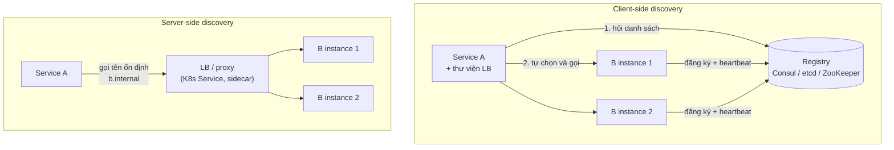

| | Client-side | Server-side |
|---|---|---|
| Ai chọn instance | Client (thư viện) | LB / proxy ở giữa |
| Ưu | Không thêm hop, thuật toán LB linh hoạt (P2C), tránh vấn đề L4 + HTTP/2 | Client đơn giản, đa ngôn ngữ dễ |
| Nhược | Phải có thư viện cho mỗi ngôn ngữ, logic LB rải khắp nơi | Thêm hop, proxy có thể thành nút thắt |
| Ví dụ | gRPC client với xDS, Netflix Eureka + Ribbon (thế hệ cũ) | Kubernetes Service (kube-proxy), AWS ALB nội bộ |

Service mesh là cách **kết hợp**: sidecar proxy chạy cạnh mỗi service làm client-side LB, nên ứng dụng không cần thư viện riêng.

**Kubernetes**: mỗi Service có tên DNS ổn định (`orders.prod.svc.cluster.local`). Với Service thường, DNS trả về một **virtual IP**, kube-proxy (iptables/IPVS) chia kết nối tới các pod → bản chất là **L4** (và gặp đúng bẫy gRPC ở 6.3). Với **headless Service**, DNS trả về **danh sách IP pod** → client tự cân bằng.

!!! tip "Registry phải sống sót khi mạng có vấn đề"
    Registry là dependency của **mọi** lời gọi. Nếu registry tạm không truy cập được, client nên **tiếp tục dùng danh sách đã cache** gần nhất thay vì coi như "không có instance nào". Đây là lý do nhiều hệ thống discovery được thiết kế thiên về availability.

---

## 📖 8. Ghép lại: tầng mạng cho Snapgram

Áp dụng tất cả vào [Drill 1 của Bài 1](./01-framework-estimation.md): 50M DAU, đọc ~174K QPS lúc đỉnh, egress ảnh ~278 Gbps, người dùng chủ yếu ở Việt Nam, một phần ở Đông Nam Á.

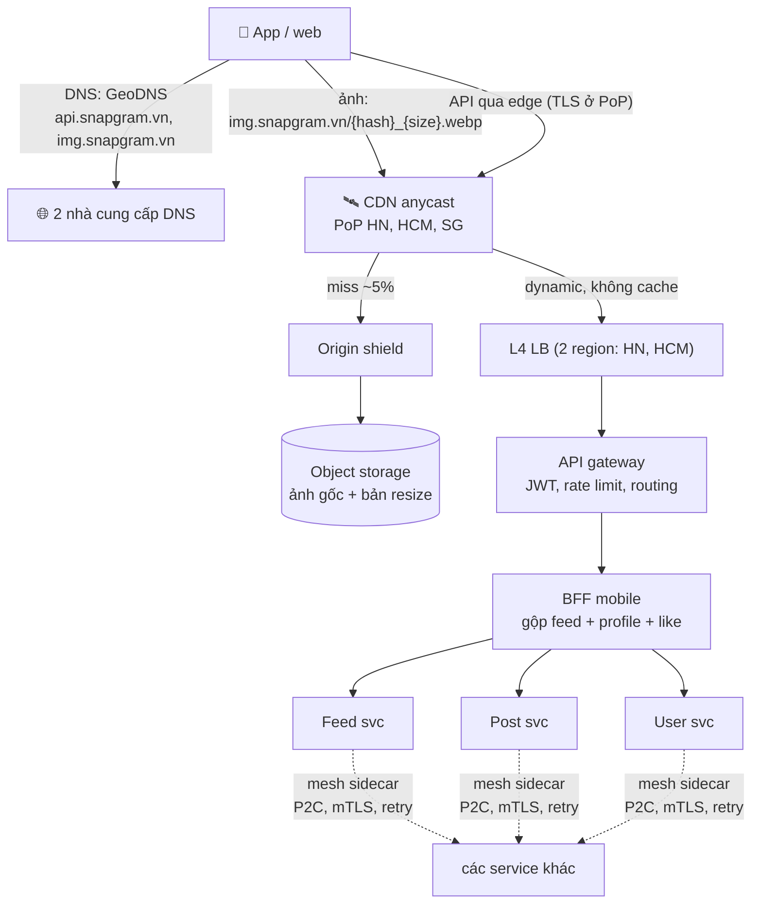

| Quyết định | Lý do (gắn với con số / yêu cầu) | Giá phải trả |
|---|---|---|
| CDN pull + origin shield cho ảnh, URL chứa hash nội dung | Egress 278 Gbps; ảnh không đổi sau khi upload → versioned URL, cache vĩnh viễn, không cần purge | Chi phí CDN; xóa ảnh (vi phạm) cần purge chủ động |
| Bản resize theo kích thước màn hình, định dạng WebP/AVIF | Giảm byte mỗi ảnh → giảm trực tiếp egress | Pipeline resize, nhiều bản lưu trữ |
| API cũng đi qua edge | TLS bắt tay gần người dùng, kết nối warm về origin; WAF/chống bot | Thêm một hop, phụ thuộc nhà cung cấp CDN |
| GeoDNS 2 region HN/HCM | RTT Bắc-Nam 20-40 ms; một region sập vẫn còn region kia | Dữ liệu phải replicate giữa 2 region (Bài 4) |
| L4 trước, gateway L7 sau | L4 chịu lưu lượng lớn, gateway làm auth/rate limit tập trung | Gateway phải scale ngang, không chứa logic |
| BFF cho mobile | Màn hình feed cần 3-5 service; mạng di động RTT cao | Thêm service; phải giữ BFF "mỏng" |
| Client-side LB P2C trong mesh | Nhiều service gRPC; tránh bẫy HTTP/2 + L4 | Vận hành mesh |

!!! tip "Trong phỏng vấn, đừng vẽ hết"
    Sơ đồ trên là mức **chi tiết đầy đủ**. Trong 45 phút, bạn vẽ phiên bản đơn giản (CDN → LB → API → services) và **chỉ mở rộng** phần mà người phỏng vấn quan tâm hoặc phần con số chỉ ra là nút thắt (ở đây: CDN và egress).

---

## 📖 9. Câu hỏi phỏng vấn thường gặp

??? question "Load balancer có phải là single point of failure không?"
    Có thể, nếu chỉ có một. Cách giải: cặp active-passive với floating IP (VRRP), hoặc active-active nhiều LB phía sau ECMP/anycast. Trên cloud, LB managed đã được thiết kế HA nhiều AZ. Ở tầng cao hơn, DNS trỏ tới nhiều LB/region.

??? question "Vì sao không để client gọi thẳng vào server, bỏ LB đi?"
    Client-side LB **là** một lựa chọn hợp lệ cho traffic nội bộ (east-west) - gRPC, service mesh làm vậy. Với client ngoài internet (app mobile), bạn không kiểm soát được client, không thể cập nhật danh sách server tức thì, và muốn ẩn topology bên trong, terminate TLS, chặn tấn công tập trung → cần LB/gateway.

??? question "CDN có cache được API không?"
    Được, với API **công khai, giống nhau cho mọi người** (danh sách sản phẩm, bảng xếp hạng, cấu hình app) - TTL ngắn + `stale-while-revalidate`. Không cache API cá nhân hóa. Ngay cả khi không cache, đi qua CDN vẫn có lợi nhờ TLS ở edge và kết nối warm.

??? question "Làm sao biết thuật toán LB nào đang dùng là tốt?"
    Theo dõi **phân bố tải theo backend** (CPU, số request đang xử lý, p99 theo từng backend). Nếu một vài backend luôn nóng hơn hẳn → thuật toán hoặc key không phù hợp. Chỉ số tổng hợp (p99 toàn hệ thống) thường che giấu điều này.

??? question "WebSocket dùng L4 hay L7 LB?"
    Cả hai đều được. L7 cần hỗ trợ `Upgrade` và cấu hình idle timeout dài; ưu điểm là định tuyến theo path/header lúc bắt tay và terminate TLS. L4 đơn giản và chịu được nhiều kết nối hơn trên cùng phần cứng. Quan trọng hơn chọn L4/L7 là: heartbeat, drain khi deploy, reconnect có jitter, và registry để định tuyến tin nhắn.

---

## 🌍 Ứng dụng thực tế

- **Google Maglev** và **Meta Katran** là các L4 LB phần mềm quy mô lớn được mô tả công khai: chạy trên máy chủ thường, dùng ECMP để scale ngang và consistent hashing để giữ kết nối khi một LB chết.
- **Envoy** (proxy L7 được dùng trong nhiều service mesh như Istio) hỗ trợ least request dựa trên power of two choices, outlier detection, panic threshold - đúng những khái niệm ở mục 3.
- **Cloudflare, Fastly, Akamai, CloudFront** - các CDN lớn dùng anycast (hoặc DNS) để đưa người dùng tới PoP gần nhất, và cung cấp edge compute.
- **Netflix Open Connect**: Netflix đặt máy chủ cache của riêng mình ngay trong mạng của các ISP để phục vụ video gần người dùng - một dạng CDN "may đo" khi egress là chi phí cốt lõi.
- **Ở Việt Nam**: các sàn TMĐT, ví điện tử, nền tảng video thường đặt CDN/PoP tại cả Hà Nội và TP.HCM vì chênh lệch RTT giữa hai miền đáng kể; và dùng hàng đợi ảo tại edge trong các đợt sale lớn.

---

## ⚠️ Sai lầm thường gặp

1. **Dựa vào DNS để failover trong vài giây** - TTL và cache khiến DNS failover luôn mất phút.
2. **Health check kiểm tra dependency** → DB chậm làm toàn bộ fleet bị đánh dấu chết.
3. **Dùng L4 LB cho gRPC/HTTP/2** rồi ngạc nhiên vì một server nóng, các server khác rảnh.
4. **Round robin với backend không đồng nhất** (máy khác cấu hình, request nặng nhẹ khác nhau).
5. **Consistent hash cho backend stateless** - không cần locality mà lại chịu rủi ro hot key.
6. **Cache response cá nhân ở CDN** - lộ dữ liệu người dùng.
7. **Cache key chứa query string tracking** - hit ratio thấp, origin chịu tải.
8. **Không drain kết nối khi deploy** - lỗi 502 mỗi lần release.
9. **WebSocket không có heartbeat** - kết nối "chết lâm sàng" do LB/NAT đóng im lặng.
10. **Client reconnect ngay lập tức không jitter** - reconnect storm đánh sập cả hệ thống sau một sự cố nhỏ.
11. **Logic nghiệp vụ trong API gateway** - gateway phình to, mọi team phụ thuộc, deploy rủi ro.
12. **Thêm tầng không có lý do** - gateway + BFF + mesh + 2 tầng LB cho một hệ thống 100 QPS.

---

## 🏋️ Bài tập

### Bài 1 (Dễ) - Chọn TTL

Bạn sắp chuyển `api.shop.vn` từ data center cũ sang cloud vào thứ Bảy. Bản ghi hiện có TTL 1 giờ. Lên kế hoạch TTL trước, trong và sau khi chuyển.

<details markdown="1">
<summary>Đáp án</summary>

- **Ít nhất 1 giờ trước** (tốt nhất 1-2 ngày trước): hạ TTL xuống **60 s**. Phải chờ hết TTL cũ (1 giờ) để mọi resolver nhận TTL mới.
- **Thứ Bảy**: đổi bản ghi sang IP mới. Hầu hết client chuyển trong 1-2 phút; một số client/resolver không tôn trọng TTL sẽ chậm hơn → **giữ hệ thống cũ chạy** (hoặc proxy sang hệ thống mới) thêm vài giờ đến một ngày.
- **Sau khi ổn định** (1-2 ngày): nâng TTL trở lại (ví dụ 1 giờ) để giảm query và chịu được sự cố DNS ngắn.
- Có thể dùng **weighted routing** (10% → 50% → 100%) để chuyển dần thay vì một lần.

</details>

### Bài 2 (Dễ) - L4 hay L7?

Chọn L4 hay L7 cho mỗi trường hợp, giải thích ngắn:

1. Định tuyến `/api/v2/*` sang cụm mới, `/api/v1/*` sang cụm cũ.
2. Game server UDP thời gian thực.
3. Trước một cụm gồm hàng trăm Envoy proxy, nhận vài trăm Gbps.
4. Gọi gRPC giữa các microservice.

<details markdown="1">
<summary>Đáp án</summary>

1. **L7** - cần đọc path.
2. **L4** - UDP, không phải HTTP; cần latency thấp nhất.
3. **L4** (ECMP + consistent hash, DSR) - lưu lượng khổng lồ, chỉ cần chia kết nối đều và ổn định cho tầng L7 phía sau.
4. **L7 hiểu HTTP/2 hoặc client-side LB** - để cân bằng theo request, tránh dính một server do kết nối dài.

</details>

### Bài 3 (Trung bình) - Đọc mô phỏng

Trong mô phỏng ở mục 3.3, nếu **tăng tải từ 60% lên 85%**, bạn dự đoán thứ hạng các thuật toán thay đổi thế nào? Riêng round robin có vấn đề gì đặc biệt? Hãy sửa hằng số `LOAD`/`load` và chạy lại để kiểm chứng.

<details markdown="1">
<summary>Đáp án</summary>

Ở 85%, mỗi server nhận (với round robin) 0,85 × 9,7 / 10 ≈ **0,82** đơn vị năng lực, nhưng server 0 chỉ có **0,7** → server 0 **quá tải** (>100%) → hàng đợi ở server 0 tăng không giới hạn trong suốt mô phỏng → p99 của round robin và random tăng vọt (hàng giây hoặc hơn), tương tự consistent hash ở mức 60%.

Least connections và P2C **tự thích nghi**: gửi ít hơn vào server 0, nên vẫn ổn định (p99 tăng nhưng không bùng nổ). Chạy thử bản Python với `LOAD = 0.85` cho kết quả: round-robin p99 ≈ **71 giây**, random ≈ 81 giây, trong khi least-conn p99 ≈ **190 ms** và p2c ≈ 275 ms (gửi chỉ ~8% request vào server 0). Bài học: thuật toán "mù tải" (RR, random) chỉ an toàn khi **mọi server khỏe như nhau** và còn nhiều dư địa; khi hệ thống chạy gần giới hạn, thuật toán **nhận biết tải** mới là thứ cứu bạn.

</details>

### Bài 4 (Trung bình) - Thiết kế health check

Service `orders` gọi PostgreSQL và Redis (cache, không bắt buộc). Viết đặc tả `/livez` và `/readyz`, và các tham số health check ở LB. Điều gì xảy ra nếu Redis sập? Nếu PostgreSQL chậm 5 giây?

<details markdown="1">
<summary>Đáp án</summary>

- `/livez`: trả 200 nếu event loop/thread pool của process còn phản hồi. **Không** gọi Redis hay Postgres.
- `/readyz`: trả 200 nếu process đã khởi động xong (load config, warm-up), pool Postgres có ít nhất 1 kết nối dùng được (kiểm tra **trạng thái pool đã có sẵn**, không mở query mới mỗi lần check). **Không** phụ thuộc Redis vì Redis không bắt buộc.
- LB: interval 5 s, timeout 2 s, unhealthy sau 3 lần fail, healthy sau 2 lần ok; bật panic threshold (ví dụ < 50% healthy → gửi tới tất cả); kèm passive outlier detection (5 lỗi 5xx liên tiếp → loại 30 s).
- **Redis sập**: service vẫn ready, đọc thẳng DB (chậm hơn, cần rate limit/coalescing để bảo vệ DB).
- **Postgres chậm 5 s**: nếu readyz kiểm tra trạng thái pool thì vẫn ready (pool còn kết nối) → request lỗi timeout và **circuit breaker** xử lý, không phải health check. Nếu bạn làm readyz chạy `SELECT 1` với timeout 2 s, cả fleet sẽ bị loại cùng lúc → panic mode cứu (hoặc không có panic mode → sập 100%).

</details>

### Bài 5 (Trung bình) - Cache key cho trang sản phẩm

Trang `GET /products/123?utm_source=zalo&ref=abc&color=red` trả HTML khác nhau theo `color` và theo ngôn ngữ (`Accept-Language`: vi hoặc en). Giá có thể đổi bất cứ lúc nào và phải cập nhật trong 1 phút. Thiết kế cache key, Cache-Control, và chiến lược invalidation.

<details markdown="1">
<summary>Đáp án</summary>

- **Cache key**: `path + color + lang`, trong đó `lang` được **chuẩn hóa** từ `Accept-Language` thành `vi` hoặc `en` (tại edge). Bỏ `utm_*`, `ref` và mọi tham số không ảnh hưởng nội dung.
- **Cache-Control**: `public, s-maxage=60, stale-while-revalidate=30, stale-if-error=3600`, và `max-age=0` cho trình duyệt (để trình duyệt luôn hỏi lại CDN).
- **Invalidation**: gắn surrogate key/tag `product-123` vào response; khi đổi giá, **purge theo tag** (mất vài giây) → cập nhật nhanh hơn 1 phút. TTL 60 s là lưới an toàn nếu purge thất bại.
- Phần cá nhân hóa (giỏ hàng, "xin chào Lan") tải bằng API riêng `private, no-store`, không nằm trong HTML được cache.

</details>

### Bài 6 (Khó) - WebSocket gateway cho 6 triệu kết nối

Tiếp tục [Drill 2 ở Bài 1](./01-framework-estimation.md): 6M kết nối lúc đỉnh, 50K kết nối/gateway. Thiết kế tầng kết nối: LB, heartbeat, deploy, scale out, xử lý khi một gateway chết. Ước lượng tải reconnect.

<details markdown="1">
<summary>Đáp án</summary>

- **Số gateway**: 6M / 50K = 120; thêm dự phòng mất 1 AZ (3 AZ → cấp 150%) → **~180 gateway**.
- **LB**: L4 (NLB) với least connections cho kết nối mới; idle timeout LB đặt cao (vd 1 giờ); TLS terminate ở gateway hoặc LB.
- **Heartbeat**: ping mỗi 30 s; 6M / 30 = **200K ping/s** - đáng kể, phải tính vào năng lực gateway (ping nhẹ, xử lý ngay tại gateway, không chạm backend).
- **Registry**: `user_id → gateway_id` trong Redis cluster (6M key × ~100 B ≈ 600 MB), TTL làm mới theo heartbeat.
- **Gateway chết**: 50K client reconnect. Nếu tất cả reconnect trong 1 s → 50K kết nối mới/s + 50K lần xác thực token → có thể đè auth service. Với **backoff + jitter** rải đều trong 30 s → ~1.700 kết nối/s, dễ chịu. Xác thực bằng token tự kiểm tra được (JWT) tại gateway để không gọi auth service mỗi lần.
- **Deploy**: rolling từng gateway; mỗi gateway đóng kết nối **từ từ** (vd 5% mỗi 30 s) và gửi message "reconnect" để client chủ động chuyển.
- **Scale out**: gateway mới nhận kết nối mới nhờ least-conn; gateway quá tải có thể chủ động đóng một phần kết nối để cân bằng lại.

</details>

### Bài 7 (Khó) - Toàn cầu hóa một API

Một API hiện chạy ở một region Singapore. Công ty mở rộng sang châu Âu và Mỹ; người dùng ở Mỹ than chậm (p99 1,2 s). Phân tích nguyên nhân (theo RTT) và đề xuất lộ trình 3 bước, từ rẻ đến đắt.

<details markdown="1">
<summary>Đáp án</summary>

**Phân tích**: RTT Mỹ ↔ Singapore ~170-200 ms. Kết nối mới: TCP + TLS ≈ 2 RTT ≈ 400 ms trước byte đầu tiên; nếu API gọi tuần tự 2-3 request (chatty) → thêm 400-600 ms. Phần lớn latency là **vật lý**, không phải server.

**Lộ trình**:

1. **Rẻ - đưa edge lại gần**: đặt API sau CDN/global LB có anycast. TLS terminate ở PoP Mỹ (bắt tay chỉ ~10-20 ms), PoP giữ kết nối warm về Singapore qua backbone. Cache được các API đọc công khai. Gộp các API chatty (BFF). Kỳ vọng giảm vài trăm ms.
2. **Trung bình - read replica + cache theo region**: đặt service đọc và read replica/cache ở Mỹ, ghi vẫn về Singapore. Phải xử lý read-your-writes (xem [Bài 3](./03-building-blocks-data.md)).
3. **Đắt - multi-region đầy đủ**: dữ liệu người dùng được "đặt nhà" (home region) theo vị trí, ghi tại chỗ; hoặc active-active với giải quyết xung đột. Cần cân nhắc data residency (GDPR cho người dùng EU). Xem [Bài 4](./04-consistency-consensus.md).

</details>

---

## ✅ Checklist

- [ ] Tôi vẽ được đường đi request: DNS → CDN/global LB → L4 → L7/gateway → service → service discovery
- [ ] Tôi giải thích được vì sao DNS failover mất phút, và TTL trade-off
- [ ] Tôi phân biệt GeoDNS, latency-based, weighted, failover routing và biết vấn đề vị trí resolver
- [ ] Tôi giải thích L4 vs L7 ở mức cơ chế: đơn vị cân bằng (kết nối vs request), NAT vs DSR, TLS termination
- [ ] Tôi chạy được mô phỏng LB và giải thích vì sao P2C tốt, consistent hash tệ khi key lệch
- [ ] Tôi thiết kế được liveness/readiness, biết panic mode và connection draining
- [ ] Tôi biết khi nào dùng sticky session và vì sao nên tránh
- [ ] Tôi giải thích được anycast và so sánh với DNS-based GSLB
- [ ] Tôi dùng đúng push/pull CDN, cache key, Cache-Control (`s-maxage`, `stale-while-revalidate`, `stale-if-error`), versioned URL, purge theo tag
- [ ] Tôi phân biệt reverse proxy, API gateway, BFF, service mesh
- [ ] Tôi biết bẫy gRPC + L4 LB và các vấn đề WebSocket: heartbeat, scale out không đều, drain, reconnect storm
- [ ] Tôi so sánh được client-side và server-side service discovery

---

**Bài tiếp theo**: [Bài 3: Building blocks - cache, replication, sharding](./03-building-blocks-data.md)
