# 📚 Bài 3: Building blocks - cache, replication, sharding

> "Có ba cách để làm database nhanh hơn: đừng hỏi nó (cache), hỏi bản sao của nó (replication), và chia nhỏ nó ra (partitioning). Mỗi cách đều có cái giá riêng."

Shop thời trang online của anh Tùng lớn dần qua từng năm, và mỗi năm lại có một cơn đau đầu mới:

- **Năm 1** - một PostgreSQL, mọi thứ ổn.
- **Năm 2** - trang chủ chậm vì ai cũng xem danh sách sản phẩm. Thêm **Redis cache** → nhanh hẳn. Nhưng thỉnh thoảng giá đã đổi mà khách vẫn thấy giá cũ cả tiếng.
- **Năm 3** - DB quá tải đọc. Thêm **2 read replica**. Rồi khách hàng phàn nàn: *"Tôi vừa sửa địa chỉ giao hàng, bấm lưu, trang hiện lại địa chỉ cũ!"*
- **Năm 4** - bảng `orders` 2 TB, ghi 8.000 đơn/giây giờ cao điểm, primary không chịu nổi. Phải **shard**. Chia theo `user_id`... rồi phát hiện báo cáo "đơn hàng theo shop" phải hỏi tất cả shard.
- **Năm 5** - một KOL livestream bán áo, **một sản phẩm** nhận 40% traffic toàn hệ thống trong 10 phút. Một shard nóng rực, các shard khác ngồi chơi.

Mỗi bước là một building block, và mỗi block mang theo một loại vấn đề **mới**. Bài này đi qua cả ba - cache, replication, partitioning - cùng "vấn đề mới" của từng cái, và kết thúc ở vấn đề khó chịu nhất: **hot key**.

## 🎯 Mục tiêu bài học

- Chọn **tầng cache** phù hợp (client, CDN, local, distributed) và **pattern** (cache-aside, read/write-through, write-behind)
- Hiểu và xử lý **race condition giữa cache và DB**, TTL có jitter, eviction policy, stampede/penetration/avalanche
- Phân biệt **leader-follower, multi-leader, leaderless**; sync vs async replication; failover và rủi ro mất dữ liệu
- Nhận diện và sửa các **bất thường do replication lag**: read-your-writes, monotonic reads, consistent prefix
- Chọn **chiến lược partition** (range, hash, directory), **partition key**, **secondary index** local vs global, và **rebalancing** an toàn
- Cài đặt **consistent hashing với virtual node**, đo **số key di chuyển** và **độ đều** bằng số liệu thật
- Xử lý **hot key / hot partition**: phát hiện, cache cục bộ, nhân bản key, tách key, gộp request (request coalescing - có code)

!!! note "Kiến thức nền"
    Cache cơ bản (cache-aside, TTL, Redis) ở [Backend Bài 8](../backend/08-caching.md). Replication và sharding mức nhập môn ở [Backend Bài 6](../backend/06-database-internals-performance.md) và [Backend Bài 10 §7](../backend/10-system-design.md) (có cài đặt consistent hashing cơ bản). Bài này đi sâu vào **những gì sai** khi dùng chúng ở quy mô lớn.

---

## 📖 1. Ba công cụ, ba mục đích

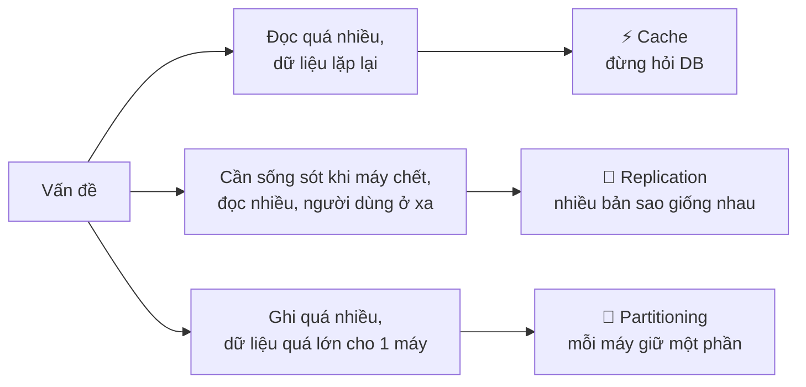

| | Cache | Replication | Partitioning (sharding) |
|---|---|---|---|
| Scale đọc | ✅✅ | ✅ | ✅ |
| Scale ghi | ❌ | ❌ (mọi bản sao đều phải ghi) | ✅✅ |
| Scale dung lượng | ❌ | ❌ | ✅✅ |
| Chịu lỗi (HA) | ❌ (thậm chí là điểm yếu mới) | ✅✅ | ❌ (một shard chết = mất một phần dữ liệu) |
| Vấn đề mới | Dữ liệu cũ, stampede | Lag, failover, split brain | Hot partition, query chéo shard, rebalancing |

Trong thực tế, hệ thống lớn dùng **cả ba cùng lúc**: dữ liệu chia thành nhiều partition, **mỗi partition được replicate** (thường 3 bản), và đằng trước có cache.

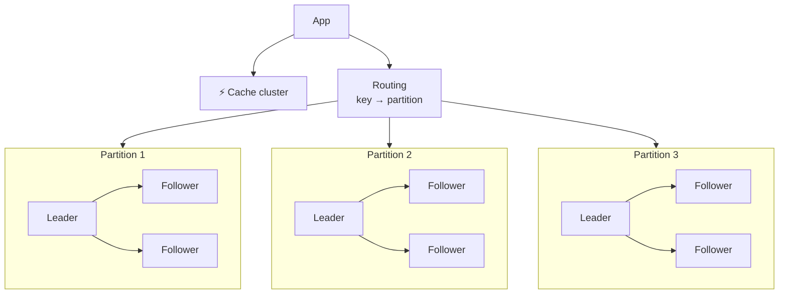

---

## 📖 2. Caching chuyên sâu

### 2.1. Cache ở đâu?

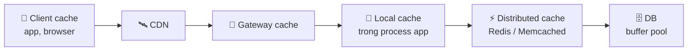

| Tầng | Latency | Phạm vi chia sẻ | Invalidation | Dùng cho |
|---|---|---|---|---|
| Client | 0 (không gọi mạng) | 1 người dùng | Khó (không kiểm soát được) | Asset tĩnh, cấu hình, dữ liệu của chính người dùng |
| CDN | ~5-20 ms | Mọi người dùng trong vùng | Purge, TTL | Nội dung công khai ([Bài 2](./02-building-blocks-network.md)) |
| Local (in-process) | ~nano-micro giây | 1 instance | **Khó** - mỗi instance một bản | Dữ liệu rất nóng, ít đổi; hot key |
| Distributed (Redis) | ~0,2-1 ms | Mọi instance | Xóa key là xong | Mặc định cho hầu hết trường hợp |
| DB buffer pool | trong DB | Mọi query | Tự động | Luôn có sẵn - đừng quên nó |

**Nguyên tắc**: cache càng gần người dùng thì càng nhanh nhưng càng **khó invalidate** và càng **dễ cũ**. Chọn tầng theo câu hỏi: *"Dữ liệu này cũ bao lâu thì chấp nhận được?"*

### 2.2. Các pattern đọc/ghi

| Pattern | Đọc | Ghi | Ưu | Nhược |
|---|---|---|---|---|
| **Cache-aside** (lazy loading) | App đọc cache, miss → đọc DB → set cache | App ghi DB, rồi **xóa** cache | Đơn giản, chỉ cache thứ được đọc, cache chết vẫn chạy | Miss đầu tiên chậm; có race condition (2.3) |
| **Read-through** | Cache tự load từ DB khi miss | (kết hợp với pattern ghi khác) | Logic load nằm một chỗ | Cần thư viện/cache hỗ trợ |
| **Write-through** | Đọc cache | Ghi cache **và** DB đồng bộ | Cache luôn mới | Ghi chậm hơn; cache chứa cả dữ liệu không ai đọc |
| **Write-behind** (write-back) | Đọc cache | Ghi cache, DB được ghi **sau** (bất đồng bộ, theo lô) | Ghi cực nhanh, gộp ghi | **Mất dữ liệu** nếu cache chết trước khi flush |
| **Write-around** | Cache-aside | Ghi thẳng DB, không đụng cache | Tránh làm bẩn cache với dữ liệu ghi một lần | Đọc ngay sau ghi sẽ miss |

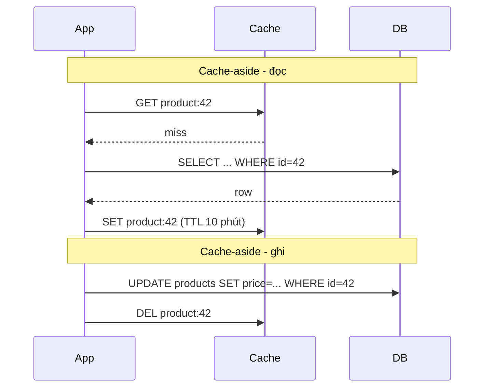

!!! tip "Xóa cache, đừng cập nhật cache"
    Khi ghi, **xóa** key (`DEL`) thay vì **ghi giá trị mới** (`SET`). Lý do: hai writer đồng thời có thể `SET` theo thứ tự ngược với thứ tự ghi DB → cache giữ giá trị cũ **vĩnh viễn** (tới khi hết TTL). Xóa thì lần đọc sau sẽ tự lấy giá trị đúng từ DB.

### 2.3. Race condition kinh điển của cache-aside

Ngay cả khi "xóa sau khi ghi", vẫn còn một khe hở:

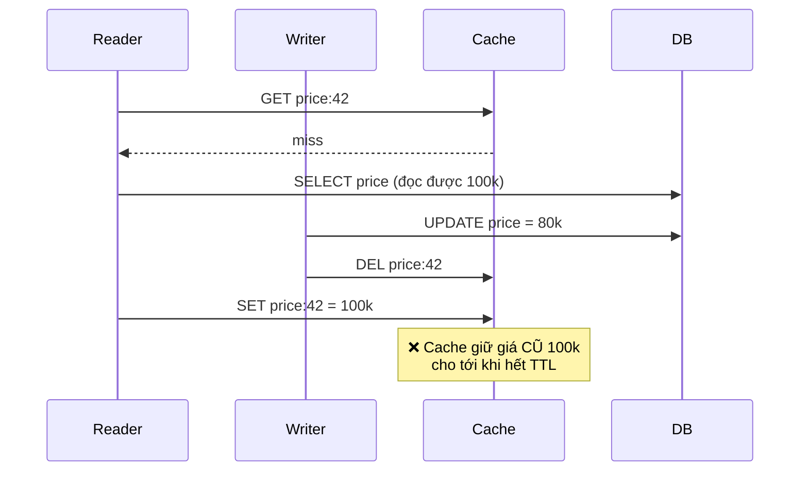

Reader đọc DB **trước** khi writer ghi, nhưng set cache **sau** khi writer xóa. Khe hở hẹp nhưng ở quy mô lớn (hàng triệu request) **chắc chắn xảy ra**.

| Cách sửa | Ý tưởng | Đánh đổi |
|---|---|---|
| **TTL ngắn** làm lưới an toàn | Sai thì cũng chỉ sai tối đa TTL | Không loại bỏ, chỉ giới hạn thiệt hại |
| **Delayed double delete** | Writer xóa, đợi ~vài trăm ms, **xóa lần nữa** | Đơn giản; không đảm bảo tuyệt đối |
| **Version / compare-and-set** | Lưu `version` cùng giá trị; chỉ set nếu version mới hơn bản đang có | Cần DB có version (cột `updated_at`/`version`) |
| **Lease** (ý tưởng từ paper Memcache của Facebook) | Khi miss, cache cấp một "lease token"; nếu key bị xóa trong lúc đó, lease bị hủy → set sẽ bị từ chối | Cần cache hỗ trợ; đồng thời chống stampede |
| **Invalidation bằng CDC** | Đọc binlog/WAL của DB (Debezium...) → xóa cache theo thứ tự commit thật | Thêm hạ tầng; độ trễ invalidation ~giây; nhưng không phụ thuộc vào việc code nhớ xóa cache |

**Lỗi nửa vời**: ghi DB thành công nhưng `DEL` cache thất bại (Redis timeout) → cache cũ. Giải pháp: retry xóa; hoặc đẩy sự kiện invalidation qua **outbox** ([Backend Bài 9](../backend/09-message-queues.md)) / CDC để đảm bảo cuối cùng sẽ xóa; và luôn có TTL.

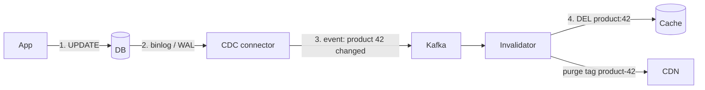

### 2.4. TTL - chọn thế nào?

| Loại dữ liệu | TTL gợi ý | Lý do |
|---|---|---|
| Cấu hình, danh mục ít đổi | 5-60 phút | Đổi hiếm, có invalidation chủ động |
| Thông tin sản phẩm (không gồm tồn kho) | 1-10 phút | Chấp nhận cũ vài phút |
| Feed, timeline | 30 s - vài phút | Eventual là đủ |
| Session | Theo thời hạn đăng nhập | |
| Tồn kho, số dư | **Không cache để quyết định**; chỉ cache để **hiển thị** (kèm kiểm tra lại khi đặt) | Sai là bán vượt / mất tiền |

**TTL jitter**: nếu bạn warm 1 triệu key lúc 9:00 với TTL đúng 1 giờ, lúc 10:00 cả triệu key **hết hạn cùng lúc** → DB nhận cú đánh lớn. Thêm ngẫu nhiên: `TTL = 3600 + random(0, 300)` giây.

**Negative caching**: cache cả kết quả "không tồn tại" (với TTL ngắn, vd 30 s) để chống tấn công/bug hỏi liên tục những key không có.

**Soft TTL (stale-while-revalidate)**: lưu kèm `expires_at` mềm; khi quá hạn mềm, trả bản cũ ngay và **một** request được chọn đi làm mới ở nền. Người dùng không bao giờ chờ miss.

### 2.5. Eviction - khi cache đầy

| Policy | Loại bỏ | Hợp với | Yếu điểm |
|---|---|---|---|
| **LRU** | Lâu nhất chưa dùng | Đa số workload | Một lần **scan** lớn (job báo cáo đọc 1 triệu key một lần) đẩy hết key nóng ra |
| **LFU** | Ít dùng nhất | Workload ổn định, có key nóng lâu dài | Key từng nóng (tin hot hôm qua) bám lì |
| **FIFO** | Vào trước | Đơn giản | Bỏ cả key nóng |
| **TTL-based** | Sắp hết hạn | Dữ liệu có thời hạn rõ | |
| **W-TinyLFU** (Caffeine, Ristretto) | Kết hợp tần suất (sketch) + gần đây, có "cửa chặn" cho key mới | Hit ratio rất tốt, chống scan | Phức tạp hơn (thư viện lo) |

Redis có cấu hình `maxmemory-policy` (`allkeys-lru`, `allkeys-lfu`, `volatile-ttl`, `noeviction`...). Với Redis làm **cache**, dùng `allkeys-lru` hoặc `allkeys-lfu`; `noeviction` dành cho Redis làm **storage** (khi đầy thì từ chối ghi thay vì âm thầm xóa).

### 2.6. Ba kiểu sự cố cache

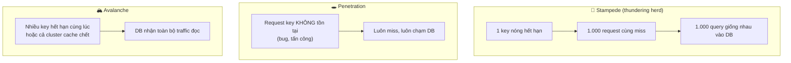

| Sự cố | Giải pháp |
|---|---|
| **Stampede** | **Request coalescing** (singleflight - code ở mục 6), lock khi rebuild, soft TTL / làm mới sớm theo xác suất trước khi hết hạn |
| **Penetration** | Negative cache, **Bloom filter** các key tồn tại ([Algorithms Bài 15](../algorithms/15-advanced-data-structures.md)), validate input, rate limit |
| **Avalanche** | TTL jitter, cache cluster có replica, **warm-up** trước khi nhận traffic, **circuit breaker + rate limit** bảo vệ DB, chấp nhận trả lỗi/degrade một phần thay vì để DB sập |

!!! warning "Cache trở thành dependency bắt buộc"
    Hệ thống chạy lâu với hit ratio 95% sẽ có DB được cấp năng lực chỉ cho 5% traffic đọc. Nếu cache cluster sập, DB nhận **gấp 20 lần** tải bình thường → sập theo. Khi đó cache **không còn là tối ưu** mà là **thành phần sống còn** - phải được thiết kế HA, theo dõi, và có kế hoạch "cache chết thì làm gì" (rate limit, phục vụ bản stale từ tầng khác, tắt tính năng phụ).

### 2.7. Cache nhiều tầng (L1 local + L2 distributed)

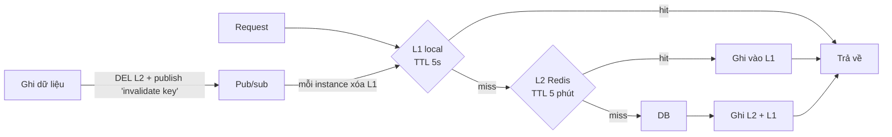

L1 cực nhanh và giảm tải Redis (đặc biệt cho **hot key** - mục 6), nhưng mỗi instance có một bản riêng → dùng **TTL rất ngắn** (vài giây) và/hoặc pub/sub để xóa. Chấp nhận dữ liệu cũ tối đa vài giây.

---

## 📖 3. Replication

### 3.1. Leader-follower (single-leader)

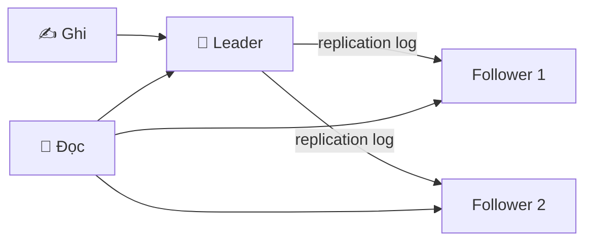

Mọi thao tác ghi đi vào **leader**; leader ghi vào log và gửi log cho các **follower**; follower áp dụng theo đúng thứ tự. Đọc có thể từ leader hoặc follower. Đây là mô hình của PostgreSQL, MySQL, MongoDB (replica set), Redis replication, Kafka (theo từng partition).

**Đồng bộ hay bất đồng bộ?**

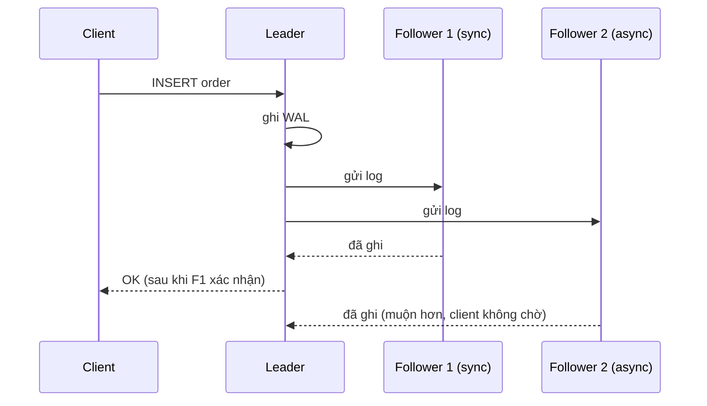

| Kiểu | Client nhận OK khi | Ưu | Nhược |
|---|---|---|---|
| **Sync** (mọi follower) | Mọi follower đã ghi | Không mất dữ liệu khi failover | Một follower chậm/chết → **mọi** lệnh ghi bị chặn |
| **Async** | Leader ghi xong | Ghi nhanh, follower chết không ảnh hưởng | Leader chết → **mất** các ghi chưa kịp gửi |
| **Semi-sync** (1 sync, còn lại async) | Leader + ít nhất 1 follower đã ghi | Cân bằng: luôn có ≥2 bản, không bị chặn bởi follower chậm nhất | Vẫn chậm hơn async |

Hầu hết hệ thống production chọn **semi-sync** hoặc async có giám sát lag, tùy RPO. Các hệ thống dùng consensus (Raft) như etcd, CockroachDB thì chờ **đa số** (quorum) - xem [Bài 4](./04-consistency-consensus.md).

### 3.2. Failover - phần nguy hiểm nhất

Khi leader chết: (1) **phát hiện** (thường bằng timeout - nhưng timeout bao nhiêu? quá ngắn → failover nhầm khi chỉ là mạng chậm; quá dài → downtime lâu), (2) **chọn** leader mới (follower có dữ liệu mới nhất), (3) **cấu hình lại** client và các follower khác.

| Rủi ro | Mô tả | Giảm thiểu |
|---|---|---|
| **Mất ghi** | Async: leader mới thiếu các ghi cuối của leader cũ | Semi-sync; chọn follower mới nhất; RPO rõ ràng |
| **Leader cũ sống lại** | Nó vẫn tưởng mình là leader và nhận ghi | **Fencing** (epoch/term, fencing token) - [Bài 4](./04-consistency-consensus.md) |
| **Split brain** | Hai node cùng nghĩ mình là leader, cùng nhận ghi → dữ liệu phân kỳ | Consensus/quorum để bầu leader; STONITH ("bắn node kia") |
| **Xung đột ID** | Leader mới cấp lại ID đã dùng (auto-increment) | ID không phụ thuộc leader (Snowflake, UUID v7) |

!!! warning "Một bài học đắt giá"
    Đã có những sự cố công khai trong ngành, trong đó failover tự động đưa một follower **chưa bắt kịp** lên làm leader, khiến các ID tự tăng bị dùng lại và dữ liệu ở hệ thống khác (cache, service khác) trỏ nhầm sang bản ghi khác. Failover tự động là cần thiết cho availability cao, nhưng phải được **thử nghiệm định kỳ** (chaos/DR drill) và có fencing.

### 3.3. Multi-leader

Mỗi datacenter (hoặc mỗi thiết bị offline) có một leader riêng nhận ghi; các leader đồng bộ bất đồng bộ với nhau.

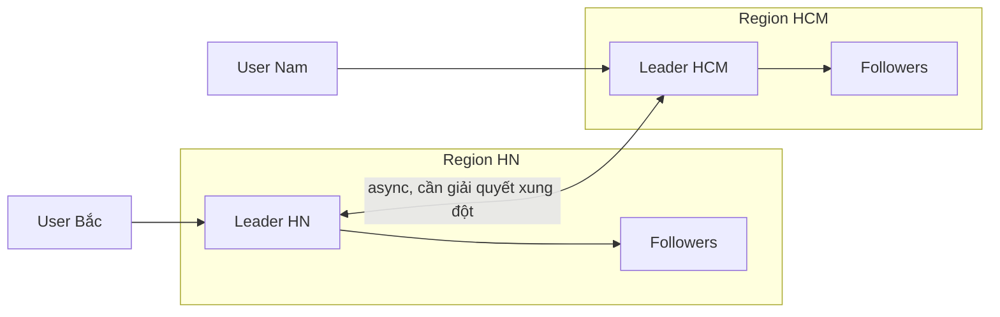

| Dùng khi | Ví dụ |
|---|---|
| Nhiều region, muốn ghi tại chỗ với latency thấp | Multi-region active-active |
| Client làm việc offline | App ghi chú, lịch trên điện thoại (mỗi thiết bị là một "leader") |
| Cộng tác thời gian thực | Google Docs-like (mỗi người sửa local) |

**Cái giá**: **xung đột ghi**. Lan sửa tiêu đề thành "A" ở HN, cùng lúc Minh sửa thành "B" ở HCM. Đồng bộ xong, giá trị là gì? Các chiến lược (last-write-wins, merge, CRDT, hỏi người dùng) ở [Bài 4 - mục multi-region](./04-consistency-consensus.md). Quy tắc: **tránh xung đột** tốt hơn giải quyết - ví dụ, mọi ghi của một user luôn đi về "home region" của user đó.

### 3.4. Leaderless (kiểu Dynamo)

Không có leader. Client (hoặc coordinator) gửi ghi tới **N** replica, chờ **W** xác nhận; đọc từ **R** replica, lấy bản mới nhất. Nếu `R + W > N` thì tập đọc và tập ghi luôn giao nhau.

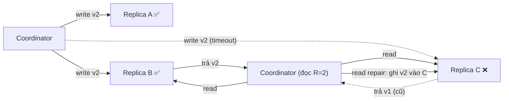

Cơ chế "tự chữa lành": **read repair** (đọc thấy replica cũ → sửa luôn), **anti-entropy** (tiến trình nền so sánh dữ liệu giữa replica bằng Merkle tree), **hinted handoff** (replica tạm chết → node khác giữ hộ ghi, trả lại sau). Dùng trong Cassandra, ScyllaDB, Riak, DynamoDB (ý tưởng gốc từ paper Dynamo). Mô phỏng quorum ở [Bài 4](./04-consistency-consensus.md), tự xây ở [Bài 7](./07-key-value-store.md).

### 3.5. So sánh ba mô hình

| | Single-leader | Multi-leader | Leaderless |
|---|---|---|---|
| Ghi ở đâu | 1 leader | Nhiều leader | Bất kỳ replica nào (N, W) |
| Xung đột ghi | Không (leader tuần tự hóa) | **Có** | **Có** (ghi đồng thời) |
| Chịu lỗi khi ghi | Leader chết → failover | Tốt | Rất tốt (chỉ cần W replica sống) |
| Latency ghi đa region | Cao (phải về leader) | Thấp (ghi tại chỗ) | Tùy W và vị trí replica |
| Độ phức tạp | Thấp nhất | Cao | Cao |
| Ví dụ | PostgreSQL, MySQL, MongoDB | MySQL/Postgres multi-source (tooling bên ngoài), CouchDB | Cassandra, DynamoDB, Riak |

### 3.6. Bất thường do replication lag (và cách sửa)

Với async replication, follower **trễ** hơn leader - thường vài ms, nhưng khi tải cao hoặc mạng có vấn đề có thể là **giây hoặc phút**. Đọc từ follower sẽ gặp những bất thường sau.

#### Read-your-writes (đọc thấy cái mình vừa ghi)

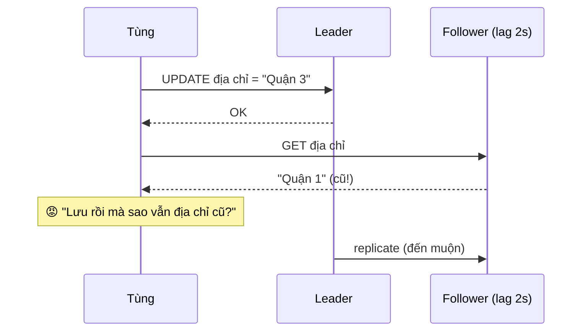

| Cách sửa | Chi tiết |
|---|---|
| Đọc dữ liệu **của chính mình** từ leader | Profile, đơn hàng của tôi → leader; profile người khác → follower |
| Đọc từ leader trong **X giây sau khi ghi** | App ghi nhớ `last_write_at` (cookie/session); nếu < 10 s → đọc leader |
| **Theo dõi vị trí replication** | Sau khi ghi, client giữ LSN/timestamp của lần ghi; chỉ đọc từ follower nào đã bắt kịp vị trí đó (hoặc chờ) |
| Cập nhật UI lạc quan | Client hiển thị giá trị vừa ghi mà không cần đọc lại (chỉ là che, không sửa gốc) |

Lưu ý thêm: **cross-device** - Tùng sửa trên laptop rồi mở điện thoại. Cách "nhớ trong cookie" không còn tác dụng; cần lưu `last_write_at` phía server theo user.

#### Monotonic reads (thời gian không chạy lùi)

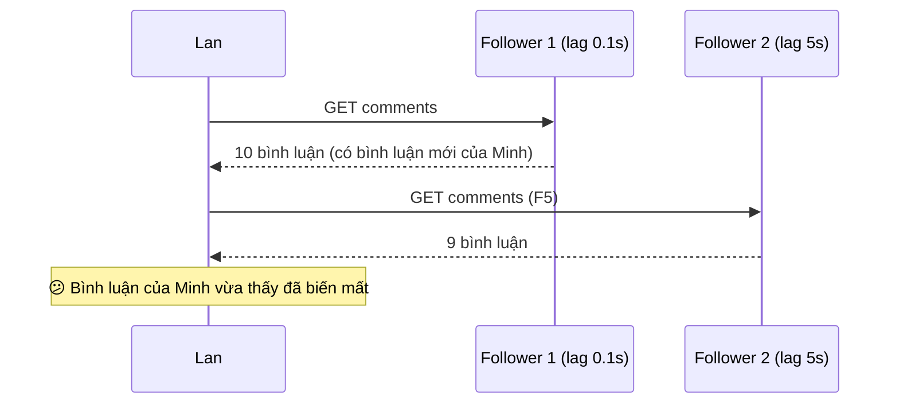

**Sửa**: mỗi user luôn đọc từ **cùng một follower** (chọn bằng `hash(user_id)`); nếu follower đó chết thì mới chuyển. Hoặc dùng cách theo dõi vị trí như trên (không đọc từ replica cũ hơn lần đọc trước).

#### Consistent prefix reads (nhân quả đúng thứ tự)

Khi dữ liệu nằm ở **nhiều partition** với lag khác nhau, người quan sát có thể thấy **câu trả lời trước câu hỏi**:

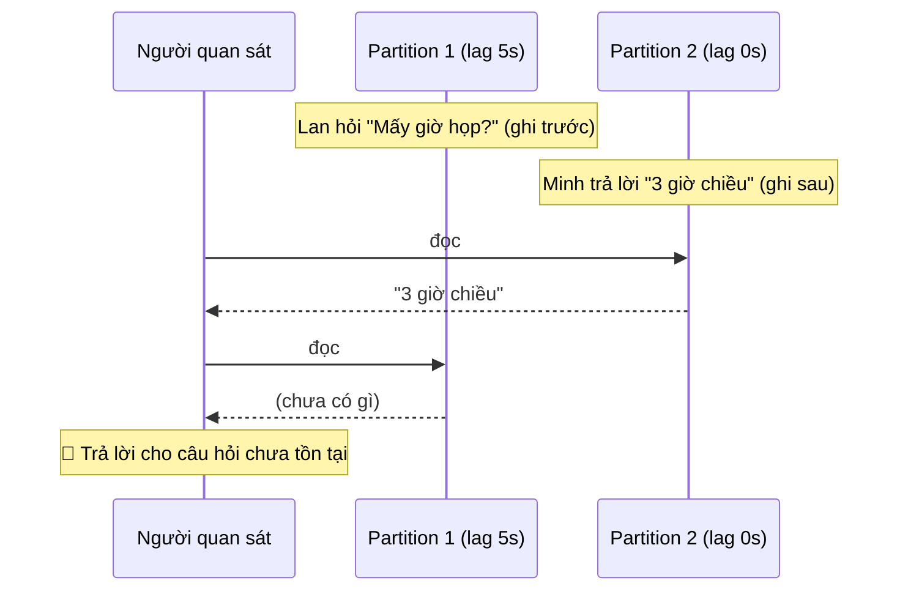

**Sửa**: ghi các sự kiện **có quan hệ nhân quả** vào **cùng một partition** (ví dụ mọi tin nhắn của một cuộc hội thoại chung partition `conversation_id`, có số thứ tự tăng dần), hoặc theo dõi phụ thuộc nhân quả (vector clock - [Bài 4](./04-consistency-consensus.md)).

!!! tip "Giám sát lag là bắt buộc"
    Đặt metric `replication_lag_seconds` cho mọi follower và alert khi vượt ngưỡng. Nhiều driver/proxy có thể **tự loại** follower có lag quá cao khỏi pool đọc. Thiết kế "đọc từ follower" luôn phải trả lời: *"Nếu lag là 5 phút thì chuyện gì xảy ra?"*

---

## 📖 4. Partitioning (sharding)

### 4.1. Khi nào mới shard?

Sharding **đắt**: query chéo shard, transaction chéo shard, rebalancing, vận hành nhiều cụm. Trước khi shard, hãy chắc đã thử:

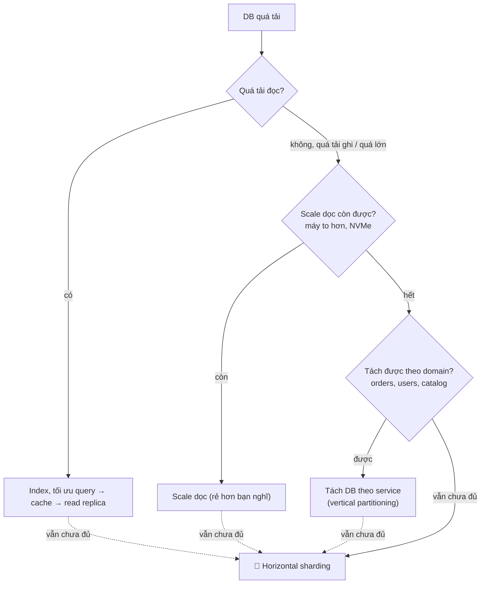

Một máy chủ database hiện đại với hàng trăm GB RAM và NVMe có thể phục vụ **hàng TB dữ liệu** và **hàng chục nghìn QPS**. Rất nhiều công ty không bao giờ cần shard - và rất nhiều công ty shard quá sớm rồi hối hận.

### 4.2. Ba chiến lược phân chia

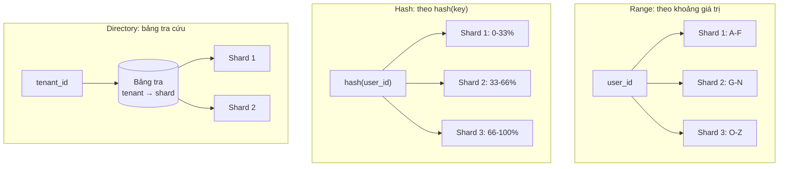

| | Range | Hash | Directory (lookup) |
|---|---|---|---|
| Truy vấn khoảng (`created_at BETWEEN`) | ✅ Hiệu quả (1-2 shard) | ❌ Phải hỏi mọi shard | Tùy |
| Phân bố đều | ❌ Dễ lệch (key tuần tự dồn vào shard cuối) | ✅ Đều (nếu key đủ đa dạng) | Tùy cách gán |
| Hot spot do thời gian | ❌ Mọi ghi mới dồn vào shard "hiện tại" | ✅ | Tùy |
| Linh hoạt di chuyển | Tách khoảng (split) | Cần consistent hashing / slot | ✅✅ Đổi một dòng trong bảng |
| Nhược điểm riêng | | Mất thứ tự | Bảng tra là dependency/SPOF, phải cache |
| Ví dụ | HBase, Bigtable, CockroachDB/TiDB (range tự split) | Cassandra, DynamoDB, Redis Cluster (slot) | Hệ thống multi-tenant (khách lớn có shard riêng) |

**Kết hợp phổ biến** (compound key): hash phần đầu để rải đều, range phần sau để truy vấn khoảng. Ví dụ Cassandra: `PRIMARY KEY ((user_id), created_at)` - `user_id` được hash để chọn partition, trong partition dữ liệu sắp xếp theo `created_at` → "100 sự kiện mới nhất của user X" chỉ chạm một partition.

### 4.3. Chọn partition key

Partition key tốt: (1) **cardinality cao** (nhiều giá trị khác nhau), (2) **phân bố đều** cả về dữ liệu lẫn traffic, (3) **khớp với truy vấn chính** (query chính chỉ chạm 1 partition).

| Hệ thống | Truy vấn chính | Key tốt | Key tệ và vì sao |
|---|---|---|---|
| Chat | Tin nhắn của 1 cuộc hội thoại | `conversation_id` | `sender_id` - đọc 1 cuộc chat phải hỏi nhiều shard |
| Đơn hàng TMĐT | "Đơn của tôi" | `user_id` | `order_date` - mọi đơn hôm nay dồn 1 shard |
| Đơn hàng (phía shop) | "Đơn của shop tôi" | `shop_id`... nhưng shop lớn sẽ nóng | → thường cần **bản sao thứ hai** partition theo `shop_id` (mục 4.4) |
| Metrics | Một series trong khoảng thời gian | `(series_id, time_bucket)` | `timestamp` - mọi ghi vào partition hiện tại |
| SaaS multi-tenant | Dữ liệu của 1 tenant | `tenant_id` (+ directory cho tenant lớn) | `tenant_id` thuần khi có tenant chiếm 30% tổng dữ liệu |

### 4.4. Secondary index: local hay global?

Dữ liệu chia theo `user_id`. Bây giờ cần "tìm mọi đơn hàng có `status = 'pending'`" hoặc "đơn của `shop_id = 7`".

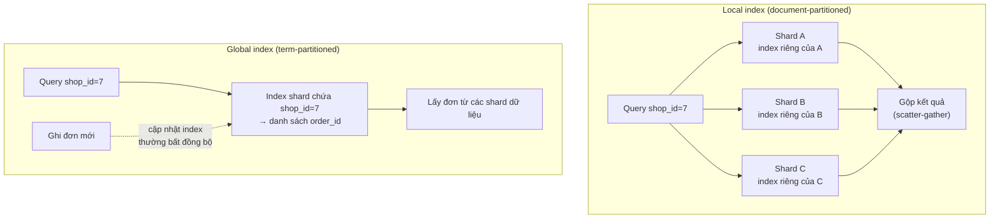

| | Local index | Global index |
|---|---|---|
| Ghi | Nhanh: chỉ 1 shard (dữ liệu + index cùng chỗ) | Chậm hơn: ghi chạm shard dữ liệu **và** shard index (thường khác nhau) |
| Đọc theo index | **Scatter-gather** mọi shard → tail latency tệ ([Bài 1 §4.2](./01-framework-estimation.md)) | Chỉ hỏi 1 shard index |
| Nhất quán | Đồng bộ với dữ liệu | Thường **eventual** (cập nhật bất đồng bộ) |
| Ví dụ | MongoDB, Elasticsearch, Cassandra secondary index | DynamoDB Global Secondary Index |

Trong thiết kế hệ thống, cách phổ biến nhất cho truy vấn theo chiều thứ hai là **tạo một bảng/collection riêng partition theo chiều đó** (denormalize) và cập nhật qua sự kiện/CDC - về bản chất là global index tự quản lý. Ví dụ: `orders_by_user` (key `user_id`) và `orders_by_shop` (key `shop_id`).

### 4.5. Rebalancing - thêm/bớt node mà không sập

**Đừng dùng `hash(key) % N`**. Khi N đổi từ 4 sang 5, gần **80%** key phải di chuyển (số liệu thật ở mục 5). Ba cách đúng:

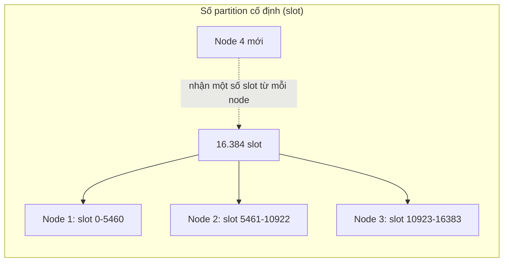

| Cách | Ý tưởng | Ví dụ |
|---|---|---|
| **Số partition cố định, nhiều hơn số node** | Tạo trước 1.024 (hay 16.384) partition; node mới "lấy" bớt một số partition nguyên vẹn từ node cũ | Redis Cluster (16.384 slot), Elasticsearch (số shard chọn khi tạo index), Kafka (partition) |
| **Dynamic split (theo range)** | Partition lớn quá ngưỡng (vd 512 MB) thì tự tách đôi; nhỏ quá thì gộp | HBase, Bigtable, CockroachDB, TiDB |
| **Consistent hashing** | Node và key trên vòng hash; thêm node chỉ di chuyển ~1/N key | Cassandra, DynamoDB (ý tưởng gốc), Riak, nhiều cache client |

**Quy trình di chuyển dữ liệu online** (khi buộc phải đổi sơ đồ shard, ví dụ từ 4 sang 16 shard):

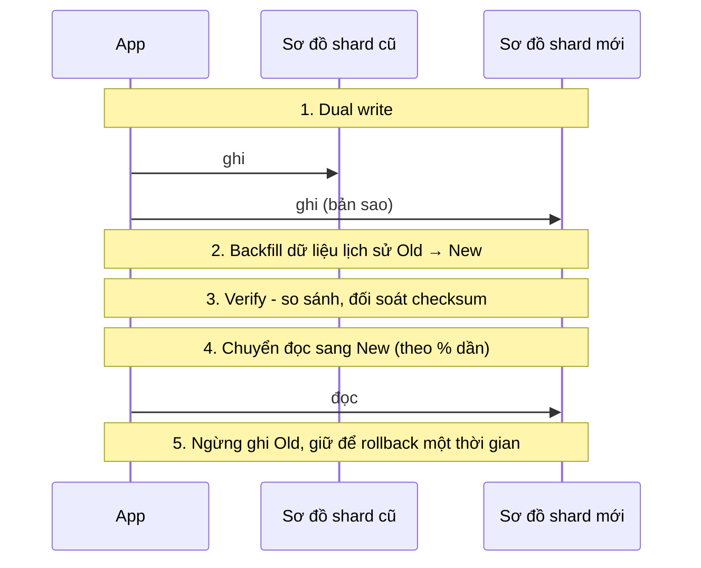

!!! warning "Rebalancing tự động có thể gây sập"
    Di chuyển dữ liệu tốn băng thông mạng và I/O của chính các node đang phục vụ traffic. Nếu một node bị đánh dấu "chết" nhầm (do chậm), hệ thống bắt đầu di chuyển dữ liệu của nó → các node khác thêm tải → chậm → bị đánh dấu chết tiếp → **sập dây chuyền**. Nhiều hệ thống chọn: tự động **phát hiện**, nhưng **con người duyệt** việc rebalancing lớn; và luôn giới hạn tốc độ di chuyển (throttle).

### 4.6. Định tuyến request tới đúng shard

```mermaid
flowchart LR
    subgraph A["1. Node bất kỳ chuyển tiếp"]
        C1["Client"] --> X["Node bất kỳ"] -->|"không phải của tôi → forward"| Y["Node đúng"]
    end
    subgraph B["2. Tầng routing"]
        C2["Client"] --> RT["Router / proxy<br/>(mongos, Vitess vtgate)"] --> Z["Shard đúng"]
    end
    subgraph CC["3. Client biết bản đồ"]
        C3["Smart client<br/>cache bản đồ shard"] --> W["Shard đúng"]
    end
    CFG[("Bản đồ shard<br/>ZooKeeper / etcd")] -.-> RT
    CFG -.-> C3
```

Bản đồ shard (partition → node) cần một nơi lưu **nhất quán** (thường dùng ZooKeeper/etcd - hệ thống consensus, [Bài 4](./04-consistency-consensus.md)). Khi bản đồ thay đổi, client có thể gửi nhầm node cũ → node trả lỗi kiểu "MOVED" (Redis Cluster) để client cập nhật.

### 4.7. Query và transaction chéo shard

- **Query chéo shard**: scatter-gather (chậm, tail latency), hoặc denormalize thành bảng theo chiều khác, hoặc đẩy sang hệ thống phân tích (data warehouse) cho báo cáo.
- **Transaction chéo shard**: tránh nếu có thể bằng cách chọn partition key sao cho thao tác cần atomic nằm trong một shard. Nếu không tránh được: 2PC hoặc saga - [Bài 4](./04-consistency-consensus.md).
- **Join chéo shard**: denormalize, hoặc join ở tầng ứng dụng với dữ liệu nhỏ (bảng tham chiếu nhỏ có thể **replicate toàn bộ** sang mọi shard).

---

## 📖 5. Consistent hashing với virtual node - đo bằng số thật

[Backend Bài 10 §7.3](../backend/10-system-design.md) đã giải thích ý tưởng vòng hash và có code cơ bản. Ở đây ta **đo** hai câu hỏi mà phỏng vấn hay hỏi:

1. Thêm một node thì **bao nhiêu % key phải di chuyển** - so với `hash % N`?
2. Cần **bao nhiêu virtual node** để tải đều? Và khi thêm node, key được lấy từ **bao nhiêu node cũ**?

Chương trình: 100.000 key, 10 node, so sánh số vnode 1, 10, 100, 500. Hash dùng 8 byte đầu của MD5 (giống nhau ở cả hai ngôn ngữ nên output **giống hệt**).

=== "Go"

    ```go
    package main

    import (
    	"crypto/md5"
    	"encoding/binary"
    	"fmt"
    	"math"
    	"sort"
    )

    func hash(s string) uint64 {
    	sum := md5.Sum([]byte(s))
    	return binary.BigEndian.Uint64(sum[:8])
    }

    type Ring struct {
    	vnodes int
    	points []uint64          // vị trí trên vòng (đã sort)
    	owner  map[uint64]string // vị trí -> node thật
    }

    func NewRing(vnodes int) *Ring { return &Ring{vnodes: vnodes, owner: map[uint64]string{}} }

    func (r *Ring) Add(node string) {
    	for v := 0; v < r.vnodes; v++ {
    		p := hash(fmt.Sprintf("%s#%d", node, v))
    		r.points = append(r.points, p)
    		r.owner[p] = node
    	}
    	sort.Slice(r.points, func(i, j int) bool { return r.points[i] < r.points[j] })
    }

    func (r *Ring) Get(key string) string {
    	h := hash(key)
    	i := sort.Search(len(r.points), func(i int) bool { return r.points[i] > h })
    	return r.owner[r.points[i%len(r.points)]]
    }

    func main() {
    	keys := make([]string, 100_000)
    	for i := range keys {
    		keys[i] = fmt.Sprintf("user:%d", i)
    	}

    	// 1) hash(key) % N: thêm 1 node làm bao nhiêu key đổi chỗ?
    	moved := 0
    	for _, k := range keys {
    		if hash(k)%4 != hash(k)%5 {
    			moved++
    		}
    	}
    	fmt.Printf("mod-N 4->5 nodes: %.1f%% key phải di chuyển\n", 100*float64(moved)/float64(len(keys)))

    	// 2) Consistent hashing: độ đều và số key di chuyển theo số vnode
    	fmt.Printf("%6s | %8s %8s %7s | moved 10->11 | lấy từ bao nhiêu node cũ\n", "vnodes", "min load", "max load", "stddev")
    	for _, vn := range []int{1, 10, 100, 500} {
    		ring := NewRing(vn)
    		for n := 0; n < 10; n++ {
    			ring.Add(fmt.Sprintf("node%d", n))
    		}
    		owner := make(map[string]string, len(keys))
    		load := map[string]int{}
    		for _, k := range keys {
    			o := ring.Get(k)
    			owner[k] = o
    			load[o]++
    		}
    		mean := float64(len(keys)) / 10
    		minL, maxL, varSum := math.Inf(1), 0.0, 0.0
    		for n := 0; n < 10; n++ {
    			l := float64(load[fmt.Sprintf("node%d", n)])
    			minL, maxL = math.Min(minL, l), math.Max(maxL, l)
    			varSum += (l - mean) * (l - mean)
    		}
    		ring.Add("node10")
    		movedKeys, donors := 0, map[string]bool{}
    		for _, k := range keys {
    			if ring.Get(k) != owner[k] {
    				movedKeys++
    				donors[owner[k]] = true
    			}
    		}
    		fmt.Printf("%6d | %8.2f %8.2f %6.1f%% | %11.1f%% | %2d\n", vn, minL/mean, maxL/mean,
    			100*math.Sqrt(varSum/10)/mean, 100*float64(movedKeys)/float64(len(keys)), len(donors))
    	}
    }

    // Output:
    // mod-N 4->5 nodes: 79.9% key phải di chuyển
    // vnodes | min load max load  stddev | moved 10->11 | lấy từ bao nhiêu node cũ
    //      1 |     0.01     3.38  102.7% |        22.3% |  1
    //     10 |     0.53     1.43   32.3% |         7.8% |  8
    //    100 |     0.85     1.17    9.1% |         9.1% | 10
    //    500 |     0.94     1.13    6.2% |         9.0% | 10
    ```

=== "Python"

    ```python
    import bisect
    import hashlib
    import statistics


    def h(s: str) -> int:
        return int.from_bytes(hashlib.md5(s.encode()).digest()[:8], "big")


    class Ring:
        def __init__(self, vnodes: int):
            self.vnodes = vnodes
            self.points: list[int] = []      # vị trí trên vòng (đã sort)
            self.owner: dict[int, str] = {}  # vị trí -> node thật

        def add(self, node: str):
            for v in range(self.vnodes):
                p = h(f"{node}#{v}")
                bisect.insort(self.points, p)
                self.owner[p] = node

        def get(self, key: str) -> str:
            i = bisect.bisect(self.points, h(key)) % len(self.points)
            return self.owner[self.points[i]]


    KEYS = [f"user:{i}" for i in range(100_000)]

    # 1) hash(key) % N: thêm 1 node làm bao nhiêu key đổi chỗ?
    before = {k: h(k) % 4 for k in KEYS}
    moved = sum(1 for k in KEYS if h(k) % 5 != before[k])
    print(f"mod-N 4->5 nodes: {moved / len(KEYS):.1%} key phải di chuyển")

    # 2) Consistent hashing: độ đều và số key di chuyển theo số vnode
    print(f"{'vnodes':>6} | {'min load':>8} {'max load':>8} {'stddev':>7} | moved 10->11 | lấy từ bao nhiêu node cũ")
    for vn in [1, 10, 100, 500]:
        ring = Ring(vn)
        for n in range(10):
            ring.add(f"node{n}")
        owner = {k: ring.get(k) for k in KEYS}
        load = [list(owner.values()).count(f"node{n}") for n in range(10)]
        mean = len(KEYS) / 10
        ring.add("node10")
        moved = [k for k in KEYS if ring.get(k) != owner[k]]
        donors = {owner[k] for k in moved}
        print(f"{vn:>6} | {min(load)/mean:>8.2f} {max(load)/mean:>8.2f} "
              f"{statistics.pstdev(load)/mean:>7.1%} | {len(moved)/len(KEYS):>12.1%} | {len(donors):>2}")

    # Output:
    # mod-N 4->5 nodes: 79.9% key phải di chuyển
    # vnodes | min load max load  stddev | moved 10->11 | lấy từ bao nhiêu node cũ
    #      1 |     0.01     3.38  102.7% |        22.3% |  1
    #     10 |     0.53     1.43   32.3% |         7.8% |  8
    #    100 |     0.85     1.17    9.1% |         9.1% | 10
    #    500 |     0.94     1.13    6.2% |         9.0% | 10
    ```

**Đọc kết quả**

```mermaid
xychart-beta
    title "Tải lớn nhất / tải trung bình theo số vnode (10 node, 100K key)"
    x-axis ["1 vnode", "10 vnode", "100 vnode", "500 vnode"]
    y-axis "max load / mean" 0 --> 3.5
    bar [3.38, 1.43, 1.17, 1.13]
```

1. **`hash % N`: 79,9% key di chuyển** khi đi từ 4 lên 5 node (lý thuyết: 1 - 1/5 = 80%). Với cache, nghĩa là 80% cache "biến mất" cùng lúc → avalanche vào DB.
2. **1 vnode/node: tệ hại.** Node lớn nhất giữ **3,38 lần** mức trung bình, node nhỏ nhất gần như **không có gì** (0,01). Độ lệch chuẩn 103%. Thêm node 11 làm di chuyển 22,3% key (gấp đôi lý tưởng), và **toàn bộ** lấy từ đúng **1** node cũ - node hàng xóm trên vòng.
3. **100 vnode: tốt.** Max/mean = 1,17, độ lệch chuẩn ~9%. Thêm node chỉ di chuyển **9,1%** key - đúng bằng lý tưởng 1/11 ≈ 9,1% - và key mới được lấy **đều từ cả 10 node cũ**. Đây là lợi ích kép của vnode: **đều hơn** và khi một node chết/thêm vào, tải được **rải đều** chứ không dồn vào một hàng xóm.
4. **500 vnode**: đều hơn chút nữa (1,13) nhưng tốn bộ nhớ cho vòng (5.000 điểm) và thời gian tìm kiếm tăng nhẹ. Thực tế dùng ~100-256 vnode/node là đủ.

!!! note "Các biến thể đáng biết"
    - **Bounded-load consistent hashing** (Google, 2016): giới hạn mỗi node nhận tối đa `(1 + ε) × trung bình`; vượt thì chuyển sang node kế tiếp trên vòng. Giải quyết một phần vấn đề hot key ở [Bài 2 §3.3](./02-building-blocks-network.md).
    - **Rendezvous hashing (HRW)**: mỗi key tính `score(key, node)` cho mọi node, chọn node điểm cao nhất. Không cần vòng, tự nhiên đều, nhưng O(N) mỗi lần tra.
    - **Jump consistent hash**: rất nhanh, không tốn bộ nhớ, nhưng chỉ hỗ trợ thêm/bớt node ở **cuối danh sách** - hợp với partition được đánh số.
    - **Maglev hashing**: bảng tra cố định kích thước, tra O(1), dùng cho L4 LB.

!!! tip "Trọng số node"
    Node có cấu hình gấp đôi? Cho nó **gấp đôi số vnode**. Đây là cách tự nhiên để cân bằng phần cứng không đồng nhất.

---

## 📖 6. Hot key và hot partition

Phân bố đều **dữ liệu** chưa đủ - cần phân bố đều **traffic**. Truy cập thực tế theo phân phối Zipf: trong mô phỏng ở [Bài 2](./02-building-blocks-network.md), user nóng nhất một mình chiếm ~15% traffic. Không thuật toán phân chia nào chia nhỏ được **một key**.

### 6.1. Nguồn gốc của hot key

| Tình huống | Key nóng | Loại |
|---|---|---|
| Người nổi tiếng đăng bài | `post:{id}`, `user:{celebrity}` | Đọc nóng |
| Flash sale | `stock:{sku}` | **Ghi** nóng |
| Bài viral | `like_count:{post}` | Ghi nóng (đếm) |
| Livestream | `room:{id}:viewers`, chat của phòng | Đọc + ghi nóng |
| Key theo thời gian | partition `2026-10-28T09` | Ghi nóng (mọi ghi vào giờ hiện tại) |
| Cấu hình toàn cục | `config:feature_flags` | Đọc cực nóng (mọi request đọc) |
| Bug | Retry vô hạn trên một key | Bất kỳ |

```mermaid
flowchart LR
    U["1 triệu người xem<br/>livestream KOL"] --> K["product:9999"]
    K --> S7["🔥 Shard 7<br/>CPU 100%"]
    O["Traffic còn lại"] --> S1["Shard 1 😴"]
    O --> S2["Shard 2 😴"]
    O --> S3["... 😴"]
```

### 6.2. Phát hiện

- **Metric theo shard**: CPU, QPS, latency của từng shard/node - một shard lệch hẳn là dấu hiệu.
- **Top-K key**: lấy mẫu request và đếm bằng **Count-Min Sketch + heap** (xấp xỉ, ít bộ nhớ) - ý tưởng giống [Bài 15](./15-autocomplete-crawler.md) và [Bài 16](./16-metrics-aggregation.md).
- **Công cụ có sẵn**: `redis-cli --hotkeys` (cần policy LFU), thống kê theo partition của DynamoDB/Cassandra.
- **Phát hiện sớm** quan trọng hơn: biết trước sự kiện (flash sale, KOL lên sóng) → xử lý chủ động.

### 6.3. Hot key đọc

```mermaid
flowchart TB
    R["Đọc product:9999"] --> L1{"L1 local cache<br/>trong mỗi app instance<br/>TTL 1-5s"}
    L1 -->|"hit 99%"| OK["Trả về"]
    L1 -->|"miss"| CO["Request coalescing<br/>1 request / key / instance"]
    CO --> RP{"Redis: chọn ngẫu nhiên 1 bản sao<br/>product:9999#0 ... #7"}
    RP --> OK
```

| Kỹ thuật | Cách làm | Hiệu quả |
|---|---|---|
| **Cache cục bộ (L1)** | Giữ key nóng trong RAM của mỗi app instance, TTL vài giây | 100 instance → Redis chỉ nhận tối đa ~100 request / TTL cho key đó |
| **Nhân bản key** | Ghi `product:9999#0..#7` lên 8 node khác nhau; đọc ngẫu nhiên một bản | Chia tải đọc cho 8 node; ghi phải cập nhật 8 bản |
| **Request coalescing** | Trong một instance, các request cùng key đang bay chỉ gửi **1** lời gọi xuống dưới | Chống stampede khi key hết hạn (code bên dưới) |
| **CDN / edge** | Nội dung công khai (trang sản phẩm) cache ở edge | Chặn traffic trước khi vào hệ thống |
| **Read replica** cho shard nóng | Thêm follower cho riêng shard đó | Chỉ giúp đọc; cần chấp nhận lag |

**Request coalescing** - 1.000 request cùng lúc cho một key vừa hết hạn cache:

=== "Go"

    ```go
    package main

    import (
    	"fmt"
    	"sync"
    	"sync/atomic"
    	"time"
    )

    var dbCalls atomic.Int64

    func loadFromDB(key string) string { // giả lập query chậm 50ms
    	dbCalls.Add(1)
    	time.Sleep(50 * time.Millisecond)
    	return "value-of-" + key
    }

    // Group: gộp các request cùng key đang bay thành 1 lần gọi DB (giống x/sync/singleflight)
    type call struct {
    	wg  sync.WaitGroup
    	val string
    }

    type Group struct {
    	mu sync.Mutex
    	m  map[string]*call
    }

    func (g *Group) Do(key string, fn func() string) string {
    	g.mu.Lock()
    	if c, ok := g.m[key]; ok { // đã có người đang gọi -> chờ chung kết quả
    		g.mu.Unlock()
    		c.wg.Wait()
    		return c.val
    	}
    	c := &call{}
    	c.wg.Add(1)
    	g.m[key] = c
    	g.mu.Unlock()

    	c.val = fn()
    	c.wg.Done()

    	g.mu.Lock()
    	delete(g.m, key)
    	g.mu.Unlock()
    	return c.val
    }

    func burst(name string, get func(string) string) {
    	dbCalls.Store(0)
    	var wg sync.WaitGroup
    	start := time.Now()
    	for i := 0; i < 1000; i++ { // 1000 request cùng lúc cho 1 hot key vừa hết hạn cache
    		wg.Add(1)
    		go func() { defer wg.Done(); get("product:42") }()
    	}
    	wg.Wait()
    	fmt.Printf("%-16s DB calls = %4d, thời gian ~%dms\n", name, dbCalls.Load(),
    		time.Since(start).Round(10*time.Millisecond).Milliseconds())
    }

    func main() {
    	burst("không coalescing", loadFromDB)
    	g := &Group{m: map[string]*call{}}
    	burst("có coalescing", func(k string) string {
    		return g.Do(k, func() string { return loadFromDB(k) })
    	})
    }

    // Output:
    // không coalescing DB calls = 1000, thời gian ~50ms
    // có coalescing    DB calls =    1, thời gian ~50ms
    ```

=== "Python"

    ```python
    import asyncio
    import time

    db_calls = 0


    async def load_from_db(key):  # giả lập query chậm 50ms
        global db_calls
        db_calls += 1
        await asyncio.sleep(0.05)
        return f"value-of-{key}"


    class Group:
        """Gộp các request cùng key đang bay thành 1 lần gọi DB."""

        def __init__(self):
            self.inflight: dict[str, asyncio.Future] = {}

        async def do(self, key, fn):
            if key in self.inflight:          # đã có người đang gọi -> chờ chung kết quả
                return await self.inflight[key]
            fut = asyncio.get_running_loop().create_future()
            self.inflight[key] = fut
            try:
                val = await fn()
                fut.set_result(val)
                return val
            except Exception as e:
                fut.set_exception(e)
                raise
            finally:
                del self.inflight[key]


    async def burst(name, get):
        global db_calls
        db_calls = 0
        start = time.perf_counter()
        # 1000 request cùng lúc cho 1 hot key vừa hết hạn cache
        await asyncio.gather(*(get("product:42") for _ in range(1000)))
        ms = round((time.perf_counter() - start) * 100) * 10
        print(f"{name:<16} DB calls = {db_calls:4d}, thời gian ~{ms}ms")


    async def main():
        await burst("không coalescing", load_from_db)
        g = Group()
        await burst("có coalescing", lambda k: g.do(k, lambda: load_from_db(k)))


    asyncio.run(main())

    # Output:
    # không coalescing DB calls = 1000, thời gian ~60ms
    # có coalescing    DB calls =    1, thời gian ~60ms
    ```

1.000 request → **1** lần gọi DB, tổng thời gian không đổi (~50 ms). Trong Go, dùng thư viện chuẩn de facto `golang.org/x/sync/singleflight` (có xử lý lỗi, panic, `Forget`) thay vì tự viết. Lưu ý: coalescing chỉ gộp **trong một instance**; với 100 instance, DB vẫn nhận tối đa 100 request - thường là đủ tốt. Muốn gộp toàn cục thì dùng lock phân tán hoặc lease.

### 6.4. Hot key ghi

Ghi khó hơn đọc: không thể "cache" một lệnh ghi. Các kỹ thuật:

**1. Tách key (key splitting / sharded counter)** - đếm like cho bài viral:

```mermaid
flowchart LR
    W["10.000 like/s<br/>cho post:42"] --> H{"chọn ngẫu nhiên<br/>0..15"}
    H --> C0["likes:42:0"]
    H --> C1["likes:42:1"]
    H --> C2["..."]
    H --> C15["likes:42:15"]
    C0 & C1 & C2 & C15 -->|"đọc: SUM 16 key<br/>(cache kết quả vài giây)"| R["Tổng like"]
```

Mỗi sub-key nằm ở partition khác nhau → 16 node chia nhau tải ghi. Đọc phải cộng 16 giá trị (cache tổng vài giây). Chỉ tách **những key nóng** (phát hiện động), không cần tách mọi key.

**2. Gộp ghi (batching / buffering)**: thay vì 10.000 lệnh `INCR` mỗi giây, mỗi app instance cộng dồn trong bộ nhớ và flush mỗi giây một lần `INCRBY n`. Đánh đổi: mất tối đa 1 giây số đếm nếu instance chết - chấp nhận được với like, **không** chấp nhận được với tiền.

**3. Ghi qua log/stream rồi tổng hợp**: mỗi like là một sự kiện vào Kafka (partition theo `post_id` hoặc ngẫu nhiên), stream processor tổng hợp theo cửa sổ và ghi kết quả. Xem [Bài 5](./05-messaging-streaming.md), [Bài 16](./16-metrics-aggregation.md).

**4. Chia tồn kho thành bucket** (flash sale): 10.000 sản phẩm → 20 bucket × 500, mỗi bucket là một key ở shard khác nhau. Request được đưa ngẫu nhiên vào một bucket; bucket hết thì thử bucket khác. Chi tiết ở [Bài 14](./14-ticket-flash-sale.md).

**5. Hot partition do thời gian**: thêm **salt** vào key: `metrics:{bucket 0..15}:{2026-10-28T09}` → ghi của cùng một giờ rải ra 16 partition; đọc cả giờ thì hỏi 16 partition.

### 6.5. Celebrity problem

Người có 10 triệu follower đăng bài: nếu dùng fan-out-on-write (đẩy bài vào timeline của từng follower), một bài = **10 triệu lệnh ghi**. Giải pháp phổ biến là **hybrid**: người thường dùng fan-out on write, người nổi tiếng dùng fan-out on read (follower tự kéo bài của celebrity khi mở feed, và bài của celebrity được cache cực mạnh vì ai cũng đọc). Chi tiết ở [Bài 9](./09-news-feed.md) và [Backend Bài 10 §15](../backend/10-system-design.md).

### 6.6. Tổng hợp kỹ thuật

| Kỹ thuật | Đọc nóng | Ghi nóng | Giá phải trả |
|---|---|---|---|
| Cache cục bộ L1 | ✅✅ | | Dữ liệu cũ vài giây |
| Nhân bản key | ✅ | ❌ (ghi nhiều bản) | Ghi phức tạp hơn |
| Request coalescing | ✅ | | Gần như miễn phí |
| CDN | ✅✅ | | Chỉ cho nội dung công khai |
| Tách key (sub-counter, bucket) | | ✅✅ | Đọc phải gộp |
| Gộp ghi (batch) | | ✅ | Có thể mất dữ liệu chưa flush |
| Stream + tổng hợp | | ✅✅ | Eventual, thêm hạ tầng |
| Salt cho key thời gian | | ✅ | Đọc phải hỏi nhiều partition |
| Shard riêng / scale dọc cho key cực nóng | ✅ | ✅ | Vận hành đặc biệt |

---

## 🌍 Ứng dụng thực tế

- **Facebook Memcache** (paper "Scaling Memcache at Facebook", NSDI 2013): mô tả lease để chống stale set và thundering herd, invalidation từ log của MySQL, cache nhiều vùng. Một trong những bài đọc hay nhất về cache quy mô lớn.
- **Redis Cluster** chia keyspace thành 16.384 hash slot; thêm node bằng cách chuyển slot; client nhận lỗi `MOVED`/`ASK` để cập nhật bản đồ.
- **Instagram** từng mô tả công khai cách họ shard PostgreSQL bằng nhiều "logical shard" (schema) map lên ít máy vật lý, và sinh ID chứa sẵn shard ID - chính là kỹ thuật "số partition cố định nhiều hơn số node".
- **Vitess** (gốc từ YouTube) là lớp sharding cho MySQL: routing (vtgate), resharding online - quy trình gần giống mục 4.5.
- **DynamoDB** có "adaptive capacity" để tự xử lý một phần hot partition, nhưng tài liệu của AWS vẫn khuyến nghị thiết kế partition key có cardinality cao và **write sharding** (thêm hậu tố ngẫu nhiên) cho key nóng - đúng mục 6.4.
- **TMĐT ở Việt Nam** trong các đợt sale lớn: tồn kho sản phẩm hot thường được trừ trong bộ nhớ (Redis/Lua) và ghi bền vững bất đồng bộ, kết hợp hàng đợi ảo.

---

## ⚠️ Sai lầm thường gặp

1. **`SET` cache khi ghi thay vì `DEL`** → cache giữ giá trị cũ do race giữa hai writer.
2. **Không có TTL** "vì đã có invalidation" → một lần invalidation thất bại = dữ liệu sai vĩnh viễn.
3. **TTL giống hệt nhau** cho hàng triệu key → avalanche định kỳ.
4. **Dùng cache để ra quyết định cần nhất quán** (tồn kho, số dư).
5. **Đọc từ follower cho mọi thứ** → người dùng không thấy thay đổi của chính mình.
6. **Không giám sát replication lag**.
7. **Failover tự động không có fencing** → split brain, dữ liệu phân kỳ.
8. **Shard quá sớm** khi một máy to hơn hoặc vài read replica là đủ.
9. **`hash % N`** → thêm node làm di chuyển ~80% dữ liệu.
10. **Partition key theo thời gian** → mọi ghi dồn vào một partition.
11. **Partition key không khớp truy vấn chính** → mọi truy vấn là scatter-gather.
12. **Quên secondary index trên hệ thống shard** - truy vấn theo chiều thứ hai không có đường đi.
13. **Coi phân bố đều dữ liệu = phân bố đều traffic** → bị hot key bất ngờ.
14. **Rebalancing tự động không throttle** → sập dây chuyền.

---

## 🏋️ Bài tập

### Bài 1 (Dễ) - Chọn cache pattern

Chọn pattern (cache-aside, write-through, write-behind, write-around) cho mỗi trường hợp và giải thích:

1. Trang chi tiết sản phẩm, đọc nhiều, sửa vài lần mỗi ngày.
2. Bộ đếm lượt xem video, hàng chục nghìn lần tăng mỗi giây, mất vài giây số liệu không sao.
3. Log audit ghi một lần, hầu như không bao giờ đọc lại.
4. Hồ sơ người dùng, cần đọc ngay sau khi sửa luôn thấy bản mới.

<details markdown="1">
<summary>Đáp án</summary>

1. **Cache-aside** + TTL vài phút + `DEL` khi sửa (hoặc CDC invalidation).
2. **Write-behind**: tăng trong Redis (hoặc bộ nhớ local), flush xuống DB theo lô mỗi vài giây.
3. **Write-around**: ghi thẳng storage, không làm bẩn cache.
4. **Write-through** (ghi DB và cache đồng bộ) hoặc cache-aside + đọc từ nguồn chính cho chính chủ sau khi sửa (read-your-writes). Lưu ý race ở 2.3 vẫn áp dụng nếu có nhiều writer.

</details>

### Bài 2 (Dễ) - Tính phần trăm key di chuyển

Một cụm cache dùng `hash(key) % N` với N = 9. Thêm 1 node (N = 10). Khoảng bao nhiêu % key bị "mất" khỏi cache? Nếu dùng consistent hashing với 150 vnode/node?

<details markdown="1">
<summary>Đáp án</summary>

- `% N`: một key giữ nguyên chỗ khi `h % 9 == h % 10`. Xét `h mod 90` (bội chung nhỏ nhất của 9 và 10): chỉ 9 giá trị (0..8) thỏa mãn → **10%** giữ nguyên, **~90%** key di chuyển. Tổng quát, đi từ N lên N+1 node thì chỉ ~1/(N+1) key giữ nguyên (4 → 5: giữ 20%, di chuyển 80% - khớp với 79,9% ở mục 5).
- Consistent hashing: **~1/10 = 10%** key di chuyển (node mới nhận phần của mình), lấy đều từ 9 node cũ.

Chạy lại chương trình ở mục 5 với N tương ứng để kiểm chứng.

</details>

### Bài 3 (Trung bình) - Sửa race condition

Hệ thống dùng cache-aside cho giá sản phẩm, TTL 1 giờ. Thỉnh thoảng giá trên trang không khớp với giá trong DB tới cả tiếng. Đề xuất 3 cải tiến theo thứ tự từ rẻ đến tốn công, kèm đánh đổi.

<details markdown="1">
<summary>Đáp án</summary>

1. **Rẻ**: giảm TTL xuống 5 phút + jitter; đảm bảo dùng `DEL` (không `SET`) khi ghi; retry `DEL` khi lỗi. Đánh đổi: hit ratio giảm nhẹ.
2. **Trung bình**: **delayed double delete** (xóa, chờ ~500 ms, xóa lần nữa) hoặc lưu `version` và set có điều kiện (`SET ... IF version mới hơn` bằng Lua script). Đánh đổi: thêm logic.
3. **Tốn công nhất**: invalidation bằng **CDC** từ binlog → Kafka → invalidator xóa cache (và purge CDN). Mọi thay đổi DB, kể cả từ tool admin hay script thủ công, đều kích hoạt invalidation. Đánh đổi: thêm hạ tầng, invalidation trễ vài trăm ms - vài giây.

Và quan trọng: **giá dùng để tính tiền khi đặt hàng phải đọc từ DB** (hoặc chốt trong đơn), cache chỉ dùng để hiển thị.

</details>

### Bài 4 (Trung bình) - Replication lag

Ứng dụng mạng xã hội đọc từ 3 follower (async). Người dùng phàn nàn: (a) đăng bình luận xong không thấy; (b) kéo để làm mới, bình luận lúc thấy lúc không. Gọi tên hai bất thường và đề xuất cách sửa cụ thể.

<details markdown="1">
<summary>Đáp án</summary>

- (a) Vi phạm **read-your-writes**. Sửa: sau khi user ghi, trong ~10-30 s đọc các dữ liệu liên quan **từ leader** (đánh dấu bằng `last_write_at` lưu phía server theo user để đúng cả khi đổi thiết bị); hoặc client giữ LSN của lần ghi và chỉ đọc follower đã bắt kịp; kèm UI lạc quan.
- (b) Vi phạm **monotonic reads** (mỗi lần làm mới rơi vào follower có lag khác nhau). Sửa: **gắn user với một follower** bằng `hash(user_id) % số follower`, chỉ đổi khi follower đó lỗi; hoặc không đọc từ follower cũ hơn vị trí đã đọc lần trước.
- Thêm: giám sát lag, loại follower lag > ngưỡng khỏi pool đọc.

</details>

### Bài 5 (Trung bình) - Chọn partition key

Hệ thống đặt xe lưu chuyến đi: `trip_id, rider_id, driver_id, city_id, created_at, status, fare`. Truy vấn chính: (1) lịch sử chuyến của một khách (thường xuyên); (2) lịch sử chuyến của một tài xế (thường xuyên); (3) doanh thu theo thành phố theo ngày (báo cáo, hằng đêm); (4) chuyến đang hoạt động theo `trip_id` (rất thường xuyên). Thiết kế partitioning.

<details markdown="1">
<summary>Đáp án</summary>

- Bảng chính `trips` partition theo **`trip_id`** (hash) → (4) chạm 1 partition; `trip_id` có thể nhúng sẵn thông tin shard (kiểu Snowflake/Instagram) để route không cần tra.
- `trips_by_rider`: partition `rider_id`, clustering `created_at DESC` → (1). Cập nhật bất đồng bộ từ sự kiện `trip.completed` (eventual là đủ cho lịch sử).
- `trips_by_driver`: tương tự với `driver_id` → (2).
- (3) **Không** phục vụ từ DB giao dịch: đẩy sự kiện vào stream → data warehouse/OLAP, tổng hợp theo `(city_id, date)`.
- **Không** dùng `city_id` làm partition key cho bảng chính - TP.HCM và Hà Nội sẽ là hot partition khổng lồ.

</details>

### Bài 6 (Khó) - Đếm like cho bài viral

Một bài đăng nhận đỉnh **50.000 like/s** trong 10 phút. Hệ thống hiện tại: `UPDATE posts SET like_count = like_count + 1` và `INSERT INTO likes(user_id, post_id)`. Phân tích vấn đề và thiết kế lại. Đảm bảo: một người chỉ like một lần; số like hiển thị có thể trễ vài giây.

<details markdown="1">
<summary>Đáp án</summary>

**Vấn đề**: mọi `UPDATE` cùng một hàng → **lock contention** trên một row, một partition; 50K/s vượt xa khả năng của một hàng trong DB quan hệ.

**Thiết kế**:

1. **Tính duy nhất**: bảng `likes` partition theo `post_id` (hoặc `(post_id, bucket)` nếu một bài quá nóng), khóa chính `(post_id, user_id)` → insert trùng bị từ chối (idempotent). Hoặc ghi sự kiện like vào Kafka và để consumer insert với `ON CONFLICT DO NOTHING`.
2. **Đếm**: không cập nhật `like_count` đồng bộ. Hoặc:
    - **Sharded counter**: `INCR likes:{post}:{rand 0..31}` trong Redis, đọc thì `SUM` 32 key và cache tổng 2-5 s; hoặc
    - **Stream aggregation**: sự kiện like → Kafka → stream processor cộng theo cửa sổ 1-2 s → `UPDATE like_count = like_count + n` (một lệnh mỗi cửa sổ thay vì 50K).
3. **Hiển thị**: client hiển thị lạc quan (+1 ngay khi bấm); số tổng làm tròn "12,3K".
4. **Đối soát**: job định kỳ đếm lại từ bảng `likes` để sửa sai lệch của counter.

</details>

### Bài 7 (Khó) - Kế hoạch resharding

Bảng `orders` đang ở 4 shard (`user_id % 4`), mỗi shard 1,5 TB, tăng 40%/năm. Bạn cần chuyển sang sơ đồ có thể mở rộng lâu dài **mà không downtime**. Thiết kế sơ đồ mới và kế hoạch chuyển đổi.

<details markdown="1">
<summary>Đáp án</summary>

**Sơ đồ mới**: **số logical partition cố định lớn** (vd 1.024), `partition = hash(user_id) % 1024`, bảng tra `partition → cụm vật lý` lưu trong etcd/config. Ban đầu 1.024 partition map lên 16 cụm (64 partition/cụm). Sau này thêm cụm = chuyển nguyên partition, không bao giờ phải hash lại.

**Chuyển đổi** (mỗi bước có thể rollback):

1. Tạo 16 cụm mới, bật **dual write**: app ghi vào sơ đồ cũ (nguồn sự thật) và sơ đồ mới (bất đồng bộ qua CDC hoặc đồng bộ có xử lý lỗi).
2. **Backfill** dữ liệu lịch sử từ 4 shard cũ sang 1.024 partition mới, có throttle để không ảnh hưởng production.
3. **Verify**: so sánh số lượng và checksum theo partition/khoảng thời gian; shadow-read (đọc cả hai, so sánh, log khác biệt).
4. **Chuyển đọc** sang sơ đồ mới theo phần trăm user (1% → 10% → 100%).
5. **Đổi nguồn sự thật**: ghi chính vào sơ đồ mới, ghi ngược về sơ đồ cũ một thời gian để có đường rollback.
6. Ngừng sơ đồ cũ sau vài tuần ổn định.

Ước lượng: 6 TB hiện tại; với throttle 100 MB/s backfill ≈ 6×10^12 / 10^8 = 60.000 s ≈ **17 giờ**, thực tế vài ngày khi tính verify và chạy ngoài giờ cao điểm.

</details>

### Bài 8 (Khó) - Hot key trong cache cluster

Cụm Redis 12 node, mỗi node chịu ~150K ops/s. Key `config:homepage` được mọi request trang chủ đọc: 600K lần/s lúc đỉnh. Key `stock:sku-777` nhận 80K lệnh `DECR`/s trong flash sale. Thiết kế cách xử lý cho từng key.

<details markdown="1">
<summary>Đáp án</summary>

- `config:homepage` (**đọc nóng**, 600K/s > 4 lần năng lực một node): **L1 local cache** trong mỗi app instance (TTL 1-5 s, hoặc làm mới chủ động khi nhận thông báo pub/sub). Với 200 instance và TTL 2 s → Redis chỉ nhận ~100 lần đọc/s cho key này. Kèm request coalescing để khi L1 hết hạn không dồn request. Có thể thêm nhân bản key `config:homepage#0..7` làm lớp thứ hai.
- `stock:sku-777` (**ghi nóng**, 80K/s - gần sát năng lực một node và một key là đơn luồng): **chia tồn kho thành bucket** `stock:sku-777:{0..15}` trên các node khác nhau, mỗi bucket giữ 1/16 tồn kho; request chọn bucket ngẫu nhiên, `DECR` bằng Lua (kiểm tra ≥ 0), bucket hết thì thử bucket khác. Phía trước có **hàng đợi ảo + rate limit** để chỉ cho số request hợp lý đi vào (không cần 80K/s cho 10.000 sản phẩm). Kết quả trừ kho ghi bền vững qua stream/outbox vào DB. Xem [Bài 14](./14-ticket-flash-sale.md).

</details>

---

## ✅ Checklist

- [ ] Tôi chọn được tầng cache (client, CDN, local, distributed) theo câu hỏi "cũ bao lâu thì chấp nhận được"
- [ ] Tôi phân biệt cache-aside, read-through, write-through, write-behind, write-around
- [ ] Tôi vẽ được race condition của cache-aside và nêu ít nhất 3 cách sửa
- [ ] Tôi dùng TTL có jitter, negative caching, soft TTL; biết LRU/LFU/W-TinyLFU
- [ ] Tôi phân biệt và xử lý được stampede, penetration, avalanche
- [ ] Tôi so sánh được single-leader, multi-leader, leaderless; sync, async, semi-sync
- [ ] Tôi biết rủi ro của failover: mất ghi, split brain, leader cũ sống lại
- [ ] Tôi giải thích và sửa được read-your-writes, monotonic reads, consistent prefix
- [ ] Tôi biết khi nào **chưa** nên shard
- [ ] Tôi so sánh range / hash / directory partitioning và chọn được partition key
- [ ] Tôi phân biệt local vs global secondary index
- [ ] Tôi biết 3 cách rebalancing đúng và quy trình di chuyển dữ liệu online
- [ ] Tôi chạy được chương trình consistent hashing và giải thích vì sao 100+ vnode cho tải đều và di chuyển ~1/N key
- [ ] Tôi phát hiện và xử lý được hot key đọc (L1, nhân bản, coalescing) và ghi (tách key, batch, stream, bucket)

---

**Bài tiếp theo**: [Bài 4: Nhất quán, đồng thuận & multi-region](./04-consistency-consensus.md)
