# 📚 Bài 4: Nhất quán, đồng thuận & multi-region

> "Một hệ phân tán là hệ thống mà sự cố của một máy tính bạn thậm chí không biết là tồn tại có thể làm máy tính của bạn không dùng được." - Leslie Lamport

2 giờ sáng, đội vận hành ví điện tử nhận alert: **mạng giữa hai datacenter Hà Nội và TP.HCM chập chờn**. Mỗi bên vẫn chạy, nhưng không nói chuyện được với nhau trong 40 giây. Trong 40 giây đó:

- Chị Hoa ở Hà Nội chuyển 5 triệu cho em trai. Request vào datacenter HN.
- Cùng lúc, chồng chị dùng **cùng tài khoản** trên điện thoại ở TP.HCM, thanh toán hóa đơn 4 triệu. Request vào datacenter HCM.
- Số dư tài khoản: **6 triệu**.

Nếu mỗi datacenter tự quyết định dựa trên bản sao số dư của mình, cả hai giao dịch đều thành công → số dư **âm 3 triệu**. Nếu một datacenter từ chối phục vụ cho đến khi liên lạc được với bên kia, thì một nửa khách hàng thấy lỗi trong 40 giây.

Không có lựa chọn thứ ba "vừa đúng vừa luôn phục vụ". Đây không phải hạn chế của công nghệ - đây là **định lý**. Bài này giúp bạn hiểu chính xác những lựa chọn đó, cái giá của từng lựa chọn, và các công cụ (quorum, Raft, clock, saga, idempotency, CRDT) mà hệ thống thật dùng để sống chung với chúng.

## 🎯 Mục tiêu bài học

- Phân biệt các **mô hình nhất quán**: linearizable, sequential, causal, các session guarantee (read-your-writes...), eventual - bằng **timeline cụ thể**
- Hiểu **CAP đúng cách** (không phải "chọn 2 trong 3") và **PACELC**
- Tính và **mô phỏng quorum N/R/W**: tỉ lệ đọc cũ và latency đánh đổi thế nào
- Hiểu **Raft**: term, bầu leader, log replication, vì sao đa số ngăn split brain, và **fencing token**
- Hiểu **clock**: lệch giờ, NTP, monotonic clock, **Lamport clock**, **vector clock** (có code chạy được)
- Phân tích **2PC** và các kiểu hỏng; thiết kế **saga** với bù trừ
- Đạt **exactly-once effects** bằng at-least-once + idempotency
- Thiết kế **multi-region & disaster recovery**: active-passive vs active-active, RPO/RTO, failover, data residency, giải quyết xung đột (LWW vs **CRDT**)

!!! note "Kiến thức nền"
    CAP nhắc nhanh và idempotency key ở [Backend Bài 10 §8, §12](../backend/10-system-design.md); transaction và isolation level ở [Backend Bài 6](../backend/06-database-internals-performance.md); outbox, at-least-once, consumer idempotent ở [Backend Bài 9](../backend/09-message-queues.md); replication và các bất thường do lag ở [Bài 3](./03-building-blocks-data.md). Tư duy về thất bại ở [Systems Thinking Bài 5](../systems-thinking/05-failure-thinking.md).

---

## 📖 1. Vì sao hệ phân tán khó: ba điều không đáng tin

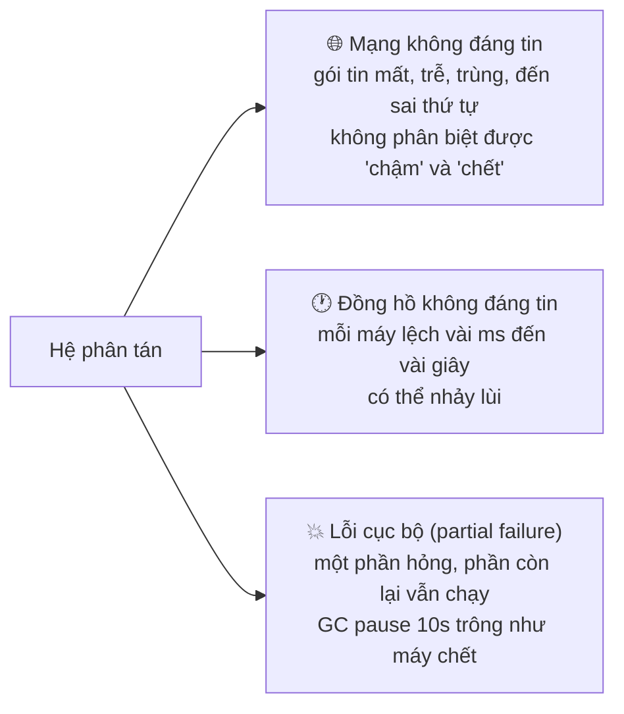

Hệ quả quan trọng nhất: **khi gửi request mà không nhận được trả lời, bạn không biết** request bị mất, server đã xử lý nhưng response bị mất, hay server chỉ đang chậm. Mọi kỹ thuật trong bài này (quorum, consensus, idempotency, fencing) đều là cách sống chung với sự **không biết** đó.

---

## 📖 2. Phổ các mô hình nhất quán

"Consistency" là một trong những từ bị dùng nhiều nghĩa nhất trong ngành. Ở đây ta nói về **consistency model**: một **hợp đồng** giữa hệ thống và người dùng về việc **đọc sẽ thấy giá trị nào** khi có nhiều bản sao và nhiều thao tác đồng thời.

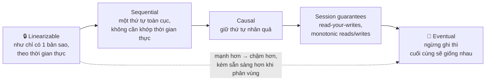

### 2.1. Linearizable (nhất quán mạnh)

**Định nghĩa dễ hiểu**: hệ thống hành xử **như thể chỉ có một bản sao dữ liệu**, và mỗi thao tác có hiệu lực **tức thời tại một thời điểm** nằm giữa lúc gửi request và lúc nhận response. Hệ quả: một khi **ai đó** đã đọc được giá trị mới, **mọi người** đọc sau đó (theo thời gian thực) đều phải thấy giá trị mới hoặc mới hơn.

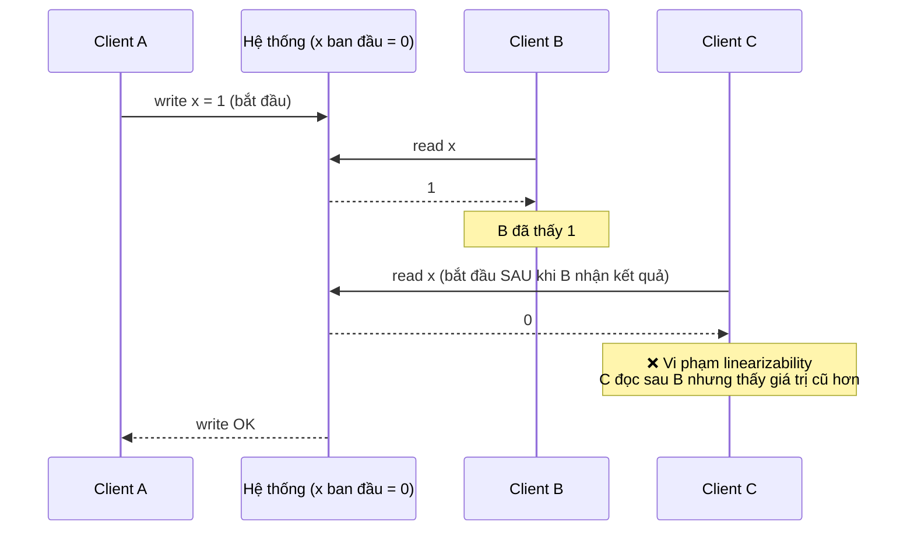

Trong ví dụ trên, việc B thấy `1` khi write của A **chưa xong** là **được phép** (write đang diễn ra). Nhưng C - bắt đầu đọc **sau khi** B đã thấy `1` - mà lại thấy `0` thì không linearizable. Đây chính là chuyện xảy ra khi B đọc từ replica đã nhận bản mới còn C đọc từ replica chưa nhận.

**Cần khi nào**: khóa phân tán và bầu leader (chỉ một người được giữ khóa), ràng buộc duy nhất (username, số ghế), số dư/tồn kho khi phải quyết định "đủ hay không".

### 2.2. Sequential

Mọi người thấy các thao tác theo **cùng một thứ tự toàn cục**, và thao tác của mỗi client giữ đúng thứ tự client đó đã thực hiện - nhưng thứ tự đó **không cần khớp với thời gian thực**. Có thể nghĩ như mọi replica áp dụng **cùng một log** theo cùng thứ tự, nhưng một replica có thể đang ở vị trí cũ hơn trong log.

### 2.3. Causal

Chỉ đảm bảo thứ tự cho những thao tác **có quan hệ nhân quả**: nếu B đã thấy A rồi mới ghi (B "phụ thuộc" A), mọi người phải thấy A trước B. Các thao tác **đồng thời** (không ai biết ai) có thể được thấy theo thứ tự khác nhau ở các nơi.

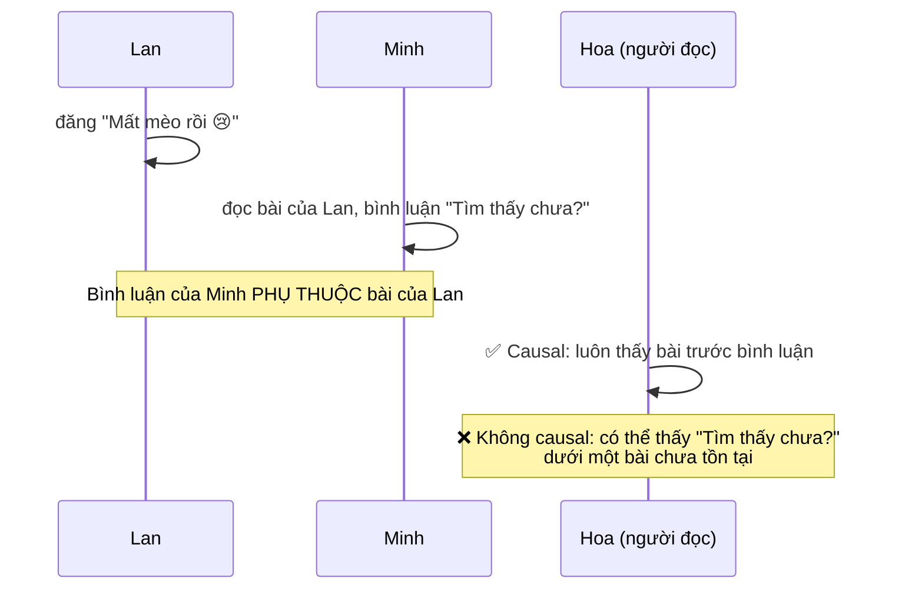

Causal là mô hình **mạnh nhất có thể đạt được mà vẫn sẵn sàng khi có phân vùng mạng** - vì vậy rất hấp dẫn cho hệ thống multi-region. Theo dõi quan hệ nhân quả cần metadata như **vector clock** (mục 6).

### 2.4. Session guarantees

Nhẹ hơn causal, phạm vi **một phiên người dùng**. Đây là những thứ người dùng **thực sự cảm nhận được** - đã gặp ở [Bài 3 §3.6](./03-building-blocks-data.md):

| Guarantee | Hứa gì | Vi phạm trông như thế nào |
|---|---|---|
| **Read-your-writes** | Bạn luôn thấy những gì chính bạn đã ghi | Sửa địa chỉ xong, trang hiện địa chỉ cũ |
| **Monotonic reads** | Đã thấy giá trị mới thì không bao giờ thấy lại giá trị cũ hơn | Bình luận lúc hiện lúc mất khi làm mới |
| **Monotonic writes** | Các ghi của bạn được áp dụng đúng thứ tự bạn ghi | Đổi mật khẩu 2 lần, mật khẩu cũ hơn "thắng" |
| **Writes-follow-reads** | Ghi của bạn được xếp sau những gì bạn đã đọc | Trả lời được áp dụng trước câu hỏi mà bạn đã đọc |

### 2.5. Eventual

Nếu **ngừng ghi**, các bản sao **cuối cùng** sẽ giống nhau. Không hứa gì về **khi nào**, cũng không hứa gì về những gì bạn đọc được trong lúc chờ. Rất yếu - nhưng rẻ, nhanh và luôn sẵn sàng. Đủ dùng cho số like, số lượt xem, feed của người khác, cache.

### 2.6. Bảng tổng hợp

| Mô hình | Đảm bảo | Chi phí | Ví dụ hệ thống / cấu hình |
|---|---|---|---|
| Linearizable | Như 1 bản sao, theo thời gian thực | Cao: cần consensus/quorum, latency ≥ 1 RTT tới đa số; không sẵn sàng ở phía thiểu số khi phân vùng | etcd, ZooKeeper (ghi), Spanner, đọc từ leader có lease |
| Sequential | Cùng một thứ tự toàn cục | Cao | ZooKeeper (đọc mặc định từ follower) |
| Causal | Thứ tự nhân quả | Vừa; metadata theo dõi phụ thuộc | Causal consistency session của MongoDB |
| Read-your-writes, monotonic | Trong phạm vi phiên | Thấp: định tuyến thông minh | Sticky replica, đọc leader sau khi ghi |
| Eventual | Cuối cùng hội tụ | Thấp nhất | Cassandra với `ONE`, DNS, cache |

!!! warning "Linearizable ≠ Serializable"
    Hai khái niệm hay bị nhầm. **Serializable** (isolation level, [Backend Bài 6](../backend/06-database-internals-performance.md)) nói về **transaction** nhiều đối tượng: kết quả như thể các transaction chạy **tuần tự theo một thứ tự nào đó** - không nhất thiết khớp thời gian thực. **Linearizable** nói về **một đối tượng**, khớp **thời gian thực**. Có cả hai cùng lúc gọi là **strict serializability** (Spanner hướng tới điều này).

---

## 📖 3. CAP và PACELC - nói cho đúng

### 3.1. CAP phát biểu chính xác

Khi có **phân vùng mạng** (P - các node không liên lạc được với nhau), hệ thống phải chọn giữa:

- **C** (ở đây nghĩa hẹp là **linearizability**): từ chối hoặc chờ một số request để không trả dữ liệu sai; hoặc
- **A** (availability theo nghĩa hẹp): **mọi** node còn sống đều trả lời mọi request, chấp nhận dữ liệu có thể cũ/xung đột.

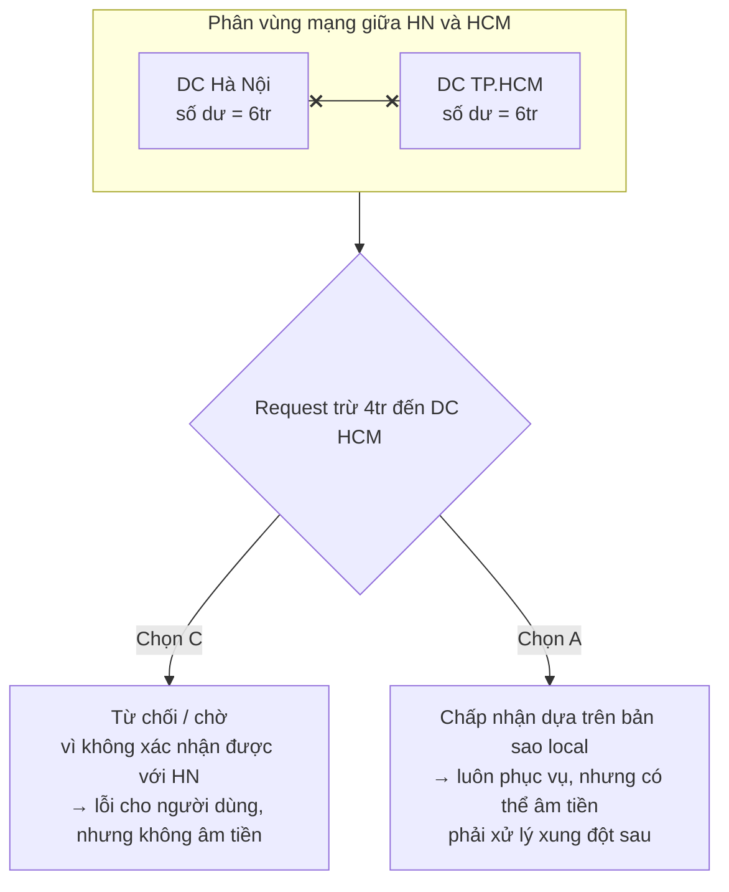

### 3.2. Những hiểu lầm phổ biến

| Hiểu lầm | Thực tế |
|---|---|
| "Chọn 2 trong 3: CA, CP, AP" | P **không phải lựa chọn** - mạng sẽ phân vùng dù bạn muốn hay không. Câu hỏi thật: **khi phân vùng xảy ra**, chọn C hay A. Hệ thống "CA" chỉ tồn tại khi chạy trên một máy. |
| "Hệ thống X là CP" (cho cả hệ thống) | Nhiều hệ thống **cấu hình được** theo từng thao tác (Cassandra: `QUORUM` vs `ONE`; MongoDB: read/write concern). |
| "Chọn A nghĩa là không có consistency" | Vẫn có thể có eventual, causal, read-your-writes. |
| "CAP giải thích mọi trade-off" | CAP chỉ nói về lúc **có phân vùng**. Phần lớn thời gian không có phân vùng, và trade-off lúc đó là **latency** - PACELC. |
| "Availability trong CAP = uptime 99,99%" | Availability trong CAP là định nghĩa lý thuyết (mọi node còn sống phải trả lời). Hệ thống "CP" vẫn có thể đạt 99,99% nếu phân vùng hiếm và phía đa số vẫn phục vụ. |

### 3.3. PACELC

> **if P**artition → chọn **A** hoặc **C**; **E**lse (bình thường) → chọn **L**atency hoặc **C**onsistency.

Ngay cả khi mạng hoàn toàn bình thường, muốn **linearizable** bạn phải chờ xác nhận từ nhiều replica (có thể ở xa) → **chậm hơn**. Muốn nhanh thì trả lời từ replica gần nhất → có thể cũ.

| Hệ thống (cấu hình phổ biến) | Khi phân vùng (P) | Bình thường (E) | Ghi chú |
|---|---|---|---|
| Cassandra / ScyllaDB (`ONE`) | A | L | Chỉnh R/W để dịch về phía C |
| DynamoDB (đọc eventually consistent mặc định) | A | L | Có tùy chọn strongly consistent read |
| Spanner, CockroachDB | C | C | Trả giá bằng latency của consensus |
| etcd, ZooKeeper | C | C | Dùng cho metadata nhỏ, không cho dữ liệu lớn |
| MongoDB (`majority`) | C | C | Read/write concern thấp hơn → nghiêng về L |
| PostgreSQL + async replica (đọc replica) | Tùy failover | L | Đọc replica = chọn L |

!!! tip "Trong phỏng vấn"
    Đừng nói "mình chọn AP" cho cả hệ thống. Hãy nói **theo từng thao tác**: *"Trừ tiền cần linearizable nên đi qua leader của partition tài khoản, chấp nhận lỗi khi mất đa số. Lịch sử giao dịch và số dư hiển thị có thể đọc từ replica gần nhất - nghiêng về latency."*

---

## 📖 4. Quorum: N, R, W

Ở hệ thống leaderless ([Bài 3 §3.4](./03-building-blocks-data.md)), mỗi key có **N** replica. Ghi thành công khi **W** replica xác nhận; đọc hỏi **R** replica và lấy bản có version mới nhất.

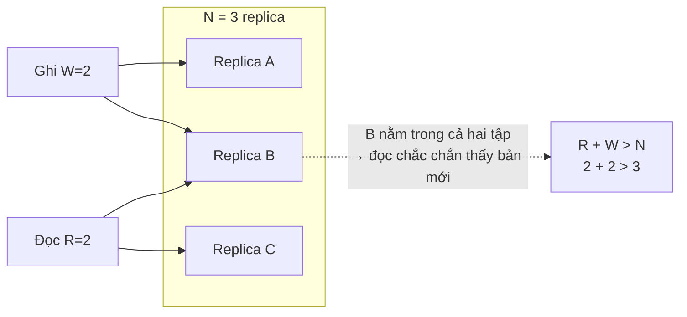

**Vì sao `R + W > N` thì đọc thấy bản mới?** Tập W replica đã ghi và tập R replica được đọc có tổng kích thước > N, nên theo **nguyên lý chuồng bồ câu** chúng phải **giao nhau** ít nhất 1 replica - replica đó có bản mới.

| Cấu hình (N=3) | Đặc điểm |
|---|---|
| W=3, R=1 | Đọc nhanh; ghi chậm và **một replica chết là không ghi được** |
| W=1, R=3 | Ghi nhanh; đọc chậm, một replica chết là không đọc được (kiểu quorum chặt) |
| **W=2, R=2** | Cân bằng phổ biến: chịu 1 replica chết cho cả đọc lẫn ghi |
| W=1, R=1 | Nhanh nhất, **có thể đọc cũ** |

### 4.1. Mô phỏng: tỉ lệ đọc cũ và latency

Mô phỏng N = 3. Mỗi lần ghi gửi tới cả 3 replica; mỗi replica ghi xong sau một thời gian ngẫu nhiên (trung bình 10 ms, 2% replica bị chậm thêm 300 ms - như đang GC hay đĩa chậm). Client nhận "OK" khi đủ W replica. **Ngay sau đó** (0-5 ms) client đọc từ R replica ngẫu nhiên - đây là kịch bản khó nhất: đọc ngay sau ghi. Mỗi replica trả lời đọc sau trung bình 5 ms, 0,5% bị chậm thêm 200 ms. 100.000 lần thử cho mỗi cấu hình.

=== "Go"

    ```go
    package main

    import (
    	"fmt"
    	"math/rand"
    	"sort"
    )

    const (
    	N      = 3
    	trials = 100_000
    )

    // Thời gian (ms) để 1 replica nhận và ghi xong bản mới. 2% replica bị chậm.
    func applyDelay(r *rand.Rand) float64 {
    	d := r.ExpFloat64() * 10
    	if r.Float64() < 0.02 {
    		d += 300
    	}
    	return d
    }

    // Thời gian (ms) để 1 replica trả lời lệnh đọc. 0.5% bị chậm.
    func readDelay(r *rand.Rand) float64 {
    	d := r.ExpFloat64() * 5
    	if r.Float64() < 0.005 {
    		d += 200
    	}
    	return d
    }

    func pct(xs []float64, q float64) float64 {
    	sort.Float64s(xs)
    	return xs[int(q*float64(len(xs)-1))]
    }

    func run(R, W int, seed int64) {
    	rnd := rand.New(rand.NewSource(seed))
    	stale := 0
    	wLat := make([]float64, 0, trials)
    	rLat := make([]float64, 0, trials)
    	for t := 0; t < trials; t++ {
    		applied := make([]float64, N) // lúc mỗi replica có bản mới
    		for i := range applied {
    			applied[i] = applyDelay(rnd)
    		}
    		sorted := append([]float64(nil), applied...)
    		sort.Float64s(sorted)
    		ack := sorted[W-1]              // client nhận ack khi đủ W
    		readAt := ack + rnd.Float64()*5 // đọc ngay sau khi ghi
    		chosen := rnd.Perm(N)[:R]       // gửi đọc tới R replica
    		fresh, slowest := false, 0.0
    		for _, i := range chosen {
    			if applied[i] <= readAt {
    				fresh = true
    			}
    			slowest = max(slowest, readDelay(rnd)) // chờ đủ R câu trả lời
    		}
    		if !fresh {
    			stale++
    		}
    		wLat = append(wLat, ack)
    		rLat = append(rLat, slowest)
    	}
    	tag := "weak  "
    	if R+W > N {
    		tag = "strong"
    	}
    	fmt.Printf("R=%d W=%d (%s) stale=%5.2f%%  write p99=%6.1fms  read p99=%6.1fms\n",
    		R, W, tag, 100*float64(stale)/trials, pct(wLat, .99), pct(rLat, .99))
    }

    func main() {
    	for _, c := range [][2]int{{1, 1}, {1, 2}, {2, 1}, {2, 2}, {1, 3}, {3, 1}} {
    		run(c[0], c[1], 7)
    	}
    }

    // Output:
    // R=1 W=1 (weak  ) stale=53.22%  write p99=  16.3ms  read p99=  26.2ms
    // R=1 W=2 (weak  ) stale=26.93%  write p99=  32.7ms  read p99=  26.2ms
    // R=2 W=1 (weak  ) stale=21.45%  write p99=  16.1ms  read p99=  67.1ms
    // R=2 W=2 (strong) stale= 0.00%  write p99=  32.6ms  read p99=  67.1ms
    // R=1 W=3 (strong) stale= 0.00%  write p99= 317.7ms  read p99=  26.2ms
    // R=3 W=1 (strong) stale= 0.00%  write p99=  16.3ms  read p99= 202.1ms
    ```

=== "Python"

    ```python
    import random

    N = 3
    TRIALS = 100_000


    def apply_delay(rnd):
        """Thời gian (ms) để 1 replica nhận và ghi xong bản mới. 2% replica bị chậm."""
        return rnd.expovariate(1 / 10) + (300 if rnd.random() < 0.02 else 0)


    def read_delay(rnd):
        """Thời gian (ms) để 1 replica trả lời lệnh đọc. 0.5% bị chậm."""
        return rnd.expovariate(1 / 5) + (200 if rnd.random() < 0.005 else 0)


    def pct(xs, q):
        xs = sorted(xs)
        return xs[int(q * (len(xs) - 1))]


    def run(r, w, seed=7):
        rnd = random.Random(seed)
        stale, w_lat, r_lat = 0, [], []
        for _ in range(TRIALS):
            applied = [apply_delay(rnd) for _ in range(N)]  # lúc mỗi replica có bản mới
            ack = sorted(applied)[w - 1]                     # client nhận ack khi đủ W
            read_at = ack + rnd.uniform(0, 5)                # đọc ngay sau khi ghi
            chosen = rnd.sample(range(N), r)                 # gửi đọc tới R replica
            if all(applied[i] > read_at for i in chosen):    # không ai trong R có bản mới
                stale += 1
            w_lat.append(ack)
            r_lat.append(max(read_delay(rnd) for _ in chosen))  # chờ đủ R câu trả lời
        tag = "strong" if r + w > N else "weak  "
        print(f"R={r} W={w} ({tag}) stale={stale / TRIALS:6.2%}  "
              f"write p99={pct(w_lat, .99):6.1f}ms  read p99={pct(r_lat, .99):6.1f}ms")


    for r, w in [(1, 1), (1, 2), (2, 1), (2, 2), (1, 3), (3, 1)]:
        run(r, w)

    # Output:
    # R=1 W=1 (weak  ) stale=52.84%  write p99=  16.0ms  read p99=  26.7ms
    # R=1 W=2 (weak  ) stale=26.65%  write p99=  32.3ms  read p99=  26.7ms
    # R=2 W=1 (weak  ) stale=21.41%  write p99=  16.2ms  read p99= 200.2ms
    # R=2 W=2 (strong) stale= 0.00%  write p99=  31.9ms  read p99= 200.2ms
    # R=1 W=3 (strong) stale= 0.00%  write p99= 317.5ms  read p99=  26.7ms
    # R=3 W=1 (strong) stale= 0.00%  write p99=  16.1ms  read p99= 202.1ms
    ```

**Đọc kết quả**

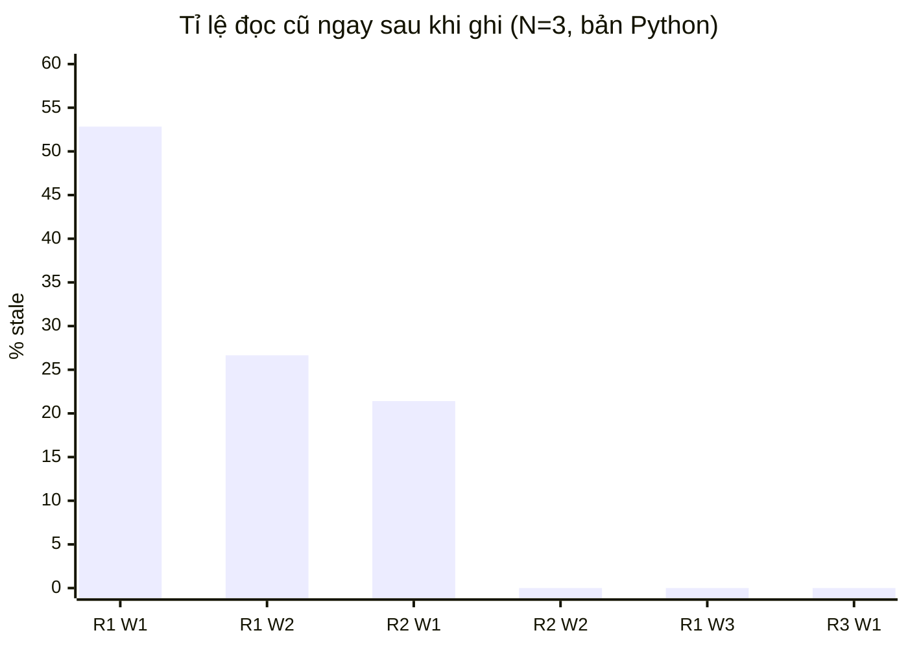

1. **R + W ≤ N có thể đọc cũ - và rất nhiều** khi đọc ngay sau khi ghi: R=1, W=1 đọc cũ hơn **một nửa** số lần. Trong thực tế, nếu đọc xảy ra lâu sau khi ghi, tỉ lệ thấp hơn nhiều - nhưng "đọc ngay sau khi ghi" chính là kịch bản người dùng hay gặp (sửa rồi xem lại).
2. **R + W > N: 0% đọc cũ** trong cả ba cấu hình - đúng như lý thuyết giao nhau.
3. **Cái giá nằm ở đuôi latency**:
    - **W=3**: write p99 ≈ **317 ms** - vì phải chờ replica **chậm nhất**, mà xác suất ít nhất 1 trong 3 replica chậm là 1 - 0,98³ ≈ 5,9% > 1% → p99 rơi vào vùng chậm.
    - **W=2**: write p99 ≈ 32 ms - chỉ cần 2 trong 3, bỏ qua replica chậm.
    - **R=3**: read p99 ≈ **202 ms** (1 - 0,995³ ≈ 1,5% > 1%).
    - **R=2**: read p99 ≈ 67 ms (Go) hoặc 200 ms (Python) - xác suất ít nhất 1 trong 2 replica chậm ≈ 1% nằm **ngay ranh giới** p99, nên chỉ cần khác bộ sinh số ngẫu nhiên là p99 nhảy qua lại. Đây là bài học thực tế: **p99 rất nhạy** khi tỉ lệ sự cố gần 1%; hãy nhìn cả p99.9.
4. **R=2, W=2** cho điểm cân bằng: không đọc cũ, ghi nhanh, chịu được 1 replica chết. Đó là lý do nó là cấu hình phổ biến cho N=3.

### 4.2. Khi R + W > N vẫn chưa đủ

Quorum **không tự động cho linearizability**. Các khe hở:

| Tình huống | Vì sao vẫn sai |
|---|---|
| **Ghi đồng thời** | Hai client ghi cùng key cùng lúc → các replica có thể nhận theo thứ tự khác nhau; cần quy tắc chọn (LWW mất dữ liệu, hoặc giữ cả hai - vector clock) |
| **Ghi thất bại một phần** | Ghi tới 1 replica rồi lỗi (chưa đủ W) → client nhận lỗi nhưng bản mới vẫn nằm trên 1 replica, có thể bị đọc thấy (hoặc không) |
| **Đọc đồng thời với ghi** | Đọc A thấy bản mới, đọc B sau đó vẫn có thể thấy bản cũ (vi phạm như ví dụ ở 2.1) - trừ khi đọc làm **read repair đồng bộ** trước khi trả lời |
| **Sloppy quorum + hinted handoff** | Khi replica "nhà" chết, ghi được nhận bởi node **ngoài** N replica → tập đọc và tập ghi có thể không giao nhau |
| **LWW + lệch đồng hồ** | Bản "mới hơn" theo timestamp chưa chắc là bản ghi sau (mục 6) |

Kết luận: quorum cho **xác suất đọc cũ thấp** và **availability cao**; nếu cần linearizable thật sự, dùng **consensus** (mục 5).

---

## 📖 5. Đồng thuận (consensus), bầu leader và Raft

### 5.1. Vì sao cần consensus?

Rất nhiều bài toán quy về việc **nhiều node đồng ý về một giá trị** dù có node chết và mạng chập chờn:

- **Bầu leader**: chỉ một node được làm leader của partition.
- **Khóa phân tán**: chỉ một client giữ khóa.
- **Ràng buộc duy nhất**: chỉ một người đăng ký được username `lan`.
- **Lưu cấu hình/metadata**: bản đồ shard, danh sách node (ZooKeeper, etcd).
- **Log nhân bản**: mọi replica áp dụng cùng chuỗi lệnh theo cùng thứ tự (replicated state machine).

Các thuật toán nổi tiếng: **Paxos** (Lamport, nền tảng lý thuyết, nổi tiếng khó hiểu), **Raft** (thiết kế để dễ hiểu, dùng trong etcd, Consul, CockroachDB, TiKV), **Zab** (ZooKeeper). Ta học Raft.

### 5.2. Raft: vai trò và term

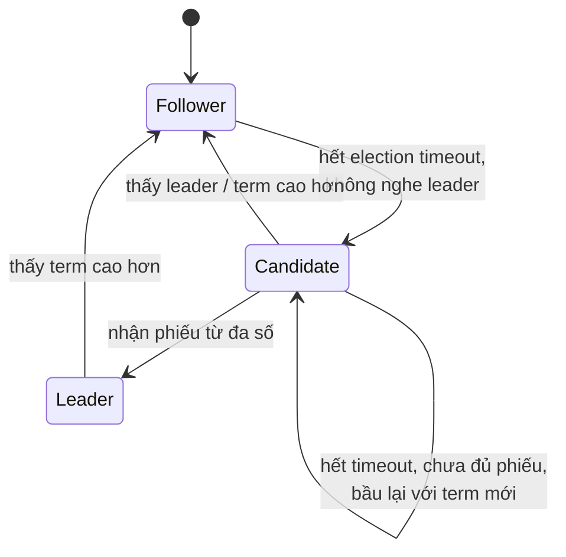

- **Term**: thời gian được chia thành các "nhiệm kỳ" đánh số tăng dần. Mỗi term có **tối đa một leader**. Term đóng vai trò **đồng hồ logic**: mọi message mang term; node thấy term cao hơn của mình thì cập nhật và lùi về follower.
- **Election timeout ngẫu nhiên** (ví dụ 150-300 ms): tránh việc mọi follower cùng lúc thành candidate và chia phiếu.
- **Mỗi node chỉ bỏ 1 phiếu mỗi term**, và chỉ bỏ cho candidate có log **ít nhất mới bằng** log của mình (election restriction) → leader mới luôn có mọi entry đã commit.

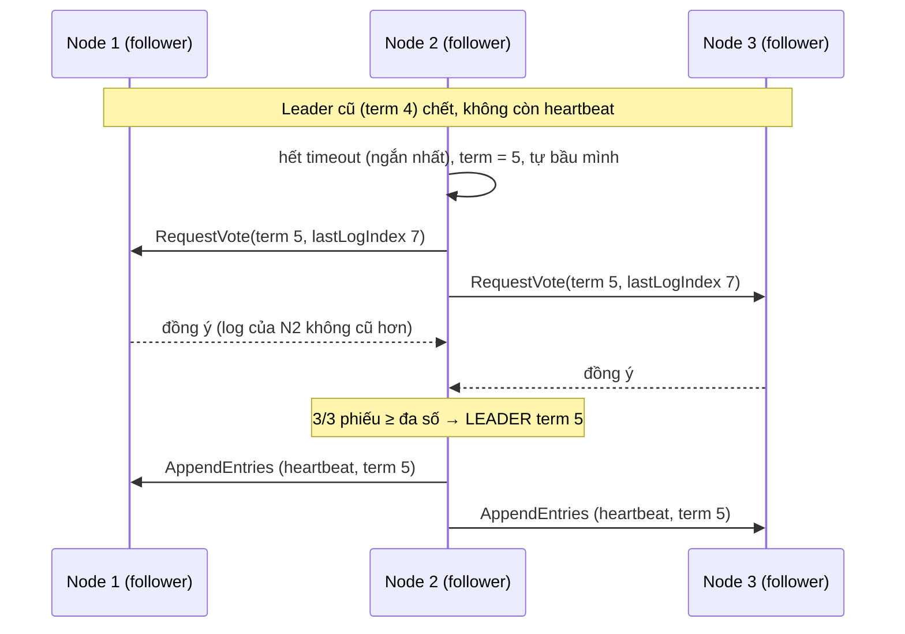

### 5.3. Log replication và commit

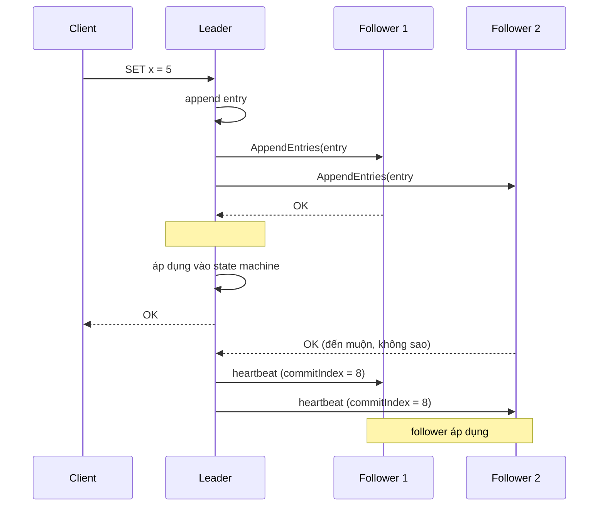

Điểm mấu chốt:

- Entry được **commit** khi có trên **đa số** node. Client nhận OK **sau** commit.
- `prevIndex/prevTerm` giúp follower phát hiện log của mình lệch; leader lùi dần và gửi lại cho tới khi khớp → log của follower cuối cùng **giống hệt** leader.
- Cụm **3 node chịu được 1 node chết**; **5 node chịu được 2**. Thêm node từ 3 lên 4 **không** tăng khả năng chịu lỗi (đa số của 4 là 3) - nên cụm consensus luôn có số node **lẻ**.

### 5.4. Đa số ngăn split brain như thế nào?

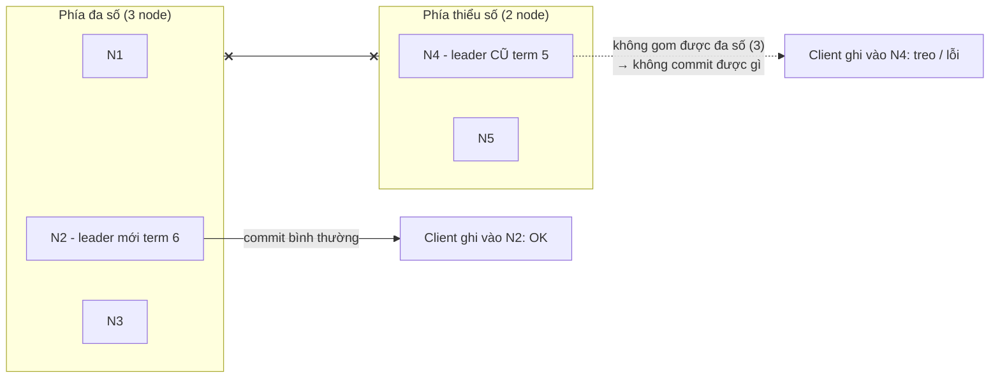

Leader cũ (N4) có thể **vẫn tưởng** mình là leader, nhưng nó **không commit được gì** vì không gom được 3/5 xác nhận. Hai đa số luôn giao nhau → không thể có hai leader cùng commit được trong cùng một lúc. Đây là cách consensus **chọn C** trong CAP: phía thiểu số không phục vụ ghi.

### 5.5. Fencing token - khi leader/lock holder "tưởng" mình còn quyền

Consensus giữ cho **cụm** nhất quán. Nhưng còn **client bên ngoài** giữ khóa (lease) và ghi vào một storage khác thì sao?

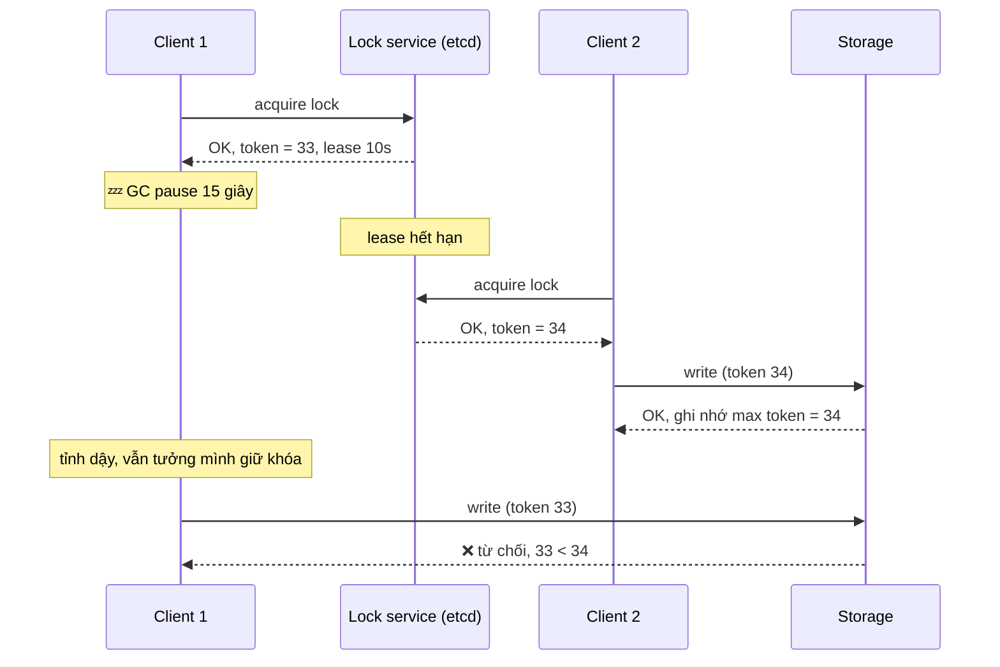

**Fencing token**: mỗi lần cấp khóa, lock service trả về một số **tăng dần** (trong etcd có thể dùng revision; trong Raft chính là **term**). Storage ghi nhớ token lớn nhất đã thấy và **từ chối** mọi request mang token nhỏ hơn. Không có bước này, khóa phân tán **không an toàn** - vì không có cách nào để client biết chắc mình vừa bị "đóng băng" bao lâu.

### 5.6. Thực dụng

- **Đừng tự cài Raft/Paxos** cho production. Dùng etcd, ZooKeeper, Consul, hoặc database đã tích hợp consensus (CockroachDB, Spanner, TiDB, YugabyteDB, Kafka KRaft).
- Consensus **chậm theo khoảng cách**: mỗi commit cần 1 round trip tới đa số. Cụm 5 node trải trên 3 region cách nhau 30 ms → mỗi ghi tối thiểu ~30 ms. Đặt cụm trong 1 region (3 AZ) nếu chịu lỗi cấp AZ là đủ.
- Consensus hợp với **dữ liệu nhỏ, quan trọng** (metadata, cấu hình, leader). Với dữ liệu lớn, chia partition và chạy **một nhóm Raft cho mỗi partition** (multi-Raft - cách CockroachDB, TiKV làm).

---

## 📖 6. Đồng hồ (clocks)

### 6.1. Đồng hồ vật lý không đáng tin

- **Lệch (skew)**: đồng hồ các máy lệch nhau. Trong một datacenter có NTP tốt, thường cỡ **ms trở xuống**; qua internet công cộng có thể **hàng chục ms** hoặc hơn; máy cấu hình sai có thể lệch **giây, phút**.
- **Trôi (drift)**: thạch anh chạy nhanh/chậm vài chục ppm (vài giây mỗi ngày nếu không đồng bộ).
- **Nhảy**: NTP chỉnh giờ có thể làm đồng hồ **nhảy lùi**; leap second; VM bị tạm dừng rồi chạy tiếp.

| Đồng hồ | Dùng cho | Không dùng cho |
|---|---|---|
| **Wall clock** (time-of-day: `time.Now()` hiển thị, `datetime.now()`) | Hiển thị cho người dùng, log | Đo khoảng thời gian, sắp thứ tự sự kiện giữa các máy |
| **Monotonic clock** (`time.Since` trong Go dùng monotonic; `time.monotonic()` Python) | Đo timeout, latency, lease **trên một máy** | So sánh giữa các máy (giá trị tuyệt đối vô nghĩa) |

### 6.2. Nguy hiểm: Last-Write-Wins với đồng hồ lệch

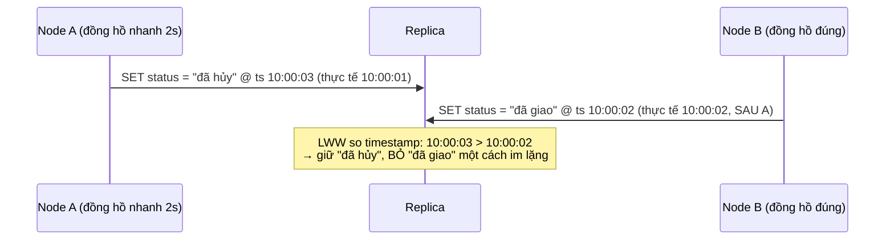

Lệnh ghi xảy ra **sau** bị mất **không một lời báo lỗi**. LWW dựa trên wall clock chỉ an toàn khi: mất dữ liệu đồng thời là chấp nhận được (ví dụ cache, "last seen"), hoặc mỗi key chỉ có một writer.

### 6.3. Lamport clock - thứ tự mà không cần đồng hồ thật

Mỗi node giữ một bộ đếm `L`:

1. Trước mỗi sự kiện cục bộ hoặc gửi message: `L = L + 1`.
2. Gửi message kèm `L`.
3. Nhận message mang `L_msg`: `L = max(L, L_msg) + 1`.

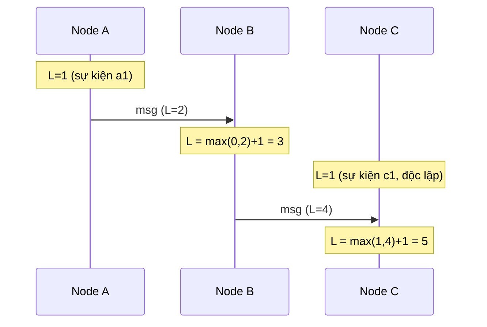

**Tính chất**: nếu sự kiện X **gây ra** Y (X → Y) thì `L(X) < L(Y)`. Dùng `(L, node_id)` để phá hòa → có **thứ tự toàn phần** nhất quán với nhân quả. **Giới hạn**: chiều ngược lại không đúng - `L(X) < L(Y)` **không** cho biết X có gây ra Y hay chúng đồng thời. Ví dụ c1 (L=1) và a1 (L=1) đồng thời; nhưng c1 với L=1 và một sự kiện L=3 ở B cũng có thể là đồng thời. Muốn **phát hiện đồng thời**, cần vector clock.

### 6.4. Vector clock - phát hiện xung đột

Mỗi node giữ một **vector** đếm: `{A: số sự kiện A đã biết, B: ..., ...}`.

- Sự kiện/ghi tại node X: tăng thành phần X.
- Nhận/gộp: lấy **max từng thành phần**, rồi tăng thành phần của mình.
- So sánh `V1` và `V2`: nếu mọi thành phần `V1 ≤ V2` → V1 **xảy ra trước** V2; ngược lại → **sau**; nếu không bên nào ≤ bên nào → **đồng thời (concurrent)** → **xung đột**, phải giải quyết.

Ví dụ: giỏ hàng lưu trên hai replica A và B (kiểu Dynamo):

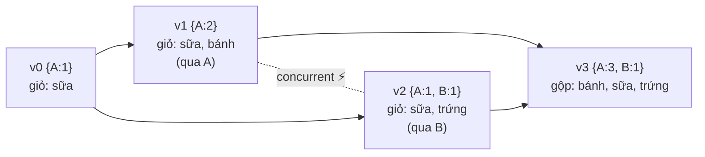

=== "Go"

    ```go
    package main

    import (
    	"fmt"
    	"sort"
    	"strings"
    )

    // VClock: node_id -> số sự kiện node đó đã thấy
    type VClock map[string]int

    func (v VClock) Tick(node string) VClock { // sự kiện cục bộ / ghi mới tại node
    	c := VClock{}
    	for k, x := range v {
    		c[k] = x
    	}
    	c[node]++
    	return c
    }

    func (v VClock) Merge(o VClock) VClock { // lấy max từng thành phần
    	c := VClock{}
    	for k, x := range v {
    		c[k] = x
    	}
    	for k, x := range o {
    		c[k] = max(c[k], x)
    	}
    	return c
    }

    func (v VClock) Compare(o VClock) string {
    	le, ge := true, true
    	for _, m := range []VClock{v, o} {
    		for k := range m {
    			if v[k] > o[k] {
    				le = false
    			}
    			if v[k] < o[k] {
    				ge = false
    			}
    		}
    	}
    	switch {
    	case le && ge:
    		return "equal"
    	case le:
    		return "before" // v xảy ra trước o
    	case ge:
    		return "after"
    	}
    	return "concurrent" // không ai biết ai -> xung đột
    }

    func (v VClock) String() string {
    	keys := make([]string, 0, len(v))
    	for k := range v {
    		keys = append(keys, k)
    	}
    	sort.Strings(keys)
    	parts := make([]string, len(keys))
    	for i, k := range keys {
    		parts[i] = fmt.Sprintf("%s:%d", k, v[k])
    	}
    	return "{" + strings.Join(parts, ", ") + "}"
    }

    func union(sets ...[]string) []string {
    	seen := map[string]bool{}
    	var out []string
    	for _, s := range sets {
    		for _, x := range s {
    			if !seen[x] {
    				seen[x] = true
    				out = append(out, x)
    			}
    		}
    	}
    	sort.Strings(out)
    	return out
    }

    func main() {
    	// Giỏ hàng lưu trên 2 replica A và B
    	v0 := VClock{}.Tick("A") // Lan thêm "sữa" qua replica A
    	cart0 := []string{"sữa"}
    	fmt.Println("v0 (A thêm sữa)          =", v0)

    	v1 := v0.Tick("A") // Lan thêm "bánh" qua A (biết v0)
    	cart1 := union(cart0, []string{"bánh"})
    	v2 := v0.Tick("B") // Minh (cùng tài khoản) thêm "trứng" qua B, chỉ biết v0
    	cart2 := union(cart0, []string{"trứng"})
    	fmt.Println("v1 (A thêm bánh)         =", v1)
    	fmt.Println("v2 (B thêm trứng)        =", v2)
    	fmt.Println("v0 vs v1                 :", v0.Compare(v1))
    	fmt.Println("v1 vs v2                 :", v1.Compare(v2))

    	// Đọc thấy 2 phiên bản concurrent -> trả cả hai (siblings), client/ứng dụng tự gộp
    	merged := union(cart1, cart2)
    	v3 := v1.Merge(v2).Tick("A") // ghi bản đã gộp, clock mới "sau" cả hai
    	fmt.Printf("v3 (gộp rồi ghi qua A)   = %v %q\n", v3, merged)
    	fmt.Println("v1 vs v3                 :", v1.Compare(v3))
    	fmt.Println("v2 vs v3                 :", v2.Compare(v3))
    }

    // Output:
    // v0 (A thêm sữa)          = {A:1}
    // v1 (A thêm bánh)         = {A:2}
    // v2 (B thêm trứng)        = {A:1, B:1}
    // v0 vs v1                 : before
    // v1 vs v2                 : concurrent
    // v3 (gộp rồi ghi qua A)   = {A:3, B:1} ["bánh" "sữa" "trứng"]
    // v1 vs v3                 : before
    // v2 vs v3                 : before
    ```

=== "Python"

    ```python
    class VClock(dict):
        """Vector clock: {node_id: số sự kiện node đó đã thấy}."""

        def tick(self, node):                 # sự kiện cục bộ / ghi mới tại node
            c = VClock(self)
            c[node] = c.get(node, 0) + 1
            return c

        def merge(self, other):               # lấy max từng thành phần
            return VClock({n: max(self.get(n, 0), other.get(n, 0)) for n in self.keys() | other.keys()})

        def compare(self, other):
            nodes = self.keys() | other.keys()
            le = all(self.get(n, 0) <= other.get(n, 0) for n in nodes)
            ge = all(self.get(n, 0) >= other.get(n, 0) for n in nodes)
            if le and ge:
                return "equal"
            if le:
                return "before"               # self xảy ra trước other
            if ge:
                return "after"
            return "concurrent"               # không ai biết ai -> xung đột

        def __str__(self):
            return "{" + ", ".join(f"{k}:{self[k]}" for k in sorted(self)) + "}"


    # Giỏ hàng lưu trên 2 replica A và B
    v0 = VClock().tick("A")                   # Lan thêm "sữa" qua replica A
    cart0 = {"sữa"}
    print("v0 (A thêm sữa)          =", v0)

    v1 = v0.tick("A")                         # Lan thêm "bánh" qua A (biết v0)
    cart1 = cart0 | {"bánh"}
    v2 = v0.tick("B")                         # Minh (cùng tài khoản) thêm "trứng" qua B, chỉ biết v0
    cart2 = cart0 | {"trứng"}
    print("v1 (A thêm bánh)         =", v1)
    print("v2 (B thêm trứng)        =", v2)
    print("v0 vs v1                 :", v0.compare(v1))
    print("v1 vs v2                 :", v1.compare(v2))

    # Đọc thấy 2 phiên bản concurrent -> trả cả hai (siblings), client/ứng dụng tự gộp
    merged_cart = sorted(cart1 | cart2)
    v3 = v1.merge(v2).tick("A")               # ghi bản đã gộp, clock mới "sau" cả hai
    print("v3 (gộp rồi ghi qua A)   =", v3, merged_cart)
    print("v1 vs v3                 :", v1.compare(v3))
    print("v2 vs v3                 :", v2.compare(v3))

    # Output:
    # v0 (A thêm sữa)          = {A:1}
    # v1 (A thêm bánh)         = {A:2}
    # v2 (B thêm trứng)        = {A:1, B:1}
    # v0 vs v1                 : before
    # v1 vs v2                 : concurrent
    # v3 (gộp rồi ghi qua A)   = {A:3, B:1} ['bánh', 'sữa', 'trứng']
    # v1 vs v3                 : before
    # v2 vs v3                 : before
    ```

`v1 {A:2}` và `v2 {A:1, B:1}`: A của v1 lớn hơn, B của v2 lớn hơn → **không ai trước ai** → concurrent. Thay vì âm thầm bỏ một bản (như LWW), hệ thống trả **cả hai bản** (gọi là *siblings*) cho ứng dụng gộp. Ở đây gộp là hợp hai tập → không mất món nào. Bản ghi sau khi gộp mang clock **lớn hơn cả hai** nên thay thế được cả hai.

!!! note "Giới hạn và biến thể"
    - Vector clock **lớn dần** theo số node/client ghi → cần cắt tỉa (Dynamo cắt bớt các entry cũ nhất, chấp nhận đôi khi báo xung đột giả).
    - Xóa trong giỏ hàng gộp bằng phép hợp có thể làm món đã xóa "sống lại" → cần tombstone hoặc dùng CRDT (mục 9.5).
    - **Hybrid Logical Clock (HLC)**: kết hợp wall clock và Lamport → timestamp gần với giờ thật nhưng vẫn giữ thứ tự nhân quả (dùng trong CockroachDB, YugabyteDB).
    - **TrueTime** (Spanner): đồng hồ có **khoảng sai số** được đảm bảo (dùng GPS + đồng hồ nguyên tử); khi commit, Spanner **chờ hết khoảng sai số** (commit wait) để đảm bảo thứ tự toàn cục khớp thời gian thực.

---

## 📖 7. Transaction phân tán: 2PC và saga

### 7.1. Two-phase commit (2PC)

Một thao tác cần thay đổi dữ liệu ở **nhiều** database (hoặc nhiều shard) một cách nguyên tử: **hoặc tất cả, hoặc không gì cả**.

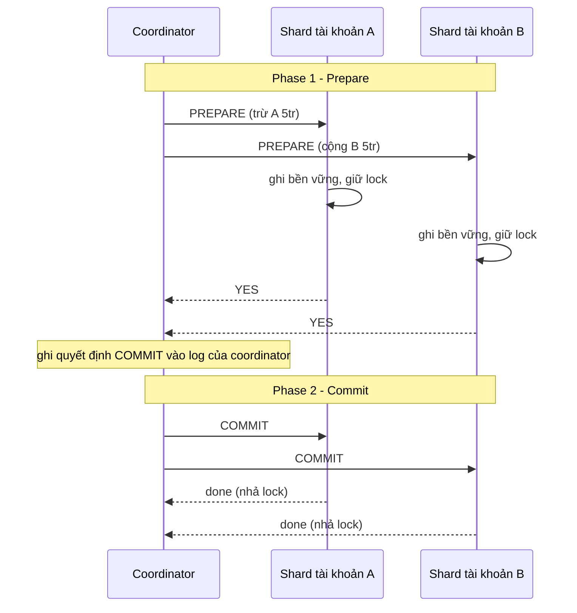

Khi participant trả lời **YES**, nó **hứa** sẽ commit được nếu được yêu cầu - kể cả khi crash và khởi động lại. Từ lúc đó nó **không được tự ý hủy**.

| Hỏng ở đâu | Hậu quả |
|---|---|
| Participant trả NO hoặc timeout ở phase 1 | Coordinator gửi ABORT cho tất cả - an toàn |
| Participant crash sau khi trả YES | Khởi động lại, đọc log, hỏi coordinator quyết định - an toàn nhưng chậm |
| **Coordinator crash sau khi nhận đủ YES, trước khi gửi quyết định** | Participant **kẹt** ở trạng thái "in doubt": không được commit, không được abort, **giữ lock** cho tới khi coordinator sống lại → các transaction khác trên các hàng đó bị chặn. Đây là điểm yếu chí mạng: **2PC là giao thức blocking** |
| Mạng phân vùng giữa coordinator và một participant ở phase 2 | Participant đó chờ; dữ liệu tạm thời "nửa vời" về mặt quan sát |

Ngoài ra: latency cao (2 round trip + nhiều lần ghi đĩa đồng bộ), giữ lock lâu, coordinator là điểm hỏng. **Dùng 2PC** khi các participant cùng một hệ thống được thiết kế cho nó (database phân tán như Spanner/CockroachDB dùng 2PC **kết hợp** consensus, mỗi participant là một nhóm Raft nên "participant crash" gần như không xảy ra). **Tránh** 2PC (XA) xuyên qua nhiều service/database khác loại trong kiến trúc microservices.

### 7.2. Saga

Saga chia một thao tác lớn thành chuỗi **transaction cục bộ**, mỗi bước có một **hành động bù trừ (compensation)**. Nếu bước k thất bại, chạy bù trừ cho bước k-1, ..., 1.

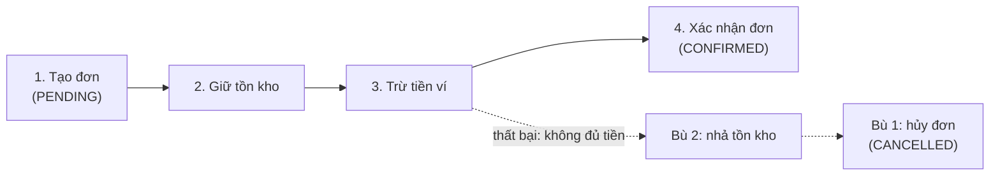

**Hai cách điều phối**:

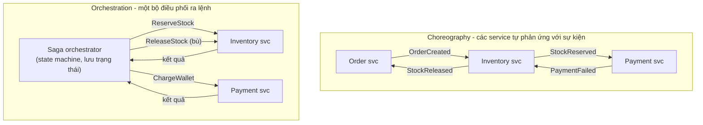

| | Choreography | Orchestration |
|---|---|---|
| Ưu | Không có điểm trung tâm, service lỏng lẻo | Luồng rõ ràng ở một chỗ, dễ theo dõi, dễ thêm bước |
| Nhược | Luồng nằm rải rác, khó hiểu khi > 3-4 bước, dễ vòng lặp sự kiện | Orchestrator là thành phần thêm (nhưng có thể dùng engine sẵn: Temporal, Step Functions...) |
| Hợp với | Saga ngắn, ít bước | Saga dài, nghiệp vụ quan trọng (thanh toán, đặt vé) |

**Những điều saga KHÔNG cho bạn**:

- **Không có isolation**: giữa các bước, người khác có thể thấy trạng thái trung gian (đơn PENDING, tồn kho đã giữ). Giảm thiểu bằng **semantic lock** (trạng thái PENDING báo cho người khác biết "đang xử lý"), thiết kế để trạng thái trung gian là hợp lệ về nghiệp vụ.
- **Bù trừ không phải rollback**: email đã gửi không "gửi ngược" được → bù bằng email xin lỗi. Hãy đặt các bước **không thể bù** (gửi hàng, chuyển tiền ra ngân hàng ngoài) ở **cuối** saga (pivot transaction).
- **Mỗi bước và mỗi bù trừ phải idempotent** - vì sẽ được retry (mục 8).
- Các bước giao tiếp qua message → dùng **outbox** để "ghi DB + phát sự kiện" nguyên tử ([Backend Bài 9](../backend/09-message-queues.md)).

| | 2PC | Saga |
|---|---|---|
| Atomicity | Có (tất cả hoặc không) | Cuối cùng (qua bù trừ) |
| Isolation | Có (giữ lock) | Không |
| Availability | Thấp hơn (blocking, lock) | Cao |
| Latency | Cao, đồng bộ | Mỗi bước nhanh; toàn bộ bất đồng bộ |
| Dùng cho | Trong một DB phân tán | Xuyên qua nhiều service |

---

## 📖 8. Idempotency và exactly-once effects

### 8.1. Vì sao "exactly-once delivery" là không thể?

Nhớ lại mục 1: gửi request mà không nhận được trả lời, bạn **không biết** server đã xử lý hay chưa. Chỉ có hai lựa chọn: **không gửi lại** (có thể mất → at-most-once) hoặc **gửi lại** (có thể trùng → at-least-once). Không giao thức nào qua mạng không đáng tin đảm bảo **giao đúng một lần**.

Thứ ta làm được là **exactly-once effect** (hiệu ứng đúng một lần):

```text
exactly-once effect = at-least-once delivery + xử lý idempotent (hoặc khử trùng)
```

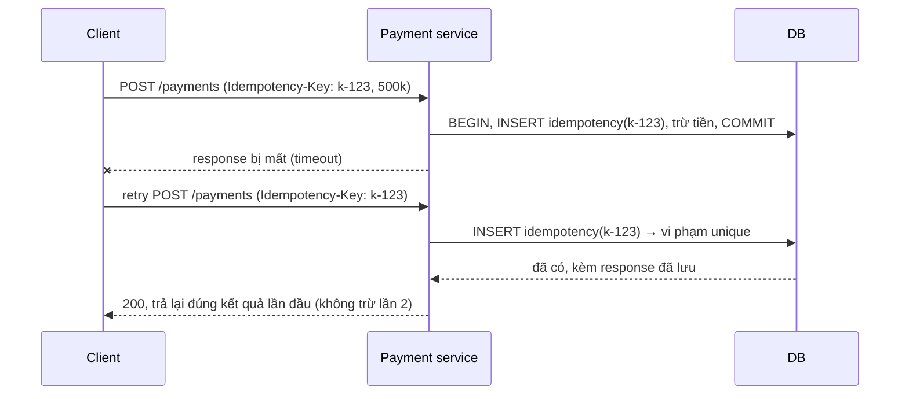

### 8.2. Các kỹ thuật

| Kỹ thuật | Cách làm | Ghi chú |
|---|---|---|
| **Idempotency key** | Client sinh key (UUID) cho mỗi **ý định**; server lưu `key → kết quả` | Lưu key **trong cùng transaction** với tác dụng; xem cài đặt ở [Backend Bài 10 §12](../backend/10-system-design.md) |
| **Bảng khử trùng (dedup) cho consumer** | Consumer ghi `message_id` đã xử lý vào bảng có unique constraint, cùng transaction với tác dụng | Chuẩn cho Kafka/RabbitMQ consumer |
| **Ghi có điều kiện / version** | `UPDATE ... SET status='PAID' WHERE id=? AND status='PENDING'` | Lần hai không khớp điều kiện → không làm gì |
| **Thao tác tự nhiên idempotent** | `SET x = 5` thay vì `x = x + 1`; `PUT` toàn bộ tài nguyên | Thiết kế API theo hướng "trạng thái đích" |
| **Sequence number theo nguồn** | Mỗi producer đánh số tăng dần; consumer bỏ số ≤ số lớn nhất đã thấy | Kafka idempotent producer dùng ý tưởng này |
| **Transaction của message broker** | Kafka transactions: đọc - xử lý - ghi ra topic khác + commit offset **nguyên tử** | Chỉ "exactly-once" **bên trong Kafka**; tác dụng ra ngoài (gọi API, ghi DB khác) vẫn cần idempotency |

!!! warning "Idempotency key phải gắn với ý định, không phải với request"
    Nếu client sinh key mới cho **mỗi lần retry**, key vô dụng. Key phải sinh **một lần khi người dùng bấm "Thanh toán"** và dùng lại cho mọi lần retry của ý định đó. Đồng thời, server nên kiểm tra **body của retry khớp** với lần đầu (cùng key nhưng khác số tiền → lỗi 422).

---

## 📖 9. Multi-region và disaster recovery

### 9.1. Vì sao multi-region?

| Lý do | Giải thích |
|---|---|
| **Latency** | Người dùng ở xa chịu RTT 150+ ms ([Bài 1 §5.2](./01-framework-estimation.md)) |
| **Availability trước sự cố cấp region** | Cả region có thể gặp sự cố (mất điện diện rộng, lỗi mạng, lỗi cấu hình của nhà cung cấp) |
| **Data residency / pháp lý** | Một số dữ liệu phải lưu trong lãnh thổ quốc gia (ví dụ: châu Âu với GDPR và các quy định về chuyển dữ liệu ra ngoài; Việt Nam có các quy định về lưu trữ dữ liệu trong nước như Nghị định 53/2022/NĐ-CP hướng dẫn Luật An ninh mạng - luôn hỏi ý kiến bộ phận pháp lý cho trường hợp cụ thể) |

Nhưng multi-region **đắt và phức tạp**: chi phí hạ tầng gấp đôi trở lên, latency replication giữa region, và mọi vấn đề nhất quán ở trên trở nên **nghiêm trọng hơn** vì RTT lớn và phân vùng mạng giữa region xảy ra thường hơn. Đừng làm multi-region nếu yêu cầu không cần.

### 9.2. Các mức DR

| Chiến lược | Mô tả | RPO | RTO | Chi phí |
|---|---|---|---|---|
| **Backup & restore** | Backup định kỳ sang region khác; sự cố thì dựng lại từ đầu | Giờ (theo chu kỳ backup) | Giờ - ngày | $ |
| **Pilot light** | Dữ liệu được replicate liên tục; hạ tầng tính toán tắt, chỉ bật khi cần | Phút | Chục phút - giờ | $$ |
| **Warm standby** | Bản thu nhỏ chạy sẵn ở region 2, scale lên khi failover | Giây - phút | Phút | $$$ |
| **Active-passive (hot standby)** | Region 2 đầy đủ, sẵn sàng, không nhận traffic ghi | Giây (async) hoặc 0 (sync) | Phút | $$$$ |
| **Active-active** | Cả hai region cùng phục vụ đọc và ghi | ~0 - giây | ~0 - giây | $$$$$ |

### 9.3. Active-passive

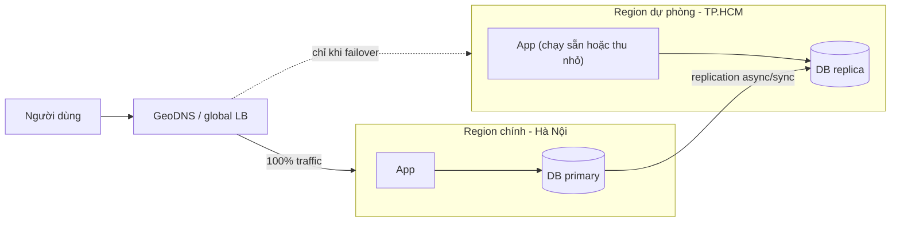

**Quy trình failover** - phần lớn sự cố DR là do **quy trình**, không phải công nghệ:

```mermaid
sequenceDiagram
    participant M as Giám sát
    participant OC as On-call / tự động
    participant R1 as Region chính
    participant R2 as Region dự phòng
    participant T as DNS / global LB
    M->>OC: Region chính lỗi > 5 phút (từ nhiều điểm quan sát)
    OC->>OC: Quyết định failover (runbook, tự động hoặc người duyệt)
    OC->>R1: FENCE - chặn ghi (nếu còn liên lạc được), thu hồi quyền
    OC->>R2: Promote replica thành primary (epoch mới)
    OC->>R2: Scale app lên đủ tải
    OC->>T: Chuyển traffic sang region dự phòng
    Note over R1,R2: Khi region chính phục hồi - KHÔNG tự động nhận lại ghi<br/>đối soát dữ liệu chưa replicate, rồi failback có kế hoạch
```

Những câu hỏi phải có câu trả lời **trước khi** sự cố xảy ra:

- **Ai quyết định** failover, dựa trên tín hiệu nào? Tự động hoàn toàn có nguy cơ failover nhầm (flapping giữa hai region); người duyệt thì chậm hơn.
- **Dữ liệu chưa replicate** (với async) xử lý thế nào khi region cũ quay lại? (Đối soát, áp dụng lại thủ công, hay chấp nhận mất theo RPO?)
- **Fencing**: làm sao chắc region cũ không tiếp tục nhận ghi (split brain cấp region)?
- **Năng lực**: region dự phòng có đủ capacity cho 100% traffic không - kể cả khi mọi khách hàng cùng failover sang (nhà cung cấp cloud có thể hết máy trong region đó)?
- **DR drill**: lần cuối thật sự failover là khi nào? Kế hoạch DR chưa từng chạy thử thì nên coi như **không có**.

### 9.4. Active-active

```mermaid
flowchart TB
    U1["Người dùng miền Bắc"] --> R1
    U2["Người dùng miền Nam"] --> R2
    subgraph R1["Region HN"]
        A1["App"] --> D1[("DB")]
    end
    subgraph R2["Region HCM"]
        A2["App"] --> D2[("DB")]
    end
    D1 <-->|"replication 2 chiều<br/>→ xung đột có thể xảy ra"| D2
```

Ba cách tổ chức dữ liệu cho active-active, từ an toàn đến khó:

| Cách | Mô tả | Xung đột |
|---|---|---|
| **Partition theo home region** | Mỗi user/tenant có "nhà" ở một region; mọi ghi của user đó đi về region nhà (đọc có thể ở bất kỳ đâu) | **Không** (mỗi bản ghi chỉ một writer) - cách phổ biến và khuyến nghị |
| **Consensus toàn cầu** | Database dùng Raft/Paxos trải nhiều region (Spanner, CockroachDB multi-region) | Không, nhưng ghi chậm theo RTT giữa region |
| **Multi-leader thật sự** | Ghi bất kỳ đâu, replicate bất đồng bộ 2 chiều | **Có** - phải giải quyết (9.5) |

Ví dụ ví điện tử ở đầu bài: tài khoản của chị Hoa có **home region** là HN. Request từ TP.HCM được **chuyển về HN** để trừ tiền (chậm hơn ~30 ms, nhưng không bao giờ âm tiền). Khi phân vùng mạng giữa hai region, request từ TP.HCM cho tài khoản nhà HN **bị từ chối hoặc xếp hàng** - chọn C cho thao tác tiền. Trong khi đó, xem lịch sử giao dịch vẫn phục vụ từ bản sao local - chọn A.

### 9.5. Giải quyết xung đột: LWW vs CRDT

| Chiến lược | Cách làm | Mất dữ liệu? | Dùng cho |
|---|---|---|---|
| **Last-write-wins (LWW)** | Giữ bản có timestamp lớn nhất | **Có**, im lặng (và lệch đồng hồ làm tệ hơn) | Cache, trạng thái "last seen", dữ liệu ghi đè toàn bộ không quan trọng |
| **Giữ tất cả, ứng dụng gộp** | Trả siblings (vector clock), code nghiệp vụ gộp | Không, nếu gộp đúng | Giỏ hàng (Dynamo) |
| **Hỏi người dùng** | Hiển thị cả hai phiên bản | Không | File sync ("bản sao xung đột" - [Bài 11](./11-file-sync.md)) |
| **CRDT** | Kiểu dữ liệu được thiết kế sao cho **gộp theo thứ tự nào cũng ra cùng kết quả** | Không (theo ngữ nghĩa của kiểu) | Bộ đếm, tập hợp, cộng tác thời gian thực |

**CRDT** (Conflict-free Replicated Data Type): phép gộp có tính **giao hoán, kết hợp, lũy đẳng** → các replica nhận cập nhật theo bất kỳ thứ tự nào, bao nhiêu lần cũng được, cuối cùng đều hội tụ về **cùng một giá trị** - không cần điều phối.

**Ví dụ G-Counter** (bộ đếm chỉ tăng): mỗi replica giữ một mảng đếm riêng cho từng replica; tăng thì chỉ tăng ô của mình; gộp lấy **max từng ô**; giá trị = **tổng** các ô.

```mermaid
flowchart LR
    A0["Replica HN<br/>{HN:3, HCM:0}<br/>= 3"] --> M["Gộp: max từng ô<br/>{HN:3, HCM:2}<br/>= 5 ✅"]
    B0["Replica HCM<br/>{HN:0, HCM:2}<br/>= 2"] --> M
    M -.->|"gộp lại lần nữa vẫn = 5<br/>(lũy đẳng)"| M
```

So sánh với LWW: nếu mỗi region lưu một số nguyên "like = 3" và "like = 2" rồi LWW → kết quả 3 hoặc 2, **mất** like của region kia. G-Counter cho 5 - đúng.

| CRDT | Hỗ trợ | Ví dụ dùng |
|---|---|---|
| G-Counter | Chỉ tăng | Lượt xem, like |
| PN-Counter | Tăng và giảm (hai G-Counter) | Like/unlike, số người đang online (xấp xỉ) |
| G-Set | Chỉ thêm | Tập ID đã thấy |
| OR-Set (observed-remove) | Thêm và xóa, "thêm thắng" khi đồng thời | Giỏ hàng, danh sách thành viên |
| LWW-Register | Một giá trị, LWW nhưng có định nghĩa rõ | Tên hiển thị, avatar |
| Sequence CRDT (RGA, ...) | Chuỗi ký tự, danh sách | Soạn thảo văn bản cộng tác |

!!! warning "CRDT không giải quyết ràng buộc toàn cục"
    CRDT đảm bảo **hội tụ**, không đảm bảo **bất biến nghiệp vụ**. PN-Counter cho số dư có thể hội tụ về **-3 triệu** một cách hoàn hảo. Những bất biến như "số dư ≥ 0", "không bán quá tồn kho", "username duy nhất" cần **điều phối** (consensus, home region, hoặc chia trước hạn mức cho từng region - ví dụ mỗi region được bán tối đa 500 trong 1.000 vé).

---

## 🌍 Ứng dụng thực tế

- **Amazon Dynamo** (paper 2007): leaderless, quorum có thể chỉnh, vector clock, giỏ hàng gộp bằng hợp tập - nền tảng của Cassandra, Riak và nhiều thiết kế ở [Bài 7](./07-key-value-store.md).
- **Google Spanner**: TrueTime + Paxos + 2PC → transaction phân tán toàn cầu, strict serializability, trả giá bằng commit wait và latency giữa region.
- **etcd** (trong mọi cụm Kubernetes): Raft giữ trạng thái cluster; Kubernetes controller dùng lease để bầu leader.
- **Kafka**: idempotent producer (sequence number), transactions cho consume-transform-produce; KRaft thay ZooKeeper bằng Raft cho metadata.
- **Stripe** mô tả công khai việc dùng idempotency key cho API thanh toán - đúng mô hình ở mục 8.
- **Redis CRDT (Active-Active)**, **Riak data types**, các thư viện như **Automerge**, **Yjs** cho cộng tác thời gian thực - CRDT trong sản phẩm thật.
- **Ngân hàng, ví điện tử ở Việt Nam** thường vận hành theo mô hình datacenter chính + datacenter dự phòng (DR site), với yêu cầu diễn tập DR định kỳ - đúng mô hình active-passive và DR drill ở mục 9.

---

## ⚠️ Sai lầm thường gặp

1. **"Hệ thống của mình là CP/AP"** cho cả hệ thống thay vì quyết định theo từng thao tác.
2. **Nhầm linearizable với serializable**.
3. **Tin rằng R + W > N là linearizable** - bỏ qua ghi đồng thời, ghi thất bại một phần, sloppy quorum.
4. **Dùng wall clock để sắp thứ tự sự kiện giữa các máy** / LWW cho dữ liệu quan trọng.
5. **Đo timeout bằng wall clock** thay vì monotonic clock.
6. **Khóa phân tán không có fencing token** - GC pause làm hai client cùng "giữ khóa".
7. **Cụm consensus 2 hoặc 4 node** - không tăng khả năng chịu lỗi, chỉ tăng chi phí.
8. **Trải cụm consensus qua nhiều region** mà không tính latency mỗi lần ghi.
9. **2PC xuyên microservices** - blocking, giữ lock, coordinator là điểm hỏng.
10. **Saga không có bù trừ idempotent**, hoặc đặt bước không thể bù ở giữa saga.
11. **Sinh idempotency key mới cho mỗi lần retry**.
12. **Tin "exactly-once" của Kafka áp dụng cho cả gọi API bên ngoài**.
13. **Kế hoạch DR chưa từng diễn tập**.
14. **Failover tự động không fencing region cũ** → split brain cấp region.
15. **Active-active multi-leader cho dữ liệu có bất biến** (số dư, tồn kho) mà không có home region hay chia hạn mức.

---

## 🏋️ Bài tập

### Bài 1 (Dễ) - Gọi tên mô hình nhất quán

Mỗi tính năng sau cần mô hình nhất quán nào (tối thiểu)?

1. Đăng ký username (không được trùng).
2. Bình luận dưới bài đăng: trả lời không được hiện trước bình luận gốc.
3. Số lượt xem video.
4. Người dùng đổi avatar và phải thấy avatar mới ngay.
5. Bầu leader cho một partition.

<details markdown="1">
<summary>Đáp án</summary>

1. **Linearizable** (ràng buộc duy nhất) - hoặc một unique constraint trên **một** DB/leader.
2. **Causal** (hoặc consistent prefix: đặt mọi bình luận của một bài trên cùng partition, có số thứ tự).
3. **Eventual** (có thể xấp xỉ).
4. **Read-your-writes** (người khác thấy trễ vài giây là được).
5. **Linearizable** - qua consensus (etcd/ZooKeeper/Raft) + fencing token.

</details>

### Bài 2 (Dễ) - Quorum

N = 5. Liệt kê các cặp (R, W) đảm bảo tập đọc và tập ghi giao nhau. Cặp nào chịu được **2 node chết** cho cả đọc lẫn ghi?

<details markdown="1">
<summary>Đáp án</summary>

Cần R + W > 5, tức R + W ≥ 6: (1,5), (2,4), (3,3), (4,2), (5,1) và các cặp lớn hơn.

Chịu 2 node chết cho cả đọc và ghi nghĩa là còn 3 node sống phải đủ cả R lẫn W → R ≤ 3 và W ≤ 3. Kết hợp R + W ≥ 6 → **R = 3, W = 3** là cặp duy nhất.

</details>

### Bài 3 (Trung bình) - Chạy lại mô phỏng quorum

Sửa mô phỏng ở mục 4.1: thay vì đọc **ngay** sau khi ghi (0-5 ms), cho đọc sau **50-100 ms**. Dự đoán tỉ lệ đọc cũ của R=1, W=1 thay đổi thế nào, rồi chạy để kiểm chứng. Điều này nói gì về việc chọn R/W cho thực tế?

<details markdown="1">
<summary>Đáp án</summary>

Thời gian áp dụng mỗi replica trung bình 10 ms (phân phối mũ), nên sau 50-100 ms gần như mọi replica **không chậm** đã có bản mới; chỉ còn các replica rơi vào nhóm 2% chậm (+300 ms). Tỉ lệ đọc cũ của R=1, W=1 giảm từ ~53% xuống còn **khoảng 2%** (xấp xỉ xác suất replica được chọn là replica chậm và chưa áp dụng - 2%). Sửa `read_at = ack + rnd.uniform(50, 100)` (Python) / `readAt := ack + 50 + rnd.Float64()*50` (Go). Bản Python cho: R=1 W=1 stale **2,04%**, R=1 W=2 **1,90%**, R=2 W=1 **0,04%**, các cấu hình R + W > N vẫn 0%.

Ý nghĩa: với dữ liệu mà người đọc thường **không phải** người vừa ghi (feed người khác, số like), R=1/W=1 cho tỉ lệ cũ thấp và latency tốt nhất. Với kịch bản "ghi rồi đọc lại ngay" (read-your-writes), cần R + W > N **hoặc** định tuyến đọc của chính người ghi tới replica đã ack.

</details>

### Bài 4 (Trung bình) - Raft

Cụm Raft 5 node: N1 (leader, term 3), N2, N3, N4, N5. Mạng chia thành {N1, N2} và {N3, N4, N5}.

1. Chuyện gì xảy ra ở mỗi phía?
2. Client gửi ghi tới N1 trong lúc phân vùng. Kết quả?
3. Mạng lành lại. N1 làm gì?

<details markdown="1">
<summary>Đáp án</summary>

1. Phía {N3, N4, N5} không nhận heartbeat → một node hết timeout, thành candidate **term 4**, nhận 3/5 phiếu (đa số) → leader mới. Phía {N1, N2}: N1 vẫn nghĩ mình là leader term 3 nhưng chỉ có 2/5 node.
2. N1 append entry vào log, gửi cho N2, nhưng chỉ có 2/5 xác nhận < đa số → **không commit**, client không nhận OK (timeout). Không có dữ liệu sai được xác nhận.
3. N1 nhận message từ leader term 4 (hoặc phản hồi mang term 4) → thấy term cao hơn → **lùi về follower**. Các entry chưa commit trong log của N1 (từ lúc phân vùng) bị **ghi đè** bởi log của leader mới. Client đã nhận timeout nên phải retry (với idempotency key).

</details>

### Bài 5 (Trung bình) - Vector clock

Ba replica A, B, C. Cho các version: `v1 = {A:2, B:1}`, `v2 = {A:2, B:1, C:1}`, `v3 = {A:3, B:1}`, `v4 = {A:1, B:2}`. Với mỗi cặp (v1,v2), (v2,v3), (v1,v3), (v3,v4), cho biết quan hệ. Phiên bản nào cần giữ lại sau khi đọc cả bốn?

<details markdown="1">
<summary>Đáp án</summary>

- (v1, v2): v1 ≤ v2 mọi thành phần → **v1 trước v2**.
- (v2, v3): v2 có C:1 > 0, v3 có A:3 > 2 → **concurrent**.
- (v1, v3): v1 ≤ v3 → **v1 trước v3**.
- (v3, v4): v3 có A:3 > 1, v4 có B:2 > 1 → **concurrent**.
- (v2, v4): v2 có A:2 > 1, v4 có B:2 > 1 → concurrent.

Bỏ v1 (đã bị v2 và v3 "thay thế"). Giữ **v2, v3, v4** là siblings - ba phiên bản đồng thời đôi một, cần gộp. Bản gộp ghi với clock ≥ max từng thành phần, ví dụ `{A:3, B:2, C:1}` rồi tăng thành phần của node ghi.

</details>

### Bài 6 (Khó) - Saga đặt tour du lịch

Đặt một tour gồm: giữ chỗ máy bay (hãng bay bên ngoài, có API hủy miễn phí trong 24 giờ), giữ phòng khách sạn (API ngoài, hủy mất phí 10%), trừ tiền ví khách, gửi email + SMS xác nhận. Thiết kế saga: thứ tự bước, bù trừ, chỗ cần idempotency, và cách xử lý khi API khách sạn timeout.

<details markdown="1">
<summary>Đáp án</summary>

**Orchestration** (luồng quan trọng, nhiều bước, có bên ngoài):

1. Tạo booking `PENDING` (semantic lock). Bù: `CANCELLED`.
2. **Trừ tiền ví** (nội bộ, bù trừ rẻ và chắc chắn: hoàn tiền). Đặt sớm để không giữ chỗ cho người không trả được tiền. Bù: hoàn tiền (idempotent theo `booking_id`).
3. Giữ chỗ máy bay (hủy miễn phí). Bù: hủy chỗ.
4. Giữ phòng khách sạn (**bước khó bù nhất - hủy mất phí → đặt sau các bước dễ thất bại**). Bù: hủy (chịu phí, hoặc có chính sách chuyển phí cho khách).
5. Xác nhận booking `CONFIRMED`.
6. Gửi email/SMS (**không thể bù** → đặt cuối, sau pivot; lỗi thì retry, không làm hỏng saga).

**Idempotency**: mọi lệnh gọi ra ngoài mang idempotency key dẫn xuất từ `booking_id + step` (nếu đối tác hỗ trợ); mọi bù trừ idempotent; orchestrator lưu trạng thái từng bước bền vững trước khi gọi.

**Khách sạn timeout**: **không biết** đã giữ phòng hay chưa. Không được coi là thất bại ngay. → Retry với cùng idempotency key; nếu đối tác không hỗ trợ key, **truy vấn trạng thái** theo mã tham chiếu của mình trước khi retry. Hết số lần retry → chuyển sang trạng thái `NEEDS_RECONCILIATION`, chạy bù trừ cho các bước trước nếu quyết định hủy, và một job đối soát xử lý phòng "mồ côi" (giữ nhưng không ai dùng) bằng cách hủy.

</details>

### Bài 7 (Khó) - DR cho ví điện tử

Ví điện tử có yêu cầu: RPO = 0 cho giao dịch tiền, RTO ≤ 15 phút, dữ liệu phải lưu tại Việt Nam, hai datacenter HN và HCM (RTT ~25 ms). Thiết kế: mô hình (active-passive/active-active), replication, quy trình failover, và cái giá về latency.

<details markdown="1">
<summary>Đáp án</summary>

- **RPO = 0** → replication **đồng bộ** sang datacenter thứ hai trước khi xác nhận giao dịch (semi-sync tới ít nhất một replica ở HCM, hoặc database consensus với replica ở cả hai nơi). Cái giá: mỗi commit thêm **≥ 25 ms** (1 RTT). Chấp nhận được với giao dịch thanh toán (p99 mục tiêu cỡ vài trăm ms).
- Cẩn thận: chỉ 2 datacenter thì consensus không chịu được mất một datacenter (2 là đa số của 3 chỉ khi có node thứ ba) → cần **site thứ ba làm trọng tài** (witness/tiebreaker, có thể chỉ chứa node bỏ phiếu, không chứa dữ liệu đầy đủ), hoặc chấp nhận failover có người duyệt.
- **Mô hình**: active-passive cho **ghi** sổ cái (một primary), có thể active-active cho **đọc** (lịch sử, số dư hiển thị) và các service không chứa tiền. Hoặc active-active theo **home region** của tài khoản nếu muốn ghi gần người dùng.
- **Failover** (RTO 15 phút): giám sát từ nhiều điểm; runbook tự động hóa các bước (fence primary cũ → promote → chuyển traffic qua global LB/DNS TTL thấp → scale app) với một bước **người duyệt** để tránh failover nhầm; diễn tập DR định kỳ.
- **Sau failover**: vì replication đồng bộ, không có giao dịch đã xác nhận nào bị mất; vẫn chạy đối soát với ngân hàng/đối tác cho các giao dịch "in flight" lúc sự cố.

</details>

### Bài 8 (Khó) - Active-active cho số lượng vé

Một sự kiện bán 1.000 vé, bán qua hai region (HN và HCM) theo mô hình active-active để người dùng mỗi miền có latency thấp. Thiết kế sao cho **không bán quá 1.000 vé** mà mỗi lần mua không phải chờ round trip giữa hai region.

<details markdown="1">
<summary>Đáp án</summary>

**Chia trước hạn mức (escrow / quota)**: HN giữ 500 vé, HCM giữ 500 vé. Mỗi region trừ tồn kho **cục bộ** (linearizable trong region - một leader hoặc một Redis/DB primary với thao tác nguyên tử). Tổng không bao giờ vượt 1.000 vì mỗi region không vượt hạn mức của mình.

**Cân bằng lại**: khi một region sắp hết (vd còn < 50) trong khi region kia còn nhiều, chạy một giao thức chuyển hạn mức (một transaction điều phối giữa hai region, chậm nhưng hiếm): region nhiều trừ hạn mức của mình, rồi region ít mới được cộng. Thứ tự "trừ trước, cộng sau" đảm bảo an toàn kể cả khi lỗi giữa chừng (tệ nhất là vé tạm thời "mất", sẽ được đối soát trả lại).

**Khi phân vùng mạng**: mỗi region vẫn bán được phần hạn mức của mình (availability) mà vẫn đúng bất biến (consistency của **bất biến toàn cục**). Đây là ví dụ thiết kế để **né** CAP bằng cách chia nhỏ bất biến.

Xem chi tiết flash sale ở [Bài 14](./14-ticket-flash-sale.md).

</details>

---

## ✅ Checklist

- [ ] Tôi phân biệt linearizable, sequential, causal, session guarantees, eventual bằng timeline cụ thể
- [ ] Tôi không nhầm linearizable với serializable
- [ ] Tôi phát biểu CAP đúng (chọn C hay A **khi** phân vùng) và giải thích được PACELC
- [ ] Tôi quyết định consistency **theo từng thao tác**, không cho cả hệ thống
- [ ] Tôi tính được cặp (R, W) cho N cho trước, chạy mô phỏng quorum và giải thích đánh đổi đọc cũ vs tail latency
- [ ] Tôi biết những trường hợp R + W > N vẫn không linearizable
- [ ] Tôi giải thích được Raft: term, bầu leader với timeout ngẫu nhiên, log replication, commit theo đa số
- [ ] Tôi giải thích vì sao đa số ngăn split brain và vì sao cụm consensus có số node lẻ
- [ ] Tôi dùng fencing token cho khóa phân tán
- [ ] Tôi biết vì sao wall clock không dùng được để sắp thứ tự; phân biệt wall clock và monotonic clock
- [ ] Tôi cài đặt và dùng được Lamport clock và vector clock để phát hiện ghi đồng thời
- [ ] Tôi phân tích được các kiểu hỏng của 2PC và thiết kế được saga có bù trừ, đúng thứ tự (pivot)
- [ ] Tôi đạt exactly-once effect bằng at-least-once + idempotency key / dedup trong cùng transaction
- [ ] Tôi so sánh các mức DR (backup → active-active) theo RPO/RTO/chi phí, và có quy trình failover có fencing
- [ ] Tôi biết các cách tổ chức active-active (home region, consensus toàn cầu, multi-leader) và giải quyết xung đột (LWW, siblings, CRDT)

---

**Bài tiếp theo**: [Bài 5: Messaging & stream processing](./05-messaging-streaming.md)
