# 📚 Bài 5: Messaging & stream processing

> "Log là cấu trúc dữ liệu đơn giản nhất có thể: một chuỗi bản ghi chỉ được nối thêm, sắp theo thời gian." - Jay Kreps, *The Log* (diễn ý)

Một sàn thương mại điện tử chạy flash sale lúc 0h. Trong 5 phút đầu, mỗi giây có hàng chục nghìn sự kiện: xem sản phẩm, thêm giỏ, đặt hàng, thanh toán. Đội data muốn biểu đồ "doanh thu theo phút" cập nhật gần thời gian thực. Đội chống gian lận muốn phát hiện "một thẻ thanh toán dùng cho 20 tài khoản trong 1 phút". Đội search muốn giá mới hiện trong kết quả tìm kiếm trong vòng vài giây. Đội kho muốn trừ tồn kho **đúng một lần** cho mỗi đơn.

Cả bốn đội đều nói "dùng Kafka đi". Nhưng ngay sau câu đó là hàng loạt câu hỏi khó:

- Biểu đồ "doanh thu theo phút" tính theo **giờ điện thoại tạo đơn** hay **giờ server nhận được**? Điện thoại mất sóng 3 phút rồi gửi bù thì sao?
- Consumer bị restart giữa chừng - đơn hàng có bị trừ kho **hai lần** không?
- Thêm 10 consumer để chạy nhanh hơn - tại sao hệ thống lại **đứng hình 30 giây**?
- Làm sao để Elasticsearch luôn khớp với PostgreSQL mà **không** phải sửa mọi chỗ ghi DB?

Bài [Message Queue](../backend/09-message-queues.md) đã dạy bạn **dùng** queue: RabbitMQ, Kafka cơ bản, delivery semantics, outbox, retry, DLQ, saga. Bài này đi **xuống dưới nắp capo**: log-based broker vận hành thế nào, vì sao "exactly-once" vừa có thật vừa không, và cách xử lý dòng sự kiện vô tận (stream processing) khi dữ liệu đến trễ và lộn xộn.

## 🎯 Mục tiêu bài học

- Hiểu **bên trong** một log-based broker: partition, segment, offset, replication (ISR, `acks`, high watermark), consumer group và **rebalancing**, retention và **log compaction**
- Biết chính xác broker đảm bảo **thứ tự** đến đâu, và các cách vô tình phá vỡ thứ tự
- Giải thích được **exactly-once** trong Kafka (idempotent producer + transactions) và giới hạn của nó; thiết kế **effectively-once** bằng idempotent sink
- Nắm stream processing: **event time vs processing time**, cửa sổ **tumbling / sliding / session**, **watermark**, dữ liệu đến trễ - kèm demo chạy được (Go + Python)
- Thiết kế **backpressure** cho pipeline nhiều tầng
- Dùng **CDC (change data capture)** và **outbox** để đồng bộ dữ liệu giữa các hệ thống
- Phân biệt **Lambda vs Kappa architecture**
- Chọn đúng giữa **Kafka, RabbitMQ, SQS/SNS, Google Pub/Sub, Redis Streams** theo yêu cầu cụ thể

!!! note "Kiến thức nền cần có"
    - [Backend - Message Queue](../backend/09-message-queues.md): queue vs pub/sub, RabbitMQ, Kafka cơ bản, at-most/at-least/exactly-once, consumer idempotent, outbox, DLQ.
    - [Bài 3 - Building blocks: cache, replication, sharding](./03-building-blocks-data.md): replication leader-follower, partitioning.
    - [Bài 4 - Nhất quán & đồng thuận](./04-consistency-consensus.md): quorum, Raft (Kafka KRaft dùng Raft để quản lý metadata).

---

## 📖 1. Hai họ broker: "hộp thư" và "cuốn sổ"

Có hai mô hình broker rất khác nhau, và nhầm lẫn giữa chúng là nguồn gốc của nhiều thiết kế sai.

**Hộp thư (queue truyền thống - RabbitMQ, SQS, ActiveMQ)**: thư đến, người nhận lấy ra, đọc xong (ack) thì thư **bị huỷ**. Broker theo dõi trạng thái **từng message** (đã giao chưa, đã ack chưa). Muốn đọc lại thư cũ? Không được - nó đã bị xé.

**Cuốn sổ (log - Kafka, Pulsar, Kinesis, Redis Streams)**: mọi sự kiện được **ghi nối vào cuối sổ** và **giữ lại** theo thời hạn. Người đọc chỉ cần nhớ "tôi đã đọc tới dòng số mấy" (offset). Mười người đọc có thể đọc cùng cuốn sổ ở mười vị trí khác nhau; muốn đọc lại từ đầu chỉ cần lùi offset.

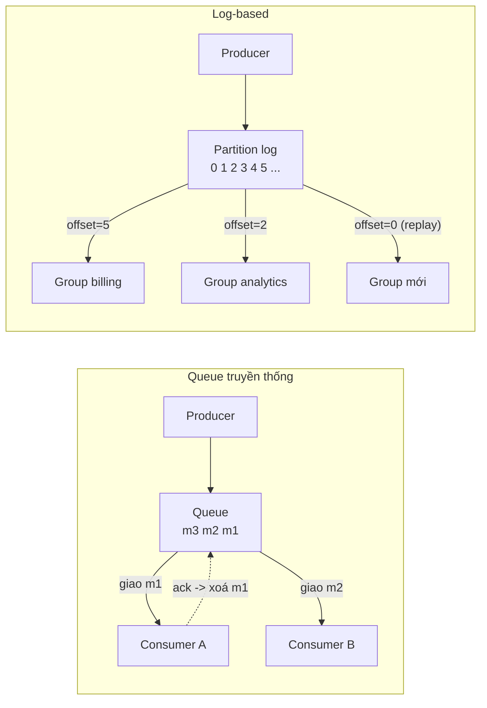

| Tiêu chí | Queue truyền thống | Log-based |
|---|---|---|
| Trạng thái theo dõi | Từng message (unacked, acked) | Một offset cho mỗi (group, partition) |
| Sau khi xử lý | Message bị xoá | Message vẫn còn tới hết retention |
| Đọc lại (replay) | Không (trừ khi tự lưu) | Có - lùi offset |
| Nhiều hệ thống cùng đọc | Cần exchange/fan-out ra nhiều queue | Tự nhiên - mỗi group một offset |
| Thứ tự | Một queue + một consumer thì có; nhiều consumer thì không | Trong một partition luôn có |
| Song song hoá | Thêm consumer bất kỳ lúc nào | Bị giới hạn bởi số partition |
| Routing phức tạp, ưu tiên, delay | Mạnh (RabbitMQ exchanges, priority) | Yếu - tự làm |
| Một message chậm/lỗi | Chỉ message đó bị retry | Chặn cả partition phía sau (head-of-line blocking) |
| Hợp với | Task queue, job, RPC bất đồng bộ | Event stream, CDC, analytics, event sourcing |

!!! tip "Câu hỏi để chọn mô hình"
    Hỏi: *"Sau khi xử lý xong, sự kiện này còn giá trị với ai khác không?"* Nếu câu trả lời là "có - analytics, search, audit, một service tương lai" thì bạn cần **log**. Nếu là "không - đây chỉ là việc cần làm (gửi email, resize ảnh)" thì **queue** đơn giản hơn.

---

## 📖 2. Bên trong một log-based broker

Phần này dùng Kafka làm ví dụ vì nó phổ biến nhất, nhưng Pulsar, Redpanda, Kinesis có khái niệm tương đương.

### 2.1 Partition là một file chỉ-nối-thêm (append-only)

Một **topic** chia thành nhiều **partition**. Mỗi partition là một log có thứ tự; mỗi bản ghi có một **offset** tăng dần (0, 1, 2, ...). Trên đĩa, partition không phải một file khổng lồ mà là chuỗi **segment**:

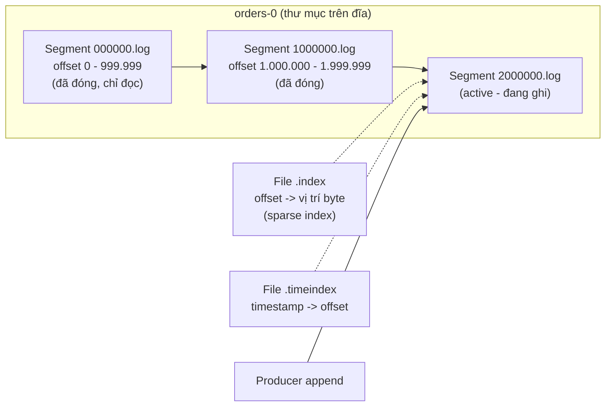

Vì sao thiết kế như vậy lại nhanh?

1. **Ghi tuần tự**: chỉ nối vào cuối file active. Ghi tuần tự trên cả HDD lẫn SSD nhanh hơn ghi ngẫu nhiên rất nhiều.
2. **Page cache của OS**: Kafka không tự cache message trong heap JVM, nó dựa vào page cache. Consumer đọc "bám đuôi" (tail) gần như luôn trúng RAM.
3. **Zero-copy**: khi gửi dữ liệu cho consumer, broker dùng `sendfile()` để copy thẳng từ page cache ra socket, không qua user space (khi không bật TLS).
4. **Batching + nén**: producer gom nhiều bản ghi thành một batch, nén cả batch (lz4/zstd). Broker lưu nguyên batch đã nén, consumer tự giải nén.
5. **Xoá dữ liệu cũ = xoá cả segment**: không cần xoá từng bản ghi. Retention chỉ là "segment này có bản ghi mới nhất cũ hơn 7 ngày? Xoá file".

Tìm offset 1.500.123? Binary search trên tên segment để ra `1000000.log`, rồi dùng **sparse index** (mỗi ~4KB dữ liệu một mục) để nhảy gần đúng vị trí, rồi quét ngắn.

### 2.2 Offset, commit và consumer lag

Consumer **pull** dữ liệu: "cho tôi bản ghi từ offset X của partition P". Định kỳ, consumer **commit** offset đã xử lý vào một topic nội bộ (`__consumer_offsets`). Khi consumer chết và consumer khác nhận partition, nó đọc tiếp từ offset đã commit.

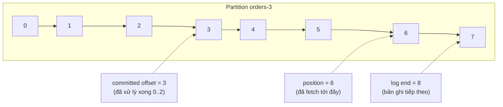

- **Thời điểm commit quyết định semantics**: commit **trước** khi xử lý → at-most-once (crash giữa chừng thì mất). Commit **sau** khi xử lý → at-least-once (crash sau xử lý nhưng trước commit thì xử lý lại). Chi tiết ở [backend/09 §6](../backend/09-message-queues.md).
- **Consumer lag** = log end offset - committed offset. Đây là **metric quan trọng nhất** của mọi pipeline streaming: lag tăng đều nghĩa là consumer không theo kịp; lag tính bằng **thời gian** (bản ghi cũ nhất chưa xử lý đã bao lâu) dễ đặt SLO hơn lag tính bằng số bản ghi.

### 2.3 Replication: leader, follower và ISR

Mỗi partition có **replication factor** (thường 3): một **leader** nhận mọi ghi/đọc, các **follower** kéo dữ liệu từ leader. Follower theo kịp được xếp vào **ISR (in-sync replicas)**.

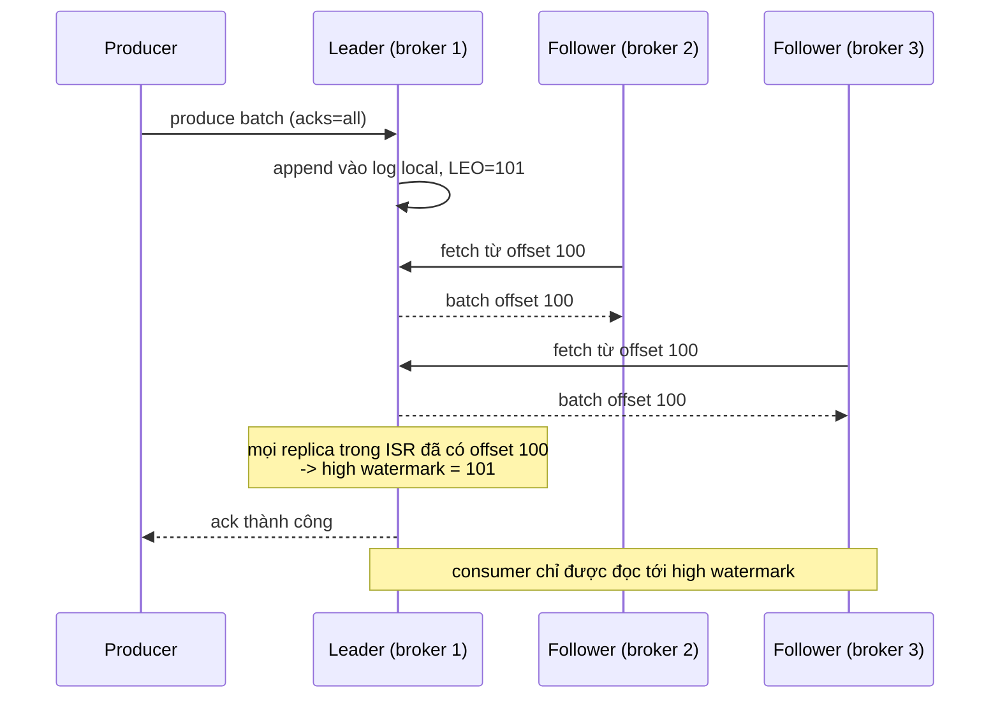

Ba tham số quyết định độ bền:

| `acks` | Ý nghĩa | Mất dữ liệu khi | Độ trễ |
|---|---|---|---|
| `0` | Gửi xong là xong, không chờ | Mạng lỗi, broker chết | Thấp nhất |
| `1` | Chờ leader ghi xong | Leader chết trước khi follower kịp sao chép | Thấp |
| `all` (`-1`) | Chờ mọi replica trong ISR | Gần như không (nếu cấu hình đúng `min.insync.replicas`) | Cao hơn |

- **`min.insync.replicas=2`** với replication factor 3: nếu ISR co lại còn 1 (hai follower tụt lại), ghi `acks=all` bị **từ chối** thay vì âm thầm chỉ ghi lên một máy. Đây là lựa chọn **C hơn A** (xem [Bài 4](./04-consistency-consensus.md)).
- **High watermark**: offset cao nhất mà mọi ISR đã có. Consumer không thấy bản ghi vượt high watermark - nếu leader chết, bản ghi đó có thể bị mất, và consumer không được phép đã "nhìn thấy" nó.
- **Unclean leader election**: nếu mọi ISR đều chết, có cho một replica **ngoài ISR** (thiếu dữ liệu) lên làm leader không? Bật = ưu tiên availability, chấp nhận mất dữ liệu. Mặc định tắt.

!!! warning "Combo kinh điển cho dữ liệu quan trọng"
    `replication.factor=3`, `min.insync.replicas=2`, producer `acks=all`, `enable.idempotence=true`, `unclean.leader.election.enable=false`. Chịu được mất 1 broker mà vẫn ghi được, không mất dữ liệu đã ack.

Metadata của cluster (ai là leader, ISR gồm ai) xưa kia nằm ở ZooKeeper; Kafka hiện đại dùng **KRaft** - một nhóm controller đồng thuận bằng Raft ([Bài 4](./04-consistency-consensus.md)).

### 2.4 Consumer group và rebalancing

Một **consumer group** là một nhóm consumer cùng chia nhau đọc một topic: **mỗi partition chỉ được giao cho đúng một consumer trong group** tại một thời điểm. Đó là cách log-based broker giữ thứ tự trong partition mà vẫn song song hoá.

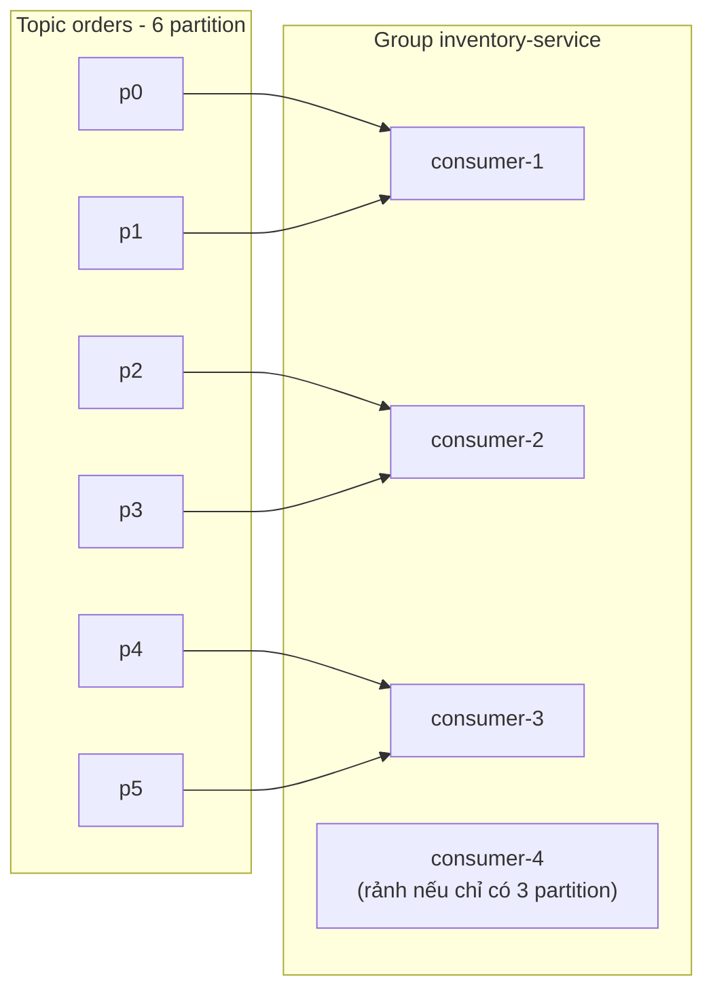

Hệ quả: **số consumer hữu ích tối đa = số partition**. Consumer thứ 7 cho topic 6 partition chỉ ngồi chơi (làm dự phòng nóng).

**Rebalancing** xảy ra khi có consumer vào/ra group (deploy, scale, crash, hoặc consumer xử lý quá lâu không gọi `poll()` kịp `max.poll.interval.ms`). Group coordinator (một broker) thu hồi và chia lại partition.

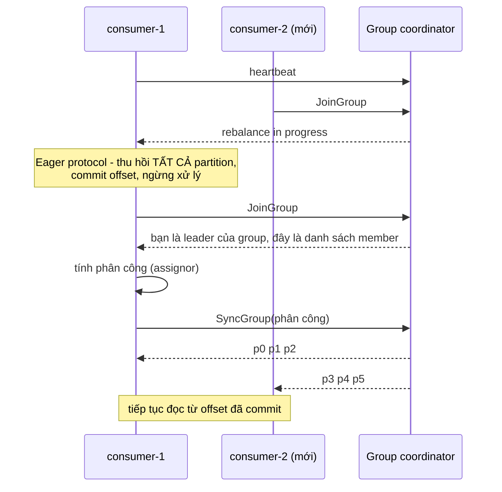

Vấn đề của giao thức **eager** cổ điển: **stop-the-world** - mọi consumer dừng hết dù chỉ một partition cần chuyển chủ. Với group hàng trăm consumer, mỗi lần deploy rolling có thể gây hàng chục lần rebalance liên tiếp ("rebalance storm").

Các cải tiến:

| Kỹ thuật | Ý tưởng | Lợi ích |
|---|---|---|
| **Cooperative (incremental) rebalancing** | Chỉ thu hồi những partition thực sự phải chuyển, qua nhiều vòng nhỏ | Consumer khác vẫn chạy trong lúc rebalance |
| **Sticky assignor** | Cố giữ partition ở consumer cũ | Ít mất cache/state cục bộ |
| **Static membership** (`group.instance.id`) | Consumer restart với cùng ID trong `session.timeout` thì không coi là rời group | Rolling deploy không gây rebalance |
| **Giao thức group mới phía broker** (KIP-848, Kafka 4.x) | Broker tự tính phân công, client chỉ heartbeat | Rebalance nhanh và ít "đứng hình" hơn |

!!! warning "Lỗi kinh điển: xử lý lâu → bị đá khỏi group → xử lý lại → lại lâu"
    Consumer lấy 500 bản ghi, mỗi bản ghi gọi API ngoài mất 1 giây → 500 giây > `max.poll.interval.ms` (mặc định 5 phút). Coordinator coi consumer đã chết, giao partition cho người khác; người đó xử lý lại đúng 500 bản ghi đó và lại chậm... Vòng lặp vô tận, lag tăng mãi. Cách chữa: giảm `max.poll.records`, xử lý bất đồng bộ có kiểm soát, hoặc tăng timeout có chủ đích.

### 2.5 Retention và log compaction

Có hai chính sách dọn dẹp, cấu hình theo từng topic:

**Delete (theo thời gian/kích thước)**: xoá segment cũ hơn `retention.ms` (vd 7 ngày) hoặc khi partition vượt `retention.bytes`. Dùng cho event stream: click, log, đơn hàng.

**Compact (theo key)**: giữ lại **bản ghi mới nhất cho mỗi key**, xoá các bản cũ hơn của cùng key. Bản ghi với value `null` là **tombstone** - đánh dấu xoá key, và sau một thời gian (`delete.retention.ms`) chính tombstone cũng bị dọn.

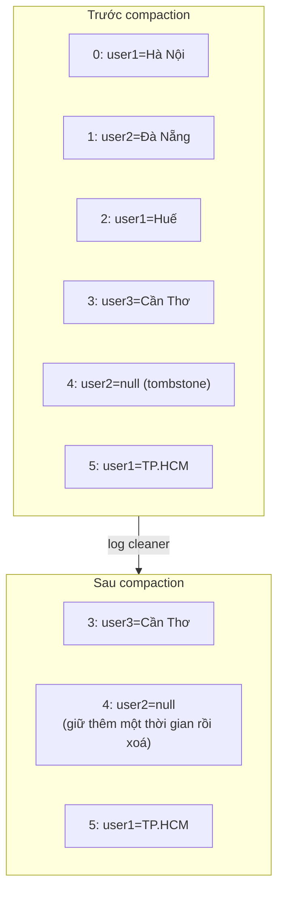

Lưu ý: offset **không đổi** sau compaction (chỉ bị "thủng lỗ"), thứ tự giữ nguyên. Compacted topic biến log thành **bảng có thể tái tạo**: một service mới đọc từ đầu topic `user-profile` (compacted) là có ngay trạng thái mới nhất của mọi user - đây là nền tảng của **KTable**, của changelog cho state store trong Kafka Streams, và của CDC.

| Chính sách | Giữ gì | Dùng cho | Rủi ro |
|---|---|---|---|
| `delete` | Mọi bản ghi trong N ngày | Event stream, log | Consumer chậm quá retention sẽ **mất** dữ liệu chưa đọc |
| `compact` | Bản mới nhất mỗi key | Trạng thái (profile, giá, cấu hình), changelog | Không phải lịch sử đầy đủ; key phải được chọn đúng |
| `compact,delete` | Bản mới nhất mỗi key, nhưng không quá N ngày | Cache phân tán có hạn | Phức tạp hơn khi suy luận |

**Tiered storage**: segment cũ được đẩy sang object storage (S3, xem [Bài 6](./06-specialized-storage.md)), broker chỉ giữ phần "nóng" trên đĩa local. Retention dài (tháng, năm) trở nên rẻ, thêm broker không phải copy hàng TB dữ liệu lịch sử.

### 2.6 Nên có bao nhiêu partition?

Công thức ước lượng thô:

```
partitions >= max( throughput_mục_tiêu / throughput_1_partition_phía_producer,
                   throughput_mục_tiêu / throughput_1_consumer )
```

Ví dụ: mục tiêu 200 MB/s; một partition producer ghi được ~20 MB/s; một consumer (có logic nghiệp vụ, ghi DB) chỉ xử lý được ~5 MB/s → cần **ít nhất 40 partition** (consumer là nút cổ chai). Thêm dư địa tăng trưởng → chọn 48 hoặc 64.

Đừng tạo quá nhiều: mỗi partition tốn file handle, bộ nhớ, thời gian bầu leader khi broker chết, và làm rebalance lâu hơn. **Tăng** partition sau này được, nhưng **phá vỡ ánh xạ key → partition** (`hash(key) % N` đổi khi N đổi) - các bản ghi cùng key sau khi tăng có thể vào partition khác, mất thứ tự trong giai đoạn chuyển tiếp. Vì vậy nên chọn dư ngay từ đầu cho topic cần thứ tự theo key.

---

## 📖 3. Thứ tự (ordering) - đảm bảo đến đâu?

**Đảm bảo duy nhất**: bản ghi trong **cùng một partition** được đọc theo đúng thứ tự đã ghi. Giữa các partition **không có** thứ tự toàn cục.

Vì vậy câu hỏi thiết kế là: *"Thứ tự quan trọng ở phạm vi nào?"* Rồi chọn **partition key** đúng phạm vi đó.

| Nghiệp vụ | Cần thứ tự trong phạm vi | Partition key |
|---|---|---|
| Trạng thái đơn hàng (created → paid → shipped) | Một đơn | `order_id` |
| Số dư ví | Một ví | `wallet_id` |
| Tin nhắn chat | Một cuộc hội thoại | `conversation_id` (xem [Bài 8](./08-chat-presence.md)) |
| CDC từ DB | Một hàng (primary key) | Primary key của bảng |
| Click analytics | Không cần | `null` (round-robin / sticky) |

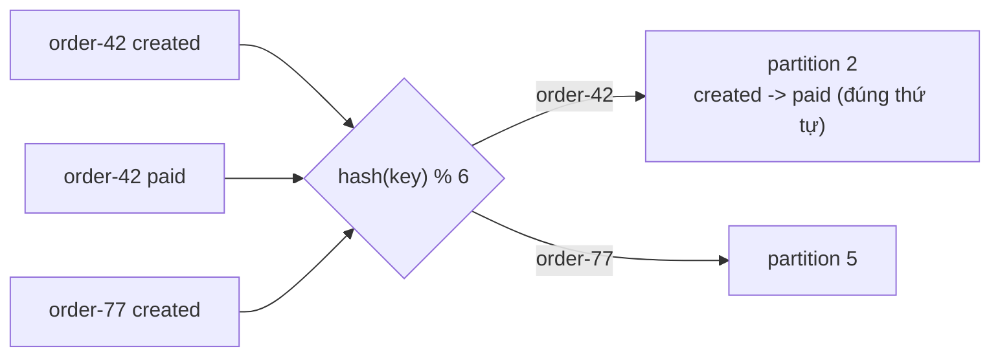

### 3.1 Những cách vô tình phá vỡ thứ tự

1. **Retry ở producer khi có nhiều request đang bay**: batch 1 lỗi tạm, batch 2 thành công, batch 1 retry thành công → thứ tự trên log là 2, 1. Cách chữa: bật **idempotent producer** (§4.2) - broker dùng sequence number để từ chối batch sai thứ tự, cho phép tới 5 request đang bay mà vẫn giữ thứ tự.
2. **Consumer xử lý song song bằng thread pool**: lấy 100 bản ghi từ một partition, ném vào 10 thread → thứ tự mất. Cách chữa: song song **theo key** - băm key vào N hàng đợi nội bộ, mỗi hàng đợi một thread (cùng key luôn vào cùng thread).
3. **Retry topic / DLQ**: bản ghi lỗi chuyển sang retry topic, bản ghi tiếp theo của cùng key được xử lý trước. Nếu nghiệp vụ yêu cầu thứ tự, khi một key đang "kẹt" ở retry, các bản ghi sau của key đó cũng phải đi theo (park theo key).
4. **Đổi số partition** (§2.6).
5. **Hai producer cho cùng một key** (vd hai instance service cùng cập nhật một đơn): thứ tự ghi vào log là thứ tự **đến broker**, không phải thứ tự nghiệp vụ. Cách chữa: kèm **version / sequence nghiệp vụ** trong payload, consumer bỏ qua bản ghi có version cũ hơn cái đã áp dụng.

!!! tip "Thứ tự toàn cục gần như luôn là yêu cầu sai"
    Một topic **1 partition** cho thứ tự toàn cục nhưng giới hạn throughput ở một máy, một consumer. Gần như mọi bài toán "cần thứ tự toàn cục" thực ra chỉ cần thứ tự **theo thực thể**. Hỏi lại người yêu cầu trước khi chấp nhận.

---

## 📖 4. Exactly-once: có thật không?

Câu trả lời ngắn: **"exactly-once delivery" qua mạng là không thể** (bài toán Two Generals - bạn không bao giờ chắc bên kia nhận được ack của bạn). Cái làm được là **exactly-once processing / effect**: mỗi sự kiện **ảnh hưởng tới kết quả đúng một lần**, dù bản thân nó có thể được gửi/xử lý nhiều lần.

Công thức chung: **at-least-once + loại trùng (idempotency) = effectively-once.**

### 4.1 Ba chỗ trùng lặp có thể xuất hiện

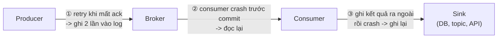

Mỗi chỗ cần một cơ chế riêng.

### 4.2 Idempotent producer - chặn trùng ở ①

Khi bật `enable.idempotence=true` (mặc định từ Kafka 3.0), producer được cấp một **Producer ID (PID)** và đánh **sequence number** cho mỗi batch gửi tới từng partition. Broker nhớ sequence cuối cùng của mỗi (PID, partition):

- Sequence = cuối + 1 → ghi.
- Sequence ≤ cuối → **trùng** (do retry) → trả ack nhưng không ghi lại.
- Sequence > cuối + 1 → **lỗ** → báo lỗi out-of-order.

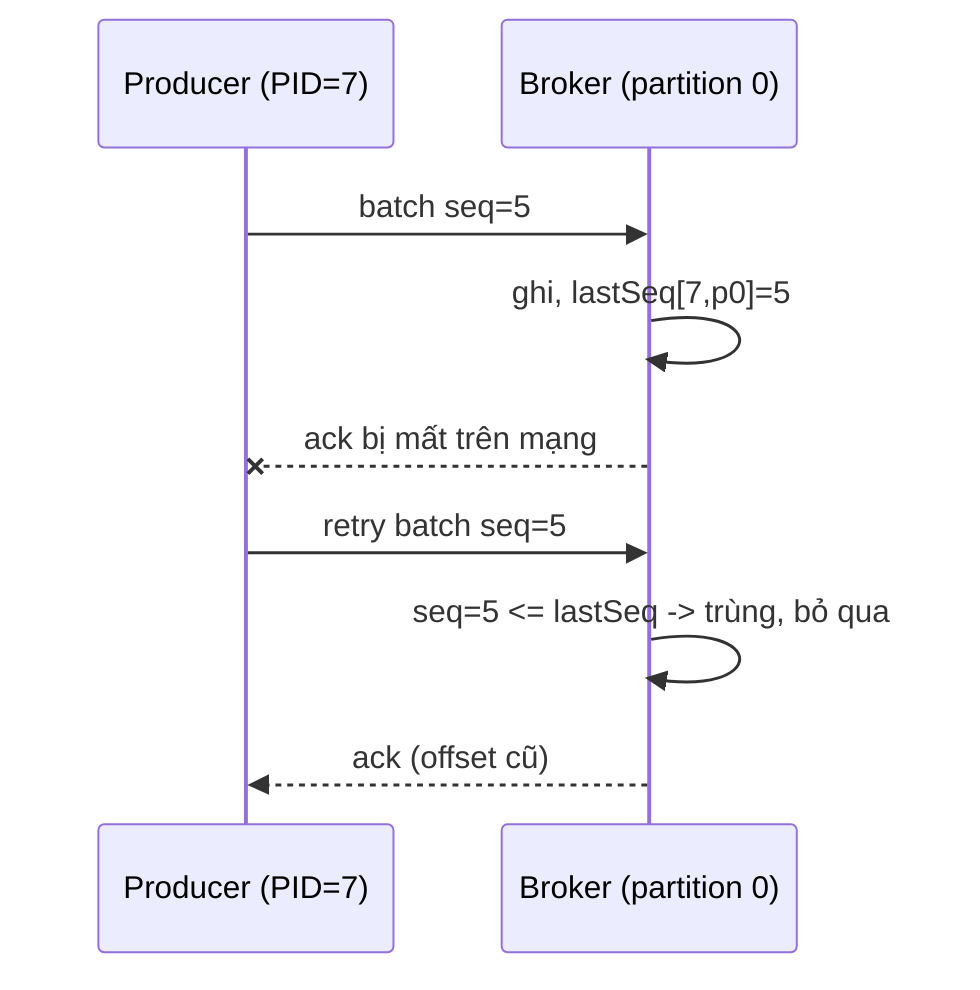

Giới hạn: chỉ chống trùng **trong một phiên producer**. Nếu ứng dụng crash và khởi động lại, nó nhận PID mới, và nếu chính ứng dụng gửi lại message (do không biết lần trước đã thành công chưa) thì vẫn trùng. Đó là việc của transactions hoặc của idempotent sink.

### 4.3 Transactions - nguyên tử cho chu trình "đọc → xử lý → ghi"

Bài toán: stream processor đọc từ topic `orders`, tính toán, ghi vào topic `invoices`, và commit offset của `orders`. Ba việc này phải **cùng thành công hoặc cùng thất bại**. Nếu ghi `invoices` xong mà crash trước khi commit offset → xử lý lại → hoá đơn trùng.

Kafka transactions gói cả ba vào một giao dịch:

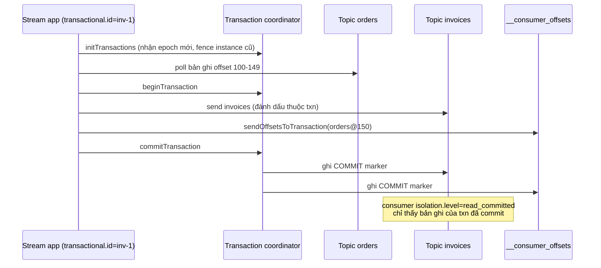

Các mảnh ghép:

- **`transactional.id`** cố định cho mỗi "vai" xử lý (vd mỗi input partition). Khi instance mới khởi động với cùng ID, coordinator tăng **epoch** và **fence** (chặn) instance cũ - kể cả khi instance cũ là một "zombie" vẫn đang chạy sau khi bị tưởng là chết (do GC pause dài hoặc mạng chập chờn).
- **Offset commit nằm trong transaction**: commit offset đầu vào và ghi đầu ra là một đơn vị nguyên tử.
- **Consumer phía sau** phải đặt `isolation.level=read_committed` để không đọc bản ghi của transaction bị abort.

Kafka Streams bật toàn bộ cơ chế này bằng một dòng: `processing.guarantee=exactly_once_v2`. Flink làm tương tự bằng **two-phase commit sink** gắn với checkpoint.

### 4.4 Giới hạn: exactly-once chỉ đúng **bên trong** Kafka

Transactions chỉ bao được những gì **nằm trong Kafka** (topic đầu ra + offset). Ngay khi consumer làm một **side effect ra bên ngoài** - gửi email, gọi cổng thanh toán, ghi PostgreSQL, cập nhật Elasticsearch - Kafka không thể rollback việc đó. Crash sau khi gửi email nhưng trước commit → email gửi hai lần.

### 4.5 Effectively-once với idempotent sink

Ba kỹ thuật, xếp từ đơn giản tới mạnh:

**(a) Ghi kiểu upsert theo khoá tự nhiên.** Kết quả có khoá xác định (vd `invoice_id = order_id`), ghi bằng `INSERT ... ON CONFLICT (invoice_id) DO NOTHING` hoặc `PUT` vào KV store. Ghi lại lần hai không đổi kết quả.

**(b) Bảng dedup (inbox).** Lưu `event_id` đã xử lý trong **cùng transaction DB** với thay đổi nghiệp vụ (chi tiết và code ở [backend/09 §6.2, §7](../backend/09-message-queues.md)).

**(c) Lưu offset cùng kết quả.** Không commit offset vào Kafka nữa; thay vào đó lưu `(topic, partition, offset)` trong **cùng transaction** với dữ liệu nghiệp vụ ở DB đích. Khi khởi động, consumer đọc offset từ DB và `seek()` tới đó. Vì dữ liệu và offset luôn cùng commit hoặc cùng rollback, không thể có trùng hay mất.

```sql
BEGIN;
UPDATE inventory SET stock = stock - 1 WHERE sku = 'SKU-9';
UPDATE consumer_offsets SET next_offset = 1501
  WHERE topic = 'orders' AND partition = 3 AND next_offset = 1500;  -- điều kiện = chống zombie
COMMIT;
```

**(d) Với API bên ngoài**: gửi kèm **idempotency key** (vd `order_id`), phía cổng thanh toán tự loại trùng. Nếu API không hỗ trợ, bạn phải chấp nhận at-least-once và có quy trình đối soát (reconciliation).

| Cơ chế | Chặn trùng ở | Phạm vi | Chi phí |
|---|---|---|---|
| Idempotent producer | ① producer → broker | Một phiên producer, từng partition | Gần như miễn phí - luôn bật |
| Kafka transactions | ①②③ khi đầu ra là Kafka | Kafka → Kafka | Thêm độ trễ (chờ commit), cấu hình phức tạp |
| Upsert theo khoá tự nhiên | ③ | Sink hỗ trợ upsert | Cần khoá xác định từ dữ liệu |
| Dedup table / inbox | ②③ | Sink là DB có transaction | Thêm bảng, cần dọn định kỳ |
| Offset lưu trong sink | ②③ | Sink là DB có transaction | Tự quản lý offset |
| Idempotency key với API ngoài | ③ | API hỗ trợ | Phụ thuộc bên thứ ba |

!!! tip "Câu trả lời phỏng vấn tốt"
    "Tôi thiết kế pipeline **at-least-once** ở mọi chỗ, rồi làm **mọi sink idempotent**. Nếu toàn bộ pipeline là Kafka → Kafka thì bật transactions của Kafka Streams/Flink. Với side effect ra ngoài, tôi dùng idempotency key và đối soát." Câu này cho thấy bạn hiểu cả cơ chế lẫn giới hạn.

---

## 📖 5. Stream processing

### 5.1 Batch vs stream

**Batch**: dữ liệu có **điểm kết thúc** - "tính doanh thu ngày hôm qua". Chạy job, đọc hết, ra kết quả.

**Stream**: dữ liệu **vô tận** - "doanh thu mỗi phút, cập nhật liên tục". Không bao giờ có lúc "đọc hết", nên mọi phép tổng hợp phải được **chia theo cửa sổ** (window).

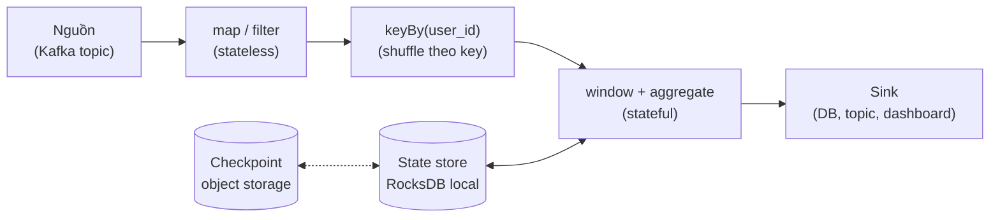

Công cụ phổ biến: **Apache Flink** (mạnh nhất về event time, state, exactly-once), **Kafka Streams** (thư viện nhúng vào service Java, không cần cluster riêng), **Spark Structured Streaming** (micro-batch), các dịch vụ managed (Dataflow / Apache Beam, Kinesis Data Analytics), và các hệ "streaming database" dùng SQL.

### 5.2 Event time vs processing time

Đây là ý tưởng quan trọng nhất của stream processing.

- **Event time**: thời điểm sự kiện **thực sự xảy ra** (điện thoại ghi lúc người dùng bấm "Mua").
- **Ingestion time**: thời điểm broker nhận được.
- **Processing time**: thời điểm operator xử lý nó.

Ba mốc này có thể lệch nhau từ vài mili-giây tới **vài giờ**: điện thoại vào thang máy mất sóng, app gom log gửi theo lô, consumer bị dừng để deploy, hoặc bạn **replay** dữ liệu tuần trước.

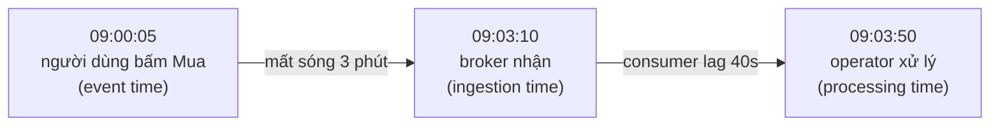

Nếu tính "doanh thu theo phút" bằng **processing time**: đơn mua lúc 09:00 bị cộng vào phút 09:03 - sai. Tệ hơn, nếu bạn replay dữ liệu cả tuần trong 10 phút, toàn bộ doanh thu tuần dồn vào 10 phút đó. Kết quả **phụ thuộc vào lúc chạy** - không lặp lại được.

Dùng **event time** thì kết quả **chỉ phụ thuộc vào dữ liệu**: chạy lại bao nhiêu lần cũng ra cùng con số. Cái giá: phải trả lời câu hỏi *"bao giờ thì tôi chắc là đã nhận đủ dữ liệu của phút 09:00?"* - đó là việc của **watermark**.

### 5.3 Các loại cửa sổ

| Loại | Mô tả | Ví dụ |
|---|---|---|
| **Tumbling** | Kích thước cố định, không chồng lấp, liền nhau | Doanh thu mỗi phút: [09:00, 09:01), [09:01, 09:02) |
| **Sliding / hopping** | Kích thước cố định, trượt theo bước nhỏ hơn kích thước → chồng lấp | "Số lần đăng nhập sai trong 5 phút gần nhất", tính lại mỗi 1 phút |
| **Session** | Không cố định; mở khi có sự kiện, đóng khi **im lặng** quá khoảng gap | Một phiên xem sản phẩm: đóng sau 30 phút không hoạt động |
| **Global + trigger** | Một cửa sổ cho mỗi key, tự định nghĩa khi nào phát kết quả | "Phát kết quả mỗi 100 sự kiện" |

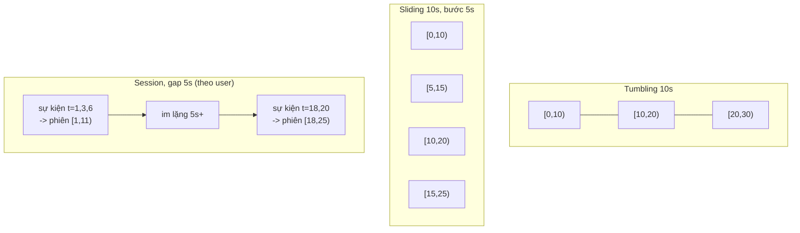

Lưu ý chi phí: sliding window kích thước W bước S làm **mỗi sự kiện thuộc W/S cửa sổ** (10s bước 1s → mỗi sự kiện vào 10 cửa sổ). Session window có thể **gộp** hai phiên khi một sự kiện đến trễ lấp vào khoảng trống giữa chúng.

### 5.4 Watermark và dữ liệu đến trễ

**Watermark** là một khẳng định mà hệ thống tự đưa ra: *"Tôi tin rằng sẽ không còn sự kiện nào có event time nhỏ hơn W."* Khi watermark vượt qua mốc kết thúc của một cửa sổ, cửa sổ đó **được đóng và phát kết quả**.

Cách sinh watermark phổ biến nhất - **bounded out-of-orderness**:

```
watermark = (event time lớn nhất đã thấy) - (độ trễ tối đa chấp nhận)
```

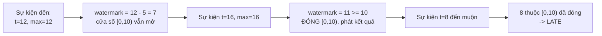

Sự kiện đến sau khi cửa sổ đã đóng gọi là **late data**. Các lựa chọn:

| Chiến lược | Cách làm | Khi nào dùng |
|---|---|---|
| **Bỏ qua** | Đếm vào metric "late dropped" | Dashboard gần đúng, dữ liệu trễ hiếm |
| **Side output** | Đẩy sang topic riêng, xử lý bù bằng batch | Báo cáo tài chính - cần đủ nhưng không cần ngay |
| **Allowed lateness** | Giữ state cửa sổ thêm một thời gian, mỗi sự kiện trễ phát ra **kết quả cập nhật** | Hạ nguồn chấp nhận upsert (bảng theo `window_start`) |
| **Watermark chậm hơn** | Tăng độ trễ tối đa chấp nhận | Đánh đổi: kết quả đến muộn hơn |

**Trade-off cốt lõi**: watermark **nhanh** → kết quả sớm nhưng nhiều dữ liệu trễ bị bỏ; watermark **chậm** → đầy đủ hơn nhưng dashboard trễ hơn và giữ state lâu hơn (tốn bộ nhớ). Không có giá trị đúng tuyệt đối - chọn theo phân phối độ trễ thực tế (đo p99 của `ingestion_time - event_time`).

!!! warning "Watermark bị kẹt bởi partition im lặng"
    Watermark của một operator = **min** watermark của mọi partition đầu vào. Nếu một partition không có dữ liệu (ít traffic ban đêm), watermark của nó không tiến → **mọi cửa sổ ngừng đóng**. Flink có cấu hình "idleness" để bỏ qua partition im lặng quá lâu. Đây là bug kinh điển khi chạy thử với ít dữ liệu.

### 5.5 Demo: đếm sự kiện theo cửa sổ tumbling với watermark

Mô phỏng: tumbling window 10 giây, đếm số sự kiện theo user, chấp nhận trễ tối đa 5 giây. Thứ tự **đến** khác thứ tự event time (sự kiện `A@7` đến sau `B@12`, sự kiện `A@8` đến sau khi cửa sổ [0,10) đã đóng).

=== "Go"

    ```go
    package main

    import (
    	"fmt"
    	"sort"
    )

    type Event struct {
    	User string
    	TS   int // event time (giây)
    }

    const (
    	windowSize = 10 // tumbling window 10 giây
    	maxDelay   = 5  // chấp nhận trễ tối đa 5 giây (bounded out-of-orderness)
    )

    func main() {
    	// Thứ tự ĐẾN (arrival order) - không trùng thứ tự event time
    	events := []Event{
    		{"A", 1}, {"A", 3}, {"B", 12}, {"A", 7}, {"A", 14}, {"B", 16},
    		{"A", 8}, {"A", 21}, {"B", 19}, {"B", 27}, {"A", 24},
    	}
    	open := map[int]map[string]int{} // windowStart -> user -> count
    	maxTS, watermark := -1, -1

    	emit := func(ws int) {
    		users := []string{}
    		for u := range open[ws] {
    			users = append(users, u)
    		}
    		sort.Strings(users)
    		fmt.Printf("  >> EMIT window [%d,%d):", ws, ws+windowSize)
    		for _, u := range users {
    			fmt.Printf(" %s=%d", u, open[ws][u])
    		}
    		fmt.Println()
    		delete(open, ws)
    	}
    	closeReady := func() {
    		starts := []int{}
    		for ws := range open {
    			if ws+windowSize <= watermark {
    				starts = append(starts, ws)
    			}
    		}
    		sort.Ints(starts)
    		for _, ws := range starts {
    			emit(ws)
    		}
    	}

    	for _, e := range events {
    		ws := e.TS / windowSize * windowSize
    		if ws+windowSize <= watermark { // cửa sổ đã đóng
    			fmt.Printf("event %s@%-2d -> LATE (watermark=%d), đưa vào side output\n", e.User, e.TS, watermark)
    			continue
    		}
    		if open[ws] == nil {
    			open[ws] = map[string]int{}
    		}
    		open[ws][e.User]++
    		if e.TS > maxTS {
    			maxTS = e.TS
    		}
    		watermark = maxTS - maxDelay
    		fmt.Printf("event %s@%-2d -> window [%d,%d) watermark=%d\n", e.User, e.TS, ws, ws+windowSize, watermark)
    		closeReady()
    	}
    	fmt.Println("end of stream -> flush")
    	watermark = 1 << 30
    	closeReady()
    }
    ```

=== "Python"

    ```python
    WINDOW = 10   # tumbling window 10 giây
    MAX_DELAY = 5 # chấp nhận trễ tối đa 5 giây

    # Thứ tự ĐẾN (arrival order) - không trùng thứ tự event time
    events = [("A", 1), ("A", 3), ("B", 12), ("A", 7), ("A", 14), ("B", 16),
              ("A", 8), ("A", 21), ("B", 19), ("B", 27), ("A", 24)]

    open_windows: dict[int, dict[str, int]] = {}
    max_ts, watermark = -1, -1

    def close_ready():
        for ws in sorted(w for w in open_windows if w + WINDOW <= watermark):
            counts = open_windows.pop(ws)
            body = " ".join(f"{u}={c}" for u, c in sorted(counts.items()))
            print(f"  >> EMIT window [{ws},{ws + WINDOW}): {body}")

    for user, ts in events:
        ws = ts // WINDOW * WINDOW
        if ws + WINDOW <= watermark:
            print(f"event {user}@{ts:<2} -> LATE (watermark={watermark}), đưa vào side output")
            continue
        bucket = open_windows.setdefault(ws, {})
        bucket[user] = bucket.get(user, 0) + 1
        max_ts = max(max_ts, ts)
        watermark = max_ts - MAX_DELAY
        print(f"event {user}@{ts:<2} -> window [{ws},{ws + WINDOW}) watermark={watermark}")
        close_ready()

    print("end of stream -> flush")
    watermark = 1 << 30
    close_ready()
    ```

Output (Go và Python giống hệt nhau):

```
event A@1  -> window [0,10) watermark=-4
event A@3  -> window [0,10) watermark=-2
event B@12 -> window [10,20) watermark=7
event A@7  -> window [0,10) watermark=7
event A@14 -> window [10,20) watermark=9
event B@16 -> window [10,20) watermark=11
  >> EMIT window [0,10): A=3
event A@8  -> LATE (watermark=11), đưa vào side output
event A@21 -> window [20,30) watermark=16
event B@19 -> window [10,20) watermark=16
event B@27 -> window [20,30) watermark=22
  >> EMIT window [10,20): A=1 B=3
event A@24 -> window [20,30) watermark=22
end of stream -> flush
  >> EMIT window [20,30): A=2 B=1
```

Đọc kết quả:

- `A@7` đến **sau** `B@12` nhưng vẫn được tính vào [0,10) vì lúc đó watermark mới là 7 - cửa sổ còn mở. Đây là tác dụng của độ trễ cho phép 5 giây.
- `B@16` đẩy watermark lên 11 ≥ 10 → cửa sổ [0,10) đóng với `A=3`.
- `A@8` đến ngay sau đó - **trễ**: cửa sổ đã phát kết quả. Nếu `maxDelay = 10`, nó sẽ được tính, nhưng cửa sổ [0,10) chỉ đóng khi thấy event time ≥ 20 - kết quả đến muộn hơn hẳn. Đó chính là trade-off ở §5.4.
- `B@19` đến sau `A@21` vẫn hợp lệ vì [10,20) chưa đóng.

??? question "Thử ngay: đổi `maxDelay` thành 2 và thành 10, kết quả thay đổi thế nào?"
    Với `maxDelay=2`: `B@12` đã đẩy watermark lên 10 → [0,10) đóng **trước** khi `A@7` đến, nên cả `A@7` và `A@8` đều trễ; cửa sổ đầu chỉ có `A=2`. Với `maxDelay=10`: không sự kiện nào trễ, [0,10) có đủ `A=4`, nhưng nó chỉ được phát khi gặp `A@21` (watermark 11) thay vì ở `B@16`; còn [10,20) thậm chí phải chờ tới cuối stream mới đóng (watermark chỉ lên tới 17). Đầy đủ hơn nhưng chậm hơn.

### 5.6 State, checkpoint và khôi phục

Operator có state (bộ đếm cửa sổ, bảng join) lưu state **cục bộ** (RAM hoặc RocksDB trên đĩa local) để nhanh. Nếu máy chết thì sao?

**Checkpoint kiểu Flink** (dựa trên thuật toán snapshot phân tán Chandy-Lamport): nguồn chèn một **barrier** vào dòng dữ liệu. Khi barrier đi qua một operator, operator chụp state của mình lên object storage. Khi mọi operator đã chụp với cùng barrier, ta có một **snapshot nhất quán** gồm state + offset nguồn.

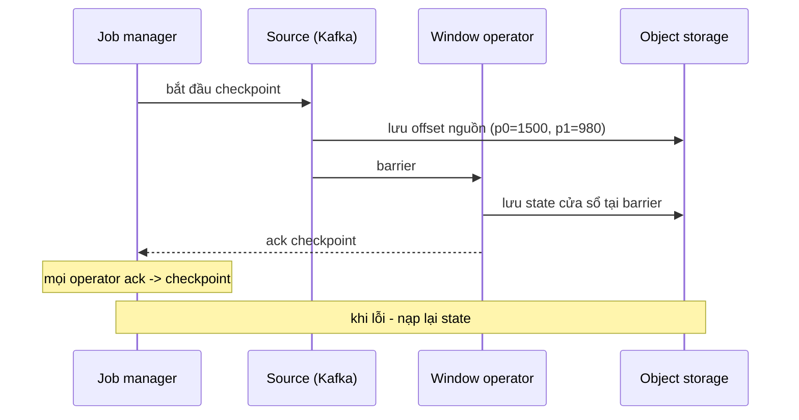

Khôi phục = nạp state từ checkpoint gần nhất **và** tua nguồn về offset tương ứng. Các bản ghi sau checkpoint được xử lý lại - nhưng state cũng đã bị tua lại, nên kết quả **bên trong** job là exactly-once. Đầu ra ra ngoài vẫn cần sink transactional (2PC gắn với checkpoint) hoặc idempotent sink (§4.5).

Kafka Streams làm khác: mỗi state store có một **changelog topic** (compacted, §2.5). Khôi phục = đọc lại changelog để dựng lại state.

### 5.7 Join trong stream

| Loại join | Ví dụ | State cần giữ |
|---|---|---|
| **Stream - table** | Đơn hàng (stream) + thông tin user (bảng, từ compacted topic/CDC) | Bảng mới nhất của mỗi key |
| **Stream - stream có cửa sổ** | "Lượt hiển thị quảng cáo" join "lượt click" trong vòng 30 phút | Mọi sự kiện trong cửa sổ của cả hai phía |
| **Temporal join** | Đơn hàng join **tỷ giá tại thời điểm đặt đơn** | Lịch sử phiên bản của bảng theo thời gian |

Điểm mấu chốt: muốn join theo key thì **hai stream phải được partition theo cùng key với cùng số partition** (co-partitioning), nếu không framework phải shuffle lại qua mạng.

---

## 📖 6. Backpressure trong pipeline nhiều tầng

Nguyên lý cơ bản (producer nhanh hơn consumer thì phải làm chậm producer, đệm, hoặc bỏ bớt) đã có ở [backend/09 §12](../backend/09-message-queues.md) và [Little's law](../systems-thinking/04-mental-models.md). Ở quy mô hệ thống, câu hỏi là: **tín hiệu "chậm lại" truyền đi đâu?**

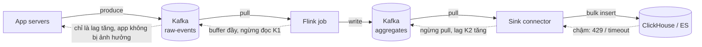

Đặc điểm hay của log-based broker: **broker là bộ đệm khổng lồ có giới hạn bằng đĩa**. Consumer kiểu **pull** tự nhiên có backpressure - chậm thì kéo ít đi, lag tăng, nhưng producer không bị chặn. Đây là lý do log thường được đặt **giữa** các tầng có tốc độ khác nhau.

Nhưng bộ đệm không vô hạn. Lag tăng mãi sẽ gặp **retention**: dữ liệu chưa đọc bị xoá. Các lớp phòng thủ:

| Tầng | Kỹ thuật |
|---|---|
| Bên trong stream processor | Credit-based flow control giữa operator (Flink): operator phía sau chỉ nhận khi còn buffer trống |
| Consumer → sink | Batch lớn hơn khi lag cao, giới hạn concurrency ghi, circuit breaker khi sink lỗi |
| Consumer group | **Autoscale theo lag** (vd KEDA scale theo consumer lag), nhưng trần là số partition |
| Producer | `buffer.memory` + `max.block.ms`: khi broker chậm, `send()` bị chặn hoặc lỗi - app phải quyết định (chờ, trả lỗi 503, bỏ sự kiện ít quan trọng) |
| Nguồn | **Load shedding** có ưu tiên: bỏ sự kiện analytics trước, giữ sự kiện thanh toán |
| Vận hành | Alert khi `lag tính theo thời gian > X phút` và khi lag dự báo chạm retention |

!!! tip "Push-based thì sao?"
    Broker push (RabbitMQ, Pub/Sub push subscription) cần cơ chế giới hạn rõ ràng: `prefetch` (RabbitMQ chỉ đẩy tối đa N message chưa ack), hoặc trả mã lỗi để broker giãn tốc độ đẩy. Thiếu cấu hình này, consumer bị dội hàng nghìn message vào RAM và chết OOM.

---

## 📖 7. CDC (Change Data Capture) và outbox

### 7.1 Bài toán: giữ nhiều hệ thống khớp với database

Bạn có PostgreSQL là nguồn sự thật (source of truth) cho sản phẩm. Elasticsearch phục vụ tìm kiếm, Redis cache giá, data warehouse cho báo cáo. Cách ngây thơ - **dual write**: code ứng dụng ghi DB rồi ghi ES rồi xoá cache.

Vấn đề (đã phân tích ở [backend/09 §7.1](../backend/09-message-queues.md)): không có transaction bao cả DB lẫn ES. Ghi DB xong, ghi ES lỗi → lệch vĩnh viễn. Hai request đồng thời có thể ghi DB theo thứ tự A, B nhưng ghi ES theo thứ tự B, A → ES giữ giá trị **sai**.

### 7.2 CDC dựa trên log của database

Mọi DB nghiêm túc đều có một log ghi lại mọi thay đổi theo đúng thứ tự commit: **WAL** của PostgreSQL, **binlog** của MySQL, **oplog/change streams** của MongoDB. CDC đọc log đó và phát mỗi thay đổi thành một sự kiện.

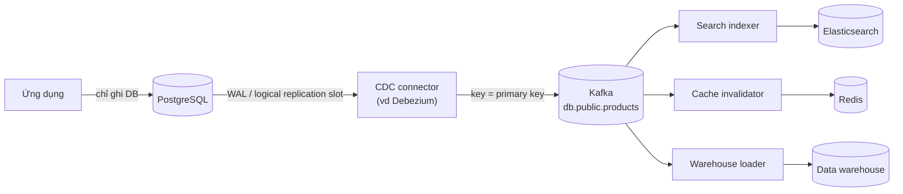

Một sự kiện CDC điển hình mang cả trạng thái trước và sau:

```json
{
  "op": "u",
  "source": { "table": "products", "lsn": 23759184, "ts_ms": 1767225600000 },
  "before": { "id": 42, "price": 199000, "stock": 10 },
  "after":  { "id": 42, "price": 179000, "stock": 10 }
}
```

Vì sao CDC dựa trên log tốt hơn **polling** (`SELECT * WHERE updated_at > ?` mỗi 10 giây)?

| Tiêu chí | Polling theo `updated_at` | CDC dựa trên log |
|---|---|---|
| Bắt được DELETE | Không (hàng đã mất) - trừ soft delete | Có |
| Thay đổi trung gian (A→B→C trong 10s) | Chỉ thấy C | Thấy đủ |
| Tải lên DB | Query định kỳ, quét index | Đọc log tuần tự, nhẹ |
| Độ trễ | Bằng chu kỳ poll | Thường dưới giây |
| Thứ tự | Phụ thuộc đồng hồ, transaction dài commit muộn có thể bị **bỏ sót** | Đúng thứ tự commit |
| Phụ thuộc schema | Cần cột `updated_at` mọi bảng | Không |
| Vận hành | Đơn giản | Cần connector, replication slot, theo dõi lag |

**Snapshot + stream**: khi mới bật CDC, connector phải chụp **toàn bộ** bảng hiện có (snapshot), ghi lại vị trí log tại thời điểm đó, rồi mới stream thay đổi từ vị trí đó - để không hở khoảng nào.

!!! warning "Replication slot bị bỏ quên = đĩa DB đầy"
    Với PostgreSQL, CDC dùng **logical replication slot**. Slot giữ WAL cho tới khi connector xác nhận đã đọc. Connector chết 2 ngày → WAL tích tụ 2 ngày → **đĩa của DB chính đầy**, DB ngừng ghi. Luôn alert theo kích thước WAL bị slot giữ lại.

### 7.3 Outbox qua CDC

CDC raw có một nhược điểm: sự kiện là **thay đổi hàng trong bảng** - lộ chi tiết schema nội bộ ra ngoài; đổi tên cột là phá consumer. **Outbox** khắc phục: ứng dụng ghi sự kiện nghiệp vụ được thiết kế cẩn thận vào bảng `outbox` **trong cùng transaction** với thay đổi dữ liệu; CDC chỉ đọc bảng `outbox` và đẩy lên Kafka.

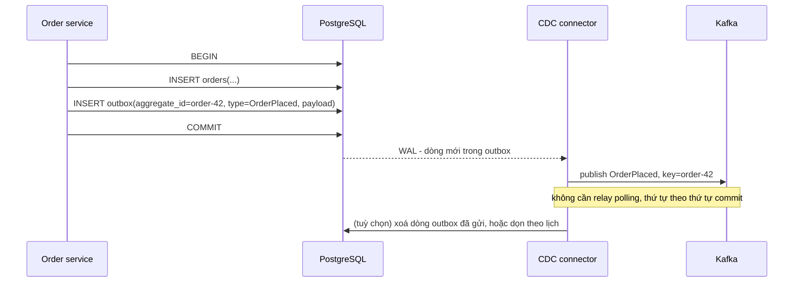

| | CDC trên bảng nghiệp vụ | Outbox (qua polling hoặc CDC) |
|---|---|---|
| Hình dạng sự kiện | Hàng DB (before/after) | Sự kiện nghiệp vụ có hợp đồng rõ |
| Sửa code ứng dụng | Không | Có - ghi thêm vào outbox |
| Đổi schema bảng | Có thể phá consumer | Không ảnh hưởng (hợp đồng tách rời) |
| Hợp với | Đồng bộ search/cache/warehouse (bản sao dữ liệu) | Giao tiếp giữa các service (domain event) |

Polling relay cho outbox (code ở [backend/09 §7.2](../backend/09-message-queues.md)) đơn giản và đủ dùng cho nhiều hệ thống; CDC cho outbox giảm độ trễ và tải poll.

---

## 📖 8. Lambda vs Kappa architecture

Khi cần **cả** kết quả thời gian thực **và** kết quả chính xác trên lịch sử dài, có hai trường phái.

**Lambda**: hai đường song song. **Batch layer** tính lại toàn bộ từ dữ liệu thô (chính xác, chậm - vài giờ). **Speed layer** tính gần đúng trên dữ liệu mới (nhanh). **Serving layer** gộp: dùng kết quả batch cho quá khứ, speed cho phần gần đây.

**Kappa**: chỉ có **một** đường streaming. Cần tính lại (sửa bug, đổi logic)? Chạy một phiên bản job mới đọc lại log **từ đầu** (log phải giữ đủ lâu, hoặc có tiered storage), khi bắt kịp thì chuyển traffic đọc sang output mới.

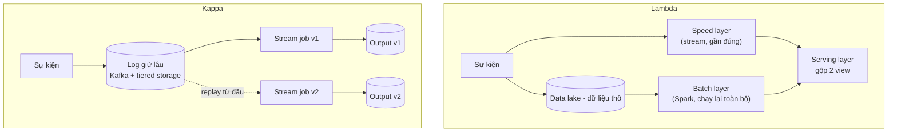

| Tiêu chí | Lambda | Kappa |
|---|---|---|
| Số codebase logic | **Hai** (batch + stream), dễ lệch nhau | Một |
| Tính lại lịch sử | Chạy lại batch - tự nhiên | Replay log - cần log giữ đủ lâu và job đủ nhanh |
| Độ chính xác | Batch là "nguồn sự thật" | Phụ thuộc xử lý event time/late data tốt |
| Vận hành | Hai hệ thống | Một hệ thống stream mạnh |
| Hợp với | Tính toán batch rất nặng (ML training, join lịch sử lớn) | Đa số pipeline analytics/real-time hiện đại |

Xu hướng hiện nay nghiêng về Kappa (hoặc "streaming + table format trên data lake" như Iceberg/Delta, nơi cùng một bảng được ghi bằng stream và đọc bằng batch - xem [Bài 6](./06-specialized-storage.md)), vì duy trì hai bộ logic song song tốn kém và dễ sai lệch.

---

## 📖 9. Chọn broker: Kafka, RabbitMQ, SQS/SNS, Pub/Sub, Redis Streams

| Tiêu chí | Kafka (và tương tự: Redpanda, Pulsar) | RabbitMQ | AWS SQS (+ SNS) | Google Pub/Sub | Redis Streams |
|---|---|---|---|---|---|
| Mô hình | Log phân tán, partition | Queue + exchange routing | Queue managed (+ SNS fan-out) | Topic + subscription managed | Log trong RAM của Redis |
| Replay | Có, theo retention | Không (Streams plugin của RabbitMQ có) | Không | Có giới hạn (seek theo thời gian/snapshot nếu bật giữ message) | Có, tới khi bị trim |
| Thứ tự | Theo partition | Theo queue (một consumer) | Standard: không; FIFO: theo message group | Theo ordering key (khi bật) | Theo stream |
| Throughput | Rất cao (GB/s cluster) | Trung bình - cao | Standard: gần như không giới hạn; FIFO: thấp hơn | Rất cao, tự scale | Cao nhưng giới hạn bởi RAM một shard |
| Retry/DLQ/delay | Tự xây (retry topic) | Có sẵn (DLX, TTL, priority) | Có sẵn (visibility timeout, redrive DLQ, delay) | Có sẵn (ack deadline, DLQ, retry policy) | Tự xây (PEL, XCLAIM / XAUTOCLAIM) |
| Vận hành | Nặng (trừ khi dùng managed) | Vừa | Không có - serverless | Không có - serverless | Nhẹ nếu đã có Redis |
| Độ bền | Cao (replication, đĩa) | Cao với quorum queue | Cao | Cao | Phụ thuộc cấu hình persistence của Redis - có thể mất dữ liệu gần nhất |
| Hợp nhất với | Event streaming, CDC, analytics, event sourcing | Task queue, routing phức tạp, RPC bất đồng bộ | Task queue trên AWS, decoupling đơn giản | Fan-out sự kiện trên GCP, ingest analytics | Hàng đợi nhẹ, sự kiện realtime kích thước vừa phải |

```mermaid
flowchart TD
    Q1{"Cần replay / nhiều hệ thống<br/>đọc độc lập cùng dữ liệu?"}
    Q1 -->|"Có"| Q2{"Muốn tự vận hành?"}
    Q2 -->|"Có / có đội platform"| KF["Kafka / Redpanda / Pulsar"]
    Q2 -->|"Không"| MK["Kafka managed (MSK, Confluent)<br/>hoặc Pub/Sub, Kinesis"]
    Q1 -->|"Không - chỉ là việc cần làm"| Q3{"Đang ở trên cloud,<br/>muốn zero-ops?"}
    Q3 -->|"Có"| SQS["SQS (AWS) / Pub/Sub / Cloud Tasks"]
    Q3 -->|"Không"| Q4{"Cần routing phức tạp,<br/>priority, delay?"}
    Q4 -->|"Có"| RMQ["RabbitMQ"]
    Q4 -->|"Không, quy mô nhỏ,<br/>đã có Redis"| RS["Redis Streams"]
```

Vài điểm hay bị hỏi:

- **SQS visibility timeout**: message được "ẩn" khỏi consumer khác trong N giây sau khi nhận; xử lý không xong và không xoá kịp → hiện lại → xử lý trùng. Phải đặt timeout > thời gian xử lý p99, hoặc gia hạn khi đang chạy.
- **SNS + SQS fan-out**: một sự kiện publish lên SNS topic, mỗi service có một SQS queue riêng subscribe - mô phỏng pub/sub với khả năng retry/DLQ độc lập cho từng service.
- **Redis Streams**: `XADD` để ghi, `XREADGROUP` để đọc theo consumer group, `XACK` để xác nhận; message chưa ack nằm trong **PEL (pending entries list)**, consumer chết thì consumer khác dùng `XAUTOCLAIM` để nhận lại. Cần `MAXLEN` để giới hạn bộ nhớ. Hợp cho hệ thống vừa phải, không thay thế Kafka cho dữ liệu hàng TB.
- **Kafka không phải task queue tốt**: một message lỗi chặn partition, không có delay/priority sẵn, không retry từng message. Dùng Kafka cho mọi thứ là sai lầm phổ biến; nhiều hệ thống dùng **cả hai** - Kafka cho event stream, RabbitMQ/SQS cho job.

!!! note "Hợp đồng sự kiện và schema registry"
    Khi nhiều team cùng đọc một topic, payload là **API công khai**. Dùng định dạng có schema (Avro, Protobuf, JSON Schema) với **schema registry** kiểm tra **tương thích** khi đăng ký phiên bản mới: *backward compatible* (consumer mới đọc được dữ liệu cũ - thêm field có default), *forward compatible* (consumer cũ đọc được dữ liệu mới - không xoá field bắt buộc). Quy tắc thực dụng: **chỉ thêm field optional, không đổi nghĩa field cũ, không tái sử dụng tên/số field đã xoá.**

### 💡 Tips quan trọng

- **Partition key = phạm vi thứ tự cần có.** Chọn sai key là lỗi khó sửa nhất sau này.
- **At-least-once + idempotent sink** là mặc định đúng. Exactly-once của Kafka chỉ là phần thưởng thêm khi pipeline nằm trọn trong Kafka.
- **Đo lag theo thời gian**, alert trước khi chạm retention.
- **Event time cho mọi phép tổng hợp nghiệp vụ**; processing time chỉ cho metric vận hành.
- **CDC cho đồng bộ bản sao dữ liệu, outbox cho domain event** - đừng để consumer bên ngoài phụ thuộc vào schema bảng nội bộ.
- Static membership + cooperative rebalancing cho mọi consumer group lớn.

---

## 🌍 Ứng dụng thực tế

- **LinkedIn** tạo ra Kafka để thay thế hàng loạt pipeline point-to-point giữa các hệ thống bằng một log trung tâm - ý tưởng "log là trung tâm của kiến trúc dữ liệu" bắt nguồn từ đây.
- **Uber, Netflix** và nhiều công ty lớn công khai dùng Kafka + Flink cho pipeline thời gian thực: tính giá động, phát hiện gian lận, metrics. (Quy mô cụ thể thay đổi theo thời gian - đọc engineering blog của họ thay vì nhớ con số.)
- **Debezium** là công cụ CDC mã nguồn mở phổ biến nhất, hỗ trợ PostgreSQL, MySQL, MongoDB, SQL Server, Oracle.
- **Sàn TMĐT Việt Nam** (mô hình điển hình, không phải số liệu chính thức): đơn hàng ghi vào MySQL/PostgreSQL → CDC → Kafka → cập nhật Elasticsearch cho tìm kiếm, data warehouse cho báo cáo, và stream job tính dashboard flash sale theo phút.
- **Ứng dụng ngân hàng/ví điện tử**: Kafka với `acks=all` + idempotent consumer có bảng dedup, kèm đối soát cuối ngày - không đặt cược vào "exactly-once" của một mình broker.

## ⚠️ Sai lầm thường gặp

1. **Tin rằng bật `exactly_once` là xong** - trong khi consumer gửi email hoặc gọi API thanh toán. Side effect ra ngoài vẫn có thể lặp lại.
2. **Thread pool xử lý song song bản ghi của một partition** rồi thắc mắc vì sao trạng thái đơn hàng đi lùi.
3. **Tạo topic với 3 partition "cho đủ dùng"**, sau đó không scale consumer được và phải tăng partition - phá vỡ thứ tự theo key.
4. **Tổng hợp theo processing time** cho số liệu nghiệp vụ - replay hay sự cố lag làm số liệu nhảy lung tung.
5. **Không theo dõi replication slot / consumer lag** - phát hiện ra khi đĩa DB đầy hoặc dữ liệu đã bị retention xoá.
6. **Dùng Kafka làm task queue** cho job cần retry từng cái, delay, priority - rồi tự xây lại RabbitMQ một cách vụng về.
7. **Event payload là entity đầy đủ của DB**, không có schema, không có version - đổi một cột là vỡ năm service.
8. **Consumer xử lý chậm hơn `max.poll.interval.ms`** - rebalance liên tục, lag tăng mãi.
9. **`acks=1` cho dữ liệu tài chính** vì "nhanh hơn" - mất dữ liệu khi leader chết.

---

## 🏋️ Bài tập

### Bài 1 (Dễ) - Chọn partition key

Hệ thống giao đồ ăn phát các sự kiện sau vào Kafka. Chọn partition key cho mỗi topic và giải thích.

1. `order-status` (placed, accepted, picked_up, delivered)
2. `driver-location` (tài xế gửi toạ độ mỗi 4 giây)
3. `app-clicks` (dùng cho dashboard số click theo màn hình)
4. `restaurant-menu-changes` (CDC từ bảng menu)

<details markdown="1"><summary>Đáp án</summary>

1. `order_id` - trạng thái một đơn phải theo đúng thứ tự.
2. `driver_id` - vị trí của một tài xế cần theo thứ tự (không để vị trí cũ đè vị trí mới). Topic này nên dùng retention ngắn, hoặc compact theo `driver_id` nếu chỉ cần vị trí mới nhất.
3. Không cần key (null → sticky partitioner chia đều) - không cần thứ tự, cần phân tải đều. Nếu dùng `screen_id` sẽ bị **hot partition** cho màn hình trang chủ.
4. Primary key của món ăn (`menu_item_id`) - CDC cần thứ tự theo hàng. Topic nên **compacted** để consumer mới có ngay trạng thái hiện tại.

</details>

### Bài 2 (Dễ) - Tính số partition

Mục tiêu 120 MB/s. Một partition ghi được 25 MB/s. Một consumer (ghi vào Cassandra) xử lý được 4 MB/s. Cần bao nhiêu partition? Bao nhiêu consumer?

<details markdown="1"><summary>Đáp án</summary>

- Phía producer: 120 / 25 = 4,8 → 5 partition.
- Phía consumer: 120 / 4 = 30 consumer, và vì mỗi partition chỉ có một consumer trong group → cần **≥ 30 partition**.
- Chọn ≥ 30, thêm dư địa tăng trưởng (vd gấp 1,5-2 lần) → **48 hoặc 64**. Chạy 30 consumer hiện tại, có thể scale tới 48/64 sau mà không đổi số partition.

</details>

### Bài 3 (Trung bình) - Debug thứ tự

Sự kiện `OrderCancelled` của đơn 42 được xử lý **trước** `OrderPaid` của chính đơn đó, dù producer gửi `OrderPaid` trước. Liệt kê ít nhất 3 nguyên nhân có thể và cách kiểm tra từng cái.

<details markdown="1"><summary>Đáp án</summary>

1. **Key khác nhau**: một sự kiện dùng `order_id`, sự kiện kia dùng `user_id` (hoặc null) → nằm ở hai partition khác nhau. Kiểm tra: in partition của cả hai bản ghi.
2. **Producer retry không có idempotence**, `max.in.flight > 1`: batch chứa `OrderPaid` lỗi tạm, batch sau thành công trước. Kiểm tra: offset của hai bản ghi trong partition; cấu hình `enable.idempotence`.
3. **Hai producer khác nhau** (payment-service gửi Paid, order-service gửi Cancelled): thứ tự trên log là thứ tự đến broker. Cách chữa: version/sequence nghiệp vụ trong payload, hoặc chỉ một service sở hữu trạng thái đơn.
4. **Consumer xử lý song song** bằng thread pool không theo key.
5. **Retry topic**: `OrderPaid` xử lý lỗi lần đầu, bị chuyển sang retry topic, `OrderCancelled` được xử lý trong lúc đó.
6. **Số partition vừa được tăng**: hai bản ghi trước/sau thời điểm tăng rơi vào partition khác nhau.

</details>

### Bài 4 (Trung bình) - Watermark

Dashboard "số đơn mỗi phút" theo event time. Đo được: 95% sự kiện đến trong vòng 3 giây, 99,9% trong vòng 40 giây, một số rất ít đến muộn tới 2 giờ (app offline). Sản phẩm muốn dashboard có số trong vòng 10 giây, còn báo cáo tài chính cuối ngày phải chính xác tuyệt đối. Thiết kế watermark và xử lý dữ liệu trễ.

<details markdown="1"><summary>Đáp án</summary>

- Dashboard: watermark với độ trễ cho phép ~5 giây → cửa sổ phút đóng sau ~5 giây, phát kết quả kịp mục tiêu 10 giây, bao ~95%+ sự kiện.
- Dùng **allowed lateness** ~60 giây: sự kiện trễ trong khoảng này phát **kết quả cập nhật** (upsert theo `window_start`) - dashboard tự sửa số trong vòng 1 phút, bao 99,9%.
- Sự kiện trễ hơn nữa → **side output** sang topic `late-orders`.
- Báo cáo tài chính: **không** dựa vào kết quả streaming. Chạy batch cuối ngày (hoặc vài giờ sau nửa đêm để đợi dữ liệu trễ) trên dữ liệu thô trong data lake, hoặc tính lại bằng cách replay. Đây là một dạng Lambda "nhẹ": stream cho tốc độ, batch cho sự chính xác ở nơi cần.

</details>

### Bài 5 (Trung bình) - Exactly-once trừ kho

Consumer đọc topic `orders`, mỗi đơn trừ tồn kho trong PostgreSQL rồi commit offset. Viết (pseudo-code hoặc SQL) một thiết kế để crash ở **bất kỳ** thời điểm nào cũng không trừ kho hai lần.

<details markdown="1"><summary>Đáp án</summary>

Cách 1 - bảng dedup trong cùng transaction:

```sql
BEGIN;
INSERT INTO processed_events(event_id) VALUES ('order-42-placed');  -- PK -> trùng thì lỗi
UPDATE inventory SET stock = stock - 2 WHERE sku = 'SKU-9' AND stock >= 2;
COMMIT;
-- sau đó mới commit offset Kafka; nếu INSERT lỗi duplicate -> rollback, bỏ qua, commit offset
```

Cách 2 - lưu offset cùng kết quả (không cần bảng dedup lớn):

```sql
BEGIN;
SELECT next_offset FROM consumer_offsets WHERE topic='orders' AND partition=3 FOR UPDATE;
-- nếu offset bản ghi < next_offset -> đã xử lý, bỏ qua
UPDATE inventory SET stock = stock - 2 WHERE sku = 'SKU-9' AND stock >= 2;
UPDATE consumer_offsets SET next_offset = 1501 WHERE topic='orders' AND partition=3;
COMMIT;
```

Khi khởi động: đọc `next_offset` từ DB và `seek()`. Phân tích crash: trước COMMIT → rollback toàn bộ, đọc lại từ offset cũ → xử lý một lần; sau COMMIT → offset trong DB đã tiến, không xử lý lại.

</details>

### Bài 6 (Khó) - Đồng bộ Elasticsearch

Bảng `products` (20 triệu hàng, ~2.000 cập nhật/giây lúc cao điểm) trong PostgreSQL cần đồng bộ sang Elasticsearch với độ trễ < 5 giây. Thiết kế: luồng dữ liệu, cách khởi tạo lần đầu, cách xử lý xoá, thứ tự, lỗi ES, và cách **reindex toàn bộ** khi đổi mapping mà không downtime.

<details markdown="1"><summary>Đáp án</summary>

- **Luồng**: PostgreSQL → logical replication slot → Debezium → Kafka topic `products` (key = `product_id`, compacted + retention đủ dài) → indexer consumer → ES bulk API.
- **Khởi tạo**: Debezium snapshot toàn bảng rồi stream tiếp từ LSN đã ghi lại. Hoặc: vì topic là compacted, consumer mới đọc từ đầu topic là có trạng thái mới nhất.
- **Xoá**: sự kiện `op=d` → tombstone trên Kafka → indexer gọi `DELETE` trên ES.
- **Thứ tự & trùng**: key = `product_id` giữ thứ tự theo sản phẩm. Ghi ES với **external versioning** (`version = LSN` của thay đổi) → ES từ chối ghi có version cũ hơn → replay/retry an toàn (idempotent sink).
- **ES lỗi/chậm**: consumer ngừng commit offset, retry với backoff; lag tăng nhưng không mất dữ liệu; alert khi lag > 5 giây và theo dõi WAL bị slot giữ.
- **Reindex khi đổi mapping**: tạo index mới `products_v2` với mapping mới; chạy consumer group **mới** đọc topic từ đầu vào `products_v2`; khi lag ≈ 0, đổi **alias** `products` từ v1 sang v2 (nguyên tử); dừng consumer cũ, xoá v1 sau một thời gian. Đây chính là tư tưởng Kappa (§8).

</details>

### Bài 7 (Khó) - Rebalance storm

Group 200 consumer trên Kubernetes, mỗi lần deploy (rolling, 10 pod mỗi đợt) dashboard lag tăng vọt và có những lúc xử lý dừng hoàn toàn 20-40 giây. Phân tích nguyên nhân và đề xuất ít nhất 4 thay đổi.

<details markdown="1"><summary>Đáp án</summary>

Nguyên nhân: mỗi pod tắt → rời group → rebalance; pod mới lên → join → rebalance. Với eager protocol, mỗi lần rebalance **mọi** consumer dừng, thu hồi toàn bộ partition. 20 đợt × 2 rebalance = 40 lần dừng toàn bộ.

Đề xuất:

1. **Static membership** (`group.instance.id` = tên pod ổn định của StatefulSet) + `session.timeout.ms` lớn hơn thời gian restart pod → restart không gây rebalance.
2. **Cooperative sticky assignor** → chỉ partition cần chuyển mới bị thu hồi, phần còn lại vẫn chạy.
3. Nâng cấp lên giao thức consumer group mới phía broker (KIP-848) nếu cluster/client hỗ trợ.
4. **Graceful shutdown**: bắt SIGTERM, xử lý xong batch hiện tại, commit offset, rồi mới đóng consumer (`terminationGracePeriodSeconds` đủ lớn).
5. Giảm `max.poll.records` để mỗi vòng poll ngắn, tránh bị coi là chết do vượt `max.poll.interval.ms` khi đang rebalance.
6. Xem lại có thực sự cần 200 consumer trong một group không - tách topic/group theo chức năng.

</details>

---

## ✅ Checklist

- [ ] Giải thích được khác biệt queue truyền thống vs log-based và khi nào chọn cái nào
- [ ] Mô tả được segment, offset, consumer lag, high watermark, ISR, `acks`, `min.insync.replicas`
- [ ] Biết nguyên nhân và cách giảm tác động của rebalancing (cooperative, static membership)
- [ ] Phân biệt retention `delete` và `compact`, biết tombstone dùng để làm gì
- [ ] Chọn partition key theo phạm vi thứ tự, liệt kê được các cách vô tình phá vỡ thứ tự
- [ ] Giải thích idempotent producer, Kafka transactions, zombie fencing và giới hạn của exactly-once
- [ ] Thiết kế được idempotent sink (upsert, dedup table, offset lưu cùng kết quả)
- [ ] Phân biệt event time / processing time; tumbling / sliding / session window
- [ ] Giải thích watermark, late data, trade-off độ trễ vs độ đầy đủ; chạy và sửa được demo
- [ ] Thiết kế được pipeline CDC (snapshot + stream) và biết rủi ro replication slot
- [ ] So sánh được Lambda vs Kappa
- [ ] Chọn được broker phù hợp cho một yêu cầu cụ thể và giải thích lý do

---

**Bài tiếp theo**: [Bài 6: Lưu trữ chuyên dụng](./06-specialized-storage.md)
