# 📚 Bài 6: Lưu trữ chuyên dụng

> "Nếu thứ duy nhất bạn có là cái búa, mọi thứ trông đều giống cái đinh." - Abraham Maslow (diễn ý)

Một ứng dụng mạng xã hội bán hàng khởi đầu với **một** PostgreSQL. Năm thứ hai, mọi thứ bắt đầu rạn nứt:

- Ảnh sản phẩm lưu dạng `BYTEA` trong bảng → backup 2 TB mất 9 tiếng, replica tụt lại hàng phút mỗi khi người bán đăng ảnh hàng loạt.
- Ô tìm kiếm dùng `WHERE name ILIKE '%ao khoac%'` → quét toàn bảng, không tìm được "áo khoác" khi gõ không dấu, không xếp hạng được kết quả nào liên quan hơn.
- Bảng `metrics` ghi 50.000 dòng/giây từ các server → index phình to, `VACUUM` không theo kịp.
- Câu báo cáo "doanh thu theo tỉnh theo tháng trong 3 năm" chạy 40 phút và làm chậm cả trang thanh toán.
- Tính năng "bạn của bạn bè cũng mua món này" cần JOIN 3 tầng bảng `friendships` - chết ngay ở tầng thứ hai.

Không phải PostgreSQL kém. Mà mỗi loại workload có **hình dạng truy cập** khác nhau, và có những hệ lưu trữ được thiết kế riêng cho hình dạng đó. Bài [NoSQL](../backend/07-nosql.md) đã giới thiệu các họ database. Bài này đi sâu vào **cách chúng hoạt động bên trong** và **khi nào dùng** - đúng mức mà phỏng vấn system design và công việc thực tế đòi hỏi.

## 🎯 Mục tiêu bài học

- Thiết kế với **object storage** (kiểu S3): bucket/key, multipart upload, presigned URL, erasure coding vs replication, mô hình nhất quán, lifecycle
- Hiểu **search engine** từ bên trong: analysis, inverted index, segment, **BM25**, near-real-time indexing, sharding/replica, và cách giữ search khớp với DB bằng CDC
- Thiết kế **time-series** storage: nén, cardinality, **downsampling** và **retention** - kèm phép tính dung lượng
- **Mô hình hoá wide-column (Cassandra)** theo truy vấn: partition key, clustering key, bucketing, tombstone
- Biết khi nào **graph database** đáng dùng và khi nào không
- Giải thích được **vì sao column store nhanh** cho analytics - kèm demo chạy được
- Phân biệt **data lake, data warehouse, lakehouse** và các table format
- Có một **bảng quyết định "use case → storage"** để dùng ngay khi thiết kế

!!! note "Kiến thức nền cần có"
    - [Backend - NoSQL](../backend/07-nosql.md): CAP/PACELC, các họ NoSQL, ví dụ MongoDB/Cassandra/Elasticsearch cơ bản.
    - [Backend - Database internals](../backend/06-database-internals-performance.md): B-tree, index, WAL.
    - [Bài 3](./03-building-blocks-data.md) (replication, sharding) và [Bài 5](./05-messaging-streaming.md) (CDC).

---

## 📖 1. Bức tranh tổng thể: polyglot persistence

Một hệ thống cỡ vừa trở lên thường có **một nguồn sự thật** (thường là DB quan hệ) và **nhiều bản sao chuyên dụng** được dẫn xuất từ nó qua CDC hoặc event.

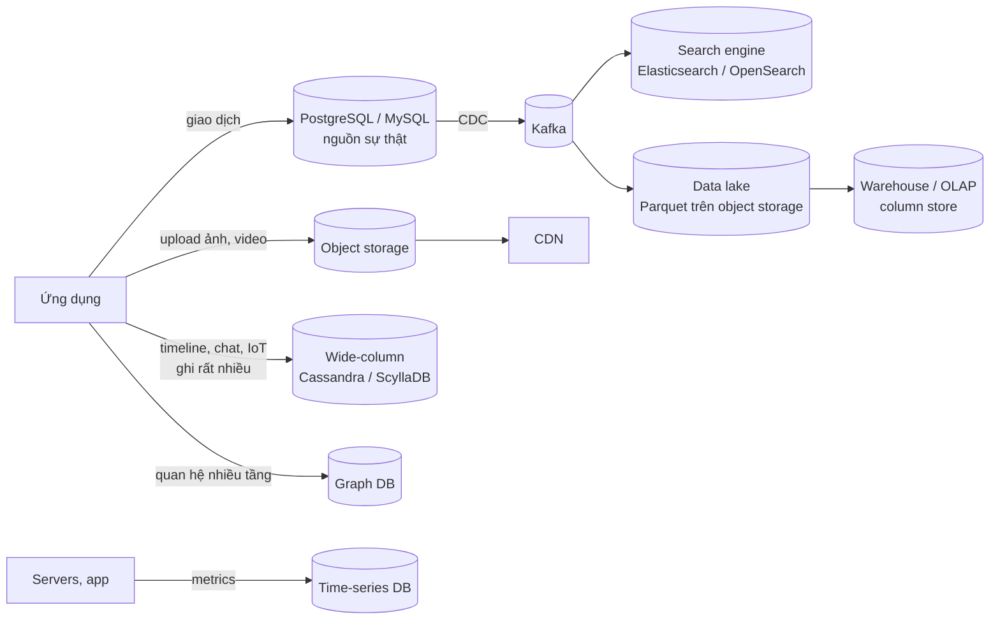

Nguyên tắc vàng: **mỗi kho thêm vào là một hệ thống phải vận hành, giám sát, backup, và giữ đồng bộ**. Chỉ thêm khi workload thật sự cần - và luôn trả lời được câu hỏi "nếu kho này lệch với nguồn sự thật, tôi dựng lại nó bằng cách nào?"

---

## 📖 2. Object storage (kiểu S3)

### 2.1 Mô hình: không phải hệ thống file

Object storage (Amazon S3, Google Cloud Storage, Azure Blob, MinIO, Ceph RGW) lưu **object**: một khối byte bất kỳ + metadata, được định danh bởi `bucket` + `key`.

```
s3://shop-media/products/2026/10/sku-9921/main-1080.webp
     └ bucket ┘ └──────────────── key ────────────────┘
```

Khác biệt quan trọng so với filesystem:

| Đặc điểm | Filesystem (ext4, NFS) | Object storage |
|---|---|---|
| Không gian tên | Cây thư mục thật | **Phẳng** - dấu `/` chỉ là ký tự trong key; "thư mục" là prefix |
| Sửa một phần file | Có (seek + write) | **Không** - ghi lại cả object (object bất biến) |
| Đổi tên thư mục | Một thao tác metadata | Copy + xoá **từng object** |
| Liệt kê | Nhanh | Chậm, phân trang, tốn tiền theo request |
| Giao tiếp | System call, POSIX | HTTP API (PUT/GET/DELETE/LIST) |
| Quy mô | Giới hạn bởi một máy / một cluster | Gần như vô hạn, trả theo GB + request |
| Độ bền | Phụ thuộc RAID/backup | Thiết kế cho độ bền rất cao (nhiều số 9) nhờ sao chép/erasure coding qua nhiều zone |

Hệ quả thiết kế: object storage hợp cho **dữ liệu lớn, ghi một lần, đọc nhiều**: ảnh, video, file đính kèm, backup, log, dữ liệu analytics (Parquet). Không hợp cho dữ liệu sửa nhỏ liên tục hoặc cần truy vấn theo nội dung - metadata cần truy vấn (chủ sở hữu, kích thước, trạng thái) nên lưu **ở DB**, kèm `object_key` trỏ sang.

### 2.2 Bên trong một object store

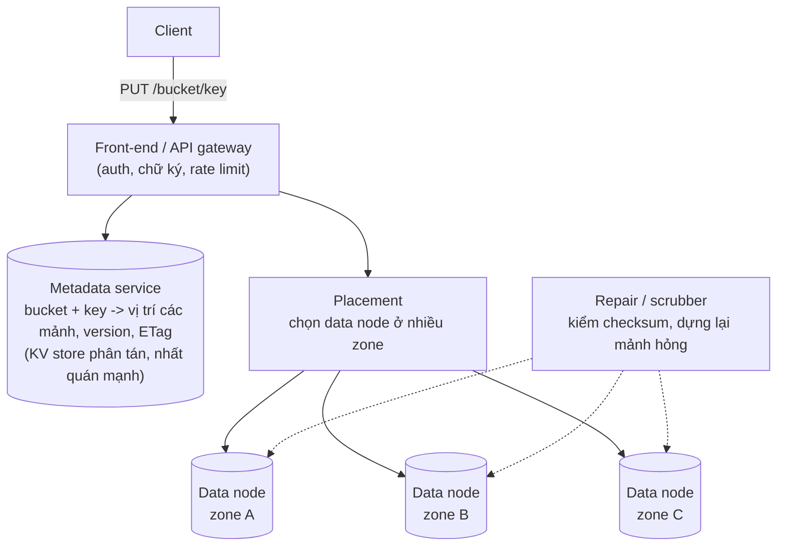

Hai phần tách biệt: **metadata** (nhỏ, cần nhất quán mạnh - thường là một KV store phân tán như ở [Bài 7](./07-key-value-store.md)) và **data** (khổng lồ, chia thành mảnh, rải trên nhiều đĩa/zone). Một tiến trình **scrubber** liên tục đọc lại dữ liệu, kiểm checksum và sửa mảnh hỏng trước khi đủ nhiều mảnh hỏng cùng lúc để mất dữ liệu.

### 2.3 Replication vs erasure coding

Làm sao chịu được đĩa, máy, thậm chí cả một zone hỏng?

**Replication**: lưu 3 bản sao đầy đủ. Đơn giản, đọc nhanh (đọc bản nào cũng được), sửa nhanh (copy một bản). Nhưng **tốn 3 lần dung lượng**.

**Erasure coding (EC)**, ví dụ Reed-Solomon `RS(k, m)`: chia object thành `k` mảnh dữ liệu, tính thêm `m` mảnh chẵn lẻ (parity). Bất kỳ `k` mảnh nào trong tổng `k + m` mảnh cũng đủ dựng lại object.

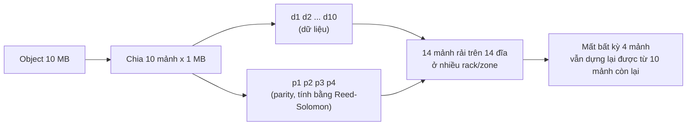

| Tiêu chí | Replication 3x | Erasure coding RS(10,4) |
|---|---|---|
| Dung lượng thực tế / dữ liệu | 3,0x (tốn thêm 200%) | 1,4x (tốn thêm 40%) |
| Chịu được mất đồng thời | 2 bản | 4 mảnh |
| Đọc bình thường | 1 node | 10 node (ghép mảnh) - hoặc đọc mảnh dữ liệu trực tiếp |
| Đọc khi có mảnh hỏng | Đọc bản khác | Phải **giải mã** - tốn CPU |
| Sửa một mảnh hỏng | Copy 1 lần dữ liệu | Đọc **10 mảnh** để tính lại 1 mảnh (repair traffic lớn) |
| Object nhỏ | Tốt | Kém - chi phí metadata và mảnh tối thiểu |
| Hợp với | Dữ liệu nóng, object nhỏ, metadata | Dữ liệu lớn, ấm/lạnh, lưu trữ dài hạn |

Phép tính đáng nhớ: lưu **1 PB** dữ liệu, replication 3x cần 3 PB đĩa; RS(10,4) cần 1,4 PB - tiết kiệm **1,6 PB**. Đó là lý do mọi object store lớn dùng EC cho phần lớn dữ liệu, thường kết hợp: object mới/nhỏ replicate trước, sau đó chuyển sang EC.

### 2.4 Multipart upload

Upload file 5 GB bằng một `PUT` duy nhất: mạng chập chờn ở 99% là phải làm lại từ đầu, và chỉ dùng một kết nối TCP. **Multipart upload** chia file thành nhiều phần, upload song song, retry từng phần.

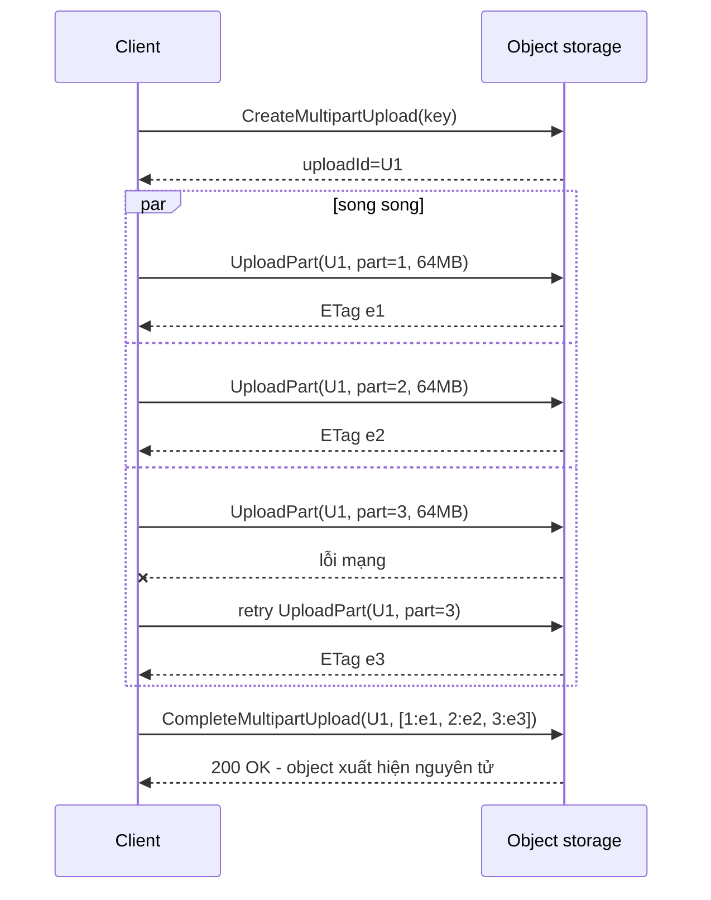

Điểm cần nhớ:

- Object chỉ **xuất hiện** khi `Complete` thành công - người đọc không bao giờ thấy file dở dang.
- Upload dở dang **vẫn tốn tiền lưu trữ** cho các part đã gửi. Luôn đặt **lifecycle rule** tự abort multipart upload chưa hoàn tất sau N ngày.
- Resume: client lưu `uploadId` + danh sách part đã xong; sau khi mất mạng, gọi `ListParts` rồi upload tiếp phần thiếu.
- Mỗi part có checksum; ETag của object multipart **không phải** MD5 của cả file - đừng dùng nó để so khớp nội dung.

### 2.5 Presigned URL: để client upload thẳng vào storage

Nếu ảnh/video đi qua API server của bạn, server phải chịu toàn bộ băng thông và bộ nhớ đệm. Cách đúng: API server chỉ **cấp quyền**, client upload **trực tiếp** lên object storage bằng **presigned URL** - một URL có chữ ký, cho phép đúng một thao tác trên đúng một key trong thời hạn ngắn.

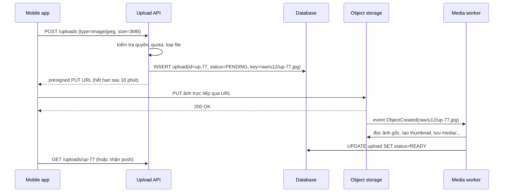

Bảo mật presigned URL:

- **Hạn ngắn** (vài phút) và **một key cụ thể**, key do server sinh (không để client tự đặt đường dẫn).
- Giới hạn `Content-Type` và **kích thước** (với presigned POST có policy `content-length-range`), nếu không người dùng có thể upload file 50 GB.
- Upload vào khu vực `raw/` **không công khai**; chỉ sau khi worker kiểm tra (định dạng thật, quét mã độc, kiểm duyệt nội dung) mới chuyển sang khu vực phục vụ.
- Download file riêng tư cũng dùng presigned GET (hoặc signed URL/cookie của CDN).

### 2.6 Mô hình nhất quán

Trong lịch sử, nhiều object store chỉ **eventually consistent**: ghi đè một object xong, `GET` ngay có thể trả bản cũ; `LIST` có thể chưa thấy object mới. Amazon S3 đã chuyển sang **strong read-after-write consistency** cho mọi thao tác từ cuối năm 2020; GCS cũng nhất quán mạnh cho đọc sau ghi. Tuy vậy khi thiết kế, vẫn cần nhớ:

- **CDN và cache phía trước** không nhất quán: ghi đè `logo.png` thì CDN vẫn phục vụ bản cũ tới hết TTL. Giải pháp chuẩn: **key bất biến có version/hash** (`logo.3f9a2c.png`) thay vì ghi đè.
- Hai client ghi đè cùng key đồng thời: **last writer wins**. Muốn tránh, dùng **ghi có điều kiện** (If-Match theo ETag, If-None-Match để "chỉ tạo nếu chưa có") nếu storage hỗ trợ, hoặc đưa việc điều phối về DB.
- Các object store tự host (MinIO, Ceph) hoặc dịch vụ khác có thể có đảm bảo khác - đọc tài liệu cụ thể.

### 2.7 Storage class, lifecycle và thiết kế key

| Lớp | Đặc điểm | Ví dụ dùng |
|---|---|---|
| Standard (nóng) | Đọc nhanh, giá lưu cao nhất | Ảnh sản phẩm, avatar |
| Infrequent access | Giá lưu thấp hơn, **tính phí khi đọc**, thời gian lưu tối thiểu | Ảnh đơn hàng cũ, file đính kèm > 30 ngày |
| Archive (lạnh) | Rất rẻ, lấy ra mất vài phút tới vài giờ | Backup, log kiểm toán phải giữ nhiều năm |

**Lifecycle rule** tự chuyển lớp và xoá theo tuổi: `logs/` → infrequent sau 30 ngày → archive sau 90 ngày → xoá sau 7 năm.

Thiết kế key:

- Bắt đầu bằng thứ phục vụ **truy vấn liệt kê** bạn cần (`tenant/{id}/...` để xoá hết dữ liệu một tenant).
- Tránh dồn tải ghi cực cao vào một prefix duy nhất - object store chia tải theo prefix; nếu cần, thêm phần băm ngắn ở đầu key.
- Đặt version/hash nội dung trong key để cache CDN được vĩnh viễn.
- Không đặt thông tin nhạy cảm (email, số điện thoại) trong key - key thường xuất hiện trong log và URL.

---

## 📖 3. Search engine

### 3.1 Từ văn bản đến inverted index

Ý tưởng inverted index (term → danh sách document chứa term) đã có ở [backend/07 §9](../backend/07-nosql.md). Ở đây ta xem kỹ **pipeline phân tích** - nơi quyết định tìm được hay không.

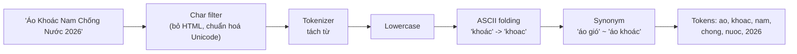

Nguyên tắc: **cùng một analyzer** (hoặc tương thích) phải dùng cho cả lúc index lẫn lúc query. Tiếng Việt có hai điểm đặc thù:

- **Dấu**: người dùng gõ không dấu rất nhiều. Thường index **hai trường**: một giữ dấu (để xếp hạng khớp chính xác cao hơn), một đã bỏ dấu (để không lỡ kết quả).
- **Tách từ**: "học sinh" là một từ, nhưng tokenizer theo khoảng trắng tách thành "học" + "sinh". Có thể dùng tokenizer tiếng Việt chuyên dụng, hoặc **phrase query / shingles** (ghép cặp token liền nhau) để ưu tiên kết quả có cụm đúng thứ tự.

Mỗi posting trong inverted index lưu không chỉ `doc_id` mà còn **term frequency** và **vị trí** (cho phrase query "áo khoác" đúng thứ tự), được **nén** mạnh (delta encoding cho doc_id tăng dần + bit-packing).

### 3.2 Segment bất biến - họ hàng của LSM tree

Lucene (lõi của Elasticsearch, OpenSearch, Solr) không sửa index tại chỗ. Document mới được gom trong bộ đệm, định kỳ ghi ra thành một **segment** mới - một inverted index nhỏ, **bất biến**. Xoá = đánh dấu trong file "deleted docs"; cập nhật = xoá + thêm mới. Nền tảng định kỳ **merge** các segment nhỏ thành segment lớn và thực sự loại bỏ document đã xoá.

Nghe quen? Đây chính là ý tưởng của **LSM tree** sẽ học ở [Bài 7](./07-key-value-store.md): ghi tuần tự, file bất biến, compaction ở nền.

### 3.3 Near-real-time indexing

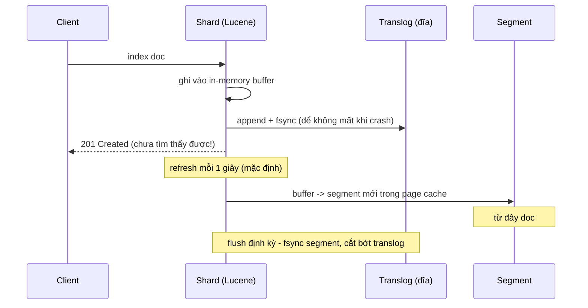

- **Refresh** (mặc định mỗi 1 giây trong Elasticsearch) biến buffer thành segment có thể tìm kiếm → "near real-time": ghi xong khoảng 1 giây sau mới tìm thấy.
- **Translog** đảm bảo document đã ack không mất khi crash trước khi segment được fsync.
- Trade-off: refresh dày → nhiều segment nhỏ → tốn CPU merge và chậm ghi. Khi **nạp lại toàn bộ dữ liệu**, đặt `refresh_interval=-1` và replicas=0, nạp xong mới bật lại - nhanh hơn rất nhiều.
- Nếu một luồng nghiệp vụ cần "ghi xong đọc thấy ngay" (người bán vừa sửa sản phẩm và mở trang quản lý), **đừng đọc từ search** - đọc từ DB, hoặc dùng `refresh=wait_for` cho riêng request đó.

### 3.4 Sharding, replica và đường đi của một truy vấn

Index được chia thành **primary shard** (mỗi shard là một Lucene index độc lập), mỗi primary có **replica**. Document được định tuyến theo `hash(_routing hoặc _id) % số_primary_shard` - nên **số primary shard cố định** sau khi tạo index (muốn đổi phải split/shrink hoặc reindex).

Truy vấn tìm kiếm là **scatter-gather** hai pha:

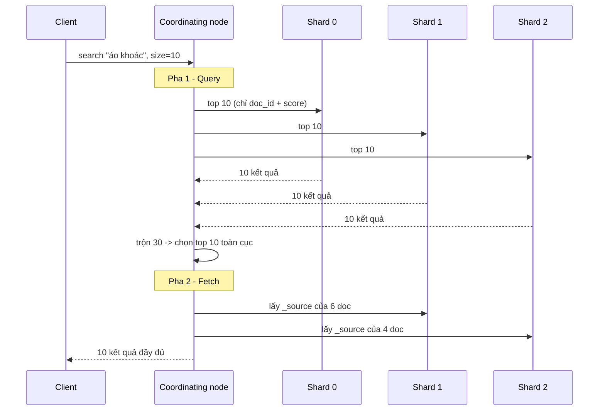

Hệ quả thiết kế:

- **Độ trễ = shard chậm nhất** (tail latency). Nhiều shard nhỏ không phải lúc nào cũng nhanh hơn. Hướng dẫn phổ biến: mỗi shard khoảng **10-50 GB**.
- **Phân trang sâu** (`from=10000, size=10`): mỗi shard phải trả về 10.010 kết quả để coordinating node trộn → rất tốn. Dùng `search_after` (con trỏ theo giá trị sort của kết quả cuối) thay vì `from`.
- **Routing theo tenant** (`_routing=shop_id`): mọi document của một shop nằm trên một shard → truy vấn "tìm trong shop X" chỉ chạm một shard. Cái giá: shop lớn tạo shard nóng.
- **Replica** vừa để chịu lỗi vừa để **tăng throughput đọc**.
- Điểm số BM25 tính dựa trên thống kê **từng shard** (df, độ dài trung bình); khi dữ liệu ít, các shard có thống kê lệch nhau → điểm hơi khác nhau. Thường không đáng kể với dữ liệu lớn.

### 3.5 Relevance: từ TF-IDF đến BM25

Câu hỏi: trong các document chứa "kafka partition", cái nào **liên quan nhất**? Trực giác:

1. Term xuất hiện **nhiều lần** trong document → liên quan hơn (**TF**), nhưng lợi ích **giảm dần**: lần thứ 10 không quan trọng bằng lần thứ 2.
2. Term **hiếm** trong toàn bộ kho ("partition") giá trị hơn term phổ biến ("kafka") (**IDF**).
3. Document **ngắn** chứa term thì term đó "đậm đặc" hơn document dài lê thê (**chuẩn hoá độ dài**).

**BM25** (mặc định của Lucene) mã hoá đúng ba trực giác đó:

```
score(D, Q) = Σ_{q ∈ Q}  IDF(q) × f(q,D) × (k1 + 1) / ( f(q,D) + k1 × (1 - b + b × |D| / avgdl) )

IDF(q) = ln( 1 + (N - n(q) + 0.5) / (n(q) + 0.5) )
```

- `f(q,D)`: số lần term xuất hiện trong D; `|D|`: độ dài D; `avgdl`: độ dài trung bình; `N`: số document; `n(q)`: số document chứa q.
- `k1` (~1.2): điều khiển độ **bão hoà** của TF. `b` (~0.75): mức **phạt độ dài**.

Demo nhỏ: xây inverted index cho 5 document và xếp hạng truy vấn `kafka partition`.

=== "Go"

    ```go
    package main

    import (
    	"fmt"
    	"math"
    	"sort"
    	"strings"
    )

    var docs = []string{
    	"kafka partition offset consumer group",
    	"kafka la message broker dang log",
    	"redis cache key value",
    	"partition partition partition sharding database",
    	"huong dan kafka cho nguoi moi bat dau tu con so khong va rat dai dong",
    }

    const k1, b = 1.2, 0.75

    func main() {
    	// 1) Inverted index: term -> {docID: term frequency}
    	index := map[string]map[int]int{}
    	lens := make([]int, len(docs))
    	total := 0
    	for id, d := range docs {
    		toks := strings.Fields(d)
    		lens[id] = len(toks)
    		total += len(toks)
    		for _, t := range toks {
    			if index[t] == nil {
    				index[t] = map[int]int{}
    			}
    			index[t][id]++
    		}
    	}
    	N := float64(len(docs))
    	avgdl := float64(total) / N

    	query := []string{"kafka", "partition"}
    	scores := map[int]float64{}
    	for _, q := range query {
    		postings := index[q]
    		n := float64(len(postings))
    		idf := math.Log(1 + (N-n+0.5)/(n+0.5))
    		fmt.Printf("term %-9s df=%d idf=%.3f\n", q, len(postings), idf)
    		for id, tf := range postings { // chỉ duyệt doc CÓ term - nhờ inverted index
    			f := float64(tf)
    			norm := 1 - b + b*float64(lens[id])/avgdl
    			scores[id] += idf * f * (k1 + 1) / (f + k1*norm)
    		}
    	}
    	ids := []int{}
    	for id := range scores {
    		ids = append(ids, id)
    	}
    	sort.Slice(ids, func(i, j int) bool { return scores[ids[i]] > scores[ids[j]] })
    	for _, id := range ids {
    		fmt.Printf("doc%d score=%.3f len=%d | %s\n", id, scores[id], lens[id], docs[id])
    	}
    }
    ```

=== "Python"

    ```python
    import math
    from collections import defaultdict

    docs = [
        "kafka partition offset consumer group",
        "kafka la message broker dang log",
        "redis cache key value",
        "partition partition partition sharding database",
        "huong dan kafka cho nguoi moi bat dau tu con so khong va rat dai dong",
    ]
    K1, B = 1.2, 0.75

    # 1) Inverted index: term -> {doc_id: term frequency}
    index: dict[str, dict[int, int]] = defaultdict(lambda: defaultdict(int))
    lens = []
    for doc_id, d in enumerate(docs):
        toks = d.split()
        lens.append(len(toks))
        for t in toks:
            index[t][doc_id] += 1
    N = len(docs)
    avgdl = sum(lens) / N

    scores: dict[int, float] = defaultdict(float)
    for q in ["kafka", "partition"]:
        postings = index.get(q, {})
        n = len(postings)
        idf = math.log(1 + (N - n + 0.5) / (n + 0.5))
        print(f"term {q:<9} df={n} idf={idf:.3f}")
        for doc_id, tf in postings.items():   # chỉ duyệt doc CÓ term
            norm = 1 - B + B * lens[doc_id] / avgdl
            scores[doc_id] += idf * tf * (K1 + 1) / (tf + K1 * norm)

    for doc_id in sorted(scores, key=scores.get, reverse=True):
        print(f"doc{doc_id} score={scores[doc_id]:.3f} len={lens[doc_id]} | {docs[doc_id]}")
    ```

Output (Go và Python giống hệt nhau):

```
term kafka     df=3 idf=0.539
term partition df=2 idf=0.875
doc0 score=1.617 len=5 | kafka partition offset consumer group
doc3 score=1.472 len=5 | partition partition partition sharding database
doc1 score=0.578 len=6 | kafka la message broker dang log
doc4 score=0.359 len=16 | huong dan kafka cho nguoi moi bat dau tu con so khong va rat dai dong
```

Đọc kết quả:

- `partition` (có ở 2 doc) có IDF cao hơn `kafka` (có ở 3 doc) - term hiếm "đắt" hơn.
- doc3 chứa "partition" **3 lần** nhưng vẫn thua doc0 (chứa **cả hai** term, mỗi term một lần): TF bão hoà, không thể "nhồi từ khoá" để thắng.
- doc1 và doc4 đều chứa "kafka" đúng một lần, nhưng doc4 dài gấp gần 3 lần nên bị phạt: 0,359 so với 0,578.
- doc2 không xuất hiện - inverted index không bao giờ chạm tới nó.

Trong sản phẩm thật, BM25 chỉ là **tầng một**. Điểm cuối cùng thường kết hợp thêm tín hiệu nghiệp vụ (độ phổ biến, đánh giá, tồn kho, khoảng cách), boosting theo trường (khớp ở `title` nặng hơn `description`), và ngày càng phổ biến là **hybrid search**: BM25 + vector similarity, rồi re-rank bằng model.

### 3.6 Giữ search khớp với database

Search engine **không phải nguồn sự thật**: không có transaction đa document, có thể mất dữ liệu gần nhất trong một số sự cố, mapping đổi là phải reindex. Luôn phải **dựng lại được** index từ DB.

| Cách đồng bộ | Ưu | Nhược |
|---|---|---|
| Dual write trong code | Đơn giản lúc đầu | Lệch khi một bên lỗi, sai thứ tự khi đồng thời |
| Outbox / event nghiệp vụ | Không lệch do lỗi một phía | Mọi chỗ ghi phải phát event |
| **CDC** ([Bài 5 §7](./05-messaging-streaming.md)) | Bắt mọi thay đổi kể cả script sửa tay, thứ tự đúng theo commit | Thêm hạ tầng (connector, Kafka) |
| Batch reindex định kỳ | Tự sửa mọi sai lệch | Trễ, tốn tài nguyên |

Mẫu khuyến nghị: **CDC + external version** (dùng LSN hoặc `updated_version` làm version của document để bản cũ không đè bản mới khi retry), cộng **reindex định kỳ hoặc khi đổi mapping** qua **alias** (`products` → `products_v7`), cộng **job đối soát** đếm/so sánh mẫu giữa DB và index.

Nhiều thuộc tính trong document search cần **denormalize** (tên danh mục, tên shop, điểm đánh giá) - khi tên danh mục đổi, hàng nghìn document phải cập nhật. Cân nhắc giữ trong index chỉ ID cho các trường hay đổi và tra cứu lúc hiển thị.

---

## 📖 4. Time-series database

### 4.1 Hình dạng dữ liệu

```
cpu_usage{host="web-12", region="hcm", core="3"}  @ 2026-10-28T09:00:10Z = 73.5
└ metric ┘└───────────── labels (tags) ──────────┘   └──── timestamp ────┘   └value┘
```

Mỗi tổ hợp metric + labels là một **series**. Đặc điểm workload:

- **Ghi**: liên tục, khối lượng rất lớn, gần như luôn **nối thêm theo thời gian**, hiếm khi sửa.
- **Đọc**: theo **khoảng thời gian** + lọc theo label + **tổng hợp** (avg, p99, rate). Dữ liệu mới đọc nhiều, dữ liệu cũ đọc ít và thường ở độ phân giải thô hơn.
- **Xoá**: theo khối thời gian (hết retention).

Ví dụ: Prometheus, VictoriaMetrics, InfluxDB, TimescaleDB (extension PostgreSQL), M3, cùng các column store như ClickHouse cũng thường được dùng cho time-series.

### 4.2 Vì sao TSDB nén tốt đến thế

Kỹ thuật kinh điển từ paper **Gorilla** của Facebook:

- **Timestamp**: các mẫu cách đều 10s → delta luôn là 10 → **delta-of-delta** gần như luôn 0 → mã hoá bằng 1 bit.
- **Giá trị float**: giá trị liên tiếp thường gần nhau → XOR với giá trị trước cho ra nhiều bit 0 → chỉ lưu phần bit khác.

Kết quả: từ 16 byte/mẫu (8 byte timestamp + 8 byte float) xuống còn khoảng **1-2 byte/mẫu** với dữ liệu điển hình.

Dữ liệu được tổ chức theo **block thời gian** (vd 2 giờ): mỗi block có index label → series và các chunk đã nén. Xoá theo retention = xoá cả block, giống xoá segment trong Kafka.

### 4.3 Cardinality - kẻ thù số một

Số series = tích số giá trị của mọi label. `http_requests{path, method, status, host}` với 50 path × 4 method × 10 status × 200 host = **400.000 series** - ổn. Thêm label `user_id` với 1 triệu user → **400 tỷ series** - TSDB sập (mỗi series tốn bộ nhớ index, và nhiều series chỉ có vài điểm nên nén kém).

!!! warning "Không bao giờ đặt ID không giới hạn vào label"
    `user_id`, `order_id`, `request_id`, URL đầy đủ có query string, email... không được làm label metric. Đó là việc của **log** hoặc **tracing** (xem [backend/11](../backend/11-observability-reliability.md)) hoặc của OLAP store (§7).

### 4.4 Downsampling và retention theo tầng

Không ai cần biểu đồ CPU độ phân giải 10 giây của 2 năm trước. **Downsampling** (rollup) gộp dữ liệu cũ thành độ phân giải thô hơn, lưu **nhiều hàm tổng hợp** (min, max, sum, count - từ đó suy ra avg) để vẫn trả lời được nhiều kiểu câu hỏi.

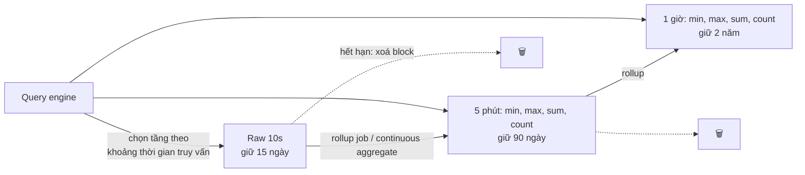

**Ước lượng dung lượng** (giả định để luyện tập: 10.000 server × 100 metric = **1 triệu series**, mẫu mỗi 10 giây, nén còn ~1,5 byte/giá trị):

| Hạng mục | Phép tính | Kết quả |
|---|---|---|
| Mẫu/giây | 1.000.000 / 10 | 100.000 mẫu/s |
| Mẫu/ngày | 1.000.000 × 8.640 | 8,64 tỷ |
| Raw chưa nén / ngày | 8,64 tỷ × 16 byte | ~138 GB |
| Raw đã nén / ngày | 8,64 tỷ × 1,5 byte | ~13 GB |
| **Tầng 1**: raw 15 ngày | 13 GB × 15 | **~195 GB** |
| **Tầng 2**: 5 phút × 4 hàm, 90 ngày | (288 × 4) / 8.640 = 13,3% raw → 1,73 GB/ngày × 90 | **~156 GB** |
| **Tầng 3**: 1 giờ × 4 hàm, 2 năm | (24 × 4) / 8.640 = 1,1% raw → 0,144 GB/ngày × 730 | **~105 GB** |
| **Tổng có downsampling** | | **~456 GB** |
| Giữ raw 2 năm không downsampling | 13 GB × 730 | **~9,5 TB** |

Downsampling giảm khoảng **20 lần** dung lượng, và quan trọng hơn: truy vấn "CPU trung bình theo tuần trong năm qua" chỉ phải đọc vài nghìn điểm thay vì hàng tỷ.

!!! tip "Rollup không phải lúc nào cũng gộp được"
    `avg` của các `avg` là **sai** nếu số mẫu mỗi nhóm khác nhau - vì vậy lưu `sum` + `count`. **Percentile không gộp được** từ percentile: p99 của các p99 không phải p99. Muốn percentile ở tầng rollup, lưu **histogram** (bucket đếm) hoặc sketch (t-digest, DDSketch) - những cấu trúc này **cộng gộp được**.

---

## 📖 5. Wide-column: mô hình hoá kiểu Cassandra

Cassandra, ScyllaDB, HBase, Bigtable thuộc họ **wide-column**. Ở đây tập trung vào Cassandra/ScyllaDB vì mô hình phổ biến nhất. Cơ chế phân tán bên dưới (consistent hashing, replication, quorum, LSM) chính là thiết kế Dynamo-style sẽ học ở [Bài 7](./07-key-value-store.md).

### 5.1 Partition key và clustering key

```sql
CREATE TABLE messages_by_conversation (
    conversation_id text,
    bucket          int,        -- tháng: 202610
    message_id      timeuuid,   -- sắp xếp theo thời gian
    sender_id       text,
    body            text,
    PRIMARY KEY ((conversation_id, bucket), message_id)
) WITH CLUSTERING ORDER BY (message_id DESC);
```

- **Partition key** `(conversation_id, bucket)`: băm ra token, quyết định dữ liệu nằm ở **node nào**. Mọi hàng cùng partition key nằm **cùng chỗ**.
- **Clustering key** `message_id`: quyết định **thứ tự sắp xếp** các hàng **bên trong** partition trên đĩa.

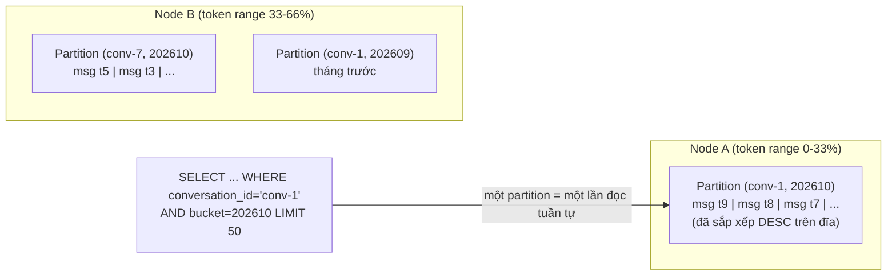

Truy vấn hiệu quả = **chỉ định đủ partition key** + lọc/sắp xếp theo **tiền tố** của clustering key. Mọi thứ khác (lọc theo cột không phải key, JOIN, GROUP BY tuỳ ý) hoặc không được hỗ trợ, hoặc phải `ALLOW FILTERING` - tức là quét cả cluster.

### 5.2 Quy trình mô hình hoá: truy vấn trước, bảng sau

Với SQL, bạn chuẩn hoá dữ liệu rồi viết truy vấn gì cũng được. Với Cassandra thì **ngược lại**:

1. Liệt kê **mọi truy vấn** ứng dụng cần (access patterns).
2. Thiết kế **một bảng cho mỗi truy vấn** (hoặc nhóm truy vấn cùng partition key).
3. Chấp nhận **denormalize** - cùng dữ liệu ghi vào nhiều bảng. Ghi trong Cassandra rẻ; đọc kiểu scatter mới đắt.

Ví dụ hệ thống đơn hàng:

| Truy vấn | Bảng | Partition key | Clustering key |
|---|---|---|---|
| Đơn của một user, mới nhất trước | `orders_by_user` | `user_id` | `created_at DESC, order_id` |
| Chi tiết một đơn | `orders_by_id` | `order_id` | - |
| Đơn của một shop theo ngày | `orders_by_shop_day` | `(shop_id, day)` | `created_at DESC` |

Ghi một đơn = ghi 3 bảng (dùng **logged batch** nếu cần đảm bảo cả 3 cuối cùng đều được ghi, lưu ý nó không phải transaction cô lập).

### 5.3 Kích thước partition và bucketing

Partition quá lớn là lỗi phổ biến nhất: một nhóm chat 10 năm tuổi, một cảm biến ghi mỗi giây suốt đời, một shop lớn trong `orders_by_shop`. Partition lớn gây đọc chậm, compaction nặng, **hot spot** (một node gánh hết), và sửa chữa (repair) lâu. Khuyến nghị phổ biến: giữ mỗi partition dưới **khoảng 100 MB** và không để tăng không giới hạn.

Giải pháp: **bucketing** - đưa một thành phần thời gian (hoặc số bucket băm) vào partition key: `(conversation_id, month)`, `(sensor_id, day)`, `(shop_id, day)`. Đọc "50 tin nhắn gần nhất" có thể phải đọc bucket tháng này, nếu chưa đủ thì bucket tháng trước - chấp nhận được.

Ước lượng: nhóm chat sôi nổi 5.000 tin/ngày × 300 byte = 1,5 MB/ngày → bucket theo **tháng** ~45 MB - ổn. Kênh phát thanh 1 triệu tin/ngày thì phải bucket theo **giờ** hoặc ngày.

### 5.4 Những cái bẫy

| Bẫy | Vì sao | Cách tránh |
|---|---|---|
| **Tombstone** | Xoá = ghi dấu xoá; đọc phải lướt qua mọi tombstone cho tới khi compaction dọn (sau `gc_grace_seconds`). Mẫu "queue trong Cassandra" (ghi rồi xoá liên tục) tạo hàng triệu tombstone → đọc timeout | Không dùng Cassandra làm queue; dùng TTL theo cả partition/bucket; thiết kế để xoá cả partition thay vì từng hàng |
| **Secondary index** | Index cục bộ trên mỗi node → truy vấn theo index phải hỏi **mọi node** | Tạo bảng denormalize riêng cho truy vấn đó |
| **Lightweight transaction** (`IF NOT EXISTS`) | Dùng Paxos, nhiều round-trip - chậm hơn ghi thường nhiều lần | Chỉ dùng cho chỗ thật sự cần (đăng ký username duy nhất) |
| **Đọc-sửa-ghi** | Không có transaction, hai client đè nhau | Thiết kế ghi kiểu append (mỗi sự kiện một hàng) hoặc dùng counter type |
| **Partition key ít giá trị** (`country`) | Dữ liệu dồn vào vài node | Partition key có nhiều giá trị, phân bố đều |

---

## 📖 6. Graph database

### 6.1 Khi nào graph DB thắng?

Graph DB (Neo4j, Amazon Neptune, JanusGraph, Memgraph...) lưu **node** và **edge** (quan hệ) là công dân hạng nhất. Ưu thế nằm ở **duyệt nhiều bước** (multi-hop traversal): mỗi node giữ con trỏ trực tiếp tới hàng xóm (index-free adjacency), nên đi một bước tốn chi phí tỉ lệ với số hàng xóm, không phụ thuộc kích thước toàn bộ đồ thị.

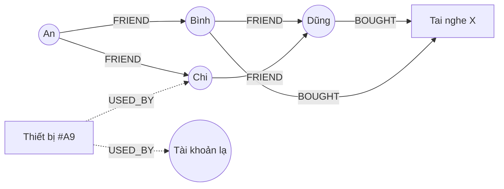

```cypher
// Gợi ý: sản phẩm mà bạn của bạn bè đã mua, An chưa mua
MATCH (me:User {name:'An'})-[:FRIEND*1..2]-(f:User)-[:BOUGHT]->(p:Product)
WHERE NOT (me)-[:BOUGHT]->(p) AND f <> me
RETURN p.name, count(DISTINCT f) AS so_nguoi
ORDER BY so_nguoi DESC LIMIT 10;
```

Trong SQL, mỗi bước là một self-JOIN trên bảng `friendships`; với 3-4 bước và người dùng có hàng trăm bạn, số hàng trung gian bùng nổ theo cấp số nhân. (PostgreSQL có `WITH RECURSIVE` - dùng tốt cho cây danh mục, phân cấp tổ chức, nhưng không tối ưu cho duyệt đồ thị dày.)

### 6.2 Khi nào **không** cần graph DB?

| Bài toán | Có cần graph DB? |
|---|---|
| Danh sách bạn bè, follower (1 bước) | Không - bảng adjacency trong SQL/KV là đủ |
| Cây danh mục, phân cấp nhân sự | Không - `WITH RECURSIVE`, nested set, materialized path |
| Phát hiện vòng gian lận (thiết bị/thẻ/IP dùng chung qua nhiều tài khoản, 3-5 bước) | **Có**, rất hợp |
| Knowledge graph, phân tích quan hệ phức tạp, truy vấn dạng mẫu tuỳ ý | **Có** |
| Đường đi ngắn nhất trên bản đồ | Thường dùng engine định tuyến chuyên dụng (xem [algorithms/12](../algorithms/12-shortest-paths-mst.md)) |
| Social graph quy mô hàng tỷ edge, truy vấn đơn giản tốc độ cao | Thường **không** - các công ty lớn hay dùng mô hình đơn giản "object + association" trên KV/SQL đã shard kèm cache (vd hệ thống TAO của Facebook xây trên MySQL) |

Khó khăn lớn nhất của graph DB phân tán: **chia đồ thị** sao cho truy vấn ít phải nhảy qua máy khác - bài toán graph partitioning vốn rất khó, và đồ thị mạng xã hội không có "đường cắt" sạch. Nhiều graph DB vì vậy mạnh nhất khi đồ thị vừa trong một máy (lớn) + replica đọc.

---

## 📖 7. OLAP và column store

### 7.1 OLTP vs OLAP

| | OLTP (giao dịch) | OLAP (phân tích) |
|---|---|---|
| Câu hỏi điển hình | "Lấy đơn #42", "trừ kho SKU-9" | "Doanh thu theo tỉnh theo tháng trong 3 năm" |
| Số hàng chạm tới | Vài hàng | Hàng triệu - hàng tỷ |
| Số cột cần | Hầu hết các cột của hàng | Vài cột trong bảng hàng trăm cột |
| Ghi | Nhiều ghi nhỏ, cập nhật tại chỗ | Nạp theo lô lớn, hiếm khi sửa |
| Người dùng | Ứng dụng, hàng nghìn request/s | Analyst, dashboard, vài chục truy vấn nặng |
| Lưu trữ phù hợp | **Row store** (PostgreSQL, MySQL) | **Column store** (ClickHouse, BigQuery, Snowflake, Redshift, DuckDB, Druid, Pinot) |

### 7.2 Row layout vs column layout

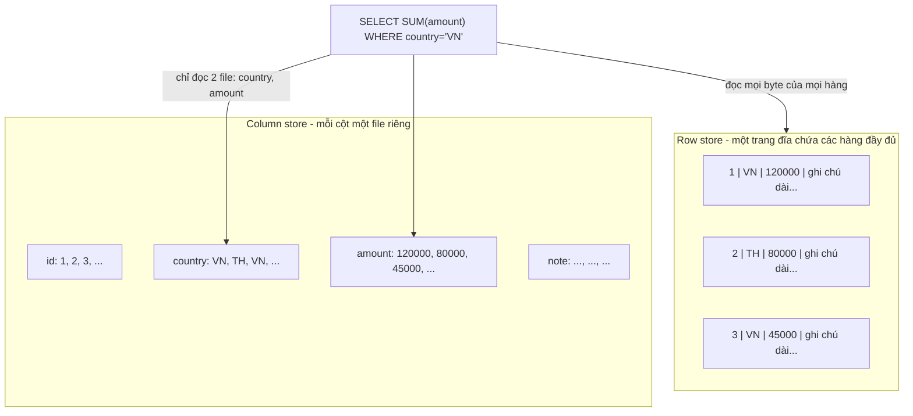

### 7.3 Vì sao column store nhanh: 6 lý do

1. **Chỉ đọc cột cần**: truy vấn chạm 3/200 cột thì đọc ~1,5% dữ liệu.
2. **Nén cực tốt**: một cột chứa các giá trị **cùng kiểu, thường lặp lại** → dictionary encoding (`VN`→0), run-length encoding (RLE: "VN × 50.000"), delta encoding (timestamp tăng dần), bit-packing (giá trị 0-7 chỉ cần 3 bit).
3. **Sắp xếp theo sort key** (vd `(country, date)`) làm RLE và lọc hiệu quả hơn nữa.
4. **Bỏ qua khối (data skipping)**: mỗi khối lưu min/max (zone map); truy vấn `date >= '2026-10-01'` bỏ qua các khối có max < ngày đó mà không cần đọc.
5. **Thực thi vector hoá**: xử lý theo lô hàng nghìn giá trị cùng kiểu trong một vòng lặp chặt → tận dụng cache CPU và SIMD, thay vì gọi hàm cho từng hàng.
6. **Late materialization**: lọc trên cột `country` ra danh sách vị trí, rồi mới đọc `amount` ở đúng các vị trí đó.

### 7.4 Demo: row vs column và sức mạnh của sort + RLE

Mô phỏng bảng 100.000 hàng: `id` (8 byte), `country` (2 byte), `amount` (8 byte), `note` (100 byte - cột rộng mà truy vấn không cần). Truy vấn `SELECT SUM(amount) WHERE country='VN'`. Dữ liệu sinh bằng cùng một bộ sinh số ngẫu nhiên LCG ở cả hai ngôn ngữ để ra kết quả giống nhau.

=== "Go"

    ```go
    package main

    import (
    	"encoding/binary"
    	"fmt"
    	"sort"
    )

    const (
    	N       = 100_000
    	noteLen = 100            // cột "note" rộng, query không cần
    	rowSize = 8 + 2 + 8 + noteLen // id + country + amount + note = 118 byte
    )

    var countries = []string{"VN", "TH", "SG", "ID", "MY"}

    type lcg struct{ x uint64 }

    func (r *lcg) next() uint64 { r.x = (r.x*1103515245 + 12345) % (1 << 31); return r.x }

    // đếm số "run" khi nén RLE: chuỗi giá trị liên tiếp giống nhau = 1 run
    func runs(col []byte) int {
    	n := 1
    	for i := 1; i < len(col); i++ {
    		if col[i] != col[i-1] {
    			n++
    		}
    	}
    	return n
    }

    func main() {
    	rng := &lcg{x: 42}
    	rowStore := make([]byte, 0, N*rowSize) // ROW layout: các hàng nằm liền nhau
    	colCountry := make([]byte, 0, N)        // COLUMN layout: mỗi cột 1 mảng (dictionary-encoded 1 byte)
    	colAmount := make([]int64, 0, N)
    	note := make([]byte, noteLen)

    	for i := 0; i < N; i++ {
    		c := byte(rng.next() % 5)
    		amt := int64(rng.next() % 1_000_000)
    		row := make([]byte, 18)
    		binary.LittleEndian.PutUint64(row[0:], uint64(i))
    		copy(row[8:], countries[c])
    		binary.LittleEndian.PutUint64(row[10:], uint64(amt))
    		rowStore = append(append(rowStore, row...), note...)
    		colCountry = append(colCountry, c)
    		colAmount = append(colAmount, amt)
    	}

    	// SELECT SUM(amount) WHERE country = 'VN'
    	var sumRow, sumCol int64
    	for off := 0; off < len(rowStore); off += rowSize { // phải lướt qua cả hàng
    		if string(rowStore[off+8:off+10]) == "VN" {
    			sumRow += int64(binary.LittleEndian.Uint64(rowStore[off+10:]))
    		}
    	}
    	for i, c := range colCountry { // chỉ đọc 2 cột cần thiết
    		if c == 0 {
    			sumCol += colAmount[i]
    		}
    	}
    	rowBytes, colBytes := len(rowStore), len(colCountry)+len(colAmount)*8
    	fmt.Printf("SUM row-store=%d column-store=%d equal=%v\n", sumRow, sumCol, sumRow == sumCol)
    	fmt.Printf("bytes phải đọc: row=%d column=%d -> ít hơn %.1fx\n", rowBytes, colBytes, float64(rowBytes)/float64(colBytes))

    	r1 := runs(colCountry)
    	sorted := append([]byte(nil), colCountry...)
    	sort.Slice(sorted, func(i, j int) bool { return sorted[i] < sorted[j] })
    	r2 := runs(sorted)
    	fmt.Printf("cột country: raw=%d byte | RLE chưa sort=%d run (%d byte) | RLE đã sort=%d run (%d byte)\n",
    		N*2, r1, r1*5, r2, r2*5) // mỗi run = 1 byte giá trị + 4 byte độ dài
    }
    ```

=== "Python"

    ```python
    import struct

    N = 100_000
    NOTE_LEN = 100                       # cột "note" rộng, query không cần
    ROW_SIZE = 8 + 2 + 8 + NOTE_LEN      # id + country + amount + note = 118 byte
    COUNTRIES = [b"VN", b"TH", b"SG", b"ID", b"MY"]

    x = 42
    def rnd() -> int:
        global x
        x = (x * 1103515245 + 12345) % (1 << 31)
        return x

    def runs(col) -> int:  # số "run" khi nén RLE
        return 1 + sum(1 for i in range(1, len(col)) if col[i] != col[i - 1])

    row_store = bytearray()               # ROW layout: các hàng nằm liền nhau
    col_country = bytearray()             # COLUMN layout: dictionary-encoded 1 byte/giá trị
    col_amount: list[int] = []
    note = bytes(NOTE_LEN)
    for i in range(N):
        c = rnd() % 5
        amt = rnd() % 1_000_000
        row_store += struct.pack("<Q2sQ", i, COUNTRIES[c], amt) + note
        col_country.append(c)
        col_amount.append(amt)

    # SELECT SUM(amount) WHERE country = 'VN'
    sum_row = 0
    for off in range(0, len(row_store), ROW_SIZE):          # phải lướt qua cả hàng
        if row_store[off + 8:off + 10] == b"VN":
            sum_row += struct.unpack_from("<Q", row_store, off + 10)[0]
    sum_col = sum(a for c, a in zip(col_country, col_amount) if c == 0)  # chỉ đọc 2 cột

    row_bytes, col_bytes = len(row_store), len(col_country) + len(col_amount) * 8
    print(f"SUM row-store={sum_row} column-store={sum_col} equal={str(sum_row == sum_col).lower()}")
    print(f"bytes phải đọc: row={row_bytes} column={col_bytes} -> ít hơn {row_bytes / col_bytes:.1f}x")
    r1, r2 = runs(col_country), runs(sorted(col_country))
    print(f"cột country: raw={N * 2} byte | RLE chưa sort={r1} run ({r1 * 5} byte) | "
          f"RLE đã sort={r2} run ({r2 * 5} byte)")
    ```

Output (Go và Python giống hệt nhau):

```
SUM row-store=9903686206 column-store=9903686206 equal=true
bytes phải đọc: row=11800000 column=900000 -> ít hơn 13.1x
cột country: raw=200000 byte | RLE chưa sort=79910 run (399550 byte) | RLE đã sort=5 run (25 byte)
```

Ba bài học từ ba dòng output:

1. Cùng kết quả, nhưng column store chỉ đọc **900 KB thay vì 11,8 MB** - ít hơn 13 lần, chỉ vì không phải đọc cột `note` và `id`. Bảng thật có 100-200 cột thì tỷ lệ còn chênh lớn hơn nhiều.
2. Dictionary encoding đã giảm `country` từ 2 byte xuống 1 byte/giá trị.
3. **RLE trên dữ liệu chưa sắp xếp còn tệ hơn không nén** (399.550 byte > 200.000 byte), nhưng sau khi **sắp xếp** thì cả cột chỉ còn **5 run = 25 byte**. Đó là lý do column store bắt bạn chọn **sort key / ORDER BY** khi tạo bảng - chọn đúng thì nén và lọc tốt gấp bội.

### 7.5 Điểm yếu của column store

- **Lấy một hàng đầy đủ** phải ghép từ hàng trăm file cột → chậm cho truy vấn kiểu OLTP.
- **Cập nhật/xoá từng hàng** đắt (file bất biến, nén theo khối) - thường làm bằng cách đánh dấu và merge ở nền, hoặc thiết kế dữ liệu kiểu append-only.
- **Nhiều insert nhỏ** tạo hàng nghìn phần nhỏ → phải **gom batch** (vd mỗi giây vài nghìn hàng một lần), thường qua Kafka ([Bài 5](./05-messaging-streaming.md)).

**Parquet** là định dạng file cột phổ biến nhất trong data lake: file chia thành **row group**, mỗi row group chứa **column chunk** cho từng cột, mỗi chunk có thống kê min/max để bỏ qua. Spark, Trino, DuckDB, BigQuery, Snowflake... đều đọc được.

!!! tip "Pre-aggregation khi truy vấn quá nặng"
    Dashboard chạy cùng một truy vấn mỗi 10 giây cho hàng trăm người xem? Dùng **materialized view** / rollup table (vd ClickHouse `AggregatingMergeTree`, Druid/Pinot rollup lúc nạp) để tính sẵn theo phút/giờ. Ý tưởng giống downsampling ở §4.4. Case study tổng hợp click quảng cáo ở [Bài 16](./16-metrics-aggregation.md) đi sâu chủ đề này.

---

## 📖 8. Data lake, data warehouse, lakehouse

| | Data warehouse | Data lake | Lakehouse |
|---|---|---|---|
| Lưu gì | Dữ liệu đã làm sạch, có cấu trúc | **Mọi thứ**: thô, bán cấu trúc, file, log | Như lake, nhưng có lớp bảng quản lý |
| Schema | **Schema-on-write** (phải đúng schema mới nạp được) | **Schema-on-read** (diễn giải lúc đọc) | Schema được quản lý, tiến hoá được |
| Nơi lưu | Lưu trữ riêng của warehouse | Object storage (file Parquet, JSON, ảnh...) | Object storage + **table format** |
| Transaction / update | Có | Không (chỉ là file) | Có (ACID qua table format) |
| Ví dụ | Snowflake, BigQuery, Redshift | S3/GCS + Spark/Trino | Apache Iceberg, Delta Lake, Apache Hudi trên S3 |
| Rủi ro | Đắt, kém linh hoạt với dữ liệu mới | Thành "data swamp" - không ai biết file nào đúng | Thêm một tầng công nghệ phải hiểu |

**Table format** (Iceberg, Delta, Hudi) là một lớp **metadata** trên các file Parquet: danh sách file nào thuộc phiên bản nào của bảng, schema, phân vùng. Nhờ đó có: commit nguyên tử (ghi xong mới hiện), **time travel** (đọc bảng như ở phiên bản hôm qua), schema evolution, upsert/delete (merge-on-read hoặc copy-on-write), và nhiều engine (Spark, Flink, Trino, warehouse) đọc/ghi cùng một bảng.

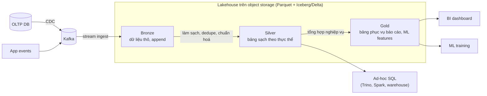

Kiến trúc "medallion" (bronze/silver/gold) ở trên là một quy ước phổ biến. **ELT** (nạp thô trước, biến đổi bằng SQL trong warehouse/lakehouse sau - vd bằng dbt) đã thay thế dần **ETL** truyền thống (biến đổi trước khi nạp), vì lưu trữ rẻ và giữ dữ liệu thô cho phép tính lại khi logic thay đổi - cùng tinh thần với Kappa ở [Bài 5 §8](./05-messaging-streaming.md).

!!! note "Vector database"
    Tìm kiếm theo **ý nghĩa** (embedding) dùng chỉ mục ANN như HNSW, IVF - giới thiệu ở [backend/07 §11](../backend/07-nosql.md). Ở quy mô vừa, `pgvector` trong PostgreSQL hoặc vector field trong Elasticsearch/OpenSearch thường đủ dùng trước khi cần một vector DB riêng. Mẫu phổ biến cho search sản phẩm: **hybrid** = BM25 (khớp từ khoá chính xác, mã sản phẩm) + vector (khớp ý nghĩa), rồi re-rank.

---

## 📖 9. Bảng quyết định: use case → storage

| Use case | Lựa chọn đầu tiên | Vì sao | Khi nào đổi |
|---|---|---|---|
| Dữ liệu nghiệp vụ có quan hệ, cần transaction (đơn hàng, tài khoản, ví) | PostgreSQL / MySQL | ACID, JOIN, ràng buộc, hệ sinh thái | Vượt một máy → shard ([Bài 3](./03-building-blocks-data.md)) hoặc NewSQL (Spanner, CockroachDB, TiDB) |
| Ảnh, video, file đính kèm, backup | Object storage + CDN | Rẻ, bền, vô hạn, phục vụ trực tiếp qua URL | Hầu như không đổi |
| Cache, session, rate limit, leaderboard | Redis | Độ trễ dưới mili-giây, cấu trúc dữ liệu phong phú | Cần bền vững/khối lượng lớn → KV store bền ([Bài 7](./07-key-value-store.md)) |
| Tra cứu theo key với khối lượng khổng lồ, ghi nhiều (giỏ hàng, profile, session dài hạn) | DynamoDB / Cassandra / ScyllaDB | Scale ngang tuyến tính, độ trễ ổn định | Cần truy vấn linh hoạt → thêm search/OLAP bên cạnh |
| Tin nhắn chat, timeline, lịch sử theo thực thể + thời gian | Wide-column (Cassandra/ScyllaDB/HBase) | Partition theo thực thể, sắp theo thời gian, ghi rất nhanh | Quy mô nhỏ → PostgreSQL với partition theo thời gian là đủ |
| Tìm kiếm full-text, lọc nhiều chiều (facet), autocomplete | Elasticsearch / OpenSearch | Inverted index, BM25, aggregation | Quy mô nhỏ → PostgreSQL full-text (`tsvector`) + `pg_trgm` |
| Metrics hạ tầng/ứng dụng | Prometheus / VictoriaMetrics / TSDB managed | Nén tốt, truy vấn theo thời gian, downsampling | Cardinality cao → OLAP store |
| Sự kiện IoT, log có cấu trúc, analytics sự kiện người dùng | ClickHouse / Druid / Pinot | Column store, nạp nhanh, truy vấn tổng hợp dưới giây | Cần lưu lâu rẻ → lakehouse |
| Báo cáo BI, phân tích ad-hoc trên toàn công ty | Warehouse (BigQuery, Snowflake, Redshift) hoặc lakehouse | SQL chuẩn, tách compute và storage | - |
| Dữ liệu thô giữ lâu, ML training | Data lake / lakehouse (Parquet + Iceberg/Delta trên object storage) | Rẻ nhất, nhiều engine đọc được | - |
| Quan hệ nhiều bước (gian lận, gợi ý, knowledge graph) | Graph DB (Neo4j, Neptune) | Duyệt nhiều bước hiệu quả | Quan hệ 1 bước, quy mô cực lớn → adjacency list trên KV/SQL shard |
| Tìm kiếm ngữ nghĩa, RAG | pgvector / vector field của ES → vector DB khi lớn | ANN index | - |
| Hàng đợi việc, event stream | Broker ([Bài 5](./05-messaging-streaming.md)) - **không** dùng DB làm queue ở quy mô lớn | - | - |

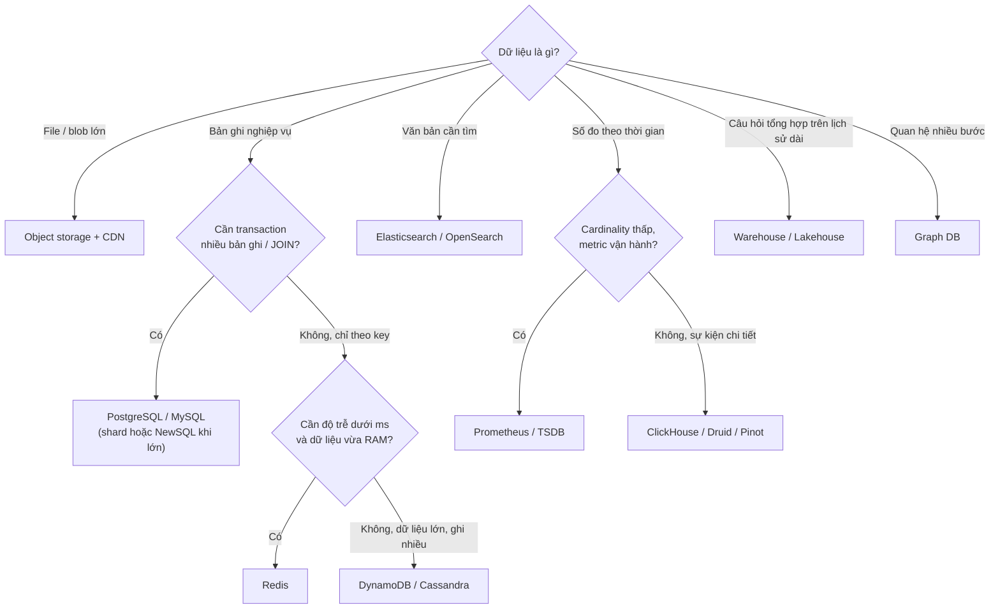

### 💡 Tips quan trọng

- **Một nguồn sự thật, nhiều bản dẫn xuất** - và mọi bản dẫn xuất phải dựng lại được từ nguồn (qua CDC/replay).
- **Metadata ở DB, byte ở object storage.** Đừng nhét file vào DB, đừng tìm kiếm trong object storage.
- **Search engine ≠ database**: không đọc từ search cho luồng cần "ghi xong thấy ngay".
- **Cassandra: truy vấn trước, bảng sau**; luôn ước lượng kích thước partition.
- **TSDB: canh chừng cardinality**; lưu sum + count + histogram để rollup đúng.
- **Column store: chọn sort key cẩn thận**, nạp theo batch.
- Bắt đầu đơn giản: PostgreSQL làm được full-text, JSON, time-series (partition, TimescaleDB), vector (pgvector) ở quy mô vừa. Thêm kho chuyên dụng khi số liệu đo được nói rằng cần.

---

## 🌍 Ứng dụng thực tế

- **Netflix, Apple, Discord** và nhiều công ty công khai dùng Cassandra hoặc ScyllaDB cho dữ liệu khối lượng lớn theo thực thể + thời gian (lịch sử xem, tin nhắn). Discord từng viết blog về việc chuyển lưu trữ tin nhắn từ Cassandra sang ScyllaDB - đọc để thấy các vấn đề partition lớn và hot partition ngoài đời thật.
- **Facebook** công bố paper **Gorilla** (TSDB in-memory nén mạnh) và **TAO** (graph đơn giản trên MySQL + cache) - hai ví dụ kinh điển về thiết kế chuyên dụng thay vì dùng sản phẩm có sẵn.
- **Uber, Cloudflare** công khai dùng ClickHouse cho log và analytics khối lượng lớn.
- **Sàn TMĐT Việt Nam** (mô hình điển hình): MySQL/PostgreSQL cho đơn hàng → CDC → Elasticsearch cho tìm kiếm sản phẩm (có xử lý tiếng Việt không dấu), object storage + CDN cho ảnh, ClickHouse hoặc BigQuery cho dashboard và báo cáo.
- **Amazon S3** là chuẩn de-facto cho API object storage; MinIO, Ceph, Cloudflare R2 và nhiều dịch vụ khác tương thích API S3.

## ⚠️ Sai lầm thường gặp

1. **Lưu ảnh/video trong DB** (`BYTEA`, `BLOB`) - backup chậm, replica tụt, cache DB bị ô nhiễm.
2. **Đọc từ Elasticsearch ngay sau khi ghi** rồi báo bug "mất dữ liệu" - thực ra là chưa refresh.
3. **Dual write vào DB và search** - lệch dần theo thời gian mà không ai biết.
4. **Mô hình hoá Cassandra như SQL**: chuẩn hoá, rồi `ALLOW FILTERING` khắp nơi.
5. **Partition không giới hạn** (`orders_by_shop` không có bucket ngày) - shop lớn giết một node.
6. **Đặt `user_id` vào label Prometheus** - TSDB hết bộ nhớ.
7. **Chạy báo cáo nặng trên DB OLTP chính** - trang thanh toán chậm theo.
8. **Lấy trung bình của trung bình, percentile của percentile** khi rollup.
9. **Presigned URL hạn 7 ngày, không giới hạn kích thước**, upload thẳng vào khu vực công khai.
10. **Thêm graph DB cho danh sách bạn bè một bước** - thêm một hệ thống phải vận hành mà không được lợi gì.

---

## 🏋️ Bài tập

### Bài 1 (Dễ) - Chọn kho lưu trữ

Với mỗi yêu cầu, chọn kho lưu trữ chính và giải thích ngắn:

1. Lưu hoá đơn PDF của khách, giữ 10 năm theo luật.
2. Tìm nhà hàng theo tên món, có lọc theo quận, giá, đang mở cửa.
3. Biểu đồ số request/giây, độ trễ p99 của 300 microservice.
4. "Lịch sử giao dịch 12 tháng gần nhất" của 30 triệu ví điện tử, mỗi ví đọc theo trang.
5. Phân tích tỷ lệ chuyển đổi theo kênh marketing trên 2 năm dữ liệu click.

<details markdown="1"><summary>Đáp án</summary>

1. **Object storage** với lifecycle chuyển sang lớp archive sau vài tháng, bật versioning/object lock (WORM) nếu cần chống sửa. Metadata hoá đơn trong DB.
2. **Elasticsearch/OpenSearch** (full-text + filter + geo), đồng bộ từ DB qua CDC.
3. **Prometheus/VictoriaMetrics** (TSDB) với downsampling cho dữ liệu cũ; histogram để tính p99.
4. **Wide-column** (Cassandra/DynamoDB): partition `(wallet_id, month)`, clustering `tx_time DESC`. Nguồn sự thật của số dư vẫn ở DB có transaction ([Bài 13](./13-payment-wallet.md)); bảng lịch sử này là bản đọc.
5. **Warehouse / lakehouse** (BigQuery, Snowflake, Iceberg + Trino) - column store, dữ liệu click giữ dạng Parquet.

</details>

### Bài 2 (Dễ) - Erasure coding

Bạn cần lưu 600 TB dữ liệu. So sánh dung lượng đĩa thô cần thiết với replication 3x, RS(6,3) và RS(10,4). Mỗi phương án chịu được mất đồng thời bao nhiêu mảnh/bản?

<details markdown="1"><summary>Đáp án</summary>

- Replication 3x: 600 × 3 = **1.800 TB**, chịu mất 2 bản.
- RS(6,3): 600 × 9/6 = **900 TB**, chịu mất 3 mảnh bất kỳ.
- RS(10,4): 600 × 14/10 = **840 TB**, chịu mất 4 mảnh bất kỳ.

RS(10,4) vừa rẻ nhất vừa chịu lỗi tốt nhất, nhưng mỗi lần sửa một mảnh phải đọc 10 mảnh khác (repair traffic lớn), và mỗi lần đọc bình thường chạm nhiều đĩa hơn. Với object nhỏ hoặc dữ liệu nóng, replication vẫn hợp lý hơn.

</details>

### Bài 3 (Trung bình) - Mô hình hoá Cassandra

Ứng dụng đặt sân thể thao cần các truy vấn:

- Q1: Lịch đặt của một sân trong một ngày, sắp theo giờ.
- Q2: Các lượt đặt sắp tới của một người dùng.
- Q3: Chi tiết một lượt đặt theo `booking_id`.

Thiết kế bảng (partition key, clustering key) và ước lượng kích thước partition lớn nhất.

<details markdown="1"><summary>Đáp án</summary>

```sql
CREATE TABLE bookings_by_court_day (
  court_id text, day date, start_time time, booking_id uuid, user_id text, status text,
  PRIMARY KEY ((court_id, day), start_time, booking_id));

CREATE TABLE bookings_by_user (
  user_id text, start_at timestamp, booking_id uuid, court_id text, status text,
  PRIMARY KEY (user_id, start_at, booking_id)) WITH CLUSTERING ORDER BY (start_at ASC, booking_id ASC);

CREATE TABLE bookings_by_id (
  booking_id uuid PRIMARY KEY, court_id text, user_id text, start_at timestamp, status text, price bigint);
```

- Q1: một sân một ngày tối đa ~18 slot × vài trăm byte → partition rất nhỏ.
- Q2: `WHERE user_id = ? AND start_at >= now()` - partition theo user; người dùng hoạt động mạnh có thể vài nghìn lượt/năm → vẫn nhỏ. Nếu lo tăng không giới hạn, thêm bucket năm `(user_id, year)`.
- Ghi một lượt đặt = ghi 3 bảng (logged batch). Chống đặt trùng slot: cần một cơ chế điều phối (LWT `IF NOT EXISTS` trên `(court_id, day, start_time)` hoặc làm ở DB có transaction) - xem [Bài 14](./14-ticket-flash-sale.md).

</details>

### Bài 4 (Trung bình) - Downsampling

Hệ thống IoT: 200.000 cảm biến, mỗi cảm biến 5 metric, mẫu mỗi 5 giây, nén còn 2 byte/giá trị. Tính dung lượng/ngày của dữ liệu raw. Đề xuất chính sách retention 3 tầng giữ dữ liệu 3 năm và tính tổng dung lượng.

<details markdown="1"><summary>Đáp án</summary>

- Series = 200.000 × 5 = 1.000.000. Mẫu/ngày/series = 86.400 / 5 = 17.280. Raw/ngày = 1M × 17.280 × 2 B ≈ **34,6 GB/ngày**.
- Tầng 1: raw 7 ngày → 34,6 × 7 ≈ **242 GB**.
- Tầng 2: 1 phút × 4 hàm (min/max/sum/count), 90 ngày: giá trị/ngày/series = 1.440 × 4 = 5.760 = 1/3 raw → 11,5 GB/ngày × 90 ≈ **1,04 TB**.
- Tầng 3: 1 giờ × 4 hàm, 3 năm: 24 × 4 = 96 giá trị/ngày → 96/17.280 ≈ 0,56% raw → 0,19 GB/ngày × 1.095 ≈ **210 GB**.
- Tổng ≈ **1,5 TB** so với giữ raw 3 năm ≈ 34,6 × 1.095 ≈ **37,9 TB**. Nếu tầng 2 quá đắt, đổi sang 5 phút (giảm thêm 5 lần) hoặc rút ngắn còn 30 ngày.

</details>

### Bài 5 (Trung bình) - Upload video an toàn

Thiết kế luồng cho người dùng upload video tối đa 2 GB từ điện thoại có mạng không ổn định. Yêu cầu: resume được, server API không chịu băng thông video, không cho phép upload file quá cỡ hoặc phát tán nội dung chưa kiểm duyệt.

<details markdown="1"><summary>Đáp án</summary>

1. App gọi `POST /videos` (khai báo kích thước, loại) → API kiểm tra quota, tạo bản ghi `PENDING`, khởi tạo **multipart upload**, trả về `uploadId` + **presigned URL cho từng part** (hạn ngắn, key do server sinh trong khu vực `raw/` riêng tư).
2. App upload các part 8-16 MB song song (2-4 luồng), lưu tiến độ cục bộ. Mất mạng → gọi API lấy danh sách part đã xong (`ListParts`) và URL mới cho phần còn lại.
3. App gọi API `complete` → API gọi `CompleteMultipartUpload`, kiểm tra tổng kích thước ≤ 2 GB (vượt thì xoá).
4. Event `ObjectCreated` → pipeline transcode + kiểm duyệt (xem [Bài 10](./10-video-streaming.md)); chỉ khi đạt mới ghi bản phát hành vào khu vực phục vụ qua CDN.
5. Lifecycle: abort multipart chưa hoàn tất sau 1-3 ngày; xoá file `raw/` sau khi transcode xong một thời gian.

</details>

### Bài 6 (Khó) - Search sản phẩm cho sàn TMĐT

50 triệu sản phẩm, 3.000 cập nhật giá/tồn kho mỗi giây lúc flash sale, 20.000 truy vấn tìm kiếm/giây lúc cao điểm. Thiết kế: kiến trúc đồng bộ, số shard/replica (ước lượng), xử lý tiếng Việt, cách cập nhật tồn kho mà không làm sập cluster, và cách đổi mapping không downtime.

<details markdown="1"><summary>Đáp án</summary>

- **Đồng bộ**: DB → CDC → Kafka (key = `product_id`) → indexer bulk vào ES với external version.
- **Kích thước**: giả định 2 KB/document sau index → 50M × 2 KB ≈ 100 GB/bản; chọn ~5-6 primary shard (15-20 GB/shard, để dư tăng trưởng). Replica: 20.000 QPS; nếu một shard copy phục vụ ~1.000-2.000 QPS cho truy vấn điển hình (cần đo thật!), mỗi truy vấn chạm mọi shard → cần ~10-20 bản sao cho mỗi shard → khoảng 2 replica trên nhiều node + cache kết quả cho truy vấn phổ biến. Con số này **phải benchmark**, không đoán.
- **Tiếng Việt**: trường `name` (giữ dấu, tokenizer tiếng Việt) + `name.folded` (ascii folding) + shingles cho cụm từ; boost khớp có dấu và khớp cụm.
- **Tồn kho/giá đổi liên tục**: không reindex cả document cho mỗi lần đổi tồn kho. Lựa chọn: (a) chỉ index trạng thái thô `in_stock: true/false` và giá theo khoảng, cập nhật khi **đổi trạng thái** thay vì mỗi lần trừ 1; (b) gom (coalesce) cập nhật theo `product_id` trong cửa sổ 1-5 giây trước khi gửi ES; (c) hiển thị tồn kho/giá chính xác bằng cách tra cứu từ cache/DB lúc render kết quả.
- **Đổi mapping**: tạo index mới, consumer group mới đọc lại topic compacted từ đầu, khi bắt kịp thì đổi alias nguyên tử.

</details>

### Bài 7 (Khó) - Vì sao truy vấn này chậm?

Bảng ClickHouse `events` có `ORDER BY (event_time)`, 5 tỷ hàng. Truy vấn `SELECT count() FROM events WHERE user_id = 12345 AND event_time >= now() - INTERVAL 30 DAY` mất 8 giây. Giải thích và đề xuất 3 cách cải thiện kèm trade-off.

<details markdown="1"><summary>Đáp án</summary>

Sort key chỉ có `event_time` → data skipping chỉ loại được dữ liệu ngoài 30 ngày; trong 30 ngày đó, `user_id` nằm rải rác ở mọi khối → phải đọc cột `user_id` của mọi khối trong 30 ngày.

1. **Đổi sort key** thành `(user_id, event_time)` - truy vấn theo user cực nhanh; nhưng truy vấn chỉ theo thời gian (dashboard toàn hệ thống) sẽ kém đi. Có thể dùng `PARTITION BY toYYYYMM(event_time)` để vẫn tỉa theo tháng.
2. **Projection / materialized view** có sort key khác (`user_id, event_time`) - giữ cả hai kiểu truy vấn nhanh, đổi lại tốn thêm dung lượng và chi phí ghi.
3. **Data skipping index** (bloom filter trên `user_id`) - rẻ hơn, giúp bỏ qua khối không chứa user, hiệu quả khi mỗi user chỉ xuất hiện ở ít khối.

Nếu truy vấn "theo user" là nhu cầu OLTP (hiển thị cho chính user đó), cân nhắc phục vụ từ một kho khác (wide-column theo `user_id`) thay vì OLAP.

</details>

---

## ✅ Checklist

- [ ] Giải thích được object storage khác filesystem thế nào và hợp cho dữ liệu gì
- [ ] So sánh replication vs erasure coding bằng con số dung lượng và khả năng chịu lỗi
- [ ] Vẽ được luồng multipart upload và presigned URL, nêu các biện pháp bảo mật
- [ ] Mô tả pipeline analysis, segment, refresh/translog của search engine
- [ ] Giải thích BM25 (TF bão hoà, IDF, chuẩn hoá độ dài) và chạy được demo
- [ ] Biết truy vấn search đi qua các shard thế nào, vì sao phân trang sâu đắt
- [ ] Đồng bộ search với DB bằng CDC + external version + alias
- [ ] Tính được dung lượng TSDB với downsampling nhiều tầng; biết vì sao cardinality nguy hiểm
- [ ] Mô hình hoá Cassandra từ danh sách truy vấn, có bucketing và ước lượng partition
- [ ] Biết khi nào graph DB đáng dùng
- [ ] Giải thích 6 lý do column store nhanh và chạy được demo row vs column
- [ ] Phân biệt warehouse, lake, lakehouse và vai trò của table format
- [ ] Dùng được bảng quyết định use case → storage

---

**Bài tiếp theo**: [Bài 7: Distributed key-value store](./07-key-value-store.md)
