# 📚 Bài 7: Distributed key-value store

> "Một hệ thống phân tán là hệ thống mà sự cố của một máy tính bạn thậm chí không biết là tồn tại có thể làm máy tính của bạn ngừng hoạt động." - Leslie Lamport

Năm 2007, Amazon công bố paper **Dynamo**: một key-value store nội bộ phục vụ giỏ hàng, được thiết kế với một mệnh lệnh kinh doanh đơn giản - *"khách hàng phải luôn thêm được hàng vào giỏ, kể cả khi đĩa hỏng, mạng đứt, hay cả một datacenter bị lũ cuốn"*. Để đạt được điều đó, Dynamo chấp nhận một điều mà DB truyền thống không chấp nhận: **hai bản ghi xung đột có thể cùng tồn tại**, và việc gộp chúng là trách nhiệm của ứng dụng.

Ý tưởng của Dynamo sống tiếp trong Cassandra, Riak, ScyllaDB, Voldemort, và ảnh hưởng tới rất nhiều hệ thống khác. "Thiết kế một distributed key-value store" vì thế là **câu hỏi phỏng vấn kinh điển**: nó gom gần như mọi building block của các bài trước - consistent hashing, replication, quorum, xử lý lỗi, storage engine - vào một bài toán.

Đây là **bài case study đầu tiên** của khoá học. Từ bài này trở đi, mỗi case study đi theo cùng một khung: tự thiết kế trước → làm rõ yêu cầu → ước lượng → API → dữ liệu → kiến trúc → deep dive → scale & lỗi → giám sát → tự chấm.

## 🎯 Mục tiêu bài học

- Tự đi qua một bài thiết kế đầy đủ theo khung case study của khoá học
- Thiết kế partitioning bằng **consistent hashing + vnodes** và replication **N** bản theo zone
- Hiểu **quorum R/W tuỳ chỉnh**, **sloppy quorum** và **hinted handoff**
- Phát hiện và giải quyết xung đột bằng **vector clock** (kèm code), so sánh với LWW và CRDT
- Đồng bộ replica bằng **anti-entropy với Merkle tree** (kèm code), read repair
- Hiểu **gossip** và **phi accrual failure detector**
- Hiểu **LSM tree** (memtable, WAL, SSTable, compaction, bloom filter) và so sánh với **B-tree** (kèm code mini-LSM)
- Vẽ và giải thích được **đường đi của read và write**

!!! note "Kiến thức nền cần có"
    - [Bài 3 - Cache, replication, sharding](./03-building-blocks-data.md): consistent hashing, vnodes, hot keys - bài này **dùng** chứ không dạy lại.
    - [Bài 4 - Nhất quán & đồng thuận](./04-consistency-consensus.md): quorum, mô hình nhất quán, Raft.
    - [Bloom filter](../algorithms/15-advanced-data-structures.md), [B-tree & WAL](../backend/06-database-internals-performance.md).

---

## 🧩 Tự thiết kế trước

> **Đề bài**: Thiết kế một key-value store phân tán cho các dịch vụ nội bộ của một công ty thương mại điện tử lớn (giỏ hàng, session, hồ sơ người dùng, cấu hình cá nhân hoá). Hỗ trợ `get(key)` và `put(key, value)`. Hệ thống phải **luôn ghi được** kể cả khi có node chết hoặc mạng bị chia cắt, độ trễ thấp ở p99, và mở rộng bằng cách thêm máy.

Đặt đồng hồ **15-20 phút**. Trên giấy, viết ra: yêu cầu, ước lượng, API, cách chia dữ liệu, cách nhân bản, cách xử lý node chết, cách xử lý hai lần ghi xung đột, và storage engine trên mỗi node. Sau đó mới đọc tiếp và tự chấm bằng rubric ở cuối bài.

<details markdown="1"><summary>Gợi ý nếu bị kẹt</summary>

- "Luôn ghi được khi mạng chia cắt" → theo CAP, bạn đang chọn **AP**. Vậy hai bên của vết chia cắt có thể ghi cùng một key - phải có cách **phát hiện** và **gộp** xung đột.
- Chia dữ liệu: `hash(key) % N` sẽ di chuyển gần hết dữ liệu khi thêm máy - cần cách khác.
- Không có node "master" nào - vậy ai biết node nào còn sống? Các node phải tự trao đổi thông tin.
- Replica bị lệch nhau sau khi node chết rồi sống lại - so sánh 1 tỷ key để tìm chỗ lệch thì quá đắt. Có cấu trúc nào cho phép so sánh **theo khối**?
- Workload ghi nhiều: cấu trúc trên đĩa nào biến ghi ngẫu nhiên thành ghi tuần tự?

</details>

---

## 📖 1. Làm rõ yêu cầu

Một buổi phỏng vấn tốt bắt đầu bằng câu hỏi, không phải bằng sơ đồ.

> **Ứng viên**: Value có kích thước khoảng bao nhiêu? Có giới hạn không?
>
> **Interviewer**: Đa số dưới 10 KB, trung bình khoảng 2 KB. Giới hạn cứng 1 MB.
>
> **Ứng viên**: Có cần truy vấn theo khoảng (range scan), tìm theo value, hay transaction nhiều key không?
>
> **Interviewer**: Không. Chỉ `get` / `put` / `delete` theo đúng một key.
>
> **Ứng viên**: Khi mạng chia cắt, ta ưu tiên luôn ghi được hay ưu tiên không bao giờ đọc dữ liệu cũ?
>
> **Interviewer**: Luôn ghi được. Giỏ hàng mất một món là mất tiền. Đọc hơi cũ trong vài giây chấp nhận được.
>
> **Ứng viên**: Vậy nếu hai thiết bị cùng sửa một giỏ hàng trong lúc chia cắt, hệ thống có được trả về **cả hai phiên bản** để ứng dụng tự gộp không?
>
> **Interviewer**: Được, với điều kiện ứng dụng nào không muốn tự gộp thì có lựa chọn đơn giản hơn.
>
> **Ứng viên**: Mỗi ứng dụng có cần mức nhất quán khác nhau không? Ví dụ cấu hình cần đọc mới nhất, còn session thì chỉ cần nhanh.
>
> **Interviewer**: Có, nên cho phép điều chỉnh.
>
> **Ứng viên**: Có triển khai nhiều datacenter/region không?
>
> **Interviewer**: Trước mắt một region, ba availability zone. Sau đó sẽ hỏi về multi-region.

**Yêu cầu chức năng**

- `put(key, value)`, `get(key)`, `delete(key)`; key ≤ 256 byte, value ≤ 1 MB.
- Tuỳ chọn TTL cho key (session).
- Trả về các phiên bản xung đột (siblings) cho ứng dụng tự gộp, **hoặc** tự động giải quyết theo chính sách (last-write-wins) - cấu hình theo **namespace** (bucket).
- Mức nhất quán điều chỉnh được theo namespace và theo từng request.

**Yêu cầu phi chức năng**

| Thuộc tính | Mục tiêu |
|---|---|
| Availability ghi | 99,99%+, ghi được khi có node chết / chia cắt mạng |
| Độ trễ | p99 `get` < 10 ms, p99 `put` < 20 ms trong cùng region |
| Độ bền | Không mất dữ liệu đã ack khi mất 1 zone |
| Khả năng mở rộng | Thêm node → tăng tuyến tính dung lượng và throughput, không downtime |
| Nhất quán | Eventual consistency mặc định; có thể chọn quorum để đọc được bản ghi mới nhất đã ack (trong điều kiện bình thường) |
| Vận hành | Không có node đặc biệt (no single point of failure), node tự phát hiện nhau |

**Ngoài phạm vi**: range scan, secondary index, transaction nhiều key, truy vấn SQL, mã hoá ở mức ứng dụng.

---

## 📖 2. Ước lượng

Số liệu dưới đây là **ước tính để luyện tập**, không phải số của công ty cụ thể.

**Giả định**: 5 tỷ key, value trung bình 2 KB; peak 500.000 `get`/s và 150.000 `put`/s; replication N = 3.

| Hạng mục | Phép tính | Kết quả |
|---|---|---|
| Dữ liệu logic | 5 × 10⁹ × 2 KB | **10 TB** |
| Sau replication | 10 TB × 3 | 30 TB |
| Overhead LSM (space amplification, tombstone, compaction tạm thời) | × ~1,5 | **~45 TB** |
| Số node (2 TB SSD/node, chỉ lấp 70% ≈ 1,4 TB) | 45 / 1,4 | **~32 node** (≈ 11 node/zone) |
| Lượt ghi replica/s | 150.000 × 3 | 450.000 → **~14.000/s mỗi node** |
| Lượt đọc replica/s (R = 2) | 500.000 × 2 | 1.000.000 → **~31.000/s mỗi node** |
| Băng thông ghi vào cluster | 150.000 × 2 KB | 300 MB/s từ client; **~900 MB/s** tính cả nhân bản |
| Băng thông đọc trả client | 500.000 × 2 KB | **~1 GB/s** |
| Bộ nhớ bloom filter (1% false positive ≈ 10 bit/key) | 5 × 10⁹ × 3 bản × 10 bit | ~18,75 GB toàn cluster → **~0,6 GB/node** |

Nhận xét rút ra từ con số:

- 14.000 ghi/s mỗi node là nhẹ với storage engine ghi tuần tự (LSM); sẽ nặng với B-tree ghi ngẫu nhiên trên đĩa.
- 31.000 đọc/s mỗi node cần **block cache** tốt và **bloom filter** để tránh đọc đĩa vô ích; bloom filter cho mọi SSTable chỉ tốn chưa tới 1 GB RAM mỗi node - rất đáng.
- Với 32 node, **mỗi ngày có node gặp sự cố là chuyện bình thường** - xử lý lỗi phải tự động.

---

## 📖 3. Thiết kế API

API phía client (thường được bọc trong thư viện client):

```
get(key, options{r, timeout})            -> GetResult{ siblings: [ {value, context} ] }
put(key, value, context, options{w, ttl}) -> PutResult{ context }
delete(key, context, options{w})          -> ok
```

**`context`** là thứ quan trọng nhất và dễ bị bỏ qua: đó là **phiên bản** (vector clock, §7.2) của dữ liệu mà client **đã đọc**. Khi `put`, client gửi lại context đó để hệ thống biết lần ghi này **kế thừa** từ phiên bản nào - nhờ vậy phân biệt được "ghi đè có chủ đích" với "ghi đồng thời xung đột".

Dạng HTTP (giống phong cách của Riak):

```http
GET /v1/ns/carts/keys/user-42?r=2
200 OK
X-KV-Context: a85hYGBgzGDKBVIcR4M2cgczH7HPYEpkzGNlsP
Content-Type: application/json

{"items":[{"sku":"SKU-9","qty":1}]}
```

Khi có xung đột, trả về **300 Multiple Choices** kèm tất cả sibling:

```http
GET /v1/ns/carts/keys/user-42
300 Multiple Choices
X-KV-Context: a85hYGBgzGDKBVIcR4M2cgczH7HPYEpkzGNlsP...   (context đã gộp của các sibling)

{"siblings":[
  {"items":[{"sku":"SKU-9","qty":1},{"sku":"SKU-3","qty":2}]},
  {"items":[{"sku":"SKU-9","qty":1},{"sku":"SKU-7","qty":1}]}
]}
```

Client gộp (vd hợp các món trong giỏ), rồi ghi lại **kèm context đã gộp** - lần ghi này "thống trị" cả hai sibling và xung đột biến mất.

```http
PUT /v1/ns/carts/keys/user-42?w=2
X-KV-Context: a85hYGBgzGDKBVIcR4M2cgczH7HPYEpkzGNlsP...
Content-Type: application/json

{"items":[{"sku":"SKU-9","qty":1},{"sku":"SKU-3","qty":2},{"sku":"SKU-7","qty":1}]}

204 No Content
X-KV-Context: (context mới)
```

Cấu hình namespace (admin API):

```json
PUT /v1/ns/sessions
{ "n": 3, "r": 1, "w": 1, "conflict_resolution": "lww", "default_ttl_s": 1800 }

PUT /v1/ns/carts
{ "n": 3, "r": 2, "w": 2, "conflict_resolution": "siblings" }
```

---

## 📖 4. Mô hình dữ liệu và lựa chọn lưu trữ

Hệ thống này **chính là** storage, nên "data model" ở đây là cách mỗi node lưu bản ghi và metadata của cluster.

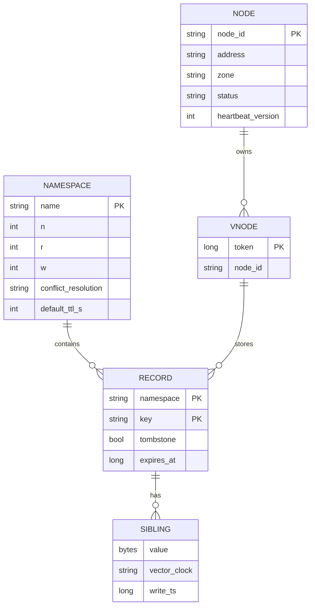

Bản ghi trên đĩa (một entry trong SSTable):

| Trường | Kích thước | Ghi chú |
|---|---|---|
| `key` | ≤ 256 B | `namespace` + `key` ghép lại |
| `siblings[]` | thường 1 | Mỗi sibling: `value`, `vector_clock`, `write_ts` |
| `tombstone` | 1 bit | Xoá = ghi tombstone (§7.4, §8) |
| `expires_at` | 8 B | TTL; hết hạn coi như tombstone |

**Metadata cluster** (ring: token → node, trạng thái node, cấu hình namespace) được lan truyền bằng **gossip** (§7.3) - mỗi node đều có một bản sao, không có metadata server trung tâm. (Một biến thể hiện đại là giữ metadata trong một nhóm nhỏ đồng thuận bằng Raft - xem phần "Biến thể".)

**Storage engine mỗi node**: **LSM tree** (§7.4) - vì workload ghi nhiều, value nhỏ, cần ghi tuần tự. Thực tế có thể dùng RocksDB làm engine nhúng thay vì tự viết.

---

## 📖 5. Kiến trúc tổng thể

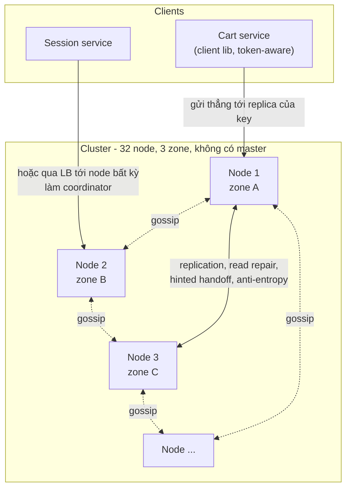

Bên trong mỗi node - mọi node giống hệt nhau:

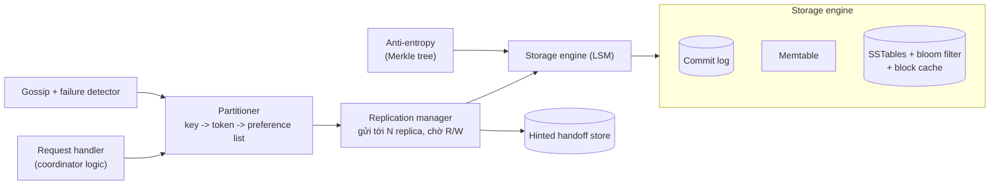

### 5.1 Đường đi của một lần ghi

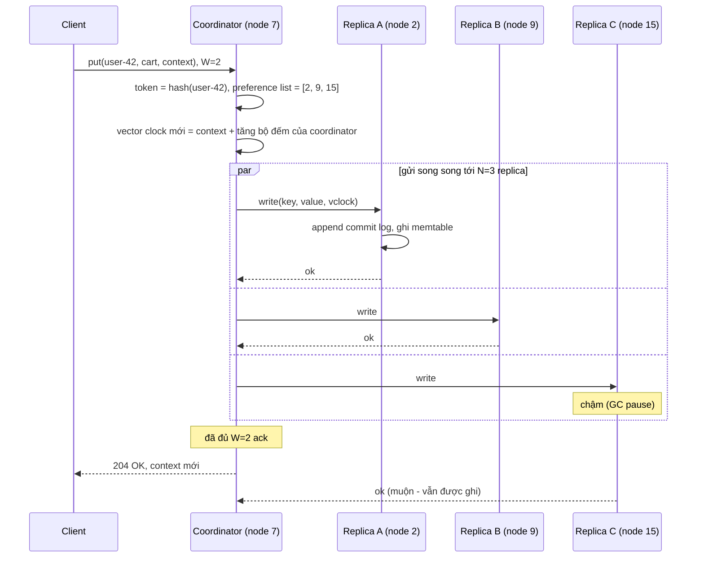

### 5.2 Đường đi của một lần đọc

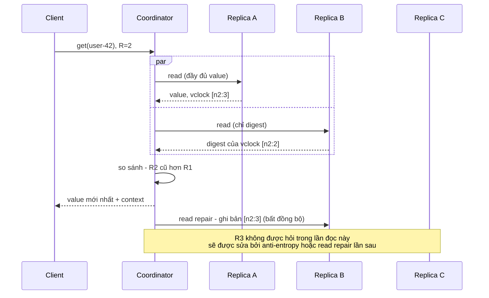

Hai tối ưu đáng nói: coordinator hỏi **một** replica lấy dữ liệu đầy đủ và các replica còn lại chỉ trả **digest** (hash) - tiết kiệm băng thông; và **read repair** sửa replica cũ ngay trên đường đọc.

---

## 📖 6. Partitioning và replication

### 6.1 Consistent hashing với vnodes

Cơ chế consistent hashing và lý do cần virtual node đã được dạy kỹ ở [Bài 3](./03-building-blocks-data.md). Áp dụng vào đây:

- Không gian hash 64-bit (vd Murmur3) là một vòng tròn. Mỗi node vật lý nhận **nhiều token** ngẫu nhiên (vd 16-256 vnode).
- Key được băm thành token; đi **theo chiều kim đồng hồ** tới vnode đầu tiên → node đó là **coordinator tự nhiên** và replica đầu tiên.
- Thêm node: node mới nhận các token mới, chỉ **lấy bớt một phần nhỏ dữ liệu từ nhiều node khác** (nhờ vnode, tải được lấy đều từ cả cluster chứ không chỉ từ một hàng xóm).

### 6.2 Preference list: chọn N replica

Đi tiếp theo chiều kim đồng hồ để chọn N replica, nhưng **bỏ qua** vnode thuộc node vật lý đã chọn, và ưu tiên **khác zone**:

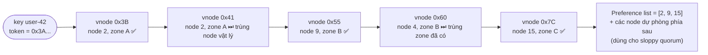

Danh sách này còn kéo dài thêm vài node **dự phòng** phía sau - sẽ dùng cho sloppy quorum (§7.1).

| Quyết định | Lựa chọn | Lý do |
|---|---|---|
| Hàm hash | Murmur3 64-bit | Nhanh, phân bố đều; không cần mã hoá |
| Số vnode/node | 16-256 tuỳ cluster | Nhiều vnode → phân bố đều hơn, nhưng metadata ring và chi phí repair lớn hơn |
| N | 3 | Chịu mất 1 zone; cân bằng chi phí |
| Đặt replica | Mỗi replica một zone | Mất cả zone vẫn còn 2 bản |

---

## 📖 7. Deep dives

### 7.1 Quorum tuỳ chỉnh, sloppy quorum và hinted handoff

**Quorum cổ điển** (chi tiết lý thuyết ở [Bài 4](./04-consistency-consensus.md)): ghi chờ W ack, đọc hỏi R replica. Nếu `R + W > N`, tập đọc và tập ghi **giao nhau** → đọc chạm ít nhất một replica có bản ghi mới nhất (trong điều kiện không có lỗi phức tạp).

| Cấu hình (N=3) | Đặc điểm | Hợp với |
|---|---|---|
| W=1, R=1 | Nhanh nhất, có thể đọc dữ liệu cũ | Session, cache, số liệu không quan trọng |
| W=2, R=2 | `R+W>N`, cân bằng | Giỏ hàng, hồ sơ - mặc định hợp lý |
| W=3, R=1 | Đọc nhanh, ghi chậm và **ghi lỗi nếu 1 replica chết** | Dữ liệu đọc rất nhiều, ghi hiếm (cấu hình) |
| W=1, R=3 | Ghi nhanh, đọc chậm, đọc lỗi nếu 1 replica chết | Hiếm dùng |

!!! warning "R + W > N không biến hệ thống thành linearizable"
    Với sloppy quorum, last-write-wins dựa trên đồng hồ, ghi thất bại một phần (W chưa đạt nhưng vài replica đã ghi), hai request đồng thời... bạn vẫn có thể thấy hiện tượng đọc "đi lùi". Quorum ở đây cho **xác suất cao** đọc được bản mới, không phải đảm bảo tuyệt đối. Cần linearizable thật thì dùng đồng thuận (Raft/Paxos) - xem phần Biến thể.

**Sloppy quorum**: điều gì xảy ra khi node 15 (replica C) chết và client yêu cầu W=2? Quorum chặt chẽ vẫn ổn (còn 2 replica). Nhưng nếu **hai** replica chết, hoặc client bị chia cắt khỏi chúng? Quorum chặt → **từ chối ghi** (mất availability). Dynamo chọn **sloppy quorum**: ghi vào **N node khoẻ mạnh đầu tiên** trong preference list mở rộng, kể cả khi đó không phải "chủ nhà" của key.

**Hinted handoff**: node "ở nhờ" lưu bản ghi kèm một **gợi ý (hint)**: *"cái này thuộc về node 15"*. Khi gossip báo node 15 sống lại, nó chuyển bản ghi về đúng chỗ rồi xoá hint.

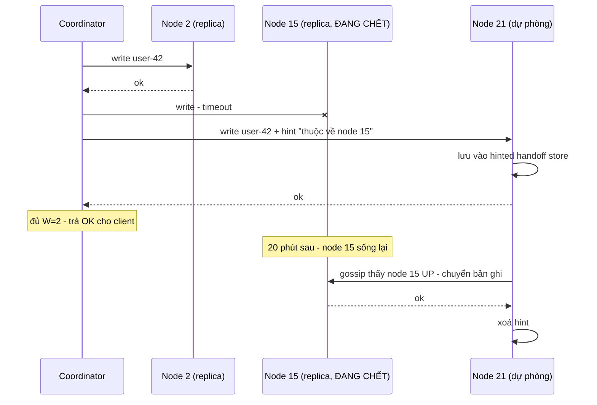

| Cơ chế | Ưu | Nhược |
|---|---|---|
| Strict quorum | Đảm bảo giao nhau R/W thật sự | Ghi thất bại khi không đủ replica gốc |
| Sloppy quorum + hinted handoff | Gần như luôn ghi được | Đọc với R=2 có thể **không thấy** bản ghi đang nằm ở node dự phòng; hint có giới hạn thời gian/dung lượng - node chết quá lâu thì phải nhờ anti-entropy |

Cassandra có cấu hình tương tự (`max_hint_window`): hint chỉ được giữ trong một khoảng thời gian; node chết lâu hơn phải chạy **repair** đầy đủ.

### 7.2 Phiên bản và giải quyết xung đột

Trong lúc chia cắt mạng (hoặc chỉ đơn giản là hai request đồng thời đến hai coordinator khác nhau), hai lần ghi có thể cùng dựa trên một phiên bản cũ. Hệ thống phải trả lời: *"Hai phiên bản này, cái nào mới hơn - hay chúng **đồng thời** (concurrent)?"*

**Lựa chọn 1 - Last-write-wins (LWW)**: mỗi lần ghi gắn timestamp, bản có timestamp lớn hơn thắng. Đơn giản, không có sibling. Nhưng:

- Đồng hồ các máy **lệch nhau** (clock skew) - bản ghi "mới hơn" theo thời gian thực có thể thua.
- Hai lần ghi đồng thời: một lần **bị mất âm thầm**. Với giỏ hàng: thêm món A trên điện thoại, thêm món B trên laptop → còn một món.

**Lựa chọn 2 - Vector clock**: mỗi phiên bản mang một danh sách `(node, bộ đếm)`. Node xử lý ghi tăng bộ đếm của chính nó. So sánh hai vector clock:

- Mọi thành phần của A ≤ B → A **xảy ra trước** B → B thay thế A.
- Có thành phần A lớn hơn, có thành phần B lớn hơn → **đồng thời** → giữ cả hai làm sibling.

Demo kịch bản kinh điển trong paper Dynamo: D1, D2 ghi qua node Sx; hai client cùng sửa D2 qua Sy và Sz; client sau đó đọc được hai sibling, gộp và ghi lại qua Sx.

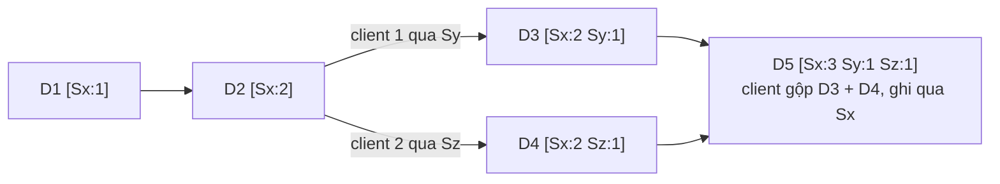

=== "Go"

    ```go
    package main

    import (
    	"fmt"
    	"sort"
    	"strings"
    )

    type VC map[string]int

    func (v VC) String() string {
    	ks := []string{}
    	for k := range v {
    		ks = append(ks, k)
    	}
    	sort.Strings(ks)
    	parts := []string{}
    	for _, k := range ks {
    		parts = append(parts, fmt.Sprintf("%s:%d", k, v[k]))
    	}
    	return "[" + strings.Join(parts, " ") + "]"
    }

    // inc: node ghi một phiên bản mới dựa trên phiên bản v
    func inc(v VC, node string) VC {
    	out := VC{}
    	for k, c := range v {
    		out[k] = c
    	}
    	out[node]++
    	return out
    }

    // merge: lấy max từng thành phần (dùng khi client gộp các sibling)
    func merge(a, b VC) VC {
    	out := VC{}
    	for k, c := range a {
    		out[k] = c
    	}
    	for k, c := range b {
    		if c > out[k] {
    			out[k] = c
    		}
    	}
    	return out
    }

    func compare(a, b VC) string {
    	aLess, bLess := false, false
    	keys := map[string]bool{}
    	for k := range a {
    		keys[k] = true
    	}
    	for k := range b {
    		keys[k] = true
    	}
    	for k := range keys {
    		if a[k] < b[k] {
    			aLess = true
    		}
    		if b[k] < a[k] {
    			bLess = true
    		}
    	}
    	switch {
    	case !aLess && !bLess:
    		return "EQUAL"
    	case aLess && !bLess:
    		return "BEFORE (b ghi đè a được)"
    	case !aLess && bLess:
    		return "AFTER (a ghi đè b được)"
    	}
    	return "CONCURRENT (giữ cả hai = sibling)"
    }

    func main() {
    	d1 := inc(VC{}, "Sx")
    	d2 := inc(d1, "Sx")
    	d3 := inc(d2, "Sy") // client 1 sửa D2, request rơi vào Sy
    	d4 := inc(d2, "Sz") // client 2 cũng sửa D2, rơi vào Sz
    	fmt.Println("D1", d1, "D2", d2, "D3", d3, "D4", d4)
    	fmt.Println("D2 vs D3:", compare(d2, d3))
    	fmt.Println("D3 vs D4:", compare(d3, d4))
    	d5 := inc(merge(d3, d4), "Sx") // client đọc 2 sibling, gộp, ghi lại qua Sx
    	fmt.Println("D5", d5)
    	fmt.Println("D5 vs D3:", compare(d5, d3))
    	fmt.Println("D5 vs D4:", compare(d5, d4))
    }
    ```

=== "Python"

    ```python
    VC = dict[str, int]

    def fmt(v: VC) -> str:
        return "[" + " ".join(f"{k}:{v[k]}" for k in sorted(v)) + "]"

    def inc(v: VC, node: str) -> VC:
        """node ghi một phiên bản mới dựa trên phiên bản v."""
        out = dict(v)
        out[node] = out.get(node, 0) + 1
        return out

    def merge(a: VC, b: VC) -> VC:
        """Lấy max từng thành phần (dùng khi client gộp các sibling)."""
        return {k: max(a.get(k, 0), b.get(k, 0)) for k in a.keys() | b.keys()}

    def compare(a: VC, b: VC) -> str:
        keys = a.keys() | b.keys()
        a_less = any(a.get(k, 0) < b.get(k, 0) for k in keys)
        b_less = any(b.get(k, 0) < a.get(k, 0) for k in keys)
        if not a_less and not b_less:
            return "EQUAL"
        if a_less and not b_less:
            return "BEFORE (b ghi đè a được)"
        if b_less and not a_less:
            return "AFTER (a ghi đè b được)"
        return "CONCURRENT (giữ cả hai = sibling)"

    d1 = inc({}, "Sx")
    d2 = inc(d1, "Sx")
    d3 = inc(d2, "Sy")   # client 1 sửa D2, request rơi vào Sy
    d4 = inc(d2, "Sz")   # client 2 cũng sửa D2, rơi vào Sz
    print("D1", fmt(d1), "D2", fmt(d2), "D3", fmt(d3), "D4", fmt(d4))
    print("D2 vs D3:", compare(d2, d3))
    print("D3 vs D4:", compare(d3, d4))
    d5 = inc(merge(d3, d4), "Sx")  # client đọc 2 sibling, gộp, ghi lại qua Sx
    print("D5", fmt(d5))
    print("D5 vs D3:", compare(d5, d3))
    print("D5 vs D4:", compare(d5, d4))
    ```

Output (Go và Python giống hệt nhau):

```
D1 [Sx:1] D2 [Sx:2] D3 [Sx:2 Sy:1] D4 [Sx:2 Sz:1]
D2 vs D3: BEFORE (b ghi đè a được)
D3 vs D4: CONCURRENT (giữ cả hai = sibling)
D5 [Sx:3 Sy:1 Sz:1]
D5 vs D3: AFTER (a ghi đè b được)
D5 vs D4: AFTER (a ghi đè b được)
```

Vấn đề thực tế của vector clock: danh sách có thể **dài ra** khi nhiều node khác nhau làm coordinator. Dynamo **cắt bớt** các mục cũ nhất khi vượt ngưỡng (vd 10) - đánh đổi một chút chính xác (có thể sinh sibling thừa) lấy kích thước nhỏ. Riak về sau dùng **dotted version vectors** gắn theo replica thay vì theo client để tránh "sibling explosion".

**Lựa chọn 3 - CRDT (Conflict-free Replicated Data Types)**: thiết kế kiểu dữ liệu sao cho **mọi** cách gộp đều cho cùng kết quả (phép gộp giao hoán, kết hợp, luỹ đẳng). Ví dụ: G-Counter (mỗi node một bộ đếm, tổng = giá trị), OR-Set (tập hợp cho phép thêm/xoá, thêm và xoá đồng thời thì thêm thắng). Hệ thống tự gộp, ứng dụng không phải viết logic gộp.

| Cách giải quyết | Mất dữ liệu khi ghi đồng thời? | Độ phức tạp cho ứng dụng | Phụ thuộc đồng hồ | Hợp với |
|---|---|---|---|---|
| LWW (timestamp) | **Có** - âm thầm | Không | Có | Session, cache, dữ liệu ghi đè toàn bộ |
| Vector clock + siblings | Không - ứng dụng thấy cả hai | Cao: phải viết hàm gộp | Không | Giỏ hàng, dữ liệu có ngữ nghĩa gộp rõ |
| CRDT | Không | Thấp - nhưng chỉ cho kiểu dữ liệu được hỗ trợ | Không | Bộ đếm, tập hợp, cờ, map đơn giản |
| Đồng thuận (Raft) - tránh xung đột từ đầu | Không có xung đột | Không | Không | Cấu hình, khoá, số dư - cần linearizable |

!!! tip "Trong phỏng vấn, đề xuất theo namespace"
    "Mặc định LWW cho namespace không cần gộp (session). Namespace giỏ hàng dùng vector clock + sibling, hoặc tốt hơn là mô hình giỏ hàng như **OR-Set CRDT** để hệ thống tự gộp." Câu trả lời này cho thấy bạn hiểu chi phí của từng lựa chọn.

### 7.3 Membership, phát hiện lỗi và anti-entropy

**Gossip**: không có master giữ danh sách thành viên. Mỗi giây, mỗi node chọn **ngẫu nhiên** vài node khác và trao đổi bảng trạng thái của mình (`node → (heartbeat_version, status, tokens, ...)`); bên nào có version mới hơn thì cập nhật. Thông tin lan ra toàn cluster trong **O(log N)** vòng - giống tin đồn lan trong một xóm.

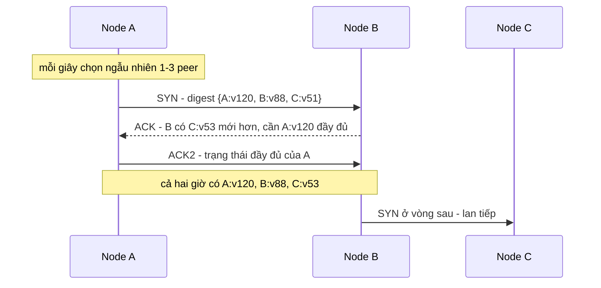

**Failure detector**: node nào "chết"? Timeout cố định (vd 5 giây không có heartbeat) quá cứng - mạng chậm thì báo nhầm, mạng nhanh thì phát hiện chậm. **Phi accrual failure detector** (dùng trong Cassandra, Akka) học **phân phối khoảng cách giữa các heartbeat** của từng node, rồi tính **φ** - một mức nghi ngờ liên tục: φ = 1 nghĩa là khả năng nhầm ~10%, φ = 8 nghĩa là ~10⁻⁸. Khi φ vượt ngưỡng (Cassandra mặc định 8), node bị coi là DOWN.

Điểm quan trọng: "DOWN" theo failure detector **chỉ là ý kiến cục bộ** để định tuyến request (không gửi tới node đó, dùng hinted handoff). Việc **xoá hẳn** một node khỏi ring (và di chuyển dữ liệu) là quyết định **của người vận hành** hoặc một quy trình riêng - tránh việc một sự cố mạng ngắn gây hàng loạt di chuyển dữ liệu.

**Ba cơ chế sửa lệch replica** bổ sung cho nhau:

| Cơ chế | Khi nào chạy | Sửa được gì | Giới hạn |
|---|---|---|---|
| **Read repair** | Trên đường đọc | Key **được đọc** | Key ít đọc thì không bao giờ được sửa |
| **Hinted handoff** | Khi node chết rồi sống lại trong cửa sổ hint | Ghi bị lỡ trong lúc chết ngắn | Hint hết hạn / node giữ hint cũng chết |
| **Anti-entropy (Merkle tree)** | Định kỳ ở nền (vd mỗi vài ngày), hoặc sau sự cố | **Mọi** sai lệch | Tốn CPU/IO để tính cây và stream dữ liệu |

**Anti-entropy với Merkle tree**: hai replica cùng giữ một dải token chứa hàng trăm triệu key. So sánh từng key qua mạng thì quá đắt. Merkle tree giải quyết: chia dải key thành nhiều khối lá, mỗi lá là hash của các key trong đó, mỗi node cha là hash của hai con. **Root giống nhau → toàn bộ dải giống nhau**, chỉ một lần so sánh. Root khác → đi xuống nhánh khác nhau, bỏ qua các nhánh giống.

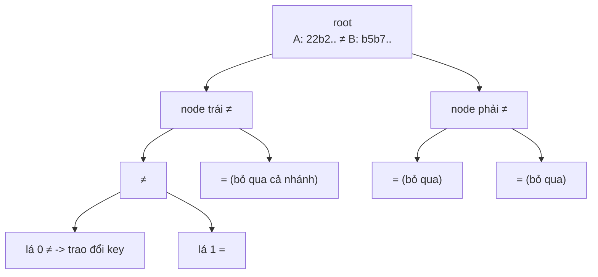

Demo: hai replica 100 key, replica B có 1 key cũ (`key17`) và thiếu 1 key (`key42`). Cây 8 lá.

=== "Go"

    ```go
    package main

    import (
    	"crypto/sha256"
    	"encoding/hex"
    	"fmt"
    	"sort"
    )

    const leaves = 8 // mỗi lá phụ trách 1 "dải" key (ở đây: bucket theo hash)

    func h(s string) string { x := sha256.Sum256([]byte(s)); return hex.EncodeToString(x[:]) }

    func bucket(k string) int { x := sha256.Sum256([]byte(k)); return int(x[0]) % leaves }

    // build trả về cây dạng mảng heap: node 1 là root, con của i là 2i và 2i+1, lá ở [leaves, 2*leaves)
    func build(data map[string]string) []string {
    	per := make([][]string, leaves)
    	for k := range data {
    		per[bucket(k)] = append(per[bucket(k)], k)
    	}
    	tree := make([]string, 2*leaves)
    	for i := 0; i < leaves; i++ {
    		sort.Strings(per[i])
    		s := ""
    		for _, k := range per[i] {
    			s += k + "=" + data[k] + ";"
    		}
    		tree[leaves+i] = h(s)
    	}
    	for i := leaves - 1; i >= 1; i-- {
    		tree[i] = h(tree[2*i] + tree[2*i+1])
    	}
    	return tree
    }

    func main() {
    	a, b := map[string]string{}, map[string]string{}
    	for i := 0; i < 100; i++ {
    		k, v := fmt.Sprintf("key%02d", i), fmt.Sprintf("v%d", i)
    		a[k], b[k] = v, v
    	}
    	b["key17"] = "v17-stale" // replica B lỡ một lần ghi
    	delete(b, "key42")       // và thiếu hẳn một key

    	ta, tb := build(a), build(b)
    	fmt.Printf("root A=%s root B=%s\n", ta[1][:8], tb[1][:8])

    	compared, diffLeaves := 0, []int{}
    	var walk func(i int)
    	walk = func(i int) {
    		compared++
    		if ta[i] == tb[i] {
    			return // cả cây con giống nhau -> bỏ qua, không cần xem key nào
    		}
    		if i >= leaves {
    			diffLeaves = append(diffLeaves, i-leaves)
    			return
    		}
    		walk(2 * i)
    		walk(2*i + 1)
    	}
    	walk(1)
    	fmt.Printf("so sánh %d/%d node hash, lá lệch: %v\n", compared, 2*leaves-1, diffLeaves)

    	keys := 0
    	for _, leaf := range diffLeaves { // chỉ trao đổi key trong các lá lệch
    		all := map[string]bool{}
    		for k := range a {
    			if bucket(k) == leaf {
    				all[k] = true
    			}
    		}
    		for k := range b {
    			if bucket(k) == leaf {
    				all[k] = true
    			}
    		}
    		ks := []string{}
    		for k := range all {
    			ks = append(ks, k)
    		}
    		sort.Strings(ks)
    		keys += len(ks)
    		for _, k := range ks {
    			if a[k] != b[k] {
    				fmt.Printf("  lá %d: %s A=%q B=%q\n", leaf, k, a[k], b[k])
    			}
    		}
    	}
    	fmt.Printf("chỉ phải gửi %d/100 key thay vì toàn bộ\n", keys)
    }
    ```

=== "Python"

    ```python
    import hashlib

    LEAVES = 8  # mỗi lá phụ trách 1 "dải" key (ở đây: bucket theo hash)

    def h(s: str) -> str:
        return hashlib.sha256(s.encode()).hexdigest()

    def bucket(k: str) -> int:
        return hashlib.sha256(k.encode()).digest()[0] % LEAVES

    def build(data: dict[str, str]) -> list[str]:
        """Cây dạng heap: node 1 là root, con của i là 2i, 2i+1, lá ở [LEAVES, 2*LEAVES)."""
        tree = [""] * (2 * LEAVES)
        for i in range(LEAVES):
            ks = sorted(k for k in data if bucket(k) == i)
            tree[LEAVES + i] = h("".join(f"{k}={data[k]};" for k in ks))
        for i in range(LEAVES - 1, 0, -1):
            tree[i] = h(tree[2 * i] + tree[2 * i + 1])
        return tree

    a = {f"key{i:02d}": f"v{i}" for i in range(100)}
    b = dict(a)
    b["key17"] = "v17-stale"   # replica B lỡ một lần ghi
    del b["key42"]             # và thiếu hẳn một key

    ta, tb = build(a), build(b)
    print(f"root A={ta[1][:8]} root B={tb[1][:8]}")

    compared, diff_leaves = 0, []
    def walk(i: int) -> None:
        global compared
        compared += 1
        if ta[i] == tb[i]:
            return                      # cả cây con giống nhau -> bỏ qua
        if i >= LEAVES:
            diff_leaves.append(i - LEAVES)
            return
        walk(2 * i)
        walk(2 * i + 1)

    walk(1)
    print(f"so sánh {compared}/{2 * LEAVES - 1} node hash, lá lệch: [{' '.join(map(str, diff_leaves))}]")

    keys = 0
    for leaf in diff_leaves:            # chỉ trao đổi key trong các lá lệch
        ks = sorted({k for k in (a | b) if bucket(k) == leaf})
        keys += len(ks)
        for k in ks:
            if a.get(k, "") != b.get(k, ""):
                print(f'  lá {leaf}: {k} A="{a.get(k, "")}" B="{b.get(k, "")}"')
    print(f"chỉ phải gửi {keys}/100 key thay vì toàn bộ")
    ```

Output (Go và Python giống hệt nhau):

```
root A=22b2e317 root B=b5b7b330
so sánh 9/15 node hash, lá lệch: [0 2]
  lá 0: key42 A="v42" B=""
  lá 2: key17 A="v17" B="v17-stale"
chỉ phải gửi 27/100 key thay vì toàn bộ
```

Với 8 lá và 2 lá lệch, ta vẫn phải gửi 27% số key. Trong hệ thống thật, cây có **hàng chục nghìn lá** (Cassandra mặc định cây sâu 15 → 32.768 lá cho mỗi dải), nên một vài key lệch chỉ kéo theo vài lá nhỏ - lượng dữ liệu trao đổi giảm hàng nghìn lần. Đổi lại, khi thêm/bớt node làm dải token thay đổi, cây phải **tính lại** - một trong những lý do repair tốn kém.

### 7.4 Storage engine: LSM tree vs B-tree

**B-tree** (PostgreSQL, MySQL InnoDB) cập nhật **tại chỗ**: tìm trang chứa key, sửa trang, ghi trang về đĩa. Mỗi lần ghi nhỏ có thể làm ghi lại cả trang 8-16 KB ở vị trí ngẫu nhiên.

**LSM tree (Log-Structured Merge tree)** (Cassandra, RocksDB, LevelDB, ScyllaDB, HBase) **không bao giờ sửa tại chỗ**:

1. Ghi vào **commit log / WAL** (append tuần tự, để chịu crash) và **memtable** (cây có thứ tự trong RAM).
2. Memtable đầy → **flush** thành một **SSTable** (Sorted String Table): file bất biến, key đã sắp xếp, kèm index thưa và **bloom filter**.
3. Đọc: memtable → SSTable **mới nhất → cũ nhất**, dừng ở bản đầu tiên tìm thấy. Bloom filter cho biết "chắc chắn không có" để bỏ qua SSTable mà không chạm đĩa.
4. **Compaction** ở nền: gộp nhiều SSTable, giữ bản mới nhất của mỗi key, bỏ bản cũ và tombstone hết hạn.

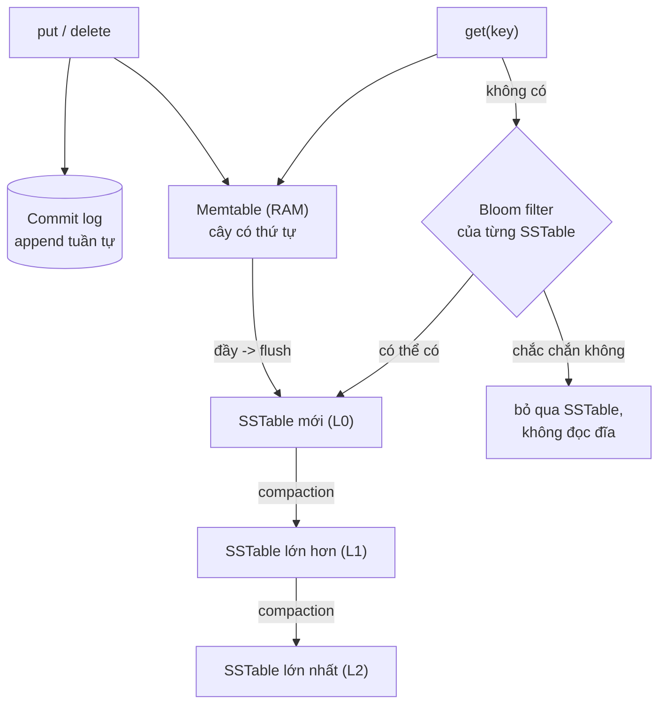

Demo mini-LSM: memtable đầy 3 key thì flush; xoá bằng tombstone; đọc từ mới tới cũ; compaction gộp và bỏ tombstone. (Bỏ qua WAL và bloom filter cho gọn.)

=== "Go"

    ```go
    package main

    import (
    	"fmt"
    	"sort"
    )

    const tombstone = "<DEL>"
    const memLimit = 3 // memtable đầy 3 key thì flush

    type SSTable struct{ keys, vals []string } // bất biến, key đã sort

    type LSM struct {
    	mem      map[string]string
    	sstables []SSTable // [0] là cũ nhất
    	reads    int       // số SSTable đã phải mở khi đọc
    }

    func (l *LSM) Put(k, v string) {
    	l.mem[k] = v // (thực tế: ghi WAL trước để không mất khi crash)
    	if len(l.mem) >= memLimit {
    		l.flush()
    	}
    }
    func (l *LSM) Delete(k string) { l.Put(k, tombstone) } // xoá = ghi tombstone

    func (l *LSM) flush() {
    	t := SSTable{}
    	for k := range l.mem {
    		t.keys = append(t.keys, k)
    	}
    	sort.Strings(t.keys)
    	for _, k := range t.keys {
    		t.vals = append(t.vals, l.mem[k])
    	}
    	l.sstables = append(l.sstables, t)
    	l.mem = map[string]string{}
    	fmt.Printf("flush -> SSTable#%d %v\n", len(l.sstables)-1, t.keys)
    }

    func (l *LSM) Get(k string) (string, bool) {
    	if v, ok := l.mem[k]; ok {
    		return v, v != tombstone
    	}
    	for i := len(l.sstables) - 1; i >= 0; i-- { // mới -> cũ
    		l.reads++
    		t := l.sstables[i]
    		j := sort.SearchStrings(t.keys, k) // binary search trong file đã sort
    		if j < len(t.keys) && t.keys[j] == k {
    			return t.vals[j], t.vals[j] != tombstone
    		}
    	}
    	return "", false
    }

    // Compaction: gộp mọi SSTable, giữ bản mới nhất, bỏ tombstone
    func (l *LSM) Compact() {
    	merged := map[string]string{}
    	for _, t := range l.sstables { // cũ -> mới, bản sau đè bản trước
    		for i, k := range t.keys {
    			merged[k] = t.vals[i]
    		}
    	}
    	t := SSTable{}
    	for k, v := range merged {
    		if v != tombstone {
    			t.keys = append(t.keys, k)
    		}
    	}
    	sort.Strings(t.keys)
    	for _, k := range t.keys {
    		t.vals = append(t.vals, merged[k])
    	}
    	fmt.Printf("compact %d SSTable -> 1 SSTable %v\n", len(l.sstables), t.keys)
    	l.sstables = []SSTable{t}
    }

    func main() {
    	db := &LSM{mem: map[string]string{}}
    	db.Put("user:1", "An")
    	db.Put("user:2", "Binh")
    	db.Put("user:3", "Chi")
    	db.Put("user:1", "An v2") // update = ghi thêm, không sửa tại chỗ
    	db.Delete("user:2")
    	db.Put("user:4", "Dung")
    	db.Put("user:5", "Em")

    	for _, k := range []string{"user:1", "user:2", "user:3", "user:5"} {
    		db.reads = 0
    		v, ok := db.Get(k)
    		fmt.Printf("get %s -> %q found=%v (mở %d SSTable)\n", k, v, ok, db.reads)
    	}
    	db.Compact()
    	db.reads = 0
    	v, ok := db.Get("user:3")
    	fmt.Printf("get user:3 -> %q found=%v (mở %d SSTable)\n", v, ok, db.reads)
    }
    ```

=== "Python"

    ```python
    import bisect

    TOMBSTONE = "<DEL>"
    MEM_LIMIT = 3  # memtable đầy 3 key thì flush

    class LSM:
        def __init__(self) -> None:
            self.mem: dict[str, str] = {}
            self.sstables: list[tuple[list[str], list[str]]] = []  # bất biến, [0] cũ nhất
            self.reads = 0                                          # số SSTable đã mở khi đọc

        def put(self, k: str, v: str) -> None:
            self.mem[k] = v  # (thực tế: ghi WAL trước để không mất khi crash)
            if len(self.mem) >= MEM_LIMIT:
                self.flush()

        def delete(self, k: str) -> None:
            self.put(k, TOMBSTONE)  # xoá = ghi tombstone

        def flush(self) -> None:
            keys = sorted(self.mem)
            self.sstables.append((keys, [self.mem[k] for k in keys]))
            self.mem = {}
            print(f"flush -> SSTable#{len(self.sstables) - 1} [{' '.join(keys)}]")

        def get(self, k: str) -> tuple[str, bool]:
            if k in self.mem:
                v = self.mem[k]
                return v, v != TOMBSTONE
            for keys, vals in reversed(self.sstables):  # mới -> cũ
                self.reads += 1
                j = bisect.bisect_left(keys, k)          # binary search trong file đã sort
                if j < len(keys) and keys[j] == k:
                    return vals[j], vals[j] != TOMBSTONE
            return "", False

        def compact(self) -> None:
            """Gộp mọi SSTable, giữ bản mới nhất, bỏ tombstone."""
            merged: dict[str, str] = {}
            for keys, vals in self.sstables:             # cũ -> mới, bản sau đè bản trước
                merged.update(zip(keys, vals))
            keys = sorted(k for k, v in merged.items() if v != TOMBSTONE)
            print(f"compact {len(self.sstables)} SSTable -> 1 SSTable [{' '.join(keys)}]")
            self.sstables = [(keys, [merged[k] for k in keys])]

    db = LSM()
    db.put("user:1", "An")
    db.put("user:2", "Binh")
    db.put("user:3", "Chi")
    db.put("user:1", "An v2")   # update = ghi thêm, không sửa tại chỗ
    db.delete("user:2")
    db.put("user:4", "Dung")
    db.put("user:5", "Em")

    for k in ["user:1", "user:2", "user:3", "user:5"]:
        db.reads = 0
        v, ok = db.get(k)
        print(f'get {k} -> "{v}" found={str(ok).lower()} (mở {db.reads} SSTable)')
    db.compact()
    db.reads = 0
    v, ok = db.get("user:3")
    print(f'get user:3 -> "{v}" found={str(ok).lower()} (mở {db.reads} SSTable)')
    ```

Output (Go và Python giống hệt nhau):

```
flush -> SSTable#0 [user:1 user:2 user:3]
flush -> SSTable#1 [user:1 user:2 user:4]
get user:1 -> "An v2" found=true (mở 1 SSTable)
get user:2 -> "<DEL>" found=false (mở 1 SSTable)
get user:3 -> "Chi" found=true (mở 2 SSTable)
get user:5 -> "Em" found=true (mở 0 SSTable)
compact 2 SSTable -> 1 SSTable [user:1 user:3 user:4]
get user:3 -> "Chi" found=true (mở 1 SSTable)
```

Đọc kết quả:

- `user:1` có **hai** phiên bản trên đĩa (SSTable#0 và #1) - update không sửa tại chỗ. Đọc thấy bản mới nhất ở SSTable#1 và dừng.
- `user:2` bị xoá bằng **tombstone** ở SSTable#1 - nó "che" bản `Binh` cũ ở SSTable#0. Nếu không có tombstone, đọc sẽ đi xuống SSTable#0 và **"hồi sinh"** dữ liệu đã xoá.
- `user:3` phải mở **2** SSTable trước khi compaction (**read amplification**), chỉ 1 sau compaction. `user:5` còn trong memtable - không chạm đĩa.

!!! warning "Tombstone và 'zombie' trong hệ thống nhân bản"
    Ở demo, compaction bỏ tombstone ngay. Trong cluster thật **không được** làm vậy: nếu một replica đang chết lúc xoá (không nhận tombstone), rồi các replica khác đã bỏ tombstone, khi replica đó sống lại và chạy anti-entropy, nó sẽ coi dữ liệu cũ của mình là "mới" và **hồi sinh** key đã xoá. Vì thế Cassandra giữ tombstone ít nhất `gc_grace_seconds` (mặc định 10 ngày) và **repair phải chạy xong trong khoảng đó**.

**Compaction strategy** - hai trường phái chính:

| | Size-tiered (STCS) | Leveled (LCS) |
|---|---|---|
| Cách làm | Gộp các SSTable **cùng cỡ** thành một file lớn hơn | Chia tầng L1, L2... mỗi tầng lớn gấp ~10 lần, key **không chồng lấp** trong một tầng |
| Write amplification | Thấp | Cao (dữ liệu bị viết lại nhiều lần qua các tầng) |
| Read amplification | Cao (một key có thể nằm ở nhiều file) | Thấp (mỗi tầng tối đa 1 file chứa key) |
| Space amplification | Cao (cần chỗ trống tới ~2x khi gộp file lớn) | Thấp (~10%) |
| Hợp với | Ghi rất nhiều, đọc ít | Đọc nhiều, cập nhật nhiều |

**LSM vs B-tree tổng kết**:

| Tiêu chí | LSM tree | B-tree |
|---|---|---|
| Ghi | **Rất nhanh** - tuần tự | Chậm hơn - ghi ngẫu nhiên, cả trang |
| Đọc điểm | Có thể chạm nhiều file (giảm nhờ bloom filter, cache, compaction) | **Ổn định** - O(log n) trang |
| Range scan | Phải trộn nhiều file | Tốt - lá liên kết |
| Dung lượng | Nén tốt (file bất biến) nhưng có bản cũ chờ compaction | Phân mảnh trang |
| Độ trễ đuôi | Có thể nhảy khi compaction nặng | Ổn định hơn |
| Ví dụ | Cassandra, RocksDB, ScyllaDB, HBase, LevelDB | PostgreSQL, MySQL InnoDB, SQLite, LMDB |

Với yêu cầu "ghi nhiều, value nhỏ, chịu được read amplification nhờ bloom filter", **LSM là lựa chọn đúng** cho hệ thống này.

---

## 📖 8. Scale, nút thắt và chế độ lỗi

### 8.1 Mở rộng và nút thắt

- **Thêm node**: node mới nhận token, gossip thông báo, các node cũ **stream** dữ liệu của dải token tương ứng sang (bootstrap). Giới hạn băng thông streaming để không ảnh hưởng traffic thật. Nhờ vnode, dữ liệu được lấy đều từ nhiều node.
- **Hot key**: một key cực nóng (cấu hình flash sale) dồn vào N replica. Giải pháp (chi tiết ở [Bài 3](./03-building-blocks-data.md)): cache phía client/ứng dụng với TTL ngắn, đọc với R=1 từ **bất kỳ** replica nào, hoặc tách key ("key sharding" kèm hậu tố) cho dữ liệu ghi nóng.
- **Value lớn**: value 1 MB làm compaction và repair nặng; khuyến nghị lưu blob lớn ở object storage ([Bài 6](./06-specialized-storage.md)) và chỉ giữ con trỏ.
- **Multi-region**: replication factor **theo datacenter** (vd 3 bản ở mỗi DC); đọc/ghi với `LOCAL_QUORUM` (quorum trong DC hiện tại) để độ trễ thấp, đồng bộ giữa DC bất đồng bộ. Xung đột giữa các region được giải bằng cùng cơ chế vector clock/LWW/CRDT. Chi tiết đánh đổi multi-region ở [Bài 4](./04-consistency-consensus.md).

### 8.2 Chế độ lỗi và cách giảm thiểu

| Sự cố | Ảnh hưởng | Giảm thiểu |
|---|---|---|
| 1 node chết tạm thời | Mất 1 replica của nhiều dải | Quorum vẫn đạt; hinted handoff; read repair |
| 1 node chết vĩnh viễn (hỏng đĩa) | Dải của node mất 1 bản | Thay node, stream dữ liệu từ replica khác; anti-entropy |
| Mất cả 1 zone | Mất 1/3 node | Mỗi key có replica ở 3 zone → còn 2 bản, W=2/R=2 vẫn chạy |
| Chia cắt mạng | Hai phía cùng ghi | Sloppy quorum giữ ghi được; vector clock phát hiện xung đột; gộp sau |
| Node chậm (GC, đĩa chậm) | Độ trễ đuôi tăng | Coordinator chỉ chờ W/R nhanh nhất; **speculative retry** (gửi thêm request tới replica khác nếu chậm hơn p99); failure detector đánh dấu node chậm |
| Clock skew | LWW chọn sai bản | NTP giám sát chặt; dùng vector clock cho dữ liệu quan trọng |
| Tombstone tích tụ | Đọc chậm, timeout | TTL theo partition, giới hạn tombstone mỗi lần đọc, compaction phù hợp |
| Repair không chạy kịp `gc_grace` | Dữ liệu đã xoá hồi sinh | Lập lịch repair tự động, alert khi quá hạn |
| Đĩa đầy do compaction | Node ngừng ghi | Chỉ lấp ~70% đĩa; theo dõi dung lượng trống |
| Bug client ghi sibling liên tục mà không gộp | Value phình to (sibling explosion) | Giới hạn số sibling, cảnh báo; dotted version vectors |

---

## 📖 9. Giám sát và metric chính

| Nhóm | Metric | Vì sao |
|---|---|---|
| Độ trễ | p50/p99/p999 `get`, `put` theo namespace và theo mức R/W | SLO chính |
| Lỗi | Tỷ lệ timeout, `UnavailableException` (không đủ replica) | Dấu hiệu mất quorum |
| Nhất quán | Số lần read repair/giây, số sibling trung bình, số key có > N sibling | Đo mức lệch replica, phát hiện client không gộp |
| Hinted handoff | Số hint đang chờ, tuổi hint lớn nhất | Node chết lâu, sắp vượt cửa sổ hint |
| Storage | Số SSTable mỗi lần đọc, pending compactions, tỷ lệ false positive bloom filter, block cache hit rate | Read amplification, compaction tụt lại |
| Tombstone | Số tombstone quét mỗi lần đọc | Dấu hiệu mô hình xoá sai |
| Repair | Thời gian từ lần repair thành công cuối cùng của mỗi dải | Phải < `gc_grace` |
| Membership | Số node UP/DOWN theo góc nhìn của từng node, φ trung bình | Phát hiện chia cắt, node chập chờn |
| Tài nguyên | Đĩa trống, CPU, GC pause, băng thông streaming | Lập kế hoạch dung lượng |

---

## 📝 Tự chấm

So bản thiết kế 15-20 phút của bạn với rubric sau.

| Hạng mục | Đạt | Chưa đạt |
|---|---|---|
| Yêu cầu | Hỏi kích thước value, mức nhất quán, hành vi khi chia cắt, multi-region; ghi rõ ngoài phạm vi | Nhảy vào vẽ sơ đồ ngay; không biết hệ thống là AP hay CP |
| Ước lượng | Tính dung lượng sau replication và overhead, số node, QPS mỗi node, bộ nhớ bloom filter | Không có con số, hoặc quên nhân hệ số replication |
| API | `get`/`put` có **context/version**, có cách trả sibling, có tham số R/W | Chỉ `get(key)` / `put(key, value)` không phiên bản |
| Dữ liệu | Bản ghi có vector clock/timestamp, tombstone, TTL; metadata ring qua gossip | Không nghĩ tới xoá trong hệ thống nhân bản |
| Kiến trúc | Ring không master, mọi node làm coordinator, preference list theo zone; vẽ được read/write path | Có "master node" làm điểm chết duy nhất, hoặc `hash % N` |
| Deep dive | Giải thích được ít nhất 2 trong: quorum + sloppy quorum/hinted handoff, vector clock, Merkle anti-entropy, LSM | Chỉ nêu tên kỹ thuật, không giải thích cơ chế |
| Trade-off | So sánh LWW vs vector clock vs CRDT; LSM vs B-tree; strict vs sloppy quorum; nêu `R+W>N` không bằng linearizable | Trình bày một phương án như thể là duy nhất |
| Lỗi | Bao gồm node chết tạm/vĩnh viễn, mất zone, chia cắt, node chậm, tombstone hồi sinh | Chỉ nói "có replication nên không sao" |

---

## 📖 10. Biến thể interviewer hay hỏi

??? question "Nếu yêu cầu đổi thành: cần nhất quán mạnh (linearizable) thì sao?"
    Bỏ mô hình leaderless. Chia key space thành **range** (vd 64-512 MB mỗi range), mỗi range là một **nhóm Raft** 3-5 replica có leader; mọi ghi đi qua leader và được commit khi đa số đồng ý; đọc từ leader (có lease) để linearizable. Đây là kiến trúc của TiKV, CockroachDB, etcd (một nhóm), FoundationDB (khác cơ chế nhưng cùng mục tiêu). Cái giá: khi mất đa số replica của một range thì range đó **không ghi được** (CP), và độ trễ ghi gồm một vòng đồng thuận. Xem [Bài 4](./04-consistency-consensus.md).

??? question "Nếu cần range scan (lấy mọi key có tiền tố `user:42:`) thì sao?"
    Consistent hashing phá vỡ thứ tự key. Dùng **range partitioning** (key được sắp xếp, mỗi node giữ một khoảng liên tục - như Bigtable/HBase/TiKV), kèm tự động **chia (split)** range quá lớn hoặc quá nóng và **gộp** range nhỏ. Trade-off: key tuần tự (timestamp) dồn ghi vào một range → hot spot, cần thêm tiền tố băm. Một cách khác giữ consistent hashing: dùng **compound key** kiểu Cassandra - partition key băm, clustering key sắp xếp bên trong partition.

??? question "Nếu chỉ là cache (mất dữ liệu được), độ trễ < 1 ms thì sao?"
    Bỏ commit log, bỏ anti-entropy, giữ toàn bộ dữ liệu trong RAM (kiểu Memcached/Redis Cluster), replication tuỳ chọn, LWW + TTL. Client dùng consistent hashing trực tiếp. Chi tiết cache ở [Bài 3](./03-building-blocks-data.md).

??? question "Nếu cần compare-and-set (CAS) cho một key, ví dụ đặt khoá phân tán?"
    Trong hệ leaderless, CAS cần đồng thuận cho **riêng key đó** - Cassandra làm bằng lightweight transaction (Paxos theo partition), tốn 4 round-trip. Nếu nhiều namespace cần CAS, cân nhắc hệ CP (etcd, ZooKeeper cho khoá; TiKV/FoundationDB cho dữ liệu). Không dùng LWW cho khoá - hai client sẽ cùng nghĩ mình giữ khoá.

??? question "Nếu triển khai active-active ở 3 region, người dùng ghi ở region gần nhất?"
    Replication factor theo region (vd 3 bản/region), ghi `LOCAL_QUORUM`, nhân bản bất đồng bộ giữa region. Xung đột xuyên region là chuyện **thường ngày**, không phải hiếm → bắt buộc có chiến lược gộp: CRDT cho dữ liệu hợp (giỏ hàng, bộ đếm), LWW cho dữ liệu ghi đè, và **định tuyến theo "home region"** cho dữ liệu cần nhất quán (mỗi user có một region chủ để ghi).

??? question "Nếu đội nhỏ, ngân sách hạn chế?"
    Đừng tự xây. Dùng dịch vụ managed (DynamoDB, Bigtable, Cosmos DB, Keyspaces) hoặc Redis/PostgreSQL nếu dữ liệu vừa. Hiểu thiết kế bên trong giúp bạn **chọn cấu hình đúng** (mức nhất quán, khoá partition, TTL) chứ không phải để viết lại.

---

### 💡 Tips quan trọng

- Khi được hỏi "thiết kế KV store", **hỏi ngay AP hay CP** - nó quyết định một nửa thiết kế (leaderless + vector clock hay Raft theo range).
- Luôn nói về **xoá** (tombstone, `gc_grace`, hồi sinh) - đây là điểm phân biệt người hiểu sâu.
- Vẽ cả **read path** và **write path** bằng sequence diagram - interviewer thường hỏi "chuyện gì xảy ra nếu replica C chết ở bước này?".
- Ba cơ chế sửa lệch (read repair, hinted handoff, anti-entropy) **bổ sung** cho nhau, không thay thế nhau.
- `R + W > N` là điều kiện giao nhau, không phải đảm bảo linearizable.

## 🌍 Ứng dụng thực tế

- **Amazon Dynamo** (paper 2007) - nguồn gốc của hầu hết ý tưởng trong bài. Lưu ý: dịch vụ **DynamoDB** ngày nay là hệ thống khác, dùng leader theo partition với đồng thuận (Paxos) thay vì leaderless + vector clock.
- **Apache Cassandra / ScyllaDB** - consistent hashing + vnodes, gossip, phi accrual, hinted handoff, Merkle tree repair, LSM, consistency level tuỳ chỉnh; giải xung đột bằng LWW theo cell.
- **Riak** - gần với Dynamo nhất: vector clock / dotted version vectors, sibling, CRDT tích hợp sẵn.
- **RocksDB** - storage engine LSM nhúng, được dùng làm engine bên dưới của rất nhiều hệ thống (TiKV, CockroachDB trước khi chuyển sang Pebble - cũng là LSM, Kafka Streams state store...).
- **etcd, TiKV, FoundationDB** - đại diện cho trường phái CP (đồng thuận) của KV store.

## ⚠️ Sai lầm thường gặp

1. Dùng `hash(key) % số_node` - thêm một node là di chuyển gần hết dữ liệu.
2. Thiết kế có "master node" giữ danh sách key → điểm chết duy nhất và nút thắt.
3. Nói "dùng LWW" mà không nhắc tới việc **mất ghi đồng thời** và clock skew.
4. Bỏ qua `context`/version trong API - không phân biệt được ghi đè và ghi đồng thời.
5. Coi `R + W > N` là nhất quán mạnh tuyệt đối.
6. Xoá dữ liệu bằng cách xoá thật trên từng replica → dữ liệu hồi sinh khi anti-entropy chạy.
7. Coi failure detector "DOWN" là lệnh xoá node khỏi ring → mạng chập chờn gây bão di chuyển dữ liệu.
8. Chọn B-tree cho workload ghi cực nhiều trên đĩa, hoặc LSM mà quên bloom filter → đọc chậm.
9. Lấp đầy đĩa 90% → compaction không đủ chỗ, node chết dây chuyền.

---

## 🏋️ Bài tập

### Bài 1 (Dễ) - Quorum

N = 5. Liệt kê các cặp (R, W) thoả `R + W > N` có tổng nhỏ nhất. Với mỗi cặp, hệ thống chịu được tối đa bao nhiêu replica chết mà vẫn đọc được? vẫn ghi được?

<details markdown="1"><summary>Đáp án</summary>

`R + W = 6`: (1,5), (2,4), (3,3), (4,2), (5,1).

- (R=1, W=5): đọc chịu 4 replica chết, ghi **không** chịu replica nào chết.
- (2,4): đọc chịu 3, ghi chịu 1.
- (3,3): đọc chịu 2, ghi chịu 2 - cân bằng nhất.
- (4,2): đọc chịu 1, ghi chịu 3.
- (5,1): đọc chịu 0, ghi chịu 4.

Quy tắc: số replica chết chịu được = N - R khi đọc, N - W khi ghi.

</details>

### Bài 2 (Dễ) - So sánh vector clock

Cho các cặp, xác định quan hệ (trước, sau, đồng thời, bằng):

1. `[A:2 B:1]` vs `[A:3 B:1]`
2. `[A:2 B:1]` vs `[A:1 B:2]`
3. `[A:1]` vs `[A:1 C:1]`
4. `[A:2 B:2 C:1]` vs `[A:2 B:2 C:1]`

<details markdown="1"><summary>Đáp án</summary>

1. Thứ nhất **trước** thứ hai (mọi thành phần ≤, A nhỏ hơn).
2. **Đồng thời** - A lớn hơn ở bên trái, B lớn hơn ở bên phải → sibling.
3. Thứ nhất **trước** thứ hai (C thiếu = 0 < 1).
4. **Bằng nhau** - cùng một phiên bản.

</details>

### Bài 3 (Trung bình) - Chạy lại demo

Sửa demo Merkle tree: tăng số lá (`leaves` / `LEAVES`) lên 64 rồi 256 (giữ nguyên 100 key và 2 key lệch; hàm `bucket` dùng byte đầu của hash nên tối đa 256 lá). Số node hash phải so sánh và số key phải gửi thay đổi thế nào? Giải thích trade-off của việc chọn số lá.

<details markdown="1"><summary>Đáp án</summary>

Kết quả chạy thật:

| Số lá | Node hash đã so sánh / tổng | Key phải gửi |
|---|---|---|
| 8 | 9 / 15 | 27 / 100 |
| 64 | 23 / 127 | 3 / 100 |
| 256 | 29 / 511 | 2 / 100 |

Khi tăng số lá, mỗi lá chứa ít key hơn → số key phải gửi giảm mạnh (về đúng 2 key lệch). Số node hash phải so sánh tăng theo **độ sâu** cây (khoảng 2 × độ sâu × số lá lệch), tức chỉ tăng chậm, nhưng **bộ nhớ** giữ cây và chi phí **tính lại** cây tăng tuyến tính theo số lá. Trade-off: cây sâu → trao đổi dữ liệu chính xác nhưng tốn bộ nhớ/CPU; cây nông → nhẹ nhưng mỗi lá lệch kéo theo nhiều key qua mạng. Hệ thống thật chọn độ sâu cố định (vd 15 → 32.768 lá) cho mỗi dải token, và chia dải nhỏ hơn khi dữ liệu lớn.

</details>

### Bài 4 (Trung bình) - Hinted handoff và đọc cũ

N=3, W=2, R=2, sloppy quorum bật. Replica B và C của key `k` bị chia cắt khỏi coordinator. Client ghi `k=v2` thành công. Ngay sau đó, mạng hồi phục, client khác đọc `k` với R=2 và nhận được `v1`. Giải thích từng bước vì sao có thể xảy ra, và đề xuất cách giảm khả năng này.

<details markdown="1"><summary>Đáp án</summary>

1. Preference list của `k` là [A, B, C]. B, C không liên lạc được → sloppy quorum ghi vào A và node dự phòng D (kèm hint cho B). W=2 đạt.
2. Mạng hồi phục. Hint từ D chưa kịp chuyển cho B.
3. Lần đọc R=2 hỏi B và C (hai replica gốc, nhanh nhất) → cả hai vẫn có `v1` → trả `v1`. Tập đọc {B, C} **không giao** với tập ghi {A, D} - sloppy quorum đã phá điều kiện giao nhau.

Giảm thiểu: (a) namespace cần đọc mới dùng **strict quorum** (từ chối ghi thay vì ghi nhờ); (b) đọc với R=3 hoặc gửi read tới cả 3 replica và chờ 2 bản **có version mới nhất**; (c) đẩy hint ngay khi node sống lại (ưu tiên cao); (d) read repair phát hiện A có bản mới hơn khi A được hỏi. Đây là ví dụ minh hoạ rằng `R + W > N` với sloppy quorum không đảm bảo đọc mới nhất.

</details>

### Bài 5 (Trung bình) - LSM read amplification

Một node có 4 tầng LSM, mỗi tầng trung bình 8 SSTable chồng lấp (size-tiered). Bloom filter có tỷ lệ false positive 1%. Một lần `get` key **không tồn tại** phải đọc đĩa trung bình bao nhiêu lần? Nếu tắt bloom filter thì sao? Và nếu chuyển sang leveled compaction?

<details markdown="1"><summary>Đáp án</summary>

- Có bloom filter: 32 SSTable × 1% ≈ **0,32 lần** đọc đĩa trung bình (bloom filter nằm trong RAM).
- Tắt bloom filter: phải tra index/đọc block ở **cả 32** SSTable (dù index thưa có thể nằm trong cache, vẫn có thể cần đọc block) → chậm hơn hàng chục lần.
- Leveled: mỗi tầng tối đa 1 SSTable có dải chứa key → 4 SSTable (+ vài file L0) × 1% ≈ **0,04-0,1 lần**. Đổi lại write amplification cao hơn.

Bài học: key **không tồn tại** là trường hợp xấu nhất của LSM - bloom filter là thứ cứu nó.

</details>

### Bài 6 (Khó) - Thêm node không downtime

Cluster 32 node đang chạy ở 75% dung lượng đĩa. Bạn cần thêm 8 node. Mô tả quy trình, những rủi ro (dung lượng, băng thông, nhất quán trong lúc chuyển) và cách theo dõi.

<details markdown="1"><summary>Đáp án</summary>

- **Quy trình**: thêm **từng node một** (hoặc theo đợt nhỏ). Node mới khởi động ở trạng thái JOINING, nhận token, gossip thông báo; các node đang giữ dải tương ứng stream dữ liệu sang. Trong lúc stream, ghi cho dải đó được gửi **cả** tới chủ cũ và node mới (pending ranges) để không lỡ ghi. Xong → node chuyển NORMAL; chạy **cleanup** trên node cũ để xoá dữ liệu không còn thuộc về mình.
- **Rủi ro dung lượng**: dữ liệu trên node cũ chỉ bị xoá khi chạy cleanup, và streaming + compaction cần chỗ trống - ở 75% đĩa là sát nguy hiểm. Thêm từng node, cleanup ngay sau mỗi node.
- **Băng thông**: giới hạn tốc độ streaming để không làm tăng p99 của traffic thật; làm vào giờ thấp điểm.
- **Nhất quán**: bootstrap nên stream từ replica "chủ cũ" của dải (không phải replica bất kỳ có thể đang cũ); sau khi xong chạy repair cho các dải mới.
- **Theo dõi**: tiến độ streaming, dung lượng đĩa trống từng node, p99 độ trễ, pending compactions, số node JOINING.

</details>

### Bài 7 (Khó) - Thiết kế giỏ hàng bằng CRDT

Thay vì sibling + client tự gộp, thiết kế giỏ hàng là một CRDT. Yêu cầu: thêm món, xoá món, đổi số lượng; hai thiết bị thao tác đồng thời không mất thao tác nào; xoá món trên thiết bị A đồng thời với tăng số lượng món đó trên thiết bị B thì kết quả hợp lý.

<details markdown="1"><summary>Đáp án</summary>

- Giỏ hàng = **OR-Map** (observed-remove map) từ `sku` → **PN-Counter** (số lượng).
- **Thêm món**: thêm `sku` vào map với một **tag duy nhất** (vd `(node, counter)`); tăng PN-Counter.
- **Xoá món**: xoá mọi tag của `sku` mà thiết bị **đã quan sát** được lúc xoá.
- **Đổi số lượng**: tăng/giảm PN-Counter (mỗi replica giữ cặp tăng/giảm riêng; giá trị = tổng tăng - tổng giảm).
- **Gộp**: hợp các tag (trừ tag đã bị xoá), gộp PN-Counter bằng max theo từng replica.
- **Xoá đồng thời với tăng số lượng**: thao tác tăng ở B tạo tag mới mà A chưa quan sát → sau khi gộp, món **vẫn còn** ("add wins"). Đây thường là kết quả mong muốn cho giỏ hàng (không làm khách mất món đang muốn mua); nếu nghiệp vụ muốn "remove wins" thì chọn biến thể CRDT khác.
- Lưu ý: PN-Counter có thể ra số âm khi gộp - ứng dụng hiển thị `max(0, value)`.

</details>

---

## ✅ Checklist

- [ ] Tự thiết kế xong trong 15-20 phút và tự chấm bằng rubric
- [ ] Đặt câu hỏi làm rõ AP/CP, kích thước value, multi-region
- [ ] Tính được số node, QPS mỗi node, bộ nhớ bloom filter
- [ ] Giải thích preference list với vnode và đặt replica theo zone
- [ ] Giải thích quorum R/W, sloppy quorum, hinted handoff và giới hạn của chúng
- [ ] So sánh LWW, vector clock, CRDT; chạy được demo vector clock
- [ ] Giải thích gossip, phi accrual failure detector
- [ ] Giải thích anti-entropy bằng Merkle tree; chạy được demo
- [ ] Giải thích LSM tree (WAL, memtable, SSTable, bloom filter, compaction), tombstone và `gc_grace`; chạy được demo
- [ ] So sánh LSM vs B-tree, size-tiered vs leveled
- [ ] Vẽ được read path và write path bằng sequence diagram
- [ ] Trả lời được các biến thể: strong consistency, range scan, cache, CAS, multi-region

---

**Bài tiếp theo**: [Bài 8: Chat & presence](./08-chat-presence.md)
