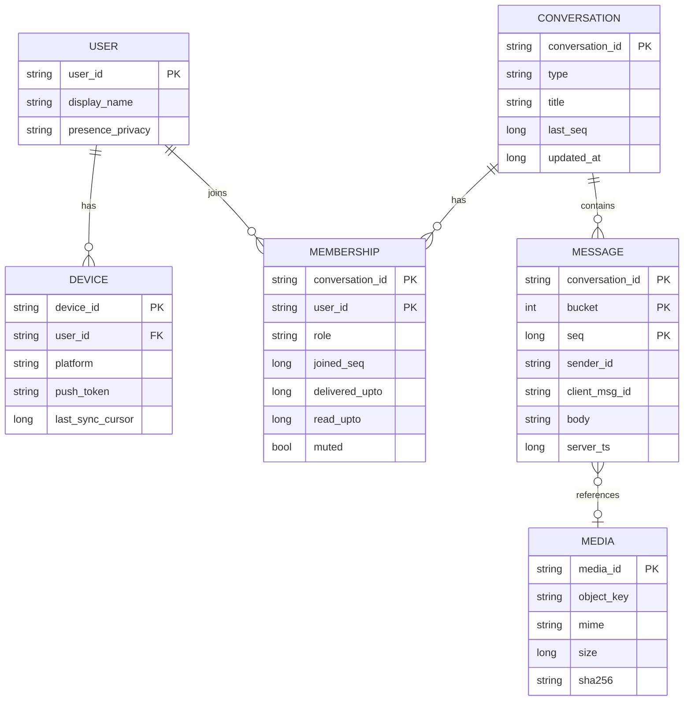
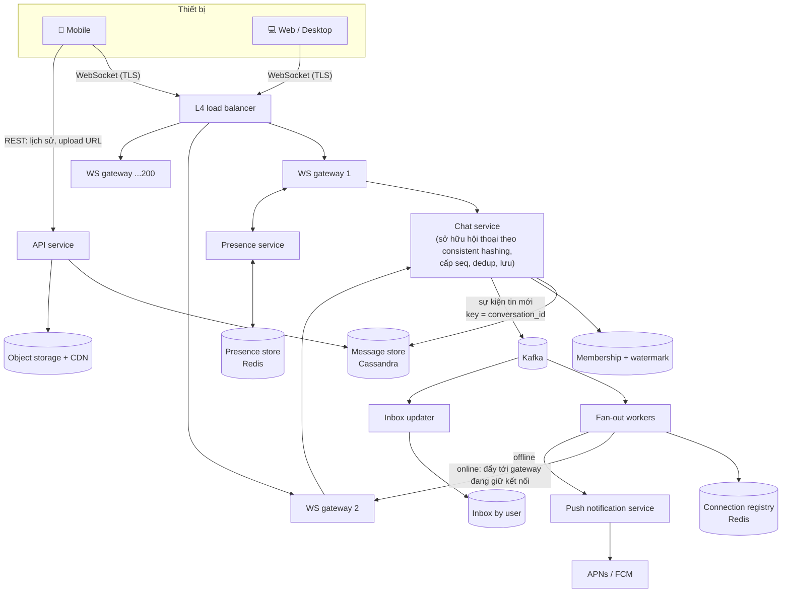
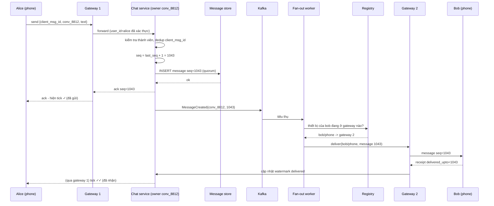
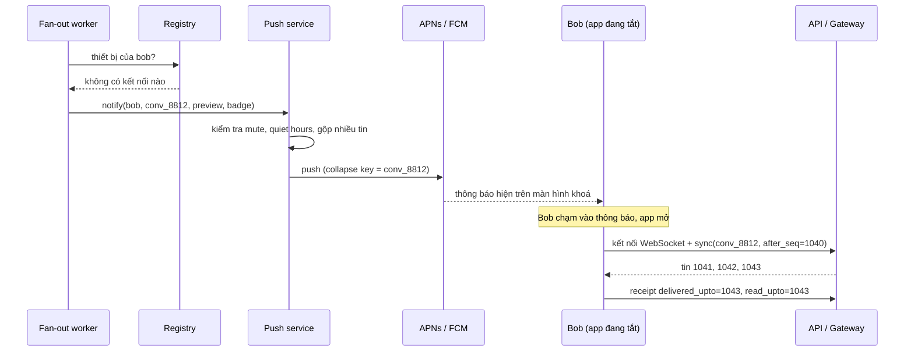
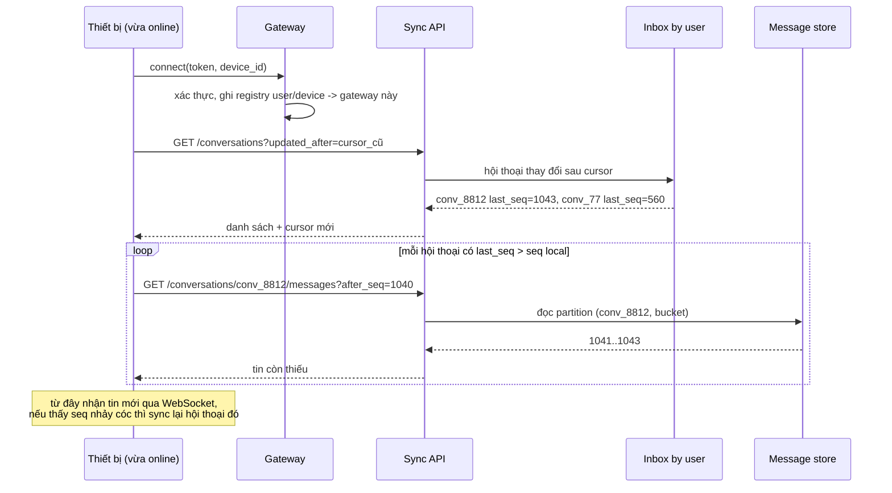
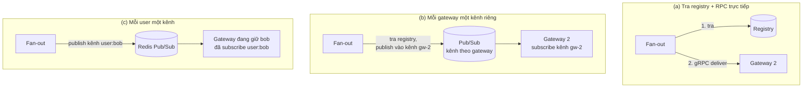
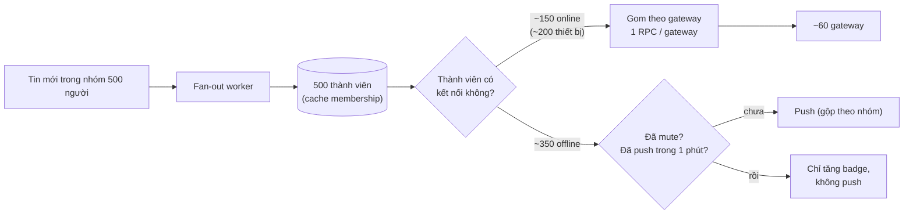
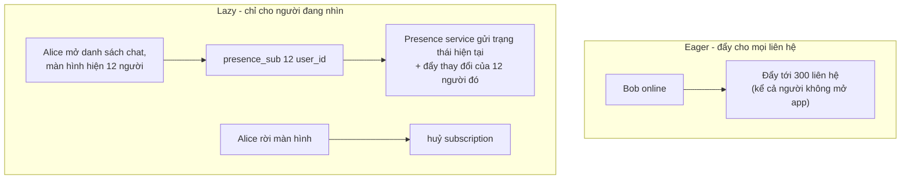
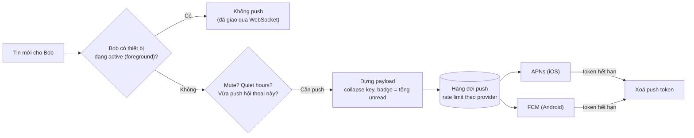
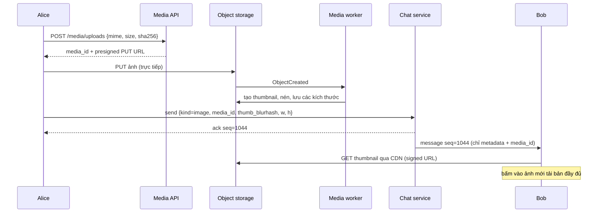

# 📚 Bài 8: Chat & presence

> "Tin nhắn là thứ duy nhất người dùng không bao giờ tha thứ nếu bị mất."

Bạn gửi cho mẹ một tin nhắn lúc đang trong thang máy: "Con về muộn, mẹ ăn trước nhé". Màn hình hiện một dấu tick xám. Ra khỏi thang máy, tick chuyển thành hai tick. Mười phút sau, hai tick xanh - mẹ đã đọc. Tối hôm đó bạn mở laptop, tin nhắn vẫn nằm đúng chỗ, đúng thứ tự, kèm dòng "đã xem".

Đằng sau trải nghiệm tưởng như đơn giản đó là hàng loạt bài toán khó:

- Hàng chục triệu **kết nối dài hạn** (WebSocket) phải được giữ mở cùng lúc - và server nào đang giữ kết nối của mẹ bạn?
- Tin nhắn gửi lúc mất sóng, gửi lại 3 lần - làm sao **không bị nhân đôi**?
- Nhóm gia đình 30 người, cả nhà cùng nhắn - làm sao mọi máy thấy **cùng một thứ tự**?
- Mẹ tắt app - ai đánh thức điện thoại của mẹ? Mẹ dùng cả điện thoại lẫn máy tính bảng - đọc trên máy này thì máy kia phải hết báo chưa đọc.
- Chấm xanh "đang hoạt động" của 300 người bạn - cập nhật cho bao nhiêu người, bao nhiêu lần mỗi giây?

[Case study chat ở backend/10 §16](../backend/10-system-design.md) đã phác thảo kiến trúc cơ bản. Bài này đi theo khung case study đầy đủ và đào sâu vào những phần thực sự khó: **định tuyến kết nối, thứ tự, đồng bộ đa thiết bị, fan-out nhóm, presence**.

## 🎯 Mục tiêu bài học

- Thiết kế hệ thống chat kiểu Zalo/Messenger/WhatsApp đầy đủ theo khung case study
- Thiết kế **WebSocket gateway fleet** và **connection registry** để định tuyến tin nhắn tới đúng server
- Đảm bảo **thứ tự theo hội thoại** bằng **sequence ID**, chống trùng bằng **client message ID**, phát hiện lỗ hổng và **đồng bộ offline** (kèm code)
- Thiết kế **delivery/read receipt** tiết kiệm (watermark thay vì từng tin)
- Chọn lưu trữ tin nhắn: **wide-column, partition theo hội thoại**
- Thiết kế **push notification** cho người dùng offline và **đồng bộ nhiều thiết bị**
- Tính được **chi phí fan-out của presence** và áp dụng **lazy presence**
- Biết giới hạn **fan-out nhóm**, cách gửi **media qua object storage**, và tổng quan **mã hoá đầu-cuối (E2E)**

!!! note "Kiến thức nền cần có"
    - [Bài 2 - Building blocks mạng](./02-building-blocks-network.md): WebSocket, load balancer L4/L7.
    - [Bài 5 - Messaging](./05-messaging-streaming.md): partition key, thứ tự, at-least-once + idempotency.
    - [Bài 6 - Lưu trữ chuyên dụng](./06-specialized-storage.md): wide-column (Cassandra), object storage, presigned URL.
    - [Bài 7 - Key-value store](./07-key-value-store.md): consistent hashing, quorum.

---

## 🧩 Tự thiết kế trước

> **Đề bài**: Thiết kế một ứng dụng nhắn tin kiểu Zalo/Messenger. Hỗ trợ chat 1-1 và nhóm, gửi ảnh/video, trạng thái đã gửi/đã nhận/đã xem, trạng thái online, nhận tin khi offline (push notification), dùng đồng thời trên điện thoại, web và desktop. Quy mô: hàng chục triệu người dùng hoạt động mỗi ngày.

Đặt đồng hồ **15-20 phút**. Viết ra: yêu cầu, ước lượng (tin/giây, dung lượng/năm, số kết nối đồng thời), giao thức client-server, data model, kiến trúc, luồng gửi tin khi người nhận online và offline, cách giữ thứ tự, cách làm presence. Sau đó đọc tiếp và tự chấm ở cuối bài.

<details markdown="1"><summary>Gợi ý nếu bị kẹt</summary>

- HTTP request-response không đủ để server **chủ động đẩy** tin tới client - cần kết nối hai chiều dài hạn.
- Kết nối nằm trên một server cụ thể → cần một nơi ghi nhớ "user X, thiết bị Y đang nối vào server nào".
- Thứ tự theo **thời gian của server** không đủ khi nhiều server cùng nhận tin cho một nhóm. Cần một bộ đếm **theo hội thoại**.
- Client mất mạng sẽ gửi lại → mỗi tin cần một ID do **client** sinh ra.
- Truy vấn chính là "50 tin gần nhất của hội thoại X" → partition theo hội thoại, sắp theo thứ tự tin.
- Presence: tính thử nếu mỗi lần ai đó online/offline phải báo cho toàn bộ danh bạ.

</details>

---

## 📖 1. Làm rõ yêu cầu

> **Ứng viên**: Chat nhóm tối đa bao nhiêu người? Có loại "kênh" hàng trăm nghìn người theo dõi không?
>
> **Interviewer**: Nhóm tối đa 500 thành viên. Kênh broadcast lớn không nằm trong phạm vi lần này, nhưng có thể sẽ hỏi.
>
> **Ứng viên**: Một người dùng có thể đăng nhập bao nhiêu thiết bị cùng lúc?
>
> **Interviewer**: Một điện thoại chính và tối đa 4 thiết bị phụ (web, desktop, tablet). Tất cả phải thấy đủ lịch sử và trạng thái đọc đồng bộ.
>
> **Ứng viên**: Lịch sử tin nhắn giữ bao lâu? Server có được đọc nội dung không, hay mã hoá đầu-cuối?
>
> **Interviewer**: Giữ vĩnh viễn trên server để đồng bộ thiết bị mới. Ban đầu chưa E2E, nhưng hãy nói ảnh hưởng nếu bật E2E.
>
> **Ứng viên**: Thứ tự tin cần đúng tới mức nào?
>
> **Interviewer**: Mọi thành viên trong một hội thoại phải thấy **cùng một thứ tự**. Giữa hai hội thoại khác nhau thì không quan trọng.
>
> **Ứng viên**: Có cần tìm kiếm trong lịch sử, gọi thoại/video, story không?
>
> **Interviewer**: Không, ngoài phạm vi.

**Yêu cầu chức năng**

- Chat 1-1 và nhóm (≤ 500 thành viên); tin văn bản, ảnh, video, file.
- Trạng thái tin: **đã gửi** (server đã lưu), **đã nhận** (tới ít nhất một thiết bị người nhận), **đã xem**.
- Danh sách hội thoại với số tin chưa đọc và tin cuối.
- Typing indicator ("đang soạn tin...").
- Presence: online / "hoạt động X phút trước".
- Người nhận offline: lưu tin, gửi **push notification**, đồng bộ khi mở app.
- Đa thiết bị: mọi thiết bị nhận tin, trạng thái đã đọc đồng bộ giữa các thiết bị.

**Yêu cầu phi chức năng**

| Thuộc tính | Mục tiêu |
|---|---|
| Độ trễ gửi → nhận (cả hai online, cùng region) | p99 < 500 ms |
| Độ bền | Tin đã hiện "đã gửi" **không bao giờ mất** |
| Thứ tự | Nhất quán trong từng hội thoại cho mọi thành viên, mọi thiết bị |
| Trùng lặp | Người dùng không bao giờ thấy một tin hai lần |
| Availability | 99,99% cho gửi/nhận tin |
| Quy mô | 50 triệu DAU (giả định luyện tập), tăng trưởng ×2 trong 2 năm |

**Ngoài phạm vi**: tìm kiếm lịch sử, gọi thoại/video, story, bot, kênh broadcast lớn (sẽ bàn ở phần biến thể).

---

## 📖 2. Ước lượng

Mọi con số là **ước tính để luyện tập**, không phải số liệu của Zalo/Messenger/WhatsApp.

**Giả định**: 50 triệu DAU; mỗi người gửi 40 tin/ngày; giờ cao điểm gấp 4 lần trung bình; mỗi tin trung bình được giao tới 3 thiết bị (người nhận + các thiết bị khác của người gửi + thành viên nhóm); 40% DAU online cùng lúc lúc cao điểm, mỗi người trung bình 1,3 kết nối; 5% tin có media, trung bình 300 KB.

| Hạng mục | Phép tính | Kết quả |
|---|---|---|
| Tin/ngày | 50M × 40 | **2 tỷ** |
| Tin/giây trung bình | 2 × 10⁹ / 86.400 | ~23.000/s |
| Tin/giây cao điểm | × 4 | **~93.000/s** (làm tròn 100.000) |
| Lượt giao tới thiết bị (peak) | 100.000 × 3 | **~300.000/s** |
| Dung lượng text/ngày (200 B/tin gồm metadata) | 2 × 10⁹ × 200 B | 400 GB/ngày |
| Text/năm | 400 GB × 365 | **~146 TB** (× 3 replica = ~438 TB đĩa) |
| Media/ngày | 2 × 10⁹ × 5% × 300 KB | **~30 TB/ngày** → ~11 PB/năm |
| Kết nối đồng thời | 50M × 40% × 1,3 | **~26 triệu** WebSocket |
| Số gateway (giả định 200.000 kết nối/server) | 26M / 200k | ~130 server; triển khai **~200** để dư cho mất zone và reconnect storm |
| Heartbeat (mỗi 30 s/kết nối) | 26M / 30 | **~870.000/s** - phải xử lý **tại gateway**, không đẩy về service trung tâm |
| Presence fan-out ngây thơ (10 lần đổi trạng thái/người/ngày, 200 liên hệ) | 50M × 10 × 200 / 86.400 | **~1,16 triệu sự kiện/s** - quá đắt (xem §7.4) |

Nhận xét:

- **Media lớn hơn text gần 75 lần** → media phải đi object storage + CDN, không đi qua đường tin nhắn ([Bài 6](./06-specialized-storage.md)).
- Text 146 TB/năm, ghi nhiều, đọc theo hội thoại và thời gian → **wide-column** hợp lý.
- 26 triệu kết nối là bài toán **stateful** - không thể "cứ thêm server stateless".
- Heartbeat và presence là nguồn tải **lớn hơn cả tin nhắn** nếu thiết kế ngây thơ.

---

## 📖 3. Thiết kế API

Hai kênh giao tiếp:

1. **WebSocket** (hoặc MQTT/giao thức nhị phân riêng trên TCP) cho mọi thứ thời gian thực: gửi/nhận tin, receipt, typing, presence.
2. **HTTPS REST** cho thao tác không cần thời gian thực: lấy lịch sử, danh sách hội thoại, xin URL upload media, đăng ký push token.

### 3.1 Các frame WebSocket

Client → server, gửi tin:

```json
{ "type": "send", "client_msg_id": "c7f1e2a0-5b1d-4f0e-9d5e-2f3a1b4c5d6e",
  "conversation_id": "conv_8812", "body": { "kind": "text", "text": "Con về muộn, mẹ ăn trước nhé" } }
```

Server → client người gửi, xác nhận đã lưu (tick ✓):

```json
{ "type": "ack", "client_msg_id": "c7f1e2a0-5b1d-4f0e-9d5e-2f3a1b4c5d6e",
  "conversation_id": "conv_8812", "seq": 1043, "server_ts": 1793170800123 }
```

Server → thiết bị người nhận:

```json
{ "type": "message", "conversation_id": "conv_8812", "seq": 1043,
  "sender_id": "u_17", "client_msg_id": "c7f1e2a0-...", "server_ts": 1793170800123,
  "body": { "kind": "text", "text": "Con về muộn, mẹ ăn trước nhé" } }
```

Thiết bị người nhận → server, receipt dạng **watermark** (đã nhận / đã đọc **tới** seq này):

```json
{ "type": "receipt", "conversation_id": "conv_8812", "delivered_upto": 1043 }
{ "type": "receipt", "conversation_id": "conv_8812", "read_upto": 1043 }
```

Typing và presence (tạm thời, không lưu):

```json
{ "type": "typing", "conversation_id": "conv_8812", "state": "start" }
{ "type": "presence_sub", "user_ids": ["u_17", "u_90"] }
{ "type": "presence", "user_id": "u_17", "status": "online" }
```

### 3.2 REST endpoints

| Method | Endpoint | Mục đích |
|---|---|---|
| `GET` | `/v1/conversations?updated_after=<cursor>` | Danh sách hội thoại thay đổi kể từ cursor (tin cuối, unread, read watermark) |
| `GET` | `/v1/conversations/{id}/messages?after_seq=1040&limit=100` | Đồng bộ tin còn thiếu (đi tới) |
| `GET` | `/v1/conversations/{id}/messages?before_seq=1000&limit=50` | Cuộn lên xem lịch sử (đi lùi) |
| `POST` | `/v1/conversations` | Tạo nhóm `{ "members": [...], "title": "..." }` |
| `POST` | `/v1/media/uploads` | Xin presigned URL `{ "mime": "image/jpeg", "size": 2400000 }` |
| `PUT` | `/v1/devices/{device_id}/push-token` | Đăng ký token APNs/FCM |

!!! tip "Gửi tin qua WebSocket hay REST?"
    Cả hai đều được. Gửi qua WebSocket nhanh hơn (kết nối sẵn), nhưng nhiều hệ thống cho phép **REST làm phương án dự phòng** khi WebSocket chưa nối xong. Điều quan trọng là **cùng một `client_msg_id`** dù gửi qua đường nào - server loại trùng theo nó.

---

## 📖 4. Mô hình dữ liệu và lựa chọn lưu trữ



### 4.1 Bảng tin nhắn (wide-column)

```sql
CREATE TABLE messages (
    conversation_id text,
    bucket          int,          -- seq / 10000: mỗi bucket tối đa 10.000 tin
    seq             bigint,
    sender_id       text,
    client_msg_id   uuid,
    kind            text,         -- text | image | video | file | system
    body            text,         -- văn bản, hoặc JSON {media_id, w, h, thumb}
    server_ts       timestamp,
    PRIMARY KEY ((conversation_id, bucket), seq)
) WITH CLUSTERING ORDER BY (seq DESC);
```

Vì sao thiết kế như vậy (nguyên tắc mô hình hoá ở [Bài 6 §5](./06-specialized-storage.md)):

- Truy vấn chính "N tin mới nhất / tin sau seq X của hội thoại" → **một partition, đọc tuần tự**.
- **Bucket theo seq** thay vì theo tháng: hội thoại im lặng không sinh partition rỗng; nhóm cực sôi nổi cũng không vượt ~10.000 tin × 200 B = 2 MB mỗi partition. Client biết seq nên tính ra bucket ngay, không phải dò.
- Ghi chỉ là **append** - không có update tại chỗ (thu hồi/sửa tin = ghi một tin `system` mới tham chiếu seq cũ) → không tạo tombstone hàng loạt.

### 4.2 Các kho khác

| Dữ liệu | Kho | Lý do |
|---|---|---|
| Tin nhắn | Cassandra / ScyllaDB (hoặc HBase) | Ghi rất nhiều, partition theo hội thoại, scale ngang |
| Membership + watermark đã nhận/đã đọc | Wide-column hoặc SQL đã shard theo `conversation_id` | Đọc khi fan-out, cập nhật watermark thường xuyên |
| Danh sách hội thoại của user (inbox) | Wide-column `inbox_by_user (user_id, updated_at DESC, conversation_id)` | "Mở app → hiện 20 hội thoại gần nhất" |
| Bộ đếm `seq` mỗi hội thoại | Chat service sở hữu hội thoại (§7.2), lưu bền trong bảng `conversations` | Thứ tự |
| Connection registry | Redis Cluster (có TTL) | Tra cứu dưới mili-giây, dữ liệu tạm |
| Presence, typing | Redis / bộ nhớ của presence service | Tạm thời, mất được |
| Dedup `client_msg_id` | Redis TTL 24h + kiểm tra trong bảng messages khi cần | Chống gửi lại |
| Media | Object storage + CDN | 30 TB/ngày |
| User, thiết bị, push token | SQL | Ít thay đổi, cần ràng buộc |

---

## 📖 5. Kiến trúc tổng thể



Vai trò từng thành phần:

- **WS gateway**: chỉ giữ kết nối, xác thực, đóng/mở gói tin, heartbeat. **Không có logic nghiệp vụ** - để deploy logic chat không phải ngắt 26 triệu kết nối.
- **Chat service**: mỗi hội thoại có một instance **sở hữu** (định tuyến bằng consistent hashing theo `conversation_id`) → cấp `seq` tuần tự không tranh chấp, kiểm tra quyền thành viên, loại trùng, lưu tin, phát sự kiện.
- **Kafka**: tách đường **lưu** (đồng bộ, phải xong trước khi ack) khỏi đường **phát** (fan-out, push, cập nhật inbox) - partition theo `conversation_id` giữ thứ tự ([Bài 5](./05-messaging-streaming.md)).
- **Fan-out workers**: tra thành viên, tra registry, đẩy tới gateway hoặc gửi push.

### 5.1 Luồng gửi tin - người nhận đang online



Điểm mấu chốt: **chỉ ack cho người gửi sau khi tin đã lưu bền** (quorum ghi trên message store). Fan-out xảy ra **sau** ack và có thể thất bại/retry - không sao, vì tin đã an toàn và người nhận luôn có thể đồng bộ lại.

### 5.2 Luồng gửi tin - người nhận offline



Push notification **chỉ là lời nhắc**, không phải kênh giao tin: nó có thể bị trễ, bị gộp, bị hệ điều hành bỏ. Nguồn sự thật luôn là **sync** từ server khi app mở.

### 5.3 Luồng đồng bộ khi kết nối lại



---

## 📖 6. Danh sách deep dive

Phần khó nhất của bài này - chọn 2-4 phần để đào sâu trong phỏng vấn:

1. **WebSocket gateway & định tuyến kết nối** (§7.1)
2. **Thứ tự, chống trùng, receipt và đồng bộ** (§7.2)
3. **Fan-out nhóm** (§7.3)
4. **Presence** (§7.4)
5. **Đa thiết bị & push notification** (§7.5)
6. **Media và E2E encryption** (§7.6)

---

## 📖 7. Deep dives

### 7.1 WebSocket gateway fleet và connection registry

**Vì sao khó?** HTTP stateless: request nào tới server nào cũng được. WebSocket thì **stateful**: kết nối của Bob nằm cố định trên gateway 2 cho tới khi đứt. Muốn gửi tin cho Bob, hệ thống phải biết **"gateway 2"**.

**Connection registry** lưu ánh xạ:

```
conn:{user_id}  ->  HASH { device_id: "gw-2|epoch-17", device_id_2: "gw-41|epoch-9" }   TTL làm mới định kỳ
```

- Khi kết nối mở: gateway ghi `HSET conn:bob phone gw-2|...`.
- Khi đóng: gateway xoá field đó.
- Gateway chết đột ngột: không ai kịp xoá → các entry "ma". Cách xử lý: mỗi gateway có một **khoá sống** `gw:alive:gw-2` với TTL ngắn (vd 15 s) được làm mới liên tục; fan-out thấy entry trỏ tới gateway không còn sống thì coi như offline. Hoặc TTL theo từng entry, gateway làm mới theo lô.

**Ba cách đưa tin từ fan-out tới đúng gateway:**



| Phương án | Ưu | Nhược | Hợp với |
|---|---|---|---|
| (a) Registry + RPC trực tiếp | Đơn giản, độ trễ thấp, dễ biết giao thành công hay không | Fan-out phải giữ kết nối tới ~200 gateway | Mặc định tốt |
| (b) Kênh theo gateway | Gateway không cần mở cổng RPC; bus đệm khi gateway chậm | Thêm một hop; vẫn cần registry | Khi đã có bus nội bộ mạnh |
| (c) Kênh theo user | Không cần registry - bus tự định tuyến | Số kênh = số user online (hàng chục triệu subscription); Redis Pub/Sub không lưu tin - mất nếu gateway đang reconnect | Quy mô nhỏ/vừa |

**Vận hành gateway - những điều dễ bị bỏ qua:**

- **L4 load balancer** (TCP) thay vì L7 nếu có thể - L7 phải giữ thêm một kết nối cho mỗi client.
- **Heartbeat** (ping/pong mỗi 20-60 s) để phát hiện kết nối chết và giữ NAT/firewall không cắt kết nối im lặng. Xử lý **ngay trong gateway**, không gửi về service khác (870.000 heartbeat/s ở §2).
- **Deploy gateway = ngắt kết nối**. Rút dần (drain): ngừng nhận kết nối mới, gửi frame "reconnect" cho client theo từng đợt nhỏ, chờ client chuyển đi.
- **Reconnect storm**: một gateway 200.000 kết nối chết → 200.000 client nối lại cùng lúc, mỗi client lại gọi sync. Client phải **backoff có jitter** (ngẫu nhiên 0-30 s), và sync phải nhẹ (chỉ hỏi hội thoại thay đổi kể từ cursor).
- **Giới hạn mỗi gateway**: bộ nhớ cho buffer TLS và WebSocket (vài chục KB/kết nối), file descriptor, CPU cho TLS handshake (đắt nhất lúc reconnect storm).

### 7.2 Thứ tự, chống trùng, receipt và đồng bộ

**Vì sao không dùng timestamp để sắp xếp?** Hai người trong nhóm gửi gần như cùng lúc, tin tới hai server khác nhau có đồng hồ lệch vài chục mili-giây → hai thiết bị có thể sắp khác nhau. Và timestamp không cho biết **có thiếu tin nào không**.

**Sequence ID theo hội thoại**: mỗi hội thoại có bộ đếm `seq` tăng dần **liên tục** (1, 2, 3, ...). Lợi ích:

1. Mọi thiết bị sắp theo `seq` → **cùng thứ tự** tuyệt đối.
2. Thấy seq 1043 trong khi local mới có 1040 → **biết chắc thiếu 1041, 1042** → gọi sync.
3. Đồng bộ chỉ cần một con số: "cho tôi mọi tin sau seq X".
4. Receipt chỉ cần một con số: "đã đọc tới seq X".

**Ai cấp seq?**

| Cách | Ưu | Nhược |
|---|---|---|
| `UPDATE conversations SET last_seq = last_seq + 1 RETURNING` trong DB có transaction | Đơn giản, đúng | Mỗi tin một transaction trên hàng nóng; nhóm sôi nổi tạo tranh chấp khoá |
| Redis `INCR seq:{conv}` | Rất nhanh | Redis failover có thể mất vài lần INCR → **cấp trùng seq**; cần kiểm tra khi ghi (ghi có điều kiện "chưa tồn tại") |
| **Single owner**: mỗi hội thoại thuộc một instance chat service (consistent hashing), counter trong RAM, lưu bền cùng tin | Không tranh chấp, nhanh, thứ tự tự nhiên | Khi đổi owner (deploy, node chết) phải **khôi phục** counter (đọc `max(seq)`) và **chặn owner cũ** (lease + epoch/fencing token) để tránh hai owner cấp cùng seq |
| Snowflake / ID theo thời gian ([backend/10 §13](../backend/10-system-design.md)) | Không cần điều phối | Không liên tục → không phát hiện được lỗ; thứ tự chỉ gần đúng |

Thiết kế này chọn **single owner** cho quy mô lớn (lùi về transaction DB khi quy mô nhỏ). Bảo vệ bổ sung: ghi tin với điều kiện `IF NOT EXISTS` trên khoá `(conversation_id, bucket, seq)` - nếu lỡ có hai owner, owner cũ sẽ bị từ chối.

**Chống trùng bằng `client_msg_id`**: client sinh UUID **trước khi gửi**, lưu cục bộ cùng tin ở trạng thái "đang gửi". Mất mạng → gửi lại **cùng ID**. Server tra `dedup:{conv}:{client_msg_id}` → nếu đã có, trả lại **ack cũ** (cùng seq) thay vì tạo tin mới. Đây chính là idempotency key ([backend/10 §12](../backend/10-system-design.md)).

**Receipt bằng watermark**: thay vì lưu "Bob đã đọc tin 1041", "Bob đã đọc tin 1042"... (mỗi tin × mỗi thành viên một hàng - nhóm 500 người là 500 hàng/tin), chỉ lưu **một con số mỗi thành viên mỗi hội thoại**: `read_upto = 1043` - mọi tin có seq ≤ 1043 coi như đã đọc. Hiển thị "đã xem" của một tin = có thành viên nào có `read_upto ≥ seq` không; "đã xem bởi 37 người" = đếm thành viên có `read_upto ≥ seq`.

Demo nhỏ - server cấp seq và loại trùng, client phát hiện lỗ và đồng bộ:

=== "Go"

    ```go
    package main

    import "fmt"

    type Msg struct {
    	Seq         int
    	Sender      string
    	ClientMsgID string
    	Text        string
    }

    // Server: mỗi conversation có bộ đếm seq riêng + bảng chống trùng client_msg_id
    type Conversation struct {
    	msgs  []Msg
    	dedup map[string]int // client_msg_id -> seq
    }

    func (c *Conversation) Send(sender, cid, text string) (int, bool) {
    	if seq, ok := c.dedup[cid]; ok {
    		return seq, true // retry: trả lại seq cũ, KHÔNG tạo tin mới
    	}
    	seq := len(c.msgs) + 1
    	c.msgs = append(c.msgs, Msg{seq, sender, cid, text})
    	c.dedup[cid] = seq
    	return seq, false
    }

    func (c *Conversation) Sync(afterSeq int) []Msg { return c.msgs[afterSeq:] }

    // Client: nhớ last_seq đã áp dụng, phát hiện "lỗ" thì gọi Sync
    type Device struct {
    	name    string
    	lastSeq int
    	conv    *Conversation
    }

    func (d *Device) OnPush(m Msg) {
    	switch {
    	case m.Seq <= d.lastSeq:
    		fmt.Printf("[%s] bỏ qua seq=%d (đã có)\n", d.name, m.Seq)
    	case m.Seq == d.lastSeq+1:
    		d.apply(m)
    	default:
    		fmt.Printf("[%s] nhận seq=%d nhưng đang chờ seq=%d -> GAP, gọi sync(after=%d)\n",
    			d.name, m.Seq, d.lastSeq+1, d.lastSeq)
    		for _, x := range d.conv.Sync(d.lastSeq) {
    			d.apply(x)
    		}
    	}
    }

    func (d *Device) apply(m Msg) {
    	d.lastSeq = m.Seq
    	fmt.Printf("[%s] hiển thị seq=%d %s: %s\n", d.name, m.Seq, m.Sender, m.Text)
    }

    func main() {
    	conv := &Conversation{dedup: map[string]int{}}
    	bob := &Device{name: "bob-phone", conv: conv}

    	s, _ := conv.Send("alice", "a-1", "chào Bob")
    	bob.OnPush(conv.msgs[s-1])
    	s, dup := conv.Send("alice", "a-1", "chào Bob") // client retry vì timeout
    	fmt.Printf("retry a-1 -> seq=%d duplicate=%v\n", s, dup)
    	s, _ = conv.Send("bob", "b-1", "hi Alice")
    	bob.OnPush(conv.msgs[s-1])

    	fmt.Println("--- bob-phone mất sóng ---")
    	conv.Send("alice", "a-2", "tối nay rảnh không?")
    	conv.Send("alice", "a-3", "đi cafe nhé")
    	s, _ = conv.Send("alice", "a-4", "7h nha")
    	fmt.Println("--- bob-phone online lại, push tin mới nhất tới trước ---")
    	bob.OnPush(conv.msgs[s-1])
    	bob.OnPush(conv.msgs[s-1]) // push trùng lặp (at-least-once)
    }
    ```

=== "Python"

    ```python
    from dataclasses import dataclass, field

    @dataclass
    class Msg:
        seq: int
        sender: str
        client_msg_id: str
        text: str

    @dataclass
    class Conversation:
        """Server: mỗi conversation có bộ đếm seq riêng + bảng chống trùng client_msg_id."""
        msgs: list[Msg] = field(default_factory=list)
        dedup: dict[str, int] = field(default_factory=dict)

        def send(self, sender: str, cid: str, text: str) -> tuple[int, bool]:
            if cid in self.dedup:
                return self.dedup[cid], True     # retry: trả lại seq cũ
            seq = len(self.msgs) + 1
            self.msgs.append(Msg(seq, sender, cid, text))
            self.dedup[cid] = seq
            return seq, False

        def sync(self, after_seq: int) -> list[Msg]:
            return self.msgs[after_seq:]

    @dataclass
    class Device:
        """Client: nhớ last_seq đã áp dụng, phát hiện 'lỗ' thì gọi sync."""
        name: str
        conv: Conversation
        last_seq: int = 0

        def on_push(self, m: Msg) -> None:
            if m.seq <= self.last_seq:
                print(f"[{self.name}] bỏ qua seq={m.seq} (đã có)")
            elif m.seq == self.last_seq + 1:
                self.apply(m)
            else:
                print(f"[{self.name}] nhận seq={m.seq} nhưng đang chờ seq={self.last_seq + 1} "
                      f"-> GAP, gọi sync(after={self.last_seq})")
                for x in self.conv.sync(self.last_seq):
                    self.apply(x)

        def apply(self, m: Msg) -> None:
            self.last_seq = m.seq
            print(f"[{self.name}] hiển thị seq={m.seq} {m.sender}: {m.text}")

    conv = Conversation()
    bob = Device("bob-phone", conv)

    s, _ = conv.send("alice", "a-1", "chào Bob")
    bob.on_push(conv.msgs[s - 1])
    s, dup = conv.send("alice", "a-1", "chào Bob")   # client retry vì timeout
    print(f"retry a-1 -> seq={s} duplicate={str(dup).lower()}")
    s, _ = conv.send("bob", "b-1", "hi Alice")
    bob.on_push(conv.msgs[s - 1])

    print("--- bob-phone mất sóng ---")
    conv.send("alice", "a-2", "tối nay rảnh không?")
    conv.send("alice", "a-3", "đi cafe nhé")
    s, _ = conv.send("alice", "a-4", "7h nha")
    print("--- bob-phone online lại, push tin mới nhất tới trước ---")
    bob.on_push(conv.msgs[s - 1])
    bob.on_push(conv.msgs[s - 1])   # push trùng lặp (at-least-once)
    ```

Output (Go và Python giống hệt nhau):

```
[bob-phone] hiển thị seq=1 alice: chào Bob
retry a-1 -> seq=1 duplicate=true
[bob-phone] hiển thị seq=2 bob: hi Alice
--- bob-phone mất sóng ---
--- bob-phone online lại, push tin mới nhất tới trước ---
[bob-phone] nhận seq=5 nhưng đang chờ seq=3 -> GAP, gọi sync(after=2)
[bob-phone] hiển thị seq=3 alice: tối nay rảnh không?
[bob-phone] hiển thị seq=4 alice: đi cafe nhé
[bob-phone] hiển thị seq=5 alice: 7h nha
[bob-phone] bỏ qua seq=5 (đã có)
```

Ba cơ chế cùng làm việc trong output trên:

- **Retry `a-1`** trả lại `seq=1` - không có tin "chào Bob" thứ hai.
- **Lỗ hổng**: thiết bị nhận seq 5 khi đang chờ seq 3 → không hiển thị lộn xộn mà **đồng bộ** 3, 4, 5 theo đúng thứ tự.
- **Push trùng** (giao at-least-once từ fan-out) bị bỏ qua nhờ `seq <= last_seq`.

**Tin của chính mình hiển thị ngay**: client không chờ server - hiển thị tin ở trạng thái "đang gửi" ở cuối danh sách (sắp theo thời gian local), khi nhận `ack` mới gán `seq` và đặt vào đúng vị trí. Nếu trong lúc đó có tin của người khác được cấp seq nhỏ hơn, tin của mình có thể "nhảy" lên trên - đó là hành vi bình thường của mọi ứng dụng chat.

### 7.3 Fan-out nhóm

Một tin trong nhóm 500 người: lưu thế nào, giao thế nào?

**Lưu: một bản cho mỗi hội thoại** (write once). Tin lưu **một lần** trong partition của hội thoại; mỗi thành viên chỉ có **con trỏ** (`inbox_by_user` cập nhật `last_seq`, unread). Khác với news feed ([Bài 9](./09-news-feed.md)), chat không cần sao chép nội dung cho từng người vì mọi thành viên đọc **cùng một dòng thời gian**.

(Ngoại lệ: hệ thống **E2E** phải mã hoá riêng cho từng thiết bị nhận - xem §7.6 - nên về bản chất là fan-out khi ghi.)

**Giao: fan-out khi có tin** tới các thành viên **đang online**, push cho người offline.



Tối ưu quan trọng:

- **Gom theo gateway**: 200 thiết bị online rải trên 60 gateway → 60 RPC, mỗi RPC mang danh sách thiết bị, thay vì 200 RPC.
- **Cache membership** của nhóm trong fan-out worker (vô hiệu hoá khi thành viên đổi).
- **Push có điều tiết**: nhóm sôi nổi 100 tin/phút không được tạo 100 push cho mỗi người - gộp ("12 tin mới trong Nhóm gia đình"), tôn trọng mute.
- **Typing indicator** trong nhóm lớn: chỉ gửi cho thành viên **đang mở** hội thoại đó, có throttle (tối đa 1 sự kiện / 3 s / người gõ).

**Chi phí và giới hạn**: mỗi tin trong nhóm N người tạo O(N) lượt giao. Với 100.000 tin/s, nếu trung bình nhóm 50 người và 30% online → 1,5 triệu lượt giao/s. Đây là lý do **mọi ứng dụng chat đều giới hạn kích thước nhóm** (vài trăm tới vài nghìn) và có **mô hình riêng cho kênh lớn**:

| | Nhóm chat (≤ vài trăm - vài nghìn) | Kênh / cộng đồng lớn (hàng trăm nghìn+) |
|---|---|---|
| Ai gửi | Mọi thành viên | Chủ yếu admin |
| Giao | Push tới mọi thiết bị online | **Pull**: client mở kênh mới tải; chỉ báo "có tin mới" thưa |
| Receipt | Theo từng thành viên | Chỉ đếm lượt xem (gần đúng) |
| Typing / presence | Có | Không |
| Push notification | Theo từng người | Rất hạn chế, chỉ khi người dùng bật |

### 7.4 Presence

**Presence** = trạng thái online/offline/"hoạt động X phút trước". Nghe nhỏ, nhưng §2 đã cho thấy cách làm ngây thơ tạo **~1,16 triệu sự kiện/s** - lớn hơn cả lưu lượng tin nhắn.

**Xác định ai online**: tận dụng kết nối WebSocket sẵn có.

- Kết nối mở → online. Kết nối đóng có chủ đích → offline, ghi `last_seen = now`.
- Kết nối chết im lặng (mất sóng) → không nhận heartbeat trong 2-3 chu kỳ → gateway đóng kết nối → offline.
- **Không** gửi mỗi heartbeat tới presence service. Gateway chỉ báo **chuyển trạng thái** (online → offline, offline → online), và làm mới TTL theo lô.
- **Chống nhấp nháy** (flapping): điện thoại vào thang máy mất kết nối 10 giây rồi có lại - không nên báo "offline" rồi "online". Hoãn thông báo offline 20-60 giây; nếu kết nối lại trong khoảng đó thì không có gì xảy ra.

**Lưu trữ**: `presence:{user_id} = {status, last_seen, devices}` trong Redis với TTL; status online nếu còn ít nhất một thiết bị kết nối.

**Phân phối - phần đắt nhất**: ai cần biết Bob vừa online?



| Chiến lược | Chi phí | Độ tươi | Ghi chú |
|---|---|---|---|
| **Eager fan-out** tới mọi liên hệ | O(số liên hệ) mỗi lần đổi trạng thái | Tức thì | Chỉ ổn khi danh bạ nhỏ (vài chục) |
| **Lazy / subscribe theo màn hình** | O(số người đang xem) | Tức thì cho người đang xem | Mặc định hợp lý cho quy mô lớn |
| **Pull khi mở hội thoại** | Một lần đọc | Đúng lúc mở | Bổ sung cho lazy |
| **Batch theo chu kỳ** (gom thay đổi mỗi 5-10 s) | Giảm nhiều lần | Trễ vài giây | Kết hợp với lazy |
| **Làm thô thông tin** ("hoạt động gần đây" thay vì phút chính xác) | Ít cập nhật hơn | Thấp | Cũng tốt cho **quyền riêng tư** |

Ước lượng lại với lazy: giả sử mỗi lần Bob đổi trạng thái chỉ có trung bình 5 người đang có Bob trên màn hình → 50M × 10 × 5 / 86.400 ≈ **29.000 sự kiện/s** - giảm **40 lần** so với eager. Giá phải trả: presence service phải quản lý **subscription** (ai đang theo dõi ai), thường shard theo `user_id` được theo dõi.

!!! tip "Presence là dữ liệu 'mất được'"
    Presence không cần độ bền: Redis chết thì mọi người tạm thời hiện "offline", các gateway gửi lại trạng thái trong vài giây. Đừng dùng quorum, đừng lưu Cassandra cho presence. Tương tự cho **typing indicator** - chỉ chuyển tiếp, không lưu.

### 7.5 Đa thiết bị và push notification

**Mỗi thiết bị là một người nhận độc lập** với con trỏ đồng bộ riêng:

- Registry lưu theo `(user_id, device_id)`; fan-out giao tới **mọi** thiết bị online của người nhận **và** các thiết bị **khác** của người gửi (để tin mình gửi từ điện thoại hiện trên laptop).
- Mỗi thiết bị lưu `last_seq` cho từng hội thoại và một **cursor** cho danh sách hội thoại.

**Đồng bộ hiệu quả nhiều hội thoại**: người dùng có 800 hội thoại, offline 2 ngày. Hỏi từng hội thoại "có gì mới không" là 800 request. Giải pháp: **inbox / change log theo user** - mỗi khi một hội thoại của user thay đổi (tin mới, đọc trên thiết bị khác, đổi tên nhóm), ghi một mục vào dòng thay đổi của user với một **cursor tăng dần theo user**. Thiết bị chỉ hỏi "thay đổi sau cursor 88123" → nhận danh sách ngắn các hội thoại cần đồng bộ (§5.3).

**Trạng thái đã đọc đồng bộ giữa thiết bị**: Bob đọc trên điện thoại → `read_upto = 1043` → sự kiện "read state changed" giao tới laptop của Bob → laptop xoá badge. Cùng cơ chế với tin nhắn, chỉ khác loại sự kiện.

**Thiết bị mới đăng nhập**: không tải toàn bộ lịch sử - tải danh sách hội thoại + N tin gần nhất mỗi hội thoại, phần còn lại tải lười khi cuộn lên.

**Push notification**:



- **Không push khi đang dùng** trên thiết bị khác (ai đang gõ trên laptop không muốn điện thoại rung liên tục) - nhưng vẫn tăng badge.
- **Collapse key** theo hội thoại: 10 tin liên tiếp → hệ điều hành chỉ giữ thông báo mới nhất.
- **Badge** = tổng unread, tính từ watermark (`last_seq - read_upto` của từng hội thoại, cộng lại) - phải nhất quán với số hiển thị trong app.
- Push provider có **rate limit** và có thể trả lỗi token không hợp lệ → hàng đợi, retry có backoff, dọn token chết.
- Payload có giới hạn kích thước và đi qua hạ tầng bên thứ ba → với E2E, push chỉ mang tín hiệu "có tin mới", app tự tải và giải mã.

### 7.6 Media và mã hoá đầu-cuối (E2E)

**Media**: không bao giờ gửi byte ảnh/video qua WebSocket hay qua chat service.



- Tin nhắn chỉ mang **tham chiếu** (`media_id`) + metadata nhỏ (kích thước, placeholder mờ) để hiển thị khung ngay.
- **Dedup** theo hash nội dung: ảnh được chuyển tiếp 10.000 lần chỉ lưu một bản (không áp dụng được khi E2E - mỗi lần mã hoá khác nhau).
- Truy cập qua **signed URL** ngắn hạn, kiểm tra quyền thành viên hội thoại khi cấp URL.
- Lifecycle: bản gốc chuyển lớp lưu trữ rẻ sau vài tháng ([Bài 6 §2.7](./06-specialized-storage.md)).

**E2E encryption - tổng quan**: với E2E, **server không đọc được nội dung**, chỉ chuyển tiếp ciphertext. Cách tiếp cận phổ biến nhất là **Signal Protocol** (được nhiều ứng dụng nhắn tin lớn áp dụng):

- Mỗi thiết bị tạo cặp khoá; server lưu **khoá công khai** và một loạt **prekey** dùng một lần để người khác có thể bắt đầu phiên mã hoá ngay cả khi thiết bị đó offline (X3DH).
- Mỗi tin dùng một khoá mới nhờ **Double Ratchet** → lộ một khoá không giải mã được tin cũ/mới khác (forward secrecy, post-compromise security).
- **Nhóm**: mã hoá riêng cho từng thiết bị (đắt với nhóm lớn), hoặc dùng **sender key** (mỗi người gửi một khoá nhóm, phân phát qua kênh 1-1 đã mã hoá).
- **Media**: mã hoá file bằng khoá ngẫu nhiên, upload ciphertext; khoá và hash nằm trong tin nhắn đã mã hoá.

Hệ quả kiến trúc khi bật E2E:

| Khía cạnh | Không E2E | Có E2E |
|---|---|---|
| Lưu tin | Một bản / hội thoại | **Một bản / thiết bị nhận** (ciphertext khác nhau) |
| Thiết bị mới | Tải lịch sử từ server | Không đọc được tin cũ - cần chuyển lịch sử từ thiết bị cũ hoặc backup mã hoá |
| Tìm kiếm, kiểm duyệt, preview link | Làm ở server | Chỉ làm được trên thiết bị |
| Push notification | Có thể mang nội dung | Chỉ mang tín hiệu, app tự giải mã |
| Dedup media | Được | Không |
| Lưu trên server | Lâu dài | Thường chỉ giữ tới khi giao xong (hàng đợi), lịch sử nằm ở thiết bị |

---

## 📖 8. Scale, nút thắt và chế độ lỗi

### 8.1 Nút thắt

- **Nhóm nóng**: nhóm 500 người cực sôi nổi (livestream, sự kiện) → một owner chat service và một partition Kafka gánh hết. Giới hạn tốc độ gửi mỗi nhóm (slow mode), gom fan-out, và nếu nhóm thành "kênh" thì chuyển sang mô hình pull (§7.3).
- **Người dùng "celebrity"** nhận tin từ hàng nghìn người lạ → hộp thư "tin nhắn chờ" riêng, rate limit theo người gửi.
- **Partition tin nhắn lớn**: đã giải bằng bucket theo seq.
- **Reconnect storm** sau sự cố gateway hoặc mạng di động chập chờn diện rộng: backoff + jitter, admission control ở gateway (từ chối mềm khi quá tải TLS handshake), sync nhẹ theo cursor.
- **Multi-region**: người dùng nối vào region gần nhất. Hội thoại có một **home region** (nơi owner cấp seq và ghi chính), tin từ region khác được chuyển về home region để cấp seq - đổi lại độ trễ liên region cho hội thoại xuyên quốc gia. Message store nhân bản bất đồng bộ giữa region để đọc lịch sử gần. Chi tiết đánh đổi ở [Bài 4](./04-consistency-consensus.md).

### 8.2 Chế độ lỗi

| Sự cố | Ảnh hưởng | Giảm thiểu |
|---|---|---|
| Gateway chết | ~200.000 kết nối đứt | Client reconnect có jitter tới gateway khác; registry entry hết hạn theo khoá sống của gateway; tin không mất vì đã lưu trước khi ack |
| Chat service owner chết | Hội thoại tạm không gửi được vài giây | Owner mới nhận lease (epoch mới), khôi phục `last_seq` từ store; client retry cùng `client_msg_id` |
| Hai owner cùng tồn tại (split-brain) | Cấp trùng seq | Fencing token / epoch; ghi `IF NOT EXISTS` trên `(conv, bucket, seq)` |
| Message store chậm/lỗi một phần | Ack chậm | Quorum chịu mất 1 replica; timeout + retry phía client; hiển thị "đang gửi" |
| Kafka lag tăng | Tin lưu rồi nhưng giao chậm | Alert theo lag thời gian; client vẫn thấy tin khi sync; scale fan-out workers (trần = số partition) |
| Redis registry mất dữ liệu | Fan-out tưởng mọi người offline → push hàng loạt | Gateway ghi lại registry định kỳ; push service có rate limit và kiểm tra "có thiết bị active" |
| Push provider lỗi | Người offline không được nhắc | Retry hàng đợi; tin vẫn đồng bộ khi mở app |
| Client gửi lại liên tục (bug) | Trùng tin, tải cao | Dedup `client_msg_id`; rate limit theo user/thiết bị |
| Mất sóng giữa chừng khi upload media | Tin không gửi được | Multipart/resumable upload; tin chỉ gửi khi media xong |

---

## 📖 9. Giám sát và metric chính

| Nhóm | Metric | Mục tiêu / ý nghĩa |
|---|---|---|
| Độ trễ đầu-cuối | Thời gian từ `send` tới `delivered` (p50/p99), đo bằng synthetic client | p99 < 500 ms |
| Ack | Độ trễ `send` → `ack`, tỷ lệ lỗi ack | Sức khoẻ đường ghi |
| Độ tin cậy | Tỷ lệ client phát hiện **gap** khi nhận push, số lần sync do gap | Gap cao = fan-out đang rơi tin |
| Trùng | Tỷ lệ request bị dedup | Tăng đột biến = client bug hoặc mạng xấu |
| Kết nối | Số kết nối mỗi gateway, tỷ lệ connect/disconnect mỗi giây, thời gian TLS handshake | Phát hiện reconnect storm |
| Pipeline | Kafka consumer lag (theo thời gian), throughput fan-out | Giao chậm |
| Push | Tỷ lệ gửi thành công theo provider, token không hợp lệ, độ trễ tới provider | |
| Presence | Số subscription, sự kiện presence/s, độ trễ cập nhật | Chi phí fan-out presence |
| Lưu trữ | Kích thước partition lớn nhất, p99 đọc/ghi Cassandra | Phát hiện nhóm nóng |
| Nghiệp vụ | Tin/giây, DAU, % tin có media | Lập kế hoạch dung lượng |

---

## 📝 Tự chấm

| Hạng mục | Đạt | Chưa đạt |
|---|---|---|
| Yêu cầu | Hỏi kích thước nhóm, đa thiết bị, thời gian giữ lịch sử, E2E, phạm vi thứ tự; ghi rõ ngoài phạm vi | Chỉ "gửi và nhận tin" |
| Ước lượng | Tin/s peak, dung lượng text/năm, **media tách riêng**, số kết nối đồng thời, số gateway, chi phí heartbeat/presence | Không tính số kết nối hoặc gộp media vào DB tin nhắn |
| API | WebSocket frame cho send/ack/message/receipt/typing; REST cho sync lịch sử theo `after_seq`; có `client_msg_id` | Chỉ có REST polling; không có ID chống trùng |
| Dữ liệu | Partition tin theo hội thoại (+ bucket), sắp theo seq; receipt dạng watermark; media ở object storage | Bảng `messages` SQL đơn lẻ không nghĩ tới quy mô; receipt từng tin từng người |
| Kiến trúc | Gateway tách khỏi logic, registry kết nối, đường lưu (đồng bộ) tách đường phát (bất đồng bộ), push cho offline | Một server làm tất cả; không giải thích tìm gateway của người nhận thế nào |
| Deep dive | Giải thích sâu ít nhất 2: định tuyến kết nối, seq + dedup + gap sync, fan-out nhóm, presence lazy, đa thiết bị | Chỉ liệt kê tên |
| Trade-off | So sánh cách cấp seq, cách định tuyến gateway, eager vs lazy presence, nhóm vs kênh, có/không E2E | Một phương án duy nhất |
| Lỗi | Gateway chết + reconnect storm, owner chết/split-brain, Kafka lag, registry mất, push lỗi | "Có replica nên không sao" |

---

## 📖 10. Biến thể interviewer hay hỏi

??? question "Nếu thêm kênh broadcast 1 triệu người theo dõi thì sao?"
    Tách thành sản phẩm riêng về mặt kỹ thuật: tin của kênh lưu một lần; **không fan-out push** tới từng người theo dõi. Client đang mở kênh nhận tin qua kết nối hiện có (subscribe theo kênh trên gateway, gateway nhận một bản và phát cho các kết nối local - fan-out theo **gateway** chứ không theo user). Người không mở kênh chỉ thấy badge "có tin mới" khi đồng bộ danh sách hội thoại (pull). Không có receipt từng người, chỉ đếm lượt xem gần đúng (HyperLogLog). Gần với mô hình news feed ở [Bài 9](./09-news-feed.md).

??? question "Nếu yêu cầu tìm kiếm trong lịch sử chat?"
    Không E2E: CDC/Kafka từ message store → search index phân vùng theo **user** (mỗi người chỉ tìm trong hội thoại của mình - routing theo `user_id` hoặc theo `conversation_id` kèm lọc quyền) ([Bài 6 §3](./06-specialized-storage.md)). Với E2E: chỉ tìm được **trên thiết bị** (index cục bộ, vd SQLite FTS).

??? question "Nếu muốn thu hồi / sửa tin nhắn?"
    Không sửa hàng cũ (tránh tombstone, giữ log bất biến). Ghi một tin `system` mới `{action: "recall", target_seq: 1043}` với seq mới; client áp dụng sự kiện này lên tin cũ. Thiết bị offline khi đồng bộ sẽ nhận cả tin gốc và sự kiện thu hồi theo đúng thứ tự. Với E2E, thu hồi chỉ là "lời đề nghị" tới thiết bị nhận.

??? question "Nếu số người dùng nhỏ (ứng dụng nội bộ 5.000 người)?"
    Một PostgreSQL (bảng `messages` có index `(conversation_id, seq)`), một vài server WebSocket, Redis Pub/Sub kênh theo user (phương án (c) ở §7.1), push qua FCM/APNs. Không cần Kafka, không cần Cassandra. Giữ nguyên các **nguyên tắc** (seq theo hội thoại, `client_msg_id`, watermark receipt) - chúng rẻ và giúp scale sau này.

??? question "Nếu yêu cầu tin nhắn 'tự huỷ' sau 24 giờ?"
    TTL trên bảng tin (Cassandra TTL) cộng xoá media theo lifecycle; client cũng tự xoá. Cẩn thận với tombstone: TTL theo từng hàng tạo tombstone - nếu mọi tin trong một bucket hết hạn cùng thời điểm thì bucket theo **thời gian** (vd theo giờ) giúp xoá cả partition hiệu quả hơn. Không có cách kỹ thuật ngăn người nhận chụp màn hình - nêu rõ giới hạn.

??? question "Nếu người dùng ở hai quốc gia, mỗi nơi một region?"
    Mỗi hội thoại có home region (vd region của người tạo hoặc của đa số thành viên). Người ở region khác gửi tin → gateway gần → chuyển tới home region để cấp seq (thêm vài chục tới hơn 100 ms) → nhân bản tin về region của người nhận để giao và lưu đọc. Đánh đổi giữa độ trễ và thứ tự nhất quán toàn cục cho hội thoại đó ([Bài 4](./04-consistency-consensus.md)).

---

### 💡 Tips quan trọng

- **Lưu trước, ack sau, phát sau nữa**: tick ✓ nghĩa là tin đã bền vững; mọi bước sau có thể retry.
- **Seq theo hội thoại + `client_msg_id`** giải quyết cùng lúc thứ tự, chống trùng, phát hiện thiếu, đồng bộ, receipt.
- **Receipt là watermark**, không phải bảng từng tin × từng người.
- **Gateway ngu, service thông minh**: gateway chỉ giữ kết nối, để deploy logic không ngắt kết nối.
- **Push là lời nhắc, sync là sự thật.**
- **Presence lười**: chỉ ai đang nhìn mới cần biết. Presence và typing là dữ liệu mất được.
- Luôn tính **media riêng** - nó áp đảo mọi con số khác.

## 🌍 Ứng dụng thực tế

- **WhatsApp** công khai dùng Erlang/FreeBSD cho các server giữ rất nhiều kết nối mỗi máy, và áp dụng Signal Protocol cho E2E. (Các con số "bao nhiêu triệu kết nối mỗi server" từ các bài nói chuyện cũ - xem như minh hoạ, không phải chuẩn.)
- **Discord** có nhiều bài blog về lưu trữ tin nhắn: từ MongoDB sang Cassandra rồi ScyllaDB, partition theo kênh + bucket thời gian - rất gần với thiết kế ở §4.1.
- **Slack** công bố kiến trúc gateway server giữ kết nối WebSocket và channel server sở hữu kênh theo consistent hashing - gần với ý tưởng "single owner" ở §7.2.
- **Facebook Messenger** từng mô tả việc dùng MQTT trên mobile để tiết kiệm pin/băng thông và một hệ thống đồng bộ dựa trên chuỗi thay đổi theo người dùng.
- **Zalo** và các ứng dụng chat Việt Nam phải tối ưu cho mạng di động chập chờn, nhiều người dùng Android cấu hình thấp - các kỹ thuật reconnect có jitter, sync theo cursor, upload resumable đặc biệt quan trọng. (Chi tiết kiến trúc nội bộ không được công bố đầy đủ - đây là các nguyên tắc chung.)

## ⚠️ Sai lầm thường gặp

1. **Polling HTTP** mỗi vài giây để nhận tin - tốn pin, tốn server, trễ.
2. **Sắp xếp theo timestamp server** - thứ tự khác nhau giữa các thiết bị, không phát hiện được tin thiếu.
3. **Ack trước khi lưu bền** - tick ✓ hiện ra nhưng tin mất khi server chết.
4. **Không có `client_msg_id`** - mạng chập chờn sinh tin trùng.
5. **Lưu receipt từng tin từng người** - bảng receipt lớn hơn bảng tin nhắn hàng trăm lần.
6. **Logic nghiệp vụ trong gateway** - mỗi lần deploy là ngắt hàng triệu kết nối.
7. **Gửi heartbeat về presence service trung tâm** - hàng trăm nghìn request/s vô ích.
8. **Eager presence** cho mọi liên hệ - chi phí fan-out vượt cả tin nhắn.
9. **Gửi ảnh/video qua WebSocket hoặc lưu trong DB tin nhắn.**
10. **Coi push notification là kênh giao tin** - mất tin khi push bị bỏ.
11. **Không giới hạn kích thước nhóm** - một nhóm 100.000 người làm nghẽn cả pipeline fan-out.

---

## 🏋️ Bài tập

### Bài 1 (Dễ) - Ba dấu tick

Mô tả chính xác sự kiện nào trong hệ thống làm tin chuyển từ "đang gửi" → ✓ → ✓✓ → ✓✓ xanh. Dữ liệu nào được cập nhật ở mỗi bước?

<details markdown="1"><summary>Đáp án</summary>

- **Đang gửi**: client đã tạo tin với `client_msg_id`, lưu cục bộ, chưa có ack.
- **✓ (đã gửi)**: chat service cấp `seq`, ghi tin vào message store (quorum) và trả `ack` → client gán seq.
- **✓✓ (đã nhận)**: ít nhất một thiết bị của người nhận nhận tin và gửi `receipt delivered_upto ≥ seq` → cập nhật `membership.delivered_upto` → sự kiện báo về người gửi.
- **✓✓ xanh (đã xem)**: người nhận mở hội thoại → `receipt read_upto ≥ seq` → cập nhật `membership.read_upto` → sự kiện báo về người gửi và về các thiết bị khác của người nhận (xoá badge).

Với nhóm: "đã xem" thường hiển thị số người có `read_upto ≥ seq`.

</details>

### Bài 2 (Dễ) - Ước lượng lại

Giả sử 20 triệu DAU, mỗi người 60 tin/ngày, peak gấp 3, 8% tin có media trung bình 500 KB, 35% DAU online lúc cao điểm với 1,5 kết nối/người, mỗi gateway giữ 150.000 kết nối. Tính tin/s peak, dung lượng media/ngày, số kết nối và số gateway.

<details markdown="1"><summary>Đáp án</summary>

- Tin/ngày = 20M × 60 = 1,2 tỷ → trung bình 1,2 × 10⁹ / 86.400 ≈ 13.900/s → peak ≈ **41.700/s**.
- Media/ngày = 1,2 × 10⁹ × 8% × 500 KB = 96 × 10⁶ × 500 KB ≈ **48 TB/ngày**.
- Kết nối = 20M × 35% × 1,5 = **10,5 triệu**.
- Gateway = 10,5M / 150k = **70** ở tải đầy; triển khai ~100-110 để dư cho mất một zone và reconnect storm.

</details>

### Bài 3 (Trung bình) - Chọn cách cấp seq

Một ứng dụng chat nội bộ doanh nghiệp: 200.000 người dùng, nhóm tối đa 2.000 người, đỉnh 3.000 tin/s toàn hệ thống, nhóm sôi nổi nhất khoảng 20 tin/s. Đang dùng PostgreSQL. Chọn cách cấp seq và giải thích. Khi nào cần đổi?

<details markdown="1"><summary>Đáp án</summary>

Dùng **transaction trong PostgreSQL**: `UPDATE conversations SET last_seq = last_seq + 1 WHERE id = $1 RETURNING last_seq` rồi `INSERT` tin trong **cùng transaction**. 3.000 tin/s rải trên nhiều hội thoại là tải bình thường cho PostgreSQL; nhóm nóng nhất 20 tin/s nghĩa là khoá hàng được giữ vài mili-giây mỗi lần - không đáng kể. Ưu điểm: đúng tuyệt đối, không lỗ, không cần owner/fencing.

Đổi sang single owner (hoặc Redis INCR + ghi có điều kiện) khi: tổng throughput vượt khả năng một cụm PostgreSQL (cần shard theo `conversation_id` - vẫn giữ được cách này trong từng shard), hoặc có nhóm nóng hàng trăm tin/s làm tranh chấp khoá thành nút thắt.

</details>

### Bài 4 (Trung bình) - Presence cho ứng dụng hẹn hò

Ứng dụng hẹn hò muốn hiển thị chấm xanh "đang online" trên **mọi** hồ sơ trong danh sách lướt (mỗi màn hình 20 hồ sơ, người dùng lướt rất nhanh). 5 triệu người online cùng lúc. Thiết kế presence và ước lượng tải.

<details markdown="1"><summary>Đáp án</summary>

- Không subscribe từng hồ sơ (người dùng lướt quá nhanh → subscribe/unsubscribe liên tục). Thay vào đó **pull theo lô**: khi tải một trang hồ sơ, API trả kèm trạng thái online (đọc `MGET presence:{id}` từ Redis cho 20 ID).
- Giả sử mỗi người online tải 1 trang mỗi 5 giây → 5M / 5 = 1M request/s, mỗi request `MGET` 20 key → 20M key lookup/s. Redis Cluster xử lý được với vài chục shard, nhưng có thể giảm: (a) nhúng trạng thái online vào **kết quả gợi ý** (dịch vụ gợi ý vốn đã ưu tiên người đang online), (b) cache trạng thái ở edge/ứng dụng vài chục giây, (c) dùng **bitmap** theo user ID (`SETBIT online <id> 1`) - 100M user chỉ ~12,5 MB, một lệnh `BITFIELD`/pipeline lấy nhiều ID.
- Độ tươi vài chục giây là chấp nhận được với trải nghiệm "lướt"; làm thô thành "hoạt động gần đây" cũng tốt cho quyền riêng tư.

</details>

### Bài 5 (Trung bình) - Gap và push trùng

Chạy lại demo §7.2 với thứ tự push: seq 4 tới trước, rồi seq 3, rồi seq 5. Dự đoán output trước khi chạy. Sau đó sửa client để **đệm** tin tới sớm trong một khoảng ngắn (vd 500 ms) trước khi gọi sync - lợi ích và rủi ro là gì?

<details markdown="1"><summary>Đáp án</summary>

Với code hiện tại: seq 4 tới khi `last_seq = 2` → GAP → sync lấy 3, 4, 5 (vì server đã có cả 5) → hiển thị 3, 4, 5. Sau đó seq 3 và seq 5 tới → đều `<= last_seq` → bỏ qua. Kết quả đúng, nhưng tốn một lần sync.

Đệm tin tới sớm: lưu seq 4 vào buffer, chờ tối đa 500 ms để seq 3 tới bằng đường push (thường tới ngay sau vì chỉ bị đảo thứ tự nhẹ trên mạng) → áp dụng 3, 4 rồi 5 mà **không cần gọi sync**. Lợi ích: giảm số request sync khi đảo thứ tự nhẹ là chuyện thường. Rủi ro: hiển thị trễ thêm tối đa 500 ms khi tin thực sự bị mất; logic client phức tạp hơn; phải giới hạn kích thước buffer. Nhiều hệ thống kết hợp: đệm ngắn, quá hạn thì sync.

</details>

### Bài 6 (Khó) - Gateway chết lúc cao điểm

Lúc 21h, một gateway giữ 200.000 kết nối bị kernel panic. Mô tả chuỗi sự kiện trong 2 phút tiếp theo trên toàn hệ thống: client, registry, fan-out, push, chat service, DB. Những gì có thể làm hệ thống **sập dây chuyền**, và bạn phòng thủ bằng gì?

<details markdown="1"><summary>Đáp án</summary>

Chuỗi sự kiện:

1. 200.000 kết nối đứt im lặng (không có FIN). Client phát hiện qua heartbeat timeout (20-60 s) hoặc lỗi khi gửi.
2. Registry vẫn trỏ 200.000 thiết bị về gateway chết → fan-out gửi RPC thất bại → nếu xử lý ngây thơ: coi là offline → **bắn push hàng loạt**; hoặc retry liên tục làm nghẽn worker.
3. Khoá sống của gateway hết hạn sau ~15 s → fan-out bắt đầu coi các entry đó là offline.
4. Client nối lại: nếu không có jitter, cả 200.000 nối lại trong vài giây → **TLS handshake storm** trên các gateway còn lại → chúng quá tải CPU → client timeout → nối lại lần nữa → lan sang gateway khác (**sập dây chuyền**).
5. Mỗi client nối lại gọi sync → **đợt đọc lớn** vào inbox và message store.

Phòng thủ:

- Client: **exponential backoff + full jitter** (trải đều 0-30 s), ưu tiên nối lại nhanh cho app đang foreground.
- Gateway: **admission control** - giới hạn tốc độ handshake mới, trả "thử lại sau N giây"; dư dung lượng ~30-50%.
- Fan-out: phân biệt "gateway không trả lời" với "user offline"; với gateway nghi chết, không bắn push ngay (chờ vài chục giây hoặc tới khi khoá sống hết hạn), circuit breaker cho gateway lỗi.
- Push: rate limit và dedup theo user/hội thoại.
- Sync: theo cursor, chỉ trả hội thoại thay đổi; cache danh sách hội thoại; rate limit theo user.
- Tin **không mất**: đã lưu trước khi ack; tin gửi dở trên client sẽ được gửi lại với cùng `client_msg_id`.

</details>

### Bài 7 (Khó) - Thêm E2E cho chat nhóm

Ban lãnh đạo muốn bật E2E cho cả chat 1-1 và nhóm (≤ 500 người, mỗi người ≤ 5 thiết bị). Liệt kê những thay đổi trong: lưu trữ, fan-out, đa thiết bị, đồng bộ thiết bị mới, push, media, tính năng nào phải bỏ hoặc chuyển xuống client. Ước lượng chi phí mã hoá/lưu trữ cho một tin nhóm nếu mã hoá riêng cho từng thiết bị so với dùng sender key.

<details markdown="1"><summary>Đáp án</summary>

- **Lưu trữ**: server không giữ plaintext. Với mã hoá theo thiết bị: mỗi tin nhóm tạo tối đa 500 × 5 = **2.500 ciphertext** (mỗi bản ~ kích thước tin + overhead) → lưu trữ và băng thông ×2.500 so với không E2E. Với **sender key**: người gửi mã hoá **một lần** bằng khoá nhóm của mình → một ciphertext chung; chi phí chỉ phát sinh khi phân phát/xoay khoá (khi có thành viên rời nhóm phải tạo sender key mới và gửi qua 1-1 cho mọi thiết bị còn lại).
- **Fan-out**: vẫn theo thiết bị; server chỉ chuyển tiếp. Thường server giữ tin **tới khi giao xong** cho từng thiết bị rồi xoá (hàng đợi theo thiết bị) thay vì lưu lịch sử vĩnh viễn.
- **Đa thiết bị**: mỗi thiết bị có khoá riêng; thêm thiết bị = các bên phải biết khoá công khai mới (cần cơ chế xác minh, cảnh báo "mã bảo mật đã thay đổi").
- **Thiết bị mới**: không đọc được lịch sử cũ - cần chuyển từ thiết bị cũ (thiết bị-tới-thiết bị) hoặc **backup mã hoá** bằng khoá do người dùng giữ.
- **Push**: chỉ mang tín hiệu; app thức dậy, tải và giải mã (hoặc notification service extension trên iOS giải mã).
- **Media**: mã hoá bằng khoá ngẫu nhiên mỗi file; không dedup được; thumbnail tạo trên client.
- **Phải bỏ/chuyển xuống client**: tìm kiếm server-side, preview link do server sinh, kiểm duyệt nội dung tự động trên server (chỉ còn dựa vào báo cáo của người dùng), đồng bộ lịch sử từ server, phân tích nội dung.
- **Giữ được**: metadata (ai gửi cho ai, khi nào, seq) vẫn ở server để định tuyến, thứ tự, receipt - cần nêu rõ với người dùng về quyền riêng tư metadata.

</details>

---

## ✅ Checklist

- [ ] Tự thiết kế xong trong 15-20 phút và tự chấm bằng rubric
- [ ] Làm rõ yêu cầu: kích thước nhóm, đa thiết bị, lịch sử, E2E, phạm vi thứ tự
- [ ] Ước lượng tin/s, dung lượng text và media, số kết nối, số gateway, chi phí heartbeat và presence
- [ ] Thiết kế giao thức WebSocket (send/ack/message/receipt/typing/presence) và REST sync
- [ ] Mô hình hoá bảng tin nhắn wide-column với partition theo hội thoại + bucket
- [ ] Giải thích connection registry và 3 cách định tuyến tới gateway
- [ ] Giải thích seq theo hội thoại, các cách cấp seq, `client_msg_id`, gap detection; chạy được demo
- [ ] Thiết kế receipt bằng watermark
- [ ] Thiết kế fan-out nhóm, giới hạn kích thước, phân biệt nhóm và kênh
- [ ] Tính chi phí presence eager vs lazy, thiết kế lazy presence
- [ ] Thiết kế đa thiết bị (cursor theo thiết bị, change log theo user) và push notification
- [ ] Mô tả luồng media qua object storage và ảnh hưởng của E2E
- [ ] Liệt kê chế độ lỗi chính (gateway chết, owner chết, reconnect storm) và cách phòng thủ

---

**Bài tiếp theo**: [Bài 9: News feed](./09-news-feed.md)
