# 📚 Bài 9: News feed

> "Bảng tin không phải là một danh sách bài viết. Nó là một **lời hứa**: mở app lúc nào cũng có thứ đáng xem, trong chưa tới nửa giây."

Tối thứ Sáu, một ca sĩ có 50 triệu người theo dõi đăng một tấm ảnh. Trong 1 phút sau đó:

- Vài triệu người mở app, kéo bảng tin và **mong thấy tấm ảnh ngay**.
- Hàng trăm nghìn người bấm ❤️ **cùng một bài** - cùng một con số đếm.
- Cùng lúc đó, 200 triệu người khác vẫn lướt bảng tin bình thường, đăng ảnh con mèo, ảnh bữa tối...

Ở [Bài System Design §15](../backend/10-system-design.md) bạn đã gặp phiên bản rút gọn của bài toán này: push vs pull, và mô hình hybrid cho celebrity. Bài này đi **sâu hơn nhiều**: con số cụ thể của vấn đề celebrity, cấu trúc feed cache trong Redis, pipeline xếp hạng, phân trang bằng cursor, bộ đếm like ở quy mô lớn (có demo chạy được), và những kỳ vọng nhất quán mà người dùng *thật sự* cảm nhận.

## 🎯 Mục tiêu bài học

- Tự thiết kế được một hệ thống news feed kiểu Twitter/Facebook theo đủ 11 bước của một case study
- Ước lượng QPS đọc/ghi feed, **số lần ghi fan-out**, bộ nhớ feed cache - và thấy con số nào "giết" phương án nào
- So sánh **fan-out on write / on read / hybrid** bằng con số, chọn ngưỡng celebrity có lý do
- Thiết kế **feed cache** (sorted set ID trong Redis), biết vì sao chỉ lưu ID
- Hiểu pipeline xếp hạng: **candidate generation → ranking → filtering**
- Phân trang bằng **cursor** thay vì offset, kể cả với feed đã xếp hạng
- Xây **sharded counter** cho lượt like ở bài viral (demo Go + Python)
- Đặt đúng **kỳ vọng nhất quán**: chỗ nào eventual được, chỗ nào phải read-your-writes

---

## 🧩 Tự thiết kế trước

!!! question "Đề bài (15–20 phút, tự làm trước khi đọc tiếp)"
    Thiết kế **bảng tin (home timeline)** cho một mạng xã hội cỡ lớn:

    - Người dùng đăng bài (chữ, ảnh, video ngắn), theo dõi (follow) người khác.
    - Mở app thấy bảng tin gồm bài của người mình theo dõi, có xếp hạng (không chỉ theo thời gian).
    - Like, comment, đếm số like.
    - 200 triệu DAU. Có tài khoản nổi tiếng hàng chục triệu follower.

    Hãy viết ra: yêu cầu, ước lượng, API, data model, sơ đồ kiến trúc, và **cách xử lý tài khoản celebrity**.

<details markdown="1"><summary>Gợi ý (chỉ mở khi bí)</summary>

1. Câu hỏi then chốt: **ghép bảng tin lúc nào** - lúc đăng (push) hay lúc đọc (pull)?
2. Tính thử: một bài của người có 50 triệu follower nếu push thì tốn bao nhiêu lần ghi? Mất bao lâu?
3. Feed cache nên lưu **nội dung bài** hay chỉ **ID bài**? Tính bộ nhớ cho cả hai.
4. Like count của bài viral: 20.000 lượt/giây vào **một hàng** DB - chuyện gì xảy ra?
5. Phân trang bằng `offset=20` có vấn đề gì khi có bài mới chen vào đầu?
6. Người đăng bài có cần thấy bài mình **ngay lập tức** không? Còn follower?

</details>

---

## 📖 1. Làm rõ yêu cầu

Đừng vội vẽ. Năm phút đầu là để **thu hẹp đề bài**. Một đoạn hội thoại mẫu:

> **Ứng viên:** Bảng tin gồm bài của người mình follow thôi, hay có cả bài gợi ý, quảng cáo?
> **Interviewer:** Chủ yếu người mình follow. Gợi ý và quảng cáo nói sơ qua là đủ.
>
> **Ứng viên:** Sắp xếp theo thời gian hay có xếp hạng?
> **Interviewer:** Có xếp hạng, nhưng không cần đi sâu vào mô hình ML.
>
> **Ứng viên:** Quan hệ một chiều (follow như Twitter) hay hai chiều (bạn bè như Facebook)?
> **Interviewer:** Một chiều. Có tài khoản 50 triệu follower.
>
> **Ứng viên:** Bài mới cần xuất hiện ở bảng tin follower trong bao lâu?
> **Interviewer:** Vài giây đến dưới một phút là ổn.
>
> **Ứng viên:** Người đăng có phải thấy bài mình ngay không?
> **Interviewer:** Có. Đăng xong mà không thấy bài là người ta đăng lại - thành bài trùng.
>
> **Ứng viên:** Số like có cần chính xác tuyệt đối theo thời gian thực?
> **Interviewer:** Không. Hiển thị "1,2 triệu" là được, nhưng không được mất like.

Kết quả ghi lại thành bảng:

| Loại | Yêu cầu |
|---|---|
| **Chức năng** | Đăng bài (text + media), follow/unfollow, xem home feed có xếp hạng, phân trang vô hạn, like/comment + đếm, xem trang cá nhân (user timeline) |
| **Phi chức năng** | Feed p99 < 300 ms; bài mới đến follower trong < 1 phút (p99); availability 99,95% cho đọc feed; **read-your-writes** cho người đăng; không mất bài, không mất like |
| **Ngoài phạm vi** | Mô hình ML chi tiết, hệ thống quảng cáo, tìm kiếm, nhắn tin ([Bài 8](./08-chat-presence.md)), xử lý video ([Bài 10](./10-video-streaming.md)) |

!!! tip "Đọc nhiều hay ghi nhiều?"
    News feed là hệ thống **đọc cực nhiều** (mở feed hàng chục lần/ngày, đăng bài vài ngày một lần). Mọi quyết định bên dưới đều xoay quanh câu: *dồn chi phí vào lúc ghi để lúc đọc rẻ*, nhưng **không để lúc ghi nổ tung** với celebrity.

---

## 📖 2. Ước lượng

Phương pháp ước lượng xem ở [Bài 1](./01-framework-estimation.md). Các con số dưới đây là **ước tính để luyện tập**, không phải số liệu chính thức của công ty nào.

**Giả định:**

- 200 triệu DAU, tổng 500 triệu user.
- Mỗi DAU mở feed 10 lần/ngày, mỗi lần tải 1–2 trang (20 bài/trang).
- 20% DAU đăng bài, trung bình 1 bài/ngày → **40 triệu bài/ngày**.
- Trung bình mỗi user có **200 follower**; phân phối lệch nặng (đuôi dài).
- Mỗi DAU like 5 bài/ngày.
- Peak = 3 × trung bình.

### 2.1 QPS

```text
Đọc feed:  200M × 10 / 86.400       ≈ 23.000 req/s   → peak ≈ 70.000 req/s
Đăng bài:  40M / 86.400              ≈    460 bài/s   → peak ≈  1.400 bài/s
Like:      200M × 5 / 86.400         ≈ 11.600 like/s  → peak ≈ 35.000 like/s
Tỉ lệ đọc feed : đăng bài            ≈ 50 : 1
```

### 2.2 Số lần ghi fan-out (con số quan trọng nhất)

Nếu dùng **fan-out on write** (đăng bài → chép ID vào feed của *từng* follower):

```text
40M bài/ngày × 200 follower         = 8 tỷ lần ghi feed/ngày
8 tỷ / 86.400                        ≈ 93.000 ghi/s   → peak ≈ 280.000 ghi/s
```

Đây là trung bình. Còn **một** bài của celebrity 50 triệu follower:

```text
1 bài × 50.000.000 follower          = 50 triệu lần ghi
Cụm fan-out chịu 1 triệu ghi/s       → 50 giây chỉ cho MỘT bài, chiếm trọn cụm
10 celebrity đăng cùng tối           → 500 triệu ghi, ~8 phút nghẽn cho mọi người khác
```

Trung bình thì nhẹ, đuôi thì chết người. Đây chính là **hot key / fan-out problem** - phần 6 giải quyết.

### 2.3 Lưu trữ

| Dữ liệu | Phép tính | Kết quả |
|---|---|---|
| Bài viết (metadata + text) | 40M × 1 KB | 40 GB/ngày ≈ **15 TB/năm** |
| Media (20% bài có ảnh, ~1 MB tổng các size) | 8M × 1 MB | 8 TB/ngày ≈ **3 PB/năm** → object storage |
| Social graph | 500M user × 200 cạnh × 2 chiều × ~20 B | ≈ **4 TB** |
| Like | 1 tỷ/ngày × ~30 B | 30 GB/ngày ≈ **11 TB/năm** |

### 2.4 Bộ nhớ feed cache

Giữ 800 ID bài gần nhất cho mỗi **active user** (200M):

```text
Cách 1 - Redis Sorted Set "ngây thơ":  800 phần tử × ~80 B overhead  ≈ 64 KB/user
                                       × 200M user                    ≈ 12,8 TB RAM  😱
Cách 2 - mảng nhị phân nén (8 B ID + 4 B ts): 800 × 12 B              ≈ 9,6 KB/user
                                       × 200M user                    ≈ 1,9 TB RAM
Cách 3 - chỉ giữ 300 ID + chỉ user active 7 ngày (~150M)              ≈ 0,5 TB RAM
```

Bài học: **overhead cấu trúc dữ liệu** có thể nhân chi phí lên 6–7 lần. Con số overhead ~80 B/phần tử là ước tính thô cho skiplist + hashtable của Redis; hãy đo bằng `MEMORY USAGE` trên dữ liệu thật.

### 2.5 Băng thông

```text
1 trang feed (chỉ JSON, 20 bài × ~1 KB hydrate)  ≈ 20 KB
70.000 req/s × 20 KB                              ≈ 1,4 GB/s ≈ 11 Gbps (API)
Ảnh đi qua CDN, không qua API server
```

---

## 📖 3. API design

```http
POST /v1/posts
Idempotency-Key: 6f1c...            # chống đăng trùng khi client retry
{ "text": "Tối nay đi biển 🌊", "media_ids": ["m_91a"], "visibility": "public" }
→ 201 { "post_id": "1849302775123456", "created_at": "2026-10-28T13:00:00Z" }

GET /v1/feed?limit=20&cursor=eyJzIjoxNzMw...
→ 200 {
    "items": [ { "post_id": "...", "author": {...}, "text": "...",
                 "media": [{ "url": "https://cdn.../m_91a_720.webp", "blurhash": "LEHV6n..." }],
                 "like_count": 1203, "liked_by_me": false, "reason": "following" } ],
    "next_cursor": "eyJzIjoxNzI5...",   # opaque, client không tự tạo
    "feed_session": "fs_77ab"            # snapshot thứ tự xếp hạng (phần 7)
  }

POST   /v1/users/{id}/follow        → 204
DELETE /v1/users/{id}/follow        → 204
POST   /v1/posts/{id}/likes         → 204   (idempotent: like 2 lần = 1 like)
DELETE /v1/posts/{id}/likes         → 204
GET    /v1/users/{id}/posts?cursor= → user timeline (trang cá nhân)
POST   /v1/media/uploads            → { "media_id", "upload_url" (presigned) }
```

**Event nội bộ** (qua Kafka, xem [Bài 5](./05-messaging-streaming.md)):

```json
{ "type": "PostCreated", "post_id": 1849302775123456, "author_id": 42,
  "created_at": 1730120400, "follower_count": 50000000, "visibility": "public" }
{ "type": "PostDeleted", "post_id": 1849302775123456, "author_id": 42 }
{ "type": "FollowCreated", "follower_id": 7, "followee_id": 42 }
{ "type": "LikeAdded", "post_id": 1849302775123456, "user_id": 7 }
```

!!! note "Vì sao `POST /likes` phải idempotent?"
    Mạng di động chập chờn → client retry. Nếu like là "tăng counter 1" thì retry sẽ đếm 2 lần. Lưu **sự kiện like (post_id, user_id) là khóa duy nhất**, counter chỉ là kết quả tổng hợp từ đó.

---

## 📖 4. Data model & lựa chọn storage

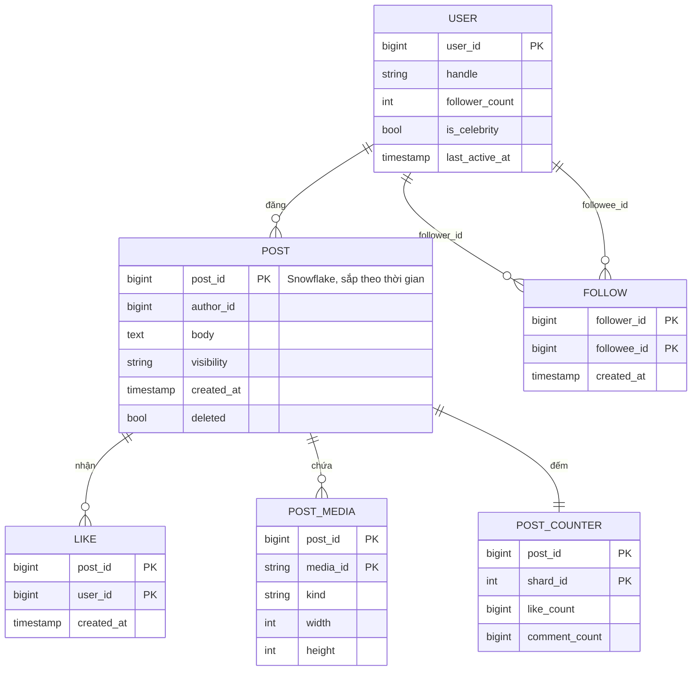

| Dữ liệu | Storage | Khóa phân mảnh | Vì sao |
|---|---|---|---|
| **Post** | Wide-column (Cassandra/ScyllaDB) hoặc MySQL sharded | `post_id` (bảng chính), `author_id` (bảng user timeline, clustering theo `post_id DESC`) | Ghi append-only, đọc theo ID hoặc theo tác giả; `post_id` kiểu Snowflake ([ID generation](../backend/10-system-design.md)) cho phép sắp theo thời gian mà không cần cột `created_at` |
| **Follow** | MySQL/KV sharded, **lưu 2 chiều** | `following(follower_id)` và `followers(followee_id)` | Đọc feed cần "tôi follow ai"; fan-out cần "ai follow tôi". Mỗi hướng một bảng, shard theo cột đầu |
| **Feed cache** | Redis cluster | `user_id` | Đọc 1 key = 1 lần truy cập, latency dưới ms |
| **Like** | Wide-column | `post_id` | "Ai đã like bài X", unique `(post_id, user_id)` |
| **Counter** | Redis (nóng) + bảng sharded counter (bền) | `(post_id, shard_id)` | Tránh hot row - phần 9 |
| **Media** | Object storage + CDN | `media_id` | Xem [Bài 6](./06-specialized-storage.md) và [Bài 10](./10-video-streaming.md) |

!!! warning "Celebrity làm lệch shard của bảng `followers`"
    `followers(followee_id=ca_sĩ)` có 50 triệu hàng **trên một shard**. Đọc nó để fan-out cũng là hot partition. Giải pháp: chia thêm theo bucket - khóa `(followee_id, bucket)` với `bucket = hash(follower_id) % 64` - để 50 triệu hàng trải ra 64 phần. Kỹ thuật này là **key salting** ([Bài 3](./03-building-blocks-data.md)).

---

## 📖 5. Kiến trúc tổng quan

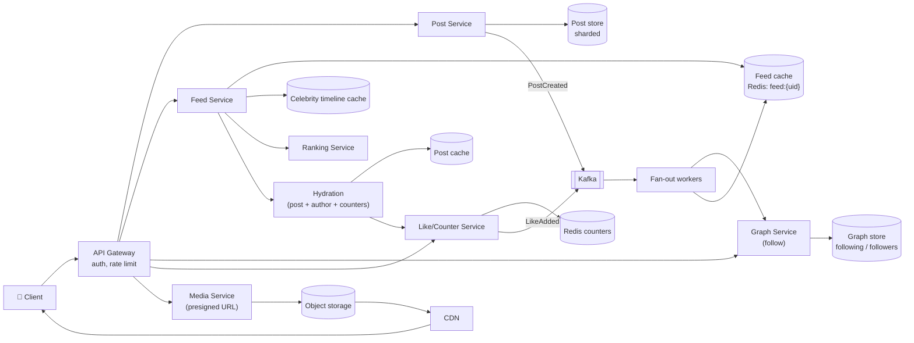

### 5.1 Luồng đăng bài

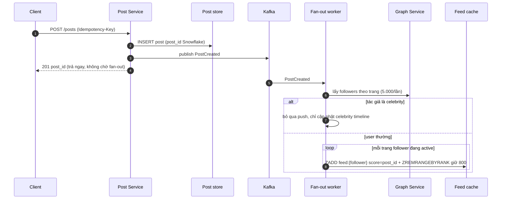

### 5.2 Luồng đọc feed

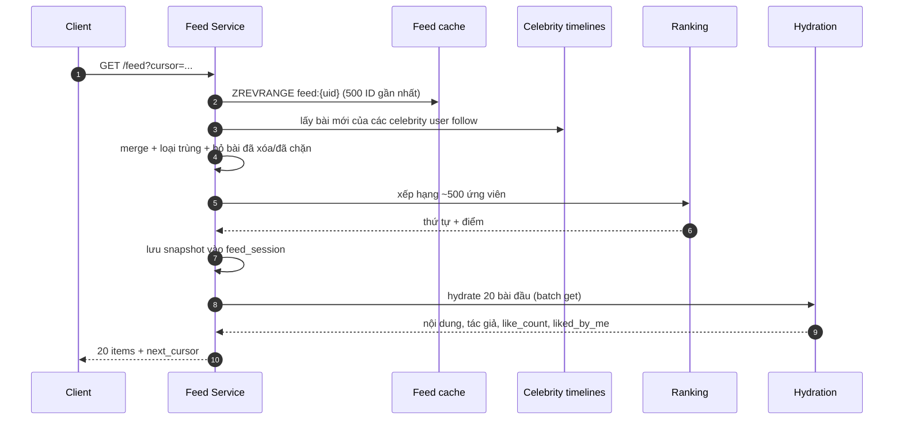

!!! tip "Hydration tách khỏi feed cache"
    Feed cache chỉ trả **ID**. Nội dung bài, avatar, số like được lấy ở bước **hydration** qua `multi-get` từ các cache riêng. Sửa bài, đổi avatar, xóa bài → chỉ sửa **một chỗ**, không phải đi sửa 50 triệu bản sao trong feed của follower.

---

## 📖 6. Deep dive 1: Fan-out on write vs on read vs hybrid

### 6.1 Ba phương án

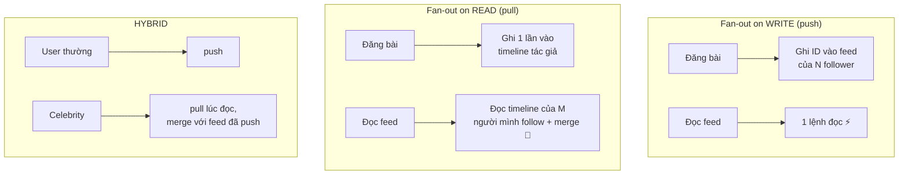

| Tiêu chí | Fan-out on write | Fan-out on read | Hybrid |
|---|---|---|---|
| Chi phí ghi | O(số follower) - nổ với celebrity | O(1) | O(follower) cho user thường, O(1) cho celebrity |
| Chi phí đọc | O(1) | O(số người follow) - 500 lần đọc + merge | O(1) + O(số celebrity mình follow) |
| Độ trễ đọc | Thấp nhất | Cao, khó đạt p99 < 300 ms | Thấp |
| Độ tươi | Trễ bằng thời gian fan-out | Tươi tuyệt đối | Tốt |
| Lãng phí | Ghi cho cả user không bao giờ mở app | Không | Giảm bằng cách chỉ push cho user active |
| Unfollow / xóa bài | Phải dọn feed của nhiều người | Tự đúng | Lọc lúc đọc |
| Ai dùng | App nhỏ, ít celebrity | Hệ thống ít đọc | Mạng xã hội lớn |

### 6.2 Con số của vấn đề celebrity

Hãy đặt **ngưỡng** bằng con số, không bằng cảm giác. Giả sử cụm fan-out ghi được **1 triệu ID/giây** (ví dụ 20 node Redis × 50k ZADD/s, ước tính để luyện tập), SLO "bài mới đến follower < 60 s":

| Số follower | Thời gian fan-out 1 bài | Tỉ trọng cụm bị chiếm | Kết luận |
|---|---|---|---|
| 200 (trung bình) | 0,2 ms | ~0 | Push thoải mái |
| 10.000 | 10 ms | ~0 | Push |
| 1.000.000 | 1 s | 1 s cả cụm | Push được, nhưng bắt đầu đáng ngại nếu đăng dồn dập |
| 10.000.000 | 10 s | 10 s cả cụm | Biên giới - nên pull |
| 50.000.000 | 50 s | Gần hết SLO, chặn mọi bài khác | **Bắt buộc pull** |

Ngưỡng thực tế thường đặt quanh **100k – 1 triệu follower** và nên là **cấu hình động**, không hard-code.

Ở phía đọc, hybrid cũng có giá: nếu trung bình mỗi user follow 5 celebrity, mỗi lần đọc feed thêm 5 lần đọc celebrity timeline:

```text
70.000 feed req/s × 5 celebrity     = 350.000 đọc/s vào celebrity timeline cache
Nhưng chỉ có ~vài nghìn celebrity    → mỗi key nhận trung bình ~100+ đọc/s,
                                        ca sĩ hot nhất có thể nhận 50.000 đọc/s
```

Đó lại là **hot key ở phía đọc** - nhưng là hot key *dễ chữa*: dữ liệu nhỏ (vài trăm ID), ít thay đổi → nhân bản key ra nhiều replica, cache cục bộ trong process Feed Service với TTL 1–5 giây ([Bài 3 - hot keys](./03-building-blocks-data.md)).

### 6.3 Tối ưu thêm cho fan-out on write

1. **Chỉ push cho follower active** (đăng nhập trong 7–30 ngày). Nếu 60% follower "ngủ đông", giảm 60% lần ghi. User quay lại sau thời gian dài → **rebuild feed** bằng pull một lần rồi chuyển sang push.
2. **Ưu tiên theo hàng đợi**: tách Kafka topic `fanout-normal` và `fanout-large` để bài của user 2 triệu follower không chặn bài của user 200 follower (chống *head-of-line blocking*).
3. **Batch theo shard Redis**: gom follower cùng slot, dùng pipeline → giảm round-trip 50–100 lần.
4. **Cắt feed**: `ZREMRANGEBYRANK` giữ 800 phần tử, không cho feed phình vô hạn.

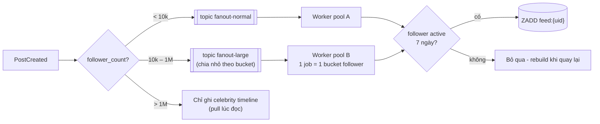

### 💡 Tips quan trọng

- Khi interviewer hỏi "celebrity thì sao?", trả lời bằng **phép tính 50 triệu × thời gian ghi**, rồi mới nói "hybrid".
- Nhắc cả **hai chiều** của hybrid: ghi rẻ đi nhưng đọc có thêm hot key → nêu cách chữa.
- "Active follower" là tối ưu hay bị quên nhưng thường tiết kiệm nhiều hơn cả hybrid.

---

## 📖 7. Deep dive 2: Feed cache & phân trang bằng cursor

### 7.1 Cấu trúc feed cache

```text
Key:   feed:{user_id}
Type:  Sorted Set
Member: post_id   (8 byte, Snowflake)
Score:  post_id   (hoặc timestamp) → sắp theo thời gian
Giới hạn: 800 phần tử gần nhất
TTL:   7 ngày kể từ lần đọc cuối (user không mở app → tự rơi khỏi RAM)
```

Vì sao **Sorted Set** chứ không phải List?

| Thao tác | List (`LPUSH`/`LRANGE`) | Sorted Set (`ZADD`/`ZREVRANGEBYSCORE`) |
|---|---|---|
| Thêm bài đến **trễ** (fan-out chậm, retry) | Chèn sai vị trí | Tự đúng thứ tự theo score |
| Fan-out retry 2 lần | Trùng phần tử | Idempotent - member đã có thì cập nhật |
| Lấy trang "trước post_id X" | Phải quét | `ZREVRANGEBYSCORE feed (X -inf LIMIT 0 20` |
| Bộ nhớ | Ít hơn | Nhiều hơn (skiplist + dict) |

Ở quy mô hàng trăm triệu user, một số hệ thống lưu feed dạng **mảng nhị phân nén** trong một key (đọc nguyên mảng, sửa trong app) để tiết kiệm RAM như phép tính 2.4. Đó là đánh đổi: tiết kiệm RAM, mất tính idempotent tự nhiên của ZSET.

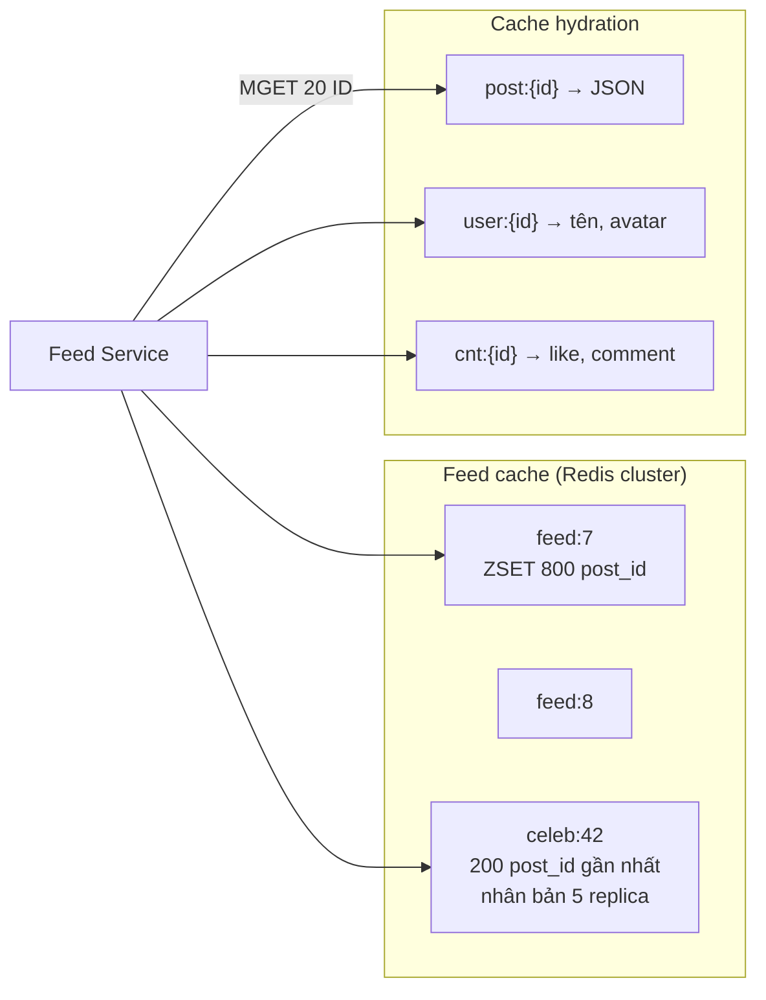

### 7.2 Vì sao offset hỏng

Bạn đang xem trang 1 (bài 1–20). Trong lúc đó có 3 bài mới chen vào đầu. Bạn kéo trang 2 với `offset=20` → nhận bài 18–37 theo thứ tự mới → **thấy lại 3 bài** đã xem. Ngược lại, nếu có bài bị xóa → **bỏ sót** bài.

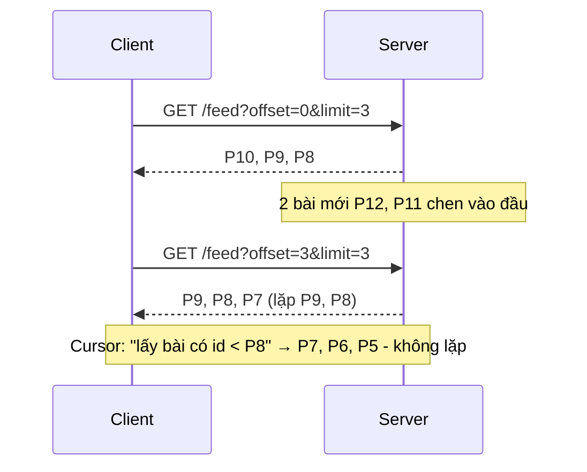

### 7.3 Cursor cho feed theo thời gian

```text
cursor = base64({"max_id": 1849302775123456})        # opaque với client
Trang tiếp: ZREVRANGEBYSCORE feed:7 (1849302775123456 -inf LIMIT 0 20
```

Dấu `(` nghĩa là "nhỏ hơn hẳn". `post_id` là duy nhất → không có hai bài cùng score, không cần tiebreaker. Nếu dùng timestamp làm score, cursor phải là cặp `(score, post_id)` để phá hòa.

### 7.4 Cursor cho feed **đã xếp hạng**

Feed xếp hạng không sắp theo ID, và điểm số thay đổi theo thời gian (bài được like thêm). Nếu mỗi trang xếp hạng lại từ đầu, bài sẽ nhảy lung tung giữa các trang. Cách phổ biến:

1. Trang đầu: xếp hạng ~500 ứng viên, lưu **danh sách thứ tự** vào `feed_session:{id}` (Redis, TTL 30 phút).
2. Cursor = `{session_id, offset}` - offset trong **snapshot bất biến**, nên an toàn.
3. Hết snapshot hoặc session hết hạn → tạo snapshot mới cho các bài **cũ hơn** bài cuối cùng đã trả (loại các ID đã gửi).
4. Kéo-để-làm-mới (pull to refresh) → snapshot mới hoàn toàn.

!!! tip "Cursor phải opaque và có chữ ký"
    Đừng để client tự ghép `max_id`. Mã hóa base64 + HMAC để client không giả mạo cursor (ví dụ để đọc snapshot của người khác) và để bạn thay đổi định dạng cursor sau này mà không vỡ app cũ.

---

## 📖 8. Deep dive 3: Pipeline xếp hạng

Feed "có xếp hạng" không phải một mô hình ML khổng lồ chấm điểm hàng triệu bài. Đó là **phễu nhiều tầng**, mỗi tầng rẻ hơn tầng sau và loại bớt ứng viên:

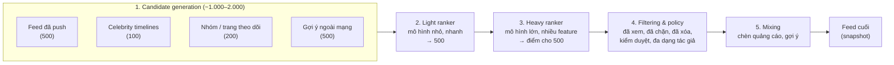

| Tầng | Đầu vào → đầu ra | Ngân sách latency (ví dụ) | Ghi chú |
|---|---|---|---|
| Candidate generation | Nhiều nguồn → ~1.500 | 30–50 ms | Song song các nguồn; nguồn nào timeout thì bỏ, feed vẫn chạy |
| Light ranker | 1.500 → 500 | 10–20 ms | Feature rẻ: tuổi bài, quan hệ tác giả, loại nội dung |
| Heavy ranker | 500 → 500 điểm | 50–100 ms | Dự đoán P(like), P(comment), P(ẩn bài)... ghép thành 1 điểm |
| Filtering | 500 → ~400 | 5–10 ms | Luật cứng: block, mute, bài đã xóa, đã xem |
| Mixing | → feed | 5 ms | Không để 5 bài liền nhau của 1 tác giả |

**Feature store**: các feature như "số lần tôi tương tác với tác giả X trong 30 ngày" được tính trước bằng stream processing ([Bài 5](./05-messaging-streaming.md)) và lưu trong KV store để ranker đọc nhanh.

!!! warning "Fallback khi ranker chết"
    Ranker là phụ thuộc nặng nhất trên đường đọc. Nếu nó timeout, **trả feed theo thời gian** (đã có sẵn trong feed cache) thay vì lỗi 500. Người dùng thấy feed "kém hay" một chút vẫn tốt hơn màn hình trắng. Xem thêm [circuit breaker](../backend/10-system-design.md) và [graceful degradation](../systems-thinking/05-failure-thinking.md).

---

## 📖 9. Deep dive 4: Bộ đếm like ở quy mô lớn

### 9.1 Vấn đề: hot row

Cách ngây thơ: `UPDATE post_counter SET likes = likes + 1 WHERE post_id = X`. Với bài viral 20.000 like/giây, cả 20.000 câu lệnh tranh nhau **khóa cùng một hàng**. Một hàng DB thường chỉ chịu được cỡ vài trăm đến vài nghìn update/giây (tùy engine, ổ đĩa, replication) → hàng đợi dài, timeout, connection pool cạn, lan sang các bài khác.

### 9.2 Các phương án

| Phương án | Cách làm | Ưu | Nhược |
|---|---|---|---|
| **1 hàng + lock** | `likes = likes + 1` | Đơn giản, chính xác | Hot row, chết ở bài viral |
| **Redis INCR** | Counter trong RAM, định kỳ flush xuống DB | Rất nhanh (~100k ops/s/key) | 1 key vẫn nằm trên 1 node; mất dữ liệu nếu node chết trước khi flush |
| **Sharded counter** | K hàng `(post_id, shard)`, ghi ngẫu nhiên 1 shard, đọc = tổng | Tải ghi chia K | Đọc tốn K lần → cache tổng |
| **Gom batch qua stream** | `LikeAdded` vào Kafka, consumer cộng dồn theo cửa sổ 1–5 s rồi ghi 1 lần | Ghi DB giảm hàng trăm lần | Số hiển thị trễ vài giây |
| **Kết hợp (thực tế)** | Event là nguồn chân lý → stream aggregation → sharded counter → cache | Bền, chịu viral | Phức tạp hơn |

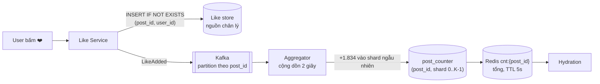

Điểm mấu chốt: **sự kiện like `(post_id, user_id)` là nguồn chân lý**, có khóa duy nhất → idempotent. Counter chỉ là một **view tổng hợp**, có thể tính lại nếu sai.

### 9.3 Demo: sharded counter

Mô phỏng 8 API server cùng ghi 20.000 like trong 1 giây cho một bài, với giả định mỗi hàng DB chịu ~1.000 update/s. So sánh số shard K = 1, 8, 32, 64.

=== "Go"

    ```go
    package main

    import (
    	"fmt"
    	"sync"
    	"sync/atomic"
    )

    // splitmix64: PRNG nhỏ, cho kết quả giống hệt bản Python
    type rng struct{ s uint64 }

    func (r *rng) next() uint64 {
    	r.s += 0x9E3779B97F4A7C15
    	z := r.s
    	z = (z ^ (z >> 30)) * 0xBF58476D1CE4E5B9
    	z = (z ^ (z >> 27)) * 0x94D049BB133111EB
    	return z ^ (z >> 31)
    }

    // ShardedCounter: 1 counter logic = K "hàng" vật lý
    type ShardedCounter struct{ shards []int64 }

    func NewShardedCounter(k int) *ShardedCounter {
    	return &ShardedCounter{shards: make([]int64, k)}
    }

    // Incr: chọn ngẫu nhiên 1 shard để ghi -> tải ghi chia đều K hàng
    func (c *ShardedCounter) Incr(r *rng) {
    	i := r.next() % uint64(len(c.shards))
    	atomic.AddInt64(&c.shards[i], 1)
    }

    // Get: đọc = cộng K shard (thường được cache lại vài giây)
    func (c *ShardedCounter) Get() int64 {
    	var sum int64
    	for i := range c.shards {
    		sum += atomic.LoadInt64(&c.shards[i])
    	}
    	return sum
    }

    func main() {
    	const likes = 20000   // 20k like trong 1 giây cho bài viral
    	const workers = 8     // 8 API server ghi song song
    	const rowCap = 1000.0 // giả định: 1 hàng DB chịu ~1000 update/s (khóa hàng)

    	fmt.Printf("Bài viral: %d like/giây, mỗi hàng DB chịu ~%.0f update/s\n", likes, rowCap)
    	fmt.Println(" K | tải max/shard | shard quá tải | thời gian xả hàng đợi | đọc tốn")
    	for _, k := range []int{1, 8, 32, 64} {
    		c := NewShardedCounter(k)
    		var wg sync.WaitGroup
    		for w := 0; w < workers; w++ {
    			wg.Add(1)
    			go func(w int) { // mỗi worker có RNG riêng (seed = w) -> kết quả tất định
    				defer wg.Done()
    				r := &rng{s: uint64(w + 1)}
    				for i := 0; i < likes/workers; i++ {
    					c.Incr(r)
    				}
    			}(w)
    		}
    		wg.Wait()
    		var maxLoad int64
    		over := 0
    		for _, v := range c.shards {
    			if v > maxLoad {
    				maxLoad = v
    			}
    			if float64(v) > rowCap {
    				over++
    			}
    		}
    		drain := float64(maxLoad) / rowCap
    		if drain < 1 {
    			drain = 1
    		}
    		fmt.Printf("%2d | %13d | %13d | %19.1fs | %d read (tổng=%d)\n",
    			k, maxLoad, over, drain, k, c.Get())
    	}
    }

    // Output:
    // Bài viral: 20000 like/giây, mỗi hàng DB chịu ~1000 update/s
    //  K | tải max/shard | shard quá tải | thời gian xả hàng đợi | đọc tốn
    //  1 |         20000 |             1 |                20.0s | 1 read (tổng=20000)
    //  8 |          2588 |             8 |                 2.6s | 8 read (tổng=20000)
    // 32 |           677 |             0 |                 1.0s | 32 read (tổng=20000)
    // 64 |           351 |             0 |                 1.0s | 64 read (tổng=20000)
    ```

=== "Python"

    ```python
    M64 = (1 << 64) - 1


    class Rng:  # splitmix64, giống bản Go
        def __init__(self, seed):
            self.s = seed

        def next(self):
            self.s = (self.s + 0x9E3779B97F4A7C15) & M64
            z = self.s
            z = ((z ^ (z >> 30)) * 0xBF58476D1CE4E5B9) & M64
            z = ((z ^ (z >> 27)) * 0x94D049BB133111EB) & M64
            return z ^ (z >> 31)


    class ShardedCounter:
        """1 counter logic = K 'hàng' vật lý."""

        def __init__(self, k):
            self.shards = [0] * k

        def incr(self, rng):
            # chọn ngẫu nhiên 1 shard -> tải ghi chia đều K hàng
            self.shards[rng.next() % len(self.shards)] += 1

        def get(self):
            # đọc = cộng K shard (thường cache lại vài giây)
            return sum(self.shards)


    LIKES, WORKERS, ROW_CAP = 20000, 8, 1000.0
    print(f"Bài viral: {LIKES} like/giây, mỗi hàng DB chịu ~{ROW_CAP:.0f} update/s")
    print(" K | tải max/shard | shard quá tải | thời gian xả hàng đợi | đọc tốn")
    for k in (1, 8, 32, 64):
        c = ShardedCounter(k)
        for w in range(WORKERS):  # mỗi "worker" có RNG riêng (seed = w+1)
            r = Rng(w + 1)
            for _ in range(LIKES // WORKERS):
                c.incr(r)
        max_load = max(c.shards)
        over = sum(1 for v in c.shards if v > ROW_CAP)
        drain = max(max_load / ROW_CAP, 1.0)
        print(f"{k:2d} | {max_load:13d} | {over:13d} | {drain:19.1f}s | {k} read (tổng={c.get()})")

    # Output:
    # Bài viral: 20000 like/giây, mỗi hàng DB chịu ~1000 update/s
    #  K | tải max/shard | shard quá tải | thời gian xả hàng đợi | đọc tốn
    #  1 |         20000 |             1 |                20.0s | 1 read (tổng=20000)
    #  8 |          2588 |             8 |                 2.6s | 8 read (tổng=20000)
    # 32 |           677 |             0 |                 1.0s | 32 read (tổng=20000)
    # 64 |           351 |             0 |                 1.0s | 64 read (tổng=20000)
    ```

**Đọc kết quả:**

- K = 1: một hàng nhận 20.000 update → hàng đợi cần ~20 giây để xả, trong lúc đó mọi request khác chạm hàng này đều chờ.
- K = 8: mỗi shard vẫn ~2.500 > 1.000 → vẫn quá tải. Chú ý **phân phối không đều**: lý tưởng 2.500, thực tế max 2.588.
- K = 32: max 677 < 1.000 → chịu được. Chi phí: đọc phải cộng 32 hàng → **cache tổng** trong Redis vài giây.
- Không phải bài nào cũng cần K = 32. Thực tế: **K động** - bài bình thường K = 1, khi phát hiện bài nóng (rate vượt ngưỡng) thì nâng K.

!!! note "Like count hiển thị là số gần đúng"
    Hiển thị "1,2 triệu" không cần chính xác từng đơn vị. Nhưng **"liked_by_me"** phải chính xác cho chính user đó (đọc từ like store theo `(post_id, user_id)`, hoặc từ cache của riêng user). Hai yêu cầu khác nhau → hai đường dữ liệu khác nhau.

---

## 📖 10. Media trong feed

Ảnh/video **không bao giờ đi qua** Post Service hay Feed Service:

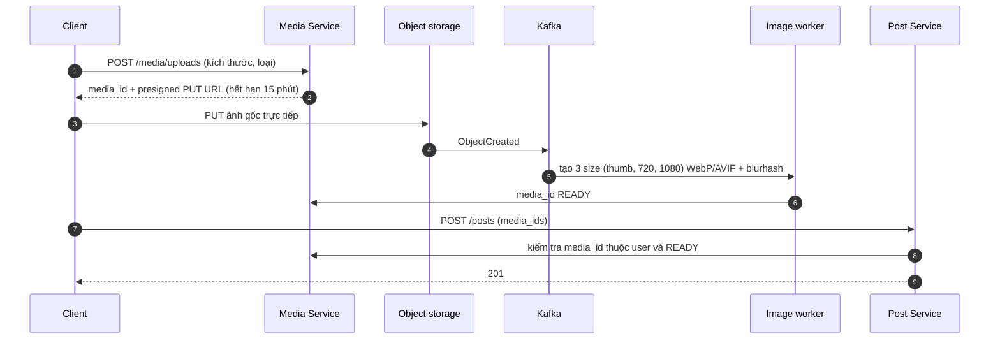

- **Presigned URL**: client upload thẳng lên object storage, không tốn băng thông API server ([Bài 6](./06-specialized-storage.md)).
- **Nhiều kích thước**: điện thoại màn nhỏ không cần ảnh 4K. Client chọn URL theo màn hình.
- **Blurhash/placeholder**: chuỗi ~30 byte đi kèm JSON, client vẽ ảnh mờ ngay trong lúc chờ CDN → cảm giác nhanh.
- **CDN**: URL có hash nội dung → cache vĩnh viễn (`Cache-Control: immutable`).
- Video ngắn trong feed dùng cùng pipeline với [Bài 10](./10-video-streaming.md) nhưng ladder nhỏ hơn và **autoplay tắt tiếng**, chỉ tải vài segment đầu.

---

## 📖 11. Kỳ vọng nhất quán

Không phải mọi thứ trong feed cần cùng mức nhất quán. Xem lý thuyết ở [Bài 4](./04-consistency-consensus.md).

| Tình huống | Kỳ vọng của người dùng | Mức nhất quán | Cách làm |
|---|---|---|---|
| Tôi vừa đăng bài, mở feed của tôi | **Phải thấy ngay** | Read-your-writes | Client chèn bài vào feed cục bộ; server merge timeline của chính tác giả lúc đọc |
| Follower thấy bài mới | Vài giây – 1 phút là ổn | Eventual | Fan-out bất đồng bộ |
| Tôi vừa xóa bài | Không ai còn thấy sau vài giây | Eventual nhưng **lọc lúc đọc** | Hydration bỏ bài `deleted`; không cần dọn 50 triệu feed ngay |
| Tôi vừa chặn (block) ai đó | **Ngay lập tức** không thấy họ | Mạnh với chính tôi | Lọc theo block list ở tầng filtering, mỗi request |
| Tôi vừa like, rồi refresh | Nút ❤️ vẫn đỏ | Read-your-writes | `liked_by_me` đọc từ like store/cache của user |
| Số like | Gần đúng, tăng dần | Eventual | Sharded counter + cache |
| Thứ tự feed giữa 2 thiết bị | Không cần giống nhau | Không đảm bảo | - |

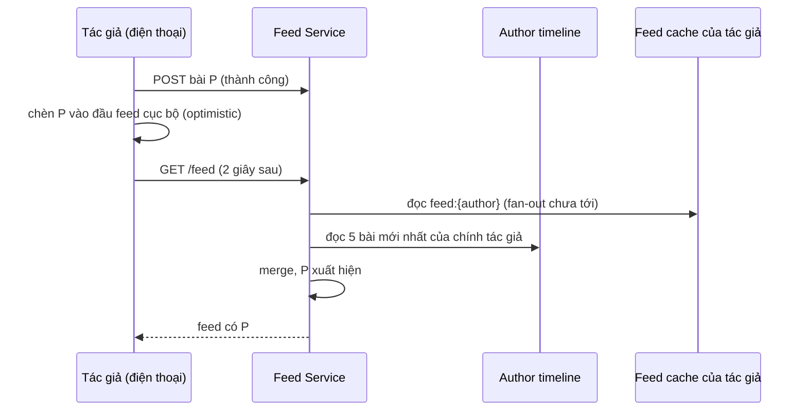

!!! warning "Unfollow cũng cần lọc lúc đọc"
    Khi A unfollow B, feed cache của A vẫn chứa bài của B. Đừng cố xóa ngay - lọc ở tầng filtering bằng danh sách "đang follow" (đã có sẵn vì dùng để lấy celebrity timeline), và để worker dọn dần.

---

## 📖 12. Scale, nút thắt & failure modes

### 12.1 Nút thắt và cách xử lý

| Nút thắt | Biểu hiện | Giảm nhẹ |
|---|---|---|
| Fan-out celebrity | Kafka lag tăng vọt khi người nổi tiếng đăng | Hybrid, topic riêng, active-only |
| Hot key đọc (celebrity timeline, bài viral) | 1 node Redis CPU 100% | Nhân bản key, cache cục bộ TTL ngắn, request coalescing |
| Hot row counter | Lock wait, timeout | Sharded counter + batch qua stream |
| Shard `followers` lệch | Đọc follower của celebrity chậm | Bucket theo `hash(follower_id)` |
| Feed cache RAM | Chi phí cụm Redis tăng tuyến tính theo user | Chỉ user active, cắt 300–800 ID, nén |
| Ranker | p99 tăng theo số ứng viên | Light ranker cắt sớm, timeout + fallback chronological |
| Thundering herd lúc sự kiện lớn (giao thừa, chung kết bóng đá) | Mọi người cùng đăng + đọc | Autoscale trước theo lịch, rate limit đăng bài, giảm số ứng viên tạm thời |

### 12.2 Multi-region

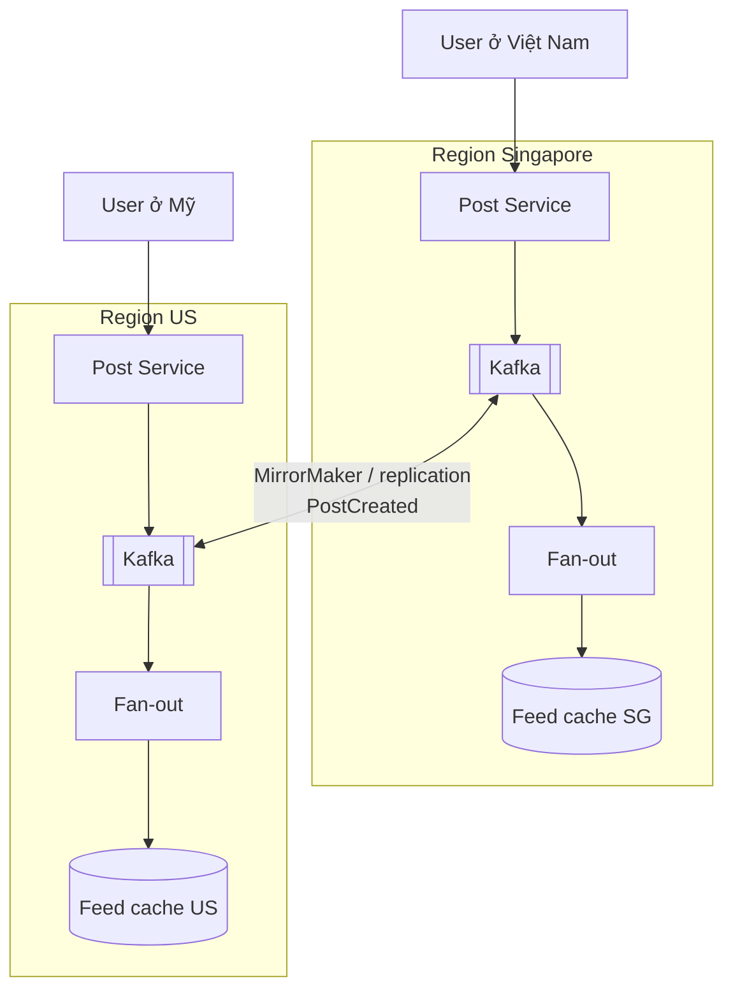

- **User ở region nhà** (home region): feed cache của user chỉ nằm ở region gần họ.
- Bài đăng ở SG được replicate event sang US; fan-out worker ở US chỉ ghi vào feed của follower **có home region US**.
- Post store replicate bất đồng bộ giữa region; hydration đọc local → có thể có "bài mới thấy ID nhưng chưa có nội dung" → bỏ qua bài đó lần này (hoặc đọc cross-region có timeout).

### 12.3 Failure modes

| Sự cố | Ảnh hưởng | Giảm nhẹ |
|---|---|---|
| Mất 1 node Redis feed cache | Một phần user mất feed đã push | Replica + failover; nếu mất hẳn → **rebuild bằng pull** (đọc timeline của người mình follow) - chậm hơn nhưng đúng |
| Fan-out worker chết giữa chừng | Một nửa follower có bài, nửa chưa | Commit offset Kafka **sau** khi ghi xong; ZADD idempotent nên chạy lại an toàn |
| Kafka lag 10 phút | Bài mới đến chậm | Alert theo lag; scale consumer; ưu tiên topic `fanout-normal` |
| Ranker timeout | Feed trống | Fallback feed theo thời gian |
| Post store region down | Hydration lỗi | Post cache TTL dài, đọc replica region khác |
| Bug fan-out ghi sai feed | Lộ bài private | Kiểm tra visibility **lần nữa** ở hydration (defense in depth) |

---

## 📖 13. Monitoring & metric chính

| Metric | Ý nghĩa | Ngưỡng ví dụ |
|---|---|---|
| Feed load latency p50/p99 | Trải nghiệm chính | p99 < 300 ms |
| **Fan-out lag** (post created → có trong feed follower), p99 | Độ tươi | < 60 s |
| Kafka consumer lag theo topic | Sớm báo nghẽn fan-out | Alert khi tăng liên tục 5 phút |
| Feed cache hit ratio | Bao nhiêu % request phải rebuild | > 99% |
| Tỉ lệ feed rỗng / dưới 5 bài | Bug hoặc mất cache | Gần 0 |
| Ranker timeout rate, tỉ lệ fallback | Sức khỏe ranking | < 0,1% |
| Hot key QPS top-10 | Phát hiện viral/celebrity | Alert khi 1 key > 20% QPS node |
| Counter drift (tổng shard so với đếm lại từ like store) | Đúng đắn | < 0,01% |
| Business: thời gian xem feed, tỉ lệ tương tác | Feed có "hay" không | Theo dõi A/B |

Thêm về observability: [Bài Observability & Reliability](../backend/11-observability-reliability.md).

---

## 📝 Tự chấm

| Hạng mục | Đạt | Chưa đạt |
|---|---|---|
| **Yêu cầu** | Hỏi rõ chronological vs ranked, 1 chiều vs 2 chiều, độ tươi, read-your-writes cho tác giả | Bắt đầu vẽ ngay, không hỏi celebrity |
| **Ước lượng** | Có QPS đọc/ghi, **số lần ghi fan-out** (trung bình và celebrity), RAM feed cache | Chỉ tính QPS đọc |
| **API** | Feed dùng cursor opaque; đăng bài có idempotency key; like idempotent | Dùng `offset`; like = "tăng 1" |
| **Data model** | Graph lưu 2 chiều; feed cache chỉ ID; post_id sắp theo thời gian | Lưu nội dung bài trong feed của từng follower |
| **Kiến trúc** | Tách post / fan-out / feed / hydration / ranking; fan-out bất đồng bộ qua queue | Fan-out đồng bộ trong request đăng bài |
| **Deep dive** | Hybrid có ngưỡng bằng số, active-only, sharded counter, cursor cho ranked feed | Nói "dùng hybrid" mà không giải thích ngưỡng |
| **Trade-off** | Nêu được hot key đọc do hybrid sinh ra; RAM vs idempotency của ZSET | Chỉ nêu ưu điểm |
| **Failure** | Rebuild bằng pull khi mất cache; fallback chronological; lọc lúc đọc cho xóa/chặn | Không nói gì khi Redis hay ranker chết |

---

## 🔄 Biến thể interviewer hay hỏi

??? question "Nếu yêu cầu đổi thành: chỉ feed theo thời gian, không xếp hạng?"
    Bỏ ranking, snapshot session. Cursor đơn giản là `max_id`. Phần còn lại (hybrid fan-out, feed cache) giữ nguyên. Có thể bỏ luôn hydration của counter nếu không hiển thị số like.

??? question "Nếu là bạn bè 2 chiều (Facebook) với giới hạn 5.000 bạn?"
    Không còn "celebrity 50 triệu follower" trong graph bạn bè → push thuần gần như đủ. Nhưng **Page/Group** vẫn có hàng triệu thành viên → các nguồn đó dùng pull, như celebrity.

??? question "Nếu có Stories biến mất sau 24 giờ?"
    Lưu stories riêng, **TTL 24h**. Feed stories thường là pull: lấy danh sách người mình follow có story còn hạn (bitmap/set "ai có story active" cập nhật khi đăng/hết hạn). Không cần fan-out vì số lượng nhỏ và vòng đời ngắn.

??? question "Nếu muốn hiển thị 'Có 12 bài mới' khi đang mở app?"
    Client giữ kết nối realtime (WebSocket/SSE, xem [Bài 8](./08-chat-presence.md)) hoặc poll nhẹ `GET /feed/new_count?since=max_id` mỗi 30–60 giây. Không push nội dung, chỉ push **con số** - tiết kiệm băng thông.

??? question "Nếu user mới chưa follow ai (cold start)?"
    Candidate generation chuyển sang nguồn **gợi ý**: bài phổ biến theo vùng, theo chủ đề user chọn lúc onboarding. Feed cache gần như rỗng → đọc pull từ "trending pool".

??? question "Nếu bài có thể được sửa (edit)?"
    Feed chỉ lưu ID nên không ảnh hưởng. Chỉ cần invalidate `post:{id}` trong cache hydration và lưu version để hiển thị "đã chỉnh sửa".

??? question "Nếu cần feed 'Đang thịnh hành' toàn hệ thống?"
    Đây là bài toán top-K theo cửa sổ thời gian: stream đếm tương tác theo bài (count-min sketch / heavy hitters), cập nhật mỗi phút. Xem [Bài 5](./05-messaging-streaming.md) và [Bài 16](./16-metrics-aggregation.md).

---

## 🌍 Ứng dụng thực tế

- **Twitter/X** đã công khai nói về mô hình fan-out vào timeline cache trong RAM và xử lý riêng tài khoản lớn - đó là nguồn gốc của "hybrid" mà sách phỏng vấn hay nhắc (chi tiết nội bộ thay đổi theo thời gian, đừng trích con số cụ thể khi phỏng vấn).
- **Facebook** công bố bài báo về **TAO** - kho graph phân tán có cache cho object và association; đây là ví dụ kinh điển về "graph store = KV + cache" thay vì graph database chuyên dụng.
- **Instagram** từng chia sẻ việc dùng Cassandra cho feed và nhiều tầng ranking. Ý tưởng **phễu candidate → ranker** xuất hiện ở hầu hết hệ thống gợi ý (YouTube, TikTok, LinkedIn).
- **Sharded counter** là mẫu được tài liệu Google Cloud (Firestore/Datastore) mô tả chính thức cho bài toán counter ghi nhiều.
- Mạng xã hội và app tin tức Việt Nam (feed tin tức, feed sản phẩm của sàn TMĐT) dùng cùng khung: candidate từ nhiều nguồn → xếp hạng → lọc → trộn quảng cáo.

---

## ⚠️ Sai lầm thường gặp

1. **Lưu nội dung bài trong feed cache** của từng follower → sửa/xóa bài phải sửa hàng triệu bản sao, RAM gấp 100 lần.
2. **Fan-out đồng bộ** trong request đăng bài → đăng bài của celebrity timeout.
3. **Nói "hybrid" mà không có ngưỡng** và không nhắc hot key phía đọc.
4. **Dùng offset** cho feed vô hạn → lặp bài, sót bài.
5. **Counter = UPDATE +1** trên một hàng → sập khi viral; không idempotent khi retry.
6. **Quên user không active** → tốn 50%+ công fan-out cho người không bao giờ đọc.
7. **Không có fallback** khi ranker hay feed cache chết → feed trắng.
8. **Xóa/chặn chỉ dựa vào dọn feed cache** → bài đã xóa vẫn hiện; phải lọc lúc đọc.
9. **Shard bảng followers chỉ theo followee_id** → partition của celebrity thành hot partition.

---

## 🏋️ Bài tập

**Bài 1 (dễ).** Một app có 5 triệu DAU, mỗi người mở feed 8 lần/ngày, 10% DAU đăng 1 bài/ngày, trung bình 150 follower. Tính QPS đọc feed (trung bình, peak ×3) và số lần ghi fan-out/giây nếu push thuần.

<details markdown="1"><summary>Đáp án</summary>

- Đọc: 5M × 8 / 86.400 ≈ **463 req/s**, peak ≈ **1.400 req/s**.
- Bài/ngày: 500k → 5,8 bài/s. Fan-out: 500k × 150 = 75M ghi/ngày ≈ **870 ghi/s** (peak ~2.600).
- Kết luận: quy mô này **push thuần** + 1 cụm Redis nhỏ là đủ; chưa cần hybrid trừ khi có tài khoản rất lớn.

</details>

**Bài 2 (dễ).** Vì sao feed cache dùng `post_id` (Snowflake) làm score lại tiện hơn timestamp giây?

<details markdown="1"><summary>Đáp án</summary>

Snowflake ID vừa **duy nhất** vừa **tăng theo thời gian**. Dùng làm score thì không có hai phần tử cùng score → cursor chỉ cần `max_id`, không cần tiebreaker. Timestamp giây có thể trùng (nhiều bài cùng giây) → cursor phải là cặp `(ts, post_id)`. Lưu ý: score của ZSET là double (53 bit mantissa) - Snowflake 63 bit có thể mất chính xác; nhiều hệ thống dùng ID 53 bit hoặc dùng timestamp ms làm score + `post_id` làm member.

</details>

**Bài 3 (trung bình).** Ngưỡng celebrity đang là 1 triệu follower. Một user 900k follower đăng 30 bài/giờ (bot tin tức). Có vấn đề gì? Đề xuất cách chọn ngưỡng tốt hơn.

<details markdown="1"><summary>Đáp án</summary>

30 bài/giờ × 900k = 27 triệu ghi/giờ chỉ từ một tài khoản - ngang một celebrity 27 triệu follower đăng 1 bài/giờ. Ngưỡng nên dựa trên **chi phí fan-out theo thời gian** = `follower_active × tần suất đăng`, không chỉ số follower. Ví dụ: pull nếu `follower_active × bài/ngày > 5 triệu ghi/ngày`. Tính lại định kỳ (job hàng ngày) và lưu cờ `fanout_mode` trong profile.

</details>

**Bài 4 (trung bình).** Thiết kế cursor cho feed đã xếp hạng sao cho: (a) không lặp bài giữa các trang, (b) không lộ thông tin nội bộ, (c) server deploy phiên bản mới vẫn hiểu cursor cũ.

<details markdown="1"><summary>Đáp án</summary>

Cursor = `base64url(version || session_id || offset || last_post_id || HMAC)`.

- (a) `session_id` trỏ tới snapshot thứ tự bất biến trong Redis; `offset` tăng dần. Khi snapshot hết hạn: tạo snapshot mới chỉ gồm bài có `post_id < last_post_id` và loại các ID đã gửi (lưu bloom filter nhỏ các ID đã gửi trong session).
- (b) HMAC + mã hóa; client không thể sửa/giả mạo.
- (c) Trường `version` đầu tiên; server giữ decoder cho N-1 version.

</details>

**Bài 5 (trung bình).** Redis feed cache cluster mất hẳn 1/10 số shard (không có replica kịp). 20 triệu user mất feed. Bạn xử lý thế nào để không sập hệ thống?

<details markdown="1"><summary>Đáp án</summary>

- Feed Service phát hiện cache miss → **rebuild bằng pull** (đọc timeline của người mình follow + merge) - nhưng 20 triệu user cùng rebuild sẽ dội vào post store.
- Giảm nhẹ: **request coalescing** (1 rebuild/user), **giới hạn tốc độ rebuild** (token bucket), trong lúc chờ trả feed rút gọn (chỉ celebrity/trending + bài của 50 người tương tác nhiều nhất), rebuild lười (lazy) khi user thật sự mở app chứ không rebuild cho cả 20 triệu.
- Sau sự cố: bật replica, xem lại `min-replicas-to-write`, diễn tập failover.

</details>

**Bài 6 (khó).** Mở rộng demo sharded counter: chỉ dùng K > 1 khi bài "nóng". Thiết kế cơ chế tự phát hiện bài nóng và chuyển K = 1 → K = 32 mà **không mất like** trong lúc chuyển.

<details markdown="1"><summary>Đáp án</summary>

- Phát hiện: aggregator đếm rate like theo bài trong cửa sổ 10 s; vượt ngưỡng (ví dụ 200 like/s) → ghi `counter_shards:{post_id} = 32` vào config cache.
- Chuyển an toàn: shard 0 chính là hàng cũ (K = 1 tương đương chỉ có shard 0). Khi K tăng lên 32, writer bắt đầu ghi vào shard ngẫu nhiên 0..31; reader luôn cộng **mọi shard tồn tại** (đọc theo range `(post_id, *)`, không dựa vào K) → không có lúc nào mất phần đã đếm.
- Giảm K về sau: gộp các shard vào shard 0 trong một transaction rồi xóa shard thừa, hoặc đơn giản để nguyên (bài hết nóng thì không ai ghi nữa).
- Vì nguồn chân lý là bảng like `(post_id, user_id)`, có thể đối soát định kỳ và sửa drift.

</details>

**Bài 7 (khó).** Interviewer: "Feed phải hiển thị cả bài trong **group** mà user tham gia. Có group 3 triệu thành viên, bài đăng liên tục." Hãy mở rộng thiết kế.

<details markdown="1"><summary>Đáp án</summary>

- Group lớn = celebrity → **pull**: mỗi group có timeline `group:{id}` (ZSET ID bài). Group nhỏ (< 10k thành viên) có thể push như bình thường.
- Candidate generation thêm nguồn "groups": lấy danh sách group của user (có thể vài trăm) → không thể đọc hết mỗi lần mở feed. Giải pháp: chỉ đọc **top N group** user tương tác nhiều (tính sẵn bằng feature store), cộng một "group digest" tính trước theo giờ.
- Quyền: bài group private chỉ hiển thị cho thành viên → kiểm tra membership ở tầng filtering (không tin vào việc bài đã nằm trong feed).
- Hot key: group 3 triệu thành viên đọc dồn → nhân bản timeline, cache cục bộ như celebrity.

</details>

---

## ✅ Checklist

- [ ] Hỏi rõ: ranked hay chronological, 1 chiều hay 2 chiều, độ tươi, read-your-writes
- [ ] Ước lượng được QPS đọc feed, **số ghi fan-out trung bình và celebrity**, RAM feed cache
- [ ] Giải thích fan-out on write / read / hybrid bằng bảng trade-off và **ngưỡng bằng số**
- [ ] Biết tối ưu "chỉ push cho follower active" và tách topic theo kích thước
- [ ] Feed cache chỉ lưu ID; hydration lấy nội dung, tác giả, counter
- [ ] Phân trang bằng cursor; xử lý được ranked feed bằng snapshot session
- [ ] Mô tả phễu candidate generation → light ranker → heavy ranker → filtering → mixing
- [ ] Sharded counter: vì sao, chọn K thế nào, đọc tổng ra sao, idempotency của like
- [ ] Bảng kỳ vọng nhất quán cho đăng bài, xóa, chặn, like
- [ ] Failure: mất feed cache → rebuild pull có giới hạn; ranker chết → chronological

---

**Bài tiếp theo**: [Bài 10: Video streaming](./10-video-streaming.md)
