# 📚 Bài 10: Video streaming

> "Một video 10 phút không phải là một file. Nó là **hàng trăm file nhỏ**, ở **năm mức chất lượng**, nằm ở **hàng nghìn máy chủ** gần người xem - và trình phát đổi qua lại giữa chúng mỗi vài giây."

Chị Lan là YouTuber dạy nấu ăn ở Đà Nẵng. Tối Chủ nhật chị quay xong một video 15 phút quay bằng điện thoại 4K - file gốc nặng 6 GB. Chị bấm upload qua Wi-Fi quán cà phê, mạng rớt hai lần. Nửa giờ sau, video đã có:

- Ở Hà Nội, một người xem bằng laptop cáp quang thấy **1080p** sắc nét.
- Trên xe buýt ở Cần Thơ, một người xem bằng 4G yếu thấy **360p** - nhưng **không bị đứng hình**.
- Thumbnail đẹp, phụ đề tự động, và hệ thống đã kiểm tra video không vi phạm bản quyền nhạc.

Đằng sau "bấm upload rồi xem" là: upload tiếp tục được (resumable), pipeline transcode chạy song song hàng chục máy, adaptive bitrate streaming, và một mạng CDN gánh **phần lớn chi phí của cả công ty**. Bài này mổ xẻ từng phần.

## 🎯 Mục tiêu bài học

- Thiết kế hệ thống video kiểu YouTube/Netflix theo đủ 11 bước của case study
- Ước lượng **lưu trữ** (theo ladder bitrate) và **egress** - và thấy vì sao egress thường là khoản lớn nhất
- Thiết kế **upload resumable** với presigned URL và multipart
- Mô hình hóa **transcoding pipeline thành DAG**, chia chunk để encode song song
- Hiểu **adaptive bitrate streaming** (HLS/DASH): manifest, segment, ladder, thuật toán chọn bitrate
- Lập **chiến lược CDN** (nhiều tầng, long tail, origin shield) và tính chi phí
- Biết khác biệt của **live streaming**, và các "móc" cho **bản quyền / kiểm duyệt**

---

## 🧩 Tự thiết kế trước

!!! question "Đề bài (15–20 phút)"
    Thiết kế một nền tảng chia sẻ video:

    - Người dùng upload video (tới vài GB), xem video trên web/mobile với chất lượng tự thích nghi theo mạng.
    - Hiển thị thông tin video, thumbnail, lượt xem.
    - 10 triệu DAU, 100.000 video mới mỗi ngày.

    Viết ra: ước lượng lưu trữ 1 năm và băng thông, luồng upload, pipeline xử lý, cách phát video, và **khoản chi phí lớn nhất**.

<details markdown="1"><summary>Gợi ý</summary>

1. Một phút video 1080p khoảng bao nhiêu MB? Có bao nhiêu mức chất lượng cần lưu?
2. Upload 6 GB qua mạng chập chờn: nếu rớt ở 90% thì sao?
3. Transcode video 2 giờ trên một máy mất bao lâu? Làm sao nhanh hơn?
4. Vì sao không stream một file MP4 duy nhất?
5. 10 triệu người × 30 phút xem/ngày = bao nhiêu PB? Ai trả tiền băng thông đó?
6. Live stream khác video on-demand ở điểm nào?

</details>

---

## 📖 1. Làm rõ yêu cầu

> **Ứng viên:** Video on-demand (VOD) như YouTube, hay có cả live?
> **Interviewer:** Tập trung VOD. Live nói khác biệt chính.
>
> **Ứng viên:** Giới hạn kích thước và độ dài video?
> **Interviewer:** Tối đa 10 GB, 2 giờ. Đa số dưới 10 phút.
>
> **Ứng viên:** Video cần sẵn sàng để xem sau bao lâu kể từ khi upload xong?
> **Interviewer:** Bản chất lượng thấp trong vài phút, đủ chất lượng trong dưới 1 giờ với video dài.
>
> **Ứng viên:** Người xem ở đâu? Thiết bị gì?
> **Interviewer:** Chủ yếu Việt Nam và Đông Nam Á, 80% mobile, mạng di động không ổn định.
>
> **Ứng viên:** Có DRM, bản quyền, kiểm duyệt?
> **Interviewer:** Phải có kiểm tra bản quyền và kiểm duyệt nội dung cơ bản. DRM ngoài phạm vi.
>
> **Ứng viên:** Lượt xem cần chính xác thời gian thực?
> **Interviewer:** Không, trễ vài phút được. Nhưng phải chống buff view.

| Loại | Yêu cầu |
|---|---|
| **Chức năng** | Upload resumable; transcode nhiều chất lượng; phát ABR; metadata (tiêu đề, mô tả, kênh); thumbnail; lượt xem; tìm kiếm cơ bản (ngoài phạm vi sâu) |
| **Phi chức năng** | Startup time (bấm play → hình đầu tiên) p90 < 2 s; rebuffer ratio < 0,5%; availability phát video 99,99%; không mất video gốc đã upload (durability rất cao); video ngắn sẵn sàng trong vài phút |
| **Ngoài phạm vi** | DRM, gợi ý video (cùng phễu với [Bài 9 §8](./09-news-feed.md)), comment, monetization |

!!! tip "Hai hệ thống trong một"
    Video platform có **hai đường rất khác nhau**: đường **ghi** (upload + transcode) nặng về CPU, chạy theo lô, chấp nhận trễ phút; và đường **đọc** (phát video) nặng về băng thông, phải nhanh từng giây. Thiết kế tách hai đường ngay từ đầu.

---

## 📖 2. Ước lượng

Mọi con số là **ước tính để luyện tập**. Phương pháp ở [Bài 1](./01-framework-estimation.md).

### 2.1 Giả định

| Thông số | Giá trị |
|---|---|
| Video mới/ngày | 100.000, trung bình 6 phút → **600.000 phút/ngày** |
| Bản gốc | ~10 Mbps trung bình |
| Ladder | 240p 0,3 / 360p 0,7 / 480p 1,2 / 720p 2,5 / 1080p 4,5 Mbps |
| DAU | 10 triệu, xem 30 phút/ngày, bitrate nhận trung bình 2 Mbps |
| Giá lưu trữ | Hot $0,020/GB-tháng, cold $0,004/GB-tháng (giả định) |
| Giá CDN | $0,005/GB khi cam kết khối lượng lớn (giả định; giá niêm yết thường cao hơn nhiều) |

### 2.2 QPS

```text
Upload:   100.000 / 86.400                 ≈ 1,2 video/s  (peak ~4/s) - rất nhỏ
Xem:      10M × 30 phút / 6 phút/video      = 50M lượt xem/ngày ≈ 580/s (peak ~1.700/s)
Segment:  mỗi người đang xem tải 1 segment / 4 s
          người xem đồng thời peak ≈ 10M × 30 phút / (24 × 60) × 3  ≈ 625.000
          → 625.000 / 4 ≈ 156.000 request segment/s  (gần như toàn bộ ở CDN)
```

Chú ý: QPS **API** nhỏ; QPS **segment** lớn nhưng do CDN gánh. Bài toán thật nằm ở **byte**, không phải request.

### 2.3 Drill: lưu trữ và egress

Một phút ở bitrate `b` Mbps chiếm `b × 60 / 8` MB. Đoạn code sau tính toàn bộ:

=== "Go"

    ```go
    package main

    import "fmt"

    type rendition struct {
    	name string
    	mbps float64 // bitrate trung bình
    }

    // MB cho 1 phút video ở bitrate cho trước: Mbps * 60s / 8 bit
    func mbPerMin(mbps float64) float64 { return mbps * 60 / 8 }

    func main() {
    	// ---- Giả định (ước tính để luyện tập, không phải số thật của công ty nào) ----
    	const uploadsPerDay = 100_000.0
    	const avgMinutes = 6.0
    	const originalMbps = 10.0
    	const hotUSDPerGBMonth = 0.020  // object storage "standard"
    	const coldUSDPerGBMonth = 0.004 // lớp lưu trữ lạnh cho bản gốc
    	const dau = 10_000_000.0
    	const watchMinPerUser = 30.0
    	const avgWatchMbps = 2.0  // ABR: trung bình người xem nhận ~2 Mbps
    	const cdnUSDPerGB = 0.005 // giá CDN khi cam kết khối lượng lớn (giả định)
    	ladder := []rendition{{"240p", 0.3}, {"360p", 0.7}, {"480p", 1.2}, {"720p", 2.5}, {"1080p", 4.5}}

    	minutesPerDay := uploadsPerDay * avgMinutes
    	fmt.Printf("Phút video upload/ngày: %.0f\n", minutesPerDay)
    	var ladderMB float64
    	for _, r := range ladder {
    		mb := mbPerMin(r.mbps)
    		ladderMB += mb
    		fmt.Printf("  %-5s %4.1f Mbps -> %6.2f MB/phút\n", r.name, r.mbps, mb)
    	}
    	origMB := mbPerMin(originalMbps)
    	fmt.Printf("Cả ladder: %.2f MB/phút, bản gốc: %.2f MB/phút\n", ladderMB, origMB)

    	ladderTBDay := ladderMB * minutesPerDay / 1e6
    	origTBDay := origMB * minutesPerDay / 1e6
    	fmt.Printf("Lưu trữ mới/ngày: ladder %.1f TB + gốc %.1f TB\n", ladderTBDay, origTBDay)
    	ladderPBYear := ladderTBDay * 365 / 1000
    	origPBYear := origTBDay * 365 / 1000
    	fmt.Printf("Sau 1 năm: ladder %.1f PB + gốc %.1f PB\n", ladderPBYear, origPBYear)
    	// chi phí tháng thứ 12 (dữ liệu tích lũy 1 năm)
    	storUSD := ladderPBYear*1e6*hotUSDPerGBMonth + origPBYear*1e6*coldUSDPerGBMonth
    	fmt.Printf("Chi phí lưu trữ tháng thứ 12: ~$%.0fk/tháng\n", storUSD/1000)

    	egressPBDay := dau * watchMinPerUser * mbPerMin(avgWatchMbps) / 1e9
    	egressUSDMonth := egressPBDay * 1e6 * cdnUSDPerGB * 30
    	fmt.Printf("Egress: %.2f PB/ngày -> CDN ~$%.0fk/tháng\n", egressPBDay, egressUSDMonth/1000)
    	fmt.Printf("Codec tốt hơn 30%% (cùng chất lượng): tiết kiệm ~$%.0fk/tháng egress\n", egressUSDMonth*0.3/1000)
    	fmt.Printf("Tỉ lệ egress : lưu trữ = %.1f : 1\n", egressUSDMonth/storUSD)
    }

    // Output:
    // Phút video upload/ngày: 600000
    //   240p   0.3 Mbps ->   2.25 MB/phút
    //   360p   0.7 Mbps ->   5.25 MB/phút
    //   480p   1.2 Mbps ->   9.00 MB/phút
    //   720p   2.5 Mbps ->  18.75 MB/phút
    //   1080p  4.5 Mbps ->  33.75 MB/phút
    // Cả ladder: 69.00 MB/phút, bản gốc: 75.00 MB/phút
    // Lưu trữ mới/ngày: ladder 41.4 TB + gốc 45.0 TB
    // Sau 1 năm: ladder 15.1 PB + gốc 16.4 PB
    // Chi phí lưu trữ tháng thứ 12: ~$368k/tháng
    // Egress: 4.50 PB/ngày -> CDN ~$675k/tháng
    // Codec tốt hơn 30% (cùng chất lượng): tiết kiệm ~$202k/tháng egress
    // Tỉ lệ egress : lưu trữ = 1.8 : 1
    ```

=== "Python"

    ```python
    def mb_per_min(mbps):  # Mbps * 60s / 8 bit
        return mbps * 60 / 8


    # ---- Giả định (ước tính để luyện tập, không phải số thật của công ty nào) ----
    UPLOADS_PER_DAY, AVG_MINUTES, ORIGINAL_MBPS = 100_000.0, 6.0, 10.0
    HOT_USD_GB_MONTH, COLD_USD_GB_MONTH = 0.020, 0.004
    DAU, WATCH_MIN_PER_USER, AVG_WATCH_MBPS = 10_000_000.0, 30.0, 2.0
    CDN_USD_PER_GB = 0.005
    LADDER = [("240p", 0.3), ("360p", 0.7), ("480p", 1.2), ("720p", 2.5), ("1080p", 4.5)]

    minutes_per_day = UPLOADS_PER_DAY * AVG_MINUTES
    print(f"Phút video upload/ngày: {minutes_per_day:.0f}")
    ladder_mb = 0.0
    for name, mbps in LADDER:
        mb = mb_per_min(mbps)
        ladder_mb += mb
        print(f"  {name:<5} {mbps:4.1f} Mbps -> {mb:6.2f} MB/phút")
    orig_mb = mb_per_min(ORIGINAL_MBPS)
    print(f"Cả ladder: {ladder_mb:.2f} MB/phút, bản gốc: {orig_mb:.2f} MB/phút")

    ladder_tb_day = ladder_mb * minutes_per_day / 1e6
    orig_tb_day = orig_mb * minutes_per_day / 1e6
    print(f"Lưu trữ mới/ngày: ladder {ladder_tb_day:.1f} TB + gốc {orig_tb_day:.1f} TB")
    ladder_pb_year = ladder_tb_day * 365 / 1000
    orig_pb_year = orig_tb_day * 365 / 1000
    print(f"Sau 1 năm: ladder {ladder_pb_year:.1f} PB + gốc {orig_pb_year:.1f} PB")
    stor_usd = ladder_pb_year * 1e6 * HOT_USD_GB_MONTH + orig_pb_year * 1e6 * COLD_USD_GB_MONTH
    print(f"Chi phí lưu trữ tháng thứ 12: ~${stor_usd / 1000:.0f}k/tháng")

    egress_pb_day = DAU * WATCH_MIN_PER_USER * mb_per_min(AVG_WATCH_MBPS) / 1e9
    egress_usd_month = egress_pb_day * 1e6 * CDN_USD_PER_GB * 30
    print(f"Egress: {egress_pb_day:.2f} PB/ngày -> CDN ~${egress_usd_month / 1000:.0f}k/tháng")
    print(f"Codec tốt hơn 30% (cùng chất lượng): tiết kiệm ~${egress_usd_month * 0.3 / 1000:.0f}k/tháng egress")
    print(f"Tỉ lệ egress : lưu trữ = {egress_usd_month / stor_usd:.1f} : 1")

    # Output:
    # Phút video upload/ngày: 600000
    #   240p   0.3 Mbps ->   2.25 MB/phút
    #   360p   0.7 Mbps ->   5.25 MB/phút
    #   480p   1.2 Mbps ->   9.00 MB/phút
    #   720p   2.5 Mbps ->  18.75 MB/phút
    #   1080p  4.5 Mbps ->  33.75 MB/phút
    # Cả ladder: 69.00 MB/phút, bản gốc: 75.00 MB/phút
    # Lưu trữ mới/ngày: ladder 41.4 TB + gốc 45.0 TB
    # Sau 1 năm: ladder 15.1 PB + gốc 16.4 PB
    # Chi phí lưu trữ tháng thứ 12: ~$368k/tháng
    # Egress: 4.50 PB/ngày -> CDN ~$675k/tháng
    # Codec tốt hơn 30% (cùng chất lượng): tiết kiệm ~$202k/tháng egress
    # Tỉ lệ egress : lưu trữ = 1.8 : 1
    ```

**Rút ra từ con số:**

1. **Bản gốc nặng hơn cả ladder cộng lại.** Giữ bản gốc để transcode lại (codec mới, sửa lỗi) là cần, nhưng chuyển nó sang **cold storage** sau vài ngày.
2. **Lưu trữ tích lũy**: chi phí lưu trữ tăng **tuyến tính theo thời gian** (tháng 24 gấp đôi tháng 12), còn egress tỉ lệ theo lượt xem. Sau vài năm, lưu trữ có thể vượt egress - lúc đó cần **xóa rendition của video không ai xem** (long tail) và transcode lại khi có người xem (lazy transcoding).
3. **Codec là đòn bẩy lớn nhất**: một codec hiệu quả hơn 30% (VP9/AV1 so với H.264, ở cùng chất lượng cảm nhận - tỉ lệ thật phụ thuộc nội dung) tiết kiệm khoản egress ngang **một nửa chi phí lưu trữ**. Đổi lại là chi phí CPU encode cao hơn nhiều - chỉ đáng với video **được xem nhiều**.
4. Giá CDN niêm yết công khai thường cao hơn con số $0,005/GB vài lần → với giá niêm yết, egress áp đảo hoàn toàn. Đây là lý do các công ty lớn tự xây CDN hoặc đặt cache trong mạng nhà mạng.

### 2.4 Băng thông ingest

```text
600.000 phút/ngày × 75 MB (gốc)  = 45 TB/ngày ≈ 520 MB/s ≈ 4,2 Gbps trung bình vào
Peak ×3                           ≈ 12,5 Gbps   → nhỏ so với egress 4,5 PB/ngày ≈ 417 Gbps
```

---

## 📖 3. API design

### 3.1 Upload (resumable, presigned)

```http
POST /v1/uploads
{ "filename": "banh-xeo.mp4", "size_bytes": 6442450944, "content_type": "video/mp4",
  "sha256": "9f2c..." }                                      # để phát hiện upload trùng
→ 201 { "upload_id": "up_8xk2", "video_id": "v_Qm71",
        "part_size": 16777216, "part_count": 384,
        "parts_url": "/v1/uploads/up_8xk2/parts" }

GET /v1/uploads/up_8xk2/parts?from=1&to=50
→ 200 { "parts": [ { "n": 1, "url": "https://obj.../v_Qm71/orig?partNumber=1&uploadId=...&X-Signature=...",
                     "expires_at": "..." }, ... ] }           # presigned PUT cho từng part

# client PUT từng part thẳng lên object storage, nhận ETag

GET /v1/uploads/up_8xk2
→ 200 { "status": "UPLOADING", "parts_done": [1,2,3,...,341] }  # để resume sau khi rớt mạng

POST /v1/uploads/up_8xk2/complete
{ "parts": [ { "n": 1, "etag": "\"a1b2\"" }, ... ] }
→ 202 { "video_id": "v_Qm71", "status": "PROCESSING" }
```

### 3.2 Metadata & phát

```http
PATCH /v1/videos/v_Qm71   { "title": "Bánh xèo miền Trung", "visibility": "public" }

GET /v1/videos/v_Qm71
→ 200 { "video_id": "v_Qm71", "title": "...", "channel": {...}, "duration_s": 912,
        "status": "READY",
        "playback": { "hls": "https://cdn.example/v/v_Qm71/master.m3u8?token=...",
                      "dash": "https://cdn.example/v/v_Qm71/manifest.mpd?token=..." },
        "thumbnails": { "default": "https://cdn.example/t/v_Qm71/1_720.webp",
                        "storyboard": "https://cdn.example/t/v_Qm71/sb.jpg" },
        "view_count": 15320 }

POST /v1/videos/v_Qm71/events     # beacon từ player, gửi theo lô
{ "session_id": "ps_91", "events": [
    { "t": "start", "ts": 1730120400, "startup_ms": 840, "rendition": "480p" },
    { "t": "heartbeat", "ts": 1730120430, "position_s": 30, "buffer_s": 18 },
    { "t": "rebuffer", "ts": 1730120455, "duration_ms": 1200 } ] }
→ 204
```

### 3.3 Event nội bộ

```json
{ "type": "UploadCompleted", "video_id": "v_Qm71", "object_key": "orig/v_Qm71", "size": 6442450944 }
{ "type": "TranscodeTaskDone", "video_id": "v_Qm71", "task": "encode_720p_chunk_017" }
{ "type": "VideoReady", "video_id": "v_Qm71", "renditions": ["240p","360p","480p","720p","1080p"] }
{ "type": "ModerationResult", "video_id": "v_Qm71", "verdict": "ALLOW", "claims": [] }
```

---

## 📖 4. Data model & storage

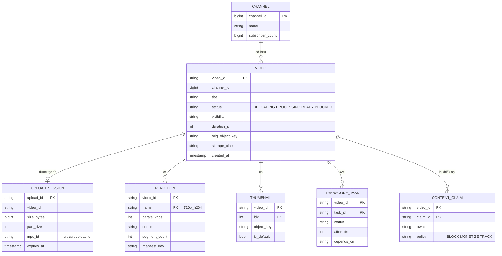

| Dữ liệu | Storage | Vì sao |
|---|---|---|
| Video gốc, segment, thumbnail | **Object storage** (S3-like), key theo `video_id/rendition/segment` | Rẻ, bền (11 số 9), không giới hạn dung lượng; lifecycle chuyển cold - xem [Bài 6](./06-specialized-storage.md) |
| Metadata video, channel | SQL (MySQL/Postgres) sharded theo `video_id`, cache Redis | Cần transaction nhẹ (đổi status), truy vấn theo channel |
| Upload session, transcode task | SQL hoặc KV với TTL | Trạng thái có vòng đời ngắn, cần update có điều kiện (CAS) |
| View count | Stream → counter store (KV) | Ghi rất nhiều, chấp nhận trễ - giống [counter Bài 9](./09-news-feed.md) |
| Player events (QoE) | Kafka → data warehouse / OLAP | Phân tích, không phục vụ request |
| Tìm kiếm | Search index (Elasticsearch/OpenSearch) | Xem [Bài 6](./06-specialized-storage.md) |

Bố cục key trong object storage:

```text
orig/v_Qm71                              (bản gốc - sau 7 ngày chuyển cold)
v/v_Qm71/master.m3u8                     (master playlist)
v/v_Qm71/720p_h264/index.m3u8            (media playlist)
v/v_Qm71/720p_h264/seg_00001.m4s         (segment 4 giây, fMP4)
v/v_Qm71/720p_h264/init.mp4
t/v_Qm71/1_720.webp                      (thumbnail)
```

!!! warning "Prefix nóng trong object storage"
    Một số object storage giới hạn request/giây theo **prefix**. Nếu mọi video mới đều ghi vào `v/2026-10-28/...`, prefix đó thành điểm nóng. Dùng ID ngẫu nhiên (hoặc hash) ở đầu key để rải tải.

---

## 📖 5. Kiến trúc tổng quan

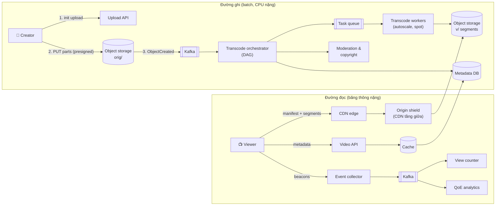

### 5.1 Luồng upload

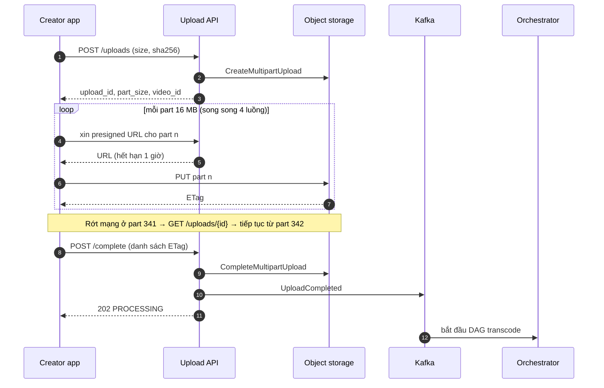

### 5.2 Luồng phát

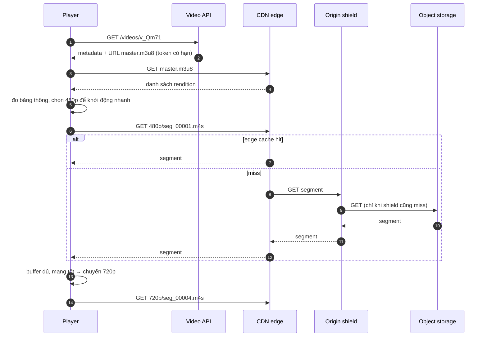

---

## 📖 6. Deep dive 1: Upload resumable

### 6.1 Vì sao không upload một request duy nhất?

| Cách | Rớt mạng ở 90% của 6 GB | Ghi chú |
|---|---|---|
| 1 request POST qua API server | Upload lại từ đầu, API server giữ kết nối 30 phút, tốn băng thông nội bộ | Tệ nhất |
| 1 presigned PUT thẳng lên object storage | Vẫn làm lại từ đầu; nhiều object storage giới hạn 1 PUT ≤ 5 GB | Đỡ tải API |
| **Multipart + presigned URL từng part** | Chỉ làm lại part đang dở (16 MB) | Chuẩn thực tế |
| Giao thức resumable chuẩn (tus, GCS resumable) | Tiếp tục từ byte offset cuối | Một URL, server theo dõi offset |

Chọn kích thước part: quá nhỏ → nhiều request, nhiều presigned URL (giới hạn số part, thường 10.000); quá lớn → rớt mạng mất nhiều. **8–64 MB** là vùng hợp lý; với file 10 GB và tối đa 10.000 part, part tối thiểu ~1 MB.

### 6.2 Vòng đời upload

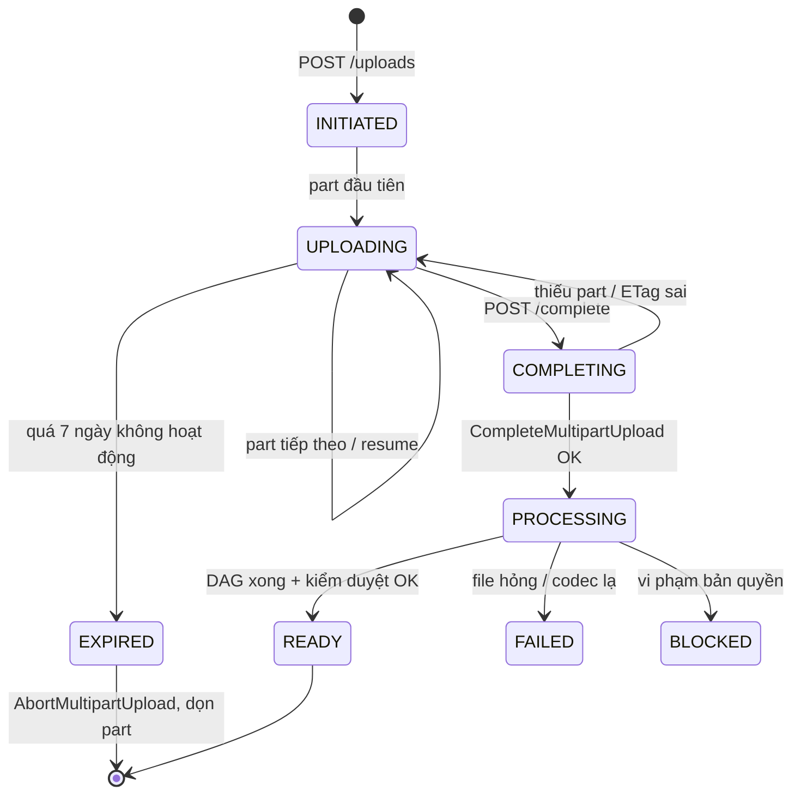

!!! warning "Dọn rác multipart"
    Part đã upload nhưng chưa `complete` **vẫn tính tiền lưu trữ** và không hiện trong danh sách object thông thường. Luôn đặt **lifecycle rule** tự abort multipart upload quá N ngày.

### 💡 Tips quan trọng

- **Checksum từng part** (MD5/CRC32C trong header) để object storage từ chối part hỏng ngay.
- **Dedup**: nếu `sha256` của file đã tồn tại (cùng người re-upload), có thể bỏ qua upload - nhưng cẩn thận lộ thông tin "file này có trên hệ thống" giữa các user khác nhau ([Bài 11](./11-file-sync.md) bàn kỹ).
- Upload từ mobile: dùng **background upload** của hệ điều hành để app bị đóng vẫn tiếp tục.

---

## 📖 7. Deep dive 2: Transcoding pipeline là một DAG

### 7.1 Vì sao cần chia nhỏ

Encode 1 giờ video 1080p bằng codec nặng trên một máy có thể mất **nhiều giờ** (tùy codec, preset, phần cứng). Encode tuần tự 5 rendition còn lâu hơn. Nhưng video có cấu trúc **GOP** (group of pictures) - mỗi đoạn bắt đầu bằng một keyframe có thể giải mã độc lập. Cắt video tại keyframe thành các **chunk 10–60 giây**, encode song song trên hàng trăm máy, rồi ghép lại.

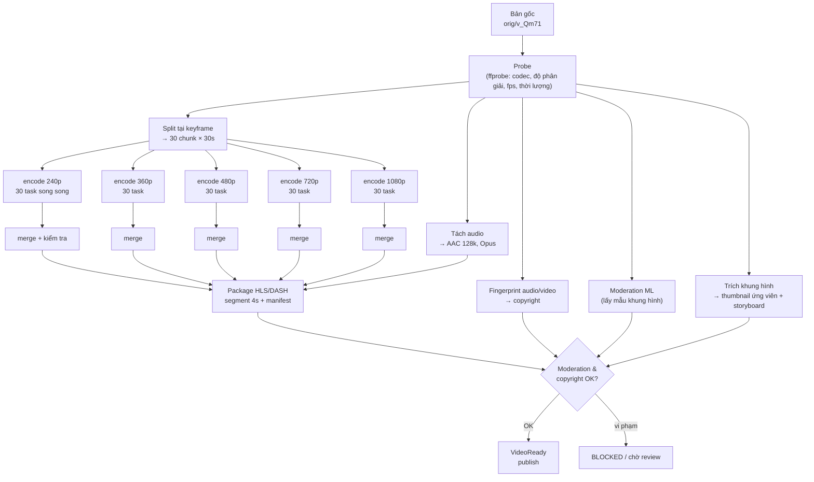

### 7.2 Orchestrator

DAG được lưu dưới dạng các task có `depends_on`. Orchestrator:

1. Khi nhận `UploadCompleted`, sinh DAG theo **profile** (video ngắn dọc, video dài ngang, audio-only...).
2. Đẩy các task **không còn phụ thuộc** vào task queue.
3. Worker nhận task, xử lý, ghi output vào object storage (key **tất định** theo task → chạy lại không sinh rác), báo `TranscodeTaskDone`.
4. Orchestrator cập nhật trạng thái (UPDATE có điều kiện, idempotent), đẩy task mới đã đủ điều kiện.
5. Task lỗi → retry với backoff; quá N lần → đánh dấu FAILED, alert.

| Lựa chọn orchestrator | Ưu | Nhược |
|---|---|---|
| Tự viết trên DB + queue | Kiểm soát hoàn toàn, rẻ | Phải tự lo retry, timeout, visibility |
| Workflow engine (Temporal, Cadence, Step Functions) | Retry, timeout, lịch sử có sẵn; code như luồng tuần tự | Thêm hạ tầng, giới hạn kích thước history |
| Batch framework (Airflow) | Quen thuộc với data team | Không hợp với hàng trăm nghìn DAG nhỏ/ngày, độ trễ lập lịch cao |

### 7.3 Ưu tiên và chi phí

- **Rendition thấp trước**: encode 360p/480p trước để video có thể phát trong vài phút; 1080p/4K và codec nặng (AV1) đến sau.
- **Hàng đợi ưu tiên**: creator lớn, video đang hot, video ngắn đi trước; backfill (encode lại thư viện cũ bằng codec mới) chạy bằng **máy spot/preemptible** giá rẻ vào giờ thấp điểm - task nhỏ 30 giây nên bị thu hồi máy cũng chỉ mất ít công.
- **Per-title encoding**: phim hoạt hình phẳng cần bitrate thấp hơn nhiều so với cảnh thể thao chuyển động nhanh ở cùng chất lượng. Phân tích độ phức tạp để chọn ladder riêng cho mỗi video → tiết kiệm egress.
- **Lazy transcoding**: video không ai xem sau 1 tuần → chỉ giữ vài rendition; khi có người xem, encode thêm.

| Codec | Hiệu quả nén (tương đối) | Chi phí encode | Hỗ trợ thiết bị | Dùng khi |
|---|---|---|---|---|
| H.264/AVC | Mốc so sánh | Thấp | Gần như mọi thiết bị | Bản mặc định, luôn có |
| H.265/HEVC | Tốt hơn đáng kể | Trung bình | Tốt trên Apple, phí bản quyền phức tạp | Thiết bị Apple, TV |
| VP9 | Tốt hơn đáng kể | Trung bình–cao | Trình duyệt, Android | Video phổ biến |
| AV1 | Tốt nhất trong nhóm | Rất cao | Đang tăng nhanh, có giải mã phần cứng trên thiết bị mới | Video **rất nhiều lượt xem** |

---

## 📖 8. Deep dive 3: Adaptive bitrate streaming (HLS/DASH)

### 8.1 Ý tưởng

Thay vì một file MP4 lớn, mỗi rendition được cắt thành **segment 2–6 giây**. Manifest liệt kê các rendition và segment. Player tải từng segment bằng HTTP thường, và **trước mỗi segment** có thể đổi rendition theo tình trạng mạng.

```text
# master.m3u8 (HLS)
#EXTM3U
#EXT-X-STREAM-INF:BANDWIDTH=400000,RESOLUTION=426x240,CODECS="avc1.42c015,mp4a.40.2"
240p_h264/index.m3u8
#EXT-X-STREAM-INF:BANDWIDTH=900000,RESOLUTION=640x360,CODECS="avc1.4d401e,mp4a.40.2"
360p_h264/index.m3u8
#EXT-X-STREAM-INF:BANDWIDTH=2800000,RESOLUTION=1280x720,CODECS="avc1.4d401f,mp4a.40.2"
720p_h264/index.m3u8
#EXT-X-STREAM-INF:BANDWIDTH=5000000,RESOLUTION=1920x1080,CODECS="avc1.640028,mp4a.40.2"
1080p_h264/index.m3u8

# 720p_h264/index.m3u8 (media playlist)
#EXTM3U
#EXT-X-TARGETDURATION:4
#EXT-X-MAP:URI="init.mp4"
#EXTINF:4.000,
seg_00001.m4s
#EXTINF:4.000,
seg_00002.m4s
...
#EXT-X-ENDLIST
```

| | HLS | DASH |
|---|---|---|
| Manifest | `.m3u8` (văn bản) | `.mpd` (XML) |
| Hỗ trợ | Bắt buộc trên thiết bị Apple, phổ biến khắp nơi | Android, trình duyệt qua MSE, TV |
| Container | TS hoặc fMP4 | fMP4 (hoặc WebM) |
| Thực tế | Dùng **CMAF (fMP4)** → cùng một bộ segment phục vụ cả HLS lẫn DASH, chỉ khác manifest → không phải lưu 2 lần |

### 8.2 Chọn độ dài segment

| Segment | Ưu | Nhược |
|---|---|---|
| 2 s | Chuyển chất lượng nhanh, khởi động nhanh, độ trễ live thấp | Nhiều request (×2), nén kém hơn (nhiều keyframe), manifest dài |
| 4–6 s | Cân bằng, phổ biến cho VOD | Phản ứng chậm hơn khi mạng tụt |
| 10 s | Ít request, nén tốt | Chuyển chất lượng chậm, rebuffer lâu hơn khi mạng tụt |

### 8.3 Thuật toán chọn bitrate ở player

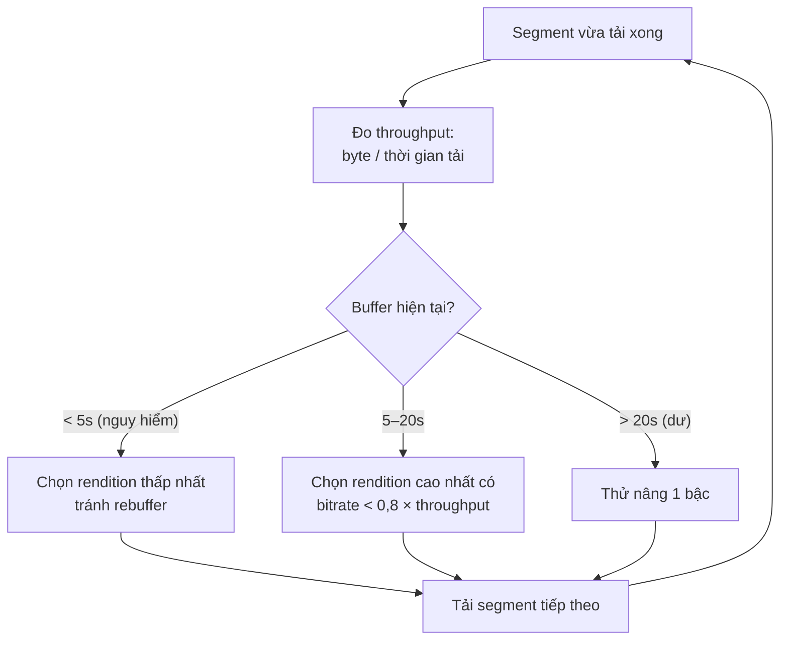

- **Throughput-based**: ước lượng băng thông (trung bình trượt) → chọn bitrate dưới mức đó với hệ số an toàn.
- **Buffer-based** (họ thuật toán BBA, BOLA): quyết định chủ yếu theo **độ đầy buffer** - ổn định hơn khi throughput dao động mạnh như mạng di động.
- Thực tế: lai cả hai, cộng với **khởi động ở rendition thấp/trung** để startup nhanh rồi nâng dần.
- Không nhảy quá nhiều bậc một lần - người xem khó chịu với chất lượng "nhấp nháy" hơn là chất lượng hơi thấp nhưng ổn định.

!!! tip "Startup time: những mẹo rẻ tiền"
    - Prefetch manifest và **segment đầu** khi người dùng lướt tới video (trước khi bấm play).
    - Segment đầu ngắn hơn (2 s) dù các segment sau 4–6 s.
    - Đặt manifest và segment đầu của video hot ở **edge** sẵn (pre-warm).
    - Token xác thực trong URL dài hạn vừa đủ để không phải gọi API lại giữa chừng.

---

## 📖 9. Deep dive 4: Chiến lược CDN & chi phí egress

### 9.1 Phân bố lượt xem: đầu nhọn, đuôi dài

Lượt xem video tuân theo phân phối lệch: một phần nhỏ video chiếm phần lớn lượt xem; hàng triệu video còn lại mỗi cái vài lượt. Hệ quả:

| Nhóm | Đặc điểm | Chiến lược |
|---|---|---|
| **Head** (video hot, mới của kênh lớn) | Rất nhiều người xem cùng lúc | Pre-warm vào edge, nhiều rendition, codec hiệu quả nhất |
| **Torso** | Lượt xem vừa | Cache theo nhu cầu ở edge/shield |
| **Long tail** | Gần như không ai xem | Không cache ở edge (tốn chỗ, đẩy video hot ra); phục vụ từ shield/origin; có thể xóa rendition cao |

### 9.2 Nhiều tầng cache

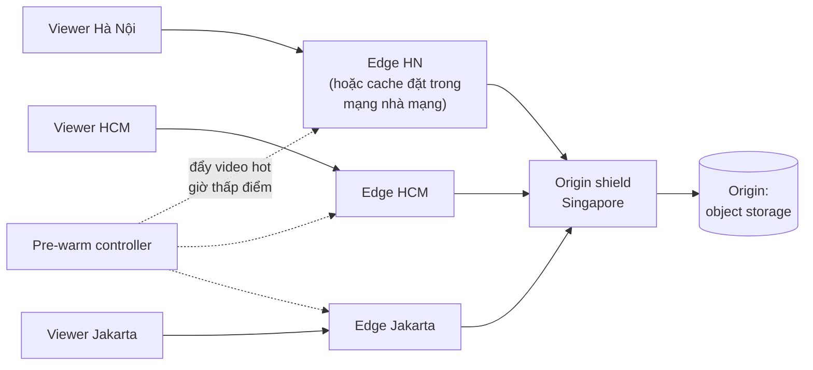

- **Edge**: gần người xem, dung lượng hạn chế, hit ratio cao cho head.
- **Origin shield**: tầng giữa gom miss của nhiều edge → origin chỉ nhận **một** request cho mỗi segment thay vì hàng trăm (giảm egress từ origin và chống thundering herd).
- **Cache trong mạng nhà mạng (ISP)**: các công ty lớn đặt máy cache trong data center của nhà mạng; nhà mạng tiết kiệm băng thông quốc tế, công ty video tiết kiệm egress. Netflix công khai mô tả chương trình Open Connect theo hướng này.
- **Multi-CDN**: dùng 2–3 nhà cung cấp, điều hướng theo giá và chất lượng đo được từ beacon của player; khi một CDN gặp sự cố, chuyển sang CDN khác.

### 9.3 Đòn bẩy giảm chi phí egress

| Đòn bẩy | Tác động | Đánh đổi |
|---|---|---|
| Codec hiệu quả hơn cho video hot | −20–40% byte (tùy nội dung) | CPU encode tăng nhiều |
| Per-title / per-scene encoding | −10–30% | Phân tích thêm |
| Giới hạn chất lượng mặc định trên mobile data (ví dụ 480p) | Lớn | Người dùng có thể đổi tay |
| Không tải trước quá nhiều (buffer tối đa 30–60 s) | Giảm byte bị bỏ khi người xem thoát sớm | Có thể tăng rebuffer khi mạng chập chờn |
| Đàm phán cam kết khối lượng / tự xây CDN | Giá/GB giảm mạnh | Vốn đầu tư, vận hành |
| Peering với nhà mạng, cache trong ISP | Giảm transit | Quan hệ kinh doanh |

!!! note "Byte bị bỏ"
    Nếu player buffer trước 2 phút nhưng 40% người xem thoát ở giây thứ 30, phần buffer đó là egress **trả tiền nhưng không ai xem**. Giới hạn buffer phía trước là một trong những tối ưu chi phí rẻ nhất.

---

## 📖 10. Metadata, lượt xem, thumbnail

### 10.1 Metadata

- Đọc nhiều, ghi ít → cache Redis theo `video_id`, TTL vài phút + invalidate khi creator sửa.
- Trang video gọi nhiều thứ (metadata, channel, counter, gợi ý) → **BFF/aggregator** gọi song song, mỗi phần có timeout và fallback riêng.

### 10.2 Lượt xem

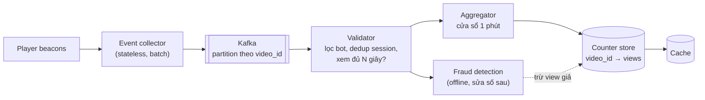

- **Định nghĩa "1 view"** là quyết định sản phẩm: xem tối thiểu N giây, một session một lượt, giới hạn số view/user/video/ngày.
- Đếm bằng **stream aggregation** (cộng dồn theo phút rồi ghi), không `+1` vào DB mỗi lần xem - cùng lý do với [sharded counter ở Bài 9](./09-news-feed.md).
- Số hiển thị có thể **đóng băng tạm** (ví dụ dừng ở một mốc trong lúc kiểm tra gian lận) - người dùng chấp nhận trễ, không chấp nhận số bị "tụt".
- Chống gian lận chạy offline trên dữ liệu đầy đủ, điều chỉnh counter sau.

### 10.3 Thumbnail

- Pipeline trích **N khung hình ứng viên** (bỏ khung tối/mờ), chấm điểm chất lượng, creator chọn hoặc upload ảnh riêng.
- Tạo nhiều kích thước + WebP/AVIF, phục vụ qua CDN với URL chứa version (`1_720.webp?v=3`) → cache vĩnh viễn.
- **Storyboard/sprite**: một ảnh lớn chứa lưới thumbnail nhỏ mỗi 5–10 giây để hiển thị khi người xem kéo thanh tua - một request thay vì hàng trăm.
- Thumbnail cũng phải qua kiểm duyệt (thumbnail gây sốc để câu view là chiêu phổ biến).

---

## 📖 11. Live streaming khác gì?

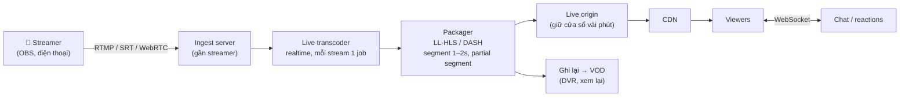

| Khía cạnh | VOD | Live |
|---|---|---|
| Transcode | Batch, chia chunk song song, có thể dùng codec nặng | **Realtime**, phải nhanh hơn thời gian thực, preset nhanh, ladder ít bậc |
| Lỗi transcoder | Retry task | Mất hình ngay → cần transcoder dự phòng chạy song song (hot standby) |
| Manifest | Tĩnh, có `ENDLIST` | **Liên tục cập nhật**, player poll manifest; cache TTL rất ngắn |
| Độ trễ (glass-to-glass) | Không áp dụng | HLS thường: 15–30 s; LL-HLS/LL-DASH: 2–5 s; WebRTC: < 1 s |
| Cache CDN | Lâu dài | Segment chỉ "nóng" vài chục giây; hàng triệu người xin **cùng segment cùng lúc** → request collapsing ở edge là bắt buộc |
| Peak | Phân tán | Dồn: trận chung kết, concert → cần đặt trước dung lượng CDN |
| Kiểm duyệt | Trước khi publish | **Trong khi** phát: lấy mẫu realtime, có nút cắt stream |

!!! tip "Độ trễ thấp không miễn phí"
    Giảm độ trễ = segment ngắn hơn = buffer ít hơn = **dễ rebuffer hơn** và nhiều request hơn. Hỏi lại yêu cầu: livestream bán hàng cần tương tác (độ trễ thấp), còn phát lại trận bóng cho hàng triệu người ưu tiên **ổn định**.

---

## 📖 12. Móc cho bản quyền & kiểm duyệt

Bản quyền và kiểm duyệt không phải "bước cuối" mà là **nút trong DAG** có quyền chặn publish:

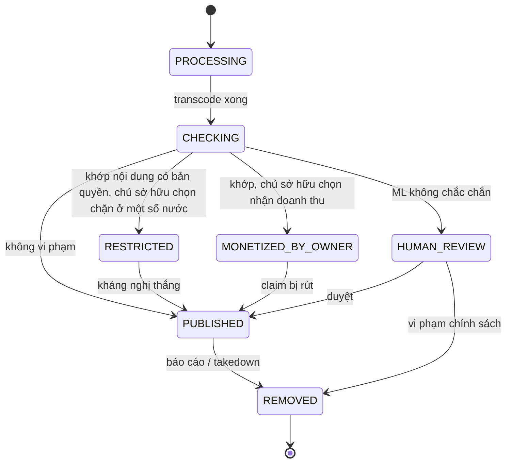

- **Fingerprint**: trích "dấu vân tay" audio/video (bền với nén, cắt, đổi tốc độ nhẹ) → tra trong kho tham chiếu của chủ sở hữu. Đây là bài toán **tìm kiếm gần đúng** quy mô lớn (LSH, vector index - xem [Bài 6](./06-specialized-storage.md)).
- **Moderation ML**: lấy mẫu khung hình + audio + tiêu đề → phân loại; điểm thấp → tự động; vùng xám → hàng đợi người duyệt.
- **Takedown**: video bị gỡ phải biến mất khỏi CDN → **purge** theo prefix `v/{video_id}/` và token phát (URL có token ký kèm `video_id` → Video API từ chối cấp token mới ngay lập tức, kể cả khi CDN chưa purge xong).
- **Kiểm tra lại khi kho tham chiếu cập nhật**: video cũ có thể khớp với nội dung tham chiếu mới thêm → job quét lại theo lô.

---

## 📖 13. Scale, nút thắt & failure modes

| Nút thắt / sự cố | Biểu hiện | Giảm nhẹ |
|---|---|---|
| Hàng đợi transcode dồn (sự kiện lớn, creator upload hàng loạt) | Video "đang xử lý" hàng giờ | Autoscale theo độ dài queue, ưu tiên rendition thấp, spot instances, giới hạn số video đồng thời/kênh |
| Worker chết giữa task | Task treo | Visibility timeout + heartbeat, output key tất định, task idempotent |
| File gốc hỏng/codec lạ | DAG FAILED | Probe sớm, báo lỗi rõ cho creator, giữ bản gốc để thử lại |
| Video viral đột ngột | Edge miss dồn về shield/origin | Origin shield, request collapsing, pre-warm khi phát hiện tốc độ tăng view |
| CDN một nhà cung cấp gặp sự cố | Rebuffer diện rộng ở một vùng | Multi-CDN, player tự chuyển host dự phòng trong manifest |
| Origin (object storage) một region lỗi | Miss không lấy được | Replicate segment của video hot sang region khác; shield ở nhiều nơi |
| Metadata DB chậm | Trang video chậm, nhưng video vẫn phát được nếu đã có URL | Cache dài, tách đường phát khỏi metadata |
| Token phát hết hạn giữa video dài | Lỗi 403 giữa chừng | Token đủ dài (vài giờ) hoặc refresh token qua API |

**Multi-region**: đường ghi có thể tập trung ở 1–2 region (transcode không cần gần người dùng, cần gần **máy rẻ**); đường đọc phân tán toàn cầu qua CDN. Metadata replicate đọc ở nhiều region ([Bài 4](./04-consistency-consensus.md)).

---

## 📖 14. Monitoring & metric chính

**Metric QoE (chất lượng trải nghiệm)** - đo từ beacon của player, quan trọng hơn mọi metric server:

| Metric | Ý nghĩa | Mục tiêu ví dụ |
|---|---|---|
| **Video startup time** (VST) p50/p90 | Bấm play → khung hình đầu | p90 < 2 s |
| **Rebuffer ratio** | Thời gian đứng hình / thời gian xem | < 0,5% |
| Video start failure | Bấm play mà không phát được | < 0,5% |
| Bitrate trung bình được phát | Chất lượng hình | Theo vùng/thiết bị |
| Số lần đổi rendition / phút | Chất lượng có "nhấp nháy" không | Thấp |
| Exit before video start | Người dùng bỏ đi vì chờ lâu | Theo dõi xu hướng |

**Metric hệ thống:**

| Metric | Ý nghĩa |
|---|---|
| CDN hit ratio (edge, shield) | Hiệu quả cache; giảm → egress origin tăng |
| Egress theo CDN, theo vùng, $/GB | Chi phí |
| Thời gian upload → READY (p50/p99), theo độ dài video | Trải nghiệm creator |
| Độ dài transcode queue, tuổi task cũ nhất | Nghẽn pipeline |
| Tỉ lệ task retry/FAILED | Chất lượng worker/input |
| Upload completion rate, số multipart bị bỏ | UX upload, rác lưu trữ |
| Moderation backlog | Video chờ người duyệt |

Cắt metric QoE theo **CDN × ISP × thiết bị × vùng** - một ISP có tuyến quốc tế kém có thể kéo rebuffer của cả nước lên. Xem thêm [Observability](../backend/11-observability-reliability.md).

---

## 📝 Tự chấm

| Hạng mục | Đạt | Chưa đạt |
|---|---|---|
| **Yêu cầu** | Tách VOD/live, hỏi độ dài, thời gian sẵn sàng, thiết bị/mạng, bản quyền | Không hỏi gì về mạng người xem |
| **Ước lượng** | Lưu trữ theo ladder + bản gốc, tích lũy theo năm; egress theo DAU × phút × bitrate; nhận ra egress/lưu trữ là chi phí chính | Chỉ tính QPS API |
| **API** | Upload multipart/presigned, endpoint resume, complete; playback trả manifest URL có token | Upload qua API server một request |
| **Data model** | Object storage cho blob, DB cho metadata/trạng thái, key layout hợp lý | Lưu video trong DB |
| **Kiến trúc** | Tách đường ghi (DAG transcode) và đường đọc (CDN nhiều tầng) | Một service làm hết |
| **Deep dive** | Chia chunk theo GOP song song; ABR với segment, ladder, thuật toán chọn bitrate; CDN head/tail | Nói "dùng ffmpeg" và "dùng CDN" chung chung |
| **Trade-off** | Codec vs CPU, độ dài segment, độ trễ live vs ổn định, lazy transcoding | Không có |
| **Failure** | Worker chết, CDN lỗi, viral, multipart rác, takedown purge | Không đề cập |

---

## 🔄 Biến thể interviewer hay hỏi

??? question "Nếu là video ngắn dạng TikTok (15–60 s, cuộn dọc)?"
    Upload nhỏ, có thể không cần multipart. Ưu tiên **thời gian sẵn sàng** (giây) và **startup gần 0**: prefetch vài video tiếp theo trong feed, ladder ít bậc, segment ngắn hoặc progressive MP4. Bài toán chính chuyển sang **gợi ý** (phễu như [Bài 9](./09-news-feed.md)).

??? question "Nếu là Netflix (thư viện nhỏ, chất lượng cao, xem nhiều)?"
    Số video ít (hàng chục nghìn) nhưng mỗi video được xem cực nhiều → đáng đầu tư **encode rất kỹ** (per-scene, nhiều codec), **pre-position** nội dung vào cache ISP vào giờ thấp điểm theo dự báo. Upload không phải bài toán người dùng. DRM bắt buộc.

??? question "Nếu yêu cầu video riêng tư / trả phí?"
    URL segment có **chữ ký** (signed URL/cookie) với hạn ngắn, gắn với user/session; CDN kiểm tra chữ ký ở edge. Nội dung cao cấp → DRM (mã hóa segment, license server).

??? question "Nếu muốn phụ đề tự động và đa ngôn ngữ?"
    Thêm nút trong DAG: tách audio → speech-to-text → dịch → xuất WebVTT. Phụ đề là track riêng trong manifest, không phải encode lại video.

??? question "Nếu có 1 triệu người xem live cùng một trận đấu?"
    Request collapsing ở edge (1 request về origin cho mỗi segment), nhiều tầng shield, đặt trước dung lượng multi-CDN, ladder cố định, transcoder dự phòng nóng, theo dõi độ trễ và rebuffer theo thời gian thực. Chat tách riêng (fan-out tin nhắn - [Bài 8](./08-chat-presence.md)), có lấy mẫu/giới hạn tốc độ khi quá đông.

??? question "Nếu phải giảm 30% chi phí trong quý tới?"
    Nhìn bảng chi phí: egress (codec cho head, giới hạn buffer, chất lượng mặc định trên mobile data, đàm phán CDN), lưu trữ (bản gốc sang cold, xóa rendition của long tail + lazy transcode), compute (spot cho backfill). Đo trước - sửa sau.

---

## 🌍 Ứng dụng thực tế

- **YouTube** công khai nhiều lần về việc dùng VP9 và AV1 cho video phổ biến và về hệ thống Content ID cho bản quyền (cơ chế chi tiết là nội bộ).
- **Netflix** có nhiều bài blog kỹ thuật về **per-title / per-shot encoding** và về **Open Connect** - cache đặt trong mạng ISP.
- **HLS** do Apple định nghĩa (RFC 8216), **MPEG-DASH** là chuẩn ISO; **CMAF** cho phép dùng chung segment.
- Các nền tảng video và livestream bán hàng ở Việt Nam/Đông Nam Á đối mặt đúng bài toán mạng di động chập chờn → ABR buffer-based và ladder có bậc thấp (144p/240p) rất quan trọng.
- Dịch vụ đám mây có sẵn: transcoding (MediaConvert, Transcoder API), live (IVS, MediaLive), workflow (Step Functions/Temporal) - phỏng vấn vẫn cần biết bên trong chúng làm gì.

---

## ⚠️ Sai lầm thường gặp

1. **Upload qua API server** trong một request → nghẽn API, không resume được.
2. **Transcode tuần tự một máy** → video dài chờ hàng giờ.
3. **Stream một file MP4 duy nhất** → không thích nghi mạng, tua chậm.
4. **Quên bản gốc** trong ước lượng lưu trữ, hoặc giữ bản gốc ở hot storage mãi mãi.
5. **Bỏ qua egress** - tính lưu trữ rất kỹ nhưng không tính băng thông, trong khi đó là khoản lớn nhất.
6. **Cache mọi thứ ở edge** → long tail đẩy video hot ra khỏi cache.
7. **Đếm view bằng UPDATE +1** mỗi lần phát.
8. **Kiểm duyệt sau khi publish** mà không có cách gỡ nhanh khỏi CDN.
9. Áp dụng thiết kế VOD cho **live** (manifest cache dài, không có transcoder dự phòng).

---

## 🏋️ Bài tập

**Bài 1 (dễ).** Một video 10 phút ở 720p 2,5 Mbps nặng bao nhiêu MB? Nếu chia segment 4 giây thì có bao nhiêu segment và mỗi segment trung bình bao nhiêu KB?

<details markdown="1"><summary>Đáp án</summary>

- 2,5 × 600 / 8 = **187,5 MB**.
- 600 / 4 = **150 segment**, mỗi segment ≈ 2,5 Mbps × 4 s / 8 = 1,25 MB ≈ **1.250 KB**.

</details>

**Bài 2 (dễ).** Vì sao dùng CMAF (fMP4) lại tiết kiệm lưu trữ khi phải hỗ trợ cả HLS lẫn DASH?

<details markdown="1"><summary>Đáp án</summary>

HLS kiểu cũ dùng MPEG-TS, DASH dùng fMP4 → phải lưu **hai bộ segment** cho cùng nội dung (gấp đôi lưu trữ, và CDN cache cũng bị chia đôi → hit ratio giảm). CMAF cho phép cả hai giao thức dùng **chung segment fMP4**, chỉ khác file manifest (vài KB).

</details>

**Bài 3 (trung bình) - Drill chi phí.** Dùng code ở §2.3, đổi giả định: DAU tăng lên 30 triệu, thêm 4K (15 Mbps) cho 10% video (chỉ 10% video được encode 4K), giá CDN $0,01/GB. Tính lại lưu trữ ladder/năm và egress/tháng (giữ bitrate xem trung bình 2 Mbps). Khoản nào tăng mạnh hơn?

<details markdown="1"><summary>Đáp án</summary>

- 4K: 15 × 60 / 8 = 112,5 MB/phút, áp cho 10% số phút → thêm 11,25 MB/phút trung bình. Ladder: 69 + 11,25 = **80,25 MB/phút** → 80,25 × 600.000 / 1e6 = 48,15 TB/ngày → **~17,6 PB/năm** (tăng ~16%).
- Egress: 30M × 30 × 15 MB = 13,5 PB/ngày → 13,5e6 GB × $0,01 × 30 ≈ **$4,05 triệu/tháng** (gấp 6 lần).
- Egress tăng mạnh hơn nhiều (tỉ lệ thuận với DAU và giá/GB), còn lưu trữ chỉ phụ thuộc lượng upload. Bài học: tăng trưởng người xem → ưu tiên tối ưu egress.

</details>

**Bài 4 (trung bình).** Video 2 giờ, encode một rendition trên một máy mất 3 giờ. Bạn có 200 worker. Chia chunk 30 giây, 5 rendition. Ước lượng thời gian hoàn thành lý tưởng. Điều gì làm thực tế chậm hơn?

<details markdown="1"><summary>Đáp án</summary>

- 7.200 s / 30 = 240 chunk × 5 rendition = **1.200 task**. Mỗi task: 3 giờ / 240 = 45 s (với rendition nặng nhất; rendition thấp nhanh hơn).
- 1.200 task / 200 worker = 6 lượt × ~45 s ≈ **4,5 phút** + split/merge/package (~vài phút) → **~10 phút** thay vì 15 giờ tuần tự.
- Thực tế chậm hơn: tải chunk từ object storage, task khởi động (container cold start), straggler (task chậm nhất quyết định - dùng speculative execution), các video khác tranh worker, encode 2-pass, kiểm duyệt.

</details>

**Bài 5 (trung bình).** Người xem bấm play, thấy hình sau 4 giây (mục tiêu p90 < 2 s). Liệt kê các bước trên đường từ bấm play đến khung hình đầu và một tối ưu cho mỗi bước.

<details markdown="1"><summary>Đáp án</summary>

| Bước | Tối ưu |
|---|---|
| Gọi Video API lấy metadata + URL | Trả URL sẵn trong feed/danh sách, prefetch khi lướt tới |
| DNS + TLS tới CDN | Kết nối giữ sẵn (preconnect), HTTP/2-3, cùng domain |
| Tải master manifest | Nhúng sẵn master manifest trong response API, cache edge |
| Tải media playlist | Cache edge, nén |
| Tải init segment + segment đầu | Bắt đầu ở rendition thấp/trung, segment đầu 2 s, pre-warm edge cho video hot |
| Edge miss → shield → origin | Origin shield, pre-warm |
| Giải mã khung đầu | Keyframe ở đầu segment, codec có giải mã phần cứng |

</details>

**Bài 6 (khó).** Thiết kế cơ chế **lazy transcoding**: video không ai xem sau 30 ngày bị xóa các rendition ≥ 720p. Khi có người xem lại, chuyện gì xảy ra? Làm sao người xem không thấy lỗi?

<details markdown="1"><summary>Đáp án</summary>

- Job hàng ngày tìm video có view 30 ngày = 0 → xóa segment 720p/1080p, cập nhật bảng `RENDITION` (đánh dấu `ARCHIVED`), **sinh lại master manifest** chỉ gồm rendition còn lại (240p–480p), purge manifest ở CDN.
- Người xem mới: nhận manifest rút gọn → phát ngay ở 480p, không lỗi. Đồng thời Video API phát sự kiện `ArchivedVideoViewed` → orchestrator đưa DAG encode lại 720p/1080p vào hàng đợi ưu tiên thấp (nếu lượt xem vượt ngưỡng, ví dụ 10 lượt/ngày, để tránh encode cho một lượt xem lẻ).
- Khi xong: thêm rendition vào manifest, purge manifest. Người xem sau thấy đủ chất lượng.
- Bản gốc phải còn (cold storage) → lưu ý thời gian lấy dữ liệu từ lớp lưu trữ lạnh có thể tính bằng giờ với một số lớp "archive"; chọn lớp phù hợp.

</details>

**Bài 7 (khó).** Thiết kế livestream cho sự kiện 2 triệu người xem đồng thời với độ trễ mục tiêu 5 giây. Tính băng thông cần và chỉ ra 3 điểm có thể sập.

<details markdown="1"><summary>Đáp án</summary>

- Băng thông: 2M × ~2,5 Mbps trung bình = **5 Tbps** ở edge - phải đặt trước dung lượng với nhiều CDN.
- Pipeline: ingest có 2 đường (chính + dự phòng, từ 2 encoder ở hiện trường) → transcoder realtime chạy **2 bản song song** ở 2 zone → packager LL-HLS (partial segment ~0,5–1 s, segment 2 s) → origin → shield → edge.
- Ba điểm sập: (1) **Manifest**: 2M player poll manifest mỗi giây → edge phải cache manifest với TTL rất ngắn + request collapsing; (2) **Origin/shield** khi segment mới xuất hiện, hàng nghìn edge cùng miss một lúc → collapsing ở shield, nhiều shield; (3) **Transcoder/ingest** đơn lẻ → hot standby, chuyển mạch tự động, cảnh báo khi bitrate ingest tụt.
- Thêm: chat/reaction giới hạn tốc độ, lấy mẫu; số người xem hiển thị là ước lượng (HyperLogLog trên session).

</details>

---

## ✅ Checklist

- [ ] Tách đường ghi (upload + transcode) và đường đọc (phát qua CDN)
- [ ] Ước lượng lưu trữ theo ladder + bản gốc, tích lũy theo năm; egress theo DAU × phút × bitrate
- [ ] Upload multipart + presigned URL, resume, dọn multipart rác
- [ ] Transcode DAG: probe → split theo GOP → encode song song → merge → package; orchestrator idempotent
- [ ] ABR: manifest, segment, ladder, chọn độ dài segment, thuật toán throughput/buffer-based
- [ ] CDN nhiều tầng, head vs long tail, origin shield, multi-CDN; các đòn bẩy giảm egress
- [ ] View count bằng stream aggregation + chống gian lận
- [ ] Khác biệt live: realtime transcode, manifest động, độ trễ vs ổn định, request collapsing
- [ ] Bản quyền/kiểm duyệt là nút trong DAG có quyền chặn; takedown = từ chối token + purge
- [ ] Metric QoE: startup time, rebuffer ratio, bitrate, start failure

---

**Bài tiếp theo**: [Bài 11: Đồng bộ file](./11-file-sync.md)
