# 📚 Bài 11: Đồng bộ file

> "Đồng bộ file nghe như 'copy file lên mây'. Thực ra nó là bài toán **phân tán khó nhất mà người dùng phổ thông chạm vào hằng ngày**: nhiều máy, mất mạng, sửa cùng lúc - và không ai chấp nhận mất một chữ trong luận văn."

Minh là sinh viên năm cuối. Sáng thứ Hai, Minh sửa file `luan-van.docx` (80 MB, có nhiều hình) trên laptop ở thư viện - Wi-Fi chập chờn, rồi mất hẳn. Minh vẫn sửa tiếp offline. Buổi chiều về nhà, Minh mở máy bàn, sửa chương 3 cùng file đó (máy bàn chưa nhận bản sáng). Tối, laptop có mạng lại.

Hệ thống đồng bộ phải trả lời:

- Laptop chỉ sửa 2 trang - có cần upload lại **cả 80 MB** không?
- Hai bản sửa khác nhau của cùng một file - giữ bản nào? **Không được âm thầm vứt bản nào.**
- Máy bàn làm sao **biết** có thay đổi mà không phải hỏi server mỗi giây?
- Nếu đang upload thì mất mạng, file trên server có bị **nửa cũ nửa mới** không?

Bài này thiết kế một hệ thống kiểu Google Drive / Dropbox: chunking (có demo đo tỉ lệ dedup), metadata và version, giao thức sync, xử lý xung đột, chia sẻ - và mối quan hệ nhất quán giữa **metadata** và **blob**.

## 🎯 Mục tiêu bài học

- Thiết kế hệ thống đồng bộ file theo đủ 11 bước của case study
- So sánh **fixed-size chunking** và **content-defined chunking (CDC)**, đo tỉ lệ dedup bằng demo Go/Python
- Dedup theo hash nội dung, refcount và **garbage collection** an toàn
- Thiết kế **metadata DB** dạng journal có version, cursor để lấy delta
- Giao thức sync: **notification (long-poll/WebSocket) + delta pull**
- Xử lý **xung đột** bằng optimistic concurrency và **conflict copy**; offline edits
- Giữ nhất quán **metadata ↔ blob**: thứ tự ghi đúng để không bao giờ có metadata trỏ tới block không tồn tại
- Mô hình chia sẻ (namespace, ACL) và kiểm soát truy cập block

---

## 🧩 Tự thiết kế trước

!!! question "Đề bài (15–20 phút)"
    Thiết kế dịch vụ lưu trữ và đồng bộ file:

    - Client desktop/mobile đồng bộ một thư mục với cloud; nhiều thiết bị cùng tài khoản.
    - File tới 50 GB; sửa offline được; lịch sử phiên bản 30 ngày.
    - Chia sẻ thư mục cho người khác (xem/sửa).
    - 50 triệu user, 10 triệu DAU.

    Viết ra: ước lượng, API, data model, kiến trúc, **cách chỉ gửi phần thay đổi**, **cách thiết bị khác biết có thay đổi**, và **xử lý xung đột**.

<details markdown="1"><summary>Gợi ý</summary>

1. Chia file thành **block** và định danh block bằng **hash nội dung** → điều gì xảy ra khi hai file có chung block?
2. Nếu chèn 1 byte vào đầu file và chia block cố định 4 MB, có bao nhiêu block bị đổi?
3. Mỗi thay đổi trong một thư mục là một dòng trong **nhật ký** có số thứ tự tăng dần → thiết bị chỉ cần nhớ "đã đọc tới số mấy".
4. Đừng gửi dữ liệu qua kênh thông báo - chỉ gửi "có gì đó thay đổi".
5. Khi commit, client nói "tôi sửa dựa trên version 7" - nếu server đang ở version 8 thì sao?
6. Upload block trước hay ghi metadata trước?

</details>

---

## 📖 1. Làm rõ yêu cầu

> **Ứng viên:** Đồng bộ cả thư mục trên máy hay chỉ upload/download thủ công qua web?
> **Interviewer:** Đồng bộ tự động hai chiều, có client desktop và mobile, cộng web.
>
> **Ứng viên:** Có cần chỉnh sửa cộng tác thời gian thực như Google Docs?
> **Interviewer:** Không. Đơn vị là file. Hai người sửa cùng file thì xử lý xung đột.
>
> **Ứng viên:** Thay đổi trên một thiết bị cần xuất hiện ở thiết bị khác trong bao lâu?
> **Interviewer:** Với file nhỏ, vài giây khi cả hai online.
>
> **Ứng viên:** Kích thước file lớn nhất, quota?
> **Interviewer:** 50 GB/file. Quota miễn phí 15 GB, trả phí 2 TB.
>
> **Ứng viên:** Lịch sử phiên bản và thùng rác?
> **Interviewer:** Khôi phục phiên bản cũ trong 30 ngày, thùng rác 30 ngày.
>
> **Ứng viên:** Có mã hóa đầu-cuối (E2E) không?
> **Interviewer:** Không bắt buộc, nhưng nói được ảnh hưởng nếu có thì tốt.

| Loại | Yêu cầu |
|---|---|
| **Chức năng** | Upload/download, đồng bộ hai chiều nhiều thiết bị, offline edit, phiên bản + khôi phục, thùng rác, chia sẻ thư mục/link với quyền xem/sửa, thông báo thay đổi |
| **Phi chức năng** | **Không mất dữ liệu** (durability ≥ 11 số 9 cho blob); sync latency vài giây khi online; tiết kiệm băng thông (chỉ gửi phần đổi); upload resumable; metadata nhất quán mạnh **trong một thư mục**; chịu được hàng chục triệu kết nối chờ thông báo |
| **Ngoài phạm vi** | Chỉnh sửa cộng tác realtime (OT/CRDT), tìm kiếm full-text nội dung, preview tài liệu chi tiết |

!!! tip "Thứ tự ưu tiên"
    Với hệ thống lưu file của người dùng: **đúng đắn > bền > nhanh**. Sync chậm vài giây không ai kiện, mất file thì có. Mọi quyết định "nhanh hơn nhưng có thể mất dữ liệu" đều phải bị loại.

---

## 📖 2. Ước lượng

Các con số là **ước tính để luyện tập**. Phương pháp ở [Bài 1](./01-framework-estimation.md).

**Giả định**: 50M user, 10M DAU; mỗi user dùng trung bình 8 GB, 2.000 file (file trung bình 4 MB); mỗi DAU tạo/sửa 20 file/ngày; trung bình 2,5 thiết bị/user, 2 thiết bị online cùng lúc với DAU.

### 2.1 Lưu trữ

```text
Logic:      50M × 8 GB                       = 400 PB
Dedup + nén (giả sử tiết kiệm 30%)           → 280 PB
Erasure coding (overhead ~1,5×)              → ~420 PB dung lượng thô
Version cũ 30 ngày (giả sử thêm 10%)         → ~460 PB
```

### 2.2 Metadata

```text
File:      50M × 2.000                       = 100 tỷ file
Mỗi bản ghi file + block list (~1–2 block)   ≈ 300 B
→ 100 tỷ × 300 B                             ≈ 30 TB metadata (chưa tính version, index)
Version 30 ngày: 10M DAU × 20 sửa/ngày × 30  = 6 tỷ version × 300 B ≈ 1,8 TB
```

30 TB metadata → **phải shard** (không vừa một máy DB một cách thoải mái), nhưng vẫn nhỏ hơn blob 4 bậc độ lớn.

### 2.3 QPS

```text
Thay đổi file: 10M × 20 / 86.400             ≈ 2.300 commit/s   → peak ≈ 7.000/s
Block upload:  mỗi commit ~1–2 block mới     ≈ 3.500 block/s    → peak ≈ 10.000/s
Delta pull:    mỗi thay đổi đánh thức ~1,5 thiết bị khác + thành viên thư mục chia sẻ
               ≈ 2.300 × 3                    ≈ 7.000 req/s      → peak ≈ 20.000/s
```

### 2.4 Kết nối thông báo

```text
Thiết bị online:  10M DAU × 2                 = 20M kết nối long-poll/WebSocket đồng thời
Một server giữ ~100.000 kết nối (ước tính)     → ~200 notification server (+ dự phòng)
```

### 2.5 Băng thông

```text
Upload: 200M thay đổi/ngày × ~1 MB dữ liệu mới thực sự (nhờ chỉ gửi block đổi)
        = 200 TB/ngày ≈ 2,3 GB/s ≈ 18,5 Gbps trung bình
Nếu gửi lại cả file (4 MB trung bình, nhưng file lớn kéo trung bình lên nhiều):
        ≥ 800 TB/ngày - chênh ít nhất 4 lần, với file lớn chênh hàng trăm lần
```

---

## 📖 3. API design

Client không upload "file" - nó upload **block** và commit **danh sách block**.

```http
# 1) Hỏi server: những block nào bạn chưa có?
POST /v1/blocks/check
{ "hashes": ["sha256:a1..", "sha256:b2..", "sha256:c3.."] }
→ 200 { "missing": ["sha256:c3.."] }

# 2) Upload block còn thiếu (thẳng lên block storage qua URL có chữ ký)
PUT /v1/blocks/sha256:c3..         (body: bytes, ≤ 4 MB; server kiểm hash khớp body)
→ 201

# 3) Commit metadata: file mới = danh sách block, dựa trên version cha
POST /v1/files/commit
{ "namespace_id": 9001, "path": "/Luan van/luan-van.docx",
  "parent_rev": 7,                                  # optimistic concurrency
  "blocks": ["sha256:a1..", "sha256:b2..", "sha256:c3.."],
  "size": 83886080, "client_mtime": "2026-10-28T09:12:00Z", "device_id": "laptop-minh" }
→ 200 { "rev": 8, "journal_id": 55012 }
→ 409 { "error": "conflict", "server_rev": 8, "server_blocks": [...] }   # có người sửa trước

# 4) Thiết bị khác: chờ thông báo (long-poll, timeout 60–90 s)
GET /v1/notify/longpoll?cursor=ns9001:55011,ns42:310
→ 200 { "changes": true }            # chỉ báo "có gì đó", KHÔNG gửi dữ liệu
→ 200 { "changes": false }           # hết timeout, gọi lại

# 5) Lấy delta theo cursor
GET /v1/delta?cursor=ns9001:55011&limit=500
→ 200 { "entries": [ { "journal_id": 55012, "path": "/Luan van/luan-van.docx", "rev": 8,
                       "blocks": [...], "size": 83886080, "deleted": false } ],
        "cursor": "ns9001:55012", "has_more": false }

# 6) Tải block mình chưa có
GET /v1/blocks/sha256:c3..   → bytes

# Chia sẻ
POST /v1/shares  { "path": "/Do an nhom", "with": "lan@example.com", "role": "editor" }
POST /v1/links   { "path": "/Anh cuoi.zip", "role": "viewer", "expires_in": 604800 }
```

!!! note "Vì sao tách check → upload → commit?"
    - **Check** cho dedup: block đã có (của chính bạn, hoặc của file khác) thì không upload lại.
    - **Upload** block là thao tác idempotent: cùng hash, cùng nội dung → upload hai lần cũng không sao → **resumable tự nhiên**.
    - **Commit** là thao tác duy nhất làm thay đổi "sự thật" mà người dùng thấy - và nó chỉ xảy ra khi mọi block đã nằm an toàn trên server.

---

## 📖 4. Data model & storage

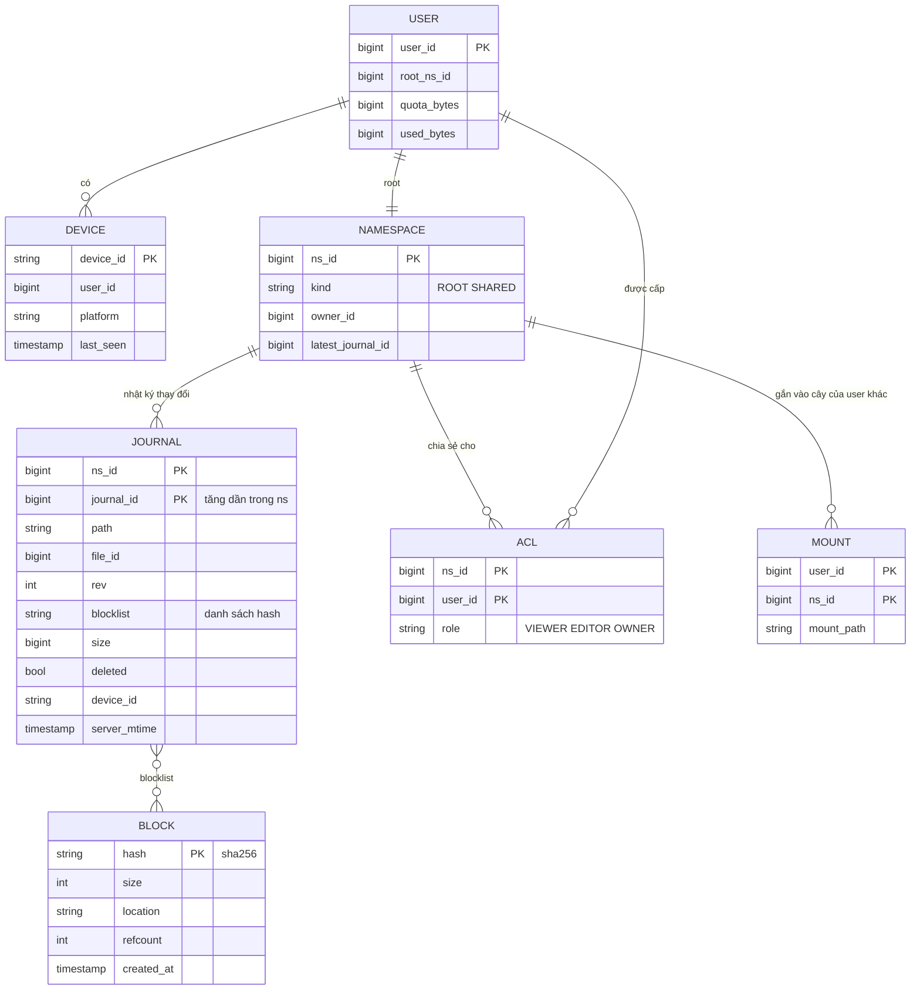

**Khái niệm namespace**: mỗi user có một namespace gốc; mỗi thư mục được chia sẻ là **một namespace riêng**, được "gắn" (mount) vào cây thư mục của từng thành viên. Nhờ vậy:

- Journal, cursor, quyền đều tính **theo namespace** - chia sẻ một thư mục cho 50 người không phải nhân bản metadata 50 lần.
- Metadata DB **shard theo `ns_id`** → mọi thay đổi trong một namespace nằm trên một shard → có thể dùng transaction và sinh `journal_id` tăng dần chặt chẽ.

| Dữ liệu | Storage | Vì sao |
|---|---|---|
| Journal / file metadata | SQL sharded theo `ns_id` (MySQL/Postgres, hoặc NewSQL) | Cần transaction trong namespace (commit = so sánh `parent_rev` + ghi journal), truy vấn theo cursor |
| Block | Object/blob storage, key = hash | Bất biến, content-addressed, erasure coding - [Bài 6](./06-specialized-storage.md) |
| Block index (hash → vị trí, refcount) | KV store sharded theo hash | Tra cứu điểm, rất nhiều |
| Kết nối thông báo | In-memory trên notification server + registry (Redis) | Tạm thời |
| Thùng rác, version | Chính là các bản ghi journal cũ + block còn được tham chiếu | Không cần lưu riêng |

!!! warning "Không lưu đường dẫn là khóa duy nhất"
    Đổi tên thư mục `/A` thành `/B` chứa 100.000 file: nếu metadata dùng **đường dẫn đầy đủ** làm khóa, phải sửa 100.000 bản ghi. Thực tế nên lưu **cây** (mỗi node có `file_id`, `parent_id`, `name`); journal ghi sự kiện "move node X sang parent Y". Bảng ER phía trên dùng `path` cho dễ đọc - hãy nhắc trade-off này khi phỏng vấn.

---

## 📖 5. Kiến trúc tổng quan

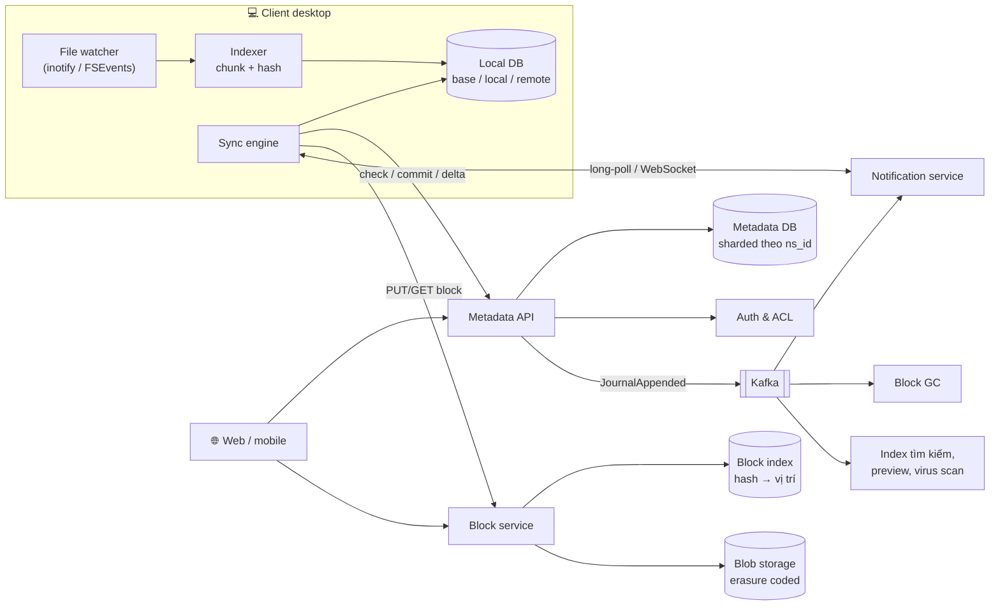

### 5.1 Luồng sửa file và upload

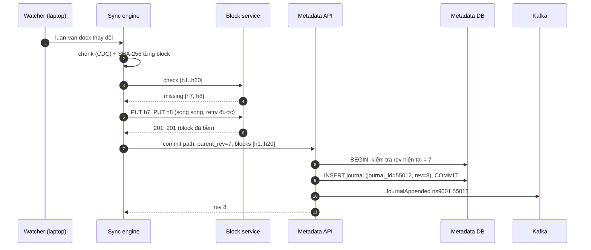

### 5.2 Luồng thiết bị khác nhận thay đổi

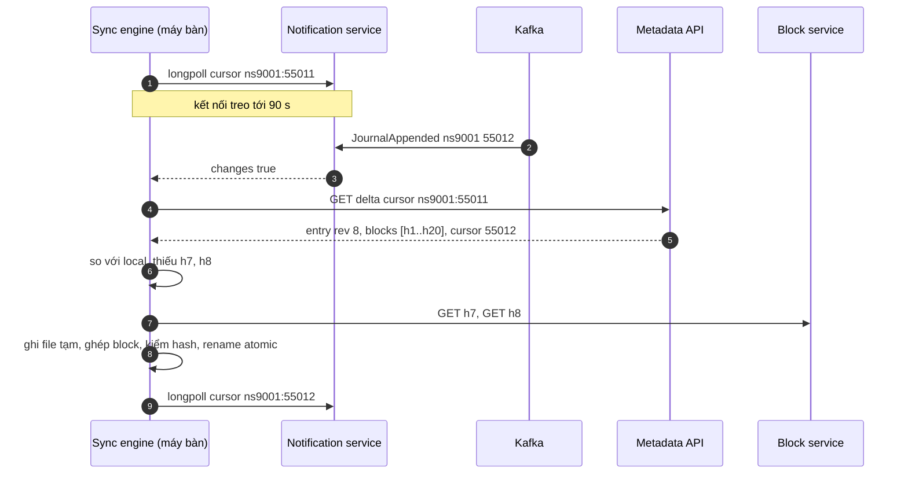

---

## 📖 6. Deep dive 1: Chunking & dedup

### 6.1 Fixed-size vs content-defined chunking

**Fixed-size**: cắt mỗi N byte. Đơn giản, nhanh. Nhưng chèn **1 byte** vào đầu file làm **mọi ranh giới block dịch đi 1 byte** → mọi block có hash mới → upload lại cả file.

**Content-defined chunking (CDC)**: trượt một cửa sổ qua dữ liệu, tính **rolling hash**; cắt khi hash thỏa điều kiện (ví dụ 12 bit thấp bằng 0 → trung bình mỗi ~4 KiB cắt một lần). Ranh giới phụ thuộc **nội dung cục bộ**, nên chèn byte chỉ làm đổi block quanh chỗ chèn; các ranh giới phía sau "bắt lại" đúng vị trí cũ.

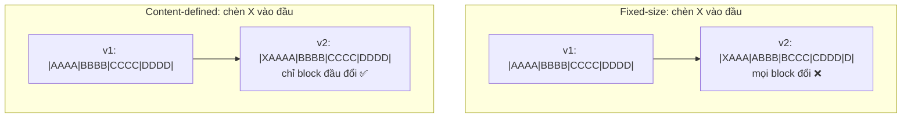

### 6.2 Demo: đo tỉ lệ dedup

File v1 512 KiB dữ liệu ngẫu nhiên. v2 = chèn 100 byte ở offset 1.000 và sửa 50 byte ở offset 300.000. Server đã có mọi block của v1. Hỏi: upload v2 tốn bao nhiêu byte?

CDC dùng **Gear hash** (họ FastCDC): `h = (h << 1) + gear[byte]`. Vì dịch trái 1 bit mỗi byte trên số 64 bit, `h` chỉ phụ thuộc ~64 byte gần nhất → đúng tính chất "cửa sổ trượt". Có `min_size` (tránh block quá nhỏ) và `max_size` (chặn trên khi dữ liệu không có điểm cắt).

=== "Go"

    ```go
    package main

    import (
    	"crypto/sha256"
    	"fmt"
    )

    const M = 4096 // fixed chunk size

    type rng struct{ s uint64 }

    func (r *rng) next() uint64 { // splitmix64
    	r.s += 0x9E3779B97F4A7C15
    	z := r.s
    	z = (z ^ (z >> 30)) * 0xBF58476D1CE4E5B9
    	z = (z ^ (z >> 27)) * 0x94D049BB133111EB
    	return z ^ (z >> 31)
    }

    func randBytes(r *rng, n int) []byte {
    	b := make([]byte, n)
    	for i := range b {
    		b[i] = byte(r.next())
    	}
    	return b
    }

    // Chia cố định: cắt mỗi 4 KiB
    func fixedChunks(data []byte) [][]byte {
    	var out [][]byte
    	for i := 0; i < len(data); i += M {
    		end := min(i+M, len(data))
    		out = append(out, data[i:end])
    	}
    	return out
    }

    // Content-defined chunking (Gear hash, kiểu FastCDC đơn giản):
    // cắt khi 12 bit thấp của hash = 0 -> trung bình ~4 KiB sau min-size
    var gear [256]uint64

    func cdcChunks(data []byte) [][]byte {
    	const minSize, maxSize, mask = 1024, 16384, (1 << 12) - 1
    	var out [][]byte
    	start := 0
    	var h uint64
    	for i := 0; i < len(data); i++ {
    		size := i - start + 1
    		h = (h << 1) + gear[data[i]]
    		if size < minSize {
    			continue
    		}
    		if h&mask == 0 || size >= maxSize {
    			out = append(out, data[start:i+1])
    			start, h = i+1, 0
    		}
    	}
    	if start < len(data) {
    		out = append(out, data[start:])
    	}
    	return out
    }

    // Upload v2 khi server đã có các chunk của v1: chỉ gửi chunk có hash mới
    func report(name string, chunker func([]byte) [][]byte, v1, v2 []byte) {
    	have := map[[32]byte]bool{}
    	for _, c := range chunker(v1) {
    		have[sha256.Sum256(c)] = true
    	}
    	c2 := chunker(v2)
    	newCnt, newBytes := 0, 0
    	for _, c := range c2 {
    		if !have[sha256.Sum256(c)] {
    			newCnt++
    			newBytes += len(c)
    		}
    	}
    	fmt.Printf("%-6s v2 có %3d chunk, phải upload %3d chunk = %6d byte (%.1f%% file), dedup %.1f%%\n",
    		name, len(c2), newCnt, newBytes, 100*float64(newBytes)/float64(len(v2)),
    		100-100*float64(newBytes)/float64(len(v2)))
    }

    func main() {
    	r := &rng{s: 42}
    	for i := range gear {
    		gear[i] = r.next()
    	}
    	v1 := randBytes(r, 512*1024) // file 512 KiB
    	// v2 = chèn 100 byte ở đầu file + sửa 50 byte ở giữa
    	v2 := append([]byte{}, v1[:1000]...)
    	v2 = append(v2, randBytes(r, 100)...)
    	v2 = append(v2, v1[1000:]...)
    	copy(v2[300000:], randBytes(r, 50))
    	fmt.Printf("v1 = %d byte, v2 = %d byte (chèn 100B ở offset 1000, sửa 50B ở offset 300000)\n", len(v1), len(v2))
    	report("Fixed", fixedChunks, v1, v2)
    	report("CDC", cdcChunks, v1, v2)
    }

    // Output:
    // v1 = 524288 byte, v2 = 524388 byte (chèn 100B ở offset 1000, sửa 50B ở offset 300000)
    // Fixed  v2 có 129 chunk, phải upload 129 chunk = 524388 byte (100.0% file), dedup 0.0%
    // CDC    v2 có 115 chunk, phải upload   2 chunk =  17639 byte (3.4% file), dedup 96.6%
    ```

=== "Python"

    ```python
    import hashlib

    M64 = (1 << 64) - 1
    FIXED = 4096


    class Rng:  # splitmix64, giống bản Go
        def __init__(self, seed):
            self.s = seed

        def next(self):
            self.s = (self.s + 0x9E3779B97F4A7C15) & M64
            z = self.s
            z = ((z ^ (z >> 30)) * 0xBF58476D1CE4E5B9) & M64
            z = ((z ^ (z >> 27)) * 0x94D049BB133111EB) & M64
            return z ^ (z >> 31)


    def rand_bytes(r, n):
        return bytes(r.next() & 0xFF for _ in range(n))


    def fixed_chunks(data):  # cắt mỗi 4 KiB
        return [data[i:i + FIXED] for i in range(0, len(data), FIXED)]


    GEAR = []


    def cdc_chunks(data, min_size=1024, max_size=16384, mask=(1 << 12) - 1):
        """Content-defined chunking (Gear hash): cắt khi 12 bit thấp của hash = 0."""
        out, start, h = [], 0, 0
        for i, b in enumerate(data):
            size = i - start + 1
            h = ((h << 1) + GEAR[b]) & M64
            if size < min_size:
                continue
            if h & mask == 0 or size >= max_size:
                out.append(data[start:i + 1])
                start, h = i + 1, 0
        if start < len(data):
            out.append(data[start:])
        return out


    def report(name, chunker, v1, v2):
        have = {hashlib.sha256(c).digest() for c in chunker(v1)}
        c2 = chunker(v2)
        new = [c for c in c2 if hashlib.sha256(c).digest() not in have]
        nb = sum(len(c) for c in new)
        print(f"{name:<6} v2 có {len(c2):3d} chunk, phải upload {len(new):3d} chunk = {nb:6d} byte "
              f"({100 * nb / len(v2):.1f}% file), dedup {100 - 100 * nb / len(v2):.1f}%")


    r = Rng(42)
    GEAR.extend(r.next() for _ in range(256))
    v1 = rand_bytes(r, 512 * 1024)  # file 512 KiB
    # v2 = chèn 100 byte ở đầu file + sửa 50 byte ở giữa
    v2 = bytearray(v1[:1000] + rand_bytes(r, 100) + v1[1000:])
    v2[300000:300050] = rand_bytes(r, 50)
    v2 = bytes(v2)
    print(f"v1 = {len(v1)} byte, v2 = {len(v2)} byte (chèn 100B ở offset 1000, sửa 50B ở offset 300000)")
    report("Fixed", fixed_chunks, v1, v2)
    report("CDC", cdc_chunks, v1, v2)

    # Output:
    # v1 = 524288 byte, v2 = 524388 byte (chèn 100B ở offset 1000, sửa 50B ở offset 300000)
    # Fixed  v2 có 129 chunk, phải upload 129 chunk = 524388 byte (100.0% file), dedup 0.0%
    # CDC    v2 có 115 chunk, phải upload   2 chunk =  17639 byte (3.4% file), dedup 96.6%
    ```

**Đọc kết quả:** chỉ 100 byte chèn ở đầu làm fixed-size chunking mất **toàn bộ** khả năng dedup - phải upload lại 100% file. CDC chỉ phải gửi **2 block** (block chứa chỗ chèn và block chứa chỗ sửa) = 3,4% file.

!!! note "Nhưng đời thực không phải lúc nào cũng thế"
    - Nhiều định dạng (docx, xlsx, pptx là file ZIP) **nén lại toàn bộ** khi lưu → sửa một chữ có thể làm đổi byte khắp file → cả hai cách đều dedup kém. Một số hệ thống xử lý riêng các định dạng này.
    - File chỉnh sửa **tại chỗ, không chèn** (database file, ảnh đĩa máy ảo, log ghi nối đuôi) → fixed-size đã dedup tốt và rẻ CPU hơn.
    - Vì vậy nhiều sản phẩm dùng **block cố định vài MB** cho upload, kết hợp **delta encoding** (kiểu rsync) bên trong block. CDC phổ biến ở hệ thống **backup** (restic, borg) nơi dedup là mục tiêu chính.

| Tiêu chí | Fixed-size | CDC |
|---|---|---|
| Chèn/xóa byte giữa file | Mọi block sau đó đổi | Chỉ block quanh chỗ sửa đổi |
| Sửa tại chỗ (không đổi độ dài) | Tốt | Tốt |
| Chi phí CPU | Gần 0 | Rolling hash mỗi byte (vẫn nhanh: nhiều trăm MB/s với Gear) |
| Kích thước block | Cố định, dễ lên kế hoạch | Dao động trong [min, max] |
| Random access "byte thứ N nằm ở block nào" | Phép chia | Cần bảng offset |
| Dùng ở | Nhiều dịch vụ sync, object storage multipart | Backup, dedup storage, một số sync engine |

### 6.3 Chọn kích thước block

| Block nhỏ (vài KB) | Block lớn (vài MB) |
|---|---|
| Dedup tốt hơn | Dedup kém hơn |
| Metadata khổng lồ: 1 file 50 GB / 4 KB = 12,5 triệu hash × 32 B = 400 MB chỉ để liệt kê block | 50 GB / 4 MB = 12.800 hash ≈ 400 KB |
| Nhiều request, overhead mỗi request lớn | Ít request |
| Block index (hash → vị trí) phình to | Index nhỏ |

Giải pháp hay dùng: **block 4 MB** làm đơn vị lưu trữ và truyền tải (kiểu fixed hoặc CDC với trung bình lớn), và tùy chọn **delta trong block** để giảm byte truyền khi chỉ vài KB đổi.

### 6.4 Dedup: phạm vi và rủi ro

| Phạm vi dedup | Tiết kiệm | Rủi ro |
|---|---|---|
| Trong một file (giữa các version) | Lớn - phần lớn sửa đổi là nhỏ | Không |
| Trong một user | Thêm (file copy, backup trùng) | Không |
| **Toàn hệ thống (cross-user)** | Lớn nhất (file cài đặt, phim, tài liệu phổ biến) | **Rò rỉ thông tin**: kẻ tấn công biết hash của tài liệu bí mật, "upload" thử → nếu server nói "đã có" (không cần upload) → biết ai đó trên hệ thống có file này |

Giảm rủi ro cross-user: chỉ dedup **phía server sau khi nhận đủ dữ liệu** (vẫn tiết kiệm lưu trữ, không tiết kiệm băng thông, không lộ), hoặc chỉ dedup trong phạm vi user/namespace; hoặc yêu cầu **chứng minh sở hữu** (proof of ownership - server hỏi vài đoạn byte ngẫu nhiên của file).

!!! warning "Mã hóa đầu-cuối và dedup ghét nhau"
    Nếu mỗi user mã hóa bằng khóa riêng, cùng nội dung → ciphertext khác → không dedup cross-user được. "Convergent encryption" (khóa = hash nội dung) khôi phục dedup nhưng lại mang theo đúng rủi ro rò rỉ ở bảng trên.

---

## 📖 7. Deep dive 2: Metadata, version & nhất quán metadata ↔ blob

### 7.1 Journal là nguồn chân lý

Mỗi namespace có một **nhật ký append-only**. Mọi thay đổi (tạo, sửa, đổi tên, xóa) = một dòng journal với `journal_id` tăng dần **trong namespace**.

```text
ns_id  journal_id  path                     rev  blocks         deleted
9001   55010       /Luan van/chuong1.docx    3   [a1,b2]        false
9001   55011       /Luan van/luan-van.docx   7   [h1..h20]      false
9001   55012       /Luan van/luan-van.docx   8   [h1..h6,h7',h8',h9..h20]  false
9001   55013       /Luan van/nhap.txt        2   []             true    ← xóa (vào thùng rác)
```

Lợi ích:

- **Cursor = `journal_id` cuối cùng đã thấy**. Delta = `SELECT ... WHERE ns_id = ? AND journal_id > ? ORDER BY journal_id LIMIT 500`. Đơn giản, đúng, phân trang được.
- **Version** của file = các dòng journal cũ của cùng `file_id`. Khôi phục bản cũ = commit một rev mới với blocklist cũ - **không cần copy dữ liệu**.
- **Thùng rác** = dòng `deleted = true`; khôi phục = commit lại.
- Journal cũ (quá 30 ngày) được **compact**: giữ trạng thái mới nhất của mỗi file, xóa dòng trung gian → block chỉ được tham chiếu bởi dòng đã xóa trở thành rác (cho GC).

!!! tip "Tại sao journal_id theo namespace, không toàn cục?"
    Một bộ đếm toàn cục cho 7.000 commit/s trên hàng trăm shard là nút cổ chai và điểm chết duy nhất. Bộ đếm **trong namespace** nằm cùng shard với dữ liệu → tăng trong cùng transaction với commit. Thiết bị giữ **một cursor cho mỗi namespace** nó mount (thường chỉ vài cái).

### 7.2 Thứ tự ghi: block trước, metadata sau

Đây là quy tắc quan trọng nhất của bài:

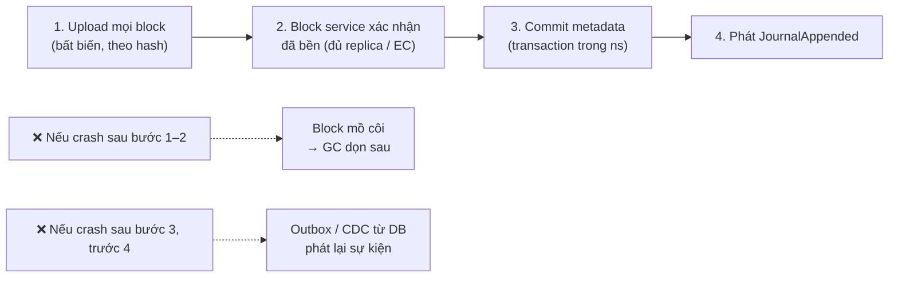

| Thứ tự | Nếu crash giữa chừng | Hậu quả |
|---|---|---|
| **Block trước, metadata sau** | Có block nhưng không có metadata → **block mồ côi** | Tốn chút dung lượng, GC dọn → **an toàn** |
| Metadata trước, block sau | Metadata trỏ tới block **chưa tồn tại** | Thiết bị khác tải file → lỗi hoặc **file hỏng** → **không chấp nhận được** |

Ngoài ra, commit nên **xác minh** mọi hash trong blocklist đã tồn tại trong block index trước khi ghi journal (một lần multi-get) - chặn client lỗi hoặc độc hại.

Phát sự kiện sau commit dùng **transactional outbox** (ghi sự kiện vào bảng outbox trong cùng transaction, một tiến trình đọc outbox đẩy lên Kafka) - xem [Bài 5](./05-messaging-streaming.md). Mất sự kiện cũng không làm sai dữ liệu (thiết bị vẫn sẽ thấy thay đổi ở lần long-poll/delta tiếp theo), chỉ làm chậm.

### 7.3 Garbage collection block

Block được chia sẻ giữa nhiều file và version → không thể xóa khi "một file bị xóa". Hai cách:

| Cách | Ý tưởng | Rủi ro |
|---|---|---|
| **Refcount** | Mỗi commit tăng refcount block mới, giảm block bị bỏ | Refcount sai (bug, crash giữa chừng) → xóa nhầm block đang dùng = **mất dữ liệu** |
| **Mark-and-sweep** | Định kỳ quét mọi journal còn sống, đánh dấu block được tham chiếu; block không được đánh dấu **và cũ hơn N ngày** thì xóa | Tốn công quét; nhưng tự sửa sai |

**Race nguy hiểm**: client vừa nhận "block h7 đã có" ở bước check, ngay lúc đó GC xóa h7 (vì nó mồ côi), rồi client commit tham chiếu h7 → metadata trỏ vào block không tồn tại. Phòng tránh:

- GC chỉ xóa block **mồ côi lâu hơn thời gian sống tối đa của một phiên upload** (ví dụ 7 ngày - grace period).
- Bước check "đã có" **gia hạn** (touch) `last_referenced_at` của block.
- Xóa mềm trước (chuyển vào khu "chờ xóa" 30 ngày) rồi mới xóa thật - để còn cứu khi GC có bug.

---

## 📖 8. Deep dive 3: Giao thức sync

### 8.1 Thông báo + kéo delta

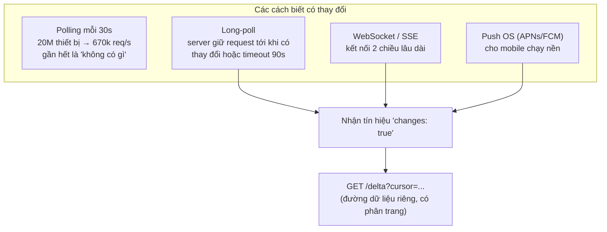

Nguyên tắc: **kênh thông báo chỉ mang tín hiệu, không mang dữ liệu**.

- Kênh thông báo có thể **mất tin** (server restart, mạng rớt) → không sao, lần kết nối sau client vẫn gọi delta với cursor của mình và nhận đủ.
- Delta luôn đúng vì đi từ **nguồn chân lý** (journal), có phân trang khi có 10.000 thay đổi.
- Notification service trở nên **stateless về dữ liệu**: chỉ cần biết "thiết bị nào đang chờ namespace nào".

### 8.2 Notification service ở quy mô 20 triệu kết nối

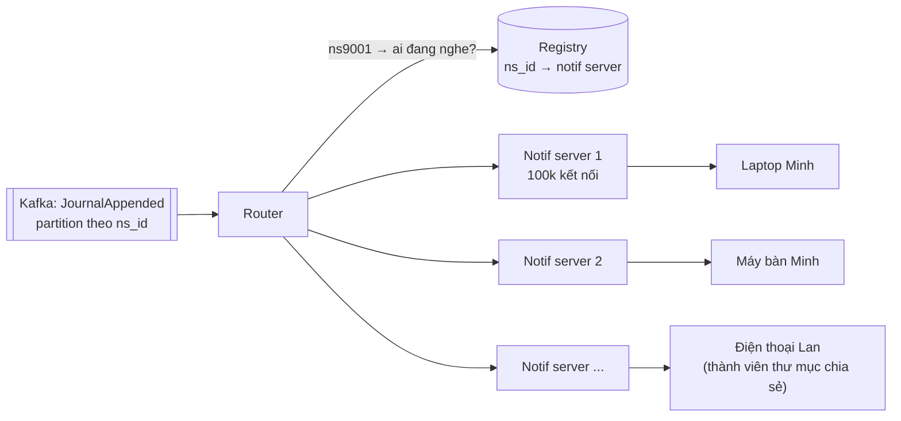

- Mỗi thiết bị đăng ký các namespace nó quan tâm. Router tra registry để chỉ gửi tín hiệu tới server đang giữ kết nối liên quan (không broadcast toàn cụm).
- **Thundering herd khi reconnect**: notification server restart → 100.000 thiết bị cùng kết nối lại và cùng gọi delta. Client phải **reconnect với jitter ngẫu nhiên** và backoff; server có thể gửi kèm "gợi ý chờ N giây".
- Namespace "nóng" (thư mục công ty 20.000 thành viên, thay đổi liên tục): **gộp tín hiệu** (debounce 1–5 s) - thành viên chỉ cần biết "có thay đổi", không cần 50 tín hiệu/giây.

### 8.3 Trạng thái cục bộ: ba cây

Client giữ trong local DB ba góc nhìn:

| Cây | Ý nghĩa |
|---|---|
| **Base (synced)** | Trạng thái đã đồng bộ thành công lần cuối - **tổ tiên chung** |
| **Local** | Trạng thái hiện tại trên ổ đĩa (watcher cập nhật) |
| **Remote** | Trạng thái server theo delta mới nhất |

So sánh ba cây cho từng file - đây là **3-way merge**:

| Local so với base | Remote so với base | Hành động |
|---|---|---|
| Không đổi | Không đổi | Không làm gì |
| Đổi | Không đổi | **Upload** (commit với `parent_rev` = rev của base) |
| Không đổi | Đổi | **Download** |
| Đổi | Đổi, giống hệt local | Chỉ cập nhật base |
| Đổi | Đổi, khác local | **Xung đột** → phần 9 |

Không có base, client không phân biệt được "tôi sửa" với "server sửa" → đó là lý do phải lưu base, không chỉ so local với remote.

### 8.4 Ghi file xuống đĩa an toàn

Khi download: ghi vào file tạm cùng thư mục → `fsync` → kiểm tra hash → **rename atomic** đè lên file cũ. Nếu người dùng đang mở file (Windows khóa file) → thử lại sau. Không bao giờ ghi đè trực tiếp từng block lên file đang có - mất điện giữa chừng sẽ để lại file nửa cũ nửa mới.

---

## 📖 9. Deep dive 4: Xung đột & offline edits

### 9.1 Optimistic concurrency

Mỗi commit mang `parent_rev`. Metadata API kiểm tra trong transaction:

```text
IF current_rev(file) == parent_rev THEN ghi rev mới
ELSE trả 409 conflict
```

Không có khóa phân tán, không có "check out file". Phù hợp vì xung đột thật **hiếm** (thường chỉ một người sửa một file tại một thời điểm), mà khóa thì không làm được khi thiết bị offline.

### 9.2 Conflict copy

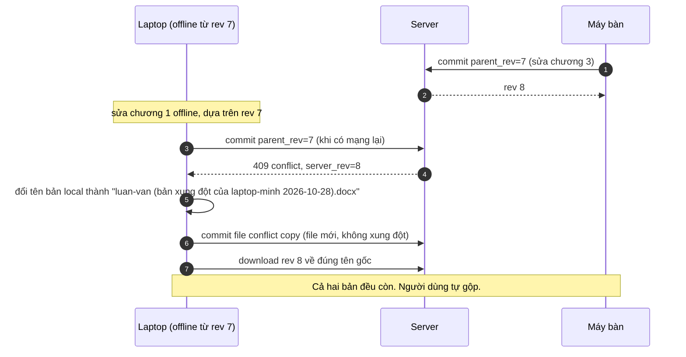

Vì sao không tự động merge? Vì hệ thống **không hiểu nội dung** file nhị phân (docx, psd, xlsx). Tự chọn "bản mới nhất thắng" (last-writer-wins) theo đồng hồ máy là **âm thầm mất dữ liệu** - đồng hồ máy có thể sai, và bản "cũ hơn" có thể chứa 3 giờ làm việc. Conflict copy xấu nhưng **không bao giờ mất chữ nào**.

| Chiến lược | Mất dữ liệu? | Trải nghiệm | Dùng khi |
|---|---|---|---|
| Last-writer-wins | **Có**, âm thầm | Gọn | Chỉ với dữ liệu không quan trọng (cài đặt UI) |
| **Conflict copy** | Không | Người dùng phải tự gộp | File nhị phân bất kỳ - lựa chọn chuẩn |
| Tự merge (3-way text merge) | Có thể sai | Tốt khi đúng | File văn bản thuần, có cấu trúc |
| OT / CRDT | Không | Tốt nhất | Trình soạn thảo cộng tác realtime - ngoài phạm vi |
| Khóa file (check-out) | Không | Chặn người khác, không hợp offline | CAD/thiết kế trong doanh nghiệp |

### 9.3 Các loại xung đột khác ngoài "sửa - sửa"

| Tình huống | Xử lý gợi ý |
|---|---|
| A sửa file, B xóa file | Giữ file (sửa thắng xóa) - người dùng ghét mất công sức hơn ghét file "sống lại" |
| A đổi tên `x` → `y`, B đổi `x` → `z` | Chọn một tên theo thứ tự server, thông báo; hoặc giữ cả hai |
| A thêm file vào thư mục `/P`, B xóa `/P` | Khôi phục `/P` (hoặc chuyển file vào thư mục "đã phục hồi") |
| A tạo `/a.txt`, B tạo `/A.txt` (máy Windows/macOS không phân biệt hoa thường) | Đổi tên một bản: `A (case conflict).txt` |
| Tên file hợp lệ trên Linux nhưng không hợp lệ trên Windows (`a:b.txt`) | Thay ký tự khi ghi xuống Windows, giữ tên gốc trên server |
| Move vòng tròn: A chuyển `/X` vào `/Y`, B chuyển `/Y` vào `/X` | Server áp lần lượt; lệnh thứ hai bị từ chối vì tạo vòng → client nhận lỗi và tải lại cây |

### 9.4 Vòng đời một file trên client

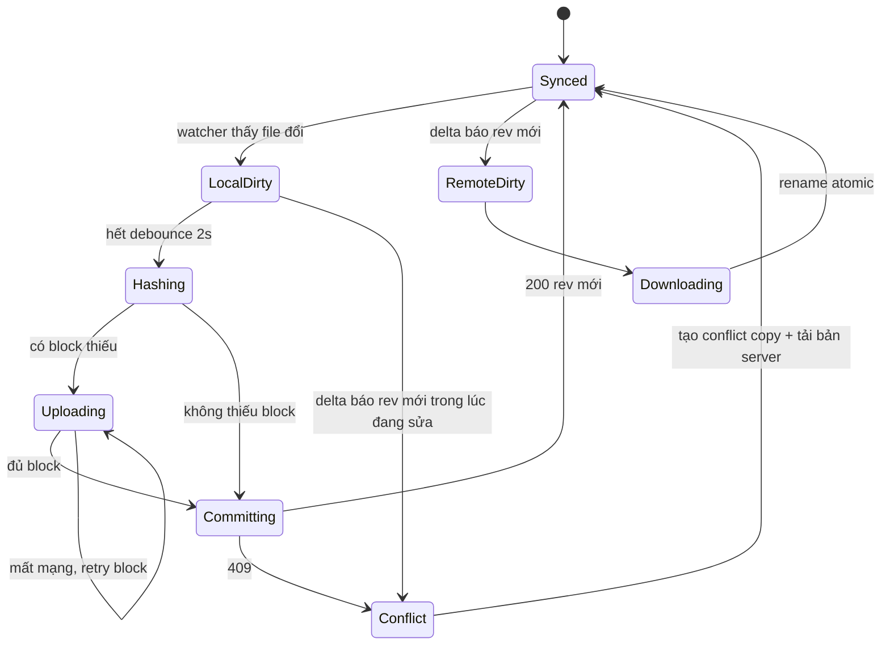

!!! tip "Debounce trước khi hash"
    Trình soạn thảo lưu file nhiều lần liên tiếp (ghi file tạm, rename, ghi lại). Chờ file "yên" 1–2 giây rồi mới hash, và kiểm tra lại kích thước + mtime ngay trước commit - nếu file đổi trong lúc đang hash thì bắt đầu lại.

---

## 📖 10. Upload resumable

Với block-level upload, resumable gần như **miễn phí**:

- Mất mạng giữa chừng → khi có mạng lại, client gọi lại `check` → server chỉ báo thiếu những block **chưa** upload xong → tiếp tục.
- Block là đơn vị nhỏ (4 MB) → mất tối đa 4 MB công sức.
- Block upload idempotent (cùng hash) → retry an toàn, không cần theo dõi "phiên upload" phía server.
- File 50 GB = 12.800 block → client upload **song song** 4–8 block, ưu tiên file nhỏ trước (người dùng thấy nhiều file "xong" sớm).
- Mobile: dùng background transfer của hệ điều hành; giới hạn upload qua dữ liệu di động theo cài đặt.

So với [multipart upload của video ở Bài 10](./10-video-streaming.md): cùng ý tưởng, nhưng ở đây block **content-addressed** nên còn được thêm dedup và chia sẻ block giữa các version.

---

## 📖 11. Chia sẻ & phân quyền

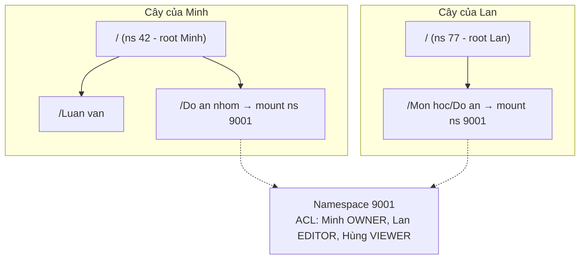

- Thư mục chia sẻ = namespace riêng với **ACL**. Mỗi thành viên mount nó ở **đường dẫn tùy ý** trong cây của mình.
- Quyền kiểm tra **ở mỗi request metadata** (delta, commit) theo `ns_id`.
- **Kiểm soát truy cập block**: nếu chỉ cần biết hash là tải được block, ai biết hash của tài liệu bí mật cũng tải được. Block service phải kiểm tra "user có quyền với ít nhất một file tham chiếu hash này" - thực tế thường làm bằng cách Metadata API cấp **token/URL có chữ ký** cho danh sách block của file mà user đang có quyền đọc.
- **Link chia sẻ**: token ngẫu nhiên đủ dài, có hạn, có thể yêu cầu mật khẩu; lưu `link_id → (ns_id, path, role, expires_at)`.
- **Thu hồi quyền**: xóa ACL → request mới bị từ chối ngay; thiết bị đã tải file về thì **không thu hồi được** bản đã tải (hãy nói rõ giới hạn này). Thiết bị đó nhận delta "namespace bị unmount" → client xóa bản local (nếu chính sách yêu cầu).
- Quota: file trong thư mục chia sẻ tính vào quota **của chủ sở hữu** (hoặc người tải lên - quyết định sản phẩm).

---

## 📖 12. Scale, nút thắt & failure modes

| Nút thắt / sự cố | Biểu hiện | Giảm nhẹ |
|---|---|---|
| Namespace khổng lồ (thư mục công ty 10 triệu file, 20.000 thành viên) | Shard chứa ns đó quá tải; delta dài | Tách ns lớn thành ns con; debounce tín hiệu; snapshot "danh sách file hiện tại" thay vì replay journal dài khi thiết bị mới tham gia |
| Thiết bị mới đăng nhập với 2 TB dữ liệu | Delta từ cursor 0 = replay hàng triệu dòng | API **list snapshot** phân trang của trạng thái hiện tại + cursor tại thời điểm snapshot |
| Notification server restart | Reconnect storm | Jitter, backoff, drain kết nối dần khi deploy |
| Block service chậm | Upload kẹt, nhưng metadata vẫn sống | Tách hai dịch vụ; client chỉ commit khi block xong |
| Metadata shard down | Namespace trên shard đó không sync được | Replica + failover tự động; thiết bị vẫn làm việc offline, sync khi lành |
| Bug client commit blocklist sai | File hỏng lan sang mọi thiết bị | Server xác minh block tồn tại + size; version cũ 30 ngày để khôi phục; **kill switch** phiên bản client |
| Bug GC | Xóa block đang dùng = mất dữ liệu | Grace period, xóa mềm, đối soát độc lập (một job thứ hai đếm lại tham chiếu trước khi xóa thật) |
| Ransomware mã hóa file trên máy user | Hàng nghìn file "đổi" cùng lúc, đồng bộ lên mây | Phát hiện mẫu bất thường (nhiều file đổi entropy cao), cho khôi phục hàng loạt về thời điểm trước đó |

**Multi-region**: namespace có **home region** (gần chủ sở hữu); metadata ghi ở home region (nhất quán mạnh trong ns), đọc replica ở region khác có thể trễ. Block có thể nằm ở region gần người upload, replicate bất đồng bộ; nếu thiết bị ở region khác cần block chưa replicate xong → đọc cross-region. Xem [Bài 4](./04-consistency-consensus.md).

**LAN sync**: hai máy cùng mạng nội bộ cùng cần một block lớn → máy này lấy từ máy kia qua LAN thay vì cả hai tải từ cloud (khám phá bằng broadcast trong mạng, vẫn xác minh hash).

---

## 📖 13. Monitoring & metric chính

| Metric | Ý nghĩa | Mục tiêu ví dụ |
|---|---|---|
| **Sync latency end-to-end** (commit ở thiết bị A → file có ở thiết bị B), p50/p99 | Trải nghiệm chính | p50 < 5 s với file nhỏ |
| Commit latency p99, tỉ lệ 409 | Sức khỏe metadata, mức xung đột | Tỉ lệ conflict rất thấp; tăng đột biến = bug client |
| Dedup ratio (byte logic / byte vật lý), byte tiết kiệm nhờ check | Hiệu quả chunking | Theo dõi xu hướng |
| Upload/download throughput, tỉ lệ block retry | Mạng, block service | - |
| Kết nối notification đang mở, tỉ lệ reconnect | Sức khỏe kênh thông báo | Reconnect thấp, không có đỉnh |
| Độ trễ outbox → Kafka → notif | Thông báo chậm | < 1 s |
| Số block mồ côi, tuổi block mồ côi lâu nhất, số block GC xóa/ngày | Sức khỏe GC | Không có bước nhảy bất thường |
| **Lỗi "block không tồn tại" khi download** | Vi phạm bất biến metadata ↔ blob | **Phải bằng 0** - alert ngay |
| Số thiết bị "kẹt" (không sync quá 24 h khi online) | Bug client | Gần 0 |

---

## 📝 Tự chấm

| Hạng mục | Đạt | Chưa đạt |
|---|---|---|
| **Yêu cầu** | Hỏi offline, xung đột, kích thước file, version, chia sẻ; ưu tiên "không mất dữ liệu" | Coi như upload/download đơn thuần |
| **Ước lượng** | Lưu trữ logic vs vật lý (dedup, EC), metadata ~TB phải shard, số kết nối thông báo | Chỉ tính dung lượng file |
| **API** | Tách check / upload block / commit với `parent_rev`; long-poll + delta với cursor | Upload cả file mỗi lần sửa; server push nội dung qua kênh thông báo |
| **Data model** | Journal theo namespace, block content-addressed, ACL theo namespace | Lưu file như BLOB trong DB; khóa theo đường dẫn mà không nhắc trade-off |
| **Kiến trúc** | Tách metadata / block / notification; client có watcher, indexer, local DB | Không có thành phần client |
| **Deep dive** | Fixed vs CDC có số liệu; block trước metadata sau; 3-way so sánh với base; conflict copy | Last-writer-wins |
| **Trade-off** | Kích thước block, phạm vi dedup vs riêng tư, refcount vs mark-sweep | Không có |
| **Failure** | Block mồ côi + GC grace period, reconnect storm, bug client, ransomware | Không đề cập |

---

## 🔄 Biến thể interviewer hay hỏi

??? question "Nếu yêu cầu đổi thành chỉnh sửa cộng tác realtime như Google Docs?"
    Đơn vị không còn là file mà là **thao tác** (chèn ký tự ở vị trí X). Cần OT (Operational Transformation) hoặc CRDT, một server điều phối theo tài liệu (hoặc peer-to-peer với CRDT), WebSocket hai chiều, lưu log thao tác + snapshot định kỳ. Xung đột được giải quyết tự động ở mức ký tự.

??? question "Nếu là backup ảnh điện thoại (Google Photos)?"
    Chỉ một chiều (điện thoại → mây), không có xung đột sửa-sửa. Trọng tâm: upload nền tiết kiệm pin và dữ liệu, dedup theo hash ảnh, tạo thumbnail/nén, tìm kiếm theo nội dung. Ảnh đã nén sẵn → CDC không giúp; dedup cả file là đủ.

??? question "Nếu file rất lớn (ảnh đĩa máy ảo 500 GB) sửa vài MB mỗi ngày?"
    Fixed-size block là tốt (sửa tại chỗ, không chèn). Watcher không thể hash lại 500 GB mỗi lần → dùng mtime + theo dõi vùng đã đổi (nếu OS hỗ trợ) hoặc hash theo lịch. Metadata blocklist lớn (125.000 block × 32 B = 4 MB) → lưu blocklist dạng cây (Merkle tree) để commit chỉ gửi nhánh đổi.

??? question "Nếu yêu cầu mã hóa đầu-cuối?"
    Server không đọc được nội dung → mất dedup cross-user, mất preview/tìm kiếm phía server, chia sẻ phải trao đổi khóa (mã hóa khóa file bằng public key của người nhận). Tên file cũng nên mã hóa. Mất khóa = mất dữ liệu → cần cơ chế khôi phục khóa.

??? question "Nếu khách hàng doanh nghiệp cần giữ dữ liệu 7 năm (legal hold) và audit log?"
    Journal + block không được GC khi có legal hold trên namespace; GC phải kiểm tra hold. Audit log ghi mọi truy cập (ai đọc/tải file nào) vào storage append-only riêng. Có thể cần chọn region lưu dữ liệu (data residency).

??? question "Nếu chỉ tải file khi cần (files on-demand) để tiết kiệm ổ đĩa?"
    Client tạo "placeholder" (file ảo) với metadata đầy đủ; khi ứng dụng mở file, driver hệ thống file (ví dụ cloud files API của OS) chặn lệnh đọc và tải block cần thiết. Cần cache LRU cục bộ và cho người dùng "ghim" thư mục để luôn có offline.

---

## 🌍 Ứng dụng thực tế

- **Dropbox** có nhiều bài blog kỹ thuật công khai về việc tách metadata và block storage, chuyển block storage sang hệ thống tự xây, và viết lại sync engine (Nucleus) với mô hình nhiều cây trạng thái - nguồn tham khảo tốt cho phần client.
- **rsync** dùng rolling checksum để chỉ gửi phần khác nhau giữa hai file - tổ tiên của ý tưởng delta sync.
- **restic, borg, Git** (lưu đối tượng theo hash nội dung) là ví dụ mã nguồn mở của **content-addressed storage** và dedup; restic/borg dùng content-defined chunking.
- **FastCDC** (bài báo USENIX ATC 2016) là thuật toán CDC nhanh dựa trên Gear hash - demo trong bài là phiên bản rút gọn.
- Google Drive, OneDrive, iCloud Drive đều có hành vi **conflict copy** quen thuộc khi sửa offline trên hai máy.

---

## ⚠️ Sai lầm thường gặp

1. **Upload lại cả file** mỗi lần sửa - lãng phí băng thông, chậm với file lớn.
2. **Ghi metadata trước khi block bền** → thiết bị khác tải về file hỏng.
3. **Last-writer-wins theo đồng hồ máy** → âm thầm mất bản sửa.
4. **Gửi dữ liệu qua kênh thông báo** → mất tin là mất thay đổi; nên chỉ gửi tín hiệu + delta theo cursor.
5. **Polling dày** thay vì long-poll/WebSocket → hàng trăm nghìn request vô ích mỗi giây.
6. **Không lưu trạng thái base** ở client → không phân biệt được ai sửa, không phát hiện xung đột đúng.
7. **GC xóa ngay block có refcount 0** → race với commit đang diễn ra.
8. **Ai biết hash là tải được block** → lỗ hổng truy cập.
9. **Cross-user dedup phía client** mà không cân nhắc rò rỉ thông tin.
10. Quên **reconnect storm** khi notification server deploy.

---

## 🏋️ Bài tập

**Bài 1 (dễ).** File 2 GB, block cố định 4 MB. Có bao nhiêu block? Blocklist (32 byte/hash) nặng bao nhiêu? Nếu block 4 KB thì sao?

<details markdown="1"><summary>Đáp án</summary>

- 2 GB / 4 MB = **512 block** → 512 × 32 B = **16 KB** blocklist.
- 2 GB / 4 KB = **524.288 block** → **16 MB** blocklist chỉ cho một file - mỗi commit gửi 16 MB metadata, block index phình 1.000 lần. Đó là lý do block nhỏ chỉ hợp cho dedup storage chuyên dụng, không hợp cho đơn vị truyền tải/metadata.

</details>

**Bài 2 (dễ).** Vì sao thao tác upload block theo hash lại idempotent và điều đó giúp gì cho resumable upload?

<details markdown="1"><summary>Đáp án</summary>

Khóa của block = hash nội dung. Upload cùng block hai lần ghi cùng nội dung vào cùng khóa → kết quả như nhau. Nhờ vậy client không cần nhớ "đã upload tới đâu" chính xác: sau khi mất mạng, gọi lại `check` để biết block nào còn thiếu và upload tiếp; retry một block đã upload một nửa hoặc đã xong đều an toàn.

</details>

**Bài 3 (trung bình).** Sửa demo §6.2: thử `mask = (1 << 13) - 1` (trung bình ~8 KiB) và `(1 << 10) - 1` (~1 KiB), giữ min/max hợp lý. Dự đoán số chunk và byte phải upload thay đổi thế nào trước khi chạy.

<details markdown="1"><summary>Đáp án</summary>

Dự đoán: block trung bình lớn hơn → **ít chunk hơn** (metadata nhỏ hơn) nhưng mỗi thay đổi kéo theo **block lớn hơn** phải upload lại → byte phải gửi tăng. Block nhỏ hơn → nhiều chunk hơn, byte phải gửi giảm (chỉ vài KB quanh chỗ sửa). Với min_size = 1024 cố định, mask 10 bit làm kích thước trung bình ≈ 1 KiB + 1 KiB. Chạy thử (bản Python, chỉ đổi `mask`):

| mask | Số chunk của v2 | Phải upload |
|---|---|---|
| 10 bit (~2 KiB tính cả min) | 261 | 2 chunk = 4.199 byte (0,8%) |
| 12 bit (bản gốc) | 115 | 2 chunk = 17.639 byte (3,4%) |
| 13 bit (~9 KiB) | 79 | 2 chunk = 22.553 byte (4,3%) |

Đúng như dự đoán: luôn chỉ 2 chunk đổi, nhưng chunk càng lớn thì byte phải gửi càng nhiều, còn metadata (số chunk) càng ít. Đây chính là trade-off ở bảng §6.3.

</details>

**Bài 4 (trung bình).** Mô tả từng bước điều gì xảy ra khi Minh sửa file trên laptop offline, máy bàn sửa cùng file lúc online, và laptop có mạng lại. Trạng thái base/local/remote của laptop ra sao ở mỗi bước?

<details markdown="1"><summary>Đáp án</summary>

1. Ban đầu: base = local = remote = rev 7.
2. Laptop sửa offline: local = 7' (đổi), base = 7, remote = 7 (chưa biết gì).
3. Máy bàn commit rev 8: server = 8. Laptop vẫn chưa biết.
4. Laptop có mạng: delta → remote = 8. So với base 7: local đổi, remote đổi, khác nhau → **xung đột**. (Hoặc laptop commit trước khi kịp kéo delta → nhận 409 → cùng kết luận.)
5. Laptop đổi tên bản local thành conflict copy, commit nó như **file mới** (parent_rev = không có) → thành công.
6. Laptop tải rev 8 về tên gốc → base = local = remote = 8 cho file gốc; file conflict copy cũng synced.
7. Máy bàn nhận delta: có thêm file conflict copy → tải về. Minh thấy hai file ở cả hai máy và tự gộp.

</details>

**Bài 5 (trung bình).** Có 20 triệu thiết bị dùng polling mỗi 30 giây thay vì long-poll. Tính QPS và so sánh. Long-poll có nhược điểm gì?

<details markdown="1"><summary>Đáp án</summary>

- Polling: 20M / 30 ≈ **667.000 req/s**, gần hết trả "không có gì", mỗi request đi qua auth, DB/cache.
- Long-poll timeout 90 s: tối đa 20M / 90 ≈ 222.000 "request làm mới" mỗi giây nhưng chúng rẻ (không đụng DB, chỉ đăng ký lắng nghe), và thay đổi đến **ngay** thay vì trễ trung bình 15 s. Với WebSocket, gần như không có request làm mới.
- Nhược điểm long-poll: giữ nhiều kết nối mở (bộ nhớ, file descriptor), load balancer/proxy phải hỗ trợ timeout dài, reconnect storm khi restart, mỗi lần nhận tín hiệu phải mở request mới để lấy delta.

</details>

**Bài 6 (khó).** Thiết kế GC cho block sao cho **không bao giờ** xóa block đang được tham chiếu, kể cả khi có commit đang diễn ra và refcount có thể sai do bug.

<details markdown="1"><summary>Đáp án</summary>

- Không tin refcount để xóa; dùng **mark-and-sweep theo epoch**:
    1. Ghi nhận thời điểm bắt đầu `T0`.
    2. Mark: quét mọi journal còn hiệu lực (kể cả version trong 30 ngày, thùng rác, legal hold) → tập block được tham chiếu (có thể lưu dưới dạng bloom filter lớn + danh sách chính xác theo shard hash).
    3. Sweep: chỉ xét block **tạo hoặc được "touch" trước `T0 - grace`** (grace ≥ thời gian tối đa giữa `check` và `commit`, ví dụ 7 ngày) và không có trong tập mark.
    4. Bước `check` luôn cập nhật `last_touched` → block vừa được báo "đã có" không bị xóa trong grace period.
- Xóa hai pha: chuyển sang "pending delete" + ẩn khỏi `check` (để client upload lại nếu cần), chờ 30 ngày, một job **độc lập** (code khác, team khác nếu được) xác minh lại không có tham chiếu rồi mới xóa thật.
- Theo dõi metric "block không tồn tại khi download" = 0 và số block bị xóa/ngày so với dự kiến.

</details>

**Bài 7 (khó).** Thư mục chia sẻ của công ty có 30.000 thành viên và 5 triệu file. Một nhân viên mới tham gia. Thiết kế quá trình đồng bộ ban đầu và chỉ ra các nút thắt.

<details markdown="1"><summary>Đáp án</summary>

- Không replay journal từ 0 (có thể hàng trăm triệu dòng qua nhiều năm). Dùng **snapshot API**: liệt kê trạng thái hiện tại theo trang (theo `file_id` hoặc cây thư mục), kèm `cursor = journal_id tại thời điểm snapshot`. Sau đó delta bình thường từ cursor đó.
- Snapshot phải nhất quán: đọc từ replica tại một điểm thời gian (MVCC snapshot) hoặc chấp nhận "không nhất quán" rồi dựa vào delta sau cursor để sửa.
- Client tải **metadata trước**, tạo placeholder (files on-demand), chỉ tải block khi mở file hoặc theo ưu tiên (file gần đây trước).
- Nút thắt: shard chứa namespace (5 triệu file) bị đọc nặng → đọc snapshot từ replica, giới hạn tốc độ; notification fan-out 30.000 thiết bị mỗi thay đổi → debounce; nhiều nhân viên mới cùng lúc (đầu quý) → hàng đợi onboarding có giới hạn đồng thời.
- Cân nhắc tách namespace lớn thành nhiều namespace con theo phòng ban.

</details>

---

## ✅ Checklist

- [ ] Ưu tiên đúng: không mất dữ liệu > bền > nhanh
- [ ] Ước lượng lưu trữ logic/vật lý, metadata, số kết nối thông báo, băng thông nhờ delta
- [ ] API: check → upload block → commit với `parent_rev`; long-poll + delta theo cursor
- [ ] Giải thích được fixed vs CDC bằng số liệu demo, và khi nào fixed là đủ
- [ ] Dedup theo hash, phạm vi dedup và rủi ro rò rỉ; xung đột với E2E
- [ ] Journal theo namespace, version và thùng rác "miễn phí", compaction
- [ ] **Block trước, metadata sau**; outbox cho sự kiện; GC có grace period
- [ ] Ba cây base/local/remote và 3-way so sánh; ghi file bằng rename atomic
- [ ] Conflict copy thay vì last-writer-wins; các xung đột đổi tên/xóa/hoa thường
- [ ] Namespace + ACL cho chia sẻ; kiểm soát truy cập block; thu hồi quyền có giới hạn

---

**Bài tiếp theo**: [Bài 12: Gọi xe & tìm quanh đây](./12-ride-hailing-proximity.md)
