# 📚 Bài 12: Gọi xe & tìm quanh đây

> "Bài toán gọi xe không phải là 'tìm tài xế gần nhất'. Đó là **ghép hàng trăm nghìn điểm đang di chuyển** với hàng nghìn yêu cầu mỗi phút, trên một bản đồ thay đổi từng giây - và trả lời trong vài giây."

18 giờ thứ Sáu, trời mưa ở trung tâm TP.HCM. Trong 10 phút quanh chợ Bến Thành:

- Hàng nghìn người mở app gọi xe cùng lúc. Ai cũng muốn thấy **chấm xe quanh mình** và **giá** ngay.
- Hàng chục nghìn tài xế trong thành phố gửi **vị trí GPS mỗi 4 giây**.
- Hệ thống phải chọn tài xế cho từng chuyến - không phải người gần nhất theo đường chim bay (có thể ở bên kia sông), mà người **đến nhanh nhất theo đường đi thật**.
- Cầu vượt cung → **giá tăng** (surge) để kéo thêm tài xế tới.
- Không bao giờ được giao **một tài xế cho hai chuyến**.

Bài này thiết kế hệ thống kiểu Grab/Uber: ingest vị trí, chỉ mục không gian (geohash, quadtree, S2/H3 - có demo geohash chạy được), tìm tài xế gần, ghép chuyến, máy trạng thái chuyến đi, ETA & surge, và bàn giao thanh toán. Cuối bài là biến thể **"tìm quán ăn quanh đây"** kiểu Yelp/Google Maps.

## 🎯 Mục tiêu bài học

- Thiết kế hệ thống gọi xe theo đủ 11 bước của case study
- Ước lượng **QPS cập nhật vị trí** và nhận ra: dữ liệu vị trí **nhỏ** (vừa RAM) nhưng **ghi cực nhiều**
- So sánh **geohash, quadtree, S2, H3**; tự cài geohash encode + tìm 8 ô lân cận (Go + Python)
- Thiết kế tìm tài xế gần và xử lý **vùng nóng** (sân bay, trung tâm giờ cao điểm)
- Thiết kế **matching/dispatch** chống giao trùng tài xế
- Mô hình hóa **máy trạng thái chuyến đi** (stateDiagram-v2) với chuyển trạng thái idempotent
- Hiểu tổng quan **ETA** và **surge pricing**; bàn giao sang thanh toán
- Áp dụng cùng kỹ thuật cho bài toán **tìm địa điểm quanh đây** (dữ liệu tĩnh, đọc nhiều)

---

## 🧩 Tự thiết kế trước

!!! question "Đề bài (15–20 phút)"
    Thiết kế dịch vụ gọi xe cho một thành phố lớn Đông Nam Á, mở rộng ra nhiều nước:

    - Hành khách thấy xe quanh mình, xem giá ước tính, đặt xe.
    - Tài xế gửi vị trí liên tục, nhận đề nghị chuyến, chấp nhận/từ chối.
    - Theo dõi chuyến đi realtime, thanh toán khi kết thúc.
    - Giờ cao điểm: 500.000 tài xế online, 300 yêu cầu đặt xe/giây.

    Viết ra: ước lượng, cách lưu và truy vấn vị trí, luồng ghép chuyến, máy trạng thái chuyến đi, và cách tránh giao một tài xế cho hai khách.

<details markdown="1"><summary>Gợi ý</summary>

1. 500.000 tài xế × 1 cập nhật/4 giây = ? ghi/giây. Mỗi bản ghi vị trí bao nhiêu byte? Tổng vừa RAM không?
2. `SELECT ... WHERE lat BETWEEN ... AND lon BETWEEN ...` với B-tree trên `lat` - vì sao chậm?
3. Biến tọa độ 2 chiều thành **một chuỗi/số 1 chiều** mà điểm gần nhau có prefix giống nhau → index được.
4. Điểm ngay sát ranh giới ô thì sao?
5. Hai yêu cầu đặt xe cùng chọn một tài xế trong cùng 100 ms - ai thắng?
6. Chuyến đi có những trạng thái nào? Tài xế bấm "đã đón" hai lần vì mạng chập chờn thì sao?

</details>

---

## 📖 1. Làm rõ yêu cầu

> **Ứng viên:** Chỉ xe ôm/ô tô chở khách, hay cả giao đồ ăn, giao hàng?
> **Interviewer:** Chở khách. Giao đồ ăn nói khác biệt nếu còn thời gian.
>
> **Ứng viên:** Hành khách có cần thấy xe quanh mình trên bản đồ trước khi đặt?
> **Interviewer:** Có, cập nhật vài giây một lần.
>
> **Ứng viên:** Ghép chuyến cần nhanh tới mức nào?
> **Interviewer:** Đề nghị đầu tiên gửi tới tài xế trong vài giây sau khi khách đặt.
>
> **Ứng viên:** Có đi chung (pool), đặt trước, nhiều loại xe?
> **Interviewer:** Nhiều loại xe (2 bánh, 4 chỗ, 7 chỗ). Pool và đặt trước ngoài phạm vi.
>
> **Ứng viên:** Có surge pricing?
> **Interviewer:** Có, nói tổng quan.
>
> **Ứng viên:** Thanh toán?
> **Interviewer:** Tiền mặt và ví. Chi tiết ví để bài sau.

| Loại | Yêu cầu |
|---|---|
| **Chức năng** | Tài xế gửi vị trí, bật/tắt nhận chuyến; khách xem xe gần, báo giá + ETA, đặt xe, hủy; ghép tài xế, gửi đề nghị, chấp nhận/từ chối; theo dõi chuyến realtime; kết thúc + thanh toán; đánh giá |
| **Phi chức năng** | Tìm xe gần p99 < 200 ms; gửi đề nghị đầu tiên < 3 s; vị trí trên bản đồ trễ < 5 s; **không bao giờ giao 1 tài xế cho 2 chuyến cùng lúc**; không mất trạng thái chuyến; availability 99,99% cho đặt xe |
| **Ngoài phạm vi** | Đi chung, đặt lịch trước, chi tiết ví và đối soát ([Bài 13](./13-payment-wallet.md)), xây bản đồ/routing engine từ đầu |

!!! tip "Hai loại dữ liệu rất khác nhau"
    - **Vị trí tài xế**: thay đổi mỗi vài giây, mất một bản cũng không sao (bản sau sẽ tới), chỉ cần **mới nhất** → **soft state** trong RAM.
    - **Chuyến đi**: ít ghi hơn nhiều, nhưng **không được mất, không được sai** (liên quan tiền) → DB bền, transaction.

    Trộn hai loại vào một database là sai lầm kinh điển.

---

## 📖 2. Ước lượng

Các con số là **ước tính để luyện tập**. Phương pháp ở [Bài 1](./01-framework-estimation.md).

**Giả định (toàn khu vực, giờ cao điểm):** 500.000 tài xế online, cập nhật vị trí mỗi 4 giây; 20 triệu hành khách DAU; 5 triệu chuyến/ngày; giờ cao điểm gấp 5 lần trung bình.

### 2.1 Ghi vị trí

```text
500.000 tài xế / 4 s                       = 125.000 cập nhật/s
Mỗi gói: driver_id, lat, lon, heading, speed, ts, trạng thái  ≈ 50–100 B
Băng thông vào: 125.000 × 100 B            ≈ 12,5 MB/s ≈ 100 Mbps    (nhỏ!)
```

### 2.2 Bộ nhớ cho vị trí hiện tại

```text
500.000 tài xế × ~200 B (bản ghi + index)   ≈ 100 MB
```

**100 MB** - vừa RAM của **một máy**. Bài toán không phải dung lượng mà là **125.000 ghi/s** và **truy vấn không gian** nhanh. Chia shard chủ yếu vì throughput và cô lập lỗi (theo thành phố), không phải vì dung lượng.

### 2.3 Lịch sử vị trí (cho tính tiền, tranh chấp, huấn luyện ETA)

```text
125.000/s × 50 B × 86.400                  ≈ 540 GB/ngày (giờ cao điểm kéo dài cả ngày - cận trên)
× 365                                       ≈ 200 TB/năm → nén, đưa vào object storage/data lake
```

### 2.4 Đặt xe và tìm xe

```text
Chuyến:   5M / 86.400                       ≈ 58 chuyến/s   → peak ≈ 300/s
Tìm xe gần (khách mở app, bản đồ làm mới mỗi 5 s trong ~1 phút trước khi đặt):
          giờ cao điểm ~300.000 khách đang mở màn hình đặt xe / 5 s ≈ 60.000 truy vấn/s
Báo giá:  mỗi chuyến ~3 lần báo giá (đổi điểm đến, loại xe) → ~1.000/s peak
```

Hệ thống nghiêng về **ghi vị trí** (125k/s) và **đọc vùng lân cận** (60k/s), còn giao dịch chuyến đi chỉ vài trăm/giây.

---

## 📖 3. API design

### 3.1 Tài xế

```text
# Kết nối WebSocket lâu dài (hoặc gRPC stream), gửi vị trí theo lô
WS /v1/driver/stream
→ { "type": "loc", "pts": [ { "lat": 10.77251, "lon": 106.69803, "ts": 1730120400123,
                               "heading": 87, "speed": 6.1, "acc": 8 } ], "seq": 1043 }
← { "type": "offer", "offer_id": "of_77", "trip_id": "tr_9a", "pickup": {...},
     "pickup_eta_s": 240, "fare_estimate": 52000, "expires_at": 1730120415 }

POST /v1/driver/status       { "status": "ONLINE" | "OFFLINE", "vehicle_type": "BIKE" }
POST /v1/offers/{id}/accept  → 200 { "trip_id": "tr_9a" } | 409 { "error": "offer_expired" }
POST /v1/offers/{id}/decline
POST /v1/trips/{id}/events   { "event": "ARRIVED" | "PICKED_UP" | "COMPLETED",
                               "event_id": "ev_5c1", "loc": {...} }     # idempotent theo event_id
```

### 3.2 Hành khách

```http
GET /v1/nearby?lat=10.7725&lon=106.6980&type=BIKE
→ 200 { "drivers": [ { "id": "anon_3f", "lat": 10.7731, "lon": 106.6994, "heading": 120 } ],
        "eta_s": 180 }                      # ID ẩn danh, vị trí làm tròn - bảo vệ tài xế

POST /v1/quotes
{ "pickup": {"lat":10.7725,"lon":106.6980}, "dropoff": {"lat":10.8188,"lon":106.6519},
  "vehicle_type": "CAR4" }
→ 200 { "quote_id": "q_31", "fare": 145000, "surge_multiplier": 1.3,
        "pickup_eta_s": 300, "trip_duration_s": 1800, "expires_at": "...+5 phút" }

POST /v1/trips
Idempotency-Key: 1b9e...
{ "quote_id": "q_31", "payment_method": "WALLET" }
→ 201 { "trip_id": "tr_9a", "status": "MATCHING" }

GET  /v1/trips/tr_9a          (+ WebSocket/SSE để nhận vị trí tài xế và đổi trạng thái)
POST /v1/trips/tr_9a/cancel   { "reason": "..." }
```

!!! note "Vì sao báo giá có `quote_id`?"
    Giá phụ thuộc surge, thay đổi từng phút. Khách thấy 145.000đ thì phải được đặt với **đúng 145.000đ** trong vài phút, kể cả khi surge vừa tăng. `quote_id` khóa giá (có chữ ký, có hạn) - và cũng là cách chống client tự sửa giá.

---

## 📖 4. Data model & storage

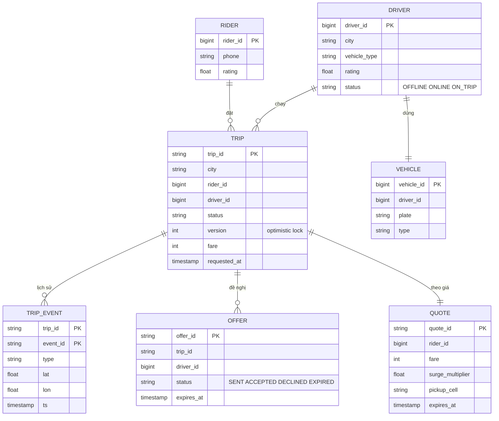

| Dữ liệu | Storage | Vì sao |
|---|---|---|
| **Vị trí hiện tại** tài xế | In-memory geo index (Redis GEO hoặc service tự viết), shard theo thành phố/ô | 125k ghi/s, chỉ cần bản mới nhất, mất được (sẽ có bản mới sau 4 s) |
| Trạng thái tài xế (ONLINE/ON_TRIP), khóa giao chuyến | Redis (cùng shard với vị trí) + DB | Cần CAS nhanh khi ghép |
| **Chuyến đi**, offer, quote | SQL (MySQL/Postgres) shard theo `city` hoặc `trip_id` | Transaction, máy trạng thái, liên quan tiền |
| Trip events | Bảng append-only + Kafka | Audit, tranh chấp, phân tích |
| Lịch sử vị trí | Kafka → object storage (Parquet) / time-series DB | Khối lượng lớn, đọc theo lô |
| Bản đồ, đồ thị đường | Routing engine riêng (in-memory graph) | ETA - [Bài thuật toán đường đi ngắn nhất](../algorithms/12-shortest-paths-mst.md) |
| Surge theo ô | Redis/KV, cập nhật mỗi phút | Đọc mỗi lần báo giá |

---

## 📖 5. Kiến trúc tổng quan

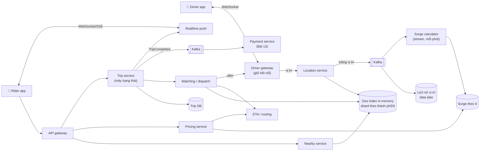

### 5.1 Luồng cập nhật vị trí

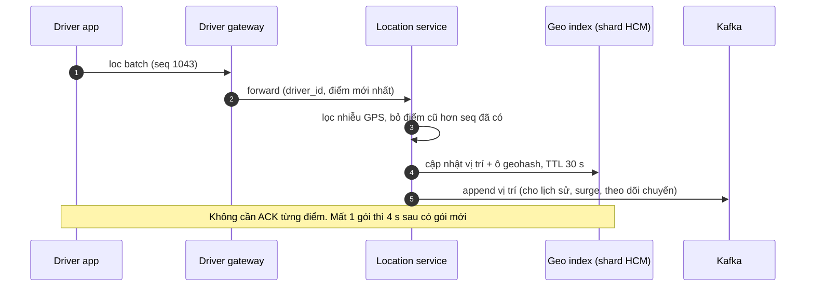

### 5.2 Luồng đặt xe và ghép chuyến

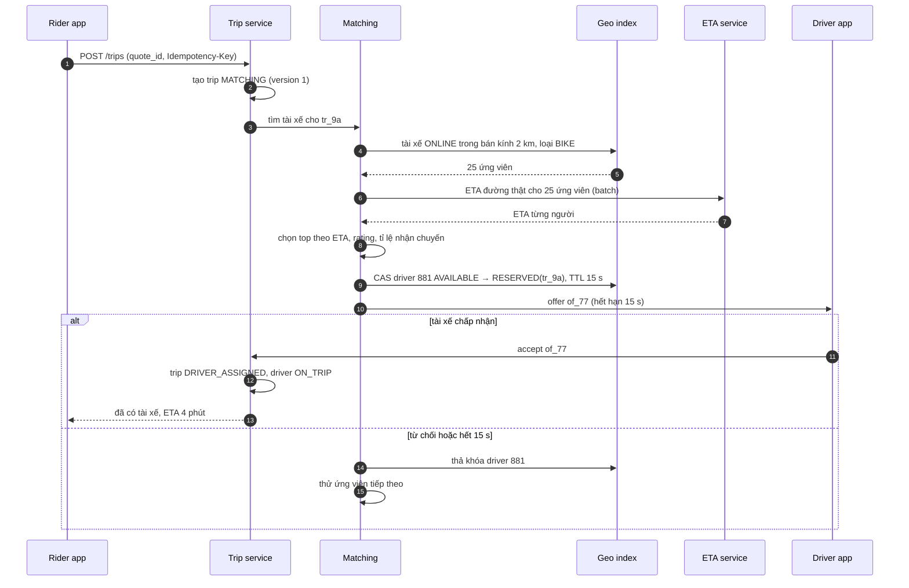

---

## 📖 6. Deep dive 1: Chỉ mục không gian

### 6.1 Vì sao không dùng index thông thường?

`SELECT * FROM drivers WHERE lat BETWEEN a AND b AND lon BETWEEN c AND d` với B-tree trên `lat`: index chỉ lọc được **một chiều** → lấy ra cả một **dải vĩ độ** chạy vòng quanh trái đất, rồi lọc kinh độ từng hàng. Index ghép `(lat, lon)` cũng chỉ giúp khi `lat` cố định. Cần một cách biến **2 chiều thành 1 chiều** mà vẫn giữ "gần nhau".

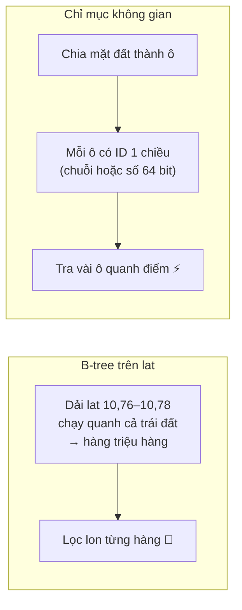

### 6.2 Geohash

Geohash chia đôi liên tục: bit đầu cho kinh độ (trái/phải), bit thứ hai cho vĩ độ (dưới/trên), xen kẽ. Mỗi 5 bit thành một ký tự base32. **Prefix chung càng dài → hai điểm càng (thường) gần nhau.**

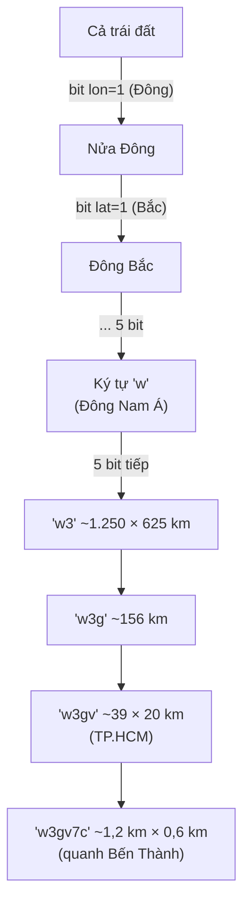

| Độ dài (precision) | Kích thước ô xấp xỉ (ở xích đạo) | Dùng cho |
|---|---|---|
| 4 | 39 km × 19,5 km | Thành phố |
| 5 | 4,9 km × 4,9 km | Quận |
| 6 | 1,2 km × 0,61 km | Tìm tài xế bán kính ~500 m – 1 km |
| 7 | 153 m × 153 m | Khu phố, tìm quán ăn rất gần |
| 8 | 38 m × 19 m | Tòa nhà |

**Hai cái bẫy của geohash:**

1. **Hiệu ứng biên**: hai điểm cách nhau vài mét nhưng nằm hai bên ranh giới ô có thể có prefix chung **rất ngắn**. → Luôn tìm trong **ô chính + 8 ô lân cận**.
2. **Ô không vuông và méo theo vĩ độ**: càng xa xích đạo, ô càng hẹp theo chiều Đông-Tây (ở TP.HCM gần xích đạo nên ít méo).

### 6.3 Demo: geohash encode + tìm tài xế trong 9 ô

Demo làm 4 việc: (1) encode tọa độ chợ Bến Thành ở nhiều precision, (2) chứng minh bẫy biên, (3) index 5.000 tài xế giả lập theo geohash6, (4) tìm tài xế trong bán kính 500 m bằng cách quét 9 ô rồi lọc khoảng cách thật (haversine).

=== "Go"

    ```go
    package main

    import (
    	"fmt"
    	"math"
    	"sort"
    	"strings"
    )

    const base32 = "0123456789bcdefghjkmnpqrstuvwxyz"

    // Encode: xen kẽ bit kinh độ (chẵn) và vĩ độ (lẻ), mỗi 5 bit -> 1 ký tự base32
    func Encode(lat, lon float64, precision int) string {
    	latR, lonR := [2]float64{-90, 90}, [2]float64{-180, 180}
    	var sb strings.Builder
    	bit, ch, even := 0, 0, true
    	for sb.Len() < precision {
    		rg, v := &latR, lat
    		if even {
    			rg, v = &lonR, lon
    		}
    		mid := (rg[0] + rg[1]) / 2
    		if v >= mid {
    			ch = ch<<1 | 1
    			rg[0] = mid
    		} else {
    			ch = ch << 1
    			rg[1] = mid
    		}
    		even = !even
    		if bit++; bit == 5 {
    			sb.WriteByte(base32[ch])
    			bit, ch = 0, 0
    		}
    	}
    	return sb.String()
    }

    // Decode: trả về tâm ô và nửa kích thước ô (độ)
    func Decode(gh string) (lat, lon, dLat, dLon float64) {
    	latR, lonR := [2]float64{-90, 90}, [2]float64{-180, 180}
    	even := true
    	for _, c := range gh {
    		idx := strings.IndexRune(base32, c)
    		for b := 4; b >= 0; b-- {
    			rg := &latR
    			if even {
    				rg = &lonR
    			}
    			mid := (rg[0] + rg[1]) / 2
    			if idx>>b&1 == 1 {
    				rg[0] = mid
    			} else {
    				rg[1] = mid
    			}
    			even = !even
    		}
    	}
    	return (latR[0] + latR[1]) / 2, (lonR[0] + lonR[1]) / 2,
    		(latR[1] - latR[0]) / 2, (lonR[1] - lonR[0]) / 2
    }

    // Neighbors: ô chính + 8 ô xung quanh (dịch tâm đi đúng 1 ô rồi encode lại)
    func Neighbors(gh string) []string {
    	lat, lon, dLat, dLon := Decode(gh)
    	var out []string
    	for _, dy := range []float64{1, 0, -1} {
    		for _, dx := range []float64{-1, 0, 1} {
    			out = append(out, Encode(lat+2*dLat*dy, lon+2*dLon*dx, len(gh)))
    		}
    	}
    	return out
    }

    func haversineM(lat1, lon1, lat2, lon2 float64) float64 {
    	const R = 6371000.0
    	p1, p2 := lat1*math.Pi/180, lat2*math.Pi/180
    	dp, dl := (lat2-lat1)*math.Pi/180, (lon2-lon1)*math.Pi/180
    	a := math.Sin(dp/2)*math.Sin(dp/2) + math.Cos(p1)*math.Cos(p2)*math.Sin(dl/2)*math.Sin(dl/2)
    	return 2 * R * math.Asin(math.Sqrt(a))
    }

    type rng struct{ s uint64 }

    func (r *rng) float() float64 { // splitmix64 -> [0,1)
    	r.s += 0x9E3779B97F4A7C15
    	z := r.s
    	z = (z ^ (z >> 30)) * 0xBF58476D1CE4E5B9
    	z = (z ^ (z >> 27)) * 0x94D049BB133111EB
    	return float64((z^(z>>31))>>11) / (1 << 53)
    }

    type driver struct {
    	id       int
    	lat, lon float64
    }

    func main() {
    	const P = 6 // ô ~1.2km x 0.6km
    	// 1) Encode một điểm: Chợ Bến Thành
    	lat, lon := 10.7725, 106.6980
    	for _, p := range []int{4, 5, 6, 7} {
    		fmt.Printf("precision %d: %s\n", p, Encode(lat, lon, p))
    	}
    	_, _, dLat, dLon := Decode(Encode(lat, lon, P))
    	fmt.Printf("ô precision %d: %.0fm (Bắc-Nam) x %.0fm (Đông-Tây)\n", P,
    		haversineM(lat-dLat, lon, lat+dLat, lon), haversineM(lat, lon-dLon, lat, lon+dLon))

    	// 2) Bẫy biên: 2 điểm rất gần nhưng nằm 2 bên ranh giới ô
    	cLat, cLon, _, cdLon := Decode(Encode(lat, lon, P))
    	edge := cLon + cdLon // ranh giới phía Đông của ô
    	a, b := Encode(cLat, edge-0.00005, P), Encode(cLat, edge+0.00005, P)
    	fmt.Printf("2 điểm cách %.0fm: %s vs %s -> prefix chung chỉ %q\n",
    		haversineM(cLat, edge-0.00005, cLat, edge+0.00005), a, b, commonPrefix(a, b))

    	// 3) Index 5000 tài xế quanh trung tâm TP.HCM theo geohash6
    	r := &rng{s: 7}
    	index := map[string][]driver{}
    	for i := 0; i < 5000; i++ {
    		d := driver{i, 10.70 + 0.16*r.float(), 106.60 + 0.20*r.float()}
    		gh := Encode(d.lat, d.lon, P)
    		index[gh] = append(index[gh], d)
    	}
    	fmt.Printf("%d tài xế nằm trong %d ô geohash%d\n", 5000, len(index), P)

    	// 4) Tìm tài xế trong bán kính 500m: quét 9 ô rồi lọc khoảng cách thật
    	cells := Neighbors(Encode(lat, lon, P))
    	fmt.Println("9 ô cần quét:", strings.Join(cells, " "))
    	type hit struct {
    		id int
    		m  float64
    	}
    	var cand, hits []hit
    	for _, c := range cells {
    		for _, d := range index[c] {
    			h := hit{d.id, haversineM(lat, lon, d.lat, d.lon)}
    			cand = append(cand, h)
    			if h.m <= 500 {
    				hits = append(hits, h)
    			}
    		}
    	}
    	sort.Slice(hits, func(i, j int) bool { return hits[i].m < hits[j].m })
    	fmt.Printf("ứng viên trong 9 ô: %d, trong 500m: %d\n", len(cand), len(hits))
    	for _, h := range hits[:min(5, len(hits))] {
    		fmt.Printf("  driver #%d cách %.0fm\n", h.id, h.m)
    	}
    }

    func commonPrefix(a, b string) string {
    	i := 0
    	for i < len(a) && i < len(b) && a[i] == b[i] {
    		i++
    	}
    	return a[:i]
    }

    // Output:
    // precision 4: w3gv
    // precision 5: w3gv7
    // precision 6: w3gv7c
    // precision 7: w3gv7cp
    // ô precision 6: 611m (Bắc-Nam) x 1200m (Đông-Tây)
    // 2 điểm cách 11m: w3gv7c vs w3gvk1 -> prefix chung chỉ "w3gv"
    // 5000 tài xế nằm trong 568 ô geohash6
    // 9 ô cần quét: w3gv7d w3gv7f w3gvk4 w3gv79 w3gv7c w3gvk1 w3gv78 w3gv7b w3gvk0
    // ứng viên trong 9 ô: 101, trong 500m: 6
    //   driver #1149 cách 191m
    //   driver #779 cách 200m
    //   driver #1117 cách 300m
    //   driver #4862 cách 336m
    //   driver #3850 cách 419m
    ```

=== "Python"

    ```python
    import math

    BASE32 = "0123456789bcdefghjkmnpqrstuvwxyz"


    def encode(lat, lon, precision):
        """Xen kẽ bit kinh độ (chẵn) và vĩ độ (lẻ), mỗi 5 bit -> 1 ký tự base32."""
        lat_r, lon_r = [-90.0, 90.0], [-180.0, 180.0]
        out, bit, ch, even = [], 0, 0, True
        while len(out) < precision:
            rg, v = (lon_r, lon) if even else (lat_r, lat)
            mid = (rg[0] + rg[1]) / 2
            if v >= mid:
                ch, rg[0] = ch << 1 | 1, mid
            else:
                ch, rg[1] = ch << 1, mid
            even = not even
            bit += 1
            if bit == 5:
                out.append(BASE32[ch])
                bit, ch = 0, 0
        return "".join(out)


    def decode(gh):
        """Trả về tâm ô và nửa kích thước ô (độ)."""
        lat_r, lon_r = [-90.0, 90.0], [-180.0, 180.0]
        even = True
        for c in gh:
            idx = BASE32.index(c)
            for b in range(4, -1, -1):
                rg = lon_r if even else lat_r
                mid = (rg[0] + rg[1]) / 2
                if idx >> b & 1:
                    rg[0] = mid
                else:
                    rg[1] = mid
                even = not even
        return ((lat_r[0] + lat_r[1]) / 2, (lon_r[0] + lon_r[1]) / 2,
                (lat_r[1] - lat_r[0]) / 2, (lon_r[1] - lon_r[0]) / 2)


    def neighbors(gh):
        """Ô chính + 8 ô xung quanh (dịch tâm đi đúng 1 ô rồi encode lại)."""
        lat, lon, dlat, dlon = decode(gh)
        return [encode(lat + 2 * dlat * dy, lon + 2 * dlon * dx, len(gh))
                for dy in (1, 0, -1) for dx in (-1, 0, 1)]


    def haversine_m(lat1, lon1, lat2, lon2):
        R = 6371000.0
        p1, p2 = math.radians(lat1), math.radians(lat2)
        dp, dl = math.radians(lat2 - lat1), math.radians(lon2 - lon1)
        a = math.sin(dp / 2) ** 2 + math.cos(p1) * math.cos(p2) * math.sin(dl / 2) ** 2
        return 2 * R * math.asin(math.sqrt(a))


    class Rng:  # splitmix64 -> [0,1), giống bản Go
        M64 = (1 << 64) - 1

        def __init__(self, seed):
            self.s = seed

        def float(self):
            self.s = (self.s + 0x9E3779B97F4A7C15) & self.M64
            z = self.s
            z = ((z ^ (z >> 30)) * 0xBF58476D1CE4E5B9) & self.M64
            z = ((z ^ (z >> 27)) * 0x94D049BB133111EB) & self.M64
            return ((z ^ (z >> 31)) >> 11) / (1 << 53)


    def common_prefix(a, b):
        i = 0
        while i < min(len(a), len(b)) and a[i] == b[i]:
            i += 1
        return a[:i]


    P = 6  # ô ~1.2km x 0.6km
    # 1) Encode một điểm: Chợ Bến Thành
    lat, lon = 10.7725, 106.6980
    for p in (4, 5, 6, 7):
        print(f"precision {p}: {encode(lat, lon, p)}")
    _, _, dlat, dlon = decode(encode(lat, lon, P))
    print(f"ô precision {P}: {haversine_m(lat - dlat, lon, lat + dlat, lon):.0f}m (Bắc-Nam) x "
          f"{haversine_m(lat, lon - dlon, lat, lon + dlon):.0f}m (Đông-Tây)")

    # 2) Bẫy biên: 2 điểm rất gần nhưng nằm 2 bên ranh giới ô
    clat, clon, _, cdlon = decode(encode(lat, lon, P))
    edge = clon + cdlon  # ranh giới phía Đông của ô
    a, b = encode(clat, edge - 0.00005, P), encode(clat, edge + 0.00005, P)
    print(f"2 điểm cách {haversine_m(clat, edge - 0.00005, clat, edge + 0.00005):.0f}m: "
          f"{a} vs {b} -> prefix chung chỉ \"{common_prefix(a, b)}\"")

    # 3) Index 5000 tài xế quanh trung tâm TP.HCM theo geohash6
    r = Rng(7)
    index = {}
    for i in range(5000):
        d = (i, 10.70 + 0.16 * r.float(), 106.60 + 0.20 * r.float())
        index.setdefault(encode(d[1], d[2], P), []).append(d)
    print(f"5000 tài xế nằm trong {len(index)} ô geohash{P}")

    # 4) Tìm tài xế trong bán kính 500m: quét 9 ô rồi lọc khoảng cách thật
    cells = neighbors(encode(lat, lon, P))
    print("9 ô cần quét:", " ".join(cells))
    cand = [(d[0], haversine_m(lat, lon, d[1], d[2])) for c in cells for d in index.get(c, [])]
    hits = sorted((h for h in cand if h[1] <= 500), key=lambda h: h[1])
    print(f"ứng viên trong 9 ô: {len(cand)}, trong 500m: {len(hits)}")
    for did, m in hits[:5]:
        print(f"  driver #{did} cách {m:.0f}m")

    # Output:
    # precision 4: w3gv
    # precision 5: w3gv7
    # precision 6: w3gv7c
    # precision 7: w3gv7cp
    # ô precision 6: 611m (Bắc-Nam) x 1200m (Đông-Tây)
    # 2 điểm cách 11m: w3gv7c vs w3gvk1 -> prefix chung chỉ "w3gv"
    # 5000 tài xế nằm trong 568 ô geohash6
    # 9 ô cần quét: w3gv7d w3gv7f w3gvk4 w3gv79 w3gv7c w3gvk1 w3gv78 w3gv7b w3gvk0
    # ứng viên trong 9 ô: 101, trong 500m: 6
    #   driver #1149 cách 191m
    #   driver #779 cách 200m
    #   driver #1117 cách 300m
    #   driver #4862 cách 336m
    #   driver #3850 cách 419m
    ```

**Đọc kết quả:**

- Ô precision 6 ở TP.HCM: **611 m × 1.200 m** (gần đúng bảng lý thuyết vì gần xích đạo).
- **Bẫy biên**: hai điểm cách nhau **11 m** có geohash `w3gv7c` và `w3gvk1` - prefix chung chỉ 4 ký tự (cấp "thành phố"). Nếu chỉ tìm theo prefix `w3gv7c` sẽ **bỏ sót** tài xế cách 11 m.
- Quét 9 ô cho **101 ứng viên**, lọc haversine còn **6** trong 500 m → bước lọc khoảng cách thật là bắt buộc (9 ô phủ diện tích ~1,8 km × 3,6 km, lớn hơn nhiều so với hình tròn 500 m).
- Quy tắc chọn precision: **cạnh ngắn của ô ≥ bán kính tìm kiếm** thì 9 ô chắc chắn phủ hết hình tròn. Ở đây cạnh ngắn 611 m ≥ 500 m ✅. Muốn bán kính 2 km → dùng precision 5.

### 6.4 Quadtree, S2, H3

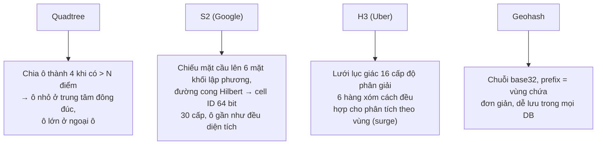

| Tiêu chí | Geohash | Quadtree | S2 | H3 |
|---|---|---|---|---|
| Hình dạng ô | Chữ nhật, méo theo vĩ độ | Vuông, kích thước **thích nghi** mật độ | Gần vuông trên mặt cầu, diện tích gần đều | Lục giác (thêm vài ngũ giác ở cấp thấp) |
| Biểu diễn | Chuỗi / số | Cây trong bộ nhớ | `uint64` cell ID | `uint64` cell ID |
| Hàng xóm | 8, khoảng cách không đều (chéo xa hơn) | Phải duyệt cây | Có hàm sẵn | **6, khoảng cách đều** |
| Lưu trong DB thông thường | Rất dễ (cột string + B-tree, truy vấn prefix) | Khó (cấu trúc trong RAM) | Dễ (range trên ID) | Dễ (theo cell ID) |
| Vùng mật độ không đều | Phải chọn 1 precision | **Tốt nhất** | Phủ vùng bằng nhiều cấp (region coverer) | Chọn resolution theo vùng |
| Cập nhật điểm di chuyển | Rẻ (encode lại) | Có thể phải tách/gộp node | Rẻ | Rẻ |
| Hợp với | Đơn giản, Redis GEO, Elasticsearch | Dữ liệu tĩnh, mật độ lệch (Yelp) | Truy vấn vùng phức tạp, đa giác | Tổng hợp/phân tích theo vùng: surge, cung-cầu |

!!! tip "Redis GEO dùng gì?"
    `GEOADD` / `GEOSEARCH` của Redis lưu vị trí trong **Sorted Set** với score là **geohash 52 bit** dạng số. `GEOSEARCH ... BYRADIUS` tự tính các ô lân cận và lọc khoảng cách - đúng những gì demo trên làm tay. Với vài trăm nghìn tài xế mỗi thành phố, Redis GEO là lựa chọn khởi đầu hợp lý.

---

## 📖 7. Deep dive 2: Ingest vị trí & tìm tài xế gần

### 7.1 Đường ghi vị trí

- **Kết nối lâu dài** (WebSocket/gRPC stream) từ app tài xế tới **driver gateway** - tránh chi phí TLS handshake mỗi 4 giây; gateway là lớp stateful giữ hàng trăm nghìn kết nối (giống notification service ở [Bài 11](./11-file-sync.md) và [Bài 8](./08-chat-presence.md)).
- **Lọc nhiễu**: GPS trong đô thị có thể nhảy hàng trăm mét (phản xạ nhà cao tầng). Bỏ điểm có độ chính xác kém, điểm "dịch chuyển tức thời" vô lý; có thể **map-matching** (bám vào đường gần nhất).
- **Thứ tự**: gói đến trễ không được ghi đè gói mới hơn → kèm `seq`/`ts`, chỉ nhận nếu mới hơn.
- **TTL**: mỗi vị trí có TTL 30 giây. Tài xế mất mạng/tắt app → tự rơi khỏi index, không bị ghép chuyến "ma".
- **Cập nhật index**: nếu tài xế đổi ô → xóa khỏi ô cũ, thêm vào ô mới (atomic trong cùng shard). Phần lớn cập nhật **không đổi ô** (4 giây đi ~40 m) → chỉ sửa tọa độ.

### 7.2 Shard geo index

| Cách shard | Ưu | Nhược |
|---|---|---|
| Theo **thành phố** | Tự nhiên (chuyến đi không vượt thành phố), cô lập lỗi, tuân thủ dữ liệu theo nước | Thành phố lớn (Jakarta, TP.HCM) có thể quá tải một shard |
| Theo **ô geohash/S2** (prefix) | Chia nhỏ tùy ý | Truy vấn sát biên chạm nhiều shard; tài xế đi qua biên phải chuyển shard |
| Theo `driver_id` | Ghi phân bố đều | Truy vấn "gần điểm X" phải hỏi **mọi** shard (scatter-gather) → tệ |

Thực tế: **thành phố → (nếu cần) chia tiếp theo ô** cho thành phố lớn, với vùng chồng lấn ở biên. Mỗi shard có replica để đọc (60k truy vấn/s chia nhiều replica) và failover.

### 7.3 Vùng nóng (hot regions)

Sân bay Tân Sơn Nhất, chợ Bến Thành giờ tan tầm, sân vận động sau trận đấu: một ô precision 6 có thể chứa **hàng nghìn tài xế** và nhận **hàng nghìn truy vấn/giây**.

| Vấn đề | Giảm nhẹ |
|---|---|
| Ô quá đông → mỗi truy vấn trả hàng nghìn ứng viên | Precision **thích nghi** (quadtree / S2 nhiều cấp): ô đông thì chia nhỏ; giới hạn số ứng viên (lấy K gần nhất trong ô nhỏ trước, mở rộng dần) |
| Nhiều truy vấn "xe quanh đây" cho bản đồ | Đây là dữ liệu hiển thị, không cần chính xác tuyệt đối → **cache kết quả theo ô 2–3 giây**; mọi khách trong cùng ô dùng chung |
| Shard chứa vùng nóng quá tải | Tách vùng nóng thành shard riêng; thêm read replica |
| Sân bay có khu chờ riêng | Mô hình **hàng đợi FIFO** (tài xế vào khu chờ sân bay được xếp hàng) thay vì "gần nhất" |

!!! warning "Nearby cho bản đồ ≠ nearby cho ghép chuyến"
    - **Bản đồ** (hiển thị chấm xe): đọc rất nhiều, cache được, vị trí làm tròn, ID ẩn danh, trễ vài giây không sao.
    - **Ghép chuyến**: đọc ít hơn, cần **trạng thái chính xác** (tài xế còn rảnh không) và khóa. Không dùng cache của bản đồ để ghép.

---

## 📖 8. Deep dive 3: Matching / dispatch

### 8.1 Chọn ai?

| Chiến lược | Cách làm | Ưu | Nhược |
|---|---|---|---|
| **Gần nhất theo đường chim bay** | Haversine nhỏ nhất | Đơn giản | Bên kia sông, đường một chiều → đến chậm |
| **ETA nhỏ nhất (greedy)** | Tính ETA đường thật cho top-K ứng viên, chọn nhỏ nhất | Tốt cho từng khách | Tối ưu cục bộ: lấy mất tài xế mà khách bên cạnh cần hơn |
| **Batch matching** | Gom yêu cầu trong cửa sổ 1–3 giây, giải bài toán ghép cặp (bipartite assignment) tối thiểu tổng ETA | Tối ưu toàn cục hơn → tổng thời gian chờ giảm | Thêm độ trễ cửa sổ, tính toán nặng hơn |
| **Thêm yếu tố** | Rating, tỉ lệ nhận chuyến, hướng đang chạy, tài xế sắp kết thúc chuyến gần đó | Chất lượng cao | Phức tạp, cần thử nghiệm A/B |

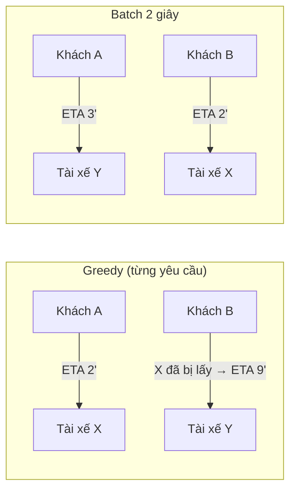

Ví dụ: greedy cho tổng chờ 2 + 9 = 11 phút; batch cho 3 + 2 = 5 phút. Batch nhỏ (1–3 giây) thường đáng giá ở vùng đông.

### 8.2 Chống giao trùng tài xế

Hai matcher (hai yêu cầu song song, hoặc hai instance) cùng chọn tài xế 881. Phải có **một nơi quyết định** - một thao tác nguyên tử trên trạng thái tài xế:

```text
# Redis Lua / hoặc UPDATE có điều kiện trong DB
IF driver:881.state == "AVAILABLE" THEN
    SET driver:881.state = "RESERVED", reserved_for = "tr_9a", lease_until = now + 15s
    RETURN OK
ELSE RETURN TAKEN
```

- **Lease có hạn**: nếu matcher chết sau khi giữ chỗ, sau 15 giây tài xế tự về AVAILABLE.
- Khi tài xế chấp nhận: Trip service chuyển `RESERVED(tr_9a)` → `ON_TRIP(tr_9a)` **có điều kiện** `reserved_for == tr_9a` (offer cũ hết hạn rồi mới bấm accept sẽ thất bại → trả 409 `offer_expired`).
- Trạng thái tài xế nằm **cùng shard** với vị trí của họ → CAS là thao tác cục bộ, không cần transaction phân tán.
- Xem thêm: [lock, lease, fencing token ở Bài 4](./04-consistency-consensus.md).

### 8.3 Gửi đề nghị: một lúc một người hay nhiều người?

| Cách | Ưu | Nhược |
|---|---|---|
| **Tuần tự** (1 tài xế, chờ 10–15 s, rồi người tiếp) | Công bằng, không ai bị "cướp" chuyến | Chậm nếu nhiều người từ chối |
| **Song song** (gửi 3 người, ai nhận trước được) | Nhanh | Tài xế bấm nhận rồi bị báo "đã có người nhận" → trải nghiệm tệ, khóa nhiều tài xế cùng lúc |
| **Lai**: tuần tự nhưng timeout ngắn, mở rộng bán kính dần | Cân bằng | Cần tinh chỉnh |

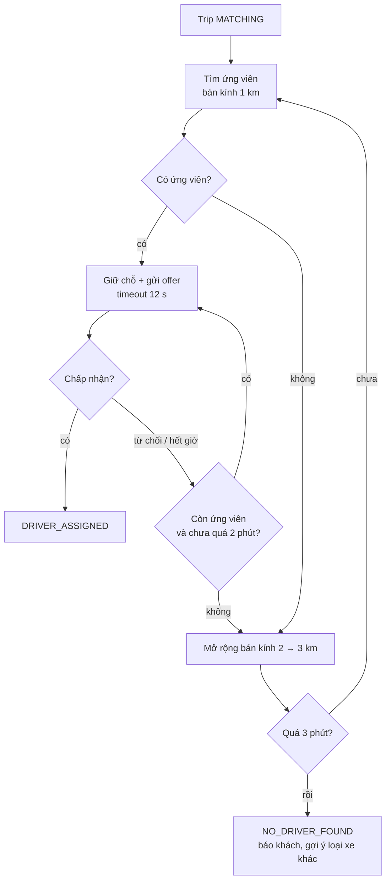

---

## 📖 9. Deep dive 4: Máy trạng thái chuyến đi

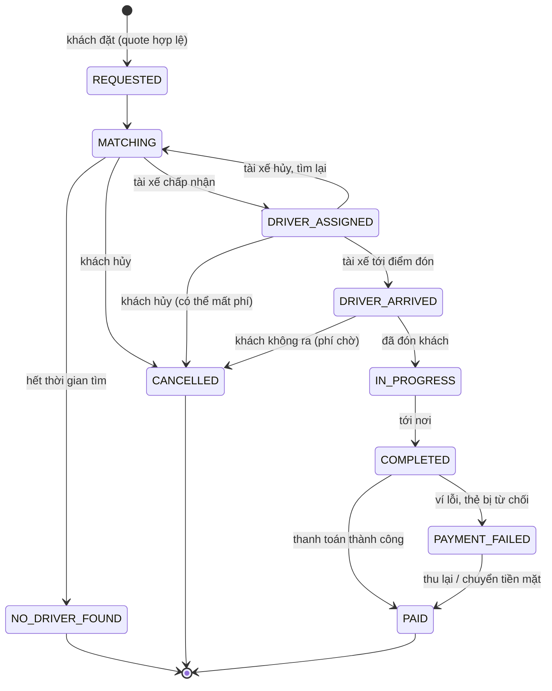

**Nguyên tắc cài đặt:**

1. **Bảng chuyển trạng thái hợp lệ** là code tường minh (không if-else rải rác). Chuyển không hợp lệ (ví dụ `COMPLETED → IN_PROGRESS`) bị từ chối.
2. **Optimistic locking**: `UPDATE trips SET status = 'IN_PROGRESS', version = 6 WHERE trip_id = ? AND status = 'DRIVER_ARRIVED' AND version = 5`. Hai sự kiện đến cùng lúc (khách hủy đúng lúc tài xế bấm "đã đón") → chỉ một thắng, bên thua nhận trạng thái mới và xử lý (báo cho người dùng).
3. **Idempotent theo `event_id`**: tài xế bấm "đã đón" ở vùng sóng yếu, app retry 3 lần → lưu `event_id` trong `TRIP_EVENT` (khóa chính) → lần 2, 3 trả kết quả cũ, không chuyển trạng thái thêm.
4. **Mỗi chuyển trạng thái phát một event** (qua outbox → Kafka): realtime push cho khách, cập nhật trạng thái tài xế, tính tiền, thanh toán, phân tích.
5. **Timeout là chuyển trạng thái**: MATCHING quá 3 phút → NO_DRIVER_FOUND do một **timer/scheduler** kích hoạt (không phụ thuộc client).

!!! note "Vì sao không dùng một transaction lớn?"
    Một chuyến đi kéo dài 30 phút, qua nhiều service (matching, tài xế, thanh toán). Không có transaction nào giữ được lâu như vậy. Máy trạng thái + event + bù trừ (compensation) chính là mô hình **saga** - xem [Bài Kiến trúc & Microservices](../backend/14-architecture-microservices.md).

---

## 📖 10. ETA & surge pricing (tổng quan)

### 10.1 ETA

- **Đồ thị đường**: nút = giao lộ, cạnh = đoạn đường có trọng số thời gian. Dijkstra/A* ([Bài thuật toán](../algorithms/12-shortest-paths-mst.md)) quá chậm cho đồ thị cả nước ở hàng nghìn truy vấn/giây → dùng kỹ thuật **tiền xử lý** như Contraction Hierarchies (truy vấn mili-giây).
- **Trọng số theo thời gian thực**: tốc độ từng đoạn đường tính từ **chính luồng GPS của tài xế** (stream processing, [Bài 5](./05-messaging-streaming.md)) → kẹt xe thật được phản ánh.
- **Hiệu chỉnh bằng ML**: ETA từ routing engine + mô hình học sai số theo giờ, thời tiết, khu vực (đón ở trung tâm thương mại mất thêm thời gian tìm nhau).
- **Ma trận ETA theo lô**: matching cần ETA từ 25 tài xế tới 1 điểm đón → một lời gọi "one-to-many" thay vì 25 lời gọi.

### 10.2 Surge pricing

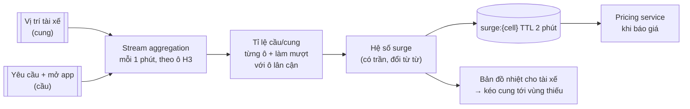

- Đơn vị không gian: **lưới lục giác H3** hợp vì các ô có kích thước gần đều và 6 hàng xóm cách đều → làm mượt giữa các ô tự nhiên.
- **Làm mượt theo không gian và thời gian**: không để giá nhảy 1,0 → 2,5 → 1,0 trong 3 phút, hay chênh mạnh giữa hai ô kề nhau (khách sẽ đi bộ qua đường để gọi xe rẻ hơn).
- **Có trần** (theo quy định địa phương và chính sách) và minh bạch với khách (hiển thị hệ số).
- Giá được **khóa vào `quote_id`** (§3) → surge đổi sau khi khách đã xem giá không ảnh hưởng chuyến đó.
- Giá cuối = công thức (giá mở cửa + km × đơn giá + phút × đơn giá) × surge + phụ phí - khuyến mãi; tính theo **lộ trình dự kiến** (giá cố định trước) hoặc **lộ trình thực tế** (từ lịch sử GPS).

---

## 📖 11. Bàn giao thanh toán

Khi chuyến chuyển sang `COMPLETED`, Trip service **không tự trừ tiền**. Nó phát sự kiện, và Payment service xử lý - chi tiết ví, ledger, đối soát ở [Bài 13](./13-payment-wallet.md).

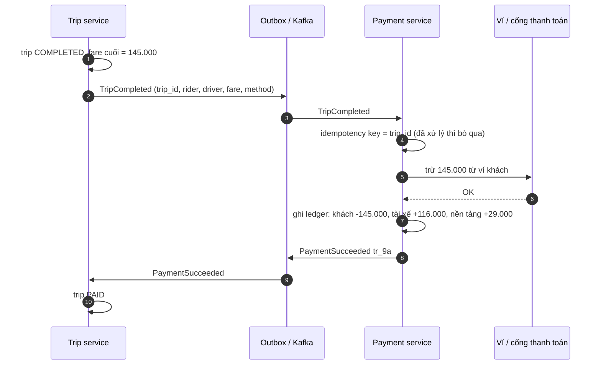

- **Idempotency key = `trip_id`**: Kafka có thể giao sự kiện 2 lần → Payment service không được trừ tiền 2 lần.
- Thanh toán thất bại **không** làm "hoàn tác" chuyến đi (khách đã đi rồi) → chuyển `PAYMENT_FAILED`, thử lại, chuyển nợ, hoặc khóa tài khoản đến khi trả.
- Tiền mặt: tài xế thu → ghi nhận "tài xế nợ nền tảng phần hoa hồng" trong ledger, trừ dần vào thu nhập chuyến ví sau.

---

## 📖 12. Biến thể: "Tìm quán ăn quanh đây" (kiểu Yelp)

Cùng câu hỏi "cái gì gần tôi?", nhưng dữ liệu **gần như tĩnh** và **đọc cực nhiều**:

| Khía cạnh | Gọi xe | Tìm quán ăn |
|---|---|---|
| Đối tượng | Tài xế **di chuyển**, cập nhật mỗi 4 s | Quán **đứng yên**, sửa vài lần/năm |
| Số lượng | Vài trăm nghìn / khu vực | Hàng chục–trăm triệu địa điểm toàn cầu |
| Tỉ lệ đọc/ghi | Ghi nhiều (125k/s) | Đọc rất nhiều, ghi rất ít |
| Lưu trữ | RAM, soft state | DB bền + index không gian, cache mạnh |
| Truy vấn | K tài xế gần + trạng thái rảnh | Lọc theo loại, giờ mở cửa, giá, rating + khoảng cách, phân trang |
| Xếp hạng | ETA | Kết hợp khoảng cách, rating, độ phổ biến, cá nhân hóa |
| Chỉ mục hợp | Geohash/S2 trong Redis, cập nhật liên tục | **Quadtree dựng sẵn** (thích nghi mật độ) hoặc geohash column + B-tree, hoặc search engine có geo query |

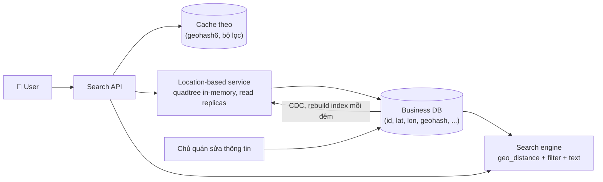

Điểm thiết kế chính:

- **Ước lượng**: 200M địa điểm × ~1 KB = 200 GB thông tin chi tiết; nhưng index không gian chỉ cần `(id, lat, lon)` ~ 24 B × 200M ≈ **4,8 GB** → vừa RAM một máy → **nhân bản** toàn bộ index ra nhiều replica để gánh QPS đọc, không cần shard index.
- **Quadtree dựng sẵn**: chia ô cho đến khi mỗi ô lá ≤ 100 địa điểm → trung tâm thành phố ô nhỏ, nông thôn ô lớn → mỗi truy vấn đọc lượng ứng viên ổn định. Dựng lại hàng đêm (hoặc áp thay đổi tăng dần), vì dữ liệu ít đổi.
- **SQL đơn giản cũng chạy**: cột `geohash` (precision 6–7) có B-tree index; truy vấn `WHERE geohash IN (9 ô) AND category = ?` rồi lọc khoảng cách - đủ cho quy mô vừa. PostGIS (R-tree/GiST) là lựa chọn mạnh khi đã dùng Postgres.
- **Mở rộng bán kính**: không đủ 20 kết quả trong 9 ô precision 6 → chuyển precision 5 (hoặc lên một cấp quadtree).
- **Cache**: kết quả theo `(ô, bộ lọc phổ biến)` cache vài phút - dữ liệu tĩnh nên hit ratio cao.
- Thêm/sửa quán không cần hiện ngay - **eventual** vài phút đến một ngày là chấp nhận được.

---

## 📖 13. Scale, nút thắt & failure modes

| Nút thắt / sự cố | Biểu hiện | Giảm nhẹ |
|---|---|---|
| Vùng nóng (sân bay, sự kiện) | Shard/ô quá tải | Ô thích nghi, shard riêng, cache bản đồ theo ô, hàng đợi sân bay |
| Node geo index chết | Mất vị trí tài xế của shard đó | Replica; và vì là **soft state** - node mới nhận lại đầy đủ vị trí sau ~4 s từ luồng cập nhật. Có thể rebuild nhanh từ Kafka (đọc 30 s cuối) |
| Driver gateway restart | Hàng trăm nghìn tài xế reconnect | Jitter, drain dần khi deploy, resume session |
| Mạng tài xế chập chờn | Offer không tới, accept tới trễ | Offer có hạn; accept trễ → 409; tài xế vào vùng không sóng quá lâu → TTL loại khỏi index |
| Matching service chậm | Khách chờ lâu | Timeout và tự mở rộng bán kính; giới hạn số ứng viên tính ETA |
| ETA service chết | Không ghép được | Fallback: ETA ước lượng = khoảng cách / tốc độ trung bình khu vực |
| Giao trùng tài xế do bug | Hai khách cùng chờ một xe | CAS + lease ở **một** nơi; job đối soát phát hiện tài xế có 2 trip đang mở |
| Thời tiết xấu toàn thành phố | Cầu tăng vọt | Surge, ưu tiên hóa, autoscale theo dự báo thời tiết |
| GPS giả (fake GPS app) | Tài xế "nhảy" tới vùng surge | Phát hiện vận tốc bất khả, đối chiếu cell tower/Wi-Fi, chữ ký thiết bị |

**Multi-region**: mỗi quốc gia/thành phố chạy trong region gần nhất; dữ liệu cá nhân và chuyến đi thường phải lưu **trong nước** (quy định dữ liệu). Chuyến đi không vượt thành phố → shard theo thành phố gần như không cần giao dịch xuyên region. Tài khoản người dùng toàn cầu (đi du lịch) → dữ liệu hồ sơ replicate, chuyến đi ghi ở region của thành phố đang đứng. Xem [Bài 4](./04-consistency-consensus.md).

---

## 📖 14. Monitoring & metric chính

| Metric | Ý nghĩa | Ví dụ mục tiêu |
|---|---|---|
| **Time to match** (đặt → tài xế chấp nhận) p50/p90 | Trải nghiệm khách | p90 < 30 s ở thành phố lớn |
| Match rate (tỉ lệ yêu cầu có tài xế) | Cung đủ không | Theo vùng/giờ |
| Offer acceptance rate, tỉ lệ offer hết hạn | Chất lượng ghép, độ trễ offer | - |
| Cancellation rate (khách/tài xế, trước/sau khi ghép) | Ghép tệ hoặc ETA sai | - |
| **ETA error** (dự báo vs thực tế) | Chất lượng ETA | Sai số trung vị < 1 phút |
| Location update lag (ts trên điện thoại → có trong index) | Độ tươi vị trí | p99 < 2 s |
| Số tài xế online theo ô, tỉ lệ cầu/cung | Cân bằng thị trường, surge | - |
| Nearby query latency p99, QPS theo shard | Sức khỏe geo index | p99 < 200 ms |
| Số kết nối gateway, tỉ lệ reconnect | Kênh realtime | - |
| Trip đang mở kẹt ở một trạng thái quá lâu | Bug máy trạng thái / timer | Gần 0 |
| Tài xế có > 1 trip đang mở | Vi phạm bất biến | **Phải bằng 0** |

---

## 📝 Tự chấm

| Hạng mục | Đạt | Chưa đạt |
|---|---|---|
| **Yêu cầu** | Tách vị trí (soft state) và chuyến đi (bền); hỏi loại xe, surge, độ trễ ghép | Coi mọi dữ liệu như nhau |
| **Ước lượng** | 125k cập nhật vị trí/s; nhận ra vị trí hiện tại chỉ ~100 MB; QPS nearby vs QPS đặt xe | Không tính tải ghi vị trí |
| **API** | WebSocket cho tài xế, quote có hạn, đặt xe có idempotency key, sự kiện chuyến có `event_id` | Polling vị trí bằng REST mỗi giây |
| **Data model** | Geo index in-memory + Trip DB + lịch sử vị trí ở data lake | Lưu vị trí vào bảng SQL và UPDATE 125k lần/s |
| **Kiến trúc** | Location, nearby, matching, trip, pricing, ETA tách rõ; Kafka cho luồng vị trí và sự kiện | Một service làm hết |
| **Deep dive** | Geohash + 9 ô + lọc khoảng cách; so sánh quadtree/S2/H3; CAS + lease chống giao trùng; máy trạng thái idempotent | "Dùng Redis GEO" mà không giải thích bên trong; không nói bẫy biên |
| **Trade-off** | Greedy vs batch matching; tuần tự vs song song offer; shard theo thành phố vs ô | Không có |
| **Failure** | Vị trí là soft state tự hồi phục; vùng nóng; fake GPS; ETA fallback | Không đề cập |

---

## 🔄 Biến thể interviewer hay hỏi

??? question "Nếu là giao đồ ăn (GrabFood) thay vì chở khách?"
    Thêm một bên: **nhà hàng**. Thời điểm gửi tài xế phụ thuộc thời gian chuẩn bị món (dự đoán) - gửi quá sớm thì tài xế chờ, quá muộn thì đồ ăn nguội. Có thể **gộp đơn** (một tài xế lấy 2 đơn cùng nhà hàng/cùng hướng) → bài toán định tuyến phức tạp hơn. Máy trạng thái thêm `RESTAURANT_ACCEPTED`, `FOOD_READY`, `PICKED_UP`.

??? question "Nếu có đi chung (pool)?"
    Matching trở thành bài toán ghép **chuyến vào lộ trình đang chạy**: khách mới có thể chen vào xe đã có khách nếu độ lệch đường cho khách cũ dưới ngưỡng. Cần tính chèn điểm đón/trả tối ưu, giá chia theo quãng, máy trạng thái theo **từng chặng**.

??? question "Nếu muốn khách thấy xe di chuyển mượt trên bản đồ trong chuyến đi?"
    Server đẩy vị trí tài xế (đã lọc) qua WebSocket/SSE cho đúng một khách của chuyến đó, 1–2 s/lần; client **nội suy** chuyển động giữa các điểm và bám đường (map-matching phía client) để không giật.

??? question "Nếu chỉ có 1 thành phố nhỏ, 2.000 tài xế?"
    Một Postgres + PostGIS (hoặc Redis GEO một node) là đủ: 2.000 / 4 = 500 cập nhật/s. Không cần shard, không cần batch matching. Hãy nói rõ: kiến trúc đầy đủ chỉ cần khi quy mô đòi hỏi.

??? question "Nếu cần tìm 'tài xế sẽ rảnh trong 2 phút nữa ở gần đây'?"
    Index thêm tài xế đang ON_TRIP với **điểm trả khách dự kiến** và thời gian dự kiến kết thúc → ứng viên có ETA = thời gian còn lại + ETA từ điểm trả tới điểm đón. Hữu ích ở vùng đông, giảm thời gian chờ.

??? question "Nếu là 'tìm bạn bè quanh đây' (friends nearby)?"
    Giống gọi xe ở chỗ đối tượng di chuyển, nhưng chỉ cần tìm **trong danh sách bạn** (vài trăm người) → không cần geo index toàn cục: lấy vị trí của bạn bè (KV theo user_id) và tính khoảng cách; hoặc pub/sub theo user để đẩy vị trí cho bạn bè đang online. Quyền riêng tư (opt-in, làm mờ vị trí) là trọng tâm.

---

## 🌍 Ứng dụng thực tế

- **Uber** công bố mã nguồn mở **H3** (lưới lục giác) và đã viết nhiều về dispatch, ETA, surge; **Google** công bố **S2 Geometry**. Cả hai được dùng rộng rãi ngoài công ty mẹ.
- **Redis GEO** (`GEOADD`, `GEOSEARCH`) cài đặt geohash trên sorted set - cách nhanh nhất để thử nghiệm tìm điểm gần.
- **PostGIS**, **Elasticsearch/OpenSearch** (geo_point, geo_distance), **MongoDB** (2dsphere) đều có truy vấn không gian - đủ cho đa số ứng dụng "quanh đây" dữ liệu tĩnh.
- Các ứng dụng gọi xe và giao đồ ăn ở Đông Nam Á (Grab, Gojek, Be, Xanh SM...) đều phải giải các bài toán trong bài; chi tiết nội bộ khác nhau và thay đổi theo thời gian - khi phỏng vấn hãy lập luận từ nguyên lý thay vì trích con số.
- Bài toán ghép cặp tối ưu (Hungarian algorithm, min-cost flow) xuất hiện trong batch matching; thực tế thường dùng heuristic nhanh vì ràng buộc thời gian.

---

## ⚠️ Sai lầm thường gặp

1. **Lưu vị trí trong SQL và UPDATE mỗi 4 giây** cho 500k tài xế → DB chìm trong ghi, WAL, replication.
2. **Index B-tree trên lat/lon** và nghĩ là đủ cho truy vấn không gian.
3. **Chỉ tìm trong 1 ô geohash** → bỏ sót tài xế cách vài mét bên kia biên.
4. **Không lọc khoảng cách thật** sau khi lấy 9 ô → trả tài xế cách 1,5 km cho truy vấn 500 m.
5. **Chọn tài xế theo đường chim bay** thay vì ETA.
6. **Không có khóa/lease** khi giữ tài xế → giao trùng.
7. **Máy trạng thái không idempotent** → retry làm chuyển trạng thái hai lần, tính tiền hai lần.
8. **Trip service gọi thẳng cổng thanh toán đồng bộ** trong request "kết thúc chuyến" → cổng chậm làm kẹt luồng chuyến đi; không có idempotency key.
9. **Shard geo index theo driver_id** → mọi truy vấn gần phải hỏi tất cả shard.
10. Quên **TTL** cho vị trí → tài xế đã tắt app vẫn được ghép chuyến.

---

## 🏋️ Bài tập

**Bài 1 (dễ).** 200.000 tài xế, cập nhật mỗi 5 giây, mỗi gói 80 byte. Tính số ghi/giây, băng thông vào và bộ nhớ cho vị trí hiện tại (200 B/tài xế tính cả index).

<details markdown="1"><summary>Đáp án</summary>

- 200.000 / 5 = **40.000 ghi/s**.
- 40.000 × 80 B = 3,2 MB/s ≈ **26 Mbps**.
- 200.000 × 200 B = **40 MB** RAM. Một node Redis dư sức về dung lượng; cần nghĩ về throughput ghi (40k/s vẫn ổn cho một node Redis) và cô lập lỗi.

</details>

**Bài 2 (dễ).** Bạn cần tìm tài xế trong bán kính 2 km. Chọn precision geohash nào để quét 9 ô là đủ? Giải thích bằng quy tắc trong bài.

<details markdown="1"><summary>Đáp án</summary>

Quy tắc: cạnh ngắn của ô ≥ bán kính. Precision 6 có cạnh ngắn ~0,61 km < 2 km → không đủ. Precision 5: ~4,9 km × 4,9 km → cạnh ≥ 2 km ✅. Quét 9 ô precision 5 (~14,7 km × 14,7 km) rồi lọc haversine. Nếu số ứng viên quá nhiều ở trung tâm, có thể dùng precision 6 nhưng quét **5×5 = 25 ô** hoặc nhiều hơn (cần ít nhất ⌈2 / 0,61⌉ = 4 ô mỗi phía theo chiều Bắc-Nam, tức 9 hàng; theo Đông-Tây ⌈2 / 1,2⌉ = 2 ô mỗi phía, tức 5 cột → 45 ô) - so sánh chi phí hai cách.

</details>

**Bài 3 (trung bình).** Sửa demo §6.3 để tìm **K = 3 tài xế gần nhất** mà không biết trước bán kính: bắt đầu precision 7, nếu chưa đủ K kết quả trong vòng tròn hợp lệ thì lùi dần precision. Mô tả thuật toán và điều kiện dừng đúng.

<details markdown="1"><summary>Đáp án</summary>

```text
for p in 7, 6, 5, 4:
    cells = neighbors(encode(lat, lon, p))       # 9 ô
    cand  = mọi tài xế trong 9 ô, tính haversine
    r_safe = cạnh ngắn của ô precision p          # bán kính đảm bảo phủ kín
    hits = [c for c in cand if c.dist <= r_safe] sắp theo dist
    if len(hits) >= K: return hits[:K]
return top K của cand ở precision thấp nhất (hoặc báo không đủ)
```

Điều kiện dừng phải dùng **r_safe**, không phải "có ≥ K ứng viên trong 9 ô": một tài xế ở góc ô chéo có thể xa hơn một tài xế ngoài 9 ô theo hướng thẳng. Chỉ những ứng viên trong bán kính r_safe mới chắc chắn là gần nhất so với mọi điểm ngoài 9 ô. Redis `GEOSEARCH ... COUNT K ASC` làm điều tương tự bên trong.

</details>

**Bài 4 (trung bình).** Khách bấm hủy đúng lúc tài xế bấm "đã đón". Hai request tới Trip service cách nhau 20 ms. Mô tả chính xác điều gì xảy ra với optimistic locking và người dùng thấy gì.

<details markdown="1"><summary>Đáp án</summary>

- Trip đang `DRIVER_ARRIVED`, `version = 5`.
- Request A (hủy): `UPDATE ... SET status='CANCELLED', version=6 WHERE trip_id=? AND version=5` → giả sử thắng, 1 hàng được cập nhật.
- Request B (đã đón): cùng điều kiện `version=5` → 0 hàng → đọc lại thấy `CANCELLED` → chuyển `CANCELLED → IN_PROGRESS` không hợp lệ → trả 409 cho tài xế với trạng thái hiện tại; app tài xế hiển thị "Khách đã hủy chuyến".
- Nếu B thắng: A nhận 409, app khách hiển thị "Chuyến đã bắt đầu, không thể hủy - liên hệ hỗ trợ". Không bao giờ có trạng thái nửa vời. Phí hủy (nếu có) được tính theo trạng thái thắng.

</details>

**Bài 5 (trung bình).** Tính surge theo ô H3 mỗi phút. Mô tả pipeline stream processing: nguồn dữ liệu, key, cửa sổ, đầu ra; và hai biện pháp chống "giá nhảy" giữa các ô kề nhau.

<details markdown="1"><summary>Đáp án</summary>

- Nguồn: topic vị trí tài xế (lọc tài xế AVAILABLE) và topic yêu cầu/mở màn hình đặt xe.
- Map mỗi sự kiện sang `h3_cell` (resolution khoảng vài trăm mét đến 1 km).
- Key = `h3_cell`; cửa sổ tumbling 1 phút (hoặc sliding 5 phút bước 1 phút). Cung = số tài xế **duy nhất** trong ô (HyperLogLog hoặc set), cầu = số yêu cầu.
- Tính `ratio = cầu / max(cung, 1)` → hệ số qua bảng/hàm có trần.
- Chống nhảy: (1) **làm mượt không gian**: hệ số ô = trung bình có trọng số của ô và 6 hàng xóm (k-ring 1); (2) **làm mượt thời gian**: EMA với hệ số trước, giới hạn bước thay đổi mỗi phút (ví dụ ±0,2).
- Đầu ra: `surge:{cell}` vào Redis TTL 2 phút; nếu pipeline chết, TTL hết → mặc định 1,0 (an toàn cho khách).

</details>

**Bài 6 (khó).** Thiết kế dịch vụ "tìm quán ăn quanh đây" cho 50 triệu địa điểm, 100.000 truy vấn/giây, hỗ trợ lọc theo loại món và "đang mở cửa". Chọn index không gian, ước lượng bộ nhớ, và giải thích cách cập nhật khi chủ quán sửa giờ mở cửa.

<details markdown="1"><summary>Đáp án</summary>

- Index: quadtree in-memory (lá ≤ 100 địa điểm) hoặc geohash precision 6–7 → danh sách ID. Bộ nhớ: 50M × (8 B id + 16 B tọa độ + vài byte thuộc tính lọc như bitmask loại món) ≈ 50M × 32 B ≈ **1,6 GB** + overhead cây → vài GB. **Nhân bản** toàn bộ ra N replica (100k QPS / ~5–10k QPS mỗi replica → 10–20 replica), không cần shard.
- Lọc: thuộc tính ít đổi (loại món, mức giá) giữ trong index dạng bitmask. "Đang mở cửa" phụ thuộc thời gian → lưu lịch mở cửa gọn (bitmap 7 ngày × 48 nửa giờ = 336 bit = 42 B) và tính lúc truy vấn theo múi giờ địa phương.
- Chi tiết (tên, ảnh, rating) ở Business DB + cache, hydrate cho top 20 kết quả.
- Cập nhật: chủ quán sửa → ghi DB → CDC/Kafka → các replica index áp thay đổi tăng dần (vị trí đổi thì xóa khỏi ô cũ, thêm vào ô mới; giờ mở cửa đổi thì sửa bitmap) trong vài giây–phút; rebuild toàn bộ hàng đêm để sửa lệch. Cache kết quả theo ô có TTL ngắn (vài phút) để thay đổi xuất hiện kịp.

</details>

**Bài 7 (khó).** Một bug khiến 0,1% chuyến đi có tài xế bị giao trùng trong đợt cao điểm. Liệt kê các giả thuyết nguyên nhân dựa trên thiết kế trong bài và cách kiểm chứng từng cái.

<details markdown="1"><summary>Đáp án</summary>

| Giả thuyết | Kiểm chứng |
|---|---|
| CAS không nguyên tử (đọc rồi ghi ở hai lệnh riêng thay vì Lua/UPDATE có điều kiện) | Đọc code; tìm log hai matcher cùng nhận "OK" cho cùng driver trong vài ms |
| Lease hết hạn trong lúc tài xế vẫn đang xem offer → matcher khác giữ chỗ → tài xế bấm accept offer cũ và accept không kiểm `reserved_for` | Đối chiếu thời điểm accept so với `lease_until`; kiểm tra accept có điều kiện `reserved_for == trip_id` không |
| Failover Redis: replica chưa nhận lệnh giữ chỗ (replication bất đồng bộ) được thăng cấp → khóa bị mất | Đối chiếu thời điểm sự cố với sự kiện failover; cân nhắc fencing token / ghi khóa vào DB nhất quán mạnh |
| Hai shard cùng chứa tài xế (đang chuyển ô/shard ở biên) và mỗi shard có trạng thái riêng | Kiểm tra tài xế bị trùng có nằm gần biên shard không; trạng thái tài xế phải có **một** chủ duy nhất |
| Trip service retry tạo 2 trip cho một yêu cầu (thiếu idempotency key) | Đếm cặp trip cùng rider tạo gần nhau |

Thêm metric "tài xế có > 1 trip đang mở" với alert = 0 để phát hiện sớm, và job đối soát tự động hủy một chuyến + bồi thường.

</details>

---

## ✅ Checklist

- [ ] Phân biệt vị trí (soft state, RAM, mất được) và chuyến đi (bền, transaction)
- [ ] Ước lượng được ghi vị trí/s, RAM cho vị trí hiện tại, QPS nearby và đặt xe
- [ ] Giải thích vì sao B-tree trên lat/lon không đủ; geohash hoạt động thế nào
- [ ] Biết bẫy biên → quét 9 ô + lọc haversine; chọn precision theo bán kính
- [ ] So sánh geohash / quadtree / S2 / H3 và biết khi nào dùng cái nào
- [ ] Shard geo index theo thành phố/ô; xử lý vùng nóng; tách nearby cho bản đồ và cho ghép chuyến
- [ ] Matching theo ETA, greedy vs batch; CAS + lease chống giao trùng; offer có hạn
- [ ] Máy trạng thái chuyến đi với optimistic locking, idempotent theo event_id, timer
- [ ] Tổng quan ETA (routing + realtime + ML) và surge (H3, làm mượt, quote khóa giá)
- [ ] Bàn giao thanh toán qua event với idempotency key = trip_id
- [ ] Áp dụng cho "tìm quán ăn quanh đây": index nhỏ → nhân bản, quadtree dựng sẵn, cache theo ô

---

**Bài tiếp theo**: [Bài 13: Thanh toán & ví điện tử](./13-payment-wallet.md)
