# 📚 Bài 13: Thanh toán & ví điện tử

> "Trong hệ thống tiền, 'gần đúng' nghĩa là 'sai'. Và 'sai' nghĩa là có người mất tiền thật."

21 giờ tối thứ Sáu, chị Lan bấm "Thanh toán" 89.000đ cho một ly trà sữa trên app ví. Màn hình quay vòng 15 giây rồi báo "Có lỗi xảy ra". Chị bấm lại. Lần này thành công. Sáng hôm sau, chị thấy tài khoản bị trừ **hai lần**: 178.000đ.

Ở phía sau, chuyện đã xảy ra là: request đầu tiên **đã** trừ tiền thành công, nhưng response bị mất trên đường về (mạng 4G chập chờn, gateway timeout). App coi timeout là "thất bại", cho phép bấm lại, và server không nhận ra đây là **cùng một ý định thanh toán**. Không ai viết code sai theo nghĩa thông thường. Hệ thống chỉ thiếu ba thứ: **idempotency key**, **máy trạng thái rõ ràng**, và **đối soát**.

Bài này thiết kế một ví điện tử kiểu MoMo/ZaloPay kèm cổng thanh toán (payment gateway) kết nối ngân hàng và PSP (Payment Service Provider). Đây là case study mà **tính đúng quan trọng hơn tốc độ**: mất 1 đồng cũng là sự cố.

## 🎯 Mục tiêu bài học

- Thiết kế **sổ cái kép (double-entry ledger)**: bút toán bất biến, số dư được **suy ra**, mọi giao dịch có tổng bằng 0 - có code Go/Python chạy được kèm kiểm tra bất biến
- Áp dụng **idempotency key end-to-end**: từ app → API → ledger → PSP → webhook
- Vẽ và cài đặt **máy trạng thái thanh toán** (stateDiagram-v2), xử lý **timeout = UNKNOWN** chứ không phải FAILED
- Xử lý **callback/webhook** từ ngân hàng/PSP: xác thực chữ ký, chống replay, dedup, xử lý bất đồng bộ
- Hiểu **hold/authorize vs capture**, **refund**, **chargeback** trong sổ cái
- Thiết kế **đối soát (reconciliation)** theo lô hằng ngày và gần thời gian thực - có code demo
- Giải thích vì sao **số dư không được eventual consistency**, và chuyển tiền **xuyên shard** an toàn
- Biết các điểm móc **fraud/risk**, **audit**, **compliance** (PCI DSS, KYC/AML)

!!! note "Kiến thức nền"
    Bài này dùng nhiều khái niệm từ các bài trước, ta sẽ **link** thay vì dạy lại:
    tiền là số nguyên và idempotency cơ bản ở [Bẫy production §1, §4](../backend/16-production-traps.md),
    transaction & isolation ở [Database internals](../backend/06-database-internals-performance.md),
    outbox & message queue ở [Message queues](../backend/09-message-queues.md) và [Bài 5](./05-messaging-streaming.md),
    nhất quán & đồng thuận ở [Bài 4](./04-consistency-consensus.md), sharding ở [Bài 3](./03-building-blocks-data.md).

---

## 🧩 Tự thiết kế trước

Trước khi đọc tiếp, hãy tự làm bài này trong **15–20 phút** trên giấy hoặc whiteboard.

!!! question "Đề bài"
    Thiết kế một **ví điện tử** cho thị trường Việt Nam với các chức năng:

    1. Nạp tiền từ tài khoản ngân hàng liên kết vào ví.
    2. Chuyển tiền ví → ví (P2P).
    3. Thanh toán cho merchant (quán cà phê, sàn TMĐT) - kể cả thanh toán qua thẻ/ngân hàng thông qua PSP khi ví không đủ tiền.
    4. Hoàn tiền (refund) toàn phần hoặc một phần.
    5. Rút tiền về ngân hàng.

    Yêu cầu: **không bao giờ mất hoặc nhân đôi tiền**, chịu được mạng chập chờn và retry, kiểm toán được mọi đồng.

Gợi ý tự kiểm tra: bạn đã trả lời được những câu sau chưa?

<details markdown="1"><summary>Gợi ý (chỉ mở khi bí)</summary>

- Số dư lưu ở đâu? Là một cột `balance` bị `UPDATE` liên tục, hay được tính từ lịch sử?
- Nếu client gửi cùng một yêu cầu chuyển tiền 2 lần (do retry), làm sao server biết?
- Gọi sang ngân hàng bị **timeout** - tiền đã trừ hay chưa? Bạn làm gì tiếp theo?
- Ngân hàng gửi callback 3 lần cho cùng một giao dịch - xử lý thế nào?
- Cuối ngày, làm sao chứng minh số tiền trong hệ thống khớp với số tiền thật ở ngân hàng?
- Merchant lớn nhận 2.000 giao dịch/giây vào **một** tài khoản - row đó có thành điểm nóng không?
- Hai user ở hai shard khác nhau chuyển tiền cho nhau - dùng transaction nào?

</details>

---

## 📖 1. Làm rõ yêu cầu

Trong phỏng vấn, đừng lao vào vẽ. Hãy hỏi. Dưới đây là một đoạn hội thoại mẫu:

> **Ứng viên:** Phạm vi là ví nội bộ (tiền nằm trong hệ thống của ta) hay chỉ là cổng thanh toán chuyển tiếp sang ngân hàng?
>
> **Interviewer:** Cả hai. Ví có số dư riêng, và có cổng thanh toán để merchant nhận tiền từ ví hoặc từ thẻ/ngân hàng qua PSP.
>
> **Ứng viên:** Một tiền tệ (VND) hay đa tiền tệ?
>
> **Interviewer:** Chủ yếu VND. Nếu còn thời gian thì nói cách mở rộng đa tiền tệ.
>
> **Ứng viên:** Quy mô? Bao nhiêu người dùng, bao nhiêu giao dịch mỗi ngày, có đợt cao điểm nào?
>
> **Interviewer:** Khoảng 30 triệu người dùng hoạt động/tháng. Cao điểm là ngày lương, Tết, các ngày sale 9/9, 11/11, 12/12.
>
> **Ứng viên:** Độ trễ mong đợi cho một lần thanh toán?
>
> **Interviewer:** Người dùng thấy kết quả trong vài giây. Nhưng đúng quan trọng hơn nhanh.
>
> **Ứng viên:** Tôi có cần tự xử lý thẻ (lưu số thẻ) không?
>
> **Interviewer:** Không. Dùng PSP, ta chỉ lưu token.
>
> **Ứng viên:** Vậy tôi coi phần chấm điểm gian lận và KYC là các service có sẵn, tôi chỉ thiết kế điểm móc vào?
>
> **Interviewer:** Được.

### Yêu cầu chức năng

| # | Chức năng | Ghi chú |
|---|---|---|
| F1 | Nạp tiền từ ngân hàng liên kết | Qua cổng ngân hàng/PSP, bất đồng bộ (callback) |
| F2 | Chuyển P2P ví → ví | Nội bộ, đồng bộ, vài trăm ms |
| F3 | Thanh toán merchant | Từ ví (nội bộ) hoặc thẻ/ngân hàng (qua PSP) |
| F4 | Authorize/hold rồi capture | Ví dụ: đặt xe giữ trước 100k, cuối chuyến trừ 87k |
| F5 | Hoàn tiền toàn phần/một phần | Không vượt quá số đã capture |
| F6 | Rút tiền về ngân hàng | Bất đồng bộ, có thể mất vài phút đến T+1 |
| F7 | Lịch sử giao dịch, số dư | Đọc nhiều |

### Yêu cầu phi chức năng

| Thuộc tính | Mục tiêu | Vì sao |
|---|---|---|
| Tính đúng | **0** giao dịch mất/nhân đôi; sổ cái luôn cân | Tiền thật, pháp lý |
| Nhất quán số dư | Strong consistency khi trừ tiền | Không được tiêu cùng một đồng hai lần |
| Khả dụng | 99,95%+ cho luồng thanh toán | Mỗi phút sập = mất doanh thu, mất niềm tin |
| Độ trễ | P99 < 500ms cho P2P nội bộ | Trải nghiệm |
| Kiểm toán | Truy vết mọi đồng, lưu nhiều năm | Thanh tra, kế toán |
| Bảo mật | PCI DSS (qua PSP), mã hóa, phân quyền | Quy định |

### Ngoài phạm vi (nói rõ ra)

- Thuật toán chấm điểm gian lận (chỉ thiết kế điểm móc).
- Quy trình eKYC (chụp CCCD, nhận diện khuôn mặt).
- Sản phẩm tín dụng (trả sau, vay).
- Chi tiết pháp lý cụ thể - **luôn kiểm tra quy định hiện hành** của Ngân hàng Nhà nước khi làm thật.

!!! tip "Câu hỏi đáng giá nhất"
    "Khi có xung đột giữa **khả dụng** và **đúng đắn**, ta chọn gì?" Với ví, câu trả lời gần như luôn là **đúng đắn**: thà từ chối giao dịch (người dùng thử lại sau) còn hơn trừ tiền sai. Đây là lựa chọn **CP** trong CAP cho phần số dư (xem [Bài 4](./04-consistency-consensus.md)).

---

## 📖 2. Ước lượng

Các con số dưới đây là **ước tính để luyện tập**, không phải số liệu chính thức của công ty nào.

**Giả định:**

- 30 triệu MAU, 10 triệu DAU.
- Trung bình 3 giao dịch tài chính/DAU/ngày → **30 triệu giao dịch/ngày**.
- Đọc (xem số dư, lịch sử) gấp ~10 lần ghi.
- Cao điểm (ngày sale, Tết) gấp **10 lần** trung bình trong vài giờ.

**QPS:**

```
Ghi trung bình  = 30.000.000 / 86.400 ≈ 350 giao dịch/s
Ghi cao điểm    ≈ 350 × 10 = 3.500 giao dịch/s  (thiết kế cho ~5.000/s)
Đọc trung bình  ≈ 3.500 /s,  cao điểm ≈ 35.000 /s
```

**Bút toán (ledger entries):** mỗi giao dịch sinh 2–4 bút toán (P2P: 2; thanh toán merchant có phí: 3–4). Lấy trung bình 3.

```
Bút toán/ngày   = 30M × 3 = 90 triệu
Kích thước      ≈ 200 byte/bút toán (id, tx_id, account_id, amount, currency, created_at...)
Dữ liệu thô/ngày ≈ 90M × 200B = 18 GB
Có index (×2,5) ≈ 45 GB/ngày  →  ~16 TB/năm
Lưu 10 năm      ≈ 160 TB  → cần phân vùng theo thời gian + đẩy dữ liệu cũ sang kho lạnh
```

**Bảng payments/idempotency:** 30M dòng/ngày × ~1KB ≈ 30 GB/ngày. Bảng idempotency chỉ cần giữ "nóng" 24–72 giờ.

**Bộ nhớ cache số dư** (cho đọc): 30M ví × ~100 byte ≈ 3 GB - nằm gọn trong một cụm Redis nhỏ. Nhưng nhớ: cache chỉ để **hiển thị**, không bao giờ dùng để **quyết định trừ tiền**.

**Kết luận từ ước lượng:**

1. 5.000 giao dịch/s ghi là **vừa phải** - một cụm PostgreSQL/MySQL được shard vài chục node là dư. Vấn đề **không phải** throughput tổng.
2. Vấn đề thật là **tài khoản nóng**: một merchant lớn có thể nhận 1.000–2.000 giao dịch/s vào **một** dòng `accounts` → khóa dòng thành nút cổ chai (xem §11).
3. Dung lượng lớn theo thời gian → partition theo tháng, archive.

---

## 📖 3. Thiết kế API

API công khai (client & merchant) và API nội bộ (giữa các service). Mọi API ghi đều **bắt buộc** có `Idempotency-Key`.

```http
POST /v1/transfers
Idempotency-Key: 6f1c2a9e-1b7d-4c55-9a3e-0d2f8b1e7a10
Authorization: Bearer <token>

{ "to_wallet": "w_bob", "amount": 250000, "currency": "VND", "note": "tra tien an trua" }
```

```json
201 Created
{ "transfer_id": "tr_01J9...", "status": "SUCCEEDED", "amount": 250000, "currency": "VND",
  "balance_after": 750000, "created_at": "2026-10-28T14:03:11Z" }
```

| Endpoint | Mục đích | Đồng bộ? |
|---|---|---|
| `POST /v1/transfers` | P2P ví → ví | Đồng bộ |
| `POST /v1/topups` | Nạp tiền từ ngân hàng | Trả `PENDING`, kết quả qua callback/poll |
| `POST /v1/payments` | Merchant tạo yêu cầu thanh toán (payment intent) | Trả `payment_id` + `PENDING` |
| `POST /v1/payments/{id}/confirm` | User xác nhận (PIN/sinh trắc) | Ví: đồng bộ; PSP: bất đồng bộ |
| `POST /v1/payments/{id}/capture` | Capture một phần/toàn phần sau hold | Đồng bộ |
| `POST /v1/payments/{id}/void` | Hủy hold | Đồng bộ |
| `POST /v1/refunds` | Hoàn tiền (có `payment_id`, `amount`) | Ví: đồng bộ; PSP: bất đồng bộ |
| `GET /v1/payments/{id}` | Tra trạng thái (client poll) | - |
| `GET /v1/wallets/me` | Số dư khả dụng + đang giữ | - |
| `POST /internal/psp/webhook` | PSP/ngân hàng gọi về | - |

**Webhook gửi cho merchant** (ta là bên gửi):

```json
POST https://merchant.example.vn/hooks/payments
X-Signature: t=1761660191,v1=5c2b...   (HMAC-SHA256 của "t.body" bằng secret của merchant)

{ "event_id": "evt_01J9...", "type": "payment.succeeded",
  "data": { "payment_id": "pay_01J9...", "order_id": "DH-7781", "amount": 89000, "currency": "VND" } }
```

!!! warning "Số tiền là số nguyên"
    `"amount": 250000` - số nguyên theo **đơn vị nhỏ nhất** của tiền tệ (VND có 0 chữ số thập phân, USD có 2 → `$12.34` là `1234`). Không bao giờ dùng `float`/`double`. Xem [Bẫy production §1](../backend/16-production-traps.md). Luôn đi kèm `currency`.

---

## 📖 4. Mô hình dữ liệu

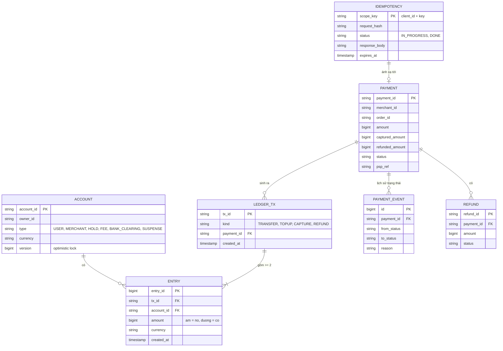

**Ba quy tắc vàng của sổ cái:**

1. **Bút toán bất biến (immutable):** chỉ `INSERT`, không bao giờ `UPDATE`/`DELETE`. Sai thì ghi **bút toán đảo (reversal)**, giống kế toán viết bút đỏ chứ không tẩy xóa.
2. **Mỗi giao dịch cân bằng:** tổng `amount` các bút toán trong một `tx_id` = 0. Tiền không tự sinh ra hay mất đi, chỉ **di chuyển** giữa các tài khoản.
3. **Số dư được suy ra:** `balance(account) = SUM(amount) WHERE account_id = ?`. Có thể có bảng `balances` làm cache/snapshot để đọc nhanh, nhưng nó phải được cập nhật **trong cùng DB transaction** với bút toán, và luôn có thể tính lại từ sổ.

**Chọn storage:**

| Dữ liệu | Lựa chọn | Lý do |
|---|---|---|
| Ledger, accounts, balances, payments, idempotency | **RDBMS (PostgreSQL/MySQL) shard theo account_id**, hoặc NewSQL (CockroachDB, TiDB, Spanner) | Cần ACID, ràng buộc unique, `SELECT ... FOR UPDATE`, transaction nhiều dòng |
| Lịch sử giao dịch để hiển thị | Bản sao đọc (read replica) hoặc store riêng (Cassandra/Elasticsearch) dựng từ CDC | Tách đọc nặng khỏi đường ghi |
| Audit log | Append-only, WORM storage (object storage có object lock) | Không ai sửa được, kể cả admin |
| Sự kiện | Kafka (qua outbox) | Thông báo, analytics, đối soát realtime |
| Cache số dư hiển thị | Redis | Chỉ để đọc, không để quyết định |

!!! warning "Vì sao không dùng NoSQL eventual consistency cho số dư?"
    Hai request trừ tiền cùng lúc đọc hai replica khác nhau, cả hai thấy số dư 100k, cả hai trừ 80k → số dư -60k. Với feed hay lượt like, sai một chút không sao. Với tiền, đó là **double spending**. Số dư cần **linearizable** khi kiểm tra-và-trừ.

---

## 📖 5. Kiến trúc tổng thể

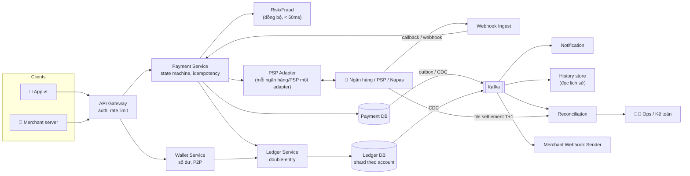

Tách **Payment Service** (quản lý vòng đời một khoản thanh toán, nói chuyện với bên ngoài) khỏi **Ledger Service** (chỉ biết ghi bút toán cân bằng, không biết gì về PSP). Ledger là trái tim, càng đơn giản càng tốt.

### Luồng 1 - Chuyển tiền P2P (nội bộ, đồng bộ)

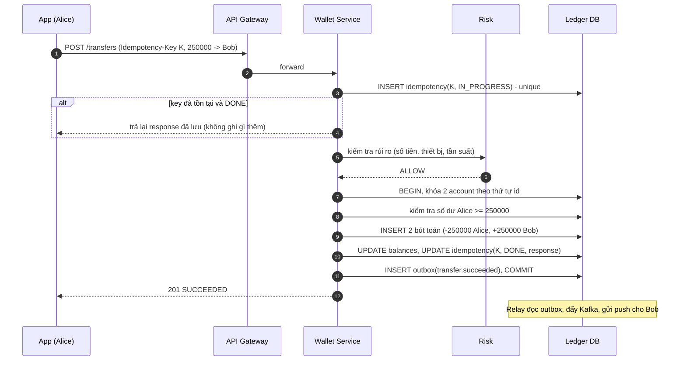

Mọi thứ quan trọng (bút toán, số dư, trạng thái idempotency, outbox event) nằm trong **một DB transaction**. Hoặc tất cả, hoặc không gì cả.

### Luồng 2 - Thanh toán merchant qua PSP (bất đồng bộ)

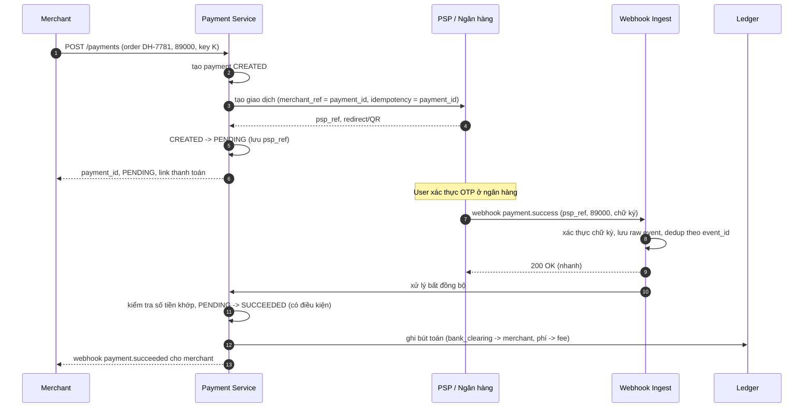

!!! tip "Không tin redirect của trình duyệt"
    Khi user quay về từ trang ngân hàng với `?status=success`, đó là **dữ liệu do client gửi** - có thể bị sửa. Chỉ tin **webhook có chữ ký** hoặc **API tra trạng thái server-to-server**.

---

## 📖 6. Deep dive 1 - Sổ cái kép (double-entry ledger)

### 6.1 Vì sao không chỉ là `UPDATE wallets SET balance = balance - x`?

Cách "một cột balance" trông đơn giản, nhưng:

| Câu hỏi | Một cột balance | Sổ cái kép |
|---|---|---|
| "Số dư hôm qua lúc 15h là bao nhiêu?" | Không biết | `SUM` đến thời điểm đó |
| "Tiền này từ đâu đến?" | Không biết | Mỗi bút toán có đối ứng |
| "Có ai sửa tay số dư không?" | Không phát hiện được | Bút toán bất biến + tổng phải = 0 |
| Bug ghi thiếu một vế | Tiền "bốc hơi" hoặc "sinh ra" âm thầm | Bất biến tổng = 0 bị vi phạm → báo động ngay |
| Kiểm toán | Khó | Đây chính là thứ kế toán dùng 500 năm nay |

Hãy nghĩ sổ cái như **sổ ghi chép chợ quê**: không ai tẩy số cũ, chỉ ghi thêm dòng mới. Muốn biết còn bao nhiêu thì cộng lại.

### 6.2 Tài khoản hệ thống - tiền "ở đâu" khi đang di chuyển?

Mọi đồng tiền phải luôn nằm trong **một** tài khoản. Ngoài ví người dùng và merchant, ta cần các tài khoản nội bộ:

| Tài khoản | Ý nghĩa | Được âm? |
|---|---|---|
| `user:*` | Ví người dùng | Không |
| `merchant:*` | Số dư merchant chờ quyết toán | Không |
| `hold:*` | Tiền đang bị giữ (authorize chưa capture) | Không |
| `fee:revenue` | Doanh thu phí | Không |
| `bank_clearing:<bank>` | Phản ánh tiền ta có/nợ ở ngân hàng đối tác | **Có** (là tài khoản "bên ngoài") |
| `suspense` / `transit` | Tiền đang chuyển giữa các shard hoặc chưa rõ đích | Có, nhưng phải về 0 sau đối soát |

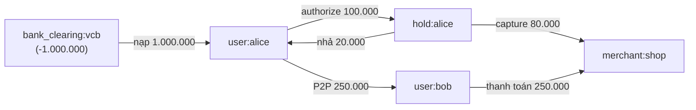

Tổng mọi tài khoản luôn bằng 0: phần âm của `bank_clearing` chính là "ta đang giữ hộ khách 1.000.000 đồng tiền thật ở ngân hàng".

### 6.3 Code: sổ cái kép với idempotency và kiểm tra bất biến

Chương trình dưới đây cài đặt một ledger trong bộ nhớ với:

- Bút toán append-only, mỗi giao dịch 2 bút toán tổng = 0.
- Idempotency: cùng key + cùng payload → trả kết quả cũ; cùng key + khác payload → lỗi.
- Không cho ví người dùng âm.
- Hold → capture một phần → nhả phần còn lại.
- 100 request đồng thời rút từ một ví - không được rút quá.
- Kiểm tra 4 bất biến ở cuối.

=== "Go"

    ```go
    package main

    import (
    	"errors"
    	"fmt"
    	"sync"
    )

    // Tiền luôn là số nguyên đơn vị nhỏ nhất (VND không có xu => 1 đơn vị = 1 đồng).
    type Amount int64

    type Entry struct {
    	TxID    string
    	Account string
    	Delta   Amount // âm = ghi nợ (tiền ra), dương = ghi có (tiền vào)
    }

    type Tx struct {
    	ID, IdemKey, From, To string
    	Amount                Amount
    }

    type Ledger struct {
    	mu       sync.Mutex
    	entries  []Entry           // append-only, không bao giờ sửa/xóa
    	byIdem   map[string]Tx     // idempotency key -> giao dịch đã ghi
    	external map[string]bool   // tài khoản được phép âm (ngân hàng, PSP)
    	balance  map[string]Amount // cache, luôn suy ra được từ entries
    	nextTx   int
    }

    var (
    	ErrInsufficient = errors.New("không đủ số dư")
    	ErrIdemConflict = errors.New("idempotency key đã dùng với payload khác")
    	ErrBadAmount    = errors.New("số tiền phải > 0")
    )

    func NewLedger(external ...string) *Ledger {
    	l := &Ledger{byIdem: map[string]Tx{}, external: map[string]bool{}, balance: map[string]Amount{}}
    	for _, a := range external {
    		l.external[a] = true
    	}
    	return l
    }

    // Transfer ghi một giao dịch gồm 2 bút toán có tổng = 0, trong một "transaction".
    func (l *Ledger) Transfer(idemKey, from, to string, amt Amount) (Tx, bool, error) {
    	if amt <= 0 || from == to {
    		return Tx{}, false, ErrBadAmount
    	}
    	l.mu.Lock() // trong DB thật: SELECT ... FOR UPDATE trên các account theo thứ tự cố định
    	defer l.mu.Unlock()
    	if old, ok := l.byIdem[idemKey]; ok {
    		if old.From != from || old.To != to || old.Amount != amt {
    			return Tx{}, false, ErrIdemConflict
    		}
    		return old, true, nil // replay: trả lại kết quả cũ, KHÔNG ghi thêm
    	}
    	if !l.external[from] && l.balance[from] < amt {
    		return Tx{}, false, ErrInsufficient
    	}
    	l.nextTx++
    	tx := Tx{ID: fmt.Sprintf("tx%03d", l.nextTx), IdemKey: idemKey, From: from, To: to, Amount: amt}
    	l.entries = append(l.entries,
    		Entry{tx.ID, from, -amt},
    		Entry{tx.ID, to, +amt})
    	l.balance[from] -= amt
    	l.balance[to] += amt
    	l.byIdem[idemKey] = tx
    	return tx, false, nil
    }

    // DerivedBalance tính lại số dư từ đầu sổ - nguồn sự thật duy nhất.
    func (l *Ledger) DerivedBalance(acc string) Amount {
    	var s Amount
    	for _, e := range l.entries {
    		if e.Account == acc {
    			s += e.Delta
    		}
    	}
    	return s
    }

    // CheckInvariants: (1) mỗi tx tổng = 0, (2) toàn sổ tổng = 0, (3) cache khớp sổ, (4) ví user không âm.
    func (l *Ledger) CheckInvariants() error {
    	perTx := map[string]Amount{}
    	var total Amount
    	for _, e := range l.entries {
    		perTx[e.TxID] += e.Delta
    		total += e.Delta
    	}
    	for id, s := range perTx {
    		if s != 0 {
    			return fmt.Errorf("tx %s lệch %d", id, s)
    		}
    	}
    	if total != 0 {
    		return fmt.Errorf("tổng sổ lệch %d", total)
    	}
    	for acc, b := range l.balance {
    		if b != l.DerivedBalance(acc) {
    			return fmt.Errorf("cache %s sai", acc)
    		}
    		if !l.external[acc] && b < 0 {
    			return fmt.Errorf("ví %s âm", acc)
    		}
    	}
    	return nil
    }

    func main() {
    	l := NewLedger("bank:vcb")
    	show := func(label string, tx Tx, replay bool, err error) {
    		fmt.Printf("%-34s tx=%-6s replay=%-5v err=%v\n", label, tx.ID, replay, err)
    	}

    	tx, r, err := l.Transfer("topup-1", "bank:vcb", "user:alice", 1_000_000)
    	show("nạp 1.000.000 vào alice", tx, r, err)
    	tx, r, err = l.Transfer("pay-42", "user:alice", "user:bob", 250_000)
    	show("alice -> bob 250.000", tx, r, err)
    	tx, r, err = l.Transfer("pay-42", "user:alice", "user:bob", 250_000)
    	show("client retry cùng key", tx, r, err)
    	tx, r, err = l.Transfer("pay-42", "user:alice", "user:bob", 999_000)
    	show("cùng key, khác số tiền", tx, r, err)
    	tx, r, err = l.Transfer("pay-43", "user:alice", "user:bob", 5_000_000)
    	show("chuyển quá số dư", tx, r, err)

    	// Hold (authorize) rồi capture một phần, nhả phần còn lại
    	tx, r, err = l.Transfer("auth-7", "user:alice", "hold:alice", 100_000)
    	show("authorize 100.000 (hold)", tx, r, err)
    	tx, r, err = l.Transfer("cap-7", "hold:alice", "merchant:shop", 80_000)
    	show("capture 80.000", tx, r, err)
    	tx, r, err = l.Transfer("void-7", "hold:alice", "user:alice", 20_000)
    	show("nhả hold 20.000", tx, r, err)

    	// 100 request đồng thời, mỗi cái rút 10.000 từ bob (có 250.000)
    	var wg sync.WaitGroup
    	var mu sync.Mutex
    	ok, fail := 0, 0
    	for i := 0; i < 100; i++ {
    		wg.Add(1)
    		go func(i int) {
    			defer wg.Done()
    			_, _, err := l.Transfer(fmt.Sprintf("c-%d", i), "user:bob", "merchant:shop", 10_000)
    			mu.Lock()
    			if err == nil {
    				ok++
    			} else {
    				fail++
    			}
    			mu.Unlock()
    		}(i)
    	}
    	wg.Wait()
    	fmt.Printf("100 request đồng thời: thành công=%d, từ chối=%d\n", ok, fail)

    	for _, a := range []string{"bank:vcb", "user:alice", "user:bob", "hold:alice", "merchant:shop"} {
    		fmt.Printf("%-14s %10d\n", a, l.DerivedBalance(a))
    	}
    	fmt.Println("số bút toán:", len(l.entries), "| bất biến:", l.CheckInvariants())
    }

    // Output:
    // nạp 1.000.000 vào alice            tx=tx001  replay=false err=<nil>
    // alice -> bob 250.000               tx=tx002  replay=false err=<nil>
    // client retry cùng key              tx=tx002  replay=true  err=<nil>
    // cùng key, khác số tiền             tx=       replay=false err=idempotency key đã dùng với payload khác
    // chuyển quá số dư                   tx=       replay=false err=không đủ số dư
    // authorize 100.000 (hold)           tx=tx003  replay=false err=<nil>
    // capture 80.000                     tx=tx004  replay=false err=<nil>
    // nhả hold 20.000                    tx=tx005  replay=false err=<nil>
    // 100 request đồng thời: thành công=25, từ chối=75
    // bank:vcb         -1000000
    // user:alice         670000
    // user:bob                0
    // hold:alice              0
    // merchant:shop      330000
    // số bút toán: 60 | bất biến: <nil>
    ```

=== "Python"

    ```python
    import threading
    from dataclasses import dataclass


    class InsufficientFunds(Exception):
        pass


    class IdempotencyConflict(Exception):
        pass


    @dataclass(frozen=True)
    class Entry:  # frozen = không sửa được sau khi tạo
        tx_id: str
        account: str
        delta: int  # số nguyên đơn vị nhỏ nhất (VND)


    @dataclass(frozen=True)
    class Tx:
        id: str
        idem_key: str
        src: str
        dst: str
        amount: int


    class Ledger:
        def __init__(self, external=()):
            self._lock = threading.Lock()
            self.entries: list[Entry] = []  # append-only
            self.by_idem: dict[str, Tx] = {}
            self.external = set(external)  # tài khoản được phép âm
            self.balance: dict[str, int] = {}  # cache suy ra từ entries
            self._next = 0

        def transfer(self, idem_key, src, dst, amount):
            """Trả về (tx, replay). Ghi 2 bút toán tổng = 0 trong một khóa."""
            if not isinstance(amount, int) or amount <= 0 or src == dst:
                raise ValueError("số tiền phải là int > 0")
            with self._lock:  # DB thật: SELECT ... FOR UPDATE theo thứ tự account
                old = self.by_idem.get(idem_key)
                if old:
                    if (old.src, old.dst, old.amount) != (src, dst, amount):
                        raise IdempotencyConflict(idem_key)
                    return old, True
                if src not in self.external and self.balance.get(src, 0) < amount:
                    raise InsufficientFunds(src)
                self._next += 1
                tx = Tx(f"tx{self._next:03d}", idem_key, src, dst, amount)
                self.entries += [Entry(tx.id, src, -amount), Entry(tx.id, dst, amount)]
                self.balance[src] = self.balance.get(src, 0) - amount
                self.balance[dst] = self.balance.get(dst, 0) + amount
                self.by_idem[idem_key] = tx
                return tx, False

        def derived_balance(self, acc):
            return sum(e.delta for e in self.entries if e.account == acc)

        def check_invariants(self):
            per_tx = {}
            for e in self.entries:
                per_tx[e.tx_id] = per_tx.get(e.tx_id, 0) + e.delta
            assert all(v == 0 for v in per_tx.values()), "có tx không cân"
            assert sum(e.delta for e in self.entries) == 0, "tổng sổ lệch"
            for acc, b in self.balance.items():
                assert b == self.derived_balance(acc), f"cache {acc} sai"
                assert acc in self.external or b >= 0, f"ví {acc} âm"
            return "OK"


    def main():
        l = Ledger(external={"bank:vcb"})

        def run(label, *args):
            try:
                tx, replay = l.transfer(*args)
                print(f"{label:<34} tx={tx.id} replay={replay}")
            except Exception as ex:
                print(f"{label:<34} lỗi={type(ex).__name__}")

        run("nạp 1.000.000 vào alice", "topup-1", "bank:vcb", "user:alice", 1_000_000)
        run("alice -> bob 250.000", "pay-42", "user:alice", "user:bob", 250_000)
        run("client retry cùng key", "pay-42", "user:alice", "user:bob", 250_000)
        run("cùng key, khác số tiền", "pay-42", "user:alice", "user:bob", 999_000)
        run("chuyển quá số dư", "pay-43", "user:alice", "user:bob", 5_000_000)
        run("authorize 100.000 (hold)", "auth-7", "user:alice", "hold:alice", 100_000)
        run("capture 80.000", "cap-7", "hold:alice", "merchant:shop", 80_000)
        run("nhả hold 20.000", "void-7", "hold:alice", "user:alice", 20_000)

        results = []

        def worker(i):
            try:
                l.transfer(f"c-{i}", "user:bob", "merchant:shop", 10_000)
                results.append(True)
            except InsufficientFunds:
                results.append(False)

        threads = [threading.Thread(target=worker, args=(i,)) for i in range(100)]
        for t in threads:
            t.start()
        for t in threads:
            t.join()
        print(f"100 request đồng thời: thành công={results.count(True)}, từ chối={results.count(False)}")

        for a in ["bank:vcb", "user:alice", "user:bob", "hold:alice", "merchant:shop"]:
            print(f"{a:<14} {l.derived_balance(a):>10}")
        print("số bút toán:", len(l.entries), "| bất biến:", l.check_invariants())


    if __name__ == "__main__":
        main()

    # Output:
    # nạp 1.000.000 vào alice            tx=tx001 replay=False
    # alice -> bob 250.000               tx=tx002 replay=False
    # client retry cùng key              tx=tx002 replay=True
    # cùng key, khác số tiền             lỗi=IdempotencyConflict
    # chuyển quá số dư                   lỗi=InsufficientFunds
    # authorize 100.000 (hold)           tx=tx003 replay=False
    # capture 80.000                     tx=tx004 replay=False
    # nhả hold 20.000                    tx=tx005 replay=False
    # 100 request đồng thời: thành công=25, từ chối=75
    # bank:vcb         -1000000
    # user:alice         670000
    # user:bob                0
    # hold:alice              0
    # merchant:shop      330000
    # số bút toán: 60 | bất biến: OK
    ```

Đọc kết quả:

- `client retry cùng key` trả về **đúng `tx002`** với `replay=true` - không có bút toán mới. Đây là thứ cứu chị Lan ở đầu bài.
- `cùng key, khác số tiền` bị từ chối: một key chỉ gắn với **một** ý định. Nếu cho qua, một bug ở client có thể biến "trả 250k" thành "trả 999k" mà vẫn trông như retry.
- 100 request đồng thời, Bob có 250.000 → **đúng 25** thành công. Khóa (mutex ở đây, `SELECT ... FOR UPDATE` trong DB thật) biến "kiểm tra số dư rồi trừ" thành một bước nguyên tử.
- 60 bút toán = 30 giao dịch × 2, tổng = 0, cache số dư khớp với số dư suy ra.

### 6.4 Trong DB thật trông như thế nào?

```sql
BEGIN;
-- 1) Khóa các account theo THỨ TỰ id cố định để tránh deadlock (A->B và B->A cùng lúc)
SELECT account_id, balance FROM balances
 WHERE account_id IN ('user:alice', 'user:bob')
 ORDER BY account_id
 FOR UPDATE;

-- 2) Kiểm tra số dư trong ứng dụng (hoặc dùng UPDATE có điều kiện bên dưới)
UPDATE balances SET balance = balance - 250000, version = version + 1
 WHERE account_id = 'user:alice' AND balance >= 250000;   -- 0 dòng = không đủ tiền -> ROLLBACK
UPDATE balances SET balance = balance + 250000, version = version + 1
 WHERE account_id = 'user:bob';

-- 3) Ghi bút toán bất biến
INSERT INTO ledger_tx(tx_id, kind, created_at) VALUES ('tx_01J9..', 'TRANSFER', now());
INSERT INTO entries(tx_id, account_id, amount, currency) VALUES
  ('tx_01J9..', 'user:alice', -250000, 'VND'),
  ('tx_01J9..', 'user:bob',   +250000, 'VND');

-- 4) Đánh dấu idempotency + outbox trong CÙNG transaction
UPDATE idempotency SET status = 'DONE', response_body = '{...}' WHERE scope_key = 'app:6f1c..';
INSERT INTO outbox(topic, payload) VALUES ('transfer.succeeded', '{...}');
COMMIT;
```

Thêm phòng thủ ở tầng DB, không chỉ ở code:

```sql
ALTER TABLE balances ADD CONSTRAINT non_negative CHECK (balance >= 0 OR account_type IN ('BANK_CLEARING','SUSPENSE'));
REVOKE UPDATE, DELETE ON entries FROM app_user;   -- ứng dụng chỉ được INSERT
```

Và một **job kiểm tra bất biến** chạy liên tục (vài phút/lần): `SELECT tx_id FROM entries GROUP BY tx_id HAVING SUM(amount) <> 0` phải rỗng; `balances` phải khớp `SUM(entries)` (kiểm tra theo mẫu ngẫu nhiên hoặc theo partition).

### 💡 Tips quan trọng

- **Số dư khả dụng ≠ số dư sổ sách.** Khả dụng = sổ sách − đang hold. Nếu hold là một tài khoản riêng (`hold:alice`) như code trên thì số dư `user:alice` chính là khả dụng.
- **Đa tiền tệ:** mỗi bút toán có `currency`, và tổng = 0 **theo từng tiền tệ**. Đổi tiền = 2 giao dịch qua tài khoản `fx:<cặp>`: `user USD → fx` và `fx → user VND` với tỷ giá lưu kèm.
- **Snapshot:** với tài khoản có hàng triệu bút toán, lưu `balance_snapshot(account, as_of_entry_id, balance)` định kỳ; số dư = snapshot + `SUM` các bút toán sau đó.

---

## 📖 7. Deep dive 2 - Idempotency end-to-end

Idempotency không phải một tính năng của **một** API. Nó phải là một **chuỗi** không đứt từ ngón tay người dùng đến ngân hàng.

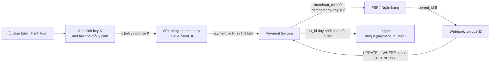

| Mắt xích | Khóa idempotency | Cơ chế |
|---|---|---|
| App → API | `Idempotency-Key` do client sinh (UUID) khi user bắt đầu ý định, **lưu lại** để retry | Bảng `idempotency` có unique constraint |
| API → Payment | `payment_id` sinh **một lần** gắn với K | Lưu ánh xạ K → payment_id |
| Payment → PSP | Gửi `payment_id` làm `merchant_ref`/idempotency key của PSP | PSP từ chối trùng hoặc trả lại giao dịch cũ |
| PSP → Webhook | `event_id` của PSP (hoặc `psp_ref` + loại sự kiện) | Unique trên bảng `webhook_events` |
| Payment → Ledger | `(payment_id, step)` ví dụ `(P, CAPTURE)` | Unique trên `ledger_tx` |
| Ta → Merchant webhook | `event_id` của ta | Merchant tự dedup (ta ghi rõ trong tài liệu) |

### 7.1 Xử lý hai request cùng key đến **đồng thời**

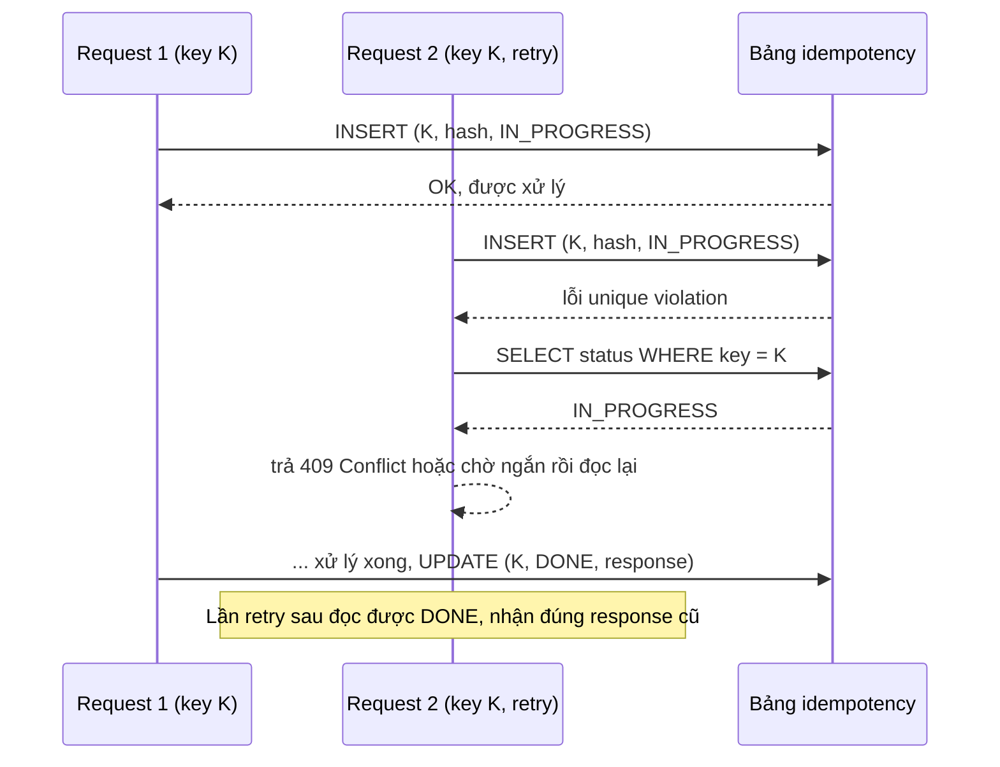

Ba trường hợp khi thấy key đã tồn tại:

| Trạng thái đã lưu | Hash request | Hành động |
|---|---|---|
| `DONE` | Giống | Trả lại **response đã lưu** (cùng status code, cùng body) |
| `DONE` | Khác | `422` - key đã dùng cho yêu cầu khác |
| `IN_PROGRESS` | Giống | `409` (client chờ rồi retry) - **không** xử lý song song |
| `IN_PROGRESS` quá lâu (process chết) | Giống | Sau khi chắc chắn tiến trình cũ không còn (lease hết hạn), kiểm tra trạng thái thật ở ledger/PSP rồi mới tiếp tục |

!!! warning "Lưu response lỗi hay không?"
    Lỗi **nghiệp vụ** (không đủ tiền, 4xx) → lưu, retry nhận cùng lỗi. Lỗi **tạm thời** (DB timeout, 5xx trước khi ghi gì) → **không** đánh dấu DONE, để retry được xử lý lại. Nguyên tắc: chỉ lưu kết quả khi nó là **kết luận cuối cùng**.

### 7.2 Retry mà không trừ tiền hai lần

Quy tắc khi gọi ra ngoài (PSP, ngân hàng):

1. **Timeout ≠ thất bại.** Timeout nghĩa là "**không biết**". Chuyển payment sang `UNKNOWN`, không trả "thất bại" cho user, không cho tạo payment mới.
2. **Retry với cùng idempotency key** (cùng `payment_id`) - chỉ khi PSP hỗ trợ idempotency.
3. Nếu PSP **không** hỗ trợ idempotency: **không retry lệnh tạo**, thay vào đó gọi **API tra trạng thái** (`GET /transactions?merchant_ref=P`) với backoff.
4. Vẫn không rõ sau N lần → để **đối soát** quyết định (§9), báo user "đang xử lý".
5. Exponential backoff + jitter, giới hạn số lần, circuit breaker theo từng PSP (xem [Bài System design backend](../backend/10-system-design.md)).

---

## 📖 8. Deep dive 3 - Máy trạng thái thanh toán & webhook

### 8.1 Máy trạng thái

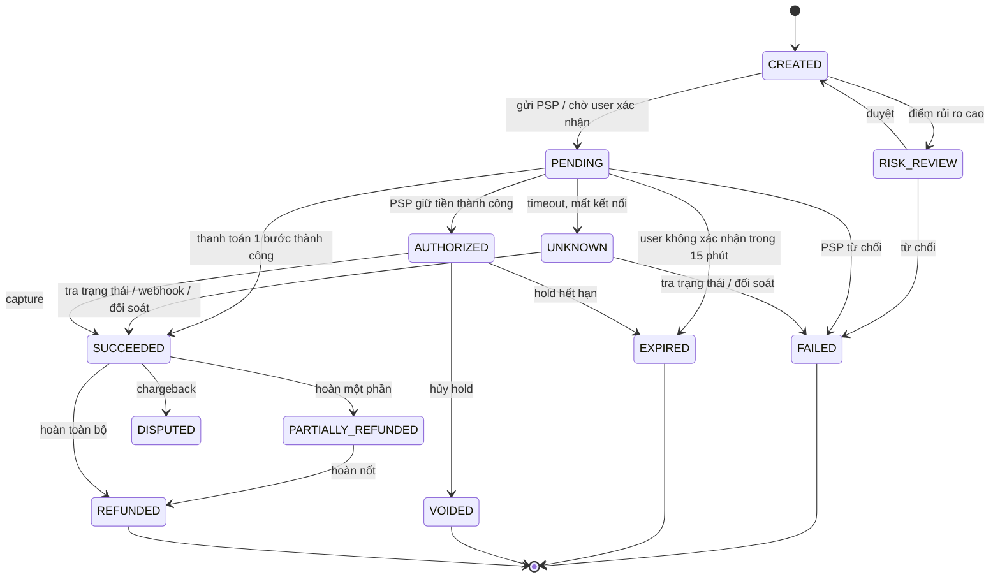

Nguyên tắc cài đặt:

- **Chỉ đi tiến:** chuyển trạng thái bằng **UPDATE có điều kiện**, không đọc-rồi-ghi:

    ```sql
    UPDATE payments SET status = 'SUCCEEDED', updated_at = now()
     WHERE payment_id = 'pay_01J9' AND status IN ('PENDING', 'UNKNOWN');
    -- 0 dòng bị đổi => trạng thái đã khác (webhook trùng, hoặc đã FAILED) -> không ghi ledger
    ```

- **Trạng thái cuối (terminal) không bao giờ đổi:** `FAILED` không thể thành `SUCCEEDED`. Nếu PSP báo thành công cho một payment đã `FAILED`/`EXPIRED` (user trả muộn) → **không** sửa trạng thái; tạo case "tiền về muộn" → hoàn tiền tự động hoặc ghi có vào ví, và cảnh báo.
- **Mỗi lần chuyển trạng thái ghi một dòng `payment_events`** (ai, khi nào, lý do, raw payload) - đó là audit trail.
- Bút toán ledger được ghi **cùng transaction** với lần chuyển trạng thái tương ứng (hoặc qua outbox với khóa idempotent `(payment_id, step)`).

### 8.2 Nhận webhook/callback từ PSP đúng cách

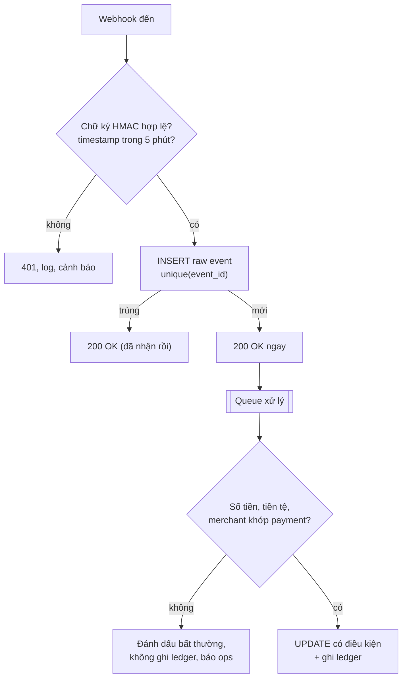

| Mối đe dọa / sự cố | Phòng thủ |
|---|---|
| Kẻ gian giả webhook "thành công" | HMAC/chữ ký RSA của PSP, allowlist IP, mTLS |
| Replay webhook cũ | Timestamp trong chữ ký + cửa sổ 5 phút + dedup `event_id` |
| PSP gửi lại nhiều lần | Dedup bằng unique `event_id`; chuyển trạng thái có điều kiện |
| Webhook đến **trước** khi ta lưu `psp_ref` | Tra theo `merchant_ref = payment_id`; nếu chưa có payment thì lưu và xử lý lại sau |
| Thứ tự đảo (FAILED đến sau SUCCEEDED) | Trạng thái terminal không đổi; sự kiện mâu thuẫn → báo ops |
| Xử lý chậm làm PSP timeout và gửi lại | Trả 200 ngay sau khi lưu raw event, xử lý bất đồng bộ |
| Webhook bị **mất hẳn** | Poll API tra trạng thái cho payment `PENDING` quá X phút + đối soát cuối ngày |

!!! tip "Lưu raw payload"
    Luôn lưu nguyên văn body + header của webhook (có mã hóa nếu chứa dữ liệu nhạy cảm). Khi tranh chấp với ngân hàng, đó là bằng chứng.

---

## 📖 9. Deep dive 4 - Đối soát (reconciliation)

Dù code hoàn hảo, vẫn có lúc hệ thống của ta và ngân hàng **lệch nhau**: webhook mất, ngân hàng đảo giao dịch, lỗi làm tròn phí, người vận hành sửa tay... Đối soát là **lưới an toàn cuối cùng**: so sánh sổ của ta với sổ của đối tác, tìm và xử lý mọi chênh lệch.

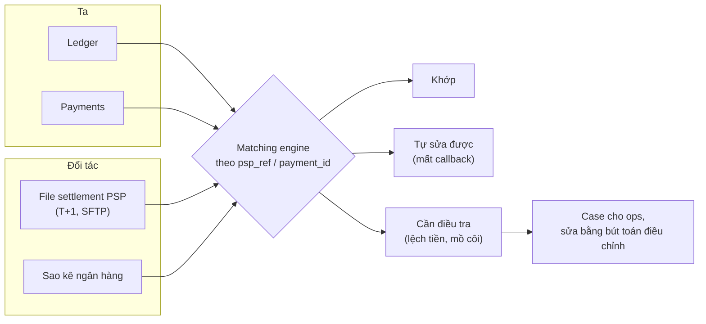

### 9.1 Các loại chênh lệch

| Loại | Ví dụ | Xử lý |
|---|---|---|
| Khớp | Cùng ref, cùng số tiền, cùng trạng thái | Đánh dấu reconciled |
| Lệch trạng thái tự sửa được | Ta `PENDING`/`UNKNOWN`, PSP `SUCCESS` (mất callback) | Chuyển trạng thái + ghi ledger tự động |
| Lệch số tiền | Ta 75.000, PSP 70.000 | **Chặn**, mở case, không tự sửa |
| Thiếu ở PSP | Ta `SUCCESS`, PSP không có | Có thể file đến muộn (chờ 1 kỳ), sau đó điều tra, có thể phải đảo bút toán |
| Mồ côi ở PSP | PSP có tiền, ta không có bản ghi | Ghi vào `suspense`, tìm chủ (theo nội dung chuyển khoản), hoàn tiền nếu không tìm được |
| Lệch phí | Phí PSP tính khác hợp đồng | Báo tài chính, đòi lại/điều chỉnh |

### 9.2 Code: một engine đối soát nhỏ

=== "Go"

    ```go
    package main

    import (
    	"fmt"
    	"sort"
    )

    type Internal struct {
    	PaymentID, PSPRef, Status string
    	Amount                    int64
    }

    type PSPRow struct {
    	PSPRef, Status string
    	Amount         int64
    }

    func reconcile(ours []Internal, theirs []PSPRow) map[string][]string {
    	byRef := map[string]PSPRow{}
    	for _, r := range theirs {
    		byRef[r.PSPRef] = r
    	}
    	seen := map[string]bool{}
    	out := map[string][]string{}
    	add := func(k, msg string) { out[k] = append(out[k], msg) }

    	for _, p := range ours {
    		r, ok := byRef[p.PSPRef]
    		seen[p.PSPRef] = true
    		switch {
    		case !ok && p.Status == "SUCCESS":
    			add("4_MISSING_AT_PSP", fmt.Sprintf("%s: ta ghi SUCCESS %d, PSP không có -> điều tra/đảo bút toán", p.PaymentID, p.Amount))
    		case !ok:
    			add("1_MATCHED", fmt.Sprintf("%s: %s ở cả hai phía (không có tiền)", p.PaymentID, p.Status))
    		case r.Amount != p.Amount:
    			add("3_AMOUNT_MISMATCH", fmt.Sprintf("%s: ta %d, PSP %d, lệch %d -> chặn & điều tra", p.PaymentID, p.Amount, r.Amount, p.Amount-r.Amount))
    		case p.Status == "PENDING" && r.Status == "SUCCESS":
    			add("2_STATUS_FIX", fmt.Sprintf("%s: ta PENDING, PSP SUCCESS -> mất callback, chuyển SUCCESS", p.PaymentID))
    		case p.Status != r.Status:
    			add("3_STATUS_MISMATCH", fmt.Sprintf("%s: ta %s, PSP %s", p.PaymentID, p.Status, r.Status))
    		default:
    			add("1_MATCHED", fmt.Sprintf("%s: khớp %d", p.PaymentID, p.Amount))
    		}
    	}
    	for _, r := range theirs {
    		if !seen[r.PSPRef] {
    			add("5_ORPHAN_AT_PSP", fmt.Sprintf("%s: PSP có %d nhưng ta không có -> hoàn tiền hoặc ghi bù", r.PSPRef, r.Amount))
    		}
    	}
    	return out
    }

    func main() {
    	ours := []Internal{
    		{"P1", "R1", "SUCCESS", 100_000},
    		{"P2", "R2", "SUCCESS", 250_000},
    		{"P3", "R3", "PENDING", 50_000},
    		{"P4", "R4", "SUCCESS", 75_000},
    		{"P5", "R5", "SUCCESS", 120_000},
    		{"P6", "R6", "FAILED", 30_000},
    	}
    	theirs := []PSPRow{
    		{"R1", "SUCCESS", 100_000},
    		{"R2", "SUCCESS", 250_000},
    		{"R3", "SUCCESS", 50_000},
    		{"R4", "SUCCESS", 70_000},
    		{"R7", "SUCCESS", 40_000},
    	}
    	res := reconcile(ours, theirs)
    	keys := make([]string, 0, len(res))
    	for k := range res {
    		keys = append(keys, k)
    	}
    	sort.Strings(keys)
    	for _, k := range keys {
    		fmt.Println(k)
    		for _, m := range res[k] {
    			fmt.Println("   ", m)
    		}
    	}
    }

    // Output:
    // 1_MATCHED
    //     P1: khớp 100000
    //     P2: khớp 250000
    //     P6: FAILED ở cả hai phía (không có tiền)
    // 2_STATUS_FIX
    //     P3: ta PENDING, PSP SUCCESS -> mất callback, chuyển SUCCESS
    // 3_AMOUNT_MISMATCH
    //     P4: ta 75000, PSP 70000, lệch 5000 -> chặn & điều tra
    // 4_MISSING_AT_PSP
    //     P5: ta ghi SUCCESS 120000, PSP không có -> điều tra/đảo bút toán
    // 5_ORPHAN_AT_PSP
    //     R7: PSP có 40000 nhưng ta không có -> hoàn tiền hoặc ghi bù
    ```

=== "Python"

    ```python
    from collections import defaultdict

    ours = [  # (payment_id, psp_ref, status, amount) - từ ledger của ta
        ("P1", "R1", "SUCCESS", 100_000),
        ("P2", "R2", "SUCCESS", 250_000),
        ("P3", "R3", "PENDING", 50_000),
        ("P4", "R4", "SUCCESS", 75_000),
        ("P5", "R5", "SUCCESS", 120_000),
        ("P6", "R6", "FAILED", 30_000),
    ]
    theirs = [  # (psp_ref, status, amount) - file settlement PSP gửi cuối ngày
        ("R1", "SUCCESS", 100_000),
        ("R2", "SUCCESS", 250_000),
        ("R3", "SUCCESS", 50_000),
        ("R4", "SUCCESS", 70_000),
        ("R7", "SUCCESS", 40_000),
    ]


    def reconcile(ours, theirs):
        by_ref = {ref: (st, amt) for ref, st, amt in theirs}
        seen, out = set(), defaultdict(list)
        for pid, ref, st, amt in ours:
            seen.add(ref)
            if ref not in by_ref:
                if st == "SUCCESS":
                    out["4_MISSING_AT_PSP"].append(f"{pid}: ta ghi SUCCESS {amt}, PSP không có -> điều tra/đảo bút toán")
                else:
                    out["1_MATCHED"].append(f"{pid}: {st} ở cả hai phía (không có tiền)")
                continue
            p_st, p_amt = by_ref[ref]
            if p_amt != amt:
                out["3_AMOUNT_MISMATCH"].append(f"{pid}: ta {amt}, PSP {p_amt}, lệch {amt - p_amt} -> chặn & điều tra")
            elif st == "PENDING" and p_st == "SUCCESS":
                out["2_STATUS_FIX"].append(f"{pid}: ta PENDING, PSP SUCCESS -> mất callback, chuyển SUCCESS")
            elif st != p_st:
                out["3_STATUS_MISMATCH"].append(f"{pid}: ta {st}, PSP {p_st}")
            else:
                out["1_MATCHED"].append(f"{pid}: khớp {amt}")
        for ref, st, amt in theirs:
            if ref not in seen:
                out["5_ORPHAN_AT_PSP"].append(f"{ref}: PSP có {amt} nhưng ta không có -> hoàn tiền hoặc ghi bù")
        return out


    for k, msgs in sorted(reconcile(ours, theirs).items()):
        print(k)
        for m in msgs:
            print("   ", m)

    # Output:
    # 1_MATCHED
    #     P1: khớp 100000
    #     P2: khớp 250000
    #     P6: FAILED ở cả hai phía (không có tiền)
    # 2_STATUS_FIX
    #     P3: ta PENDING, PSP SUCCESS -> mất callback, chuyển SUCCESS
    # 3_AMOUNT_MISMATCH
    #     P4: ta 75000, PSP 70000, lệch 5000 -> chặn & điều tra
    # 4_MISSING_AT_PSP
    #     P5: ta ghi SUCCESS 120000, PSP không có -> điều tra/đảo bút toán
    # 5_ORPHAN_AT_PSP
    #     R7: PSP có 40000 nhưng ta không có -> hoàn tiền hoặc ghi bù
    ```

Trong thực tế engine này chạy trên hàng chục triệu dòng: đọc file settlement vào bảng staging, `FULL OUTER JOIN` với bảng payments theo `psp_ref` trong một partition ngày, rồi phân loại bằng SQL hoặc Spark. Kết quả không chỉ là báo cáo mà là **hành động**: sửa tự động những gì an toàn, mở case cho phần còn lại, và chặn quyết toán cho merchant nếu lệch vượt ngưỡng.

### 9.3 Đối soát theo lô vs gần thời gian thực

| Tiêu chí | Lô hằng ngày (T+1) | Gần thời gian thực (streaming) |
|---|---|---|
| Nguồn | File settlement, sao kê | Webhook, API tra trạng thái, sự kiện ledger qua Kafka |
| Phát hiện lệch | Sáng hôm sau | Vài phút |
| Độ đầy đủ | Cao - file của đối tác là "sự thật cuối cùng" | Thấp hơn - có thể thiếu sự kiện |
| Chi phí | Thấp, đơn giản | Cao, phức tạp (state, window, join hai stream) |
| Dùng để | Quyết toán, kế toán, báo cáo pháp lý | Phát hiện sớm sự cố (PSP lỗi, webhook mất hàng loạt) |

Hệ thống tốt dùng **cả hai**: streaming để báo động sớm ("10 phút qua có 300 payment `UNKNOWN` ở ngân hàng X"), batch để chốt sổ. Đây chính là tinh thần kiến trúc Lambda ở [Bài 5](./05-messaging-streaming.md) và [Bài 16](./16-metrics-aggregation.md).

!!! note "Đối soát nội bộ cũng quan trọng"
    Không chỉ ta-vs-ngân-hàng. Còn ledger-vs-payments (mọi payment `SUCCEEDED` có đúng bút toán?), balances-vs-entries, và `suspense` phải về 0. Nhiều sự cố lớn được phát hiện bởi đối soát nội bộ, không phải bởi khách hàng.

---

## 📖 10. Hold, capture, refund, chargeback

### 10.1 Authorize (hold) vs capture

Gọi xe: lúc đặt, app **giữ** 100.000đ (ước tính); cuối chuyến giá thật 87.000đ → **capture** 87.000đ, **nhả** 13.000đ. Khách sạn: giữ tiền cọc khi nhận phòng, capture khi trả phòng.

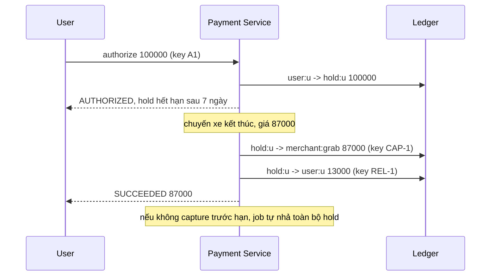

Với thẻ qua PSP, hold nằm ở **ngân hàng phát hành thẻ**, ta chỉ lưu trạng thái `AUTHORIZED` và hạn; capture/void là lệnh gửi PSP (vẫn với idempotency key). Với ví nội bộ, hold là một **tài khoản trong sổ cái** của ta - như code ở §6.3.

Quy tắc: `captured ≤ authorized`; capture nhiều lần (partial capture) phải có tổng ≤ authorized; hold hết hạn phải được **job** nhả tự động.

### 10.2 Refund

- Refund là **giao dịch mới** đi ngược chiều, **không** xóa/sửa giao dịch gốc.
- Ràng buộc: `refunded_amount + amount_moi ≤ captured_amount` - kiểm tra bằng UPDATE có điều kiện để hai refund đồng thời không vượt:

    ```sql
    UPDATE payments SET refunded_amount = refunded_amount + 30000
     WHERE payment_id = 'pay_01J9' AND refunded_amount + 30000 <= captured_amount;
    ```

- Refund qua PSP là bất đồng bộ: `REFUND_PENDING` → `REFUNDED`/`REFUND_FAILED`. Nếu merchant không đủ số dư để hoàn → tùy chính sách: trừ vào kỳ quyết toán sau, hoặc âm `merchant_receivable`.
- Phí: hoàn phí hay không là **quyết định kinh doanh** - ghi rõ bằng bút toán riêng.

### 10.3 Chargeback (tranh chấp thẻ)

Chủ thẻ khiếu nại với ngân hàng, ngân hàng **rút lại tiền** từ phía ta. Ledger: `merchant:x → chargeback_receivable` (hoặc âm số dư merchant), trạng thái `DISPUTED`, mở case để merchant cung cấp bằng chứng. Thắng tranh chấp → bút toán ngược lại.

---

## 📖 11. Nhất quán, sharding và tài khoản nóng

### 11.1 Chuyển tiền xuyên shard

Shard ledger theo `account_id`. Alice ở shard 1, Bob ở shard 7 - không còn "một DB transaction" nữa.

| Phương án | Cách làm | Ưu | Nhược |
|---|---|---|---|
| **2PC** (two-phase commit) | Coordinator prepare cả 2 shard rồi commit | Atomic thật | Coordinator chết → khóa treo; chậm; khó vận hành |
| **Saga + tài khoản transit** | (1) Shard 1: `alice → transit` (local tx, cân bằng); (2) outbox đảm bảo bước 2: Shard 7: `transit → bob` (idempotent theo tx_id) | Mỗi bước là local ACID; không khóa phân tán | Có khoảnh khắc tiền "đang trên đường"; cần bù trừ nếu bước 2 thất bại vĩnh viễn |
| **Distributed SQL** (Spanner, CockroachDB, TiDB) | DB lo transaction phân tán (Raft + 2PC bên trong) | Code đơn giản | Độ trễ cao hơn, chi phí, phụ thuộc công nghệ |
| **Co-locate** | Cố gắng đặt tài khoản hay giao dịch với nhau cùng shard | Nhanh | Không áp dụng được cho P2P ngẫu nhiên |

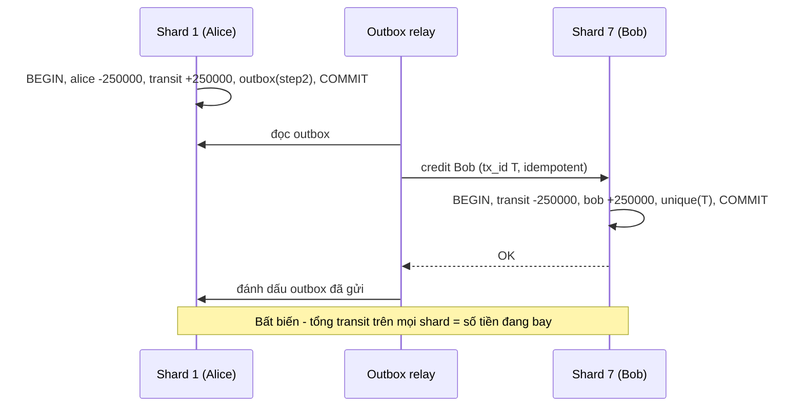

Điểm tinh tế: **bước trừ tiền (debit) phải đồng bộ và nhất quán mạnh**, vì đó là chỗ có thể double spending. **Bước cộng tiền (credit) có thể chậm vài trăm ms** mà không ai mất tiền - Bob chỉ thấy tiền hơi muộn. Đây là chỗ duy nhất "eventual" được chấp nhận, và nó được kiểm soát bằng tài khoản transit + đối soát.

### 11.2 Tài khoản nóng (hot account)

Merchant lớn trong giờ sale nhận 2.000 giao dịch/s. Mỗi giao dịch `SELECT ... FOR UPDATE` cùng một dòng → xếp hàng, mỗi lock giữ ~2–5ms → tối đa ~200–500 tx/s. Nghẽn. (Bài toán hot key chung ở [Bài 3](./03-building-blocks-data.md).)

| Kỹ thuật | Cách làm | Khi nào dùng |
|---|---|---|
| **Chia tài khoản con** | `merchant:shopee#0..#31`, ghi có ngẫu nhiên vào 1 trong 32 con; số dư = tổng | Tài khoản **nhận** nhiều; rút tiền thì gom về |
| **Ghi có bất đồng bộ / gộp lô** | Bút toán credit vào hàng đợi, gộp 100ms một lần thành 1 bút toán tổng | Merchant chỉ cần thấy tiền trong vài giây |
| **Không cần khóa khi credit** | Credit không thể làm âm số dư → chỉ cần `INSERT` entry + `UPDATE balance = balance + x` (lock rất ngắn) | Luôn áp dụng: chỉ debit mới cần kiểm tra số dư |
| **Tách số dư merchant ra khỏi ledger realtime** | Merchant settlement tính theo kỳ (T+1) từ bút toán | Phần lớn merchant |

### 11.3 Đa vùng (multi-region)

Tiền là dữ liệu **không được** ghi active-active tùy tiện (hai region cùng trừ một ví). Các lựa chọn:

- **Một region chính cho mỗi ví** (home region, shard theo người dùng); region khác chỉ chuyển tiếp ghi về. Failover có kiểm soát (RPO = 0 cần replication đồng bộ sang region gần).
- **Distributed SQL** với quorum trải 3 region - mỗi lần ghi trả giá RTT liên vùng.

Chi tiết trade-off ở [Bài 4](./04-consistency-consensus.md).

---

## 📖 12. Fraud/risk, audit và compliance

### 12.1 Điểm móc chống gian lận

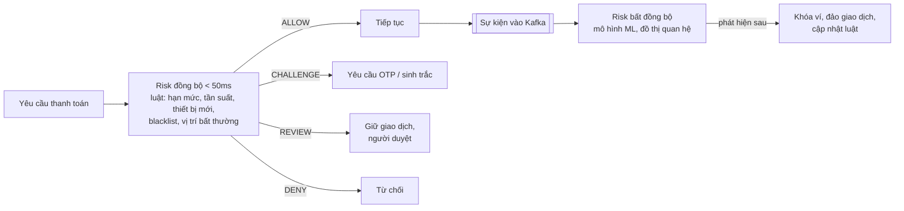

- **Luật đồng bộ** phải nhanh và có **fallback**: nếu Risk service chậm/sập, chọn "fail-open với hạn mức thấp" (cho qua giao dịch nhỏ) hay "fail-closed" (chặn hết) - đó là quyết định kinh doanh, cần ghi rõ.
- **Velocity check** dùng bộ đếm cửa sổ trượt (Redis) theo user, thiết bị, thẻ, IP.
- Tín hiệu điển hình: tài khoản mới + giao dịch lớn, nhiều ví nhận từ một nguồn rồi rút ngay (rửa tiền), đổi thiết bị + đổi mật khẩu + chuyển hết tiền trong 10 phút (chiếm tài khoản).

### 12.2 Audit & compliance

| Yêu cầu | Cách đáp ứng |
|---|---|
| Truy vết mọi thay đổi | Ledger bất biến + `payment_events` + audit log (ai, khi nào, từ đâu, trước/sau) |
| Không ai sửa được lịch sử | WORM storage, quyền DB chỉ INSERT, hash chain (mỗi bản ghi chứa hash của bản trước) |
| Điều chỉnh thủ công | **Maker-checker**: một người tạo bút toán điều chỉnh, người khác duyệt; không bao giờ `UPDATE` trực tiếp |
| PCI DSS | Không lưu số thẻ - dùng token của PSP; trang nhập thẻ do PSP host (hosted fields) để thu hẹp phạm vi |
| KYC/AML | Hạn mức theo cấp xác minh danh tính; theo dõi và báo cáo giao dịch đáng ngờ theo quy định |
| Lưu trữ | Giữ chứng từ nhiều năm theo luật kế toán; partition + archive sang kho lạnh nhưng vẫn truy vấn được |
| Dữ liệu cá nhân | Mã hóa khi lưu, che (mask) trong log, phân quyền truy cập theo vai trò |

!!! warning "Quy định thay đổi"
    Hạn mức ví, yêu cầu liên kết ngân hàng, thời gian lưu chứng từ... do cơ quan quản lý quy định và **thay đổi theo thời gian**. Trong phỏng vấn, nói "hạn mức theo quy định hiện hành, cấu hình được" là đủ; khi làm thật, hỏi bộ phận pháp chế.

---

## 📖 13. Scale, nút thắt và chế độ lỗi

### 13.1 Bảng chế độ lỗi

| Sự cố | Hậu quả nếu không xử lý | Giảm thiểu |
|---|---|---|
| Response mất sau khi đã trừ tiền | Trừ hai lần khi user bấm lại | Idempotency key end-to-end |
| PSP timeout | Không biết đã thu tiền chưa | `UNKNOWN` + poll trạng thái + đối soát |
| Webhook mất | Payment kẹt `PENDING`, merchant không giao hàng | Poll định kỳ + đối soát |
| Webhook giả | Giao hàng mà không nhận tiền | Chữ ký, timestamp, kiểm tra số tiền |
| Process chết giữa hai bước | Tiền "lơ lửng" | Mọi bước là local transaction + outbox + idempotent consumer |
| Deadlock khi A→B và B→A | Giao dịch treo, timeout | Khóa theo thứ tự `account_id` |
| Hot account | Nghẽn khóa, timeout hàng loạt | Tài khoản con, credit gộp lô |
| Một PSP sập | Mọi thanh toán qua PSP đó lỗi | Circuit breaker, định tuyến sang PSP dự phòng (với payment **mới**) |
| Bug ghi lệch bút toán | Tiền sinh ra/mất đi | Bất biến tổng = 0 kiểm tra trong transaction + job quét |
| Sai giờ hệ thống (clock) | Hold hết hạn sai, đối soát sai ngày | Dùng thời gian DB/NTP, lưu UTC (xem [Bẫy production §2](../backend/16-production-traps.md)) |
| Người vận hành sửa tay | Mất dấu vết | Maker-checker, chỉ qua bút toán điều chỉnh |

### 13.2 Mở rộng theo giai đoạn

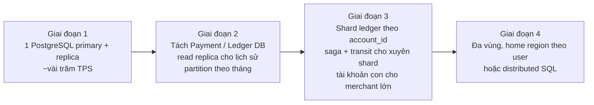

Đừng shard sớm. Một PostgreSQL tốt trên phần cứng mạnh chịu được vài nghìn giao dịch ghi/giây nếu transaction ngắn. Shard khi số liệu buộc phải shard.

---

## 📖 14. Giám sát - metrics quan trọng

| Nhóm | Metric | Ngưỡng cảnh báo ví dụ |
|---|---|---|
| Tính đúng | Số tx có tổng ≠ 0 | **> 0 là sự cố P0** |
| Tính đúng | Chênh lệch đối soát (số lượng, giá trị) | Tăng bất thường so với baseline |
| Tính đúng | Số dư `suspense`/`transit` tồn quá X phút | > 0 quá 1 giờ |
| Luồng | Tỷ lệ thành công theo PSP/ngân hàng | Giảm > 5% trong 5 phút |
| Luồng | Số payment `UNKNOWN`/`PENDING` quá hạn | Tăng đột biến |
| Luồng | Độ trễ webhook (PSP gửi → ta xử lý) | P99 > 1 phút |
| Hiệu năng | P50/P99 latency API, lock wait time | P99 > 500ms |
| Hiệu năng | Tỷ lệ replay idempotency | Tăng = client/mạng có vấn đề |
| Rủi ro | Tỷ lệ DENY/CHALLENGE, chargeback rate | Lệch xa baseline |

Dashboard theo **từng PSP/ngân hàng** quan trọng hơn dashboard tổng: khi một ngân hàng bảo trì, tổng có thể vẫn đẹp nhưng 100% khách của ngân hàng đó đang thất bại. (Cách thiết kế hệ thống metrics: [Bài 16](./16-metrics-aggregation.md); SLO & alert: [Observability](../backend/11-observability-reliability.md).)

---

## 📝 Tự chấm

So bài làm 15–20 phút của bạn với bảng sau:

| Hạng mục | Đạt | Chưa đạt |
|---|---|---|
| Yêu cầu | Hỏi phạm vi (ví vs gateway), tiền tệ, quy mô, ưu tiên đúng > nhanh; nêu out-of-scope | Lao vào vẽ; không nói tới tính đúng |
| Ước lượng | Ra được TPS cao điểm, số bút toán/ngày, dung lượng/năm; nhận ra vấn đề là hot account chứ không phải tổng TPS | Không ước lượng hoặc chỉ nêu "rất nhiều" |
| API | Có `Idempotency-Key`, amount số nguyên + currency, endpoint bất đồng bộ trả `PENDING` | Amount kiểu float, không có idempotency |
| Dữ liệu | Double-entry, bút toán bất biến, số dư suy ra/cập nhật cùng transaction | Một cột `balance` bị UPDATE, không có lịch sử |
| Kiến trúc | Tách Payment/Ledger/PSP adapter/webhook ingest; outbox; đối soát | Gọi PSP trong transaction DB; không có đối soát |
| Deep dive | Giải thích timeout = UNKNOWN, state machine có điều kiện, webhook an toàn, chuyển tiền xuyên shard | Coi timeout là thất bại; xử lý webhook đồng bộ không dedup |
| Trade-off | So sánh 2PC vs saga vs distributed SQL; batch vs realtime reconciliation | Chỉ nêu một phương án |
| Lỗi | Liệt kê được ≥ 5 chế độ lỗi và cách giảm thiểu | Chỉ nói "có retry" |

---

## 🔄 Biến thể interviewer hay hỏi

??? question "Nếu yêu cầu đổi thành: thiết kế hệ thống chuyển tiền quốc tế (remittance) thì sao?"
    Thêm đa tiền tệ (bút toán cân theo từng tiền tệ, tài khoản FX), báo giá tỷ giá có hạn (quote ID + TTL), nhiều chặng qua các đối tác (mỗi chặng một state machine + đối soát riêng), compliance nặng hơn (sanction screening). Thời gian hoàn tất tính bằng giờ/ngày → toàn bộ là bất đồng bộ.

??? question "Nếu chỉ là payment gateway (không có ví) như Stripe/VNPay?"
    Bỏ số dư người dùng; ledger chủ yếu theo dõi **số tiền nợ merchant** (merchant payable), phí, và tiền ở ngân hàng thanh toán. Trọng tâm chuyển sang: định tuyến nhiều PSP/acquirer, tokenization thẻ, webhook cho merchant với retry + chữ ký, quyết toán (payout) cho merchant theo kỳ.

??? question "Nếu cần hỗ trợ 50.000 TPS thay vì 5.000?"
    Shard ledger nhiều hơn theo account; mọi P2P xuyên shard qua saga + transit; tài khoản con cho mọi merchant lớn; tách hoàn toàn đường đọc (CQRS) dựng từ CDC; cân nhắc ledger chuyên dụng (ví dụ kiểu TigerBeetle) có batching ở tầng DB. Đo lock contention trước khi làm gì khác.

??? question "Nếu interviewer hỏi: sao không dùng event sourcing?"
    Sổ cái kép **đã là** một dạng event sourcing: bút toán là sự kiện bất biến, số dư là projection. Khác biệt là ta vẫn giữ bảng `balances` cập nhật cùng transaction để kiểm tra số dư nguyên tử - thứ mà event sourcing thuần (rebuild projection bất đồng bộ) không cho bạn.

??? question "Nếu muốn cho số dư âm (thấu chi, trả sau)?"
    Mô hình hóa bằng tài khoản tín dụng riêng (`credit_line:user`) có hạn mức, không cho ví âm. Tiêu bằng trả sau = chuyển từ `credit_line` (được âm đến −hạn mức) sang merchant. Giữ bất biến "ví không âm" đơn giản.

---

## 🌍 Ứng dụng thực tế

- **Ví điện tử Việt Nam** (MoMo, ZaloPay, ShopeePay, ViettelMoney...): ví liên kết ngân hàng, thanh toán QR, chuyển tiền qua Napas - đều cần ledger, idempotency, đối soát hằng ngày với từng ngân hàng.
- **Cổng thanh toán** (VNPay, OnePay, Stripe, Adyen): mô hình payment intent + webhook có chữ ký + idempotency key - Stripe công khai thiết kế `Idempotency-Key` trong tài liệu API.
- **Ngân hàng lõi (core banking)**: double-entry là nền tảng từ hàng trăm năm, chỉ khác quy mô và quy định.
- **Ledger chuyên dụng**: một số công ty xây DB riêng cho bút toán tài chính (ví dụ dự án mã nguồn mở TigerBeetle) để giải bài toán hot account bằng batching.
- **Mọi hệ thống có "điểm", "xu", "voucher"**: điểm thưởng là tiền đội lốt - áp dụng nguyên văn các kỹ thuật trong bài.

## ⚠️ Sai lầm thường gặp

| Sai lầm | Vì sao sai | Cách đúng |
|---|---|---|
| Lưu tiền bằng `float`/`double` | 0.1 + 0.2 ≠ 0.3, sai lệch tích lũy | `bigint` đơn vị nhỏ nhất + currency |
| `UPDATE balance` không có lịch sử | Không truy vết, không đối soát được | Double-entry, bút toán bất biến |
| Coi timeout là thất bại | Trừ tiền hai lần khi user thử lại | `UNKNOWN` + tra trạng thái + đối soát |
| Gọi PSP **bên trong** DB transaction | Giữ khóa hàng giây, PSP chậm kéo sập DB | Ghi trạng thái → commit → gọi PSP → cập nhật trạng thái |
| Tin redirect URL `?status=success` | Client sửa được | Chỉ tin webhook có chữ ký / API server-to-server |
| Xử lý webhook đồng bộ, không dedup | PSP gửi lại → ghi có hai lần | Lưu raw + unique event_id + chuyển trạng thái có điều kiện |
| Idempotency key sinh mới mỗi lần retry | Vô dụng | Sinh một lần cho mỗi ý định, lưu lại |
| Dùng cache số dư để quyết định trừ | Cache cũ → tiêu quá số dư | Kiểm tra số dư trong DB transaction có khóa |
| Sửa dữ liệu sai bằng `UPDATE`/`DELETE` | Phá audit trail | Bút toán đảo + maker-checker |
| Không có đối soát | Lệch tích tụ, phát hiện khi đã quá muộn | Đối soát hằng ngày + cảnh báo realtime |

## 🏋️ Bài tập

**Bài 1 (dễ).** Viết các bút toán (tài khoản, số tiền) cho: user nạp 500.000đ từ ngân hàng VCB; trả 120.000đ cho merchant `cafe`, merchant chịu phí 2% (phí tính trên số tiền thanh toán).

<details markdown="1"><summary>Đáp án</summary>

Nạp tiền (tx1):

| Tài khoản | Số tiền |
|---|---|
| `bank_clearing:vcb` | −500.000 |
| `user:u` | +500.000 |

Thanh toán (tx2) - một giao dịch 3 bút toán, tổng = 0:

| Tài khoản | Số tiền |
|---|---|
| `user:u` | −120.000 |
| `merchant:cafe` | +117.600 |
| `fee:revenue` | +2.400 |

Phí 2% × 120.000 = 2.400 (số nguyên, không làm tròn). Nếu phí ra số lẻ, phải có **quy tắc làm tròn ghi rõ** (thường làm tròn về phía có lợi cho khách hoặc theo hợp đồng) và phần chênh vẫn phải nằm trong bút toán để tổng = 0.

</details>

**Bài 2 (dễ).** Trong code §6.3, vì sao `Transfer` kiểm tra idempotency key **trước** khi kiểm tra số dư? Điều gì xảy ra nếu đảo thứ tự?

<details markdown="1"><summary>Đáp án</summary>

Nếu kiểm tra số dư trước: Alice có 250.000, chuyển 250.000 thành công (số dư còn 0). Response mất, app retry cùng key → kiểm tra số dư thấy 0 < 250.000 → trả lỗi **"không đủ số dư"**. User thấy thất bại dù tiền **đã** chuyển → bấm tạo giao dịch mới hoặc gọi tổng đài. Retry phải trả **đúng kết quả của lần đầu**, nên tra idempotency luôn là bước đầu tiên (sau validate cú pháp).

</details>

**Bài 3 (trung bình).** Thiết kế bảng `idempotency` và viết (pseudo-code hoặc SQL) luồng xử lý khi tiến trình chết sau khi `INSERT ... IN_PROGRESS` nhưng trước khi commit ledger. Làm sao request retry sau đó không bị kẹt mãi ở `409`?

<details markdown="1"><summary>Đáp án</summary>

Bảng: `idempotency(scope_key PK, request_hash, status, response_body, locked_until, created_at, expires_at)`.

Có hai cách:

1. **Cùng transaction (khuyến nghị cho thao tác nội bộ):** `INSERT idempotency` nằm **trong cùng** DB transaction với bút toán. Process chết trước commit → transaction rollback → dòng idempotency biến mất → retry xử lý lại từ đầu. Không bao giờ kẹt.
2. **Khác transaction (khi có gọi ra ngoài, ví dụ PSP):** dùng **lease** `locked_until = now() + 30s`. Retry thấy `IN_PROGRESS` nhưng `locked_until < now()` → được "cướp" lease (`UPDATE ... WHERE scope_key = ? AND locked_until < now()`), rồi **kiểm tra trạng thái thật** (payment có `psp_ref` chưa? tra PSP theo `merchant_ref`) trước khi gửi lại lệnh. Không bao giờ mù quáng gửi lại lệnh tạo giao dịch.

</details>

**Bài 4 (trung bình).** PSP gửi webhook `payment.success` cho payment `P` đã ở trạng thái `EXPIRED` (user thanh toán ở ngân hàng sau 20 phút, quá hạn 15 phút). Hệ thống nên làm gì? Vẽ luồng.

<details markdown="1"><summary>Đáp án</summary>

Tiền **đã** rời tài khoản user, nên không thể bỏ qua. Nhưng `EXPIRED` là trạng thái terminal, đơn hàng có thể đã bị hủy và kho đã nhả.

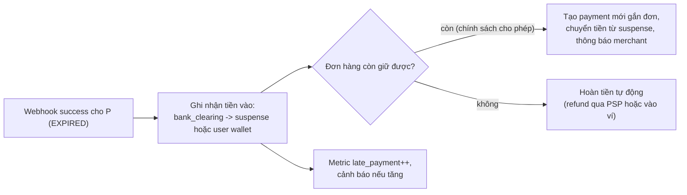

Điểm mấu chốt: **không** sửa `EXPIRED` thành `SUCCEEDED` (trạng thái terminal bất biến), mà xử lý như một sự kiện riêng có bút toán riêng.

</details>

**Bài 5 (trung bình).** Merchant `shopee` nhận 2.000 giao dịch/giây vào một tài khoản. Lock giữ trung bình 3ms. Tính throughput tối đa với một dòng, và đề xuất số tài khoản con cần thiết với hệ số an toàn 2.

<details markdown="1"><summary>Đáp án</summary>

Một dòng: tối đa 1 / 0,003s ≈ **333 tx/s** (mọi giao dịch xếp hàng tuần tự trên cùng khóa). Cần 2.000 tx/s × 2 (an toàn) = 4.000 tx/s → 4.000 / 333 ≈ 12 → chọn **16 tài khoản con** (lũy thừa 2, dễ chia). Số dư merchant = tổng 16 tài khoản con (đọc ít, chấp nhận được). Rút tiền/quyết toán: gom về trước rồi mới trừ. Ngoài ra, vì là **credit** (không làm âm số dư), có thể bỏ `SELECT ... FOR UPDATE`, chỉ `UPDATE balance = balance + x` để lock ngắn hơn nữa.

</details>

**Bài 6 (khó).** Thiết kế chuyển tiền P2P xuyên shard bằng saga + tài khoản transit. Liệt kê mọi điểm process có thể chết và chứng minh tiền không mất/nhân đôi ở mỗi điểm.

<details markdown="1"><summary>Đáp án</summary>

Các bước: (1) Shard A transaction: `alice −x`, `transit_A +x`, `outbox(credit_bob, T)`, commit. (2) Relay đọc outbox, gọi shard B. (3) Shard B transaction: `transit_B −x`, `bob +x`, `INSERT processed(T)` (unique), commit. (4) Relay đánh dấu outbox done.

| Chết ở đâu | Trạng thái | Vì sao an toàn |
|---|---|---|
| Trước commit (1) | Không có gì | Rollback, user nhận lỗi/retry với cùng key |
| Sau (1), trước (3) | Tiền ở `transit_A` | Outbox còn → relay sẽ gửi lại; tiền không mất, chỉ chậm |
| Sau (3), trước (4) | Bob đã nhận | Relay gửi lại → shard B thấy `processed(T)` đã có → bỏ qua. Không nhân đôi |
| (3) thất bại vĩnh viễn (ví Bob bị khóa) | Tiền ở transit | Saga bù trừ: shard A `transit_A −x`, `alice +x` (idempotent theo `T-compensate`) |

Bất biến kiểm tra: `Σ transit_A + Σ transit_B` = tổng các saga đang dở; mọi T phải hoàn tất hoặc được bù trong X phút - đối soát nội bộ cảnh báo nếu không.

(Ghi chú: `transit_A` và `transit_B` có thể là hai tài khoản transit riêng trên mỗi shard; bút toán ở A ghi `transit_A +x` và ở B ghi `transit_B −x`, tổng toàn hệ thống vẫn = 0 sau khi cả hai bước xong.)

</details>

**Bài 7 (khó).** Thiết kế đối soát realtime phát hiện "ngân hàng X đang trả về thành công nhưng không gửi webhook" trong vòng 5 phút. Dữ liệu nào, join gì, cảnh báo khi nào?

<details markdown="1"><summary>Đáp án</summary>

- Nguồn: stream `payment.created/pending` (từ outbox), stream `webhook.received`, và kết quả **poll trạng thái chủ động** cho một **mẫu** payment (ví dụ 5% payment PENDING > 2 phút).
- Join theo `payment_id` trong cửa sổ 10 phút (stream-stream join, xem [Bài 5](./05-messaging-streaming.md)).
- Chỉ số: theo từng ngân hàng, `pending_quá_3_phút / tổng` và `poll_nói_success_nhưng_chưa_có_webhook / số_poll`.
- Cảnh báo: chỉ số thứ hai > 1% trong 5 phút liên tiếp → báo động "webhook ngân hàng X có vấn đề", và tự động bật poll cho **toàn bộ** payment PENDING của ngân hàng đó (chế độ degrade) cho đến khi hết sự cố.

</details>

## ✅ Checklist

- [ ] Giải thích được 3 quy tắc của sổ cái kép và vì sao số dư phải được suy ra
- [ ] Viết được bút toán cho nạp, chuyển, thanh toán có phí, hold/capture, refund
- [ ] Mô tả chuỗi idempotency từ app đến PSP và webhook
- [ ] Vẽ được state machine thanh toán, biết vì sao timeout = `UNKNOWN`
- [ ] Liệt kê các bước xử lý webhook an toàn
- [ ] Phân loại được các chênh lệch đối soát và hành động cho từng loại
- [ ] So sánh 2PC, saga + transit, distributed SQL cho chuyển tiền xuyên shard
- [ ] Đề xuất được cách xử lý hot account
- [ ] Nêu được điểm móc fraud và yêu cầu audit/compliance chính
- [ ] Chạy được code ledger và đối soát, hiểu từng dòng output

---

**Bài tiếp theo**: [Bài 14: Đặt vé & flash sale](./14-ticket-flash-sale.md)
