# 📚 Bài 14: Đặt vé & flash sale

> "Bán 1.000 cái iPhone giá 1.000đ thì dễ. Bán **đúng** 1.000 cái - không phải 1.003 - cho 5 triệu người cùng bấm trong 1 giây mới khó."

10 giờ sáng, vé concert của một ca sĩ nổi tiếng mở bán: 40.000 chỗ, hơn một triệu người chờ sẵn. Trang web sập trong 3 phút. Khi trang sống lại, một số người đã trả tiền nhưng nhận email "ghế của bạn đã được bán cho người khác". Vài ngày sau, vé xuất hiện trên chợ đen với giá gấp 5 lần, phần lớn do bot mua.

0 giờ ngày 11/11, sàn TMĐT mở "flash sale" 1.000 chiếc điện thoại giá sốc. Hệ thống không sập, nhưng sáng hôm sau đội vận hành phát hiện **1.047** đơn đã thanh toán. 47 khách phải nhận lời xin lỗi kèm voucher, và câu chuyện lên mạng xã hội.

Hai sự cố, cùng một gốc: **nhiều người tranh nhau một lượng hàng có hạn trong một khoảnh khắc**. Bài này thiết kế hệ thống bán vé concert (chọn ghế cụ thể) và flash sale kiểu Shopee (hàng giống nhau, chỉ đếm số lượng), với trọng tâm là **không bán quá (oversell)** và **không sập dưới tải đột biến**.

## 🎯 Mục tiêu bài học

- So sánh 5 cách chống tranh chấp tồn kho: **row lock**, **UPDATE có điều kiện**, **optimistic version**, **Redis Lua reservation**, **token cấp phát trước**
- **Chứng minh** một thiết kế không oversell bằng bất biến
- Thiết kế **giữ chỗ có TTL** (seat hold), xử lý cuộc đua giữa "thanh toán xong" và "hết hạn"
- Thiết kế **phòng chờ ảo (virtual waiting room)** điều tiết lưu lượng theo năng lực phía sau
- Áp dụng **rate limiting, chống bot**, giới hạn mua mỗi người
- Xây **pipeline đặt hàng bất đồng bộ**, nhả tồn kho khi **hết hạn thanh toán**
- Xử lý **hot key** khi cả triệu người cùng nhắm một SKU
- Ước lượng tải đỉnh 11/11 và chạy **mô phỏng** để thấy oversell xảy ra thế nào

!!! note "Kiến thức nền"
    Rate limiting cơ bản (token bucket, sliding window) ở [System design backend](../backend/10-system-design.md); cache & hot key ở [Bài 3](./03-building-blocks-data.md); Kafka & xử lý bất đồng bộ ở [Bài 5](./05-messaging-streaming.md); luồng thanh toán, idempotency và timeout ở [Bài 13](./13-payment-wallet.md). Little's law ở [Mental models](../systems-thinking/04-mental-models.md).

---

## 🧩 Tự thiết kế trước

!!! question "Đề bài (15–20 phút)"
    Thiết kế hệ thống cho hai tình huống:

    **A. Bán vé concert:** 40.000 ghế có số (khu, hàng, ghế), giá theo khu. Người dùng xem sơ đồ, chọn tối đa 4 ghế, có 10 phút để thanh toán. Khoảng 1 triệu người truy cập trong 10 phút đầu.

    **B. Flash sale 11/11:** 1.000 sản phẩm giá sốc, mở lúc 0:00, mỗi người mua tối đa 1. Vài triệu người bấm "Mua" trong vài giây đầu. Thanh toán trong 15 phút, không thì nhả hàng.

    Yêu cầu chung: **không bao giờ bán quá số lượng**, không sập, hạn chế bot.

<details markdown="1"><summary>Gợi ý</summary>

- Bạn chặn bao nhiêu phần trăm request **trước khi** chạm vào database?
- "Kiểm tra còn hàng rồi trừ" - hai bước đó có tách rời không? Nếu có, chuyện gì xảy ra khi 1.000 người làm cùng lúc?
- Tồn kho nằm ở Redis hay DB? Nếu Redis mất dữ liệu khi failover thì sao?
- Giữ chỗ hết hạn: ai nhả? Nếu user thanh toán đúng giây hết hạn thì sao?
- Một SKU duy nhất nhận vài triệu request/giây - một key Redis chịu được không?
- Làm sao phân biệt người thật với bot?

</details>

---

## 📖 1. Làm rõ yêu cầu

> **Ứng viên:** Với vé concert, người dùng chọn **ghế cụ thể** hay chỉ chọn khu rồi hệ thống xếp ghế?
>
> **Interviewer:** Chọn ghế cụ thể trên sơ đồ. Nhưng hãy nói cả phương án "chọn khu" nếu cần giảm tải.
>
> **Ứng viên:** Flash sale thì hàng giống hệt nhau, chỉ cần đếm số lượng?
>
> **Interviewer:** Đúng. Một SKU, 1.000 cái.
>
> **Ứng viên:** Công bằng quan trọng tới mức nào? Ai đến trước được trước (FIFO), hay chấp nhận ngẫu nhiên?
>
> **Interviewer:** Người dùng mong "công bằng". Bạn đề xuất.
>
> **Ứng viên:** Chấp nhận người dùng phải **chờ** (xếp hàng) thay vì vào ngay?
>
> **Interviewer:** Chấp nhận, miễn là họ biết mình đang ở đâu.
>
> **Ứng viên:** Thanh toán dùng hệ thống có sẵn (như bài trước)? Thời hạn thanh toán bao lâu?
>
> **Interviewer:** Có sẵn. Vé 10 phút, flash sale 15 phút.
>
> **Ứng viên:** Bán lại vé, chuyển nhượng vé, hoàn vé có trong phạm vi không?
>
> **Interviewer:** Ngoài phạm vi.

### Yêu cầu chức năng

| # | Chức năng |
|---|---|
| F1 | Xem sự kiện, sơ đồ ghế và trạng thái ghế (gần thời gian thực) |
| F2 | Giữ chỗ (hold) tối đa 4 ghế trong 10 phút |
| F3 | Thanh toán → xác nhận vé; hết hạn → ghế quay lại bán |
| F4 | Flash sale: đặt mua 1 sản phẩm, giữ hàng 15 phút chờ thanh toán |
| F5 | Phòng chờ ảo khi lưu lượng vượt năng lực |
| F6 | Giới hạn mua mỗi tài khoản, chống bot |

### Yêu cầu phi chức năng

| Thuộc tính | Mục tiêu |
|---|---|
| Không oversell | **Tuyệt đối** - bán ≤ tồn kho, mỗi ghế ≤ 1 người |
| Chịu tải đột biến | Gấp 100–1000 lần lưu lượng thường trong vài phút |
| Khả dụng | Hệ thống không sập; quá tải thì **xếp hàng**, không trả lỗi 500 |
| Độ trễ | Phản hồi giữ chỗ < 1s cho người đã được vào |
| Công bằng | Có thể giải thích được (FIFO theo thời điểm vào hàng, hoặc bốc thăm) |
| Nhất quán | Tồn kho: mạnh. Hiển thị sơ đồ ghế: được phép trễ vài giây |

### Ngoài phạm vi

Chợ bán lại vé, định giá động, gợi ý ghế, hệ thống thanh toán (dùng [Bài 13](./13-payment-wallet.md)).

!!! tip "Nhận ra hai lớp nhất quán"
    **Hiển thị** ("ghế này còn trống") có thể sai vài giây - người dùng bấm vào ghế vừa bị giữ thì nhận "rất tiếc, ghế vừa có người chọn". **Ghi** (giữ chỗ, trừ kho) thì không được sai một lần nào. Tách hai lớp này ra là chìa khóa để scale.

---

## 📖 2. Ước lượng

Các số dưới đây là **ước tính để luyện tập**.

### 2.1 Flash sale 11/11

**Giả định:** 5 triệu người mở app chờ deal lúc 0:00; trong 10 giây đầu mỗi người bấm/refresh trung bình 3 lần.

```
Request đỉnh  = 5.000.000 × 3 / 10s = 1.500.000 req/s   (chỉ cho MỘT deal)
Hàng có       = 1.000 cái
Tỷ lệ thành công = 1.000 / 5.000.000 = 0,02%
```

Kết luận quan trọng nhất: **99,98% request sẽ thất bại**. Nhiệm vụ của kiến trúc là làm cho chúng **thất bại thật rẻ, thật sớm** (ở CDN/edge/phòng chờ), không để chúng đi đến database.

Toàn sàn ngày 11/11 (nhiều deal, mua sắm thường):

```
Đơn hàng/ngày (giả định)  = 50 triệu
Đơn trung bình            = 50M / 86.400 ≈ 580 đơn/s
Đỉnh 0:00–0:05 (×50)      ≈ 30.000 đơn/s
Mỗi đơn ~ 5 lần ghi DB     → ~150.000 ghi/s ở đỉnh  → cần shard DB đơn hàng + hàng đợi để san tải
```

### 2.2 Vé concert

```
Ghế          = 40.000
Người vào    = 1.000.000 trong 10 phút đầu
Thời gian một người ở trang chọn ghế + thanh toán ≈ 5 phút
```

Dùng **Little's law** (L = λ × W) để chọn tốc độ cho vào phòng mua:

```
Muốn tối đa 20.000 người đồng thời trong khu mua vé (năng lực đã load test)
W = 5 phút  →  λ = L / W = 20.000 / 5 = 4.000 người/phút được cho vào
1.000.000 người / 4.000 người/phút = 250 phút để qua hết hàng đợi
Nhưng 40.000 ghế thường hết sau ~40.000 / (4.000 × ~2 ghế/người) ≈ 5 phút đầu
```

→ Phần lớn người trong hàng đợi sẽ không mua được. Phòng chờ phải **báo sớm** "đã hết vé" để họ khỏi chờ vô ích.

### 2.3 Bộ nhớ và trạng thái

```
Trạng thái ghế:   40.000 ghế × ~100 byte = 4 MB    → Redis/bộ nhớ thoải mái
Hàng đợi:         1.000.000 người × ~100 byte = 100 MB → một Redis sorted set
Hold đang mở:     ≤ 40.000 bản ghi
```

**Bài toán không nằm ở dung lượng mà ở mức độ tranh chấp** (contention) trên một vài key/dòng.

---

## 📖 3. Thiết kế API

```http
# Phòng chờ
POST /v1/queue/{event_id}/join          -> { "queue_token": "...", "position": 18342, "eta_sec": 270 }
GET  /v1/queue/{event_id}/status        -> { "state": "WAITING" | "ADMITTED" | "SOLD_OUT", "position": 912 }
     (ADMITTED kèm "access_token" ký số, hạn 15 phút)

# Vé concert (cần access_token)
GET  /v1/events/{event_id}/seats?section=A   -> sơ đồ + trạng thái (có thể cache 1–2s)
POST /v1/holds
     Idempotency-Key: ...
     { "event_id": "ev_99", "seat_ids": ["A-12-07", "A-12-08"] }
  -> 201 { "hold_id": "h_81", "expires_at": "2026-11-11T10:10:00Z" }
  -> 409 { "error": "SEAT_TAKEN", "seats": ["A-12-08"] }
POST /v1/orders  { "hold_id": "h_81" }       -> { "order_id": "o_55", "payment_url": "..." }

# Flash sale
POST /v1/flash/{campaign_id}/reserve
     Idempotency-Key: ...
  -> 202 { "reservation_id": "r_123", "status": "RESERVED", "pay_before": "..." }
  -> 410 { "error": "SOLD_OUT" }
  -> 429 { "error": "LIMIT_EXCEEDED" }
GET  /v1/flash/reservations/{id}             -> RESERVED | ORDER_CREATED | PAID | EXPIRED
```

Sự kiện nội bộ (Kafka):

| Topic | Payload | Người tiêu thụ |
|---|---|---|
| `inventory.reserved` | reservation_id, user_id, sku, qty, expires_at | Order service |
| `order.created` | order_id, reservation_id | Payment, notification |
| `payment.succeeded` | order_id | Inventory (chốt bán), ticket issuing |
| `reservation.expired` | reservation_id | Inventory (nhả), notification |

!!! tip "Trả 202 cho flash sale"
    `reserve` chỉ làm **một** thao tác nguyên tử (trừ kho trong Redis) rồi trả `202 Accepted`. Việc tạo đơn, tính giá, áp voucher chạy bất đồng bộ phía sau. Đường nóng càng ngắn, càng ít thứ có thể chậm.

---

## 📖 4. Mô hình dữ liệu

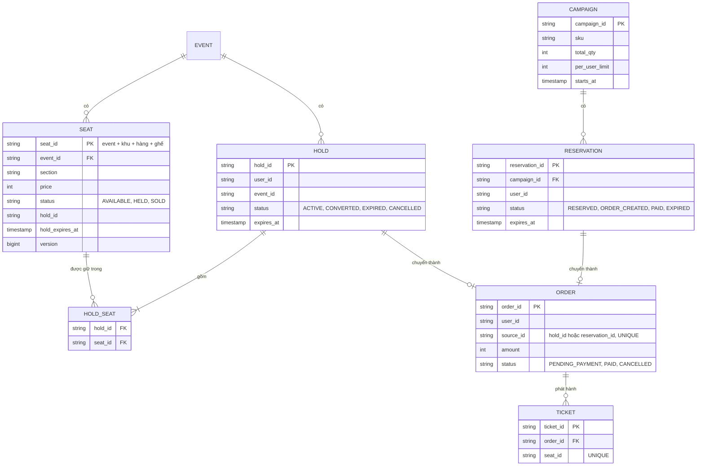

Các ràng buộc **ở tầng DB** là tuyến phòng thủ cuối:

```sql
-- Mỗi ghế chỉ có MỘT vé, dù code có bug
ALTER TABLE ticket ADD CONSTRAINT uq_ticket_seat UNIQUE (event_id, seat_id);
-- Mỗi người chỉ mua một lần trong một campaign
ALTER TABLE reservation ADD CONSTRAINT uq_one_per_user UNIQUE (campaign_id, user_id);
-- Một hold/reservation chỉ tạo một đơn (idempotent consumer)
ALTER TABLE orders ADD CONSTRAINT uq_order_source UNIQUE (source_id);
-- Tồn kho không âm
ALTER TABLE campaign_stock ADD CONSTRAINT ck_stock CHECK (available >= 0);
```

**Chọn storage:**

| Dữ liệu | Nơi lưu | Lý do |
|---|---|---|
| Trạng thái ghế, đơn, vé, reservation | RDBMS (sự thật cuối cùng) | Unique constraint, transaction |
| Bộ đếm tồn kho flash sale, hold đang mở | Redis (cổng nhanh) | Hàng trăm nghìn thao tác nguyên tử/giây, TTL sẵn có |
| Hàng đợi phòng chờ | Redis sorted set / counter, hoặc dịch vụ edge | Rẻ, nhanh |
| Sơ đồ ghế để hiển thị | Cache (Redis + CDN 1–2s) | Đọc cực nhiều, cho phép trễ |
| Sự kiện | Kafka | San tải, tách đường nóng khỏi xử lý chậm |

---

## 📖 5. Kiến trúc tổng thể

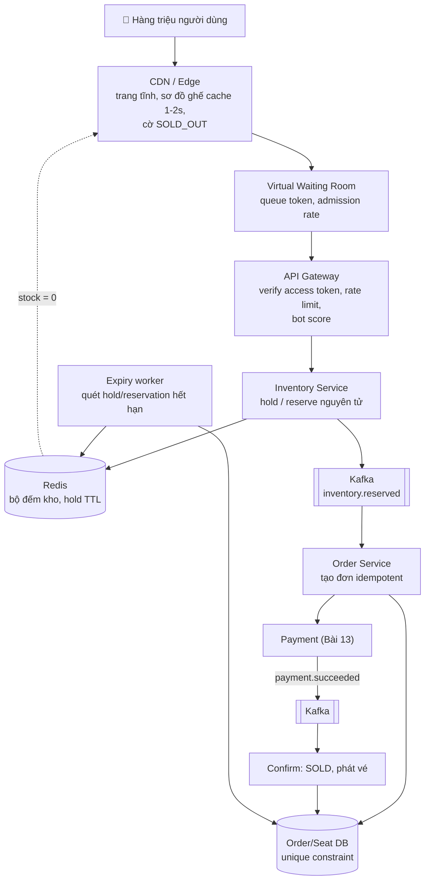

### Luồng giữ ghế và mua vé concert

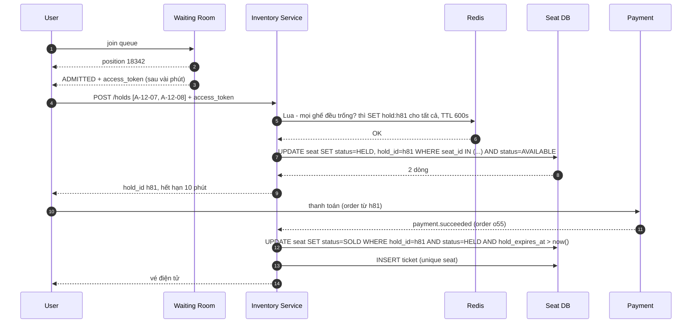

### Luồng flash sale (bất đồng bộ)

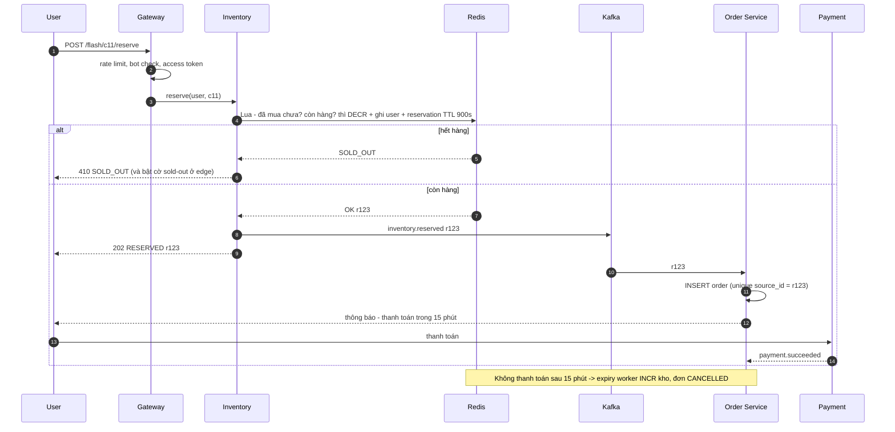

---

## 📖 6. Deep dive 1 - Tranh chấp tồn kho: 5 cách và cái giá của chúng

### 6.1 Vì sao "kiểm tra rồi trừ" sai?

```python
stock = db.query("SELECT stock FROM inventory WHERE sku = 'IP16'")   # 1 người đọc: 1
if stock > 0:                                                         # 1000 người cùng thấy: 1 > 0
    db.execute("UPDATE inventory SET stock = ? WHERE sku = 'IP16'", stock - 1)
    create_order()                                                    # 1000 đơn!
```

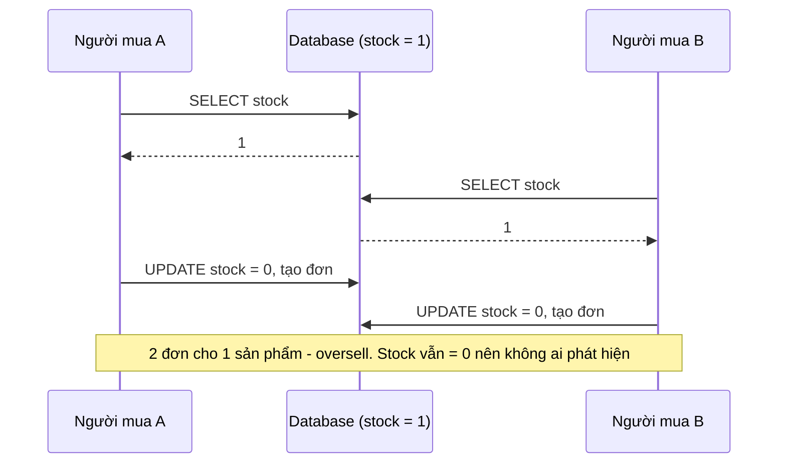

Đây là **race condition check-then-act**. Ghi chú quan trọng: stock cuối cùng vẫn trông "hợp lý" (0), vì lệnh `UPDATE` sau **ghi đè** lệnh trước (lost update). Chỉ đếm đơn mới thấy sai.

### 6.2 Năm phương án

| # | Phương án | Cách làm | Throughput trên 1 SKU | Ưu | Nhược |
|---|---|---|---|---|---|
| 1 | **Row lock** (pessimistic) | `SELECT ... FOR UPDATE` rồi trừ, trong transaction | Thấp: ~vài trăm–1.000/s (lock giữ suốt transaction) | Đơn giản, đúng | Mọi request xếp hàng trên một dòng; transaction dài = thảm họa |
| 2 | **UPDATE có điều kiện** | `UPDATE inv SET stock = stock - 1 WHERE sku = ? AND stock > 0` → kiểm tra số dòng | Trung bình: ~1–5 nghìn/s (lock rất ngắn) | Một câu lệnh, nguyên tử, DB lo hết | Vẫn là một dòng nóng trong DB |
| 3 | **Optimistic (version/CAS)** | `UPDATE ... SET stock = :v-1, version = version+1 WHERE version = :ver` | **Tệ** khi tranh chấp cao: hầu hết retry | Không giữ lock | Thundering retry; chỉ tốt khi ít tranh chấp (ghế khác nhau) |
| 4 | **Redis + Lua reservation** | Script kiểm tra + DECR + ghi user + TTL, chạy nguyên tử | Cao: ~100 nghìn/s trên một key (Redis đơn luồng) | Rất nhanh, logic phức tạp vẫn nguyên tử | Redis không phải sự thật cuối cùng; failover có thể mất ghi |
| 5 | **Token cấp phát trước** | Tạo sẵn N token (list Redis hoặc hàng đợi), mỗi người `LPOP` một token | Cao, và **có thể chia shard** (N token chia vào nhiều list) | Số token = số hàng → không thể bán quá về cấu trúc | Cần chuẩn bị trước; trả token khi hết hạn phải cẩn thận |

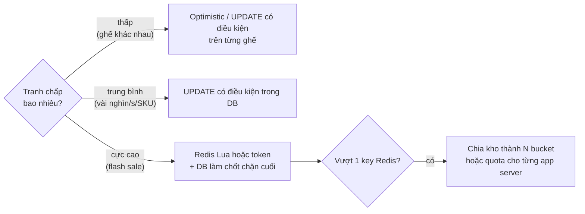

!!! tip "Vé concert khác flash sale ở chỗ nào?"
    Vé concert: 40.000 **dòng khác nhau** (mỗi ghế một dòng) → tranh chấp phân tán, trừ khi mọi người cùng nhắm hàng ghế đầu. UPDATE có điều kiện trên từng ghế là đủ. Flash sale: **một dòng** (một SKU) bị cả triệu người nhắm → cần Redis/token/bucket.

### 6.3 Redis Lua script cho flash sale

```lua
-- KEYS[1] = stock:c11      KEYS[2] = buyers:c11 (set)     KEYS[3] = resv:<reservation_id>
-- ARGV[1] = user_id        ARGV[2] = ttl_seconds
if redis.call('SISMEMBER', KEYS[2], ARGV[1]) == 1 then
  return {err = 'LIMIT_EXCEEDED'}            -- mỗi người 1 lần
end
local left = tonumber(redis.call('GET', KEYS[1]) or '0')
if left <= 0 then
  return {err = 'SOLD_OUT'}
end
redis.call('DECR', KEYS[1])
redis.call('SADD', KEYS[2], ARGV[1])
redis.call('SET', KEYS[3], ARGV[1], 'EX', ARGV[2])          -- reservation tự hết hạn
redis.call('ZADD', 'expiry:c11', redis.call('TIME')[1] + ARGV[2], KEYS[3])  -- để worker nhả kho
return left - 1
```

Redis chạy từng script **trọn vẹn, không xen kẽ** (đơn luồng) → kiểm tra + trừ là một bước nguyên tử. Lưu ý: TTL của key `resv:*` hết hạn **không** tự cộng lại kho; cần **expiry worker** đọc sorted set `expiry:c11` và chạy một script nhả kho (cũng nguyên tử, cũng kiểm tra reservation chưa được thanh toán).

### 6.4 Mô phỏng: người mua đồng thời

Chương trình dưới đây cho 1.000 (Go) / 300 (Python) người mua cùng lúc tranh 100 sản phẩm, so sánh:

1. **Naive check-then-act** - đọc, làm việc khác một chút (sleep mô phỏng gọi service/tính giá), rồi ghi.
2. **Giảm có điều kiện nguyên tử** - Go dùng CAS (`CompareAndSwap`), Python dùng SQL thật trên SQLite `UPDATE ... WHERE stock > 0`.
3. **Giữ chỗ có TTL** kiểu Redis Lua - một phần người không trả tiền, hold hết hạn, kho được nhả cho người tiếp theo.

=== "Go"

    ```go
    package main

    import (
    	"fmt"
    	"math/rand"
    	"sync"
    	"sync/atomic"
    	"time"
    )

    const stockInit, buyers = 100, 1000

    // 1) SAI: check-then-act. Đọc, "làm gì đó" (gọi DB, tính giá...), rồi ghi.
    func naive() int64 {
    	var stock, sold atomic.Int64
    	stock.Store(stockInit)
    	var wg sync.WaitGroup
    	for i := 0; i < buyers; i++ {
    		wg.Add(1)
    		go func() {
    			defer wg.Done()
    			v := stock.Load() // SELECT stock
    			if v > 0 {
    				time.Sleep(time.Duration(rand.Intn(200)) * time.Microsecond)
    				stock.Store(v - 1) // UPDATE stock = v-1  (ghi đè!)
    				sold.Add(1)        // INSERT order
    			}
    		}()
    	}
    	wg.Wait()
    	return sold.Load()
    }

    // 2) ĐÚNG: giảm có điều kiện, nguyên tử (≈ UPDATE ... SET stock=stock-1 WHERE stock>0).
    func atomicDecrement() int64 {
    	var stock, sold atomic.Int64
    	stock.Store(stockInit)
    	var wg sync.WaitGroup
    	for i := 0; i < buyers; i++ {
    		wg.Add(1)
    		go func() {
    			defer wg.Done()
    			for {
    				v := stock.Load()
    				if v <= 0 {
    					return // hết hàng
    				}
    				if stock.CompareAndSwap(v, v-1) { // chỉ thắng nếu không ai đổi giữa chừng
    					time.Sleep(time.Duration(rand.Intn(200)) * time.Microsecond)
    					sold.Add(1)
    					return
    				}
    			}
    		}()
    	}
    	wg.Wait()
    	return sold.Load()
    }

    // 3) Giữ chỗ có TTL: reserve -> (trả tiền | hết hạn thì nhả lại kho).
    type Inventory struct {
    	mu        sync.Mutex // ≈ một Redis Lua script: chạy tuần tự, không xen kẽ
    	available int
    	holds     map[int]int64 // buyerID -> hết hạn lúc (giây logic)
    	paid      int
    }

    func (inv *Inventory) Reserve(buyer int, now, ttl int64) bool {
    	inv.mu.Lock()
    	defer inv.mu.Unlock()
    	if inv.available <= 0 {
    		return false
    	}
    	inv.available--
    	inv.holds[buyer] = now + ttl
    	return true
    }

    func (inv *Inventory) Pay(buyer int, now int64) bool {
    	inv.mu.Lock()
    	defer inv.mu.Unlock()
    	exp, ok := inv.holds[buyer]
    	if !ok || now >= exp {
    		return false // hold đã hết hạn -> không được trả tiền nữa
    	}
    	delete(inv.holds, buyer)
    	inv.paid++
    	return true
    }

    func (inv *Inventory) Expire(now int64) int {
    	inv.mu.Lock()
    	defer inv.mu.Unlock()
    	n := 0
    	for b, exp := range inv.holds {
    		if now >= exp {
    			delete(inv.holds, b)
    			inv.available++
    			n++
    		}
    	}
    	return n
    }

    func main() {
    	fmt.Printf("Kho %d, %d người mua đồng thời\n", stockInit, buyers)
    	fmt.Printf("naive check-then-act : bán %d\n", naive())
    	fmt.Printf("atomic decrement     : bán %d\n", atomicDecrement())

    	// Mô phỏng hold TTL 600s (10 phút) với đồng hồ logic, seed cố định
    	r := rand.New(rand.NewSource(7))
    	inv := &Inventory{available: stockInit, holds: map[int]int64{}}
    	next := 0 // người kế tiếp trong hàng đợi
    	for round := int64(0); round < 3; round++ {
    		now := round * 600
    		freed := inv.Expire(now)
    		got := 0
    		for inv.available > 0 && next < buyers {
    			if inv.Reserve(next, now, 600) {
    				got++
    				if r.Float64() < 0.7 { // 70% trả tiền kịp trong 10 phút
    					inv.Pay(next, now+300)
    				}
    			}
    			next++
    		}
    		fmt.Printf("t=%4ds nhả %3d hold hết hạn, giữ chỗ mới %3d, đã thanh toán %3d, đang giữ %3d\n",
    			now, freed, got, inv.paid, len(inv.holds))
    	}
    	held := -1
    	for b := range inv.holds {
    		held = b // một người đang giữ chỗ nhưng chưa trả
    		break
    	}
    	late := inv.Pay(held, 1200+600) // trả đúng lúc hold vừa hết hạn
    	fmt.Printf("trả tiền sau khi hold hết hạn được không? %v | tổng đã bán %d <= %d\n", late, inv.paid, stockInit)
    }

    // Output:
    // Kho 100, 1000 người mua đồng thời
    // naive check-then-act : bán 1000
    // atomic decrement     : bán 100
    // t=   0s nhả   0 hold hết hạn, giữ chỗ mới 100, đã thanh toán  65, đang giữ  35
    // t= 600s nhả  35 hold hết hạn, giữ chỗ mới  35, đã thanh toán  86, đang giữ  14
    // t=1200s nhả  14 hold hết hạn, giữ chỗ mới  14, đã thanh toán  93, đang giữ   7
    // trả tiền sau khi hold hết hạn được không? false | tổng đã bán 93 <= 100
    ```

=== "Python"

    ```python
    import os
    import random
    import sqlite3
    import tempfile
    import threading
    import time

    STOCK, BUYERS = 100, 300


    def naive():
        """SAI: SELECT rồi UPDATE = check-then-act."""
        state = {"stock": STOCK, "sold": 0}
        lock = threading.Lock()  # chỉ để đếm sold an toàn, KHÔNG bảo vệ stock

        def buy():
            v = state["stock"]  # SELECT stock FROM inventory
            if v > 0:
                time.sleep(random.uniform(0, 0.002))  # gọi service khác, tính giá...
                state["stock"] = v - 1  # UPDATE inventory SET stock = :v - 1
                with lock:
                    state["sold"] += 1

        ts = [threading.Thread(target=buy) for _ in range(BUYERS)]
        [t.start() for t in ts]
        [t.join() for t in ts]
        return state["sold"], state["stock"]


    def sql_conditional_update():
        """ĐÚNG: điều kiện nằm TRONG câu UPDATE - DB đảm bảo nguyên tử."""
        path = os.path.join(tempfile.mkdtemp(), "shop.db")
        with sqlite3.connect(path) as db:
            db.execute("CREATE TABLE inventory(sku TEXT PRIMARY KEY, stock INT CHECK(stock >= 0))")
            db.execute("INSERT INTO inventory VALUES('IPHONE', ?)", (STOCK,))
        sold = []

        def buy():
            db = sqlite3.connect(path, timeout=30)
            cur = db.execute(
                "UPDATE inventory SET stock = stock - 1 WHERE sku = 'IPHONE' AND stock > 0"
            )
            db.commit()
            if cur.rowcount == 1:  # 1 dòng bị đổi = mua được
                sold.append(1)
            db.close()

        ts = [threading.Thread(target=buy) for _ in range(BUYERS)]
        [t.start() for t in ts]
        [t.join() for t in ts]
        left = sqlite3.connect(path).execute("SELECT stock FROM inventory").fetchone()[0]
        return len(sold), left


    class LuaLikeInventory:
        """Mô phỏng Redis + Lua: mỗi script chạy trọn vẹn, không xen kẽ."""

        def __init__(self, stock):
            self._lock = threading.Lock()
            self.available, self.holds, self.paid = stock, {}, 0

        def reserve(self, buyer, now, ttl):
            with self._lock:
                if self.available <= 0 or buyer in self.holds:
                    return False
                self.available -= 1
                self.holds[buyer] = now + ttl
                return True

        def pay(self, buyer, now):
            with self._lock:
                exp = self.holds.get(buyer)
                if exp is None or now >= exp:
                    return False
                del self.holds[buyer]
                self.paid += 1
                return True

        def expire(self, now):
            with self._lock:
                gone = [b for b, exp in self.holds.items() if now >= exp]
                for b in gone:
                    del self.holds[b]
                self.available += len(gone)
                return len(gone)


    if __name__ == "__main__":
        print(f"Kho {STOCK}, {BUYERS} người mua đồng thời")
        print("naive check-then-act   : bán %d, stock cuối %d" % naive())
        print("UPDATE ... WHERE stock>0: bán %d, stock cuối %d" % sql_conditional_update())

        rng = random.Random(7)
        inv, nxt = LuaLikeInventory(STOCK), 0
        for rnd in range(3):
            now = rnd * 600
            freed, got = inv.expire(now), 0
            while inv.available > 0 and nxt < BUYERS:
                if inv.reserve(nxt, now, 600):
                    got += 1
                    if rng.random() < 0.6:  # 60% trả tiền kịp
                        inv.pay(nxt, now + 300)
                nxt += 1
            print(f"t={now:>4}s nhả {freed:>3}, giữ mới {got:>3}, đã trả {inv.paid:>3}, đang giữ {len(inv.holds):>3}")
        held = next(iter(inv.holds), None)  # một người còn giữ chỗ chưa trả
        print("trả tiền sau khi hết hạn?", inv.pay(held, 1800), "| tổng bán", inv.paid, "<=", STOCK)

    # Output:
    # Kho 100, 300 người mua đồng thời
    # naive check-then-act   : bán 300, stock cuối 60
    # UPDATE ... WHERE stock>0: bán 100, stock cuối 0
    # t=   0s nhả   0, giữ mới 100, đã trả  66, đang giữ  34
    # t= 600s nhả  34, giữ mới  34, đã trả  91, đang giữ   9
    # t=1200s nhả   9, giữ mới   9, đã trả  97, đang giữ   3
    # trả tiền sau khi hết hạn? False | tổng bán 97 <= 100
    ```

!!! note "Kết quả naive thay đổi mỗi lần chạy"
    Số "bán" của bản naive và "stock cuối" phụ thuộc lịch chạy goroutine/thread - lần chạy của bạn có thể ra số khác, nhưng **luôn > 100**. Bản nguyên tử luôn ra **đúng 100**. Phần mô phỏng hold dùng đồng hồ logic và seed cố định nên ổn định.

Đọc kết quả:

- Naive bán **gấp 3–10 lần** số hàng. Python còn cho thấy cái bẫy thứ hai: `stock cuối` vẫn dương (ví dụ 60) dù đã bán 300 - các lệnh ghi đè lên nhau (lost update) nên **chỉ nhìn tồn kho không phát hiện được oversell**. Phải đối soát bằng số đơn.
- Bản nguyên tử bán đúng 100, kho về 0.
- Mô phỏng hold: vòng 1 giữ hết 100, chỉ một phần trả tiền; sau 600s hold hết hạn được nhả và bán tiếp cho người sau trong hàng. Tổng đã bán **luôn ≤ 100**, và người trả tiền **sau khi** hold hết hạn bị từ chối.

---

## 📖 7. Chứng minh không oversell

"Tôi dùng Redis Lua nên không oversell" chưa phải là lập luận. Hãy chứng minh bằng **bất biến** (invariant).

**Định nghĩa:** với một campaign có tổng `N` sản phẩm, tại mọi thời điểm:

```
available + reserved + sold = N          (I1: bảo toàn)
available ≥ 0, reserved ≥ 0, sold ≥ 0    (I2: không âm)
```

Nếu I1 và I2 luôn đúng thì `sold ≤ N` - **không oversell**.

**Mọi thao tác giữ nguyên bất biến**, với điều kiện mỗi thao tác là **nguyên tử**:

| Thao tác | Điều kiện (guard) | Thay đổi | I1 sau thao tác |
|---|---|---|---|
| reserve | `available > 0` | available −1, reserved +1 | Tổng không đổi ✓ |
| pay | reservation còn hiệu lực (chưa hết hạn, chưa thanh toán) | reserved −1, sold +1 | ✓ |
| expire | reservation chưa thanh toán và đã quá hạn | reserved −1, available +1 | ✓ |
| cancel | reservation chưa thanh toán | reserved −1, available +1 | ✓ |

I2: `available` chỉ giảm khi guard `available > 0` đúng **tại cùng thời điểm** trừ (nguyên tử) → không bao giờ âm. `reserved` chỉ giảm khi tồn tại một reservation cụ thể ở trạng thái RESERVED, và mỗi reservation chỉ rời trạng thái đó **một lần** (chuyển trạng thái có điều kiện) → không bao giờ âm.

**Điểm dễ sai - cuộc đua pay vs expire:** nếu `pay` và `expire` cùng thấy reservation r đang RESERVED và cả hai cùng thực hiện, ta sẽ có reserved −2, sold +1, available +1 → tổng vẫn đúng nhưng **reserved** của người khác bị trừ oan → về sau có thể bán quá. Lời giải: cả hai phải là **chuyển trạng thái có điều kiện** trên **cùng một bản ghi**:

```sql
-- pay
UPDATE reservation SET status = 'PAID'
 WHERE id = :r AND status = 'RESERVED' AND expires_at > now();
-- expire
UPDATE reservation SET status = 'EXPIRED'
 WHERE id = :r AND status = 'RESERVED' AND expires_at <= now();
```

Chỉ **một** trong hai câu đổi được 1 dòng. Người thắng mới được thay đổi bộ đếm.

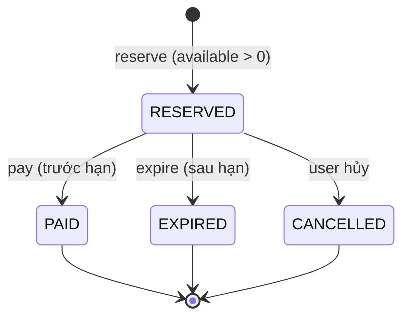

**Còn Redis failover thì sao?** Redis replication là bất đồng bộ: primary nhận `DECR`, chết trước khi replica kịp nhận → replica lên làm primary với kho **cao hơn** thực tế → có thể bán quá vài chiếc. Phòng thủ nhiều lớp:

1. **DB là sự thật cuối cùng:** đơn hàng chỉ được xác nhận khi DB chấp nhận (`CHECK(available >= 0)` trên bảng kho trong DB, hoặc đếm `COUNT(paid) ≤ N` trong transaction xác nhận). Redis chỉ là **cổng lọc nhanh**.
2. **Bảo thủ khi khôi phục:** sau failover, dựng lại bộ đếm Redis từ DB (`N − reserved − sold` theo DB) thay vì tin giá trị trên replica.
3. **Đối soát** Redis vs DB định kỳ trong suốt đợt sale.
4. Với vé (mỗi ghế giá trị cao): `UNIQUE(event_id, seat_id)` trên bảng vé đảm bảo dù mọi thứ khác sai, **một ghế không thể có hai vé**.

!!! warning "Overbooking có chủ đích"
    Hãng bay cố ý bán quá 3–5% vì biết một số khách không đến. Đó là **quyết định kinh doanh** có quy trình bồi thường, khác hoàn toàn với oversell do bug. Trong phỏng vấn, đề cập điều này cho thấy bạn hiểu ngữ cảnh.

---

## 📖 8. Deep dive 2 - Giữ chỗ có TTL

### 8.1 Hai cách triển khai hết hạn

| Cách | Mô tả | Ưu | Nhược |
|---|---|---|---|
| **Lazy expiry** | Không xóa gì; khi đọc/giữ ghế, coi `status = HELD AND hold_expires_at < now()` là **trống** | Không cần worker, không bao giờ "kẹt" | Bộ đếm tổng hợp (còn bao nhiêu ghế) phải tính lại; dữ liệu bẩn tồn tại lâu |
| **Active sweeper** | Worker quét `expiry` (sorted set theo thời điểm hết hạn, hoặc index `hold_expires_at`) mỗi giây, nhả hàng loạt | Bộ đếm chính xác, giải phóng sớm cho người chờ | Worker chết → ghế kẹt (cần HA + lazy làm dự phòng) |
| **Delayed message** | Khi tạo hold, gửi message trễ 10 phút (delay queue) | Không phải quét | Message mất/đến sớm; phụ thuộc broker |

Khuyến nghị: **lazy + sweeper**. Điều kiện "trống" luôn bao gồm "hold đã hết hạn" (đúng ngay cả khi sweeper chậm), còn sweeper giữ bộ đếm và sơ đồ ghế gọn gàng.

```sql
-- Giữ ghế: chấp nhận cả ghế AVAILABLE và ghế HELD đã hết hạn
UPDATE seat
   SET status = 'HELD', hold_id = :h, hold_expires_at = now() + interval '10 minutes',
       version = version + 1
 WHERE event_id = :e AND seat_id = ANY(:seats)
   AND (status = 'AVAILABLE' OR (status = 'HELD' AND hold_expires_at < now()));
-- Số dòng đổi phải = số ghế yêu cầu, không thì ROLLBACK (all-or-nothing)
```

### 8.2 Cuộc đua: thanh toán thành công đúng lúc hold hết hạn

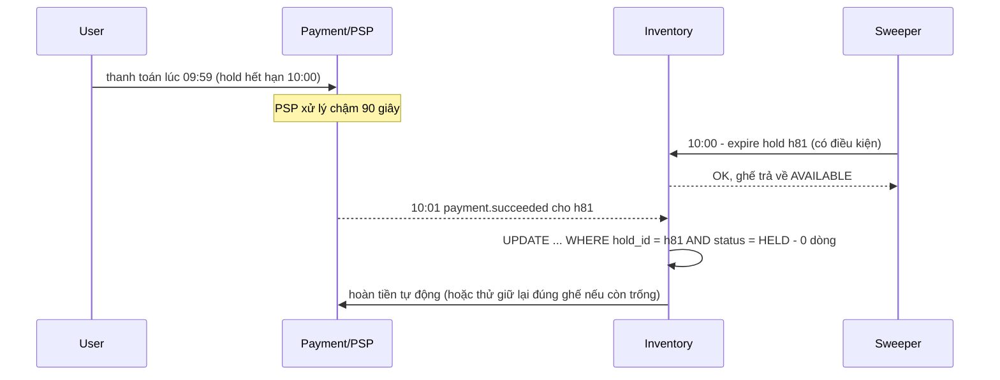

Các cách giảm cuộc đua này:

- **Gia hạn hold khi bắt đầu thanh toán:** chuyển hold sang `PAYMENT_IN_PROGRESS` với hạn mới = now + timeout thanh toán của PSP (ví dụ +5 phút). Sweeper không đụng vào trạng thái này cho đến hạn mới.
- **Timeout thanh toán < thời gian còn lại của hold:** không cho bắt đầu thanh toán nếu hold còn < 2 phút.
- **Luôn có đường hoàn tiền tự động** cho "tiền về sau khi hết hạn" (giống [Bài 13 - bài tập 4](./13-payment-wallet.md)).

### 8.3 Hold nhiều ghế: all-or-nothing

Giữ 4 ghế cạnh nhau: phải được **cả 4** hoặc **không ghế nào**. Trong DB, một transaction với UPDATE có điều kiện rồi so số dòng. Trong Redis, một Lua script kiểm tra tất cả rồi mới SET tất cả. Luôn khóa/duyệt ghế theo **thứ tự seat_id** để tránh deadlock giữa hai người giữ chéo nhau.

---

## 📖 9. Deep dive 3 - Phòng chờ ảo (virtual waiting room)

Phòng chờ biến "1 triệu người đập cửa cùng lúc" thành "một dòng người đi qua cửa với tốc độ hệ thống chịu được". Giống quầy vé rạp phim: không ai được xông vào phòng chiếu, mọi người xếp hàng và **được gọi số**.

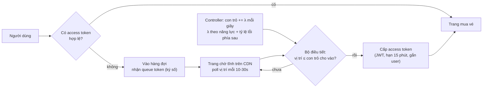

### 9.1 Thiết kế chi tiết

- **Vào hàng:** `INCR queue:ev99:seq` trả về số thứ tự → ký thành **queue token** `{event, user, seq, issued_at}` (HMAC). Không cần lưu từng người: số thứ tự nằm trong token.
- **Con trỏ cho vào:** `queue:ev99:admitted_upto` tăng `λ` mỗi giây. Người có `seq ≤ admitted_upto` được đổi queue token lấy **access token**.
- **Tính λ:** dựa trên Little's law (§2.2) và **phản hồi** từ phía sau: nếu P99 latency hoặc tỷ lệ lỗi của Inventory tăng → giảm λ; ổn → tăng dần. Đây là **admission control**, khác rate limit cố định.
- **Trang chờ hoàn toàn tĩnh**, phục vụ từ CDN; chỉ endpoint `status` là động và rất rẻ (đọc một counter, so sánh với seq trong token - có thể làm ở **edge worker** mà không chạm origin).
- **Hết vé:** khi kho = 0, đặt cờ `SOLD_OUT` → mọi người trong hàng nhận thông báo ngay, không chờ vô ích.

### 9.2 Công bằng: FIFO hay bốc thăm?

| Cách | Mô tả | Ưu | Nhược |
|---|---|---|---|
| **FIFO thuần** | Ai vào hàng trước được trước | Dễ hiểu | Thưởng cho bot và người có mạng nhanh; mọi người dồn đúng giây 0 |
| **Bốc thăm lúc mở** | Ai vào trong "phòng chờ trước giờ mở" (ví dụ 30 phút trước) đều được xáo trộn ngẫu nhiên khi mở | Giảm lợi thế của tốc độ, giảm đỉnh tại giây 0 | Người dùng cảm thấy "may rủi" |
| **Đăng ký trước + bốc thăm** | Đăng ký trong vài ngày, xác minh danh tính, bốc thăm quyền mua | Công bằng nhất, chống bot tốt | Trải nghiệm chậm, cần sản phẩm hỗ trợ |

Phổ biến: **bốc thăm cho người đến trước giờ mở + FIFO cho người đến sau**.

### 9.3 Chống "nhảy hàng"

- Token ký số, gắn `user_id` (đã đăng nhập) - không chia sẻ/không tự tạo được.
- Access token dùng một lần cho một phiên, hạn ngắn; một user chỉ có một vị trí (vào lại hàng = mất vị trí cũ hoặc giữ vị trí cũ, không bao giờ được hai vị trí).
- Không tin thời gian hay vị trí do client gửi.

---

## 📖 10. Deep dive 4 - Rate limiting & chống bot

Bot là lý do lớn nhất khiến vé "hết trong 30 giây" và xuất hiện trên chợ đen. Phòng thủ theo **nhiều lớp**:

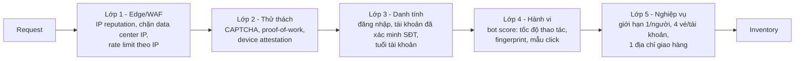

| Biện pháp | Chặn được | Lưu ý |
|---|---|---|
| Rate limit theo IP | Bot đơn giản | NAT/4G: nhiều người chung IP → giới hạn rộng tay, kết hợp theo user |
| Rate limit theo user/device | Một tài khoản spam | Bot dùng nhiều tài khoản → cần lớp danh tính |
| CAPTCHA / proof-of-work trước khi vào hàng | Bot hàng loạt | Đặt **trước giờ mở** để không thêm độ trễ lúc cao điểm |
| Tài khoản đã xác minh SĐT/eKYC, tuổi tài khoản > X ngày | Farm tài khoản mới | Có thể loại oan người dùng mới |
| `UNIQUE(campaign_id, user_id)` | Mua nhiều lần | Đây là ràng buộc nghiệp vụ, bot không vượt được |
| Vé ghi tên, kiểm tra CCCD khi vào cửa | Bán lại chợ đen | Giải pháp sản phẩm, không phải kỹ thuật |

Thuật toán rate limit (token bucket, sliding window log/counter) ở [System design backend](../backend/10-system-design.md); triển khai phân tán bằng Redis ở [Bài 2](./02-building-blocks-network.md).

!!! tip "Trả lời 429 thật rẻ"
    Request bị từ chối phải tốn **ít** tài nguyên hơn request thành công. Kiểm tra rate limit ở edge (bộ nhớ cục bộ + đồng bộ xấp xỉ) trước khi gọi Redis trung tâm; trả body rỗng; không log từng request bị chặn (chỉ đếm).

---

## 📖 11. Pipeline đặt hàng bất đồng bộ & nhả kho khi hết hạn

Sau khi `reserve` thành công, phần còn lại (tạo đơn, tính giá, voucher, phí ship, thanh toán) **không cần** chạy trong đường nóng.

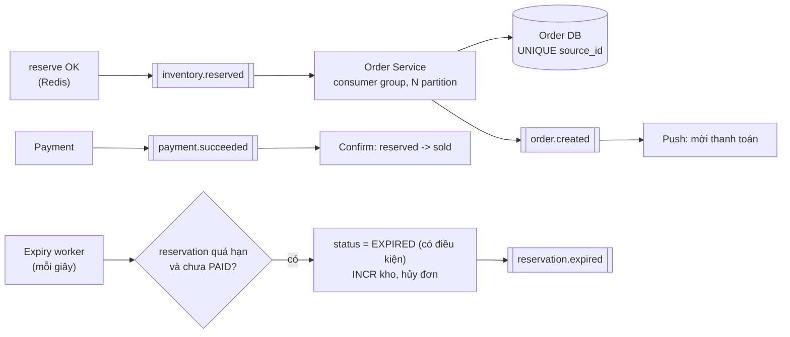

Nguyên tắc:

- **Consumer idempotent:** Kafka giao **ít nhất một lần** → `INSERT order ... ON CONFLICT (source_id) DO NOTHING`.
- **Partition theo `reservation_id`** (hoặc user) để các sự kiện của một reservation đi đúng thứ tự.
- **Hàng đợi hấp thụ đỉnh:** 30.000 đơn/s trong 1 phút có thể được Order Service xử lý ở 10.000 đơn/s trong 3 phút - người dùng chỉ thấy "đơn đang được tạo" lâu hơn chút. Đây là **load leveling**.
- **Hết hạn thanh toán → nhả kho:** expiry worker dùng chuyển trạng thái có điều kiện (§7). Kho nhả ra có thể quay lại bán cho người còn trong hàng đợi ("vé được nhả - mở thêm lượt").
- **Payment timeout ngắn hơn reservation TTL** để tránh cuộc đua ở §8.2.

!!! warning "Đừng nhả kho bằng TTL của Redis một mình"
    Key `resv:r123` hết hạn thì biến mất, nhưng **bộ đếm `stock` không tự tăng**. Dùng keyspace notification thì không đảm bảo giao (mất khi client mất kết nối). Luôn có worker quét danh sách hết hạn (sorted set theo thời điểm) và nhả bằng script nguyên tử.

---

## 📖 12. Hot key: một SKU, hàng triệu request

Một key Redis nằm trên **một** shard, xử lý bởi **một** luồng: thực tế khoảng 100 nghìn thao tác đơn giản/giây (Lua phức tạp thì ít hơn). 1,5 triệu req/s vào một key → không thể.

| Kỹ thuật | Cách làm | Hiệu quả |
|---|---|---|
| **Chặn trước** | Phòng chờ + rate limit + cờ SOLD_OUT ở edge | Chỉ vài chục nghìn req/s tới Redis |
| **Chia kho thành N bucket** | `stock:c11:0..15`, mỗi bucket 1000/16 cái, nằm ở các shard khác nhau; request chọn bucket ngẫu nhiên, hết thì thử bucket khác | Throughput × N; cuối đợt có thể còn lẻ tẻ vài bucket - quét lại |
| **Quota cục bộ cho app server** | Mỗi server xin trước một lô (ví dụ 20 cái) từ Redis, phát trong bộ nhớ | Gần như không chạm Redis; server chết → mất quota → thu hồi sau timeout |
| **Cờ sold-out** | Ngay khi kho = 0, ghi cờ vào cache cục bộ + CDN | 99,98% request thất bại không tốn gì |
| **Gộp request (coalescing)** | Gom các reserve trong 5ms thành một lệnh `DECRBY k` rồi chia | Giảm số thao tác Redis |

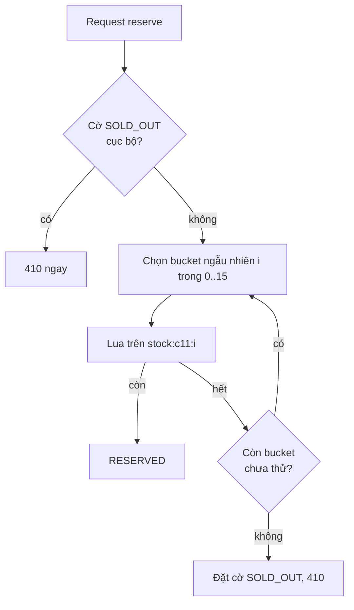

Bất biến ở §7 vẫn đúng: mỗi bucket tự giữ bất biến của nó, và tổng `N_i` = N.

---

## 📖 13. Chế độ lỗi & giảm thiểu

| Sự cố | Hậu quả | Giảm thiểu |
|---|---|---|
| Check-then-act | Oversell | Thao tác nguyên tử (UPDATE có điều kiện / Lua / token) |
| Redis failover mất ghi | Kho Redis cao hơn thực tế | DB là sự thật cuối, dựng lại từ DB, đối soát |
| Redis sập hẳn | Không bán được | Fallback sang UPDATE có điều kiện trong DB với rate limit chặt hơn; hoặc tạm dừng sale có thông báo |
| Expiry worker chết | Hàng kẹt ở RESERVED | Lazy expiry + worker HA (leader election) + cảnh báo "reserved quá hạn" |
| Kafka lag lớn | Đơn tạo chậm, người dùng hoang mang | Trạng thái `RESERVED` hiển thị ngay; scale consumer; reservation TTL tính từ lúc **đơn tạo xong** |
| PSP chậm | Hold hết hạn giữa chừng | Gia hạn hold khi bắt đầu thanh toán, hoàn tiền tự động |
| Thundering herd lúc 0:00 | Sập origin | Phòng chờ, trang tĩnh, pre-warm cache, scale trước |
| Bot | Người thật không mua được | Nhiều lớp phòng thủ (§10) |
| Lệch đồng hồ giữa server | Hết hạn sai | Thời gian lấy từ một nguồn (Redis `TIME` hoặc DB `now()`) |
| Sơ đồ ghế cache cũ | Người dùng chọn ghế đã bị giữ | Chấp nhận, trả lỗi thân thiện + gợi ý ghế gần nhất |

### Đa vùng

Tồn kho của **một** sự kiện/SKU phải có **một** nơi quyết định (home region). Người dùng ở region khác vẫn đi qua phòng chờ/CDN gần họ, nhưng lệnh reserve chuyển về home region. Chia kho cố định cho từng region (region A 600 cái, B 400 cái) chỉ hợp lý khi chấp nhận "region này hết, region kia còn".

---

## 📖 14. Giám sát

| Metric | Vì sao | Cảnh báo |
|---|---|---|
| `sold + reserved + available` so với `N` (Redis và DB) | Bất biến I1 | Lệch bất kỳ → P0 |
| Số đơn PAID so với N | Phát hiện oversell trực tiếp | > N → P0 |
| Tỷ lệ reserve thành công / 410 / 429 | Hiểu luồng | 5xx > 0,1% |
| Độ dài hàng đợi, tốc độ cho vào λ, thời gian chờ | Điều tiết | Thời gian chờ ước tính tăng bất thường |
| Latency P99 của Lua script, CPU Redis shard nóng | Hot key | CPU > 70% |
| Consumer lag Kafka | Đơn tạo chậm | Lag > 30s |
| Số reservation quá hạn chưa nhả | Worker chết | > 0 quá 1 phút |
| Tỷ lệ request bị đánh dấu bot | Chống bot | Tăng đột biến |
| Tỷ lệ chuyển đổi reserve → paid | Sức khỏe thanh toán | Giảm mạnh = PSP có vấn đề |

---

## 📝 Tự chấm

| Hạng mục | Đạt | Chưa đạt |
|---|---|---|
| Yêu cầu | Phân biệt ghế cụ thể vs số lượng; hỏi về công bằng, thời hạn thanh toán, giới hạn mỗi người | Coi như bài CRUD đơn hàng |
| Ước lượng | Tính được req/s đỉnh và nhận ra ~99,98% request thất bại; dùng Little's law cho tốc độ cho vào | Chỉ tính QPS trung bình |
| API | Có idempotency, trả 202 cho flash sale, mã lỗi SOLD_OUT/LIMIT rõ ràng | Một API "mua" đồng bộ làm mọi thứ |
| Dữ liệu | Có unique constraint làm chốt chặn cuối; trạng thái hold/reservation có hạn | Không có ràng buộc DB |
| Kiến trúc | CDN + phòng chờ + gateway + inventory nguyên tử + pipeline bất đồng bộ + expiry worker | Mọi request đi thẳng vào DB |
| Deep dive | So sánh ≥ 3 cách chống tranh chấp; chứng minh không oversell; xử lý pay vs expire | "Dùng lock là xong" |
| Trade-off | FIFO vs bốc thăm; Redis vs DB; bucket vs quota | Không nêu nhược điểm |
| Lỗi | Redis failover, worker chết, PSP chậm, bot | Không nhắc đến |

---

## 🔄 Biến thể interviewer hay hỏi

??? question "Nếu là đặt phòng khách sạn (nhiều đêm) thì sao?"
    Đơn vị tồn kho là **(loại phòng, đêm)**. Đặt 3 đêm = giữ 3 đơn vị cùng lúc, all-or-nothing, khóa theo thứ tự ngày. Tranh chấp thấp hơn flash sale nhiều → UPDATE có điều kiện trong DB là đủ. Thường cho overbooking có kiểm soát.

??? question "Nếu là đặt chỗ máy bay với nhiều hạng giá (fare class)?"
    Tồn kho phân cấp: tổng ghế khoang, chia "bucket" giá (nested booking limits). Hệ thống phân phối (GDS) nhiều kênh → cần nguồn sự thật trung tâm + giữ chỗ có TTL theo từng kênh.

??? question "Nếu muốn hiển thị số lượng còn lại realtime cho mọi người ('còn 37 cái')?"
    Không đọc trực tiếp bộ đếm cho hàng triệu người. Một job đọc bộ đếm mỗi 500ms, đẩy qua CDN/WebSocket fan-out (xem [Bài 8](./08-chat-presence.md)). Con số hiển thị chỉ mang tính tham khảo.

??? question "Nếu sản phẩm có nhiều biến thể (màu, size) trong một flash sale?"
    Mỗi biến thể là một SKU với kho riêng; giới hạn mỗi người áp ở mức campaign (`UNIQUE(campaign, user)`). Lua script nhận SKU + campaign, kiểm tra cả hai.

??? question "Nếu chỉ có 10 sản phẩm nhưng 10 triệu người - có cần cả hệ thống này?"
    Không cần Redis bucket hay Kafka. Cần **bốc thăm**: cho đăng ký trong 1 ngày, chọn ngẫu nhiên 10 người (+ danh sách dự bị), gửi link thanh toán. Thiết kế đúng là đổi **sản phẩm** để bài toán kỹ thuật biến mất.

---

## 🌍 Ứng dụng thực tế

- **Sàn TMĐT** (Shopee, Lazada, Tiki, TikTok Shop): flash sale theo khung giờ, giới hạn mỗi người, phòng chờ "đang có nhiều người mua".
- **Bán vé sự kiện** (Ticketmaster, các nền tảng vé trong nước): phòng chờ ảo, bốc thăm ("verified fan"), giữ ghế 10 phút.
- **Đặt vé tàu dịp Tết**: lưu lượng đột biến theo mùa, giữ chỗ chờ thanh toán.
- **Đặt lịch tiêm chủng, đăng ký học phần đại học**: cùng bài toán tài nguyên có hạn + đột biến tại một thời điểm.
- **Dịch vụ phòng chờ thương mại** (của các CDN lớn): phòng chờ triển khai ở edge, không cần sửa ứng dụng.

## ⚠️ Sai lầm thường gặp

| Sai lầm | Vì sao sai | Cách đúng |
|---|---|---|
| `SELECT` rồi `UPDATE` | Check-then-act, lost update | UPDATE có điều kiện / Lua / token |
| Tin Redis tuyệt đối | Failover mất ghi | DB + unique constraint làm chốt cuối, đối soát |
| Chỉ kiểm tra tồn kho để phát hiện oversell | Lost update làm số kho trông "đúng" | Đếm đơn PAID so với N |
| Transaction dài giữ row lock (gọi PSP trong transaction) | Toàn bộ người mua xếp hàng sau một request chậm | Transaction ngắn, gọi ngoài sau commit |
| Dựa vào TTL Redis để nhả kho | Key hết hạn không cộng lại bộ đếm | Expiry worker + chuyển trạng thái có điều kiện |
| Không có phòng chờ, "scale lên là được" | Autoscale chậm hơn đỉnh vài giây; DB không autoscale | Admission control |
| Rate limit chỉ theo IP | NAT 4G chặn oan người thật, bot đổi IP | Kết hợp IP + user + device + bot score |
| Thông báo "hết hàng" chậm | Hàng triệu người chờ vô ích, tiếp tục spam | Cờ SOLD_OUT đẩy ra edge ngay |

## 🏋️ Bài tập

**Bài 1 (dễ).** Viết câu SQL giữ 2 ghế `A-1`, `A-2` all-or-nothing, chấp nhận ghế HELD đã hết hạn. Làm sao biết thành công?

<details markdown="1"><summary>Đáp án</summary>

```sql
BEGIN;
UPDATE seat SET status = 'HELD', hold_id = 'h1', hold_expires_at = now() + interval '10 minutes'
 WHERE event_id = 'ev99' AND seat_id IN ('A-1', 'A-2')
   AND (status = 'AVAILABLE' OR (status = 'HELD' AND hold_expires_at < now()));
-- ứng dụng đọc số dòng bị ảnh hưởng
-- = 2 -> COMMIT ; < 2 -> ROLLBACK và báo ghế nào đã bị giữ
COMMIT;
```

Thành công khi **số dòng bị ảnh hưởng = số ghế yêu cầu**. Nếu ít hơn, ROLLBACK để không giữ một nửa.

</details>

**Bài 2 (dễ).** Trong mô phỏng Python, bản naive bán 300 nhưng "stock cuối" lại là một số dương. Giải thích vì sao, và vì sao điều này nguy hiểm trong vận hành.

<details markdown="1"><summary>Đáp án</summary>

Nhiều thread cùng đọc `v = 100`, ngủ, rồi cùng ghi `stock = 99`. Các lần ghi đè lên nhau (**lost update**), nên stock giảm chậm hơn nhiều so với số đơn bán ra. Kết quả: dashboard "tồn kho" cho thấy còn hàng (thậm chí còn mở bán tiếp), trong khi thực tế đã bán quá gấp 3. Bài học: **giám sát oversell bằng số đơn**, không bằng bộ đếm kho - và bộ đếm bị lỗi thì không tự báo lỗi.

</details>

**Bài 3 (trung bình).** Hệ thống Inventory chịu được 20.000 reserve/s, mỗi người trong khu mua ở lại trung bình 3 phút. Bạn muốn tối đa 30.000 người đồng thời trong khu mua. Tính λ cho phòng chờ. Nếu mỗi người tạo trung bình 0,2 reserve/s khi đang ở khu mua, giới hạn nào chặt hơn?

<details markdown="1"><summary>Đáp án</summary>

Theo Little: λ = L / W = 30.000 / 3 phút = **10.000 người/phút** (≈ 167 người/s).

Tải reserve khi có 30.000 người: 30.000 × 0,2 = **6.000 reserve/s** < 20.000 → Inventory không phải nút thắt; giới hạn "30.000 người đồng thời" (có thể do web/app server) là chặt hơn. Nếu muốn tận dụng Inventory, có thể tăng L đến 20.000 / 0,2 = 100.000 người (nếu tầng web chịu được) → λ ≈ 33.000 người/phút.

</details>

**Bài 4 (trung bình).** Chia kho 1.000 sản phẩm thành 16 bucket. Khi gần hết, nhiều request thử bucket nào cũng hết, tốn 16 lần gọi Redis. Đề xuất cải tiến.

<details markdown="1"><summary>Đáp án</summary>

- Duy trì **bitmap/set các bucket còn hàng** (`nonempty:c11`); khi một bucket về 0, Lua script xóa nó khỏi set. Request chọn ngẫu nhiên trong set (`SRANDMEMBER`) → tối đa 1–2 lần thử.
- Khi tổng còn lại nhỏ (ví dụ < 5% hoặc < 16 cái), **gộp** về một bucket duy nhất (rebalance bằng script).
- Cờ SOLD_OUT toàn cục khi set rỗng.
- Hoặc chuyển sang mô hình **token**: 1.000 token chia vào 16 list; `LPOP` list ngẫu nhiên, list rỗng thì bị loại khỏi set.

</details>

**Bài 5 (khó).** Chứng minh (hoặc tìm phản ví dụ) rằng thiết kế sau **không** oversell: Redis Lua reserve; Kafka → Order Service tạo đơn; thanh toán; expiry worker nhả bằng `INCR stock` khi key `resv:*` không còn tồn tại.

<details markdown="1"><summary>Đáp án</summary>

**Có phản ví dụ.** Worker nhả dựa trên "key `resv:r` không còn tồn tại", nhưng key cũng biến mất khi **thanh toán xong** (nếu code xóa key lúc PAID) hoặc khi TTL hết **trong lúc** thanh toán đang được ghi nhận:

1. r được reserve, TTL 900s.
2. User thanh toán ở giây 899; PSP chậm, webhook đến ở giây 905.
3. Giây 900: key hết hạn. Worker thấy key không còn → `INCR stock` (kho +1).
4. Giây 905: webhook PAID → đơn r được xác nhận (sold +1).
5. Người khác reserve đơn vị vừa được nhả → tổng bán = N + 1. **Oversell.**

Sửa: trạng thái reservation phải là **bản ghi có trạng thái** (`RESERVED/PAID/EXPIRED`) và cả pay lẫn expire là chuyển trạng thái có điều kiện trên cùng bản ghi (§7). Webhook đến sau khi EXPIRED → hoàn tiền, không xác nhận đơn.

</details>

**Bài 6 (khó).** Thiết kế cơ chế "quota cục bộ cho app server": mỗi server xin trước lô 20 cái. Phân tích: server chết đang giữ 15 cái thì sao? Làm sao vẫn đảm bảo bất biến?

<details markdown="1"><summary>Đáp án</summary>

- Coi lô quota như một **reservation có TTL của server**: `lease:server-7 = 20, hết hạn sau 30s`, gia hạn bằng heartbeat. Bất biến mở rộng: `available + Σ lease + reserved + sold = N`.
- Server phát từ lô: mỗi lần bán ghi `reserved` thật (vào Redis/DB) kèm `lease_id` → chuyển từ lease sang reserved là nguyên tử ở phía trung tâm (`lease -1, reserved +1`). Như vậy trung tâm luôn biết phần nào của lease đã dùng.
- Server chết: heartbeat dừng, lease hết hạn → script trung tâm trả phần **chưa dùng** của lease về `available`. Phần đã chuyển sang reserved vẫn đi theo vòng đời bình thường.
- Đánh đổi: cuối đợt có thể "còn hàng" nằm trong lease của server khác → người dùng ở server này thấy hết hàng sớm. Giảm bằng lô nhỏ dần khi kho còn ít (ví dụ khi available < 200, lô = 1, tức quay về chế độ trung tâm).

</details>

**Bài 7 (khó).** Thiết kế cho ca sĩ có 3 đêm diễn, mỗi người tối đa 4 vé **tổng cộng** cho cả 3 đêm, và có 1 triệu người. Phải sửa gì trong mô hình dữ liệu và luồng giữ chỗ?

<details markdown="1"><summary>Đáp án</summary>

- Giới hạn **xuyên sự kiện** → cần bộ đếm theo `(tour_id, user_id)`: bảng `user_quota(tour_id, user_id, held, purchased)` với `CHECK(held + purchased <= 4)`.
- Luồng giữ: trong **cùng transaction** (hoặc cùng Lua script) vừa giữ ghế, vừa `UPDATE user_quota SET held = held + k WHERE ... AND held + purchased + k <= 4`. Ghế ở 3 đêm có thể ở 3 shard → đặt `user_quota` là nơi quyết định trước (bước 1: giữ quota, bước 2: giữ ghế, thất bại thì trả quota - saga ngắn), hoặc shard toàn bộ theo `tour_id` để mọi thứ cùng một DB.
- Hết hạn hold → trả cả ghế lẫn quota (cùng chuyển trạng thái có điều kiện).
- Một phòng chờ chung cho cả tour (hoặc mỗi đêm một hàng với ưu tiên), vì người dùng thường muốn "đêm nào cũng được".

</details>

## ✅ Checklist

- [ ] Giải thích được vì sao check-then-act gây oversell và lost update che giấu nó
- [ ] So sánh 5 cách chống tranh chấp tồn kho và chọn đúng theo mức tranh chấp
- [ ] Viết được Lua script reserve có giới hạn mỗi người và TTL
- [ ] Chứng minh không oversell bằng bất biến `available + reserved + sold = N`
- [ ] Xử lý cuộc đua pay vs expire bằng chuyển trạng thái có điều kiện
- [ ] Thiết kế phòng chờ ảo với λ tính từ Little's law và phản hồi tải
- [ ] Liệt kê các lớp chống bot
- [ ] Thiết kế pipeline đặt hàng bất đồng bộ với consumer idempotent
- [ ] Đề xuất cách xử lý hot key một SKU
- [ ] Chạy được mô phỏng và giải thích output

---

**Bài tiếp theo**: [Bài 15: Autocomplete & web crawler](./15-autocomplete-crawler.md)
