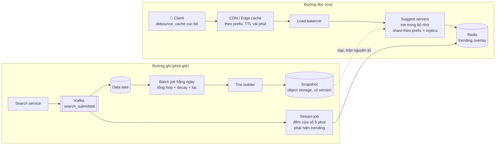
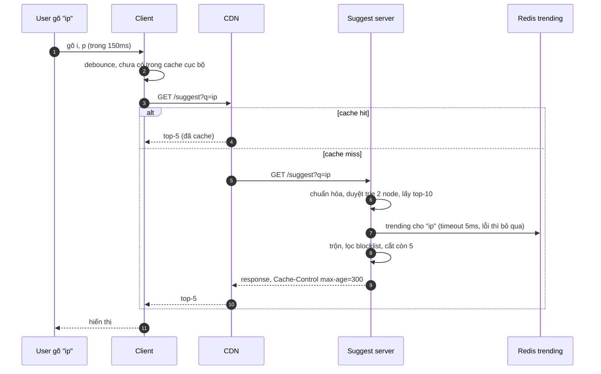
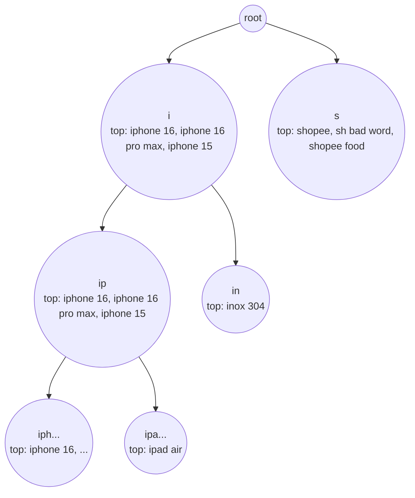
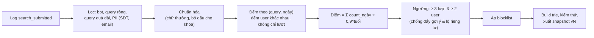
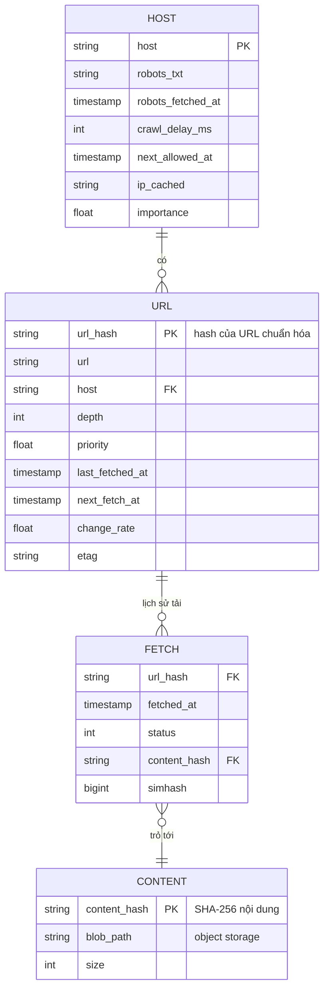
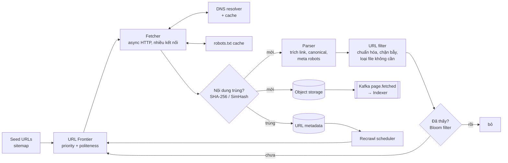
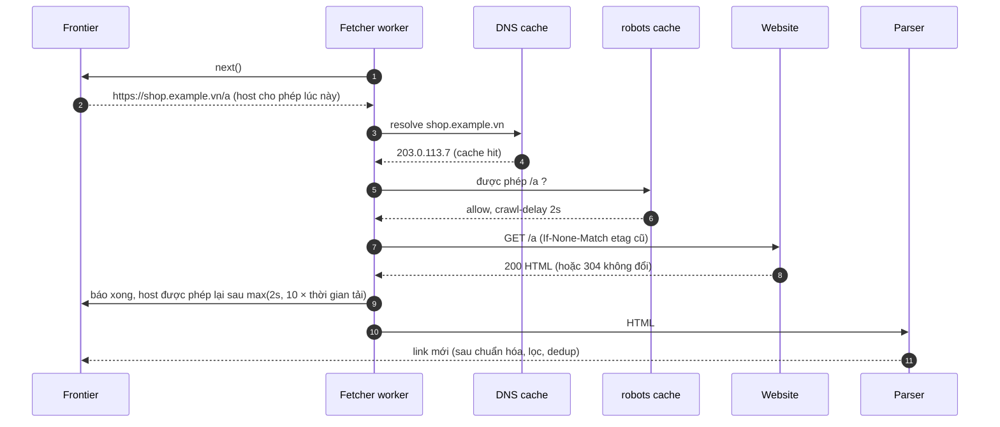
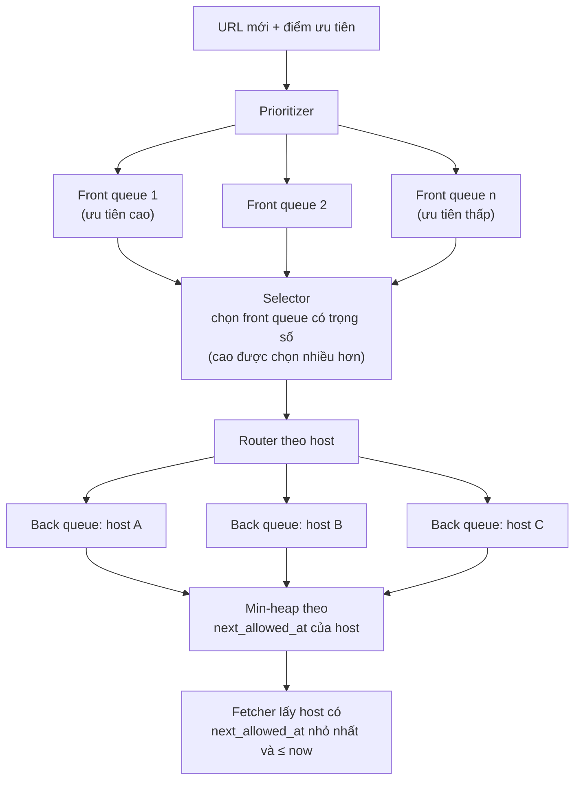
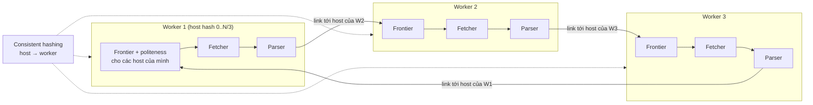
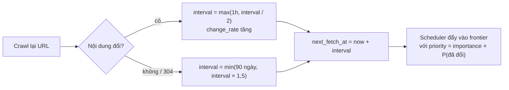

# 📚 Bài 15: Autocomplete & web crawler

> "Hệ thống tìm kiếm có hai đầu: một đầu đi **thu thập** cả thế giới, một đầu **đoán** bạn muốn gì sau ký tự thứ hai."

Bạn gõ "ip" vào ô tìm kiếm của một sàn TMĐT. Trước khi kịp gõ chữ thứ ba, danh sách "iphone 16, iphone 16 pro max, ipad air" đã hiện ra - trong vòng chưa tới 100 mili giây, giữa hàng chục nghìn người khác đang gõ cùng lúc. Đó là **autocomplete** (typeahead).

Còn để ô tìm kiếm của một công cụ tìm kiếm web có gì mà tìm, phải có ai đó đi **tải** hàng tỷ trang web, lịch sự với từng website, không lạc vào "mê cung" vô tận, không lưu cùng một trang hai lần, và quay lại khi trang thay đổi. Đó là **web crawler**.

Bài này gồm **hai case study** độc lập, hay được hỏi trong phỏng vấn, và có chung một điểm: đều là **pipeline xử lý dữ liệu lớn** phía sau một bề mặt trông đơn giản.

## 🎯 Mục tiêu bài học

**Phần A - Autocomplete:**

- Thiết kế **trie lưu sẵn top-k ở mỗi node** để trả lời trong O(độ dài tiền tố) - có code chạy được
- Xây **pipeline thu thập & tổng hợp** log tìm kiếm, chọn **tần suất cập nhật**
- Áp dụng **cache nhiều tầng** (client, CDN/edge, server)
- Thêm **trending**, **cá nhân hóa**, **lọc nội dung** mà không làm chậm đường đọc

**Phần B - Web crawler:**

- Thiết kế **URL frontier** với **politeness** (lịch sự với từng host) và **priority**
- Xử lý **robots.txt**, **cache DNS**
- **Khử trùng lặp**: chuẩn hóa URL, hash nội dung, **SimHash** cho trang gần giống - có code chạy được
- **Crawl phân tán** chia theo host, tránh **bẫy crawler**, lên lịch **crawl lại** theo độ "tươi"

!!! note "Kiến thức nền"
    Trie và Bloom filter đã học kỹ ở [Cấu trúc dữ liệu nâng cao](../algorithms/15-advanced-data-structures.md) - bài này chỉ dùng chúng. Consistent hashing ở [Bài 3](./03-building-blocks-data.md), CDN ở [Bài 2](./02-building-blocks-network.md), stream processing & cửa sổ thời gian ở [Bài 5](./05-messaging-streaming.md), object storage ở [Bài 6](./06-specialized-storage.md).

---

## 🧩 Tự thiết kế trước

!!! question "Đề A (15–20 phút): Search autocomplete"
    Thiết kế tính năng gợi ý khi gõ cho ô tìm kiếm của một sàn TMĐT lớn: 50 triệu người dùng/ngày, trả về **5 gợi ý** phổ biến nhất bắt đầu bằng chuỗi đã gõ, độ trễ **< 100ms**. Gợi ý phản ánh xu hướng trong ngày, không gợi ý từ ngữ phản cảm.

!!! question "Đề B (15–20 phút): Web crawler"
    Thiết kế crawler tải **1 tỷ trang/tháng** phục vụ công cụ tìm kiếm. Phải lịch sự với website (không làm sập web người khác), tuân thủ robots.txt, không tải trùng, crawl lại các trang hay thay đổi.

<details markdown="1"><summary>Gợi ý</summary>

**A:**

- Bạn tính top-5 **lúc truy vấn** (duyệt cây con) hay **tính sẵn**? Cây con của tiền tố "i" có bao nhiêu node?
- Dữ liệu tần suất đến từ đâu? Cập nhật trie thế nào khi đang phục vụ hàng chục nghìn QPS?
- Mỗi phím gõ một request - có cách nào giảm?
- "Trending" khác "phổ biến" thế nào?

**B:**

- Hàng đợi URL có phải chỉ là một FIFO? Nếu một trang có 1.000 link cùng host thì sao?
- Bạn tốn bao lâu cho DNS mỗi URL?
- `http://A.com/x?utm_source=fb` và `https://a.com/x` có phải một trang?
- Một trang lịch có link "tháng sau" vô tận - crawler có kẹt mãi không?

</details>

---

## 🔎 Phần A - Search autocomplete

## 📖 A1. Làm rõ yêu cầu

> **Ứng viên:** Gợi ý dựa trên **tiền tố** (prefix) hay khớp ở giữa câu ("16 pro" gợi ý "iphone 16 pro")?
>
> **Interviewer:** Tiền tố là đủ.
>
> **Ứng viên:** Xếp hạng theo gì? Tần suất tìm kiếm?
>
> **Interviewer:** Tần suất, có ưu tiên gần đây. Nếu có thời gian, nói thêm cá nhân hóa.
>
> **Ứng viên:** Bao nhiêu gợi ý, độ trễ?
>
> **Interviewer:** 5 gợi ý, dưới 100ms tính từ lúc gõ.
>
> **Ứng viên:** Gợi ý cập nhật nhanh cỡ nào? Một sản phẩm "hot" lúc 9h thì 9h05 phải xuất hiện?
>
> **Interviewer:** Đa số thì cập nhật theo ngày là được. Nhưng sự kiện nóng nên xuất hiện trong vòng vài phút đến 1 giờ.
>
> **Ứng viên:** Tiếng Việt có dấu: gõ "sua tam" có gợi ý "sữa tắm" không?
>
> **Interviewer:** Có, đó là yêu cầu quan trọng.
>
> **Ứng viên:** Sửa lỗi chính tả ("iphnoe")?
>
> **Interviewer:** Ngoài phạm vi.

| Loại | Yêu cầu |
|---|---|
| Chức năng | Top-5 gợi ý theo tiền tố; hỗ trợ không dấu; lọc từ cấm; trending |
| Phi chức năng | P99 < 100ms end-to-end (server < 20ms), khả dụng cao (hỏng thì ô tìm kiếm vẫn dùng được, chỉ mất gợi ý), cập nhật hằng ngày + trending trong ~1 giờ |
| Ngoài phạm vi | Sửa chính tả, tìm ở giữa câu, kết quả tìm kiếm thật |

!!! tip "Autocomplete là tính năng 'được phép hỏng'"
    Nếu dịch vụ gợi ý sập, người dùng vẫn gõ hết từ và bấm tìm. Vì vậy thiết kế ưu tiên **độ trễ và khả dụng**, chấp nhận dữ liệu cũ (stale) vài phút đến vài giờ. Đây là điểm khác biệt lớn so với [Bài 13](./13-payment-wallet.md) hay [Bài 14](./14-ticket-flash-sale.md).

## 📖 A2. Ước lượng

Các số là **ước tính để luyện tập**.

```
DAU                       = 50 triệu
Lượt tìm/người/ngày        = 5          → 250 triệu lượt tìm/ngày
Ký tự trung bình/lượt      = 15, nhưng client debounce ~150ms → ~5 request/lượt
Request gợi ý/ngày         = 250M × 5 = 1,25 tỷ
QPS trung bình             = 1,25 tỷ / 86.400 ≈ 14.500
QPS đỉnh (×3, tối, sale)    ≈ 45.000
```

Dữ liệu cho trie:

```
Query khác nhau/ngày       ≈ 30% × 250M = 75 triệu (đa số chỉ xuất hiện 1 lần - đuôi dài)
Giữ query xuất hiện ≥ 3 lần trong 30 ngày  → ~10 triệu query
Độ dài trung bình          = 20 ký tự   → tối đa 200 triệu ký tự
Chia sẻ tiền tố → số node thực tế ~ 50 triệu (ước lượng)
Mỗi node: con trỏ con (~40B) + top-10 tham chiếu query (10 × 8B = 80B) + overhead ≈ 150B
Bộ nhớ trie                ≈ 50M × 150B ≈ 7,5 GB   (+ bảng query ~10M × 40B = 0,4 GB)
```

→ Vừa bộ nhớ một máy lớn, nhưng nên **chia shard** (theo tiền tố) và **nhân bản** (để chịu 45k QPS và chịu lỗi). Có thể giảm mạnh bằng: giới hạn độ sâu (chỉ lưu top-k cho tiền tố ≤ 20 ký tự), nén radix tree, lưu top-k chỉ ở node có nhiều query.

Băng thông: mỗi response ~ 5 gợi ý × 30B + overhead ≈ 300B → 45k × 300B ≈ 13,5 MB/s - không đáng kể.

## 📖 A3. API

```http
GET /v1/suggest?q=ip&limit=5&lang=vi
Accept-Encoding: gzip

200 OK
Cache-Control: public, max-age=300
{ "q": "ip", "suggestions": [
    { "text": "iphone 16", "type": "query" },
    { "text": "iphone 16 pro max", "type": "query" },
    { "text": "ipad air", "type": "trending" } ],
  "version": "2026-10-28T02:00Z" }
```

- **GET + tham số chuẩn hóa** (chữ thường, bỏ khoảng trắng thừa) để cache CDN dùng được.
- Không đưa `user_id` vào URL cho phần chung (để cache được); phần cá nhân hóa lấy riêng hoặc làm ở client.
- `version` giúp client biết dữ liệu thuộc bản build nào (debug, A/B).

Sự kiện thu thập (client hoặc search service gửi):

```json
{ "event": "search_submitted", "query": "iphone 16", "user_id": "u_9", "ts": "2026-10-28T09:01:22Z",
  "source": "typed | suggestion_clicked", "results_count": 120 }
```

## 📖 A4. Mô hình dữ liệu & storage

| Dữ liệu | Dạng | Nơi lưu |
|---|---|---|
| Log tìm kiếm thô | Sự kiện append-only | Kafka → data lake (Parquet trên object storage) |
| Bảng tần suất | `(query_norm, display, day, count)` | Bảng trong data warehouse / Spark |
| Điểm tổng hợp | `(query_norm, display, score)` sau decay + lọc | File snapshot |
| Chỉ mục phục vụ | Trie top-k (hoặc bảng `prefix → top-k`) | **Bộ nhớ** của suggest server, nạp từ snapshot trên object storage |
| Trending overlay | `prefix → [query đang nổi]`, nhỏ | Redis, cập nhật mỗi vài phút |
| Blocklist | Danh sách query/từ cấm | Config store, đẩy tới server, áp dụng lúc phục vụ |

**Trie vs bảng prefix:**

| | Trie top-k trong bộ nhớ | Bảng `prefix → top-k` trong KV (Redis/Cassandra) |
|---|---|---|
| Truy vấn | Duyệt `len(prefix)` node | 1 lần get |
| Bộ nhớ | Chia sẻ tiền tố, gọn hơn | Lặp lại query ở mọi tiền tố của nó |
| Cập nhật | Build lại snapshot rồi tráo | Ghi lại hàng triệu key |
| Vận hành | Server tự quản bộ nhớ | Dùng KV có sẵn, server stateless |

Cả hai đều phổ biến. Trong phỏng vấn, chọn **trie trong bộ nhớ, build offline, tráo snapshot** và nói được phương án KV là đủ.

## 📖 A5. Kiến trúc tổng thể





## 📖 A6. Deep dive 1 - Trie lưu sẵn top-k

### A6.1 Vì sao không duyệt cây con lúc truy vấn?

Tiền tố "i" có cây con chứa **hàng trăm nghìn** query. Duyệt hết rồi sắp xếp cho mỗi phím gõ, với 45k QPS → không thể đạt 20ms. Giải pháp kinh điển: **mỗi node lưu sẵn top-k** của cây con của nó. Truy vấn chỉ còn: đi xuống `len(prefix)` bước rồi đọc danh sách có sẵn → **O(độ dài tiền tố)**.



Cái giá: **bộ nhớ** (mỗi node thêm k tham chiếu) và **cập nhật đắt** (đổi tần suất một query phải sửa top-k của mọi node trên đường từ gốc tới nó). Vì vậy ta build trie **offline** từ dữ liệu tổng hợp, không cập nhật từng lượt tìm.

### A6.2 Code: trie top-k

Chương trình build trie từ bảng (query, count), trả gợi ý theo tiền tố, áp blocklist lúc phục vụ, rồi mô phỏng một query "nổi lên" (tăng count) để thấy top-k thay đổi.

=== "Go"

    ```go
    package main

    import (
    	"fmt"
    	"sort"
    	"strings"
    )

    const K = 3

    type Item struct {
    	Query string
    	Count int
    }

    type Node struct {
    	children map[rune]*Node
    	top      []Item // top-K query có tiền tố = đường đi tới node này
    }

    func newNode() *Node { return &Node{children: map[rune]*Node{}} }

    // updateTop: đưa (q, c) vào danh sách top-K của node. Chỉ đúng khi count chỉ TĂNG.
    func (n *Node) updateTop(q string, c int) {
    	found := false
    	for i := range n.top {
    		if n.top[i].Query == q {
    			n.top[i].Count, found = c, true
    		}
    	}
    	if !found {
    		n.top = append(n.top, Item{q, c})
    	}
    	sort.Slice(n.top, func(i, j int) bool {
    		if n.top[i].Count != n.top[j].Count {
    			return n.top[i].Count > n.top[j].Count
    		}
    		return n.top[i].Query < n.top[j].Query
    	})
    	if len(n.top) > K {
    		n.top = n.top[:K]
    	}
    }

    type Trie struct {
    	root   *Node
    	counts map[string]int
    }

    func NewTrie() *Trie { return &Trie{root: newNode(), counts: map[string]int{}} }

    // Add cộng thêm delta lượt tìm cho query q; cập nhật top-K trên mọi node dọc đường.
    func (t *Trie) Add(q string, delta int) {
    	q = strings.ToLower(strings.TrimSpace(q))
    	t.counts[q] += delta
    	c := t.counts[q]
    	n := t.root
    	for _, ch := range q {
    		if n.children[ch] == nil {
    			n.children[ch] = newNode()
    		}
    		n = n.children[ch]
    		n.updateTop(q, c)
    	}
    }

    // Suggest: O(độ dài tiền tố) - không duyệt cây con, vì top-K đã tính sẵn.
    func (t *Trie) Suggest(prefix string, blocked map[string]bool) []string {
    	n := t.root
    	for _, ch := range strings.ToLower(prefix) {
    		if n = n.children[ch]; n == nil {
    			return nil
    		}
    	}
    	var out []string
    	for _, it := range n.top {
    		if !blocked[it.Query] { // lọc lúc phục vụ (blocklist đổi nhanh hơn trie)
    			out = append(out, fmt.Sprintf("%s(%d)", it.Query, it.Count))
    		}
    	}
    	return out
    }

    func main() {
    	t := NewTrie()
    	logs := []Item{
    		{"iphone 16", 9000}, {"iphone 16 pro max", 7000}, {"iphone 15", 4000},
    		{"ipad air", 2500}, {"inox 304", 800}, {"shopee", 12000},
    		{"shopee food", 6000}, {"sh bad word", 6500}, {"sua tam", 3000},
    	}
    	for _, it := range logs {
    		t.Add(it.Query, it.Count)
    	}
    	blocked := map[string]bool{"sh bad word": true}
    	for _, p := range []string{"i", "ip", "iphone 1", "s", "sh", "x"} {
    		fmt.Printf("%-9q -> %v\n", p, t.Suggest(p, blocked))
    	}
    	t.Add("ipad air", 8000) // trending: ra mắt iPad mới
    	fmt.Println("sau khi 'ipad air' tăng 8000 lượt:")
    	for _, p := range []string{"i", "ip"} {
    		fmt.Printf("%-9q -> %v\n", p, t.Suggest(p, blocked))
    	}
    }

    // Output:
    // "i"       -> [iphone 16(9000) iphone 16 pro max(7000) iphone 15(4000)]
    // "ip"      -> [iphone 16(9000) iphone 16 pro max(7000) iphone 15(4000)]
    // "iphone 1" -> [iphone 16(9000) iphone 16 pro max(7000) iphone 15(4000)]
    // "s"       -> [shopee(12000) shopee food(6000)]
    // "sh"      -> [shopee(12000) shopee food(6000)]
    // "x"       -> []
    // sau khi 'ipad air' tăng 8000 lượt:
    // "i"       -> [ipad air(10500) iphone 16(9000) iphone 16 pro max(7000)]
    // "ip"      -> [ipad air(10500) iphone 16(9000) iphone 16 pro max(7000)]
    ```

=== "Python"

    ```python
    K = 3


    class Node:
        __slots__ = ("children", "top")

        def __init__(self):
            self.children = {}
            self.top = []  # [(count, query)] top-K có tiền tố = đường tới node

        def update_top(self, q, c):
            """Chỉ đúng khi count chỉ TĂNG (giảm thì phải build lại)."""
            self.top = [(cnt, qq) for cnt, qq in self.top if qq != q] + [(c, q)]
            self.top.sort(key=lambda x: (-x[0], x[1]))
            del self.top[K:]


    class Trie:
        def __init__(self):
            self.root, self.counts = Node(), {}

        def add(self, q, delta):
            q = q.strip().lower()
            self.counts[q] = self.counts.get(q, 0) + delta
            c, n = self.counts[q], self.root
            for ch in q:
                n = n.children.setdefault(ch, Node())
                n.update_top(q, c)

        def suggest(self, prefix, blocked=frozenset()):
            n = self.root
            for ch in prefix.lower():
                n = n.children.get(ch)
                if n is None:
                    return []
            return [f"{q}({c})" for c, q in n.top if q not in blocked]


    t = Trie()
    logs = [("iphone 16", 9000), ("iphone 16 pro max", 7000), ("iphone 15", 4000),
            ("ipad air", 2500), ("inox 304", 800), ("shopee", 12000),
            ("shopee food", 6000), ("sh bad word", 6500), ("sua tam", 3000)]
    for q, c in logs:
        t.add(q, c)
    blocked = {"sh bad word"}
    for p in ["i", "ip", "iphone 1", "s", "sh", "x"]:
        print(f"{p!r:<10} -> {t.suggest(p, blocked)}")
    t.add("ipad air", 8000)
    print("sau khi 'ipad air' tăng 8000 lượt:")
    for p in ["i", "ip"]:
        print(f"{p!r:<10} -> {t.suggest(p, blocked)}")

    # Output:
    # 'i'        -> ['iphone 16(9000)', 'iphone 16 pro max(7000)', 'iphone 15(4000)']
    # 'ip'       -> ['iphone 16(9000)', 'iphone 16 pro max(7000)', 'iphone 15(4000)']
    # 'iphone 1' -> ['iphone 16(9000)', 'iphone 16 pro max(7000)', 'iphone 15(4000)']
    # 's'        -> ['shopee(12000)', 'shopee food(6000)']
    # 'sh'       -> ['shopee(12000)', 'shopee food(6000)']
    # 'x'        -> []
    # sau khi 'ipad air' tăng 8000 lượt:
    # 'i'        -> ['ipad air(10500)', 'iphone 16(9000)', 'iphone 16 pro max(7000)']
    # 'ip'       -> ['ipad air(10500)', 'iphone 16(9000)', 'iphone 16 pro max(7000)']
    ```

Quan sát:

- `"s"` chỉ trả **2** gợi ý dù K = 3: "sh bad word" nằm trong top-3 nhưng bị blocklist lọc lúc phục vụ, và "sua tam" (3000) không lọt top-3 của node. Bài học: **lưu K' > K** (ví dụ lưu 10, trả 5) để còn dư khi lọc, và lọc **cả lúc build** để từ cấm không chiếm chỗ.
- `updateTop` chỉ đúng khi count **tăng**. Nếu một query giảm điểm (decay theo thời gian), một query khác ngoài top-k có thể đáng lẽ lọt vào nhưng node không biết (vì không lưu nó). Đó là lý do thứ hai để **build lại toàn bộ** theo lịch thay vì sửa tại chỗ.
- Truy vấn không phụ thuộc kích thước cây: "i" và "iphone 1" đều chỉ đọc một danh sách có sẵn.

!!! note "Trie chi tiết hơn"
    Cách cài trie cơ bản, radix tree (nén các node một con) và độ phức tạp ở [Cấu trúc dữ liệu nâng cao §1](../algorithms/15-advanced-data-structures.md).

### A6.3 Tiếng Việt: có dấu và không dấu

Chuẩn hóa **khóa** của trie: chữ thường → Unicode NFD → bỏ dấu kết hợp → đ→d → gộp khoảng trắng. "Sữa Tắm" → `sua tam`. Trie đánh chỉ mục theo khóa không dấu, nhưng mỗi mục top-k lưu **chuỗi hiển thị** có dấu phổ biến nhất ("sữa tắm"). Khi người dùng gõ **có dấu** ("sữa"), có thể ưu tiên các gợi ý mà dạng có dấu khớp đúng tiền tố. (Chi tiết về Unicode NFC/NFD ở [Bẫy production §3](../backend/16-production-traps.md).)

## 📖 A7. Deep dive 2 - Thu thập, tổng hợp và tần suất cập nhật



**Các quyết định quan trọng:**

| Quyết định | Lựa chọn | Lý do |
|---|---|---|
| Đếm gì | Số **user khác nhau** tìm query (hoặc lượt có giới hạn mỗi user) | Một người/bot spam 10.000 lần không được đẩy query lên top |
| Decay | Hệ số 0,9/ngày (nửa đời ~7 ngày) | Phản ánh xu hướng, nhưng không quên ngay |
| Ngưỡng tối thiểu | ≥ k user khác nhau | Query hiếm có thể chứa thông tin cá nhân ("đơn ly hôn nguyễn văn a") |
| Tần suất build | Hằng ngày (hoặc vài giờ) | Build mất vài chục phút; đủ cho phần lớn query |
| Phần "nóng" | Stream job + trending overlay (§A8) | Đáp ứng "sự kiện nóng trong 1 giờ" mà không build lại cả trie |

**Triển khai snapshot an toàn:**

1. Builder xuất snapshot `v42` (file nhị phân) lên object storage + checksum.
2. **Kiểm thử tự động**: các tiền tố mẫu ("i", "s", "ip") phải ra kết quả hợp lý; không chứa từ cấm; kích thước không lệch quá 20% so với `v41`.
3. Server tải `v42` vào bộ nhớ **song song** với `v41`, xong thì tráo con trỏ nguyên tử (blue/green trong một process). Cần bộ nhớ gấp đôi trong lúc tráo.
4. Triển khai dần (canary 5% server trước). Lỗi → quay về `v41` ngay.

## 📖 A8. Deep dive 3 - Cache, trending, cá nhân hóa, lọc

### A8.1 Cache nhiều tầng

| Tầng | Cách làm | Hiệu quả |
|---|---|---|
| Client | **Debounce** 100–150ms; cache kết quả theo prefix trong phiên; gõ "iph" sau khi đã có kết quả "ip" → lọc cục bộ trước khi gọi mạng | Giảm 50–70% request |
| Prefetch | Lấy top-10 cho "ip", hiển thị 5; gõ thêm có thể dùng phần dư | Giảm request, cảm giác tức thì |
| CDN/Edge | Cache theo URL chuẩn hóa, TTL 5–15 phút | Tiền tố ngắn (1–3 ký tự) rất ít tổ hợp nhưng chiếm phần lớn lưu lượng → hit rate cao |
| Server | Trie trong bộ nhớ (chính là "cache") | < 1ms mỗi truy vấn |

!!! tip "Phân bố truy vấn lệch mạnh"
    Số tiền tố 1–2 ký tự chỉ vài nghìn (chữ cái × chữ cái), nhưng **mọi** lượt gõ đều đi qua chúng. Cache được chúng ở edge là đã gánh một phần rất lớn tải.

### A8.2 Trending

"Phổ biến" = tổng điểm cao. "Trending" = **tăng bất thường so với bình thường của chính nó**. Một query mới xuất hiện 2.000 lần trong 1 giờ (bình thường 10 lần/giờ) là trending, dù tổng vẫn nhỏ hơn "iphone 16".

- Stream job (Flink/Kafka Streams) đếm theo cửa sổ trượt 1 giờ, cập nhật mỗi 5 phút (cửa sổ & watermark ở [Bài 5](./05-messaging-streaming.md) và [Bài 16](./16-metrics-aggregation.md)).
- Điểm trending: `(count_1h − baseline) / sqrt(baseline + 1)` (kiểu z-score), baseline = trung bình cùng giờ 7 ngày trước.
- Ghi `prefix → top-3 trending` vào Redis cho các tiền tố của query đó (giới hạn độ dài tiền tố ≤ 10 để số key nhỏ).
- Lúc phục vụ: trộn trending vào top-k (ví dụ giữ chỗ 1–2 vị trí), **lọc kỹ hơn** vì trending dễ bị thao túng và dễ dính nội dung nhạy cảm.

### A8.3 Cá nhân hóa

- **Lịch sử của chính user** (10–50 query gần nhất): lưu ở client (localStorage) hoặc store theo user; trộn lên đầu nếu khớp tiền tố. Làm ở client → không phá cache CDN của phần chung.
- **Theo ngữ cảnh**: vị trí, ngôn ngữ, danh mục đang xem → dùng **một vài biến thể** trie (ví dụ theo vùng miền) thay vì trie theo từng người.
- **Rerank** bằng mô hình nhỏ ở server với tập ứng viên top-20 từ trie: tốn thêm vài ms, và mất khả năng cache theo URL - chỉ làm khi đo được lợi ích.

### A8.4 Lọc nội dung

| Loại | Ở đâu | Ghi chú |
|---|---|---|
| Từ ngữ phản cảm, bất hợp pháp | Build + serve | Blocklist từ/cụm từ, cả dạng không dấu và lách luật ("s.e.x") |
| Tên người (riêng tư) | Build | Ngưỡng nhiều user + bộ lọc thực thể |
| Gỡ khẩn cấp (sự cố truyền thông) | **Serve** | Blocklist đẩy tới server trong vài giây, không chờ build lại |
| Query đẩy bởi bot | Build | Đếm user khác nhau, lọc bot từ log |

## 📖 A9. Scale, lỗi và giám sát

**Chia shard trie:**

| Cách | Ưu | Nhược |
|---|---|---|
| Không shard, mỗi server giữ **toàn bộ** trie (7,5GB), scale bằng replica | Đơn giản nhất, mọi server trả lời mọi tiền tố | Mỗi server cần nhiều RAM |
| Shard theo **ký tự đầu** (a–f, g–m...) | Dễ hiểu | Lệch: tiền tố "s", "t" nhiều hơn "x", "z" rất nhiều |
| Shard theo **phân bố thực tế** (tính từ dữ liệu: mỗi shard ~ bằng nhau về số query/lưu lượng) | Cân bằng | Cần bảng ánh xạ prefix → shard, cập nhật mỗi lần build |

Với 7,5GB, phương án **không shard + nhiều replica** thường thắng. Shard khi trie vượt RAM một máy.

| Sự cố | Giảm thiểu |
|---|---|
| Suggest service sập | Client ẩn gợi ý, tìm kiếm vẫn hoạt động (graceful degradation) |
| Snapshot hỏng/sai | Kiểm thử tự động, canary, rollback về version trước |
| Redis trending chậm | Timeout 5ms, bỏ qua trending |
| Bị thao túng gợi ý (bot) | Đếm user khác nhau, ngưỡng, giám sát query tăng bất thường, duyệt tay cho trending |
| Hot prefix | CDN cache + replica |

**Metrics:** P50/P99 latency (server và end-to-end từ client), QPS, CDN hit rate, **tỷ lệ click vào gợi ý** (chất lượng), **tỷ lệ gõ thêm sau gợi ý** (gợi ý kém), tuổi snapshot đang phục vụ (stale quá 2 ngày → cảnh báo), số lần lọc blocklist.

---

## 🕷️ Phần B - Web crawler

## 📖 B1. Làm rõ yêu cầu

> **Ứng viên:** Crawler phục vụ mục đích gì? Công cụ tìm kiếm, lưu trữ web, hay theo dõi giá?
>
> **Interviewer:** Công cụ tìm kiếm.
>
> **Ứng viên:** Chỉ HTML hay cả ảnh, PDF? Có cần chạy JavaScript (trang SPA)?
>
> **Interviewer:** HTML trước. JavaScript rendering nói sau nếu có thời gian.
>
> **Ứng viên:** Quy mô: 1 tỷ trang/tháng là trang **mới** hay tính cả crawl lại?
>
> **Interviewer:** Tổng số lượt tải.
>
> **Ứng viên:** Lưu trang bao lâu? Lưu tất cả phiên bản?
>
> **Interviewer:** Lưu bản mới nhất, giữ trong 5 năm.
>
> **Ứng viên:** Có cần tuân thủ robots.txt và giới hạn tốc độ với từng website?
>
> **Interviewer:** Bắt buộc.

| Loại | Yêu cầu |
|---|---|
| Chức năng | Từ tập seed URL, tải trang, trích link, thêm link mới vào hàng đợi; lưu nội dung; crawl lại theo lịch |
| Phi chức năng | **Lịch sự** (≤ 1 kết nối đồng thời/host, tôn trọng robots.txt & crawl-delay); **mở rộng** ngang; **bền** trước trang lỗi/độc hại/bẫy; **ưu tiên** trang quan trọng; tránh trùng lặp |
| Ngoài phạm vi | Đánh chỉ mục (indexing), xếp hạng, chạy JavaScript (nhắc phương án) |

## 📖 B2. Ước lượng

Các số là **ước tính để luyện tập**.

```
Trang/tháng           = 1 tỷ
Trang/giây            = 1e9 / (30 × 86.400) ≈ 385 trang/s   (đỉnh ×2 ≈ 800/s)
Kích thước HTML TB    = 100 KB (nén gzip khi lưu ~ 25 KB)
Băng thông tải về     = 385 × 100 KB ≈ 38,5 MB/s ≈ 310 Mbps  (đỉnh ~ 650 Mbps)
Lưu trữ/tháng (nén)   = 1e9 × 25 KB = 25 TB
5 năm                 = 25 TB × 60 ≈ 1,5 PB  → object storage
```

Link phát hiện:

```
Mỗi trang ~ 50 link → 50 tỷ link/tháng (phần lớn trùng)
URL khác nhau đã biết ~ 10 tỷ → kiểm tra "đã thấy chưa" bằng Bloom filter:
10 tỷ × ~10 bit (FP 1%) ≈ 12,5 GB → chia shard theo host trên các worker
```

Độ trễ mỗi trang (DNS + kết nối + tải + xử lý) có thể 0,5–2 giây, phần lớn là **chờ mạng**:

```
Số request đồng thời cần = 385 trang/s × 1,5 s ≈ 580 (Little's law)
→ crawl là bài toán I/O: dùng I/O bất đồng bộ, mỗi worker hàng trăm kết nối
```

## 📖 B3. Giao diện (API nội bộ)

Crawler không có API công khai; các "API" là hợp đồng giữa các thành phần:

```text
Frontier.enqueue(url, priority, discovered_from, depth)
Frontier.next(worker_id) -> (url, host, not_before)     # tôn trọng politeness
Fetcher.fetch(url, if_modified_since, etag) -> (status, headers, body, final_url)
Parser.extract(body, base_url) -> (links[], text, canonical_url, meta_robots)
Store.put(url_hash, content, fetched_at, content_hash, simhash)
Scheduler.recrawl_at(url) -> timestamp
```

Sự kiện: `page.fetched` (cho indexer), `links.discovered` (gửi tới worker sở hữu host đích).

## 📖 B4. Mô hình dữ liệu & storage



| Dữ liệu | Nơi lưu | Lý do |
|---|---|---|
| Nội dung trang | Object storage (S3/GCS/MinIO), gom nhiều trang vào file lớn (kiểu WARC) | Rẻ, bền, không cần truy vấn ngẫu nhiên nhiều |
| Metadata URL (~10 tỷ dòng) | Wide-column (Bigtable/HBase/Cassandra) khóa `url_hash` hoặc `host + path` | Ghi nhiều, quét theo host |
| URL đã thấy | Bloom filter trong bộ nhớ + kiểm tra chính xác ở store khi cần | Nhanh |
| Frontier | Hàng đợi trên đĩa (RocksDB/Kafka) + phần nóng trong bộ nhớ | Hàng tỷ mục không vừa RAM |
| robots.txt, DNS | Cache trong bộ nhớ + bảng HOST | Đọc mỗi lần tải |

## 📖 B5. Kiến trúc tổng thể





## 📖 B6. Deep dive 1 - URL frontier: ưu tiên và lịch sự

Một FIFO đơn giản có hai vấn đề: (1) trang quan trọng chờ sau hàng triệu trang rác; (2) một trang có 1.000 link cùng host → 1.000 request liên tiếp vào **một** website nhỏ → bạn vô tình **DDoS** họ.

Thiết kế kinh điển (kiểu Mercator) dùng **hai tầng hàng đợi**:



- **Front queues (ưu tiên):** điểm từ PageRank/độ quan trọng của host, độ sâu, loại trang (trang chủ, sitemap), độ thay đổi. Selector chọn có trọng số để hàng thấp vẫn được phục vụ (không "chết đói").
- **Back queues (lịch sự):** mỗi back queue chỉ chứa URL của **một** host; mỗi host chỉ có một fetcher làm việc tại một thời điểm.
- **Heap thời gian:** sau khi tải xong một trang của host H mất `t` giây, đặt `next_allowed_at(H) = now + max(crawl_delay, k × t)` (k ≈ 10). Website chậm → tự động bị crawl chậm lại. Website trả 429/503 → tăng delay theo cấp số nhân.

| Tín hiệu ưu tiên | Ví dụ |
|---|---|
| Độ quan trọng của trang/host | PageRank, lưu lượng ước tính, host uy tín |
| Độ mới | Trang tin tức, trang chủ thay đổi liên tục |
| Độ sâu | Trang gần gốc thường quan trọng hơn |
| Nguồn | Từ sitemap, từ trang quan trọng |
| Phạt | Host nhiều lỗi, nhiều trang trùng, nghi bẫy |

## 📖 B7. Deep dive 2 - robots.txt, DNS và tải trang

### B7.1 robots.txt

```text
User-agent: *
Disallow: /cart
Disallow: /search?
Crawl-delay: 2
Sitemap: https://shop.example.vn/sitemap.xml
```

- Tải `/robots.txt` **trước** mọi trang của host, cache ~24 giờ (theo header cache nếu có).
- 404 → được crawl mọi thứ; 5xx/timeout → **tạm coi như cấm hết** và thử lại sau (an toàn cho website).
- Tôn trọng cả `<meta name="robots" content="noindex,nofollow">` và header `X-Robots-Tag` trong từng trang.
- Khai báo `User-Agent` rõ ràng kèm URL giải thích + liên hệ, để quản trị web biết bạn là ai.

### B7.2 DNS - nút thắt bị bỏ quên

Mỗi lần phân giải DNS có thể mất 10–200ms, và resolver hệ thống thường **đồng bộ** (khóa luồng). Ở 800 trang/s, gọi DNS cho mỗi URL là thảm họa.

- **Cache DNS riêng** trong crawler theo host (tôn trọng TTL nhưng có giới hạn dưới, ví dụ ≥ 5 phút).
- **Resolver bất đồng bộ**, nhiều request song song.
- **Phân giải trước** (prefetch) khi URL vào back queue, trước khi đến lượt tải.
- Politeness theo **IP** nữa: nhiều host ảo trên cùng một IP (shared hosting) - đừng làm sập một server chỉ vì nó chứa 500 website.

### B7.3 Tải trang an toàn

| Vấn đề | Phòng thủ |
|---|---|
| Trang khổng lồ | Giới hạn kích thước (ví dụ 10 MB), cắt bớt |
| Server cố tình chậm (tarpit) | Timeout kết nối và tổng thời gian |
| Redirect vòng | Tối đa 5 redirect, phát hiện vòng |
| Nội dung không phải HTML | Kiểm tra `Content-Type`, bỏ qua sớm |
| Trang không đổi | Conditional GET: `If-Modified-Since`, `If-None-Match` → 304 tiết kiệm băng thông |
| HTML độc hại/lỗi | Parser chịu lỗi, chạy trong sandbox, giới hạn bộ nhớ |

## 📖 B8. Deep dive 3 - Khử trùng lặp

Ba tầng trùng lặp, ba công cụ:

| Tầng | Ví dụ | Công cụ |
|---|---|---|
| **URL** khác chữ, cùng trang | `HTTPS://A.com:443/x/../y?utm_source=fb#top` và `https://a.com/y` | **Chuẩn hóa URL** + tập "đã thấy" (Bloom filter) |
| **Nội dung giống hệt** | Cùng bài viết ở `/post?id=5` và `/bai-viet/5` | Hash nội dung (SHA-256) |
| **Nội dung gần giống** | Cùng bài, khác ngày giờ ở footer, khác quảng cáo | **SimHash** (hoặc MinHash) + khoảng cách Hamming |

Ngoài ra: tôn trọng `<link rel="canonical">` - website tự nói "bản chuẩn của trang này là URL kia".

### B8.1 SimHash trong 4 câu

1. Chia văn bản thành **shingle** (cụm k từ liên tiếp).
2. Hash mỗi shingle ra 64 bit.
3. Với mỗi vị trí bit, cộng +1 nếu bit đó là 1, −1 nếu là 0 (qua mọi shingle).
4. Bit kết quả = 1 nếu tổng dương. Hai văn bản gần giống → phần lớn shingle chung → vector tổng gần nhau → **ít bit khác nhau**.

Khác với hash mật mã (đổi 1 ký tự → đổi ~50% bit), SimHash được thiết kế để **văn bản giống nhau cho hash giống nhau**.

### B8.2 Code: chuẩn hóa URL + SimHash

=== "Go"

    ```go
    package main

    import (
    	"fmt"
    	"hash/fnv"
    	"math/bits"
    	"net/url"
    	"path"
    	"sort"
    	"strings"
    )

    // Normalize: nhiều URL khác chữ nhưng cùng một trang -> một dạng chuẩn.
    func Normalize(raw string) (string, error) {
    	u, err := url.Parse(strings.TrimSpace(raw))
    	if err != nil {
    		return "", err
    	}
    	u.Scheme = strings.ToLower(u.Scheme)
    	host := strings.ToLower(u.Hostname())
    	if p := u.Port(); p != "" && !(u.Scheme == "http" && p == "80") && !(u.Scheme == "https" && p == "443") {
    		host += ":" + p
    	}
    	u.Host = host
    	u.Fragment = "" // #section không đổi nội dung trang
    	if u.Path == "" {
    		u.Path = "/"
    	} else {
    		clean := path.Clean(u.Path) // xử lý /a/./b/../c
    		if strings.HasSuffix(u.Path, "/") && clean != "/" {
    			clean += "/"
    		}
    		u.Path = clean
    	}
    	q := u.Query()
    	for k := range q {
    		if strings.HasPrefix(k, "utm_") || k == "fbclid" || k == "sessionid" {
    			q.Del(k) // tham số tracking không đổi nội dung
    		}
    	}
    	u.RawQuery = q.Encode() // Encode() sắp xếp key -> thứ tự tham số không còn quan trọng
    	return u.String(), nil
    }

    // SimHash 64-bit trên shingle 3 từ: trang gần giống nhau -> hash khác ít bit.
    func SimHash(text string) uint64 {
    	words := strings.Fields(strings.ToLower(text))
    	var v [64]int
    	for i := 0; i+3 <= len(words); i++ {
    		h := fnv.New64a()
    		h.Write([]byte(strings.Join(words[i:i+3], " ")))
    		x := h.Sum64()
    		for b := 0; b < 64; b++ {
    			if x&(1<<b) != 0 {
    				v[b]++
    			} else {
    				v[b]--
    			}
    		}
    	}
    	var out uint64
    	for b := 0; b < 64; b++ {
    		if v[b] > 0 {
    			out |= 1 << b
    		}
    	}
    	return out
    }

    func main() {
    	urls := []string{
    		"HTTPS://Shop.Example.VN:443/dien-thoai/./iphone/../iphone-16?color=den&utm_source=fb#review",
    		"https://shop.example.vn/dien-thoai/iphone-16?utm_campaign=1111&color=den",
    		"https://shop.example.vn/dien-thoai/iphone-16?color=trang",
    		"http://shop.example.vn:8080",
    	}
    	seen := map[string]bool{}
    	for _, raw := range urls {
    		n, _ := Normalize(raw)
    		fmt.Printf("dup=%-5v %s\n", seen[n], n)
    		seen[n] = true
    	}
    	base := "iphone 16 pro max chinh hang vn a gia tot nhat bao hanh mot nam doi moi ba muoi ngay giao hang nhanh toan quoc"
    	docs := map[string]string{
    		"gan giong": base + " cap nhat ngay 11 11",
    		"khac han":  "huong dan nau pho bo ha noi chuan vi voi xuong ong ham tam tieng va gia vi que hoi thao qua",
    	}
    	h0 := SimHash(base)
    	keys := []string{"gan giong", "khac han"}
    	sort.Strings(keys)
    	for _, k := range keys {
    		d := bits.OnesCount64(h0 ^ SimHash(docs[k]))
    		fmt.Printf("%-9s: khác %2d/64 bit -> near-duplicate=%v\n", k, d, d <= 10)
    	}
    }

    // Output:
    // dup=false https://shop.example.vn/dien-thoai/iphone-16?color=den
    // dup=true  https://shop.example.vn/dien-thoai/iphone-16?color=den
    // dup=false https://shop.example.vn/dien-thoai/iphone-16?color=trang
    // dup=false http://shop.example.vn:8080/
    // gan giong: khác  6/64 bit -> near-duplicate=true
    // khac han : khác 31/64 bit -> near-duplicate=false
    ```

=== "Python"

    ```python
    import posixpath
    from urllib.parse import urlsplit, urlunsplit, parse_qsl, urlencode


    def normalize(raw: str) -> str:
        """Nhiều URL khác chữ nhưng cùng một trang -> một dạng chuẩn."""
        p = urlsplit(raw.strip())
        scheme = p.scheme.lower()
        host = (p.hostname or "").lower()
        if p.port and not ((scheme, p.port) in {("http", 80), ("https", 443)}):
            host += f":{p.port}"
        path = p.path or "/"
        if path != "/":
            clean = posixpath.normpath(path)  # xử lý /a/./b/../c
            path = clean + "/" if path.endswith("/") and clean != "/" else clean
        query = sorted((k, v) for k, v in parse_qsl(p.query)
                       if not k.startswith("utm_") and k not in {"fbclid", "sessionid"})
        return urlunsplit((scheme, host, path, urlencode(query), ""))  # bỏ #fragment


    def fnv1a64(data: bytes) -> int:
        h = 0xCBF29CE484222325
        for b in data:
            h = ((h ^ b) * 0x100000001B3) & 0xFFFFFFFFFFFFFFFF
        return h


    def simhash(text: str) -> int:
        """SimHash 64-bit trên shingle 3 từ."""
        words, v = text.lower().split(), [0] * 64
        for i in range(len(words) - 2):
            x = fnv1a64(" ".join(words[i:i + 3]).encode())
            for b in range(64):
                v[b] += 1 if x >> b & 1 else -1
        return sum(1 << b for b in range(64) if v[b] > 0)


    urls = [
        "HTTPS://Shop.Example.VN:443/dien-thoai/./iphone/../iphone-16?color=den&utm_source=fb#review",
        "https://shop.example.vn/dien-thoai/iphone-16?utm_campaign=1111&color=den",
        "https://shop.example.vn/dien-thoai/iphone-16?color=trang",
        "http://shop.example.vn:8080",
    ]
    seen = set()
    for raw in urls:
        n = normalize(raw)
        print(f"dup={str(n in seen):<5} {n}")
        seen.add(n)

    base = ("iphone 16 pro max chinh hang vn a gia tot nhat bao hanh mot nam "
            "doi moi ba muoi ngay giao hang nhanh toan quoc")
    docs = {
        "gan giong": base + " cap nhat ngay 11 11",
        "khac han": "huong dan nau pho bo ha noi chuan vi voi xuong ong ham tam tieng va gia vi que hoi thao qua",
    }
    h0 = simhash(base)
    for k, text in sorted(docs.items()):
        d = bin(h0 ^ simhash(text)).count("1")
        print(f"{k:<9}: khác {d:>2}/64 bit -> near-duplicate={d <= 10}")

    # Output:
    # dup=False https://shop.example.vn/dien-thoai/iphone-16?color=den
    # dup=True  https://shop.example.vn/dien-thoai/iphone-16?color=den
    # dup=False https://shop.example.vn/dien-thoai/iphone-16?color=trang
    # dup=False http://shop.example.vn:8080/
    # gan giong: khác  6/64 bit -> near-duplicate=True
    # khac han : khác 31/64 bit -> near-duplicate=False
    ```

Hai bản cài cùng thuật toán FNV-1a 64-bit nên cho cùng khoảng cách Hamming. URL thứ hai được nhận ra là trùng URL thứ nhất dù khác hoa/thường, cổng, `./..`, tham số tracking, thứ tự tham số và fragment. Văn bản "gần giống" khác 6/64 bit, văn bản khác hẳn khác ~một nửa số bit (31/64) - đúng như kỳ vọng với hash ngẫu nhiên.

!!! note "Ngưỡng Hamming"
    Ngưỡng phụ thuộc độ dài văn bản và cách chia shingle. Ví dụ ở đây dùng văn bản rất ngắn nên chọn ngưỡng rộng (≤ 10). Với trang web thật (hàng nghìn từ), tài liệu kinh điển về phát hiện trùng lặp trang web dùng ngưỡng nhỏ, cỡ **3 bit** trên 64. Tìm mọi hash cách ≤ 3 bit trong hàng tỷ bản ghi dùng mẹo **chia 64 bit thành 4 khối**: hai hash khác ≤ 3 bit thì chắc chắn trùng nhau hoàn toàn ở ít nhất 1 khối (nguyên lý chuồng bồ câu) → đánh chỉ mục theo từng khối.

!!! warning "Chuẩn hóa URL quá tay"
    Không phải tham số nào cũng vô nghĩa: `?color=den` và `?color=trang` là hai trang khác nhau (output dòng 3). Bỏ nhầm `?page=2` sẽ làm mất cả danh mục. Danh sách tham số "an toàn để bỏ" nên **học theo từng host** (thử bỏ, so content hash) thay vì đoán chung.

## 📖 B9. Deep dive 4 - Crawl phân tán, bẫy và độ tươi

### B9.1 Chia việc theo host



- **Gán host → worker bằng consistent hashing** ([Bài 3](./03-building-blocks-data.md)). Mọi URL của một host về **cùng** một worker → politeness, robots cache, DNS cache, Bloom filter "đã thấy" đều **cục bộ**, không cần khóa phân tán.
- Link phát hiện thuộc host khác → gom lô gửi cho worker sở hữu (qua Kafka partition theo `hash(host)` hoặc RPC theo lô).
- Thêm/bớt worker → chỉ một phần host di chuyển; frontier của host đó chuyển theo (lưu trên store chung hoặc chuyển giao).
- Host khổng lồ (wikipedia, sàn TMĐT lớn) vẫn chỉ một worker - nhưng cũng chỉ cần thế, vì politeness giới hạn tốc độ crawl mỗi host.

### B9.2 Bẫy crawler (crawler traps)

| Bẫy | Ví dụ | Phòng thủ |
|---|---|---|
| Không gian vô hạn | Lịch "tháng sau" mãi mãi `/calendar?m=2099-12` | Giới hạn độ sâu, giới hạn số URL mỗi host, phát hiện mẫu tham số tăng dần |
| Session ID trong URL | `/sp?id=1&sid=8f3a...` mỗi lần một sid khác | Bỏ tham số session đã biết; học tham số "không đổi nội dung" theo host |
| Đường dẫn lặp | `/a/b/a/b/a/b/...` (link tương đối sai) | Giới hạn độ dài URL, phát hiện đoạn lặp |
| Bộ lọc tổ hợp | Trang danh mục với 10 bộ lọc → hàng triệu tổ hợp | Ngân sách crawl mỗi host theo độ quan trọng; content dedup để phạt host nhiều trùng |
| Soft 404 | Trang "không tồn tại" trả 200 | So sánh với trang của một URL ngẫu nhiên chắc chắn không tồn tại trên host |
| Link farm/spam | Hàng triệu trang tự sinh liên kết nhau | Điểm chất lượng host, giảm ưu tiên |

Nguyên tắc chung: **mỗi host có một ngân sách** (số trang, băng thông) tỷ lệ với độ quan trọng. Bẫy có thể vô hạn, nhưng ngân sách thì không.

### B9.3 Độ tươi và lịch crawl lại

Web thay đổi liên tục: trang chủ báo đổi mỗi phút, trang "giới thiệu công ty" đổi mỗi năm. Crawl lại mọi thứ cùng tần suất là phí.

- **Ước lượng tốc độ thay đổi** của từng URL: mỗi lần crawl lại, so content hash/SimHash với lần trước. Nếu thay đổi theo mô hình Poisson với tốc độ λ, xác suất trang đã thay đổi sau thời gian t là `1 − e^(−λt)`.
- **Lịch thích ứng:** đổi → giảm khoảng cách (ví dụ chia đôi); không đổi → tăng khoảng cách (nhân 1,5), kẹp trong [1 giờ, 90 ngày].
- **Ưu tiên crawl lại** = độ quan trọng × xác suất đã thay đổi. Trang quan trọng + hay đổi lên trước.
- Tín hiệu từ website: `lastmod` trong sitemap, RSS/Atom feed, header `Last-Modified`, giao thức thông báo chủ động (ví dụ IndexNow) - rẻ hơn nhiều so với tự đoán.
- Conditional GET → trang không đổi chỉ tốn một response 304 nhỏ.



### B9.4 Lỗi và giám sát

| Sự cố | Giảm thiểu |
|---|---|
| Worker chết | Frontier lưu bền (RocksDB/Kafka), host được gán lại qua consistent hashing |
| Website phàn nàn bị crawl quá mạnh | Delay thích ứng theo thời gian phản hồi, tôn trọng 429/503 & `Retry-After`, kênh liên hệ trong User-Agent |
| DNS resolver quá tải | Cache, nhiều resolver, giới hạn đồng thời |
| Bloom filter đầy (FP tăng) | Định cỡ theo dự báo, xoay vòng/scalable Bloom filter |
| Frontier phình to vì bẫy | Ngân sách mỗi host, giới hạn độ sâu |
| Trang độc hại làm parser crash | Sandbox, timeout, giới hạn bộ nhớ, cách ly lỗi theo trang |

**Metrics:** trang tải/giây (theo worker), tỷ lệ mã trạng thái (2xx/3xx/4xx/5xx), thời gian DNS & tải P99, kích thước frontier (theo mức ưu tiên), tỷ lệ trùng (URL, nội dung), số host bị tạm hoãn vì lỗi, độ tươi (tuổi trung bình của bản lưu cho top 1 triệu trang quan trọng), băng thông.

---

## 📝 Tự chấm

**Phần A - Autocomplete**

| Hạng mục | Đạt | Chưa đạt |
|---|---|---|
| Yêu cầu | Hỏi prefix vs giữa câu, tần suất cập nhật, tiếng Việt có dấu, độ trễ | Bắt đầu ngay bằng trie |
| Ước lượng | QPS có tính debounce; bộ nhớ trie; nhận ra vừa RAM một máy | Không ước lượng bộ nhớ |
| API | GET cache được, tham số chuẩn hóa, tách phần cá nhân hóa | API POST có user_id → không cache được |
| Dữ liệu | Trie top-k hoặc bảng prefix, nêu trade-off | Duyệt cây con lúc truy vấn |
| Kiến trúc | Tách đường đọc (ms) và đường ghi (giờ), snapshot + tráo nguyên tử | Cập nhật trie trực tiếp từ mỗi lượt tìm |
| Deep dive | Top-k tại node, decay, ngưỡng user, trending riêng | Chỉ nói "dùng trie" |
| Trade-off | Shard vs replica, cache CDN vs cá nhân hóa | Không nêu |
| Lỗi | Graceful degradation, rollback snapshot, chống thao túng | Không nhắc |

**Phần B - Web crawler**

| Hạng mục | Đạt | Chưa đạt |
|---|---|---|
| Yêu cầu | Mục đích, loại nội dung, robots/politeness, crawl lại | Chỉ "tải trang và lấy link" |
| Ước lượng | Trang/s, băng thông, lưu trữ, số kết nối đồng thời (Little) | Không có số |
| API/giao diện | Hợp đồng giữa frontier/fetcher/parser/store | Không có |
| Dữ liệu | Object storage cho nội dung, wide-column cho metadata, Bloom filter | Lưu HTML trong RDBMS |
| Kiến trúc | Frontier hai tầng, DNS cache, dedup, chia theo host | Một hàng đợi FIFO chung |
| Deep dive | Politeness có heap thời gian, SimHash, bẫy, recrawl thích ứng | Bỏ qua politeness |
| Trade-off | Chuẩn hóa URL mạnh vs nhẹ, BFS vs ưu tiên | Không nêu |
| Lỗi | Worker chết, tarpit, trang độc hại, bẫy | Không nhắc |

---

## 🔄 Biến thể interviewer hay hỏi

??? question "Autocomplete: nếu cần gợi ý khớp ở giữa câu ('16 pro' → 'iphone 16 pro')?"
    Đánh chỉ mục thêm **mọi hậu tố từ** của query (mỗi query thêm vào trie từ vị trí đầu mỗi từ), hoặc dùng inverted index n-gram (Elasticsearch `edge_ngram`/`search_as_you_type`). Bộ nhớ tăng theo số từ trong query.

??? question "Autocomplete: nếu cần sửa lỗi chính tả?"
    Sinh ứng viên trong khoảng cách sửa 1–2 (thuật toán kiểu SymSpell: tiền xử lý các biến thể xóa ký tự), hoặc dùng automaton Levenshtein duyệt trie. Chỉ kích hoạt khi tiền tố gốc trả về ít kết quả.

??? question "Autocomplete: nếu là gợi ý cho 1 tỷ người dùng, đa ngôn ngữ?"
    Một trie cho mỗi (ngôn ngữ, vùng), triển khai tại các region gần người dùng; dữ liệu tổng hợp toàn cục + cục bộ. CDN gánh phần lớn tải. Bộ máy build chạy song song theo ngôn ngữ.

??? question "Crawler: nếu phải chạy JavaScript (trang SPA)?"
    Tách **hai pha**: fetch HTML thô cho mọi trang; trang nào cần render (phát hiện qua nội dung rỗng/khung SPA) đưa vào hàng đợi **render** với headless browser - đắt hơn 10–100 lần, nên giới hạn ngân sách và cache tài nguyên JS/CSS dùng chung.

??? question "Crawler: nếu chỉ cần theo dõi giá 10 triệu sản phẩm trên 50 website, cập nhật mỗi giờ?"
    Không cần khám phá link: danh sách URL cố định, bài toán là **lập lịch** (10M/giờ ≈ 2.800 trang/s) với politeness chặt trên 50 host → mỗi host phải chịu ~55 trang/s - vượt mức lịch sự → cần thỏa thuận/API chính thức với website, hoặc giảm tần suất theo độ biến động giá.

---

## 🌍 Ứng dụng thực tế

- **Ô tìm kiếm** của công cụ tìm kiếm, sàn TMĐT, app nhạc/video, bản đồ (gợi ý địa điểm theo vị trí) - cùng khung: chỉ mục prefix + xếp hạng + cache.
- **Elasticsearch/OpenSearch** có completion suggester (dựa trên FST - một dạng trie nén) và `search_as_you_type`.
- **Công cụ tìm kiếm** vận hành crawler quy mô hàng tỷ trang; **Common Crawl** công bố dữ liệu crawl mở định dạng WARC.
- **Crawler chuyên dụng:** so sánh giá, theo dõi thương hiệu, lưu trữ web (Internet Archive), thu thập dữ liệu huấn luyện - tất cả cần politeness và dedup.
- **SimHash/MinHash** còn dùng để phát hiện đạo văn, gom tin tức trùng, khử trùng lặp dữ liệu huấn luyện mô hình ngôn ngữ.

## ⚠️ Sai lầm thường gặp

| Sai lầm | Vì sao sai | Cách đúng |
|---|---|---|
| Autocomplete: duyệt cây con mỗi truy vấn | Chậm với tiền tố ngắn | Top-k lưu sẵn tại node |
| Autocomplete: cập nhật trie theo từng lượt tìm | Khóa, chậm, dễ bị thao túng | Tổng hợp offline + snapshot; trending tách riêng |
| Đếm lượt thay vì user | Bot/1 người đẩy được query | Đếm user khác nhau, ngưỡng |
| Đưa user_id vào URL gợi ý | Mất cache CDN | Phần chung cache được; cá nhân hóa ở client |
| Crawler: một FIFO chung | Dồn request vào một host, trang quan trọng chờ lâu | Front queues (ưu tiên) + back queues (theo host) |
| Bỏ qua DNS | Nút thắt ẩn | Cache + resolver bất đồng bộ |
| Không chuẩn hóa URL | Tải cùng trang nhiều lần | Chuẩn hóa + canonical + Bloom filter |
| Chuẩn hóa quá tay | Mất trang thật (`?page=2`) | Học tham số theo host |
| Không giới hạn mỗi host | Kẹt trong bẫy vô hạn | Ngân sách + độ sâu + độ dài URL |
| Crawl lại mọi trang cùng tần suất | Phí tài nguyên, trang quan trọng vẫn cũ | Lịch thích ứng theo tốc độ thay đổi |

## 🏋️ Bài tập

**Bài 1 (dễ).** Với trie trong code A6.2, nếu thêm query "iphone 16 plus" với count 8000, top-3 của các tiền tố "i", "iphone 16", "iphone 16 p" là gì?

<details markdown="1"><summary>Đáp án</summary>

- "i": iphone 16 (9000), **iphone 16 plus (8000)**, iphone 16 pro max (7000) - "iphone 15" (4000) rơi khỏi top-3.
- "iphone 16": iphone 16 (9000), iphone 16 plus (8000), iphone 16 pro max (7000).
- "iphone 16 p": iphone 16 plus (8000), iphone 16 pro max (7000) - chỉ có 2 query với tiền tố này.

Lưu ý "iphone 16" là tiền tố của chính nó: query "iphone 16" nằm trong top-k của node ứng với chuỗi "iphone 16".

</details>

**Bài 2 (dễ).** Vì sao autocomplete nên đếm **số user khác nhau** thay vì số lượt tìm? Nêu hai lý do.

<details markdown="1"><summary>Đáp án</summary>

1. **Chống thao túng:** một người hoặc một bot tìm "shop X lừa đảo" 50.000 lần không thể đẩy nó lên gợi ý cho mọi người.
2. **Riêng tư:** một query chứa thông tin cá nhân (tên, số điện thoại) có thể được một người tìm nhiều lần; yêu cầu ≥ k user khác nhau giảm nguy cơ lộ thông tin đó cho người khác (tương tự tinh thần k-anonymity).

</details>

**Bài 3 (trung bình).** Ước lượng bộ nhớ cho phương án bảng `prefix → top-10` trong Redis với 10 triệu query, mỗi query trung bình 20 ký tự, chỉ lưu tiền tố tối đa 15 ký tự. So sánh với trie.

<details markdown="1"><summary>Đáp án</summary>

Số tiền tố khác nhau ≤ 10M × 15 = 150 triệu (thực tế ít hơn nhiều nhờ chia sẻ, giả sử ~40 triệu). Mỗi key: tiền tố (~10B) + top-10 × ~25B (chuỗi query) ≈ 260B + overhead Redis (~60B) ≈ 320B. Tổng ≈ 40M × 320B ≈ **12,8 GB**, có thể gần 48 GB nếu chia sẻ ít (150M key). Trie lưu **tham chiếu** (8B) tới bảng query thay vì chuỗi, và chia sẻ node → ~7,5 GB. Bảng prefix tốn hơn nhưng server phục vụ stateless và dùng hạ tầng KV sẵn có.

</details>

**Bài 4 (trung bình).** Crawler có 1.000 host, mỗi host crawl-delay 1 giây. Thời gian tải trung bình 0,5 giây. Throughput tối đa là bao nhiêu trang/giây? Nếu muốn 385 trang/s cần tối thiểu bao nhiêu host "đang hoạt động"?

<details markdown="1"><summary>Đáp án</summary>

Mỗi host: một trang mỗi max(crawl_delay, k × t_tải) - với delay 1s và (giả sử) bỏ qua hệ số k, cộng thời gian tải 0,5s → ~1 trang / 1,5s ≈ 0,67 trang/s/host. 1.000 host → ~**670 trang/s**. Muốn 385 trang/s → cần ≥ 385 / 0,67 ≈ **580 host** đang có URL sẵn sàng trong frontier. Bài học: throughput crawler bị giới hạn bởi **độ đa dạng host** trong frontier, không chỉ bởi số máy. Frontier phải luôn có URL của rất nhiều host.

</details>

**Bài 5 (trung bình).** Viết danh sách các bước chuẩn hóa URL an toàn (không làm mất trang) và các bước "rủi ro" cần học theo host.

<details markdown="1"><summary>Đáp án</summary>

**An toàn (theo chuẩn RFC 3986 hoặc gần như luôn đúng):** scheme và host chữ thường; bỏ cổng mặc định (80/443); bỏ fragment `#...`; giải `.`/`..` trong path; percent-encoding nhất quán (chữ hoa cho hex, không encode ký tự không cần); path rỗng → `/`.

**Rủi ro (học theo host):** bỏ tham số tracking (`utm_*`, `fbclid` thường an toàn nhưng không tuyệt đối); sắp xếp tham số (có server phụ thuộc thứ tự); bỏ `www.`; bỏ dấu `/` cuối; chữ thường cho path (server Windows không phân biệt, Linux có); bỏ `index.html`; gộp http/https.

Cách học: với host H, thử một mẫu URL theo hai dạng, so content hash; nếu trùng ≥ 99% mẫu thì bật quy tắc cho H.

</details>

**Bài 6 (khó).** Thiết kế trending cho autocomplete: từ stream `search_submitted` đến Redis, với yêu cầu một query nổi lên phải xuất hiện trong ≤ 10 phút và không bị thao túng bởi một nhóm 500 tài khoản bot.

<details markdown="1"><summary>Đáp án</summary>

- Stream job đọc Kafka, lọc bot (điểm bot từ hệ thống chống gian lận, tài khoản mới < 7 ngày bị giảm trọng số), chuẩn hóa query.
- Đếm **user khác nhau** theo query trong cửa sổ trượt 30 phút, trượt mỗi 2 phút (HyperLogLog theo query để tiết kiệm bộ nhớ).
- Baseline: cùng khung giờ 7 ngày trước (từ batch). Điểm = `(u_30m − baseline) / sqrt(baseline + 1)`.
- Điều kiện trending: điểm > ngưỡng **và** `u_30m` ≥ 1.000 user **và** người dùng đến từ ≥ N vùng/thiết bị/ASN khác nhau (500 bot khó qua điều kiện đa dạng và số lượng).
- Qua blocklist + bộ lọc nhạy cảm; trending mới vượt ngưỡng cao có thể vào hàng **duyệt tay** nhanh.
- Ghi Redis `trend:<prefix>` cho các tiền tố độ dài 1–10 của query, TTL 1 giờ (tự biến mất khi hết nóng).
- Độ trễ: cửa sổ trượt 2 phút + xử lý → ≤ 5–10 phút.

</details>

**Bài 7 (khó).** Một worker crawler sở hữu host `bigshop.vn` với 50 triệu URL trong frontier (phần lớn là trang lọc sản phẩm tổ hợp). Crawl-delay 0,5s. Phân tích vấn đề và đề xuất giải pháp.

<details markdown="1"><summary>Đáp án</summary>

Với delay 0,5s, tối đa ~2 trang/s → 50 triệu URL mất **~290 ngày** - không bao giờ xong, và trang quan trọng (sản phẩm mới) bị chôn vùi.

Giải pháp:

- **Ngân sách theo host** (ví dụ 2 triệu trang/tháng tùy độ quan trọng) và **ưu tiên trong host**: trang sản phẩm, danh mục chính > trang lọc tổ hợp.
- **Nhận diện tham số lọc** (`?color=&size=&sort=`) → giữ tổ hợp 0–1 bộ lọc, bỏ tổ hợp ≥ 2; dùng content dedup để phát hiện trang lọc trùng nội dung với trang danh mục.
- Dùng **sitemap** của host làm nguồn chính cho trang sản phẩm, kèm `lastmod` để crawl lại đúng chỗ.
- Liên hệ quản trị/tham gia chương trình đối tác để được crawl-delay thấp hơn hoặc nhận feed sản phẩm.
- Frontier của host lớn lưu trên đĩa, chỉ nạp phần ưu tiên cao vào bộ nhớ.

</details>

## ✅ Checklist

- [ ] Giải thích vì sao lưu top-k tại mỗi node và cái giá của nó
- [ ] Chạy được demo trie top-k, hiểu vì sao cần K' > K khi có blocklist
- [ ] Vẽ pipeline thu thập → tổng hợp → build → snapshot → phục vụ
- [ ] Nêu ít nhất 3 tầng cache cho autocomplete
- [ ] Phân biệt "phổ biến" và "trending", thiết kế được trending overlay
- [ ] Vẽ frontier hai tầng (ưu tiên + lịch sự) với heap thời gian
- [ ] Giải thích robots.txt, crawl-delay, vì sao cache DNS
- [ ] Chuẩn hóa URL và dùng SimHash để phát hiện trang gần giống
- [ ] Chia crawl theo host bằng consistent hashing và giải thích lợi ích
- [ ] Liệt kê các bẫy crawler và cách phòng thủ
- [ ] Thiết kế lịch crawl lại thích ứng

---

**Bài tiếp theo**: [Bài 16: Metrics & ad click aggregation](./16-metrics-aggregation.md)
