# 📚 Bài 16: Metrics & ad click aggregation

> "Đếm là việc đầu tiên ta học ở trường, và là việc cuối cùng ta làm đúng trong hệ thống phân tán."

3 giờ sáng, điện thoại trực (on-call) rung: "CPU cao trên 200 server". Bạn mở dashboard - dashboard không load. Hóa ra hệ thống **giám sát** mới là thứ sập: một đội vừa thêm nhãn `user_id` vào một metric, và số chuỗi thời gian (time series) tăng từ 2 triệu lên 80 triệu trong một giờ. Hệ thống giám sát hết bộ nhớ, và cảnh báo CPU kia là do chính nó gây ra.

Ở một công ty khác, đội quảng cáo nhận email từ một khách hàng lớn: "Báo cáo của các bạn nói chiến dịch của tôi có 1.204.330 click, nhưng tôi bị tính tiền 1.231.002 click. Chênh 26.672 click là sao?" Không ai trả lời được ngay, vì số realtime và số tính tiền đến từ **hai pipeline khác nhau** và chưa từng được đối soát.

Bài này gồm hai case study cùng một bản chất - **tổng hợp (aggregate) một dòng sự kiện khổng lồ theo thời gian**:

- **Phần A:** hệ thống metrics & monitoring kiểu Prometheus/Datadog.
- **Phần B:** tổng hợp click quảng cáo, nơi mỗi con số là **tiền**, nên phải đếm **chính xác một lần**.

## 🎯 Mục tiêu bài học

**Phần A - Metrics & monitoring:**

- So sánh **pull vs push** và biết khi nào dùng cái nào
- Hiểu cách **lưu time-series** hiệu quả: nén Gorilla, block, chỉ mục nhãn
- Nhận diện và phòng chống **bùng nổ cardinality**
- Thiết kế **downsampling** và **retention** nhiều tầng
- Thiết kế **pipeline cảnh báo**: đánh giá rule, khử trùng, gom nhóm, định tuyến, và giám sát chính hệ thống giám sát

**Phần B - Ad click aggregation:**

- Đếm **exactly-once** bằng at-least-once + dedup + sink idempotent
- **Tổng hợp theo cửa sổ** với watermark, sự kiện trễ, allowed lateness - có code chạy được
- **Đối soát** số realtime với batch; ôn lại **Lambda vs Kappa**
- Xử lý **hot ad** (một quảng cáo nhận lượng click khổng lồ)

!!! note "Kiến thức nền"
    Bài này dựa nhiều vào [Bài 5 - Messaging & stream processing](./05-messaging-streaming.md) (cửa sổ, watermark, exactly-once, Lambda/Kappa) và [Bài 6 - Lưu trữ chuyên dụng](./06-specialized-storage.md) (time-series DB, OLAP cột). Khái niệm SLO, golden signals, ba trụ cột observability ở [Observability & reliability](../backend/11-observability-reliability.md).

---

## 🧩 Tự thiết kế trước

!!! question "Đề A (15–20 phút): Hệ thống metrics"
    Thiết kế hệ thống thu thập metrics cho 20.000 server/container: CPU, bộ nhớ, latency, số request... Lưu dữ liệu chi tiết 15 ngày và dữ liệu thô hơn 1 năm. Dashboard truy vấn được trong vài giây, cảnh báo trong vòng 1 phút khi có sự cố.

!!! question "Đề B (15–20 phút): Ad click aggregation"
    Hệ thống quảng cáo nhận 1 tỷ click/ngày. Cần: (1) số click theo từng quảng cáo theo từng phút, truy vấn được với độ trễ vài phút; (2) top 100 quảng cáo nhiều click nhất trong M phút gần nhất; (3) số liệu dùng để **tính tiền** nên phải chính xác. Lọc theo quốc gia, thiết bị.

<details markdown="1"><summary>Gợi ý</summary>

**A:** Ai chủ động gửi dữ liệu - agent đẩy lên hay server đi lấy? Một "time series" được định danh bởi gì? Nếu một nhãn có 1 triệu giá trị thì sao? Ai giám sát hệ thống giám sát?

**B:** Click bị gửi hai lần (retry) thì sao? Click đến muộn 5 phút (điện thoại mất mạng) được tính vào phút nào? Một quảng cáo siêu hot làm một partition Kafka quá tải? Làm sao chứng minh số liệu realtime đúng?

</details>

---

## 📈 Phần A - Hệ thống metrics & monitoring

## 📖 A1. Làm rõ yêu cầu

> **Ứng viên:** Metrics ở đây là số đo dạng số theo thời gian (counter, gauge, histogram) hay cả log và trace?
>
> **Interviewer:** Chỉ metrics.
>
> **Ứng viên:** Bao nhiêu nguồn, mỗi nguồn bao nhiêu metric, chu kỳ thu thập?
>
> **Interviewer:** 20.000 host/container, mỗi cái khoảng 1.000 chuỗi, thu thập mỗi 15 giây.
>
> **Ứng viên:** Môi trường có tự động scale (container sinh/mất liên tục), có job ngắn hạn (batch chạy 30 giây)?
>
> **Interviewer:** Có cả hai.
>
> **Ứng viên:** Độ trễ cảnh báo chấp nhận được? Dashboard truy vấn khoảng thời gian bao lâu?
>
> **Interviewer:** Cảnh báo < 1 phút. Dashboard thường 1 giờ đến 7 ngày, đôi khi 1 năm để xem xu hướng.
>
> **Ứng viên:** Mất một ít điểm dữ liệu có chấp nhận được không?
>
> **Interviewer:** Chấp nhận - đây không phải dữ liệu tính tiền.

| Loại | Yêu cầu |
|---|---|
| Chức năng | Thu thập, lưu, truy vấn (ngôn ngữ kiểu PromQL), dashboard, rule cảnh báo, gửi thông báo |
| Phi chức năng | Ghi ~1,3 triệu điểm/s; truy vấn dashboard P99 < 2s; cảnh báo < 1 phút; **khả dụng cao hơn hệ thống được giám sát**; chấp nhận mất ít dữ liệu |
| Ngoài phạm vi | Log, tracing, APM chi tiết |

!!! tip "Đặc điểm của dữ liệu time-series"
    Ghi **rất nhiều**, gần như chỉ **append** theo thời gian; đọc **ít** nhưng quét **khoảng** lớn; dữ liệu mới được đọc nhiều hơn dữ liệu cũ; không cần cập nhật/xóa từng điểm; mất vài điểm không sao. Những đặc điểm này cho phép thiết kế storage chuyên dụng nhanh và nén tốt hơn nhiều so với DB thông thường.

## 📖 A2. Ước lượng

Các số là **ước tính để luyện tập**.

```
Chuỗi thời gian đang hoạt động = 20.000 host × 1.000 = 20 triệu series
Điểm/giây                      = 20M / 15s ≈ 1,33 triệu điểm/s
Điểm/ngày                      = 1,33M × 86.400 ≈ 115 tỷ điểm
```

Một điểm thô = timestamp 8 byte + giá trị float64 8 byte = 16 byte. Với **nén Gorilla** (A4) trung bình ~1,5 byte/điểm:

```
Thô không nén   = 115 tỷ × 16 B ≈ 1,8 TB/ngày
Nén Gorilla     = 115 tỷ × 1,5 B ≈ 170 GB/ngày
15 ngày chi tiết ≈ 2,6 TB   (+ chỉ mục, replica ×3 ≈ 8 TB)
```

Downsample 5 phút cho 1 năm (mỗi điểm lưu min/max/sum/count ≈ 4 giá trị, ~8 byte sau nén):

```
Điểm/series/năm = 365 × 288 = 105.120
20M × 105.120 × 8 B ≈ 17 TB/năm  → object storage
```

Bộ nhớ cho "head" (dữ liệu 2 giờ gần nhất nằm trong RAM để ghi và truy vấn nhanh):

```
Mỗi series trong RAM ~ 4 KB (nhãn, chỉ mục, chunk đang ghi) → 20M × 4 KB ≈ 80 GB
→ phải chia cho nhiều ingester (ví dụ 10 node × 8 GB + replica)
```

**Kết luận:** bộ nhớ tỷ lệ với **số series đang hoạt động** (cardinality), không phải số điểm. Đây là lý do cardinality là kẻ thù số 1 (A6).

## 📖 A3. API

```text
# Pull: mỗi service phơi endpoint dạng text
GET /metrics
http_requests_total{service="checkout",method="POST",status="200"} 1027345
http_request_duration_seconds_bucket{service="checkout",le="0.1"} 98234
process_resident_memory_bytes 2.1e+08
```

```http
# Push / remote write (agent gửi theo lô, nén snappy + protobuf)
POST /api/v1/write
Content-Encoding: snappy
[{ labels: {__name__: "cpu_usage", host: "web-17", region: "hcm"}, samples: [[1761660000000, 0.73], ...] }]

# Truy vấn khoảng thời gian
GET /api/v1/query_range?query=sum by (service)(rate(http_requests_total{status=~"5.."}[5m]))
    &start=2026-10-28T00:00:00Z&end=2026-10-28T06:00:00Z&step=60s
```

```yaml
# Rule cảnh báo
- alert: CheckoutHighErrorRate
  expr: sum(rate(http_requests_total{service="checkout",status=~"5.."}[5m]))
        / sum(rate(http_requests_total{service="checkout"}[5m])) > 0.02
  for: 3m                      # phải đúng liên tục 3 phút mới bắn - tránh nhiễu
  labels: { severity: page, team: payments }
  annotations: { summary: "Checkout 5xx > 2%", runbook: "https://wiki/runbooks/checkout-5xx" }
```

## 📖 A4. Mô hình dữ liệu & lưu trữ time-series

**Một series = tên metric + tập nhãn (label set).** `http_requests_total{service="checkout",method="POST",status="200"}` và `...status="500"` là **hai** series khác nhau. Mỗi series có một `series_id` (hash của tập nhãn) và một dãy `(timestamp, value)`.

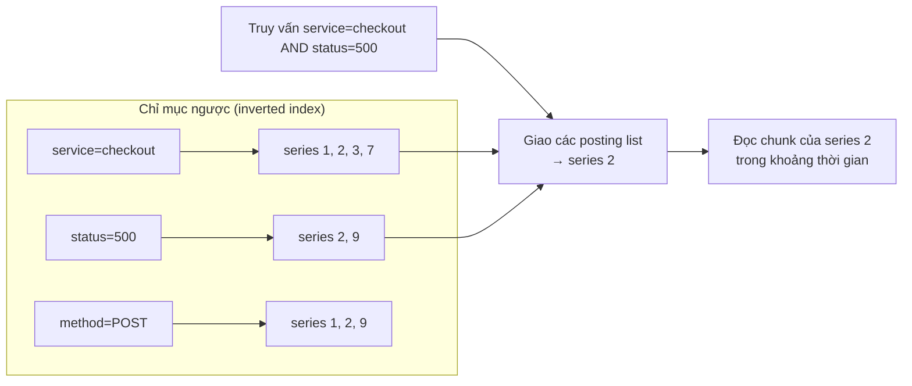

### A4.1 Nén Gorilla: vì sao 16 byte còn ~1,5 byte?

- **Timestamp - delta of delta:** thu thập đều 15s → các timestamp `1000, 1015, 1030, 1045`. Delta: `15, 15, 15`. Delta của delta: `0, 0` → mỗi điểm chỉ cần **1 bit** "giống lần trước".
- **Giá trị - XOR với giá trị trước:** gauge thay đổi chậm (CPU 0,73 → 0,74) → XOR hai float64 có rất nhiều bit 0 ở đầu và cuối → chỉ lưu phần "bit có nghĩa" ở giữa. Giá trị không đổi → 1 bit.
- Kết quả trong bài báo Gorilla (Facebook) là ~1,37 byte/điểm trên dữ liệu thực của họ - đủ để giữ nhiều giờ dữ liệu trong RAM.

### A4.2 Cấu trúc lưu trữ theo block

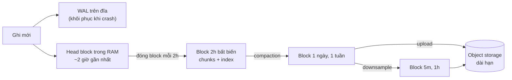

Block bất biến theo khoảng thời gian → xóa dữ liệu cũ = **xóa cả block** (rẻ), không cần xóa từng dòng. Giống tinh thần LSM-tree ([Bài 6](./06-specialized-storage.md)).

| Lựa chọn storage | Phù hợp | Ghi chú |
|---|---|---|
| TSDB cục bộ một node (kiểu Prometheus) | Một cụm vừa và nhỏ | Đơn giản, không HA, không lưu dài hạn |
| TSDB phân tán + object storage (kiểu Thanos, Cortex, Mimir, VictoriaMetrics cluster, M3) | Quy mô lớn, lưu dài hạn | Ingester shard theo series, block trên S3/GCS |
| OLAP cột (ClickHouse...) | Metrics cardinality cao, truy vấn ad-hoc | Linh hoạt hơn, nén kém hơn TSDB chuyên dụng cho metrics thuần |
| SaaS (Datadog, Grafana Cloud...) | Không muốn tự vận hành | Chi phí tính theo số series/điểm |

## 📖 A5. Kiến trúc tổng thể

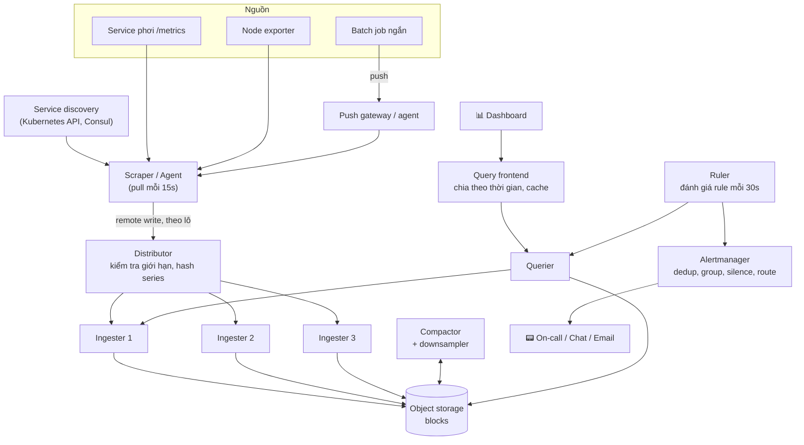

- **Distributor** hash `series_id` → chọn ingester (consistent hashing, replication factor 3). Cùng series luôn về cùng ingester → nén liên tục hiệu quả.
- **Ingester** giữ head block trong RAM + WAL, mỗi 2 giờ đẩy block lên object storage.
- **Querier** trộn dữ liệu gần (từ ingester) và dữ liệu cũ (từ object storage); **query frontend** chia truy vấn 7 ngày thành 7 truy vấn 1 ngày chạy song song và cache kết quả các ngày đã qua.

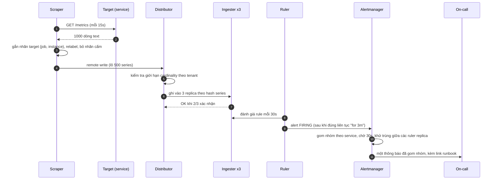

## 📖 A6. Deep dive 1 - Pull vs push

| Tiêu chí | Pull (server đi lấy) | Push (nguồn đẩy lên) |
|---|---|---|
| Biết target "chết" | **Dễ**: scrape thất bại → `up == 0` | Khó: không nhận được gì = chết hay chỉ là không có dữ liệu? Cần heartbeat |
| Kiểm soát tải | Server quyết định nhịp, không bị "ngập" | Nguồn có thể đẩy dồn dập (cần rate limit ở ingest) |
| Job ngắn hạn | **Khó**: job xong trước khi bị scrape | Dễ: đẩy trước khi thoát |
| Mạng/tường lửa | Server phải gọi vào được target (khó qua NAT, nhiều VPC) | Target chỉ cần gọi ra |
| Service discovery | Cần (phải biết target ở đâu) | Không cần |
| Debug | Mở `/metrics` bằng trình duyệt là thấy | Phải xem ở phía nhận |
| Ví dụ | Prometheus | StatsD, Datadog agent, OpenTelemetry push, CloudWatch |

Thực tế dùng **lai**: agent chạy **trên mỗi node** pull từ các process cục bộ (gần, không qua mạng phức tạp), rồi **push** theo lô lên backend trung tâm (remote write). Job ngắn hạn push vào agent/push gateway.

## 📖 A7. Deep dive 2 - Bùng nổ cardinality

**Cardinality** của một metric = số tổ hợp giá trị nhãn khác nhau = số series.

```
http_requests_total{service, method, status, endpoint}
  service: 50, method: 5, status: 10, endpoint: 40
  → tối đa 50 × 5 × 10 × 40 = 100.000 series   (chấp nhận được)

Thêm nhãn user_id (2 triệu user hoạt động):
  → tối đa 100.000 × 2.000.000 = 200 tỷ series  (hệ thống chết)
```

Mỗi series mới tốn bộ nhớ ingester (~vài KB), mục trong chỉ mục, và **không bao giờ được nén tốt** vì chỉ có vài điểm. Nhãn có giá trị không giới hạn (**unbounded**): `user_id`, `request_id`, `email`, `ip`, URL đầy đủ có tham số (`/orders/12345`), thông báo lỗi chi tiết, timestamp.

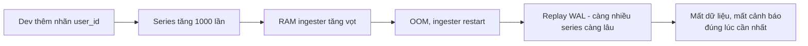

**Phòng chống nhiều lớp:**

| Lớp | Biện pháp |
|---|---|
| Thư viện / code review | Quy ước: nhãn chỉ dùng giá trị **có giới hạn**; URL dùng route template (`/orders/:id`), không dùng path thật |
| Agent (relabel) | Danh sách nhãn cấm; bỏ/viết lại nhãn trước khi gửi |
| Distributor | **Giới hạn số series theo tenant/metric** (ví dụ 5 triệu/tenant, 100k/metric); vượt → từ chối series **mới** (giữ series cũ), trả lỗi rõ ràng |
| Giám sát | Dashboard "top metric theo số series", cảnh báo khi số series tăng > 20%/giờ |
| Đúng công cụ | Dữ liệu theo từng request/user → **log** hoặc **trace**; metrics dùng **exemplar** (đính kèm trace_id mẫu vào histogram) để nhảy từ metric sang trace |

!!! tip "Câu hỏi để quyết định"
    "Tôi có cần **tổng hợp** theo nhãn này trên dashboard/alert không?" Nếu chỉ cần tra cứu một trường hợp cụ thể ("request của user X chậm vì sao?") thì đó là việc của log/trace, không phải metrics.

## 📖 A8. Deep dive 3 - Downsampling & retention

| Tầng | Độ phân giải | Giữ | Dùng cho |
|---|---|---|---|
| Thô | 15s | 15 ngày | Debug sự cố, cảnh báo |
| Downsample 1 | 5 phút | 90 ngày | Dashboard theo tuần/tháng |
| Downsample 2 | 1 giờ | 2 năm | Hoạch định năng lực, xu hướng năm |

Khi gộp 20 điểm (15s) thành 1 điểm (5 phút), **không** chỉ lưu trung bình. Lưu **min, max, sum, count** (và với counter, lưu giá trị cuối để `rate()` còn đúng):

- `avg = sum / count` vẫn tính được.
- **Đỉnh** (spike) 30 giây CPU 100% không bị "là phẳng" mất - `max` giữ lại.
- Có thể gộp tiếp từ 5 phút lên 1 giờ chính xác (sum của sum, max của max). Trung bình của trung bình thì **sai** khi số điểm không đều.

!!! warning "Percentile không gộp được"
    P99 latency của 12 khoảng 5 phút **không** gộp thành P99 của 1 giờ (trung bình các P99 ≠ P99). Muốn gộp được phải lưu **histogram** (các bucket đếm) hoặc sketch (t-digest, DDSketch), rồi tính percentile từ histogram đã cộng dồn.

Query frontend tự chọn độ phân giải theo khoảng thời gian: xem 1 năm thì đọc tầng 1 giờ (8.760 điểm/series) thay vì tầng thô (2,1 triệu điểm/series).

## 📖 A9. Deep dive 4 - Pipeline cảnh báo

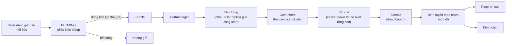

Nguyên tắc của một pipeline cảnh báo tốt:

- **Cảnh báo theo triệu chứng** (người dùng bị ảnh hưởng: lỗi, độ trễ, SLO burn rate) hơn là theo nguyên nhân (CPU cao). Xem [Observability](../backend/11-observability-reliability.md).
- **`for:`** để tránh nhiễu (flapping); **gom nhóm** để 200 pod lỗi thành **một** thông báo.
- **HA:** chạy 2+ ruler/alertmanager; alertmanager khử trùng giữa các replica (gossip) - thà nhận trùng còn hơn mất.
- **Giám sát hệ thống giám sát (meta-monitoring):**
    - **Dead man's switch:** một alert **luôn luôn bắn** (`vector(1)`) gửi tới một dịch vụ bên ngoài; nếu dịch vụ đó **không** nhận được trong 5 phút → hệ thống cảnh báo đã chết → gọi on-call bằng kênh khác.
    - Một cụm giám sát nhỏ, độc lập, giám sát cụm giám sát chính.
- Cảnh báo về **dữ liệu vắng mặt**: `absent(up{job="checkout"})` - service biến mất khỏi service discovery cũng là sự cố.

## 📖 A10. Scale, lỗi và giám sát (cho hệ thống metrics)

| Sự cố | Giảm thiểu |
|---|---|
| Bùng nổ cardinality | Giới hạn theo tenant/metric ở distributor, relabel, cảnh báo tăng series |
| Ingester chết | Replication 3, WAL replay, ghi thành công khi 2/3 xác nhận |
| Truy vấn nặng (1 năm, nhiều series) | Query frontend chia nhỏ + cache, giới hạn số series/điểm mỗi truy vấn, đọc tầng downsample |
| Hệ thống giám sát sập cùng hệ thống chính | Đặt ở hạ tầng/AZ riêng, meta-monitoring, dead man's switch |
| Đồng hồ lệch ở target | Dùng timestamp của scraper (pull) hoặc từ chối điểm quá xa hiện tại |
| Mất kết nối agent → backend | Agent đệm trên đĩa (WAL), gửi lại khi có mạng |

**Metrics của hệ thống metrics:** số series đang hoạt động (theo tenant), điểm ghi/giây, tỷ lệ ghi bị từ chối, độ trễ ghi, độ trễ truy vấn P99, độ trễ đánh giá rule (rule chạy chậm hơn chu kỳ = cảnh báo trễ), số scrape thất bại, dung lượng object storage.

---

## 🖱️ Phần B - Ad click aggregation

## 📖 B1. Làm rõ yêu cầu

> **Ứng viên:** Số liệu này dùng cho dashboard của nhà quảng cáo, cho tính tiền, hay cả hai?
>
> **Interviewer:** Cả hai. Dashboard cần nhanh; tính tiền cần đúng.
>
> **Ứng viên:** Độ trễ chấp nhận được cho dashboard?
>
> **Interviewer:** Vài phút.
>
> **Ứng viên:** Độ phân giải nhỏ nhất? Lọc theo những chiều nào?
>
> **Interviewer:** Theo phút. Lọc theo quốc gia, loại thiết bị, chiến dịch.
>
> **Ứng viên:** Click đến muộn (thiết bị offline) - tính theo thời điểm click hay thời điểm nhận?
>
> **Interviewer:** Thời điểm click.
>
> **Ứng viên:** Có cần lọc click gian lận (bot, click lặp)?
>
> **Interviewer:** Có, nhưng mô hình phát hiện là của đội khác - bạn chỉ cần chỗ để áp dụng.

| Loại | Yêu cầu |
|---|---|
| Chức năng | Đếm click theo `(ad_id, phút)` kèm chiều lọc; top-N ad trong M phút gần nhất; dữ liệu cho tính tiền |
| Phi chức năng | Exactly-once cho số tính tiền; độ trễ dashboard vài phút; chịu được click trễ; chịu được hot ad; đối soát được |
| Ngoài phạm vi | Đấu giá quảng cáo (ad serving/bidding), mô hình phát hiện gian lận |

## 📖 B2. Ước lượng

Các số là **ước tính để luyện tập**.

```
Click/ngày          = 1 tỷ
Click/giây TB       = 1e9 / 86.400 ≈ 11.600
Đỉnh (×5)           ≈ 58.000 click/s
Kích thước sự kiện  ≈ 200 byte → 200 GB/ngày thô, ~70 TB/năm (lưu dữ liệu thô cho đối soát & kiểm toán)
Kafka               58.000 × 200 B ≈ 11,6 MB/s ở đỉnh - không lớn, nhưng partition theo ad có thể lệch
```

Dữ liệu tổng hợp:

```
Quảng cáo đang chạy        = 2 triệu
Ad có click trong 1 phút   ~ 10% → 200.000 dòng/phút (không phải 2 triệu - đa số ad không có click mỗi phút)
Thêm chiều quốc gia × thiết bị (trung bình ~3 tổ hợp có dữ liệu) → ~600.000 dòng/phút
Mỗi ngày                   ≈ 600.000 × 1.440 ≈ 864 triệu dòng × ~50 B ≈ 43 GB/ngày
→ OLAP cột (ClickHouse/Druid/Pinot), rollup lên giờ/ngày sau 7 ngày
```

## 📖 B3. API

```http
# Ghi nhận click: link quảng cáo trỏ về click service, ghi log rồi chuyển hướng
GET /c?ad=ad_77&imp=imp_9f2c&sig=...        -> 302 Location: https://nha-quang-cao.example/landing
    (click_id sinh ở server, hoặc dùng impression_id + ad_id làm khóa khử trùng)

# Truy vấn
GET /v1/ads/ad_77/clicks?from=2026-10-28T09:00Z&to=2026-10-28T10:00Z&granularity=1m&country=VN
  -> { "ad_id": "ad_77", "points": [ {"t": "09:00", "clicks": 120}, ... ], "complete_until": "09:56" }

GET /v1/ads/top?window=5m&n=100&country=VN
  -> { "window_end": "10:05", "ads": [ {"ad_id": "ad_77", "clicks": 9123}, ... ] }
```

`complete_until` cho client biết dữ liệu **đến mốc nào đã "chốt"** (watermark đã đi qua) - các phút sau đó còn có thể tăng do click trễ.

## 📖 B4. Mô hình dữ liệu

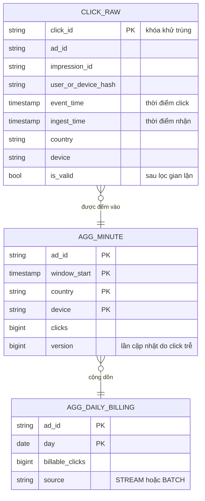

| Dữ liệu | Nơi lưu | Lý do |
|---|---|---|
| Click thô | Kafka (retention 7 ngày) → data lake (Parquet) | Phát lại (replay), batch recompute, kiểm toán |
| Tổng hợp theo phút | OLAP cột (ClickHouse/Druid/Pinot) | Truy vấn lọc + group by nhanh trên hàng tỷ dòng |
| Top-N | Tính trong stream, lưu Redis/OLAP | Đọc nhiều, nhỏ |
| Số tính tiền | RDBMS/warehouse, sau đối soát | Cần chính xác, kiểm toán |
| State dedup | State store của stream processor (RocksDB) có TTL | Nhớ click_id đã thấy trong N giờ |

## 📖 B5. Kiến trúc tổng thể

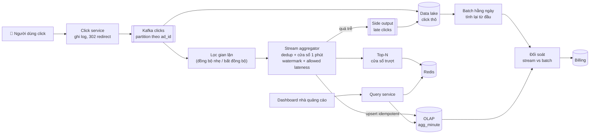

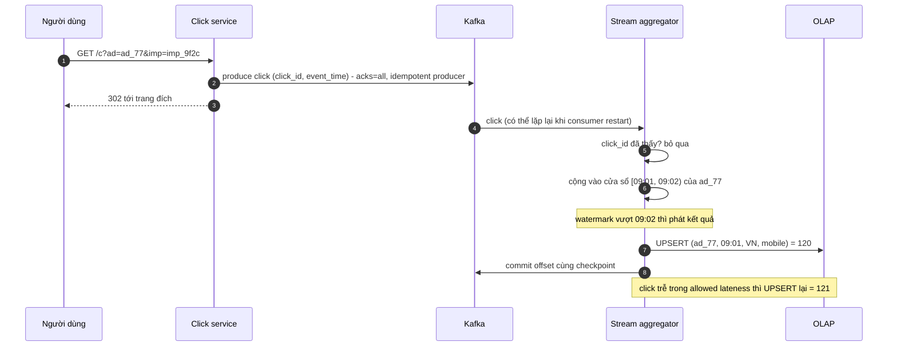

## 📖 B6. Deep dive 1 - Exactly-once counting

"Exactly-once" trong hệ phân tán thực chất là **"hiệu ứng exactly-once"**: sự kiện có thể được **xử lý** nhiều lần, nhưng **kết quả cuối cùng** như thể mỗi sự kiện được đếm đúng một lần. (Lý thuyết đầy đủ ở [Bài 5](./05-messaging-streaming.md).)

Có ba nguồn trùng lặp, cần ba cơ chế:

| Nguồn trùng | Ví dụ | Cơ chế |
|---|---|---|
| **Phía client/producer** | Người dùng bấm 2 lần, trình duyệt retry, click service retry gửi Kafka | `click_id` ổn định (từ impression_id + ad_id, hoặc sinh ở server rồi ký vào link) + **dedup** trong stream; Kafka idempotent producer |
| **Phía xử lý** | Stream processor crash, khôi phục từ checkpoint, xử lý lại một đoạn | **Checkpoint nhất quán** state + offset (Flink): state đếm và vị trí đọc được khôi phục **cùng nhau** |
| **Phía ghi kết quả (sink)** | Ghi OLAP xong nhưng crash trước checkpoint → ghi lại | **Sink idempotent** (UPSERT theo khóa `(ad, window, chiều)` với giá trị tuyệt đối, không phải `+= delta`) hoặc **sink transactional** (2PC gắn với checkpoint) |

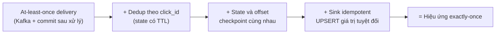

!!! warning "`+= delta` vs `= giá trị`"
    Nếu sink làm `UPDATE agg SET clicks = clicks + 5`, ghi lại hai lần thành +10 → sai. Nếu sink làm `UPSERT agg SET clicks = 125` (giá trị tuyệt đối của cửa sổ, lấy từ state), ghi lại bao nhiêu lần cũng là 125. Đây là lý do code demo bên dưới có `sink[k] = counts[k]`.

**Dedup state lớn cỡ nào?** Giữ click_id trong 24 giờ: 1 tỷ × ~16 byte ≈ 16 GB, chia cho các instance theo partition → vài GB mỗi instance trong RocksDB - chấp nhận được. Muốn tiết kiệm hơn: Bloom filter theo giờ (chấp nhận bỏ nhầm cực ít click hợp lệ - với dữ liệu tính tiền thì phải cân nhắc, và batch sẽ sửa lại).

## 📖 B7. Deep dive 2 - Cửa sổ, watermark, sự kiện trễ

Click lúc 09:01:50 trên điện thoại đang ở thang máy, đến server lúc 09:04:10. Nó thuộc cửa sổ **[09:01, 09:02)** theo **event time**. Nhưng khi nào ta dám "chốt" cửa sổ 09:01?

- **Watermark** = khẳng định "tôi tin rằng đã nhận hết sự kiện có event time < W". Cách đơn giản: `W = max_event_time_đã_thấy − độ_trễ_tối_đa_dự_kiến` (bounded out-of-orderness).
- Cửa sổ `[s, s+60)` **phát kết quả** khi `W ≥ s + 60`.
- **Allowed lateness:** sau khi phát, vẫn giữ state thêm một khoảng; sự kiện trễ trong khoảng này → cập nhật và **phát lại** (UPDATE) kết quả.
- Trễ hơn nữa → **side output** (không vứt đi!) → data lake → batch sẽ tính đúng.

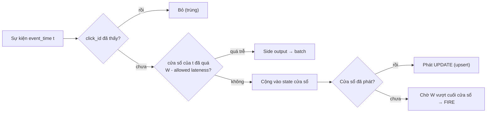

### B7.1 Code: đếm theo cửa sổ với dedup, watermark và sự kiện trễ

Cấu hình: cửa sổ tumbling 60s, watermark = max event time − 10s, allowed lateness 30s. Dòng sự kiện cố ý có: click trùng (`e2` gửi 2 lần, `e3` gửi lại cuối stream), click lệch thứ tự (`e5`), click trễ nhưng còn kịp (`e7`), và click quá trễ (`e9`).

=== "Go"

    ```go
    package main

    import (
    	"fmt"
    	"math"
    	"sort"
    )

    const (
    	Window   = 60 // tumbling window 1 phút
    	OutOfOrd = 10 // watermark = max event time đã thấy - 10s
    	Lateness = 30 // sau khi window đóng vẫn nhận sự kiện trễ thêm 30s (theo watermark)
    )

    type Event struct {
    	ID, Ad string
    	T      int64 // event time (giây), KHÔNG phải lúc server nhận
    }

    type key struct {
    	Start int64
    	Ad    string
    }

    type Agg struct {
    	seen    map[string]bool // dedup theo event_id (thật: state có TTL)
    	counts  map[key]int
    	fired   map[int64]bool // window đã phát kết quả lần đầu
    	maxT    int64
    	sink    map[key]int // sink idempotent: UPSERT theo (window, ad)
    	dropped []string
    }

    func NewAgg() *Agg {
    	return &Agg{seen: map[string]bool{}, counts: map[key]int{}, fired: map[int64]bool{},
    		sink: map[key]int{}, maxT: math.MinInt64}
    }

    func (a *Agg) watermark() int64 { return a.maxT - OutOfOrd }

    func (a *Agg) emit(k key, kind string) {
    	a.sink[k] = a.counts[k] // upsert: ghi lại bao nhiêu lần cũng ra cùng kết quả
    	fmt.Printf("   %-6s [%3d,%3d) ad=%s count=%d\n", kind, k.Start, k.Start+Window, k.Ad, a.counts[k])
    }

    func (a *Agg) fire(wm int64) {
    	ready := map[int64][]key{} // các window đã qua watermark mà chưa phát
    	for k := range a.counts {
    		if !a.fired[k.Start] && k.Start+Window <= wm {
    			ready[k.Start] = append(ready[k.Start], k)
    		}
    	}
    	var starts []int64
    	for s := range ready {
    		starts = append(starts, s)
    	}
    	sort.Slice(starts, func(i, j int) bool { return starts[i] < starts[j] })
    	for _, s := range starts {
    		a.fired[s] = true
    		ks := ready[s]
    		sort.Slice(ks, func(i, j int) bool { return ks[i].Ad < ks[j].Ad })
    		for _, k := range ks {
    			a.emit(k, "FIRE")
    		}
    	}
    }

    func (a *Agg) Process(e Event) {
    	fmt.Printf("%-3s ad=%s t=%3d  ", e.ID, e.Ad, e.T)
    	if a.seen[e.ID] {
    		fmt.Println("-> trùng event_id, bỏ qua")
    		return
    	}
    	start := e.T - e.T%Window
    	if a.maxT != math.MinInt64 && start+Window+Lateness <= a.watermark() {
    		a.dropped = append(a.dropped, e.ID)
    		fmt.Println("-> quá trễ, đẩy sang side output (để batch đối soát)")
    		return
    	}
    	a.seen[e.ID] = true
    	k := key{start, e.Ad}
    	a.counts[k]++
    	if e.T > a.maxT {
    		a.maxT = e.T
    	}
    	fmt.Printf("-> watermark=%d\n", a.watermark())
    	if a.fired[start] {
    		a.emit(k, "UPDATE") // sự kiện trễ nhưng còn trong allowed lateness
    	}
    	a.fire(a.watermark())
    }

    func main() {
    	a := NewAgg()
    	for _, e := range []Event{
    		{"e1", "A", 5}, {"e2", "A", 20}, {"e2", "A", 20}, {"e3", "B", 30},
    		{"e4", "A", 65}, {"e5", "B", 50}, {"e6", "A", 80}, {"e7", "A", 58},
    		{"e8", "B", 130}, {"e9", "A", 40}, {"e3", "B", 30},
    	} {
    		a.Process(e)
    	}
    	fmt.Println("hết stream -> watermark = +vô cực")
    	a.fire(math.MaxInt64)
    	fmt.Println("bảng kết quả cuối:", a.sink, "| bị drop:", a.dropped)
    }

    // Output:
    // e1  ad=A t=  5  -> watermark=-5
    // e2  ad=A t= 20  -> watermark=10
    // e2  ad=A t= 20  -> trùng event_id, bỏ qua
    // e3  ad=B t= 30  -> watermark=20
    // e4  ad=A t= 65  -> watermark=55
    // e5  ad=B t= 50  -> watermark=55
    // e6  ad=A t= 80  -> watermark=70
    //    FIRE   [  0, 60) ad=A count=2
    //    FIRE   [  0, 60) ad=B count=2
    // e7  ad=A t= 58  -> watermark=70
    //    UPDATE [  0, 60) ad=A count=3
    // e8  ad=B t=130  -> watermark=120
    //    FIRE   [ 60,120) ad=A count=2
    // e9  ad=A t= 40  -> quá trễ, đẩy sang side output (để batch đối soát)
    // e3  ad=B t= 30  -> trùng event_id, bỏ qua
    // hết stream -> watermark = +vô cực
    //    FIRE   [120,180) ad=B count=1
    // bảng kết quả cuối: map[{0 A}:3 {0 B}:2 {60 A}:2 {120 B}:1] | bị drop: [e9]
    ```

=== "Python"

    ```python
    import math

    WINDOW, OUT_OF_ORDER, LATENESS = 60, 10, 30


    class Aggregator:
        def __init__(self):
            self.seen = set()      # dedup theo event_id (thật: state có TTL)
            self.counts = {}       # (window_start, ad) -> count
            self.fired = set()     # window đã phát kết quả lần đầu
            self.max_t = -math.inf
            self.sink = {}         # sink idempotent: UPSERT theo (window, ad)
            self.dropped = []

        def watermark(self):
            return self.max_t - OUT_OF_ORDER

        def emit(self, k, kind):
            self.sink[k] = self.counts[k]
            s, ad = k
            print(f"   {kind:<6} [{s:>3},{s + WINDOW:>3}) ad={ad} count={self.counts[k]}")

        def fire(self, wm):
            for s in sorted({s for s, _ in self.counts if s not in self.fired and s + WINDOW <= wm}):
                self.fired.add(s)
                for k in sorted(k for k in self.counts if k[0] == s):
                    self.emit(k, "FIRE")

        def process(self, eid, ad, t):
            print(f"{eid:<3} ad={ad} t={t:>3}  ", end="")
            if eid in self.seen:
                print("-> trùng event_id, bỏ qua")
                return
            start = t - t % WINDOW
            if start + WINDOW + LATENESS <= self.watermark():
                self.dropped.append(eid)
                print("-> quá trễ, đẩy sang side output (để batch đối soát)")
                return
            self.seen.add(eid)
            k = (start, ad)
            self.counts[k] = self.counts.get(k, 0) + 1
            self.max_t = max(self.max_t, t)
            print(f"-> watermark={self.watermark()}")
            if start in self.fired:
                self.emit(k, "UPDATE")  # trễ nhưng còn trong allowed lateness
            self.fire(self.watermark())


    a = Aggregator()
    for e in [("e1", "A", 5), ("e2", "A", 20), ("e2", "A", 20), ("e3", "B", 30),
              ("e4", "A", 65), ("e5", "B", 50), ("e6", "A", 80), ("e7", "A", 58),
              ("e8", "B", 130), ("e9", "A", 40), ("e3", "B", 30)]:
        a.process(*e)
    print("hết stream -> watermark = +vô cực")
    a.fire(math.inf)
    print("bảng kết quả cuối:", a.sink, "| bị drop:", a.dropped)

    # Output:
    # e1  ad=A t=  5  -> watermark=-5
    # e2  ad=A t= 20  -> watermark=10
    # e2  ad=A t= 20  -> trùng event_id, bỏ qua
    # e3  ad=B t= 30  -> watermark=20
    # e4  ad=A t= 65  -> watermark=55
    # e5  ad=B t= 50  -> watermark=55
    # e6  ad=A t= 80  -> watermark=70
    #    FIRE   [  0, 60) ad=A count=2
    #    FIRE   [  0, 60) ad=B count=2
    # e7  ad=A t= 58  -> watermark=70
    #    UPDATE [  0, 60) ad=A count=3
    # e8  ad=B t=130  -> watermark=120
    #    FIRE   [ 60,120) ad=A count=2
    # e9  ad=A t= 40  -> quá trễ, đẩy sang side output (để batch đối soát)
    # e3  ad=B t= 30  -> trùng event_id, bỏ qua
    # hết stream -> watermark = +vô cực
    #    FIRE   [120,180) ad=B count=1
    # bảng kết quả cuối: {(0, 'A'): 3, (0, 'B'): 2, (60, 'A'): 2, (120, 'B'): 1} | bị drop: ['e9']
    ```

Đọc output từng bước:

1. `e2` lần hai bị bỏ nhờ dedup - không đếm hai lần.
2. `e5` (t=50) đến **sau** `e4` (t=65) nhưng watermark mới là 55 < 60 → cửa sổ [0,60) chưa chốt → `e5` vẫn được đếm bình thường. Đó là tác dụng của 10s "độ trễ dự kiến".
3. `e6` (t=80) đẩy watermark lên 70 ≥ 60 → **FIRE** cửa sổ [0,60): A=2, B=2.
4. `e7` (t=58) đến sau khi cửa sổ đã phát, nhưng 60 + 30 = 90 > watermark 70 → còn trong allowed lateness → **UPDATE** A=3. Sink upsert nên kết quả cuối là 3, không phải 2+3.
5. `e8` (t=130) đẩy watermark lên 120 → FIRE [60,120). Từ đây cửa sổ [0,60) đã quá 90 → đóng hẳn.
6. `e9` (t=40) quá trễ → **side output**. Stream sẽ thiếu 1 click so với sự thật; batch hằng ngày đọc toàn bộ click thô (gồm cả `e9`) sẽ ra A=4 cho cửa sổ [0,60) → đối soát phát hiện và **batch thắng** cho số tính tiền.

| Tham số | Tăng lên thì | Giảm xuống thì |
|---|---|---|
| Độ trễ watermark (out-of-orderness) | Ít sự kiện "trễ" hơn, nhưng kết quả **phát chậm hơn** | Kết quả nhanh, nhiều UPDATE/side output hơn |
| Allowed lateness | Ít side output, nhưng **giữ state lâu hơn** (tốn bộ nhớ) | Tiết kiệm state, batch phải sửa nhiều hơn |

## 📖 B8. Deep dive 3 - Đối soát với batch, Lambda vs Kappa

Stream nhanh nhưng có thể thiếu (sự kiện quá trễ, bug, mất state). Batch chậm nhưng tính lại **từ dữ liệu thô đầy đủ**, có thể chạy lại khi sửa bug. Với số liệu **tính tiền**, ta muốn cả hai.

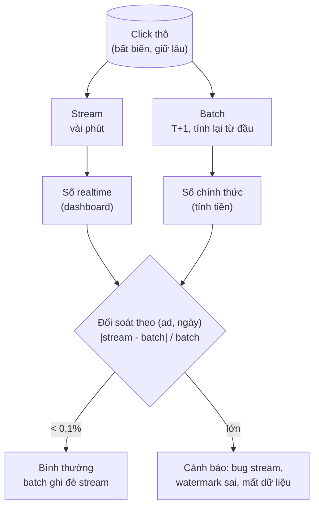

**Ôn lại Lambda vs Kappa** (chi tiết ở [Bài 5](./05-messaging-streaming.md)):

| | Lambda | Kappa |
|---|---|---|
| Ý tưởng | Hai pipeline song song: batch (đúng) + speed/stream (nhanh), gộp ở tầng phục vụ | Chỉ một pipeline stream; muốn tính lại thì **replay** log từ đầu với code mới |
| Ưu | Batch là lưới an toàn độc lập, dễ kiểm toán | Một codebase, một logic |
| Nhược | Hai codebase phải cho cùng kết quả (dễ lệch) | Cần log giữ đủ lâu để replay; replay khối lượng lớn tốn kém; phụ thuộc hoàn toàn vào độ đúng của stream |
| Hợp với | Tính tiền, báo cáo tài chính, có yêu cầu kiểm toán | Analytics, nơi stream framework đủ tin cậy (exactly-once) |

Ad click cho tính tiền thường chọn kiểu **Lambda "nhẹ"**: stream cho dashboard, batch hằng ngày tính số chính thức và **ghi đè** số stream của ngày đó; đối soát giữa hai cái là chỉ số sức khỏe. Dùng **cùng một thư viện logic** (cùng hàm lọc, cùng hàm gán cửa sổ) cho cả hai để giảm lệch - đó là tinh thần tiến gần Kappa.

## 📖 B9. Deep dive 4 - Hot ad

Partition Kafka theo `ad_id` để mọi click của một ad về cùng một task → đếm đơn giản. Nhưng một quảng cáo siêu hot (quảng cáo trong trận chung kết bóng đá, 20.000 click/s) dồn vào **một** partition, **một** task → task đó tụt lại (lag), watermark toàn job bị kéo chậm, dashboard của **mọi** ad bị trễ.

| Kỹ thuật | Cách làm | Đánh đổi |
|---|---|---|
| **Salting (rắc muối) khóa** | Khóa tổng hợp = `ad_id#(hash(click_id) % N)` → một ad trải trên N task; tầng hai cộng N phần lại | Thêm một tầng tổng hợp; dedup phải theo `click_id` (vẫn đúng vì click_id cố định → cùng muối) |
| **Pre-aggregation cục bộ** | Mỗi task/click service gộp số click theo ad trong 1–5 giây rồi mới gửi đi (combiner) | Giảm số bản ghi hàng trăm lần; tăng độ trễ chút ít |
| **Salting chỉ cho ad nóng** | Phát hiện ad nóng (top-k trong 1 phút) → bật salting động cho nó | Phức tạp hơn, nhưng không trả giá cho ad thường |
| **Tách dedup và đếm** | Dedup theo `click_id` (phân bố đều), sau đó đếm theo ad với pre-aggregation | Hai bước shuffle |

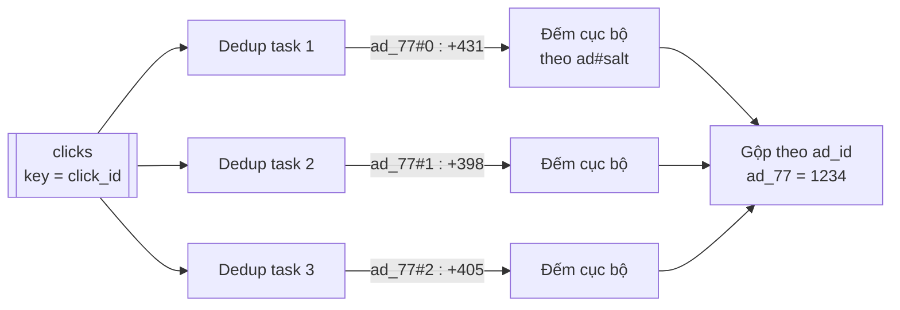

**Top-N trong M phút:** mỗi task tính top-N cục bộ cho phần ad của mình (chính xác vì ad không bị chia giữa các task sau bước gộp), rồi một task duy nhất gộp các top-N cục bộ thành top-N toàn cục (N × số task phần tử - nhỏ). Nếu ad đã bị salting thì phải gộp các phần trước khi lấy top-N cục bộ.

## 📖 B10. Lỗi và giám sát

| Sự cố | Giảm thiểu |
|---|---|
| Stream processor crash | Checkpoint state + offset, khôi phục, sink idempotent |
| Kafka mất dữ liệu | `acks=all`, `min.insync.replicas=2`, replication 3 |
| Watermark "kẹt" vì một partition không có dữ liệu | Idle timeout cho partition (bỏ qua partition rảnh khi tính watermark) |
| Một nguồn gửi event_time sai (đồng hồ thiết bị lệch hàng năm) | Kẹp event_time vào [ingest_time − 24h, ingest_time + 5 phút], ngoài khoảng → side output |
| Bot click hàng loạt | Lọc gian lận trước khi đếm; click bị loại vẫn lưu (để kiểm toán) với `is_valid = false` |
| Code stream có bug | Batch phát hiện qua đối soát; sửa code rồi replay (Kafka/lake) |
| OLAP chậm | Rollup sẵn theo giờ/ngày, materialized view, cache cho top-N |

**Metrics:** click nhận/giây, consumer lag, **độ trễ watermark so với thời gian thực**, tỷ lệ trùng bị loại, số click vào side output (tăng = vấn đề mạng client hoặc watermark quá chặt), chênh lệch stream vs batch theo ngày, thời gian checkpoint, kích thước state.

---

## 📝 Tự chấm

**Phần A - Metrics**

| Hạng mục | Đạt | Chưa đạt |
|---|---|---|
| Yêu cầu | Phân biệt metrics/log/trace; hỏi số nguồn, chu kỳ, retention, độ trễ cảnh báo | Thiết kế "lưu log" |
| Ước lượng | Tính series đang hoạt động, điểm/giây, dung lượng nén; nhận ra RAM tỷ lệ với cardinality | Chỉ tính dung lượng đĩa |
| API | Exposition/remote write, query range, rule cảnh báo có `for` | Không có |
| Dữ liệu | Series = tên + nhãn; inverted index; block + nén | Lưu mỗi điểm một dòng trong RDBMS |
| Kiến trúc | Scraper/agent → distributor → ingester → object storage; query frontend; ruler + alertmanager | Một DB trung tâm |
| Deep dive | Pull vs push; cardinality; downsampling giữ min/max/sum/count; histogram cho percentile | Downsample bằng trung bình |
| Trade-off | Lai pull/push; HA cảnh báo vs trùng thông báo | Chỉ nêu một phía |
| Lỗi | Meta-monitoring, dead man's switch, giới hạn cardinality | Không nghĩ tới việc hệ thống giám sát sập |

**Phần B - Ad click aggregation**

| Hạng mục | Đạt | Chưa đạt |
|---|---|---|
| Yêu cầu | Phân biệt dashboard vs tính tiền; event time vs processing time; lọc gian lận | Chỉ "đếm click" |
| Ước lượng | Click/s đỉnh, số dòng tổng hợp thực tế (thưa), dung lượng thô | Nhân 2 triệu ad × 1.440 phút mà không xét độ thưa |
| API | Truy vấn theo khoảng + chiều lọc + `complete_until`; top-N | Không phân biệt dữ liệu đã chốt |
| Dữ liệu | Click thô bất biến + OLAP tổng hợp + số billing riêng | Chỉ lưu bảng tổng hợp |
| Kiến trúc | Kafka → stream (dedup, cửa sổ) → OLAP; lake → batch → đối soát | Đếm trực tiếp bằng `UPDATE count = count + 1` |
| Deep dive | Exactly-once 3 lớp; watermark, allowed lateness, side output; hot ad | "Kafka có exactly-once nên không lo" |
| Trade-off | Lambda vs Kappa; độ trễ watermark vs độ đầy đủ | Không nêu |
| Lỗi | Crash, watermark kẹt, đồng hồ sai, bot, bug stream | Không nhắc |

---

## 🔄 Biến thể interviewer hay hỏi

??? question "Metrics: nếu cần lưu metrics có cardinality cao (theo từng user) cho phân tích sản phẩm?"
    Đó không còn là monitoring mà là **analytics sự kiện**: ghi sự kiện thô vào OLAP cột (ClickHouse/Druid/Pinot), truy vấn group by tùy ý. Chấp nhận truy vấn chậm hơn TSDB và chi phí lưu trữ cao hơn. Đừng nhồi vào TSDB.

??? question "Metrics: nếu cần đếm số user khác nhau (unique) mỗi phút trên toàn hệ thống?"
    Dùng **HyperLogLog**: mỗi nguồn giữ một sketch nhỏ (~12 KB, sai số ~1%), gửi lên và **gộp** (union) được - không thể cộng các con số "unique" từ nhiều nguồn với nhau.

??? question "Ad click: nếu cần số liệu chính xác trong vòng 1 giây (realtime bidding điều chỉnh ngân sách)?"
    Tách mục tiêu: ngân sách dùng **bộ đếm xấp xỉ nhanh** (Redis INCR theo ad, có thể đếm hơi dư) với ngưỡng an toàn (dừng ở 98% ngân sách); số chính xác vẫn từ pipeline cửa sổ + batch. Đừng bắt một pipeline vừa nhanh 1 giây vừa chính xác tuyệt đối.

??? question "Ad click: nếu yêu cầu thêm 'click hợp lệ chỉ khi có impression trước đó trong 30 phút'?"
    Thêm **stream-stream join** impression ↔ click theo `impression_id` trong cửa sổ 30 phút (state impression theo TTL). Click không khớp → side output để điều tra (có thể là gian lận hoặc impression trễ).

??? question "Đếm lượt xem video/bài viết (view count) cho hàng triệu nội dung?"
    Cùng khung với ad click nhưng không cần chính xác tuyệt đối: pre-aggregation ở client service, cộng dồn theo lô vào counter (Redis/Cassandra counter), chấp nhận sai lệch nhỏ; chống spam bằng dedup theo (user, video, khoảng thời gian).

---

## 🌍 Ứng dụng thực tế

- **Prometheus** (pull, TSDB cục bộ, PromQL) + **Thanos/Cortex/Mimir/VictoriaMetrics** để mở rộng và lưu dài hạn; **Grafana** làm dashboard; **Alertmanager** cho cảnh báo.
- **Datadog, New Relic, Grafana Cloud**: SaaS dựa trên agent push; tính phí theo số series → cardinality là **chi phí trực tiếp**.
- **OpenTelemetry**: chuẩn mở thu thập metrics/log/trace, hỗ trợ cả push lẫn pull.
- Bài báo **Gorilla** (Facebook) về nén time-series trong bộ nhớ - nền tảng của nhiều TSDB.
- **Hệ thống quảng cáo** của các nền tảng lớn và mạng quảng cáo trong nước: Kafka + Flink/Spark Streaming + Druid/Pinot/ClickHouse, kèm đối soát batch cho tính tiền.
- Cùng khung "đếm theo cửa sổ + dedup + đối soát" dùng cho: lượt xem video, đếm vote, phân tích hành vi người dùng, phát hiện gian lận thời gian thực.

## ⚠️ Sai lầm thường gặp

| Sai lầm | Vì sao sai | Cách đúng |
|---|---|---|
| Đưa `user_id`, `request_id`, URL đầy đủ vào nhãn | Bùng nổ cardinality, sập hệ thống giám sát | Nhãn có giới hạn; dùng log/trace/exemplar |
| Downsample bằng trung bình | Mất đỉnh, gộp tiếp bị sai | Lưu min/max/sum/count; histogram cho percentile |
| Trung bình các P99 | Không phải P99 | Gộp histogram rồi tính |
| Không giám sát hệ thống giám sát | Sự cố im lặng | Dead man's switch, cụm meta-monitoring |
| Đếm click theo processing time | Số sai khi có trễ/replay | Event time + watermark |
| Vứt bỏ sự kiện quá trễ | Mất tiền, không đối soát được | Side output → lake → batch |
| Sink `+= delta` | Ghi lại khi recovery → đếm đôi | Upsert giá trị tuyệt đối hoặc sink transactional |
| "Kafka exactly-once là đủ" | Không chống được trùng từ client | Dedup theo click_id ổn định |
| Partition theo ad mà không xử lý ad nóng | Một task tụt lại, kéo cả job | Salting, pre-aggregation |
| Stream và batch dùng logic khác nhau | Đối soát luôn lệch, không biết ai đúng | Dùng chung thư viện logic |

## 🏋️ Bài tập

**Bài 1 (dễ).** Metric `http_request_duration_seconds` là histogram với 12 bucket, nhãn `service` (40 giá trị), `endpoint` (trung bình 25/service), `method` (3), `status` (6). Ước lượng số series. Nếu thêm nhãn `pod` (mỗi service 20 pod) thì sao?

<details markdown="1"><summary>Đáp án</summary>

Histogram sinh ra `bucket` (12 + bucket `+Inf` = 13) + `sum` + `count` = **15 series** cho mỗi tổ hợp nhãn.

Tổ hợp nhãn: endpoint thuộc service nên là 40 × 25 = 1.000 cặp (service, endpoint) × 3 × 6 = 18.000 tổ hợp (tối đa) → 18.000 × 15 = **270.000 series**.

Thêm `pod` (20/service): × 20 → **5,4 triệu series** chỉ cho một metric. Với Gorilla và ~4 KB RAM/series trong head → ~21 GB RAM. Cân nhắc: có cần theo từng pod không? Thường chỉ cần `service` + `endpoint` cho dashboard, và một metric đơn giản hơn (không histogram) theo `pod` để phát hiện pod lỗi.

</details>

**Bài 2 (dễ).** Trong demo B7.1, nếu tăng `OUT_OF_ORDER` từ 10 lên 20 giây, cửa sổ [0,60) sẽ FIRE khi nào, và `e7` có còn phải UPDATE không?

<details markdown="1"><summary>Đáp án</summary>

Watermark = max_t − 20. Sau `e6` (t=80): W = 60 ≥ 60 → cửa sổ [0,60) vẫn FIRE ngay tại `e6` (vì 80 − 20 = 60). `e7` (t=58) đến sau đó → vẫn là UPDATE. Nhưng nếu tăng lên 25: sau `e6` W = 55 < 60 → chưa FIRE; `e7` được đếm **trước** khi phát → không cần UPDATE; cửa sổ chỉ FIRE khi `e8` (t=130, W=105) đến, phát A=3, B=2 một lần. Đổi lại: kết quả phát **muộn hơn** nhiều. Đây chính là trade-off độ trễ vs độ đầy đủ.

</details>

**Bài 3 (trung bình).** Thiết kế downsampling cho một **counter** (`http_requests_total`, luôn tăng, có thể reset về 0 khi process restart). Cần lưu gì để `rate()` trên dữ liệu 5 phút vẫn đúng?

<details markdown="1"><summary>Đáp án</summary>

Counter không thể downsample bằng min/max/avg của giá trị thô vì giá trị tích lũy và có reset. Cách làm:

- Trong mỗi khoảng 5 phút, tính **mức tăng đã hiệu chỉnh reset** (khi giá trị giảm, coi như reset: tăng = giá_trị_mới, không phải âm) → lưu `increase_5m`.
- Lưu thêm **giá trị cuối** của counter trong khoảng (đã hiệu chỉnh reset) - để nối liền giữa các khoảng.
- `rate` trên khoảng dài = Σ `increase_5m` / thời gian. Tổng các `increase` gộp tiếp được lên 1 giờ chính xác.

(Một số TSDB lưu "counter đã hiệu chỉnh reset" cùng các aggregate khác cho đúng mục đích này.)

</details>

**Bài 4 (trung bình).** Alert `CheckoutHighErrorRate` có `for: 3m`, ruler đánh giá mỗi 30s, alertmanager `group_wait: 30s`. Sự cố bắt đầu lúc 10:00:00. Thời điểm sớm nhất và muộn nhất on-call nhận thông báo? Làm sao giảm?

<details markdown="1"><summary>Đáp án</summary>

- `rate(...[5m])` cần thời gian để tỷ lệ lỗi trung bình 5 phút vượt 2% - phụ thuộc mức độ lỗi; giả sử lỗi lớn, vượt ngay trong lần đánh giá đầu.
- Lần đánh giá đầu thấy điều kiện đúng: 10:00:00 → 10:00:30 (tùy pha).
- `for: 3m` → FIRING lúc 10:03:00 → 10:03:30.
- `group_wait` 30s → gửi lúc 10:03:30 → 10:04:00, cộng độ trễ scrape (≤ 15s) và gửi thông báo.

→ khoảng **3,5–4,5 phút**. Giảm: `for` ngắn hơn cho alert mức nghiêm trọng cao kèm ngưỡng cao hơn (ví dụ > 20% lỗi, `for: 1m`), dùng cửa sổ `rate` ngắn hơn ([1m]), hoặc dùng **multi-window burn rate** (một cửa sổ ngắn để phát hiện nhanh, một cửa sổ dài để tránh nhiễu).

</details>

**Bài 5 (trung bình).** Giải thích vì sao trong demo B7.1, nếu sink dùng `UPDATE clicks = clicks + 1` cho mỗi sự kiện (thay vì upsert giá trị của state) thì kết quả có thể sai khi processor crash và khôi phục từ checkpoint.

<details markdown="1"><summary>Đáp án</summary>

Giả sử checkpoint cuối ở sau `e4`. Processor xử lý `e5`, `e6`, đã ghi sink +1 cho mỗi cái, rồi crash **trước** checkpoint tiếp theo. Khôi phục: state và offset quay về sau `e4`, đọc lại `e5`, `e6` → sink lại +1 cho mỗi cái → **đếm đôi** e5, e6. State dedup cũng quay về checkpoint (không chứa e5, e6) nên không chặn được.

Với upsert giá trị tuyệt đối: lần chạy lại tính ra **cùng** giá trị cửa sổ từ state đã khôi phục + sự kiện phát lại → ghi đè cùng một số → đúng. Hoặc dùng sink transactional: các lần ghi sau checkpoint chỉ được commit khi checkpoint hoàn tất (2PC), crash thì bị hủy.

</details>

**Bài 6 (khó).** Thiết kế hệ thống cảnh báo đa vùng (3 region) sao cho: (a) một region sập vẫn có cảnh báo; (b) on-call không nhận 3 thông báo cho cùng một sự cố.

<details markdown="1"><summary>Đáp án</summary>

- Mỗi region có scraper + ruler riêng giám sát chính region đó (dữ liệu cục bộ, không phụ thuộc mạng liên vùng).
- Thêm **ruler toàn cục** ở một region khác (hoặc SaaS ngoài) đánh giá rule xuyên vùng và rule "region X không gửi dữ liệu" (`absent`).
- Alertmanager chạy cụm **trải 3 region** (gossip) → khử trùng theo fingerprint của alert (cùng nhãn = cùng alert). Alert mang nhãn `region` để gom nhóm "sự cố ở region A" thành một thông báo.
- Dead man's switch từ mỗi region tới dịch vụ ngoài: mất heartbeat của region A → dịch vụ ngoài gọi on-call ("region A mất giám sát").
- Đánh đổi: khi mạng giữa các region bị chia cắt, gossip không đồng bộ → có thể nhận **trùng** thông báo. Chấp nhận - trùng tốt hơn mất.

</details>

**Bài 7 (khó).** Đối soát cho thấy stream luôn thấp hơn batch khoảng 0,8% vào các ngày có trận bóng đá lớn, các ngày khác < 0,05%. Đưa ra giả thuyết và cách kiểm chứng.

<details markdown="1"><summary>Đáp án</summary>

Giả thuyết theo thứ tự khả năng:

1. **Hot ad làm một task tụt lại (lag).** Watermark toàn job thường được đẩy bởi các partition khác (nhất là khi bật idle timeout hoặc watermark tính theo từng nguồn). Khi task nóng cuối cùng xử lý tới các click của nó, cửa sổ tương ứng đã quá `W − allowed lateness` → click thành **quá trễ** → side output. Kiểm chứng: số click vào side output và consumer lag theo partition/ad trong khung giờ trận đấu.
2. **Tải đột biến làm mạng di động nghẽn** → nhiều click đến trễ hơn `out_of_orderness + lateness`. Kiểm chứng: phân phối `ingest_time − event_time` trong ngày có trận so với ngày thường.
3. **Bộ lọc gian lận realtime** chặn nhầm khi lưu lượng tăng đột biến (ngưỡng tốc độ), trong khi batch dùng mô hình khác. Kiểm chứng: so `is_valid=false` giữa stream và batch theo ad.

Hành động: thêm salting cho ad nóng; tăng allowed lateness động khi phát hiện độ trễ tăng; dùng chung logic lọc cho stream và batch; cảnh báo side-output rate theo ad.

</details>

## ✅ Checklist

- [ ] So sánh pull vs push và giải thích mô hình lai agent
- [ ] Ước lượng số series, điểm/giây, RAM và đĩa cho hệ thống metrics
- [ ] Giải thích nén Gorilla và cấu trúc block của TSDB
- [ ] Nhận diện nhãn unbounded và nêu 4 lớp chống bùng nổ cardinality
- [ ] Thiết kế downsampling giữ min/max/sum/count; biết vì sao percentile không gộp được
- [ ] Vẽ pipeline cảnh báo với `for`, gom nhóm, ức chế, dead man's switch
- [ ] Giải thích exactly-once = at-least-once + dedup + checkpoint + sink idempotent
- [ ] Chạy demo cửa sổ và giải thích từng dòng FIRE/UPDATE/side output
- [ ] So sánh Lambda vs Kappa và chọn cho dữ liệu tính tiền
- [ ] Xử lý hot ad bằng salting và pre-aggregation

---

**Bài tiếp theo**: [Bài 17: Cẩm nang phỏng vấn](./17-interview-playbook.md)
