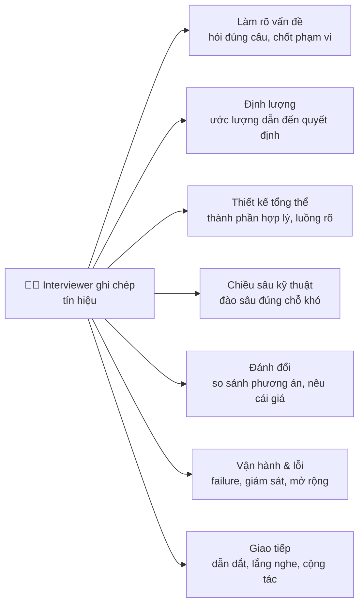
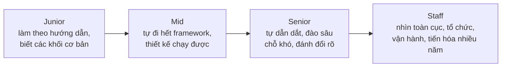
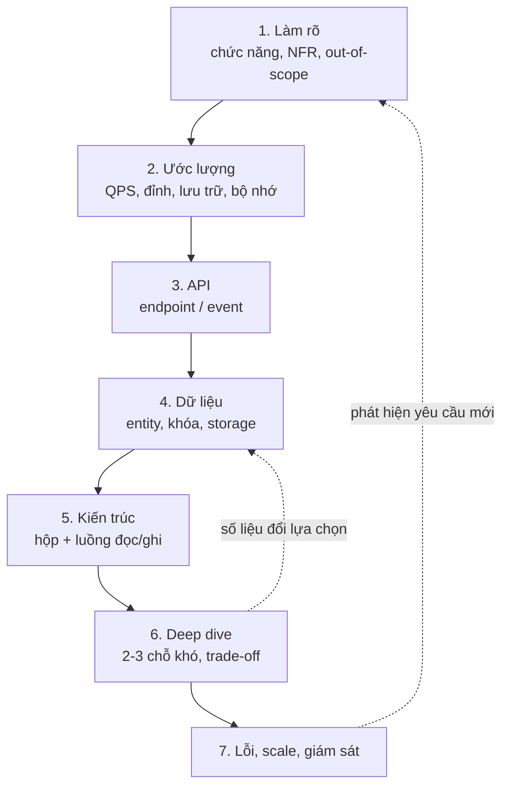
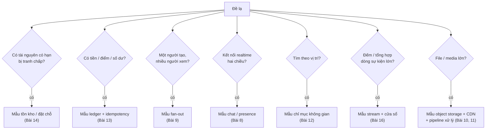
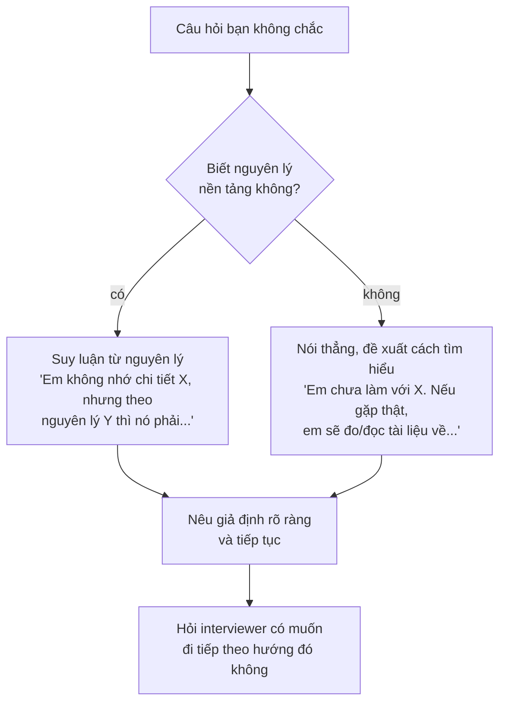
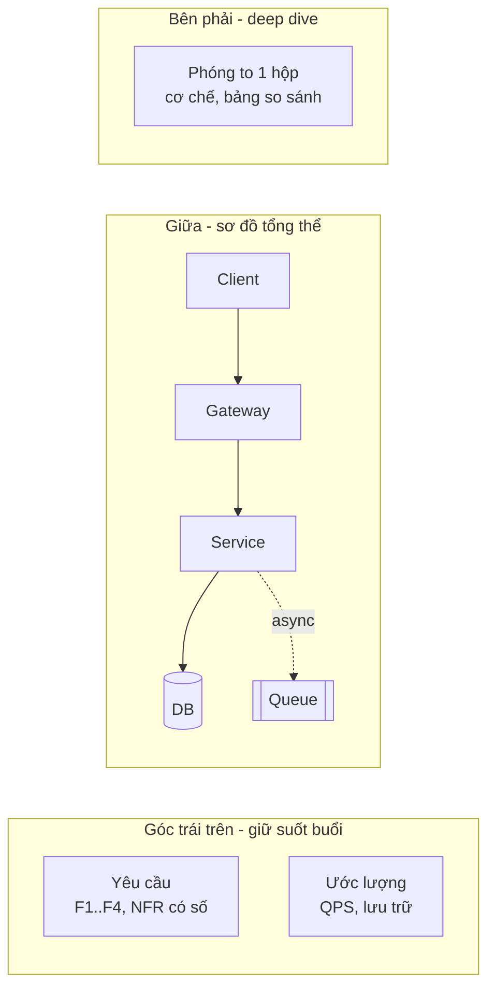
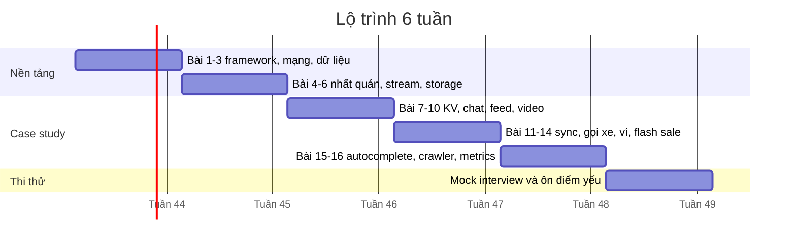

# 📚 Bài 17: Cẩm nang phỏng vấn

> "Phỏng vấn system design không chấm xem bạn có thiết kế giống Google không. Nó chấm xem **bạn suy nghĩ thế nào khi chưa có đáp án**."

Hai ứng viên cùng nhận đề "Thiết kế hệ thống đặt vé concert". Cả hai đều biết Redis, Kafka, sharding. Ứng viên thứ nhất vẽ ngay một sơ đồ 15 hộp, nói liên tục 40 phút, và khi interviewer hỏi "nếu Redis mất dữ liệu thì sao?", trả lời "Redis có replication nên không sao". Ứng viên thứ hai hỏi 5 phút, tính ra "99,9% request sẽ thất bại", vẽ 6 hộp, chọn 2 chỗ khó nhất để đào sâu, và khi bị hỏi về Redis, nói: "Câu hỏi hay - replication của Redis là bất đồng bộ, nên có thể mất vài lần trừ kho. Vì vậy em để DB có unique constraint làm chốt cuối..."

Ứng viên thứ hai được nhận. Không phải vì biết nhiều hơn, mà vì **thể hiện được cách suy nghĩ**: làm rõ, định lượng, đánh đổi, và đối diện điểm yếu của chính thiết kế mình.

Bài cuối này gom toàn bộ khóa học thành **một cẩm nang thực chiến**: phỏng vấn được chấm thế nào, dùng 45 phút ra sao, nói gì (tiếng Việt lẫn tiếng Anh), xử lý câu hỏi khó, hai buổi phỏng vấn mẫu có chú thích, kế hoạch luyện 6 tuần, và một trang tóm tắt mang theo.

## 🎯 Mục tiêu bài học

- Hiểu **buổi phỏng vấn system design được tổ chức và chấm điểm** thế nào, kỳ vọng khác nhau ra sao giữa junior, mid, senior, staff
- Có **kế hoạch thời gian 45 phút** và biết phân bổ lại khi bị lệch
- Thuộc **các câu giao tiếp** then chốt bằng tiếng Việt và tiếng Anh
- Biết **xử lý điều chưa biết** và **phản biện (pushback)** từ interviewer
- Nhận ra **red flags** khiến ứng viên giỏi kỹ thuật vẫn trượt
- Phân tích **2 buổi phỏng vấn mẫu** (một tốt, một kém) có chú thích
- Có **kế hoạch luyện 6 tuần** dựa trên các case study của khóa
- Có **một trang cheat sheet** để ôn trước giờ phỏng vấn

!!! note "Bài này dựa trên toàn bộ khóa học"
    Framework 7 bước và kỹ năng ước lượng ở [Bài 1](./01-framework-estimation.md). Các khối xây dựng ở [Bài 2](./02-building-blocks-network.md), [Bài 3](./03-building-blocks-data.md), [Bài 4](./04-consistency-consensus.md), [Bài 5](./05-messaging-streaming.md), [Bài 6](./06-specialized-storage.md). Các case study ở Bài 7–16. Quy trình thiết kế ngoài đời thật (không phải phỏng vấn) ở [Từ ý tưởng đến kiến trúc](../systems-thinking/06-idea-to-architecture.md).

---

## 📖 1. Buổi phỏng vấn system design diễn ra thế nào?

### 1.1 Hình thức phổ biến

| Hình thức | Mô tả | Lưu ý |
|---|---|---|
| **Whiteboard / bảng ảo** (Excalidraw, Miro, Google Docs) | Đề mở, 45–60 phút, bạn vẽ và nói | Luyện vẽ **nhanh và gọn** trên công cụ online trước |
| **Thiết kế dựa trên sản phẩm** | "Thiết kế tính năng X của công ty chúng tôi" | Đọc về sản phẩm trước; hỏi nhiều về người dùng |
| **Deep dive dự án cũ** | "Kể về hệ thống phức tạp nhất bạn đã xây" | Chuẩn bị 2 dự án với số liệu, trade-off, sai lầm |
| **Review thiết kế có sẵn** | Interviewer đưa sơ đồ, bạn tìm vấn đề | Đi theo checklist lỗi: SPOF, hot key, nhất quán, retry... |
| **Viết tài liệu thiết kế (take-home)** | Viết design doc 2–5 trang | Cấu trúc rõ, có phần "phương án bị loại và vì sao" |

Bài này tập trung vào hình thức đầu tiên - phổ biến nhất - nhưng kỹ năng dùng chung cho tất cả.

### 1.2 Interviewer thực sự đang tìm gì?

Interviewer không có "đáp án đúng" để so. Họ thu thập **tín hiệu (signals)** theo vài chiều:

Sau buổi phỏng vấn, họ viết feedback dạng: "Ứng viên làm rõ yêu cầu tốt, ước lượng nhanh và **dùng kết quả** để chọn Redis cho tồn kho. Deep dive về chống oversell rất chắc, chứng minh bằng bất biến. Điểm yếu: không nói về giám sát. Đề xuất: **Hire ở mức Senior**."

!!! tip "Bạn đang viết feedback hộ interviewer"
    Mỗi câu bạn nói nên tạo ra một **câu trích dẫn được** trong feedback. "Tôi chọn X **vì** Y, **cái giá** là Z" là một câu như vậy. "Dùng Kafka" thì không.

---

## 📖 2. Chấm điểm theo level

### 2.1 Kỳ vọng theo level

Mỗi công ty có thang riêng, nhưng xu hướng chung như sau:

| Chiều | Junior | Mid | Senior | Staff |
|---|---|---|---|---|
| Làm rõ yêu cầu | Hỏi khi được gợi ý | Tự hỏi chức năng chính, quy mô | Tự chốt phạm vi, ưu tiên, NFR có số | Thách thức chính đề bài ("có cần build không?"), nghĩ tới các bên liên quan |
| Ước lượng | Có thể cần giúp | Tính QPS, dung lượng đúng cấp độ | Dùng số để **quyết định** (shard? cache?) | Thêm chi phí, tăng trưởng nhiều năm, năng lực đội |
| Thiết kế tổng thể | Các khối cơ bản, có thể thiếu | Đầy đủ, chạy đúng luồng chính | Rõ ràng, tối giản, luồng phụ và lỗi | Ranh giới hệ thống/đội, hợp đồng, lộ trình tiến hóa |
| Chiều sâu | Biết một khối khá kỹ | Đào sâu được 1 chỗ khi được hỏi | Tự chọn 2–3 chỗ khó nhất và đào sâu | Đào sâu bất kỳ đâu, liên hệ kinh nghiệm thực |
| Đánh đổi | Biết "có nhiều cách" | So sánh 2 phương án | So sánh nhiều phương án, nêu điều kiện đổi lựa chọn | Đánh đổi kỹ thuật + kinh doanh + tổ chức |
| Vận hành & lỗi | Hiếm khi nhắc | Nhắc replication, retry | Failure modes, giám sát, rollout, dữ liệu sai | Sự cố đa tầng, quy trình, chi phí vận hành, di chuyển dữ liệu |
| Giao tiếp | Phản hồi câu hỏi | Trình bày mạch lạc | **Dẫn dắt** buổi phỏng vấn | Dẫn dắt + điều chỉnh theo người nghe, như đang review với đồng nghiệp |

### 2.2 Rubric chấm (dùng để tự chấm khi luyện)

| Hạng mục | 1 - Chưa đạt | 2 - Gần đạt | 3 - Đạt | 4 - Xuất sắc |
|---|---|---|---|---|
| Yêu cầu | Không hỏi, lao vào vẽ | Hỏi vài câu rời rạc | Chức năng + NFR + out-of-scope rõ | Phát hiện yêu cầu ẩn quyết định kiến trúc |
| Ước lượng | Không có / sai cấp độ | Có số nhưng không dùng | Đúng cấp độ, dùng để chọn thiết kế | Nhanh, có kiểm tra lại, nhắc chi phí |
| API & dữ liệu | Thiếu | Có nhưng sơ sài | Endpoint chính + schema + lý do chọn DB | Idempotency, phân trang, khóa shard được nghĩ kỹ |
| Kiến trúc | Rối hoặc thiếu khối quan trọng | Đủ khối nhưng luồng mơ hồ | Rõ ràng, luồng đọc/ghi giải thích được | Tối giản, mỗi khối có lý do tồn tại |
| Deep dive | Không có | Nông, kể tên công nghệ | Sâu ở 2 chỗ khó, có cơ chế cụ thể | Chứng minh tính đúng, nêu cả giới hạn |
| Trade-off | Không có | "A tốt hơn B" | Bảng so sánh, điều kiện chọn | Liên hệ yêu cầu kinh doanh |
| Lỗi & vận hành | Không có | Liệt kê chung chung | Failure modes + giảm thiểu + metrics | Rollout, migration, sự cố thực tế |
| Giao tiếp | Im lặng hoặc nói không ngừng | Theo được nhưng bị động | Dẫn dắt, kiểm tra với interviewer | Cộng tác như đồng nghiệp |

### 2.3 Cùng một câu hỏi, bốn mức trả lời

Câu hỏi: **"Làm sao đảm bảo ứng dụng chat không mất tin nhắn?"** (bối cảnh [Bài 8](./08-chat-presence.md))

| Level | Câu trả lời điển hình | Vì sao ở mức đó |
|---|---|---|
| Junior | "Lưu tin nhắn vào database trước khi gửi cho người nhận." | Đúng hướng, nhưng chưa xét lỗi mạng, retry, thiết bị offline |
| Mid | "Client gửi kèm `client_msg_id`; server lưu DB rồi mới ACK; client chưa nhận ACK thì gửi lại, server dedup theo id. Người nhận offline thì lấy lại khi kết nối theo `last_seen_seq`." | Có cơ chế end-to-end cho luồng chính |
| Senior | Như Mid, thêm: số thứ tự theo cuộc hội thoại (seq tăng dần, cấp bởi shard sở hữu conversation) để phát hiện **lỗ hổng**; client tự kéo phần thiếu; ghi vào DB với replication đồng bộ trước khi ACK; outbox để fan-out không mất khi crash; giám sát tỷ lệ gửi lại và độ trễ ACK. Nêu trade-off: ACK sau replication đồng bộ làm tăng latency vài ms. | Nghĩ tới lỗi ở **mọi tầng**, có metrics, có trade-off |
| Staff | Như Senior, thêm: định nghĩa rõ "không mất" (đã ACK cho người gửi = bền); đa vùng (home region theo conversation, hành vi khi region sập); E2E encryption làm server không đọc được nội dung → dedup/đồng bộ đa thiết bị thay đổi thế nào; kiểm thử chaos để chứng minh; quy trình khi phát hiện mất tin (đo, thông báo, hậu kiểm). | Mở rộng sang định nghĩa, tổ chức, kiểm chứng, sản phẩm |

!!! tip "Cách lên level trong câu trả lời"
    Sau khi trả lời xong luồng chính, tự hỏi thêm ba câu: "Hỏng ở đâu nữa?", "Đo bằng gì?", "Cái giá là gì?". Ba câu đó thường đưa câu trả lời mid lên senior.

**Cách đọc điểm:** tổng 8 hạng mục. Mid cần phần lớn ở mức 3. Senior cần mức 3 ở mọi hạng mục và 4 ở deep dive hoặc trade-off. Staff cần nhiều mức 4 và đặc biệt mạnh ở yêu cầu, vận hành, giao tiếp.

---

## 📖 3. Kế hoạch thời gian 45 phút

```mermaid
gantt
    title Phân bổ 45 phút
    dateFormat mm
    axisFormat %M
    section Mở đầu
    Làm rõ yêu cầu và phạm vi           :a1, 00, 5m
    Ước lượng nhanh                     :a2, after a1, 4m
    section Thiết kế
    API và mô hình dữ liệu              :b1, after a2, 6m
    Kiến trúc tổng thể và luồng chính   :b2, after b1, 8m
    section Đào sâu
    Deep dive 2 đến 3 chỗ khó           :c1, after b2, 15m
    section Kết thúc
    Lỗi, scale, giám sát                :d1, after c1, 5m
    Tóm tắt và hỏi lại                  :d2, after d1, 2m
```

| Phút | Giai đoạn | Sản phẩm trên bảng | Dấu hiệu bạn đang chậm |
|---|---|---|---|
| 0–5 | Làm rõ yêu cầu | Danh sách chức năng (3–5), NFR có số, out-of-scope | Đã 8 phút vẫn đang hỏi |
| 5–9 | Ước lượng | 4–6 dòng số: QPS, đỉnh, dung lượng, bandwidth/bộ nhớ | Đang nhân chia chính xác đến hàng đơn vị |
| 9–15 | API & dữ liệu | 3–5 endpoint, 2–4 bảng/entity, chọn storage | Viết JSON đầy đủ từng field |
| 15–23 | Kiến trúc | Sơ đồ 6–10 hộp + 1–2 luồng chính | Vẽ 20 hộp, giải thích từng cái |
| 23–38 | Deep dive | Cơ chế chi tiết, bảng so sánh | Chưa vào deep dive ở phút 30 |
| 38–43 | Lỗi & scale | Bảng failure, hot key, giám sát | Bỏ qua hoàn toàn |
| 43–45 | Tóm tắt | 3 câu: thiết kế, đánh đổi chính, việc làm tiếp | - |

!!! tip "Khi bị lệch giờ"
    - Bị cuốn vào yêu cầu quá lâu: "Để tiết kiệm thời gian, em giả định X, Y, Z - anh/chị thấy ổn không?"
    - Ước lượng sa đà: làm tròn mạnh (1 ngày ≈ 10^5 giây), chỉ tính những số **sẽ dùng**.
    - Interviewer muốn đi sâu sớm: theo họ. Kế hoạch là của bạn, nhưng buổi phỏng vấn là của cả hai.
    - Còn 5 phút mà chưa nói lỗi: nói nhanh 3 failure lớn nhất trong một câu mỗi cái.

### Với buổi 60 phút

Giữ tỷ lệ, cộng thêm thời gian cho deep dive (25 phút) và lỗi/scale (8 phút). Buổi 60 phút thường mong đợi **ba** deep dive, hoặc một biến thể đề ("bây giờ mở rộng ra đa vùng").

---

## 📖 4. Khung trả lời - nhắc lại ngắn

Framework chi tiết ở [Bài 1](./01-framework-estimation.md). Đây là phiên bản bỏ túi:

Mẹo chọn **chỗ để deep dive**: hỏi "Điều gì làm bài này **khác** một ứng dụng CRUD?" - đó chính là chỗ khó.

| Đề | Chỗ khó thật sự (nên deep dive) | Bài |
|---|---|---|
| Key-value store | Phân vùng, replication, quorum, xử lý xung đột | [Bài 7](./07-key-value-store.md) |
| Chat | Kết nối lâu dài, thứ tự tin nhắn, presence, fan-out nhóm | [Bài 8](./08-chat-presence.md) |
| News feed | Fan-out on write vs read, celebrity | [Bài 9](./09-news-feed.md) |
| Video streaming | Pipeline transcode, CDN, adaptive bitrate | [Bài 10](./10-video-streaming.md) |
| File sync | Chunking, dedup, đồng bộ xung đột | [Bài 11](./11-file-sync.md) |
| Gọi xe | Chỉ mục vị trí (geohash/quadtree), cập nhật vị trí tần suất cao, ghép chuyến | [Bài 12](./12-ride-hailing-proximity.md) |
| Ví / thanh toán | Ledger, idempotency, state machine, đối soát | [Bài 13](./13-payment-wallet.md) |
| Flash sale / vé | Tranh chấp tồn kho, oversell, phòng chờ | [Bài 14](./14-ticket-flash-sale.md) |
| Autocomplete / crawler | Top-k tại node, pipeline cập nhật / politeness, dedup | [Bài 15](./15-autocomplete-crawler.md) |
| Metrics / ad click | Cardinality / exactly-once, cửa sổ, sự kiện trễ | [Bài 16](./16-metrics-aggregation.md) |

### 4.1 Gặp đề lạ? Quy về mẫu quen

Hầu hết đề "lạ" là **tổ hợp** của vài mẫu bạn đã học. Đừng hoảng - tìm mẫu:

| Đề "lạ" | Quy về |
|---|---|
| Đặt lịch khám bệnh, đặt bàn nhà hàng | Tồn kho theo khung giờ (Bài 14) + thông báo |
| Hệ thống điểm thưởng / voucher | Ledger (Bài 13) + flash sale nếu voucher có hạn (Bài 14) |
| Bảng xếp hạng game realtime | Sorted set / top-k (Bài 15, 16) + hot key |
| Google Docs cộng tác | Đồng bộ + xung đột (Bài 11) + kết nối realtime (Bài 8) |
| Instagram stories | Media (Bài 10) + fan-out (Bài 9) + TTL 24h |
| Hệ thống giao đồ ăn | Gọi xe (Bài 12) + đơn hàng/thanh toán (Bài 13) + thông báo |
| Phát hiện gian lận realtime | Stream + cửa sổ (Bài 16) + điểm móc đồng bộ (Bài 13 §12) |
| Rate limiter phân tán | Bộ đếm + Redis + hot key ([System design backend](../backend/10-system-design.md), Bài 14 §10) |

---

## 📖 5. Câu giao tiếp then chốt

Nhiều công ty phỏng vấn bằng tiếng Anh, hoặc trộn. Bảng dưới gom các câu theo **giai đoạn**. Không cần thuộc lòng - cần **thói quen** nói những ý này.

### 5.1 Mở đầu & làm rõ

| Mục đích | Tiếng Việt | English |
|---|---|---|
| Xin thời gian hỏi | "Trước khi thiết kế, em muốn làm rõ vài điểm về yêu cầu." | "Before diving in, I'd like to clarify a few requirements." |
| Hỏi quy mô | "Quy mô mình nhắm tới là bao nhiêu người dùng hoạt động mỗi ngày?" | "What scale are we targeting - how many daily active users?" |
| Chốt phạm vi | "Em sẽ tập trung vào A và B, còn C em để ngoài phạm vi, được không ạ?" | "I'll focus on A and B and leave C out of scope - does that work for you?" |
| Hỏi ưu tiên | "Giữa độ trễ thấp và nhất quán tuyệt đối, cái nào quan trọng hơn ở đây?" | "Which matters more here - low latency or strong consistency?" |
| Đưa giả định | "Em giả định tỷ lệ đọc/ghi khoảng 10:1, nếu khác anh/chị cứ nói." | "I'll assume a read-to-write ratio of about 10 to 1 - let me know if that's off." |

### 5.2 Ước lượng & thiết kế

| Mục đích | Tiếng Việt | English |
|---|---|---|
| Báo trước sẽ làm tròn | "Em làm tròn cho nhanh: một ngày khoảng 10^5 giây." | "I'll round aggressively - a day is roughly 10^5 seconds." |
| Rút kết luận từ số | "Với 5.000 ghi/giây, một DB là đủ - vấn đề thật là hot key, không phải tổng tải." | "At 5K writes per second a single database is fine - the real issue is the hot key, not total throughput." |
| Dẫn dắt | "Em sẽ vẽ kiến trúc tổng thể trước, rồi đi sâu vào phần tồn kho." | "Let me sketch the high-level design first, then go deep on inventory." |
| Nêu lựa chọn | "Có hai phương án: A và B. Em chọn A vì..., cái giá là..." | "There are two options here, A and B. I'd go with A because..., the trade-off is..." |
| Kiểm tra với interviewer | "Đến đây anh/chị muốn em đào sâu phần nào?" | "Is there a particular area you'd like me to dive deeper into?" |

### 5.3 Đào sâu, lỗi, tóm tắt

| Mục đích | Tiếng Việt | English |
|---|---|---|
| Nói về lỗi | "Giờ em xét điều gì xảy ra khi thành phần này hỏng." | "Now let's look at what happens when this component fails." |
| Thừa nhận điểm yếu | "Thiết kế này có điểm yếu ở X. Nếu cần, em sẽ thêm Y." | "This design is weak at X. If that matters, I'd add Y." |
| Đổi ý có lý do | "Nghĩ lại thì phương án lúc nãy không ổn vì..., em đổi sang..." | "On second thought, that won't work because..., so I'd switch to..." |
| Tóm tắt | "Tóm lại: thiết kế gồm..., đánh đổi chính là..., nếu có thêm thời gian em sẽ..." | "To summarize: the design is..., the key trade-off is..., with more time I'd look at..." |

!!! tip "Từ vựng tiếng Anh nên dùng chính xác"
    *trade-off, bottleneck, single point of failure, hot partition / hot key, fan-out, back-pressure, idempotent, eventually consistent, linearizable, read-your-writes, write amplification, tail latency (p99), graceful degradation, blast radius, rollout / rollback, capacity planning.* Phát âm "cache" là /kæʃ/ (như "cash"), "queue" là /kjuː/.

---

## 📖 6. Xử lý điều chưa biết và phản biện

### 6.1 Khi bạn không biết

Không ai biết hết. Điều bị chấm là **cách bạn xử lý**:

Ví dụ:

> **Interviewer:** Cassandra dùng chiến lược compaction nào cho dữ liệu time-series?
>
> **Ứng viên (tốt):** Em không nhớ chính xác tên chiến lược. Nhưng với time-series, dữ liệu theo thời gian và thường bị xóa theo TTL, nên chiến lược hợp lý là gom SSTable theo **cửa sổ thời gian**, để khi hết hạn xóa cả file thay vì compaction lại từng dòng. Em đoán Cassandra có chiến lược kiểu đó.
>
> **Ứng viên (kém):** Dạ chắc là... leveled compaction ạ. *(đoán, không lập luận)*

!!! warning "Đừng bịa số liệu cụ thể"
    "Redis xử lý được đúng 1,2 triệu ops/s" - nếu bạn không chắc, nói "cỡ hàng trăm nghìn ops/s trên một node cho thao tác đơn giản, em sẽ load test để biết chính xác". Interviewer tin **cấp độ hợp lý + ý thức đo đạc** hơn một con số chính xác đáng ngờ.

### 6.2 Khi bị phản biện (pushback)

Interviewer phản biện vì ba lý do: (1) thiết kế có lỗi thật; (2) muốn xem bạn bảo vệ lựa chọn thế nào; (3) muốn đẩy bạn vào deep dive. Bạn **không biết** là lý do nào, nên luôn xử lý theo cùng một cách:

1. **Thừa nhận và làm rõ:** "Ý anh/chị là lo ngại về X khi Y xảy ra, đúng không ạ?"
2. **Đánh giá thật lòng:** lỗi thật → sửa; không phải lỗi → giải thích bằng lập luận/số.
3. **Nêu điều kiện:** "Nếu tải vượt Z thì đúng là cần đổi sang phương án B."

| Tình huống | Phản ứng kém | Phản ứng tốt |
|---|---|---|
| "Sao không dùng NoSQL?" | Đổi ngay sang NoSQL | "Em cân nhắc rồi. Ở đây cần transaction nhiều dòng cho bút toán, nên RDBMS hợp hơn. Nếu chỉ có số dư đơn thì NoSQL với conditional write cũng làm được." |
| "Cái này không scale được" | Cãi "scale được mà" | "Anh/chị lo ở điểm nào ạ - ghi hay đọc? ... Đúng, một partition chỉ chịu ~X. Em sẽ chia theo Y." |
| "Nếu datacenter này sập?" | "Không sập đâu ạ" | "Hiện thiết kế mất khả dụng ở đó. Có 2 hướng: standby đồng bộ ở AZ khác (RPO 0) hoặc bất đồng bộ (rẻ, mất vài giây dữ liệu). Với ví thì em chọn đồng bộ." |
| Interviewer im lặng lâu | Hoảng, đổi thiết kế | "Em xin tóm tắt lại để chắc mình đang cùng hướng..." |

---

## 📖 7. Red flags

| Red flag | Vì sao bị trừ điểm | Thay bằng |
|---|---|---|
| Vẽ ngay khi chưa hỏi | Giải sai bài toán | 3–5 phút làm rõ |
| Kể tên công nghệ thay vì cơ chế ("dùng Kafka", "dùng Kubernetes") | Không thể hiện hiểu biết | "Cần hàng đợi bền để san tải và replay - ví dụ Kafka, vì..." |
| Thiết kế cho quy mô Google khi đề là startup | Thiếu phán đoán | Thiết kế cho quy mô đề, nói cách tiến hóa |
| Không có con số nào | Mọi quyết định là cảm tính | Ước lượng ngắn, dùng nó |
| "Không có trade-off" / "cách này tốt nhất" | Ngây thơ | Mọi lựa chọn có cái giá - nói ra |
| Bỏ qua lỗi và nhất quán | Thiếu kinh nghiệm vận hành | Dành 5 phút cho failure modes |
| Nói không ngừng, không kiểm tra | Không cộng tác | Dừng sau mỗi giai đoạn, hỏi |
| Phòng thủ khi bị phản biện | Khó làm việc cùng | Thừa nhận, đánh giá, điều chỉnh |
| Đi sâu vào chi tiết vô bổ (cấu hình JVM, tên class) | Sai độ cao (altitude) | Ở mức thành phần và cơ chế |
| Bịa số liệu, bịa tính năng của công nghệ | Mất niềm tin | "Em không chắc, em suy luận rằng..." |
| Học thuộc một sơ đồ mẫu rồi áp vào mọi đề | Không thích nghi | Bắt đầu từ yêu cầu của **đề này** |

---

## 📖 8. Phỏng vấn mẫu 1 - Ứng viên mạnh

**Đề:** "Thiết kế hệ thống flash sale cho sàn TMĐT." (45 phút, mức Senior.) Chú thích 📝 là nhận xét của người chấm.

---

**[00:00] Interviewer:** Hôm nay mình thiết kế hệ thống flash sale, kiểu deal giá sốc lúc 0 giờ trên sàn TMĐT nhé.

**Ứng viên:** Dạ. Trước khi vẽ, em muốn hỏi vài câu để chốt phạm vi. Một đợt flash sale có bao nhiêu sản phẩm, mỗi sản phẩm bao nhiêu cái, và bao nhiêu người tham gia ạ?

**Interviewer:** Giả sử mỗi deal khoảng 1.000 cái, vài chục deal cùng giờ, một deal hot có thể có 5 triệu người chờ.

**Ứng viên:** Mỗi người được mua bao nhiêu? Và sau khi đặt, thanh toán trong bao lâu?

**Interviewer:** Mỗi người 1 cái mỗi deal. 15 phút để thanh toán.

**Ứng viên:** Yêu cầu quan trọng nhất em hiểu là **không bán quá số lượng**, và hệ thống không sập. Còn công bằng - ai đến trước được trước - có bắt buộc không ạ?

**Interviewer:** Người dùng mong công bằng, nhưng bạn đề xuất.

**Ứng viên:** Vậy em chốt: chức năng gồm đặt mua, giới hạn 1/người, giữ hàng 15 phút, hết hạn thì nhả. Phi chức năng: không oversell tuyệt đối, chịu đỉnh rất lớn trong vài giây, quá tải thì cho chờ chứ không lỗi. Ngoài phạm vi: hệ thống thanh toán (em coi là có sẵn), tìm kiếm, gợi ý. Được không ạ?

**Interviewer:** Ổn.

> 📝 **Nhận xét:** 4 phút, hỏi đúng các câu **quyết định kiến trúc** (số lượng, số người, giới hạn, thời hạn). Tóm tắt lại thành chức năng / NFR / out-of-scope và xin xác nhận. Tín hiệu: *làm rõ tốt, dẫn dắt.*

---

**[00:04] Ứng viên:** Em ước lượng nhanh. 5 triệu người, 10 giây đầu mỗi người bấm khoảng 3 lần → khoảng 1,5 triệu request/giây cho một deal. Hàng chỉ có 1.000. Nghĩa là **99,98% request sẽ thất bại**. Kết luận đầu tiên: kiến trúc phải làm cho request thất bại **rẻ và sớm** - ở edge, ở phòng chờ - chứ không để chạm database.

Phía đơn hàng: 1.000 đơn mỗi deal, vài chục deal → vài chục nghìn đơn trong vài phút, DB đơn hàng chịu được nếu qua hàng đợi.

> 📝 **Nhận xét:** Ước lượng ngắn (2 phút) nhưng **rút ra kết luận định hướng thiết kế**. Đây là khác biệt lớn giữa mid và senior. Tín hiệu: *định lượng tốt.*

---

**[00:07] Ứng viên:** API chính em đề xuất: `POST /flash/{campaign}/reserve` có idempotency key, trả `202 RESERVED` kèm `reservation_id`, hoặc `410 SOLD_OUT`, `429` nếu vượt giới hạn. Rồi `GET /reservations/{id}` để xem trạng thái. Đường nóng chỉ làm **một** việc: trừ kho nguyên tử. Tạo đơn, tính voucher làm bất đồng bộ.

Dữ liệu: bảng `reservation(id, campaign, user, status, expires_at)` với `UNIQUE(campaign, user)` để chặn mua 2 lần ở tầng DB; bảng `orders` có `UNIQUE(source_id)` để consumer idempotent. Bộ đếm kho nằm ở Redis cho nhanh, nhưng DB là sự thật cuối cùng.

> 📝 **Nhận xét:** API gọn, nghĩ tới idempotency và mã lỗi. Đã nêu **ràng buộc DB làm chốt chặn cuối** - dấu hiệu kinh nghiệm thật.

---

**[00:13] Ứng viên:** *(vẽ)* CDN và trang tĩnh → phòng chờ ảo → gateway có rate limit và bot check → Inventory service gọi Redis Lua → đẩy sự kiện `reserved` vào Kafka → Order service tạo đơn → Payment. Thêm một expiry worker nhả kho khi quá 15 phút.

Luồng chính: user được phòng chờ cho vào, gọi reserve. Lua script kiểm tra user đã mua chưa, kho còn không, nếu còn thì trừ, ghi user vào set, tạo reservation có hạn. Trả 202. Kafka → Order service tạo đơn idempotent. Thanh toán xong thì chuyển reservation sang PAID.

**Interviewer:** Tại sao cần phòng chờ? Rate limit chưa đủ à?

**Ứng viên:** Rate limit **từ chối** người vượt ngưỡng, họ sẽ bấm lại liên tục - tải không giảm và trải nghiệm tệ. Phòng chờ **xếp hàng**: cho vào với tốc độ hệ thống chịu được, người dùng biết vị trí của mình nên ít spam. Em tính tốc độ cho vào theo Little's law: nếu khu mua chịu 20.000 người đồng thời, mỗi người ở đó 1 phút, thì cho vào 20.000 người/phút. Khi hết hàng, phòng chờ báo ngay cho mọi người.

> 📝 **Nhận xét:** Kiến trúc 8 hộp, đúng mức. Trả lời câu hỏi "tại sao" bằng **cơ chế** và có số. Tín hiệu: *thiết kế rõ, hiểu bản chất.*

---

**[00:20] Ứng viên:** Em muốn đào sâu hai chỗ: một là **chống oversell**, hai là **hot key** trên một SKU. Anh/chị có muốn ưu tiên chỗ khác không?

**Interviewer:** Hai chỗ đó tốt.

**Ứng viên:** Về oversell, cách sai phổ biến là đọc kho rồi mới trừ - check-then-act, nhiều người cùng đọc thấy còn 1. Có mấy cách nguyên tử: UPDATE có điều kiện trong DB, CAS, Redis Lua, hoặc cấp phát token trước. *(vẽ bảng so sánh)* Với 1 SKU mà hàng triệu người nhắm, UPDATE trong DB là một dòng nóng, chỉ chịu vài nghìn/giây. Nên em chọn Redis Lua làm cổng.

Để chứng minh không oversell, em dùng bất biến: `available + reserved + sold = N`, và cả ba không âm. Reserve chỉ trừ khi available > 0 trong cùng bước nguyên tử. Pay và expire đều là chuyển trạng thái có điều kiện trên **cùng** reservation - `UPDATE ... WHERE status = RESERVED` - nên chỉ một bên thắng. Mọi thao tác giữ tổng không đổi, nên sold ≤ N.

**Interviewer:** Nếu Redis primary chết và replica lên thay thì sao?

**Ứng viên:** Câu hỏi hay. Replication Redis là bất đồng bộ, nên replica có thể chưa nhận vài lệnh DECR cuối - kho trên replica **cao hơn** thực tế, có thể bán quá vài cái. Em có ba lớp: một, khi failover, dựng lại bộ đếm từ DB thay vì tin replica; hai, xác nhận đơn cuối cùng ở DB với ràng buộc đếm `sold ≤ N` trong transaction; ba, đối soát Redis với DB liên tục trong đợt sale. Cái giá là bước xác nhận ở DB thêm độ trễ, nhưng nó nằm ngoài đường nóng.

> 📝 **Nhận xét:** Tự chọn deep dive và **hỏi ý interviewer**. So sánh phương án bằng số. **Chứng minh** tính đúng bằng bất biến - tín hiệu mạnh ở mức senior. Khi bị hỏi về failover: **thừa nhận điểm yếu thật**, rồi đưa nhiều lớp phòng thủ và nêu cái giá. Tín hiệu: *chiều sâu xuất sắc, trade-off rõ.*

---

**[00:31] Ứng viên:** Về hot key: một key Redis trên một luồng, cỡ trăm nghìn ops/s. Dù phòng chờ đã lọc, em vẫn chia kho thành 16 bucket ở các shard khác nhau, mỗi bucket giữ phần của nó; request chọn bucket ngẫu nhiên, hết thì thử bucket khác, em duy trì một set các bucket còn hàng để không phải thử cả 16. Khi tổng về 0, đặt cờ SOLD_OUT đẩy ra edge - lúc đó 99,98% request còn lại bị trả 410 ngay ở CDN.

**Interviewer:** Chia bucket có làm hỏng bất biến không?

**Ứng viên:** Không, mỗi bucket tự giữ bất biến với N_i của nó, và tổng N_i = N. Nhược điểm là cuối đợt có thể còn lẻ tẻ vài cái ở bucket ít người chọn - em gộp lại khi tổng nhỏ.

> 📝 **Nhận xét:** Trả lời câu hỏi kiểm tra bằng **lập luận**, nêu cả nhược điểm.

---

**[00:37] Ứng viên:** Còn ít phút, em nói nhanh lỗi và giám sát. Expiry worker chết → hàng kẹt: em làm lazy expiry (coi reservation quá hạn là trống) cộng worker HA. PSP chậm làm reservation hết hạn khi đang trả tiền: gia hạn khi bắt đầu thanh toán, và hoàn tiền tự động nếu tiền về sau khi hết hạn. Bot: nhiều lớp - CAPTCHA trước giờ mở, tài khoản đã xác minh, `UNIQUE(campaign, user)`.

Metrics quan trọng nhất: số đơn PAID so với N - không phải tồn kho, vì lost update có thể làm tồn kho trông đúng trong khi đã bán quá. Thêm lag Kafka, số reservation quá hạn chưa nhả, CPU shard Redis nóng.

**[00:42] Ứng viên:** Tóm lại: em chặn tải ở edge và phòng chờ, trừ kho nguyên tử bằng Redis Lua với DB làm chốt cuối, tạo đơn bất đồng bộ qua Kafka, và chứng minh không oversell bằng bất biến. Đánh đổi chính là thêm độ phức tạp đối soát Redis–DB để đổi lấy throughput. Nếu có thêm thời gian em muốn bàn về công bằng - bốc thăm cho người vào trước giờ mở thay vì FIFO thuần.

> 📝 **Nhận xét tổng:** Quản lý thời gian tốt (có tóm tắt), dẫn dắt từ đầu đến cuối, hai deep dive sâu, xử lý pushback xuất sắc, nhắc metrics **thông minh** (đếm đơn thay vì tồn kho). Thiếu sót nhỏ: chưa nói đa vùng. **Đề xuất: Strong Hire - Senior.**

---

## 📖 9. Phỏng vấn mẫu 2 - Ứng viên yếu

**Đề:** "Thiết kế news feed cho mạng xã hội." (45 phút, ứng viên apply Senior.)

---

**[00:00] Interviewer:** Mình thiết kế news feed - trang chủ hiển thị bài viết của bạn bè và trang mình theo dõi nhé.

**Ứng viên:** Dạ, em sẽ dùng microservices. *(bắt đầu vẽ)* Có User Service, Post Service, Feed Service, Notification Service, Media Service, Comment Service, Like Service, Search Service... Mỗi service có database riêng. Phía trước là API Gateway, Kubernetes để scale.

> 📝 **Nhận xét:** **Không hỏi gì**. Không biết quy mô, không biết feed theo thời gian hay xếp hạng, không biết có người nổi tiếng hay không. Bắt đầu bằng danh sách service theo bản năng - nhiều hộp không liên quan đến bài toán (Search, Media). Red flag: *vẽ ngay, kể tên thay cơ chế.*

---

**[00:06] Interviewer:** Quy mô bạn nhắm tới là bao nhiêu?

**Ứng viên:** Dạ chắc là lớn, khoảng vài trăm triệu người dùng ạ. Hệ thống phải scale được ạ.

**Interviewer:** Vậy cần bao nhiêu QPS để đọc feed?

**Ứng viên:** Dạ rất nhiều ạ, nên em dùng cache Redis và load balancer.

> 📝 **Nhận xét:** Có cơ hội ước lượng, nhưng **không tính**. "Rất nhiều" không giúp quyết định gì. Không suy ra tỷ lệ đọc/ghi - thông tin then chốt cho bài feed.

---

**[00:09] Interviewer:** Khi người dùng mở app, feed được tạo ra thế nào?

**Ứng viên:** Feed Service sẽ lấy danh sách bạn bè từ User Service, rồi lấy bài viết từ Post Service, sắp xếp theo thời gian rồi trả về ạ. Có cache Redis nên sẽ nhanh.

**Interviewer:** Nếu một người theo dõi 2.000 người thì sao?

**Ứng viên:** Dạ thì mình query 2.000 người đó... có cache nên vẫn nhanh ạ.

> 📝 **Nhận xét:** Mô tả fan-out on read nhưng **không biết mình đang chọn nó**, không biết có phương án fan-out on write. Câu trả lời "có cache nên nhanh" là dấu hiệu không hiểu cache sẽ chứa **cái gì** (feed đã tính sẵn? bài viết? danh sách bạn?) và hit rate thế nào.

---

**[00:15] Interviewer:** Có cách nào tính sẵn feed không?

**Ứng viên:** À dạ có, mình có thể khi một người đăng bài thì đẩy bài đó vào feed của tất cả bạn bè ạ. Em sẽ dùng Kafka.

**Interviewer:** Một ca sĩ có 50 triệu người theo dõi đăng bài thì sao?

**Ứng viên:** Dạ Kafka xử lý được hàng triệu message mỗi giây nên không sao ạ.

> 📝 **Nhận xét:** Đổi sang fan-out on write **ngay khi được gợi ý**, không so sánh hai phương án. Với câu hỏi celebrity - câu hỏi kinh điển nhất của đề này - trả lời bằng **sức mạnh công nghệ** thay vì phân tích: 50 triệu lần ghi cho một bài, độ trễ phát tán, lãng phí với người theo dõi không hoạt động. Không nhận ra đây là chỗ cần **lai** hai phương án.

---

**[00:22] Interviewer:** Database cho bài viết bạn chọn gì?

**Ứng viên:** Dạ MongoDB ạ, vì nó scale tốt.

**Interviewer:** Tại sao không phải PostgreSQL hay Cassandra?

**Ứng viên:** Dạ... MongoDB là NoSQL nên nhanh hơn ạ. PostgreSQL là SQL nên khó scale.

> 📝 **Nhận xét:** Lý do mơ hồ và sai lệch ("SQL khó scale"). Không nói tới mẫu truy cập (đọc theo user, theo thời gian), khóa phân vùng, hay yêu cầu nhất quán. Red flag: *lựa chọn theo cảm tính.*

---

**[00:30] Interviewer:** Nếu Feed Service bị chậm thì sao?

**Ứng viên:** Dạ mình dùng Kubernetes autoscale thêm pod ạ.

**Interviewer:** Nếu nguyên nhân chậm là database thì sao?

**Ứng viên:** Dạ... thì mình scale database ạ. Hoặc thêm cache.

> 📝 **Nhận xét:** Không phân tích được nguyên nhân, mọi câu trả lời là "scale" hoặc "cache". Không nói tới timeout, circuit breaker, giảm chức năng (trả feed cũ trong cache), back-pressure.

---

**[00:38] Interviewer:** Bạn còn muốn bổ sung gì không?

**Ứng viên:** Dạ em nghĩ thiết kế này scale được ạ, vì dùng microservices, Kafka, Redis và Kubernetes.

> 📝 **Nhận xét tổng:** Biết tên nhiều công nghệ nhưng **không thể hiện cơ chế, số liệu hay trade-off**. Không dẫn dắt - mọi bước tiến đều do interviewer kéo. Không tóm tắt. Bỏ lỡ hoàn toàn deep dive trọng tâm (fan-out lai cho celebrity, xếp hạng, phân trang feed). **Đề xuất: No Hire** cho Senior; có thể Mid nếu các vòng khác rất mạnh, nhưng tín hiệu system design yếu.

### 9.1 Ứng viên này nên làm gì khác?

| Thời điểm | Đã làm | Nên làm |
|---|---|---|
| 00:00 | Vẽ 8 service | Hỏi: DAU? Bao nhiêu bạn/theo dõi trung bình và tối đa? Feed theo thời gian hay xếp hạng? Có ảnh/video? |
| 00:06 | "Rất nhiều" | 300M DAU × 10 lần mở feed/ngày ≈ 35.000 QPS đọc TB, đỉnh ~100k; ghi bài ~1/10 → đọc nhiều hơn ghi rất nhiều → **tính sẵn feed** đáng giá |
| 00:09 | Fan-out on read không gọi tên | So sánh fan-out on write vs on read thành bảng; chọn **lai**: on write cho người thường, on read cho celebrity ([Bài 9](./09-news-feed.md)) |
| 00:22 | "MongoDB scale tốt" | "Bài viết truy cập theo `post_id` và theo `(author, time)` → wide-column (Cassandra) khóa `author_id`, cluster theo thời gian; feed tính sẵn lưu Redis list theo user, giữ 500 mục gần nhất" |
| 00:30 | "Autoscale" | Timeout + fallback trả feed trong cache dù cũ; circuit breaker sang Post store; giám sát P99 |
| 00:38 | "Scale được" | Tóm tắt 3 câu + đánh đổi chính + việc làm tiếp |

---

## 📖 10. Ngân hàng câu hỏi nhanh

Trong deep dive, interviewer hay "bắn" các câu hỏi ngắn để kiểm tra nền tảng. Mỗi câu dưới đây nên trả lời được trong **30–60 giây**, có cơ chế và có trade-off. Thử tự trả lời trước khi mở.

### 10.1 Dữ liệu & lưu trữ

??? question "Khi nào chọn SQL, khi nào NoSQL?"
    Chọn theo **mẫu truy cập và yêu cầu nhất quán**, không theo "cái nào scale tốt hơn". Cần transaction nhiều dòng, ràng buộc, truy vấn linh hoạt → RDBMS (shard được khi cần). Truy cập chủ yếu theo khóa, ghi rất nhiều, schema thay đổi, chấp nhận nhất quán điều chỉnh được → KV/wide-column/document. Nhiều hệ thống dùng cả hai cho các phần khác nhau. ([Bài 3](./03-building-blocks-data.md), [Bài 6](./06-specialized-storage.md))

??? question "Chọn khóa shard thế nào?"
    Ba tiêu chí: (1) phân bố **đều** (không hot partition); (2) phần lớn truy vấn chỉ chạm **một** shard; (3) **ổn định** (không đổi theo thời gian). Ví dụ chat: shard theo `conversation_id`; ví: theo `account_id`; feed: theo `user_id`. Cảnh giác khóa theo thời gian (mọi ghi dồn vào shard "hôm nay") và khóa có phân bố lệch (celebrity, merchant lớn).

??? question "Consistent hashing giải quyết vấn đề gì?"
    Với `hash(key) % N`, thêm/bớt một node làm **gần như mọi khóa** đổi chỗ. Consistent hashing đặt node và khóa trên một vòng; thêm/bớt node chỉ di chuyển ~1/N khóa. Virtual node giúp phân bố đều và cho phép node mạnh nhận nhiều phần hơn. ([Bài 3](./03-building-blocks-data.md), [Bài 7](./07-key-value-store.md))

??? question "Replication đồng bộ hay bất đồng bộ?"
    Đồng bộ: không mất dữ liệu khi primary chết (RPO = 0), nhưng ghi chậm hơn và replica chậm làm chậm ghi. Bất đồng bộ: ghi nhanh, nhưng failover có thể mất vài giây dữ liệu cuối. Phổ biến: **bán đồng bộ** - đồng bộ tới ít nhất một replica gần, bất đồng bộ tới phần còn lại. Dữ liệu tiền → đồng bộ; feed, like → bất đồng bộ là đủ.

??? question "Quorum R + W > N nghĩa là gì?"
    Với N bản sao, ghi chờ W xác nhận, đọc hỏi R bản. Nếu R + W > N thì tập đọc và tập ghi **giao nhau** ít nhất một bản → đọc thấy bản ghi mới nhất (trong điều kiện không có lỗi phức tạp). N=3, W=2, R=2 là cấu hình kinh điển. Giảm W → ghi nhanh hơn nhưng đọc phải lớn hơn. ([Bài 4](./04-consistency-consensus.md))

### 10.2 Cache & hiệu năng

??? question "Cache invalidation: chiến lược nào?"
    Phổ biến nhất: **cache-aside** + TTL + xóa key khi ghi (delete, không update - tránh ghi đè giá trị cũ khi hai ghi chạy đua). Cần nhất quán chặt hơn: write-through, hoặc invalidation qua CDC. Luôn có TTL làm lưới an toàn. Chi tiết ở [Caching](../backend/08-caching.md).

??? question "Cache stampede (thundering herd) là gì, chống thế nào?"
    Một key nóng hết hạn → hàng nghìn request cùng miss và cùng đập vào DB. Chống: **request coalescing** (chỉ một request đi lấy, phần còn lại chờ kết quả), **làm mới sớm có xác suất** trước khi hết hạn, **TTL có jitter**, và stale-while-revalidate (trả bản cũ trong lúc làm mới).

??? question "Hot key xử lý thế nào?"
    Tùy đọc hay ghi. **Đọc nóng:** cache cục bộ trong process (vài giây), nhân bản key (`key#1..#N`), CDN. **Ghi nóng:** chia bộ đếm thành N phần rồi cộng ([Bài 14](./14-ticket-flash-sale.md)), gộp lô, salting khóa trong stream ([Bài 16](./16-metrics-aggregation.md)), tài khoản con ([Bài 13](./13-payment-wallet.md)).

??? question "P99 latency cao nhưng trung bình thấp - nghĩ tới gì?"
    Tail latency: GC pause, một vài node chậm, lock contention, cache miss trên key lạnh, retry, hàng đợi dài lúc đỉnh, fan-out tới nhiều backend (P99 tổng ≈ chậm nhất trong N). Giảm: hedged request (gửi request dự phòng sau P95), timeout chặt, giới hạn fan-out, cách ly tài nguyên.

### 10.3 Messaging & tính đúng

??? question "Exactly-once có thật không?"
    **Giao** đúng một lần qua mạng không thể đảm bảo tuyệt đối. Thứ ta đạt được là **hiệu ứng** exactly-once: at-least-once + xử lý idempotent (dedup theo id) hoặc transaction gắn offset với kết quả. ([Bài 5](./05-messaging-streaming.md), [Bài 16](./16-metrics-aggregation.md))

??? question "Outbox pattern để làm gì?"
    Giải quyết "ghi DB xong rồi gửi message - nếu crash giữa hai bước thì sao?". Ghi bản ghi nghiệp vụ **và** message vào bảng outbox trong **cùng một transaction**; một relay đọc outbox (hoặc CDC) và đẩy sang broker, có thể gửi trùng → consumer idempotent. ([Message queues](../backend/09-message-queues.md))

??? question "Đảm bảo thứ tự message thế nào?"
    Thứ tự chỉ có trong **một partition**. Chọn khóa partition theo thực thể cần thứ tự (`conversation_id`, `order_id`). Thứ tự toàn cục rất đắt và hiếm khi cần. Consumer phải xử lý tuần tự trong partition, và cẩn thận khi retry (một message lỗi chặn cả partition → dead letter queue có kiểm soát).

??? question "Idempotency key lưu ở đâu, bao lâu?"
    Trong **cùng DB transaction** với thao tác nghiệp vụ nếu có thể (để không lệch). Unique constraint trên `(client, key)`. Lưu response để trả lại khi retry. Thời hạn ≥ khoảng thời gian client có thể retry (24–72 giờ là phổ biến). ([Bài 13](./13-payment-wallet.md))

### 10.4 Độ tin cậy & vận hành

??? question "Retry đúng cách?"
    Chỉ retry thao tác **idempotent** hoặc có idempotency key; exponential backoff **có jitter**; giới hạn số lần; **retry budget** (không quá X% tổng request) để retry không biến sự cố nhỏ thành sập dây chuyền; không retry ở mọi tầng cùng lúc (retry nhân lên theo cấp số).

??? question "Circuit breaker hoạt động thế nào?"
    Đếm lỗi gọi tới một dependency; vượt ngưỡng → **mở** (fail fast, trả fallback) trong một khoảng; sau đó **nửa mở** cho vài request thử; thành công → đóng lại. Bảo vệ cả hệ thống gọi lẫn dependency đang yếu. ([System design backend](../backend/10-system-design.md))

??? question "Graceful degradation là gì? Cho ví dụ."
    Khi một phần hỏng, hệ thống vẫn phục vụ chức năng **cốt lõi** với chất lượng thấp hơn. Ví dụ: autocomplete sập → ô tìm kiếm vẫn chạy ([Bài 15](./15-autocomplete-crawler.md)); dịch vụ xếp hạng feed chậm → trả feed theo thời gian; recommendation lỗi → trả danh sách phổ biến từ cache.

??? question "Triển khai thay đổi schema DB lớn mà không downtime?"
    **Expand–contract**: (1) thêm cột/bảng mới (tương thích ngược); (2) ghi song song cả cũ và mới; (3) backfill dữ liệu cũ theo lô; (4) chuyển đọc sang mới (có cờ, có thể quay lại); (5) ngừng ghi cũ; (6) xóa cũ. Mỗi bước đều rollback được.

### 10.5 Câu hỏi "mở"

??? question "Hệ thống của bạn cần thay đổi gì khi tăng 10 lần?"
    Trả lời theo **thứ tự cái gì vỡ trước**, dựa trên ước lượng: thường là DB ghi (→ shard), hot key (→ chia nhỏ), chi phí lưu trữ (→ tiering), fan-out (→ lai push/pull), đội vận hành (→ tự động hóa). Nêu cụ thể "ở 10× thì X đạt Y, vượt giới hạn Z".

??? question "Nếu chỉ có 2 kỹ sư và 3 tháng thì bạn cắt bớt gì?"
    Dùng dịch vụ có sẵn (managed DB, managed queue, SaaS monitoring), một DB thay vì nhiều, monolith tách module rõ thay vì microservices, bỏ đa vùng, chấp nhận downtime bảo trì. Giữ lại: tính đúng dữ liệu (idempotency, ràng buộc), backup, giám sát cơ bản. Đây là câu hỏi kiểm tra **phán đoán**, rất hay gặp ở mức staff.

---

## 📖 11. Kỹ năng phụ: vẽ, kể dự án, hỏi ngược

### 11.1 Vẽ trên bảng online

| Nên | Không nên |
|---|---|
| Luyện trước công cụ (Excalidraw, Miro, draw.io) - phím tắt tạo hộp, mũi tên | Lần đầu mở công cụ trong buổi phỏng vấn |
| Bố cục trái → phải: client → edge → service → dữ liệu | Hộp đặt lung tung, mũi tên chéo nhau |
| Đánh số luồng (1, 2, 3) trên mũi tên khi giải thích | Mô tả luồng bằng lời mà không chỉ vào đâu |
| Ghi yêu cầu và số ước lượng ở **góc bảng**, giữ suốt buổi | Xóa phần yêu cầu để lấy chỗ vẽ |
| Màu/kiểu khác nhau cho đồng bộ và bất đồng bộ | Mọi mũi tên giống nhau |
| Vẽ deep dive ở **vùng riêng** (phóng to một hộp) | Nhồi chi tiết vào sơ đồ tổng thể |

### 11.2 Vòng "kể về hệ thống bạn đã xây"

Nhiều công ty có một vòng hỏi sâu về dự án thật. Chuẩn bị **2 dự án** theo khung:

| Phần | Nội dung | Thời lượng |
|---|---|---|
| Bối cảnh | Sản phẩm, người dùng, quy mô (**có số**) | 1 phút |
| Vấn đề | Điều gì khó, vì sao giải pháp đơn giản không đủ | 1–2 phút |
| Vai trò | **Bạn** làm gì (không phải "team em") | 30 giây |
| Thiết kế | Sơ đồ, quyết định chính, **phương án đã loại và vì sao** | 5 phút |
| Kết quả | Số liệu trước/sau (latency, chi phí, sự cố) | 1 phút |
| Bài học | Điều sẽ làm khác nếu làm lại | 1 phút |

Interviewer sẽ đào sâu vào bất kỳ chỗ nào - hãy chắc bạn hiểu **mọi** quyết định trong sơ đồ của mình, kể cả những quyết định không phải của bạn ("Phần đó anh lead quyết định; em hiểu lý do là..., nếu làm lại em sẽ cân nhắc...").

!!! warning "Trung thực về vai trò"
    Phóng đại vai trò sẽ lộ ngay khi bị hỏi câu thứ ba. "Em không trực tiếp làm phần đó, nhưng em hiểu nó hoạt động thế này..." tốt hơn nhiều so với bịa.

### 11.3 Hỏi ngược interviewer

Cuối buổi thường có vài phút cho bạn hỏi. Câu hỏi tốt cho thấy bạn quan tâm đến công việc thật:

| Tiếng Việt | English |
|---|---|
| "Hệ thống thật của đội mình giải bài toán này thế nào? Có điểm nào khác thiết kế em vừa trình bày?" | "How does your team actually solve this problem? What's different from what I proposed?" |
| "Sự cố production gần nhất của đội là gì, và đội học được gì?" | "What was the most recent production incident, and what did the team learn from it?" |
| "Quyết định kiến trúc lớn được đưa ra thế nào - có design review không?" | "How are major architecture decisions made - is there a design review process?" |
| "Thách thức kỹ thuật lớn nhất của đội trong 6–12 tháng tới?" | "What's the biggest technical challenge for the team over the next 6 to 12 months?" |

### 11.4 Trước, trong và sau buổi phỏng vấn

| Thời điểm | Việc làm |
|---|---|
| 1 tuần trước | Tìm hiểu sản phẩm công ty; đoán 3 đề có thể gặp (liên quan sản phẩm của họ) và luyện |
| 1 ngày trước | Ôn cheat sheet (§13); kiểm tra công cụ vẽ, micro, camera, mạng; ngủ đủ |
| 15 phút trước | Đọc lại cheat sheet; chuẩn bị giấy nháp để tính ước lượng; nước uống |
| Trong buổi | Nói to suy nghĩ; hỏi trước, vẽ sau; giữ đồng hồ trong tầm mắt; tóm tắt cuối |
| Ngay sau buổi | Ghi lại đề, câu hỏi bị hỏi, chỗ mình lúng túng - dù kết quả thế nào, đó là dữ liệu luyện tập quý nhất |

---

## 📖 12. Kế hoạch luyện tập 6 tuần

Giả định bạn có ~1 giờ mỗi ngày trong tuần và 3 giờ mỗi ngày cuối tuần.

| Tuần | Học | Luyện | Sản phẩm cuối tuần |
|---|---|---|---|
| 1 | [Bài 1](./01-framework-estimation.md), [Bài 2](./02-building-blocks-network.md), [Bài 3](./03-building-blocks-data.md) | Mỗi ngày 1 bài ước lượng 10 phút (QPS, dung lượng của app bạn dùng hằng ngày) | Bảng "số cần nhớ" tự viết tay |
| 2 | [Bài 4](./04-consistency-consensus.md), [Bài 5](./05-messaging-streaming.md), [Bài 6](./06-specialized-storage.md) | Giải thích bằng lời (ghi âm 3 phút): quorum, exactly-once, LSM vs B-tree | 3 bản ghi âm, nghe lại và sửa |
| 3 | [Bài 7](./07-key-value-store.md) → [Bài 10](./10-video-streaming.md) | Với mỗi bài: làm phần "Tự thiết kế trước" **trước khi đọc**, hẹn giờ 20 phút, rồi tự chấm | 4 bảng tự chấm |
| 4 | [Bài 11](./11-file-sync.md) → [Bài 14](./14-ticket-flash-sale.md) | Như tuần 3, thêm: chạy code trong bài, đổi tham số, đoán output trước | 4 bảng tự chấm + ghi chú điểm yếu lặp lại |
| 5 | [Bài 15](./15-autocomplete-crawler.md), [Bài 16](./16-metrics-aggregation.md), ôn biến thể | 2 buổi tự phỏng vấn **45 phút có hẹn giờ**, nói to, vẽ trên công cụ online | 2 bản ghi màn hình |
| 6 | Bài này | 3 mock với bạn bè/đồng nghiệp (đổi vai làm interviewer 1 lần), dùng rubric §2.2 | Danh sách 3 điểm yếu nhất + kế hoạch sửa |

**Mẹo luyện hiệu quả:**

- **Luyện nói to.** Hiểu trong đầu và nói được mạch lạc là hai kỹ năng khác nhau.
- **Làm interviewer cho người khác.** Bạn sẽ thấy ngay red flags từ góc nhìn người chấm.
- **Xoay vòng đề.** Mỗi buổi chọn đề ngẫu nhiên từ danh sách §4, không chọn đề mình thích.
- **Đổi biến thể.** Làm xong đề gốc, lấy một câu "Nếu yêu cầu đổi thành..." ở cuối mỗi bài case study, làm 10 phút.
- **Ghi lại lỗi lặp lại** (ví dụ: "lần nào cũng quên giám sát") và dán lên màn hình.

---

## 📖 13. Cheat sheet một trang

!!! note "In trang này ra, đọc 15 phút trước buổi phỏng vấn"

### 13.1 Quy trình & thời gian

`Làm rõ (5) → Ước lượng (4) → API + dữ liệu (6) → Kiến trúc (8) → Deep dive (15) → Lỗi/scale/giám sát (5) → Tóm tắt (2)`

### 13.2 Số để ước lượng (làm tròn, chỉ dùng để luyện)

| Đại lượng | Giá trị xấp xỉ |
|---|---|
| 1 ngày | ~86.400 s ≈ 10^5 s |
| 1 tháng / 1 năm | ~2,5 × 10^6 s / ~3 × 10^7 s |
| 1 triệu req/ngày | ~12 req/s |
| Đỉnh / trung bình | ×2 đến ×10 (sự kiện, sale: ×10–100) |
| Đọc RAM | ~100 ns |
| Đọc SSD ngẫu nhiên | ~100 µs |
| Round-trip trong datacenter | ~0,5 ms |
| Round-trip liên lục địa | ~100–150 ms |
| Một node RDBMS tốt (giao dịch ngắn) | cỡ nghìn–chục nghìn ghi/s |
| Một node Redis (lệnh đơn giản) | cỡ trăm nghìn ops/s |
| Một partition Kafka | cỡ chục MB/s |
| 1 KB × 1 tỷ | 1 TB |

### 13.3 Chọn khối xây dựng

| Cần | Nghĩ tới |
|---|---|
| Transaction nhiều dòng, ràng buộc | RDBMS (shard khi cần), NewSQL |
| Ghi rất nhiều, truy cập theo khóa | Wide-column / KV (LSM) |
| Đọc nhiều, chịu được cũ | Cache (cache-aside), CDN |
| San tải, tách thành phần, replay | Hàng đợi / log (Kafka) |
| Tìm kiếm văn bản | Inverted index (Elasticsearch) |
| Tổng hợp phân tích | OLAP cột |
| Time-series | TSDB |
| File/ảnh/video | Object storage + CDN |
| Vị trí gần đây | Geohash / quadtree / S2 |
| Tiền tố | Trie top-k |
| "Đã thấy chưa?" tiết kiệm bộ nhớ | Bloom filter |
| Đếm unique xấp xỉ | HyperLogLog |

### 13.4 Câu hỏi kiểm tra trước khi kết thúc

- [ ] Single point of failure ở đâu?
- [ ] Hot key / hot partition ở đâu?
- [ ] Retry có an toàn không (idempotent)?
- [ ] Nhất quán: chỗ nào cần mạnh, chỗ nào được eventual?
- [ ] Dữ liệu tăng 10 lần thì cái gì vỡ trước?
- [ ] Giám sát metric nào, cảnh báo khi nào?
- [ ] Đã nói ít nhất một trade-off **có cái giá cụ thể** chưa?

### 13.5 Ba câu cứu nguy

- "Để em giả định X cho đơn giản, nếu sai anh/chị nói nhé."
- "Có hai hướng, em chọn A vì..., cái giá là..."
- "Thiết kế này yếu ở chỗ..., nếu cần em sẽ..."

---

## 🌍 Ứng dụng thực tế

Kỹ năng phỏng vấn system design **không chỉ** để qua phỏng vấn:

- **Design review** trong công ty có đúng cấu trúc: làm rõ yêu cầu, số liệu, phương án, trade-off, rủi ro. Viết design doc theo khung ở [Từ ý tưởng đến kiến trúc](../systems-thinking/06-idea-to-architecture.md).
- **Thảo luận với product/business**: hỏi đúng câu ("mất 1 phút dữ liệu có chấp nhận được không?") giúp tránh xây sai.
- **Xử lý sự cố**: tư duy failure modes và giám sát giúp bạn tìm nguyên nhân nhanh hơn ([Tư duy về thất bại](../systems-thinking/05-failure-thinking.md)).
- **Làm việc với AI**: một bản mô tả hệ thống rõ ràng (yêu cầu, ràng buộc, số liệu, quyết định) là đầu vào tốt nhất để AI sinh code đúng hướng.
- **Phỏng vấn người khác**: khi lên senior, bạn sẽ ngồi phía bên kia bàn - rubric §2.2 là điểm bắt đầu.

## ⚠️ Sai lầm thường gặp khi chuẩn bị

| Sai lầm | Hậu quả | Cách đúng |
|---|---|---|
| Chỉ đọc, không luyện nói | Hiểu nhưng trình bày rối | Mỗi tuần ≥ 2 buổi nói to có hẹn giờ |
| Học thuộc đáp án mẫu | Lúng túng khi đề đổi một chi tiết | Học **cơ chế** và **lý do**, luyện biến thể |
| Học quá nhiều công nghệ, không đào sâu nguyên lý | Trả lời bằng tên sản phẩm | Nắm chắc ~15 khối xây dựng và trade-off của chúng |
| Bỏ qua ước lượng vì "không quan trọng" | Mất tín hiệu định lượng | Luyện ước lượng 10 phút/ngày |
| Không xin feedback sau mock | Lặp lại lỗi cũ | Dùng rubric, ghi 3 điểm yếu |
| Chỉ luyện một mình | Không quen bị ngắt lời/phản biện | Mock với người thật |
| Lo lắng vì "không biết hết" | Bịa hoặc đơ | Thừa nhận + suy luận từ nguyên lý |

## 🏋️ Bài tập

**Bài 1 (dễ).** Viết 5 câu hỏi làm rõ yêu cầu cho đề "Thiết kế hệ thống rút gọn URL", sắp theo mức độ ảnh hưởng tới kiến trúc.

Đáp án

1. **Quy mô:** bao nhiêu URL tạo mới/ngày, bao nhiêu lượt redirect/ngày? (quyết định storage, cache, độ dài mã)
2. **Tỷ lệ đọc/ghi:** redirect nhiều hơn tạo bao nhiêu lần? (thường ~100:1 → tối ưu đường đọc, cache mạnh)
3. **Mã tùy chỉnh và hết hạn:** người dùng tự chọn alias? link có TTL? (ảnh hưởng sinh ID, dọn dữ liệu)
4. **Analytics:** có cần đếm click theo thời gian/quốc gia? (thêm pipeline sự kiện - giống [Bài 16](./16-metrics-aggregation.md))
5. **Nhất quán & độ dài:** link mới tạo phải dùng được ngay ở mọi region? mã ngắn bao nhiêu ký tự? (sinh ID phân tán, replication)

**Bài 2 (dễ).** Dịch sang tiếng Anh tự nhiên: "Em chọn fan-out khi ghi cho người dùng thường vì đọc nhiều hơn ghi rất nhiều, nhưng với người nổi tiếng em chuyển sang fan-out khi đọc để tránh ghi 50 triệu lần cho một bài."

Đáp án

"I'd use fan-out on write for regular users, since reads vastly outnumber writes. For celebrities, though, I'd switch to fan-out on read, so a single post doesn't trigger fifty million writes."

**Bài 3 (trung bình).** Interviewer hỏi: "Sao bạn không dùng 2PC cho chuyển tiền xuyên shard?" khi bạn đã chọn saga + tài khoản transit ([Bài 13](./13-payment-wallet.md)). Viết câu trả lời theo 3 bước ở §6.2.

Đáp án

1. **Làm rõ:** "Ý anh/chị là lo saga có khoảnh khắc tiền 'đang trên đường', còn 2PC thì atomic, đúng không ạ?"
2. **Đánh giá:** "Đúng là 2PC cho tính nguyên tử mạnh hơn. Nhưng coordinator chết giữa chừng sẽ để khóa treo trên cả hai shard, và mỗi giao dịch phải chờ hai vòng mạng. Với saga, mỗi bước là transaction cục bộ; bước trừ tiền vẫn nhất quán mạnh, chỉ bước cộng tiền chậm vài trăm ms. Tài khoản transit làm cho tiền 'đang bay' luôn hiện diện trong sổ và đối soát được, nên không mất tiền."
3. **Điều kiện:** "Nếu yêu cầu là người nhận phải thấy tiền đồng thời tuyệt đối, hoặc ta đã dùng distributed SQL có sẵn transaction phân tán, thì em sẽ chọn cách đó."

**Bài 4 (trung bình).** Dùng rubric §2.2 chấm "ứng viên yếu" ở §9 theo từng hạng mục (1–4) và giải thích ngắn.

Đáp án

| Hạng mục | Điểm | Lý do |
|---|---|---|
| Yêu cầu | 1 | Không hỏi gì |
| Ước lượng | 1 | Từ chối tính khi được mời |
| API & dữ liệu | 1–2 | Không có API; chọn DB theo cảm tính |
| Kiến trúc | 2 | Có các khối nhưng thừa, luồng mơ hồ |
| Deep dive | 1 | Không tự đào sâu; câu celebrity trả lời sai trọng tâm |
| Trade-off | 1 | Không so sánh phương án |
| Lỗi & vận hành | 1–2 | Chỉ "autoscale" |
| Giao tiếp | 2 | Theo được câu hỏi nhưng hoàn toàn bị động |

Tổng ~10–12/32 → không đạt mức Mid ở vòng này.

**Bài 5 (khó).** Tự thực hiện một buổi phỏng vấn 45 phút với đề "Thiết kế hệ thống thông báo (push/email/SMS) cho 50 triệu người dùng" (không có bài riêng trong khóa). Liệt kê: 3 câu hỏi làm rõ quan trọng nhất, 2 deep dive bạn sẽ chọn và vì sao.

Đáp án tham khảo

**Câu hỏi làm rõ:**

1. Loại thông báo nào: giao dịch (OTP, thanh toán - phải nhanh và chắc chắn) hay marketing (hàng loạt, chịu trễ)? → hai hàng đợi ưu tiên riêng.
2. Khối lượng và đỉnh: chiến dịch marketing gửi 50 triệu tin trong 1 giờ? → ~14.000 tin/s, giới hạn bởi nhà cung cấp SMS/email.
3. Yêu cầu không gửi trùng và tôn trọng tùy chọn người dùng (tắt thông báo, giờ yên lặng, tần suất tối đa)?

**Deep dive:**

1. **Đảm bảo giao và không trùng:** at-least-once qua hàng đợi + idempotency key theo `(user, notification_id, channel)`; retry với backoff; xử lý nhà cung cấp timeout (giống "timeout = UNKNOWN" ở [Bài 13](./13-payment-wallet.md)); dead letter queue.
2. **Điều tiết & ưu tiên:** rate limit theo nhà cung cấp và theo người dùng; hàng đợi ưu tiên (OTP không bị chặn sau 50 triệu tin marketing); fan-out chiến dịch theo lô ([Bài 9](./09-news-feed.md)); chuyển nhà cung cấp dự phòng khi một bên lỗi.

Vì sao: đó là hai chỗ làm bài này **khác** CRUD - tính đúng khi gửi ra hệ thống bên ngoài không đáng tin, và tải đột biến có ưu tiên.

**Bài 6 (khó).** Bạn được 10 phút cuối để mở rộng thiết kế flash sale (§8) ra **đa vùng** (Việt Nam, Thái Lan, Indonesia). Viết dàn ý những gì bạn sẽ nói.

Đáp án tham khảo

- **Làm rõ:** deal có chung kho giữa các nước không? Thường **không** (kho, giá, tiền tệ khác nhau) → mỗi nước một campaign độc lập → mỗi region tự chủ, không cần nhất quán liên vùng. Đây là câu trả lời đơn giản nhất và thường đúng.
- **Nếu kho chung** (ví dụ hàng cross-border): một **home region** cho tồn kho của deal đó; region khác vẫn phục vụ CDN/phòng chờ cục bộ, lệnh reserve chuyển về home (thêm ~30–60ms RTT, chấp nhận được). Hoặc **chia trước** kho cho từng region (VN 500, TH 300, ID 200) - nhanh, độc lập, nhưng có thể một nơi hết trong khi nơi khác còn; có thể tái phân bổ phần dư sau X phút.
- **Lỗi:** home region sập → deal tạm dừng (an toàn) thay vì failover bất đồng bộ có rủi ro oversell.
- **Vận hành:** giờ mở bán theo múi giờ địa phương → các đỉnh lệch nhau, có thể dùng chung hạ tầng dự phòng.
- **Tóm tắt trade-off:** độc lập theo nước (đơn giản, nhanh) vs kho chung (linh hoạt, phức tạp, chậm hơn).

**Bài 7 (trung bình).** Quy các đề sau về mẫu quen (§4.1) và nêu deep dive chính: (a) "Thiết kế hệ thống đấu giá trực tuyến", (b) "Thiết kế bảng xếp hạng cho game 10 triệu người chơi".

Đáp án

**(a) Đấu giá:** tài nguyên có hạn bị tranh chấp (một món hàng, nhiều người đặt giá) → mẫu tồn kho (Bài 14): đặt giá là **UPDATE có điều kiện** `WHERE current_bid < :new_bid AND ends_at > now()`; hot key ở phút cuối (giống flash sale); kết nối realtime đẩy giá mới cho người xem (Bài 8); thanh toán người thắng + giữ tiền cọc (hold/capture - Bài 13). Deep dive: cạnh tranh ở giây cuối (gia hạn thời gian kiểu "anti-sniping", thứ tự công bằng theo thời điểm server nhận), và đảm bảo không có hai người thắng.

**(b) Bảng xếp hạng:** đếm/tổng hợp (Bài 16) + top-k (Bài 15). Redis sorted set cho top-N toàn cục (`ZINCRBY`, `ZREVRANGE`), xếp hạng của một người (`ZREVRANK`) - 10 triệu phần tử vẫn vừa một node, nhưng ghi nóng → gộp lô điểm trước khi ghi. Deep dive: thứ hạng chính xác cho người ở giữa bảng (chia bucket theo điểm, xấp xỉ phần trăm), bảng theo mùa/theo bạn bè (fan-out nhỏ), chống gian lận điểm.

**Bài 8 (khó).** Ghi âm chính bạn trả lời câu hỏi nhanh "Retry đúng cách?" (§10.4) trong 60 giây. Nghe lại và chấm theo 3 tiêu chí: có cơ chế cụ thể không, có trade-off không, có ví dụ không. Viết lại phiên bản tốt hơn.

Đáp án mẫu (khoảng 60 giây nói)

"Em chỉ retry khi thao tác idempotent hoặc có idempotency key - ví dụ thanh toán thì phải có key, không thì retry có thể trừ tiền hai lần. Em dùng exponential backoff có jitter, ví dụ 100ms, 200ms, 400ms cộng ngẫu nhiên, để các client không retry đồng loạt. Giới hạn 3 lần và có retry budget, khoảng 10% lưu lượng, vì khi dependency đang quá tải, retry không giới hạn sẽ nhân tải lên và biến sự cố nhỏ thành sập dây chuyền. Và em chỉ retry ở **một** tầng - nếu mỗi tầng trong 4 tầng đều retry 3 lần thì request cuối có thể bị gửi 81 lần. Cái giá là độ trễ tăng ở các request lỗi, và cần circuit breaker đi kèm để ngừng hẳn khi dependency chết."

Chấm: cơ chế (backoff, jitter, budget, một tầng) ✓; trade-off (độ trễ, cần circuit breaker) ✓; ví dụ (thanh toán, 3^4 = 81) ✓.

## ✅ Checklist

- [ ] Biết interviewer chấm theo những chiều tín hiệu nào
- [ ] Phân biệt được kỳ vọng junior / mid / senior / staff
- [ ] Tự chấm được một buổi luyện bằng rubric 8 hạng mục
- [ ] Thuộc phân bổ 45 phút và biết cách xử lý khi lệch giờ
- [ ] Nói được các câu then chốt ở mỗi giai đoạn bằng cả tiếng Việt và tiếng Anh
- [ ] Có chiến lược khi không biết câu trả lời và khi bị phản biện
- [ ] Nhận ra ít nhất 8 red flags
- [ ] Chỉ ra được điều làm buổi mẫu 1 mạnh và buổi mẫu 2 yếu
- [ ] Đã lên lịch kế hoạch 6 tuần
- [ ] In cheat sheet

---

🎉 **Chúc mừng bạn đã hoàn thành khóa System Design chuyên sâu!** Hãy quay lại các bài case study định kỳ, làm phần "Tự thiết kế trước" khi chưa nhìn đáp án, và nhớ rằng thiết kế tốt nhất là thiết kế **giải đúng bài toán** với **độ phức tạp nhỏ nhất**.

**Quay về trang chính**: [README](./README.md)
