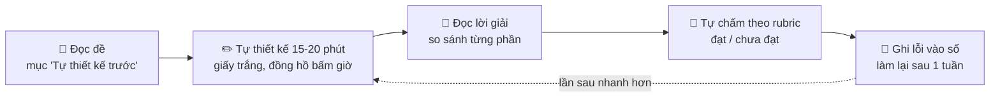
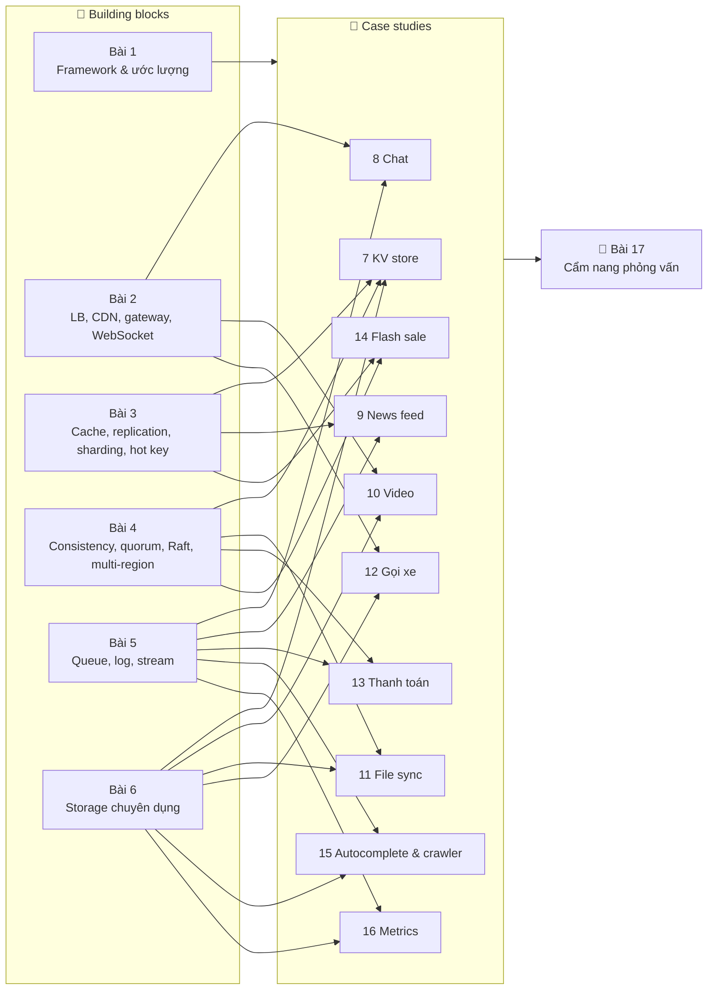

# 🏛️ System Design chuyên sâu

## 📋 Tổng quan

Khóa [Backend Engineering](../backend/README.md) đã cho bạn nền móng: API, database, cache, message queue, và một bài tổng quan [System Design & Scalability](../backend/10-system-design.md) với quy trình 7 bước, load balancer, rate limiting, consistent hashing và vài case study ngắn. Khóa này **đi sâu hơn một tầng**:

- Thay vì "dùng cache", ta hỏi: cache ở đâu, invalidation thế nào, chuyện gì xảy ra khi **một key** nhận 30% traffic?
- Thay vì "dùng replication", ta hỏi: đồng bộ hay bất đồng bộ, đọc ngay sau khi ghi có thấy dữ liệu của mình không, failover mất bao lâu, mất bao nhiêu dữ liệu?
- Thay vì "thiết kế Uber trong 45 phút" theo kiểu học thuộc, ta luyện một **quy trình lặp lại được**, ước lượng bằng **con số thật**, và tự chấm bằng **rubric**.

> 💡 **System design không có đáp án đúng duy nhất.** Có những thiết kế **phù hợp với yêu cầu** và những thiết kế không. Người giỏi system design không phải người thuộc nhiều kiến trúc nhất, mà là người **hỏi đúng câu, ra con số, nêu được trade-off, và biết khi nào nên đổi ý**.

### 🎯 Mục tiêu khóa học

Sau khóa học, bạn có thể:

- Dẫn dắt một buổi phỏng vấn system design 45-60 phút theo **framework có timebox**, không bị "đứng hình" hay lan man
- Biến yêu cầu mơ hồ thành **NFR có con số**: SLO, p99 latency, availability, durability, RPO/RTO
- **Ước lượng nhanh** QPS, peak, storage, bandwidth, cache, số server - và tự kiểm tra con số có hợp lý không
- Dùng thành thạo các **building block**: DNS, load balancer, CDN, API gateway, cache, replication, sharding, consistent hashing, queue, stream, các loại storage chuyên dụng
- Giải thích đúng **consistency models**, CAP/PACELC, quorum, Raft, clock, distributed transaction, multi-region
- Thiết kế **10 hệ thống kinh điển** (KV store, chat, news feed, video, file sync, gọi xe, ví điện tử, flash sale, autocomplete & crawler, metrics) ở độ sâu đủ cho phỏng vấn senior **và** đủ để bắt tay xây thật
- Tự chấm bài thiết kế của mình bằng rubric và biết mình còn yếu ở đâu

### 👥 Ai nên học khóa này?

- Backend engineer **đã học xong** (hoặc đã có kinh nghiệm tương đương) khóa [Backend](../backend/README.md), muốn lên mid/senior
- Người đang chuẩn bị **phỏng vấn system design** ở các công ty product, fintech, e-commerce, big tech
- Tech lead cần **ra quyết định kiến trúc** và giải thích trade-off cho team, cho sếp
- Người đã đọc DDIA hay System Design Interview nhưng thấy "đọc thì hiểu, tự làm thì bí"

!!! warning "Khóa này KHÔNG dành cho người mới"
    Nếu bạn chưa chắc về index, transaction, isolation level, Redis cơ bản, Kafka/RabbitMQ cơ bản, hãy học khóa Backend trước. Khóa này **link** về các bài đó thay vì giảng lại.

### 📚 Kiến thức cần có

| Chủ đề | Bài nền tảng | Vì sao cần |
|---|---|---|
| Quy trình 7 bước, LB, CAP, rate limit, circuit breaker, ID | [Backend Bài 10 - System Design](../backend/10-system-design.md) ⭐ | Khóa này mở rộng trực tiếp từ bài này |
| Index, transaction, isolation, replication cơ bản | [Backend Bài 6](../backend/06-database-internals-performance.md) | Hiểu tại sao DB chậm, khi nào phải shard |
| Document, key-value, wide-column, graph | [Backend Bài 7](../backend/07-nosql.md) | Chọn storage cho từng case study |
| Cache-aside, TTL, Redis | [Backend Bài 8](../backend/08-caching.md) | Bài 3 đi sâu vào consistency và hot key |
| Queue, Kafka, outbox, idempotent consumer | [Backend Bài 9](../backend/09-message-queues.md) | Bài 4, 5 và hầu hết case study |
| Log, metric, trace, SLO | [Backend Bài 11](../backend/11-observability-reliability.md) | Phần monitoring của mọi case study |
| Microservices, DDD, event-driven | [Backend Bài 14](../backend/14-architecture-microservices.md) | Ranh giới service |
| Little's law, nghĩ về thất bại | [Systems Thinking Bài 4](../systems-thinking/04-mental-models.md), [Bài 5](../systems-thinking/05-failure-thinking.md) | Ước lượng và failure mode |
| Trie, Bloom filter, đồ thị | [Algorithms Bài 15](../algorithms/15-advanced-data-structures.md), [Bài 12](../algorithms/12-shortest-paths-mst.md) | Autocomplete, crawler, chỉ đường |

### ⏱️ Thời gian học tập

- **Tổng thời gian**: khoảng **8 tuần**, 1-2 giờ/ngày (mỗi case study cần ~2 buổi: một buổi tự thiết kế, một buổi đọc và tự chấm)
- **Cấp độ**: Trung cấp → Nâng cao
- **Ngôn ngữ code**: Go và Python (chuyển bằng tab). Code chỉ xuất hiện ở chỗ nó làm rõ cơ chế cốt lõi (consistent hashing, quorum, vector clock, geohash, ledger...), và **mọi đoạn code hoàn chỉnh đều chạy được**, có output thật.

---

## 🧭 Cách học: thiết kế trước, đọc sau, tự chấm

Đọc một bài thiết kế "chuẩn" rồi gật gù là cách học **kém hiệu quả nhất**. Bạn sẽ thấy mọi thứ đều hợp lý - cho đến khi phải tự làm. Mỗi case study (Bài 7-16) được viết để bạn học theo vòng lặp sau:

1. **Tự thiết kế trước** - mỗi case study mở đầu bằng mục `🧩 Tự thiết kế trước`. Đặt đồng hồ 15-20 phút, viết ra giấy: yêu cầu, con số, API, data model, sơ đồ. Bí thì mở gợi ý (collapsible), nhưng **chỉ mở sau 5 phút bế tắc**.
2. **Đọc lời giải** - so sánh với bản của bạn. Chỗ khác nhau **không có nghĩa là bạn sai**; hãy hỏi: lời giải chọn thế vì yêu cầu nào? Nếu yêu cầu đổi thì lựa chọn của bạn có đúng hơn không?
3. **Tự chấm** - mỗi case study có bảng `📝 Tự chấm` với tiêu chí "đạt / chưa đạt" cho 8 khía cạnh. Thành thật với bản thân.
4. **Sổ lỗi** - ghi lại những điều bạn quên (ví dụ "quên ước lượng bandwidth", "không nói gì về hot key"). Sau 3-4 case study bạn sẽ thấy pattern lỗi của chính mình.
5. **Nói to** - nếu được, luyện với bạn bè: một người làm interviewer (dùng phần "Làm rõ yêu cầu" như kịch bản), một người thiết kế. Phỏng vấn system design là **kỹ năng nói** chứ không chỉ kỹ năng nghĩ.

!!! tip "Bài 1-6 học thế nào?"
    Bài 1-6 là **building blocks**. Học kỹ, chạy code, làm bài tập. Bạn không cần thuộc hết - nhưng khi đọc case study gặp "consistent hashing" hay "read-your-writes", bạn phải biết ngay nó giải quyết vấn đề gì và giá phải trả là gì. Bảng ở mục **Bản đồ khóa học** bên dưới cho biết case study nào dùng block nào.

---

## 🗓️ Lộ trình ~8 tuần

| Tuần | Bài | Nội dung |
|---|---|---|
| 1 | 1, 2 | Framework, ước lượng; building blocks mạng |
| 2 | 3, 4 | Building blocks dữ liệu; nhất quán, đồng thuận, multi-region |
| 3 | 5, 6 | Messaging & streaming; storage chuyên dụng |
| 4 | 7, 8 | KV store; chat & presence |
| 5 | 9, 10 | News feed; video streaming |
| 6 | 11, 12 | File sync; gọi xe & tìm quanh đây |
| 7 | 13, 14 | Thanh toán & ví; đặt vé & flash sale |
| 8 | 15, 16, 17 | Autocomplete & crawler; metrics; cẩm nang phỏng vấn + mock interview |

### Phần 1 - Nền tảng (Building blocks)

| Bài | Chủ đề | Mô tả ngắn |
|---|---|---|
| 1 | [Framework & ước lượng](./01-framework-estimation.md) | Quy trình có timebox, biến yêu cầu thành NFR có số, ước lượng QPS/storage/bandwidth/cache/server với 4 drill và script estimator |
| 2 | [Building blocks: mạng, LB, CDN, gateway](./02-building-blocks-network.md) | DNS/GeoDNS, LB L4/L7 và thuật toán (có mô phỏng), CDN, API gateway/BFF, WebSocket & LB, service discovery |
| 3 | [Building blocks: cache, replication, sharding](./03-building-blocks-data.md) | Cache chuyên sâu, replication và các bất thường do lag, sharding, consistent hashing có vnode, hot key |
| 4 | [Nhất quán, đồng thuận & multi-region](./04-consistency-consensus.md) | Consistency models, CAP/PACELC, quorum, Raft, clock, 2PC/saga, idempotency, multi-region & DR |
| 5 | [Messaging & stream processing](./05-messaging-streaming.md) | Queue vs log, partition & ordering, delivery semantics, backpressure, windowing, stream processing |
| 6 | [Lưu trữ chuyên dụng](./06-specialized-storage.md) | LSM vs B-tree, object storage, time-series, search index, geospatial, chọn storage theo access pattern |

### Phần 2 - Case studies

| Bài | Chủ đề | Mô tả ngắn |
|---|---|---|
| 7 | [Distributed key-value store](./07-key-value-store.md) | Tự xây "mini Dynamo": partition, replication, quorum, conflict, gossip, anti-entropy |
| 8 | [Chat & presence](./08-chat-presence.md) | Nhắn tin 1-1 và nhóm, thứ tự tin nhắn, trạng thái online, hàng triệu kết nối WebSocket |
| 9 | [News feed](./09-news-feed.md) | Fan-out on write/read, celebrity problem, ranking, cache timeline |
| 10 | [Video streaming](./10-video-streaming.md) | Upload, transcoding pipeline, adaptive bitrate, CDN, chi phí băng thông |
| 11 | [Đồng bộ file](./11-file-sync.md) | Chunking, dedup, metadata nhất quán, đồng bộ nhiều thiết bị, xung đột |
| 12 | [Gọi xe & tìm quanh đây](./12-ride-hailing-proximity.md) | Geohash/quadtree, cập nhật vị trí tần suất cao, matching tài xế, surge |
| 13 | [Thanh toán & ví điện tử](./13-payment-wallet.md) | Ledger kép, idempotency, saga, đối soát, không mất một đồng nào |
| 14 | [Đặt vé & flash sale](./14-ticket-flash-sale.md) | Tồn kho nóng, chống bán vượt, hàng đợi ảo, chống bot |
| 15 | [Autocomplete & web crawler](./15-autocomplete-crawler.md) | Trie top-k, cập nhật gợi ý; crawler lịch sự, dedup URL, frontier phân tán |
| 16 | [Metrics & ad click aggregation](./16-metrics-aggregation.md) | Thu thập, tổng hợp theo cửa sổ thời gian, exactly-once effects, đối soát |

### Phần 3 - Phỏng vấn

| Bài | Chủ đề | Mô tả ngắn |
|---|---|---|
| 17 | [Cẩm nang phỏng vấn](./17-interview-playbook.md) | Kịch bản 45/60 phút, rubric theo level, câu hỏi hay gặp, mock interview, sai lầm làm trượt |

---

## 🗺️ Bản đồ khóa học

Building blocks (Bài 1-6) là "nguyên liệu", case study (Bài 7-16) là "món ăn". Sơ đồ dưới cho thấy nguyên liệu nào được dùng nhiều nhất ở đâu:

### Case study → building blocks sử dụng

| Case study | Building blocks chính | Điểm khó nhất (deep dive) |
|---|---|---|
| [7. KV store](./07-key-value-store.md) | Consistent hashing + vnode (3), replication leaderless (3), quorum N/R/W, vector clock (4), LSM (6) | Xung đột ghi đồng thời, phát hiện node chết, anti-entropy |
| [8. Chat & presence](./08-chat-presence.md) | WebSocket + LB (2), queue/log (5), wide-column storage (6), multi-region (4), cache (3) | Thứ tự tin nhắn, gửi đúng một lần "về mặt hiệu ứng", presence ở quy mô lớn |
| [9. News feed](./09-news-feed.md) | Cache (3), fan-out bằng queue (5), sharding & hot key/celebrity (3) | Fan-out on write vs read, người dùng có hàng triệu follower |
| [10. Video streaming](./10-video-streaming.md) | CDN (2), object storage (6), pipeline bằng queue (5) | Transcoding song song, adaptive bitrate, chi phí egress |
| [11. File sync](./11-file-sync.md) | Object storage + chunking (6), metadata nhất quán (4), long-poll/WebSocket (2) | Dedup, đồng bộ delta, xung đột chỉnh sửa offline |
| [12. Gọi xe](./12-ride-hailing-proximity.md) | Geospatial index (6), WebSocket (2), hot partition theo vùng (3), stream (5) | 250k cập nhật vị trí/giây, matching không gán trùng tài xế |
| [13. Thanh toán](./13-payment-wallet.md) | Idempotency, saga, 2PC (4), ledger (6), outbox (5), multi-region DR (4) | Không mất tiền, không trừ hai lần, đối soát với bên thứ ba |
| [14. Flash sale](./14-ticket-flash-sale.md) | Hot key (3), gateway & rate limit (2), queue (5), consistency tồn kho (4) | Hàng triệu người tranh 1.000 vé, chống bán vượt |
| [15. Autocomplete & crawler](./15-autocomplete-crawler.md) | Trie (6, Algo 15), cache/CDN (2, 3), queue (5), Bloom filter, sharding (3) | Top-k cập nhật gần thời gian thực; crawler lịch sự và không lặp |
| [16. Metrics](./16-metrics-aggregation.md) | Stream processing & windowing (5), time-series DB (6), exactly-once effects (4), hot key (3) | Dữ liệu đến muộn, đếm đúng khi có retry, cardinality cao |

---

## 📝 Rubric phỏng vấn - tổng quan

Người phỏng vấn hiếm khi chấm "thiết kế có giống Netflix không". Họ chấm **cách bạn suy nghĩ**. Các case study dùng chung 8 tiêu chí dưới đây; [Bài 17 - Cẩm nang phỏng vấn](./17-interview-playbook.md) mô tả chi tiết kỳ vọng theo level (mid / senior / staff).

| Tiêu chí | "Đạt" trông như thế nào | Dấu hiệu "chưa đạt" |
|---|---|---|
| **Yêu cầu** | Hỏi để chốt phạm vi, nêu rõ out-of-scope, có NFR bằng số | Lao vào vẽ ngay, không hỏi gì |
| **Ước lượng** | QPS, peak, storage, bandwidth đúng bậc độ lớn, **dùng con số để ra quyết định** | Tính xong rồi bỏ đó, hoặc sai 1000 lần |
| **API** | Endpoint/event rõ ràng, có pagination, idempotency key khi cần | API mơ hồ, quên các trường quan trọng |
| **Data model** | Schema + lý do chọn storage theo access pattern, khóa partition hợp lý | "Dùng MongoDB vì nó scale" |
| **Kiến trúc** | Sơ đồ đi được end-to-end cho luồng chính | Hộp và mũi tên không ai giải thích |
| **Deep dive** | Chọn đúng phần khó nhất, so sánh ≥2 phương án | Đào sâu phần dễ, né phần khó |
| **Trade-off** | "Chọn A vì..., giá phải trả là..., sẽ đổi sang B khi..." | Chỉ nói ưu điểm của lựa chọn mình |
| **Failure** | Nói được cái gì hỏng, phát hiện thế nào, phục hồi ra sao | Giả định mọi thứ luôn chạy |

---

## 📦 Tài nguyên tham khảo

**Sách**

- *Designing Data-Intensive Applications* (DDIA) - Martin Kleppmann. "Kinh thánh" về dữ liệu phân tán. Bài 3, 4, 5, 6 bám sát tinh thần các chương replication, partitioning, consistency & consensus, stream processing. Ấn bản 2 (cập nhật) đáng đọc nếu bạn có.
- *System Design Interview - An Insider's Guide*, **Volume 1** và **Volume 2** - Alex Xu (Vol 2 viết cùng Sahn Lam). Nhiều case study ở khóa này có đề tương tự; hãy làm bài ở đây trước, đọc sách sau để so sánh góc nhìn.
- *Database Internals* - Alex Petrov. Đọc thêm cho Bài 6 và Bài 7.
- *Site Reliability Engineering* (Google, đọc miễn phí online) - các chương về SLO, error budget, xử lý quá tải.

**Online**

- [system-design-primer](https://github.com/donnemartin/system-design-primer) - repo GitHub tổng hợp kiến thức và flashcard, miễn phí.
- [ByteByteGo](https://bytebytego.com) - blog/newsletter và video của Alex Xu, sơ đồ trực quan.
- Engineering blog của các công ty: tìm "<tên công ty> engineering blog" (Netflix, Uber, Discord, Slack, Cloudflare, Stripe, Meta, Pinterest, Shopify, Grab...). Đọc bài về **sự cố (postmortem)** cũng quan trọng như đọc bài kiến trúc.
- Paper kinh điển (đọc khi đã học xong Bài 4 và 7): Dynamo (Amazon, 2007), Raft ("In Search of an Understandable Consensus Algorithm"), Spanner, Bigtable, Kafka.

!!! note "Về con số thực tế của các công ty"
    Khi khóa học nhắc đến quy mô của một công ty thật, đó là **ước tính để luyện tập** hoặc mô tả chung chung, không phải số liệu chính thức. Trong phỏng vấn cũng vậy: người phỏng vấn quan tâm cách bạn **suy ra** con số, không phải bạn có thuộc số liệu của họ không.

---

## ✅ Checklist trước khi bắt đầu

- [ ] Tôi đã đọc [Backend Bài 10](../backend/10-system-design.md) và giải thích được L4 vs L7, consistent hashing, CAP ở mức cơ bản
- [ ] Tôi hiểu index, transaction, isolation level, replication cơ bản ([Backend Bài 6](../backend/06-database-internals-performance.md))
- [ ] Tôi đã dùng Redis (hoặc cache tương tự) và một message queue ít nhất ở mức tutorial
- [ ] Tôi chạy được chương trình Go hoặc Python từ dòng lệnh
- [ ] Tôi có sổ tay (giấy hoặc file) để vẽ thiết kế và ghi "sổ lỗi"
- [ ] Tôi cam kết **tự thiết kế trước khi đọc lời giải** ở mỗi case study
- [ ] Tôi đã xếp lịch ~8 tuần, mỗi tuần 2 bài

---

**Bắt đầu**: [Bài 1: Framework & ước lượng](./01-framework-estimation.md)
