# 📚 Bài 1: Vì sao tư duy quan trọng hơn code

> "AI là một cái loa. Nó khuếch đại bất cứ thứ gì bạn đưa vào - kể cả sự mơ hồ, kể cả sai lầm."

Hai kỹ sư cùng công ty, cùng số năm kinh nghiệm, cùng dùng một trợ lý AI viết code. Sáu tháng sau, một người được giao dẫn dắt dự án quan trọng nhất quý, người kia bị hỏi khéo trong buổi review hiệu suất: *"Em thấy công việc của em khác gì việc AI tự làm không?"*

Họ không khác nhau ở tốc độ gõ phím. Cũng không khác nhau ở việc ai dùng AI giỏi hơn - cả hai đều sinh ra code rất nhanh. Họ khác nhau ở **những gì diễn ra trong đầu trước và sau khi code được sinh ra**: hiểu vấn đề đến đâu, nhìn thấy hệ quả xa đến đâu, và kiểm chứng kỹ đến đâu.

Bài học này trả lời một câu hỏi mà rất nhiều bạn trẻ đang lo lắng: **khi AI viết code ngày càng giỏi, kỹ sư phần mềm còn giá trị gì?** Câu trả lời ngắn: giá trị **dịch chuyển** - từ "viết code" sang "quyết định viết gì, vì sao, và chứng minh nó đúng". Câu trả lời dài là phần còn lại của bài, và của cả khóa học.

## 🎯 Mục tiêu bài học

- Đánh giá **trung thực** những gì công cụ AI viết code làm tốt và làm kém - không thổi phồng, không coi thường
- Hiểu sự **dịch chuyển giá trị**: từ "gõ code" sang "đặt vấn đề - quyết định - kiểm chứng - chịu trách nhiệm"
- Nắm **đường cong chi phí**: vì sao code rẻ đi nhưng quyết định sai lại đắt hơn
- Phân biệt kỹ năng **tích lũy kép** (càng lâu càng giá trị) với kỹ năng **mất giá nhanh**
- Nhận diện điểm khác biệt giữa **kỹ sư được AI khuếch đại** và **coder bị AI thay thế**
- Phân tích các tình huống **trước/sau** cụ thể để thấy "tư duy" trông như thế nào trong công việc hằng ngày
- Tự đánh giá cách bạn đang dùng thời gian và AI, và lập kế hoạch rèn luyện

---

## 📖 1. Một buổi sáng thứ Hai năm 2026

Hãy bắt đầu bằng một câu chuyện. Công ty thương mại điện tử **ShopNhanh** (tên hư cấu) có một ticket trong sprint:

> **[SHOP-1423]** Trang "Lịch sử đơn hàng" load chậm, khách phàn nàn. Nhờ team tối ưu.

Ticket được giao cho hai kỹ sư ở hai nhóm khác nhau (vì trang này có hai phiên bản: web và app). Cả hai đều có trợ lý AI trong IDE.

### Cách làm của Tuấn

Tuấn mở file `OrderHistoryService`, bôi đen hàm `getOrderHistory`, gõ vào khung chat AI:

> "Tối ưu hàm này cho nhanh hơn."

AI trả lời trong 20 giây: thêm cache Redis 5 phút cho kết quả, chuyển vòng lặp N+1 query thành một query `JOIN`, thêm index cho cột `user_id`. Code sạch, có cả test. Tuấn chạy test - xanh. Mở PR, reviewer thấy code gọn, approve. Merge lúc 11 giờ sáng. Tuấn đóng ticket, cảm thấy năng suất tuyệt vời.

Ba ngày sau, CSKH báo: khách hủy đơn rồi nhưng trang lịch sử vẫn hiện "Đang giao" - vì cache 5 phút. Một khách hàng bức xúc đăng lên mạng xã hội rằng ShopNhanh "lừa đảo, hủy đơn mà vẫn trừ tiền" (thực ra tiền đã được hoàn, chỉ là màn hình hiển thị sai). Đồng thời, team DBA phát hiện index mới làm chậm các câu `INSERT` vào bảng `orders` trong giờ cao điểm flash sale, vì bảng này đã có 11 index.

### Cách làm của Lan

Lan cũng có AI, nhưng cô dành 40 phút đầu tiên **không viết dòng code nào**:

1. **Hỏi "chậm" là chậm thế nào?** Mở dashboard APM: p50 của API là 180ms (ổn), nhưng **p99 là 9 giây**. Vậy vấn đề không phải "mọi người đều chậm" mà là "một nhóm nhỏ chậm khủng khiếp".
2. **Ai bị chậm?** Lọc theo user: các request chậm đều thuộc về khoảng 2% user có **trên 500 đơn hàng** - chủ yếu là các shop bán lại (reseller) mua sỉ.
3. **Vì sao họ chậm?** API trả về **toàn bộ** lịch sử, không phân trang. User có 3.000 đơn thì nhận về JSON 4MB.
4. **Mục tiêu thật là gì?** Hỏi PM: khách vào trang này để làm gì? Câu trả lời: 90% là để xem **đơn gần nhất** đang giao tới đâu.

Lan mới mở AI và giao việc **rất cụ thể**:

> "Thêm phân trang dạng cursor (keyset pagination) cho API `GET /orders/history`, mặc định 20 đơn, sắp xếp theo `created_at DESC, id DESC`. Dùng index sẵn có `idx_orders_user_created` (đã kiểm tra trong schema). Không thêm cache. Giữ tương thích ngược: client cũ không gửi `cursor` thì vẫn nhận 20 đơn đầu và field `has_more`. Viết test cho: trang đầu, trang giữa, trang cuối, user không có đơn, hai đơn trùng `created_at`."

Code AI sinh ra gần như dùng được ngay. Lan review kỹ phần so sánh cursor (chỗ dễ sai nhất), chạy thử với dữ liệu của một user 3.000 đơn trên staging: p99 giảm từ 9 giây xuống 120ms. Không có cache nên không có dữ liệu cũ. Không có index mới nên không ảnh hưởng `INSERT`.

### Điều gì khác nhau?

```mermaid
flowchart TB
    subgraph T["Tuấn - bắt đầu từ giải pháp"]
        T1["Ticket: trang chậm"] --> T2["AI: tối ưu hàm này"]
        T2 --> T3["Cache + JOIN + index"]
        T3 --> T4["Test xanh, merge"]
        T4 --> T5["❌ Dữ liệu cũ<br/>❌ INSERT chậm<br/>❌ p99 vẫn cao với reseller"]
    end
    subgraph L["Lan - bắt đầu từ vấn đề"]
        L1["Ticket: trang chậm"] --> L2["Đo: p50 ổn, p99 = 9s"]
        L2 --> L3["Ai chậm? 2% user nhiều đơn"]
        L3 --> L4["Vì sao? Không phân trang"]
        L4 --> L5["Mục tiêu? Xem đơn gần nhất"]
        L5 --> L6["AI: spec cụ thể<br/>keyset pagination"]
        L6 --> L7["✅ p99 120ms<br/>✅ không side effect"]
    end
```

Cả hai đều dùng AI. Cả hai đều có code chạy được. Khác biệt nằm ở **40 phút suy nghĩ** trước khi gõ prompt. Và 40 phút đó **không thể giao cho AI** - không phải vì AI "không đủ thông minh", mà vì:

- AI không tự mở được dashboard APM của ShopNhanh (trừ khi bạn cấp quyền - và kể cả khi đó, nó cần biết **nhìn vào đâu**).
- AI không biết reseller là một nhóm khách hàng quan trọng.
- AI không biết PM muốn gì, cũng không biết bảng `orders` đã có 11 index.
- Và quan trọng nhất: prompt "tối ưu hàm này" **đã đóng khung sẵn vấn đề sai**. AI trả lời đúng câu hỏi được hỏi - một câu hỏi sai.

!!! warning "Bài học cốt lõi"
    **AI trả lời câu hỏi bạn hỏi, không phải câu hỏi bạn nên hỏi.** Chất lượng đầu ra của AI bị giới hạn bởi chất lượng cách bạn đặt vấn đề. Đặt vấn đề là việc của bạn.

---

## 📖 2. AI viết code làm tốt gì, làm kém gì? - Một đánh giá trung thực

Có hai thái cực khi nói về AI viết code, và cả hai đều nguy hiểm:

- **Thái cực "hype"**: "AI sẽ thay thế 90% lập trình viên trong 2 năm, học code làm gì nữa."
- **Thái cực "phủ nhận"**: "AI toàn sinh code sai, chỉ là autocomplete xịn, không đáng tin."

Cả hai đều sai, và cả hai đều khiến bạn ra quyết định nghề nghiệp tệ. Người tin thái cực thứ nhất bỏ học nền tảng. Người tin thái cực thứ hai bỏ lỡ một công cụ có thể nhân năng suất lên nhiều lần. Hãy nhìn thẳng vào thực tế.

### 2.1. Những gì AI làm **rất tốt** (và ngày càng tốt hơn)

| Việc | Vì sao AI giỏi | Ví dụ |
|------|---------------|-------|
| **Code theo khuôn mẫu phổ biến** | Đã thấy hàng triệu ví dụ tương tự | CRUD API, form validation, parse JSON, gọi REST client |
| **Dịch giữa các ngôn ngữ / framework** | Ánh xạ cú pháp là bài toán nó làm tốt | Chuyển script Python sang Go, jQuery sang React |
| **Viết test cho logic đã rõ** | Test là mẫu lặp lại cao | Bảng test case cho hàm tính phí ship |
| **Giải thích code lạ** | Đọc nhanh, tóm tắt tốt | "Đoạn regex này làm gì?", "Module legacy này chạy thế nào?" |
| **Refactor cơ học** | Biến đổi có quy tắc rõ ràng | Đổi tên, tách hàm, chuyển callback sang async/await |
| **Tra cứu và gợi ý API** | Nhớ tài liệu của hàng nghìn thư viện | "Trong Go, đọc file theo dòng dùng gì?" |
| **Sinh phương án nháp** | Liệt kê nhanh nhiều hướng | "Cho 3 cách thiết kế rate limiter" |
| **Làm các việc nhàm chán, dễ kiểm** | Không biết chán | Viết migration script, cập nhật 40 file theo API mới |

Những năm gần đây, AI còn tiến bộ mạnh ở các việc dài hơi hơn: tự đọc codebase, chạy test, sửa lỗi theo vòng lặp, thực hiện thay đổi trải trên nhiều file. Đừng đánh giá AI bằng ấn tượng từ hai năm trước.

### 2.2. Những gì AI làm **kém** (hoặc không thể làm thay bạn)

| Việc | Vì sao khó cho AI | Hệ quả nếu bạn giao phó mù quáng |
|------|-------------------|-------------------------------|
| **Biết bối cảnh không nằm trong prompt** | Luật nghiệp vụ, lịch sử quyết định, ràng buộc tổ chức nằm trong đầu người và trong các cuộc họp | Giải pháp "đúng về kỹ thuật, sai về nghiệp vụ" |
| **Biết nên xây cái gì** | Đây là câu hỏi về **giá trị và ưu tiên**, không phải về code | Xây rất nhanh một thứ không ai cần |
| **Kiểm chứng với thực tế** | AI không tự thấy production, dữ liệu thật, hành vi người dùng thật (trừ khi bạn đưa cho nó, và biết đưa cái gì) | Code chạy đúng trên ví dụ, sai trên dữ liệu thật |
| **Tự tin khi sai** | Mô hình sinh ra câu trả lời "nghe hợp lý"; câu sai và câu đúng nghe tự tin như nhau | API bịa ra, cấu hình không tồn tại, lỗi bảo mật tinh vi |
| **Cân nhắc trade-off theo giá trị của tổ chức** | "Nhanh hay an toàn?", "Rẻ hay linh hoạt?" phụ thuộc vào chiến lược công ty | Lựa chọn mặc định "trung bình cộng của Internet" |
| **Nhất quán trong hệ thống lớn, thời gian dài** | Mỗi phiên làm việc là một ngữ cảnh hữu hạn | Năm cách xử lý lỗi khác nhau trong cùng một codebase |
| **Chịu trách nhiệm** | Không thể bị gọi dậy lúc 3 giờ sáng, không thể đứng trước khách hàng | Không ai thực sự "sở hữu" kết quả |

### 2.3. Vùng xám - phụ thuộc vào cách bạn dùng

Một số việc AI có thể làm tốt **hoặc** tệ, tùy vào người dùng:

- **Debug**: AI rất giỏi đưa ra giả thuyết, nhưng **chọn giả thuyết nào để kiểm, kiểm bằng cách nào** vẫn cần người hiểu hệ thống. Đưa AI log thật và mô tả hiện tượng chính xác thì nó giúp rất nhiều; nói "app lỗi, sửa đi" thì nó đoán mò.
- **Thiết kế hệ thống**: AI liệt kê được các phương án và trade-off kinh điển. Nhưng nó không biết team bạn có 3 người hay 30 người, ngân sách cloud bao nhiêu, đã từng cháy vì Kafka hay chưa.
- **Code review**: AI bắt được lỗi cục bộ (null check, off-by-one) rất tốt. Nó kém hơn ở câu hỏi "thay đổi này có nên tồn tại không?".

Hình dưới đây là một cách nhìn: trục ngang là **mức độ rõ ràng của yêu cầu**, trục dọc là **mức độ cần bối cảnh ngầm** (thông tin không nằm trong code hay tài liệu).

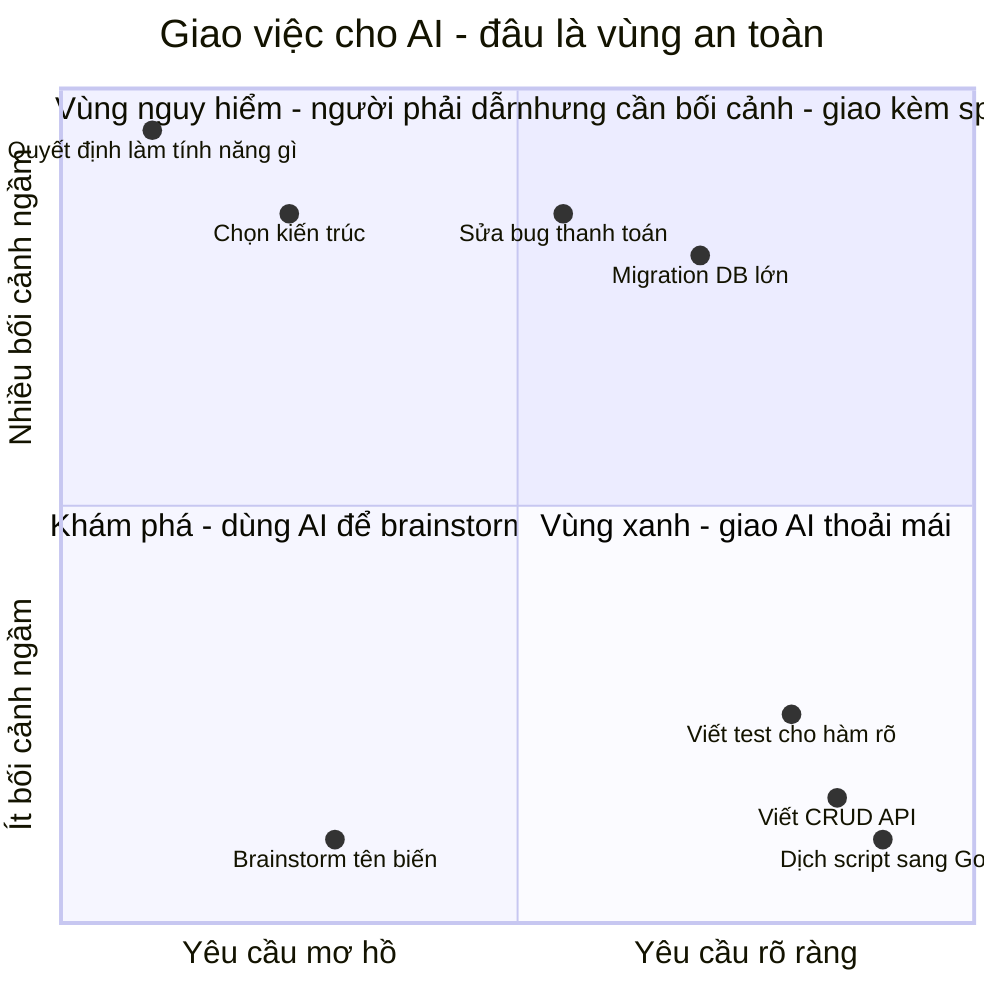

!!! note "Đánh giá này sẽ thay đổi"
    AI đang tiến bộ nhanh. Các điểm trên biểu đồ sẽ dịch dần sang phải và xuống dưới khi AI được nối với nhiều công cụ, nhiều ngữ cảnh hơn. Nhưng **góc trên bên trái** - quyết định xây gì, vì sao, chấp nhận rủi ro nào - về bản chất là việc của **người chịu trách nhiệm**. Một công cụ mạnh hơn không làm bạn bớt phải chịu trách nhiệm; nó chỉ làm hậu quả của quyết định đến nhanh hơn.

### 2.4. Phép thử đơn giản: "Cái gì sẽ sai nếu AI sai?"

Trước khi giao một việc cho AI, tự hỏi ba câu:

1. **Nếu kết quả sai, tôi có phát hiện ra không?** (Có test? Có cách đo? Hay chỉ "đọc thấy ổn"?)
2. **Nếu sai mà không phát hiện ra, hậu quả là gì?** (Một nút lệch màu, hay khách bị trừ tiền hai lần?)
3. **Sửa lại có dễ không?** (Revert một commit, hay khôi phục dữ liệu đã bị ghi đè?)

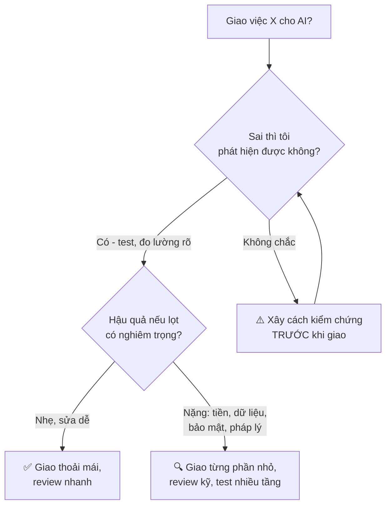

Lưu ý: không có nhánh nào là "không bao giờ dùng AI". Câu hỏi không phải **có dùng hay không**, mà là **dùng với mức kiểm chứng nào**.

---

## 📖 3. Sự dịch chuyển: từ "viết code" sang "quyết định - kiểm chứng - chịu trách nhiệm"

### 3.1. Vòng đời của một thay đổi phần mềm

Mọi thay đổi phần mềm, dù là sửa một dòng hay xây một hệ thống, đều đi qua những bước sau:

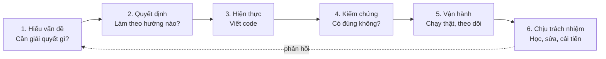

Mười năm trước, bước 3 (**viết code**) chiếm phần lớn thời gian và là nơi thể hiện "tay nghề". Một kỹ sư giỏi là người viết code nhanh, ít lỗi.

Ngày nay, AI nén bước 3 lại rất mạnh. Điều này tạo ra hai hiệu ứng:

1. **Thời gian dành cho bước 3 giảm**, nên tỷ trọng của các bước 1, 2, 4, 5, 6 trong công việc **tăng lên**.
2. **Bước 3 không còn là nút thắt**, nên nút thắt **dịch chuyển** sang các bước khác - thường là bước 1 (hiểu đúng vấn đề) và bước 4 (kiểm chứng). Bạn sẽ học về hiện tượng "nút thắt dịch chuyển" trong [Bài 4](./04-mental-models.md) (Theory of Constraints).

Dưới đây là phân bổ thời gian **minh họa** (không phải số liệu khảo sát) của một kỹ sư làm một tính năng cỡ vừa:

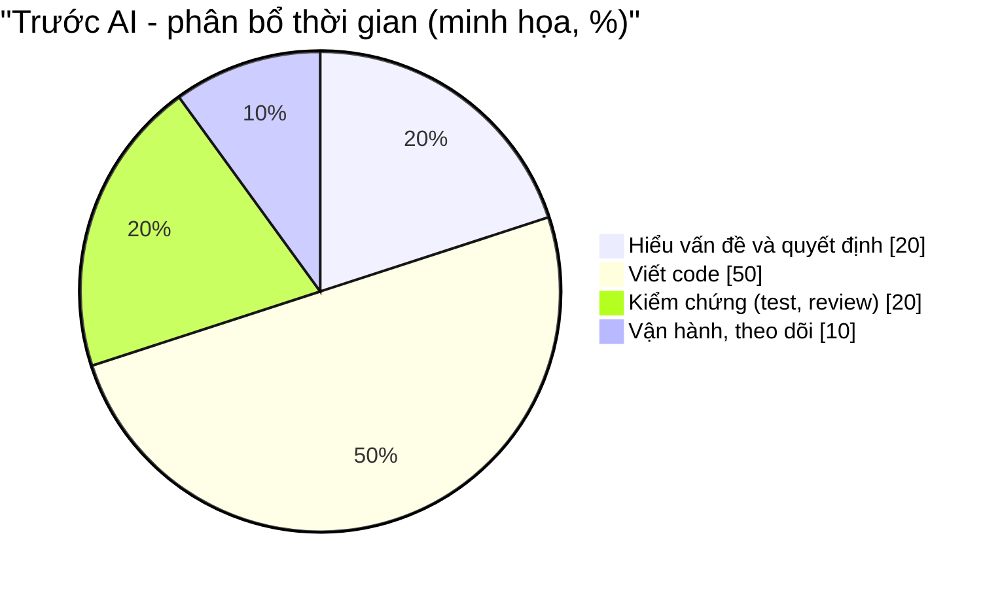

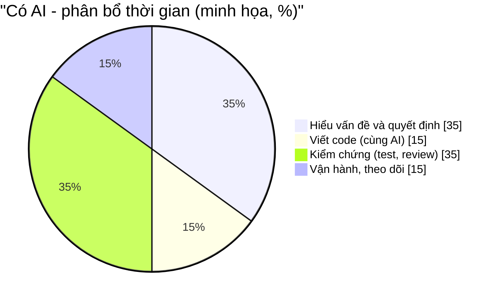

Tổng thời gian có thể ngắn hơn - nhưng **phần còn lại toàn là phần cần tư duy**. Nếu bạn không giỏi những phần đó, AI không giúp bạn nhanh hơn được bao nhiêu: bạn chỉ chuyển nút thắt từ "gõ code chậm" sang "không biết code đúng hay sai".

### 3.2. Bốn vai trò mới của kỹ sư

| Vai trò | Câu hỏi trung tâm | Ví dụ hành động |
|---------|-------------------|-----------------|
| 🎯 **Người đặt vấn đề** | "Chúng ta đang giải quyết vấn đề gì, cho ai, đo bằng gì?" | Biến ticket "trang chậm" thành "p99 của 2% reseller > 5s do không phân trang" |
| 🧭 **Người ra quyết định** | "Trong các phương án, chọn cái nào, chấp nhận đánh đổi gì?" | Chọn keyset pagination thay vì cache, vì độ tươi dữ liệu quan trọng hơn |
| 🔍 **Người kiểm chứng** | "Bằng chứng nào cho thấy nó đúng? Nó có thể sai theo cách nào?" | Test với user 3.000 đơn, test hai đơn trùng timestamp |
| 🛡️ **Người chịu trách nhiệm** | "Nếu nó hỏng lúc 3 giờ sáng, tôi có hiểu đủ để sửa không?" | Hiểu từng dòng của đoạn so sánh cursor trước khi merge |

Hãy để ý: **không vai trò nào trong số này là "người gõ code"**. Gõ code vẫn là một kỹ năng hữu ích (và bạn vẫn phải đọc code rất giỏi để kiểm chứng), nhưng nó không còn là thứ định nghĩa nghề.

### 3.3. "Hiểu từng dòng" có còn cần thiết không?

Đây là câu hỏi hay gặp: *"Nếu AI viết, và test xanh, em có cần hiểu từng dòng không?"*

Câu trả lời phụ thuộc vào **mức rủi ro** (quay lại phép thử ở mục 2.4), nhưng có một nguyên tắc không đổi:

!!! warning "Nguyên tắc chịu trách nhiệm"
    **Bạn phải hiểu đủ để giải thích được nó cho người khác và sửa được nó khi nó hỏng - mà không cần AI.** Nếu bạn không làm được điều đó với một đoạn code trên đường đi của tiền, dữ liệu người dùng hoặc bảo mật, thì bạn chưa sẵn sàng merge nó.

Xem thêm cách làm cụ thể trong [Mindset - Bài 11: Làm việc với AI mà vẫn là người chịu trách nhiệm](../mindset/11-working-with-ai.md). Chúng ta sẽ đào sâu vào kỹ thuật giao việc và review với AI ở [Bài 7](./07-engineering-with-ai.md) và kiểm chứng ở [Bài 9](./09-verification-mindset.md).

---

## 📖 4. Đường cong chi phí: code rẻ, quyết định sai đắt

### 4.1. Cái gì rẻ đi, cái gì không?

| Thứ | Xu hướng giá khi có AI | Giải thích |
|-----|----------------------|------------|
| Viết một đoạn code mới | 📉 Giảm mạnh | Vài giây đến vài phút |
| Viết test, tài liệu, boilerplate | 📉 Giảm mạnh | AI làm tốt các việc lặp lại |
| Thử nghiệm một ý tưởng (prototype) | 📉 Giảm mạnh | Trước mất 1 tuần, giờ mất 1 buổi chiều |
| **Hiểu đúng vấn đề** | ➡️ Gần như không đổi | Vẫn phải nói chuyện với người dùng, đọc dữ liệu, hiểu nghiệp vụ |
| **Bảo trì code đã viết** | ➡️ hoặc 📈 | Code nhiều hơn = nhiều thứ phải đọc, nâng cấp, vá bảo mật hơn |
| **Hậu quả của quyết định sai** | 📈 Có thể tăng | Sai được nhân bản nhanh hơn, lan rộng hơn trước khi bị phát hiện |
| **Dữ liệu bị hỏng, niềm tin của khách bị mất** | ➡️ Không đổi | AI không hoàn tác được một email gửi nhầm cho 200.000 khách |

Đây là một nghịch lý kinh tế quen thuộc, gọi là **nghịch lý Jevons**: khi một thứ trở nên rẻ hơn, người ta **dùng nó nhiều hơn**, và tổng lượng tiêu thụ có thể tăng. Khi code rẻ, các team viết **nhiều code hơn** - nhiều service hơn, nhiều tính năng hơn, nhiều script "tạm" hơn. Và mỗi dòng code là một **khoản nợ vận hành**: phải đọc, phải hiểu, phải nâng cấp dependency, phải vá lỗ hổng, phải trả tiền chạy.

!!! tip "Code là chi phí, không phải tài sản"
    Tài sản thực sự là **khả năng giải quyết vấn đề** mà code mang lại. Code chỉ là cái giá phải trả để có khả năng đó. Một kỹ sư giỏi giải quyết được vấn đề với **ít code nhất** - đôi khi bằng không dòng code nào (ví dụ: phát hiện ra tính năng được yêu cầu đã có sẵn, chỉ là người dùng không tìm thấy).

### 4.2. Chi phí sửa sai theo thời điểm phát hiện

Một quan sát lâu đời trong ngành phần mềm: lỗi phát hiện càng muộn thì sửa càng đắt. Con số chính xác (kiểu "đắt gấp 100 lần") còn nhiều tranh cãi và phụ thuộc từng dự án, nhưng **xu hướng** thì ai làm lâu năm cũng thấy:

| Phát hiện sai ở... | Ví dụ | Chi phí sửa (tương đối) |
|--------------------|-------|------------------------|
| Lúc đặt vấn đề | "À, khách cần xem đơn gần nhất, không cần toàn bộ lịch sử" | Một câu hỏi, 5 phút |
| Lúc thiết kế | "Cache sẽ gây dữ liệu cũ, đổi sang phân trang" | Sửa một đoạn tài liệu, 30 phút |
| Lúc review code | "Index này sẽ làm chậm INSERT" | Viết lại PR, vài giờ |
| Lúc test / staging | "Hai đơn trùng timestamp bị mất khi phân trang" | Debug + sửa, một ngày |
| Trên production | Khách thấy dữ liệu sai, lên mạng xã hội | Sửa code + xử lý khủng hoảng + mất niềm tin, nhiều tuần |

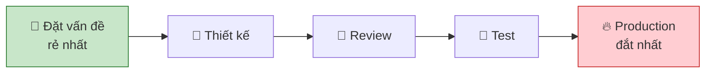

Bây giờ hãy kết hợp hai ý:

- AI làm bước **viết code** rẻ đi → người ta có xu hướng **nhảy thẳng vào code** ("thử luôn cho nhanh").
- Nhưng nhảy thẳng vào code nghĩa là **bỏ qua** các điểm phát hiện sai rẻ nhất (đặt vấn đề, thiết kế).

Kết quả: lỗi được phát hiện **muộn hơn**, ở chỗ **đắt hơn**. Đây là cái bẫy lớn nhất của kỷ nguyên AI.

!!! note "Nhưng prototype rẻ cũng là cơ hội"
    Mặt tích cực: khi prototype rẻ, bạn có thể **dùng code như một công cụ để suy nghĩ** - làm nhanh 2-3 phương án để so sánh, cho người dùng thử sớm, rồi **vứt đi**. Điều quan trọng là bạn **biết** mình đang làm prototype để học (và sẵn sàng vứt), chứ không vô tình đưa prototype lên production. Sự khác biệt nằm ở ý định, và ý định là tư duy.

### 4.3. Tốc độ không có hướng thì vô nghĩa

Hãy hình dung bạn đi từ Hà Nội vào TP.HCM. AI cho bạn một chiếc xe nhanh gấp 5 lần. Nếu bạn đi đúng hướng, bạn đến nơi sớm hơn rất nhiều. Nếu bạn đi **sai hướng** - lên Lạng Sơn - thì xe nhanh gấp 5 lần chỉ đưa bạn **xa đích** nhanh gấp 5 lần, và quãng đường quay lại cũng dài gấp 5 lần.

```text
Giá trị tạo ra  ≈  Tốc độ  ×  Hướng đi

  Tốc độ cao  × hướng đúng   = 🚀 rất nhiều giá trị
  Tốc độ cao  × hướng sai    = 💥 rất nhiều thiệt hại (nhanh hơn trước)
  Tốc độ cao  × hướng mơ hồ  = 🌀 rất nhiều code, ít giá trị
```

AI tăng **tốc độ**. Tư duy quyết định **hướng đi**. Đó là lý do khi AI càng mạnh, tư duy càng đáng giá.

---

## 📖 5. Kỹ năng tích lũy kép vs kỹ năng mất giá

### 5.1. Lãi kép trong kỹ năng

Bạn biết lãi kép trong tài chính: tiền đẻ ra tiền, rồi tiền lãi lại đẻ ra lãi. Kỹ năng cũng vậy. Một số kỹ năng **tích lũy kép**: càng có nhiều, bạn càng học thêm nhanh hơn, và chúng có giá trị trong rất nhiều bối cảnh khác nhau. Một số kỹ năng khác **mất giá**: chúng gắn với một công cụ cụ thể, và khi công cụ thay đổi, giá trị của chúng giảm về gần không.

| Kỹ năng mất giá nhanh (half-life ngắn) | Kỹ năng tích lũy kép (half-life dài) |
|---------------------------------------|-------------------------------------|
| Thuộc lòng cú pháp, tham số của API | Hiểu **vì sao** API được thiết kế như vậy |
| Gõ boilerplate nhanh | **Đặt vấn đề** rõ ràng, viết spec tốt |
| Thuộc các "mẹo" của một framework | Hiểu **nguyên lý** bên dưới (HTTP, database, concurrency) |
| Prompt "thần chú" cho một model cụ thể | **Giao tiếp rõ ràng** bằng chữ - với người hay với máy |
| Biết dùng một công cụ CI cụ thể | Hiểu **vòng phản hồi**, nút thắt, cách hệ thống hỏng |
| Tốc độ gõ phím | **Kiến thức nghiệp vụ** (domain): thanh toán, logistics, y tế... |
| | **Phán đoán**: chọn trade-off, nhận ra rủi ro |
| | **Kiểm chứng**: thiết kế test, đo lường, đọc dữ liệu |
| | **Sự tin cậy**: người khác tin bạn sẽ làm đúng và nói thật |

### 5.2. Vì sao chúng tích lũy kép?

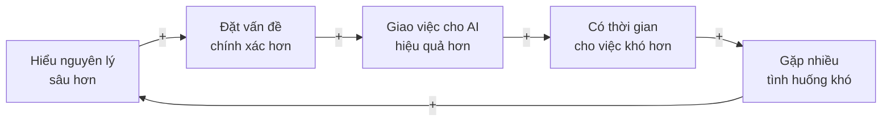

Đây là một **vòng phản hồi tăng cường** (reinforcing loop) - khái niệm bạn sẽ học kỹ ở [Bài 2](./02-systems-thinking-basics.md). Mỗi vòng quay làm vòng sau mạnh hơn. Một người bắt đầu vòng này sớm sẽ có khoảng cách ngày càng xa với người không bắt đầu.

Chú ý dấu `+` trên mỗi mũi tên: nó nghĩa là "cái này tăng thì cái kia tăng theo". Cả vòng chỉ toàn dấu `+`, nên nó tự khuếch đại.

### 5.3. Kiến thức nền tảng có còn cần không?

Có người lập luận: "AI biết hết cấu trúc dữ liệu, thuật toán, database internals rồi, em học làm gì?". Đây là một hiểu lầm nguy hiểm. Bạn học nền tảng **không phải để tự gõ lại** chúng, mà để:

1. **Nhận ra khi AI sai.** Nếu bạn không biết index B-tree hoạt động thế nào, bạn không thể nhận ra AI vừa đề xuất một index vô dụng.
2. **Đặt đúng câu hỏi.** "Tối ưu hàm này" vs "chuyển sang keyset pagination dùng index sẵn có" - câu sau chỉ có thể đến từ người hiểu database.
3. **Ước lượng nhanh trong đầu.** "Bảng này 50 triệu dòng, full scan mỗi request là không ổn" - phán đoán này phải có trước khi chạy thử.

Hãy nghĩ về một bác sĩ có máy xét nghiệm hiện đại. Máy cho ra kết quả nhanh và chính xác hơn bác sĩ tự làm. Nhưng **chỉ định xét nghiệm gì**, **đọc kết quả trong bối cảnh bệnh nhân**, **nhận ra kết quả bất thường do máy lỗi** - đều cần kiến thức y khoa sâu. Máy càng mạnh, bác sĩ giỏi càng làm được nhiều; còn người không có kiến thức y khoa thì có máy cũng không chữa được bệnh.

---

## 📖 6. Kỹ sư được AI khuếch đại vs coder bị AI thay thế

### 6.1. AI là một bộ khuếch đại

Hãy nghĩ AI như một cái amply (bộ khuếch đại âm thanh) trong quán karaoke. Amply làm giọng hát to hơn - **cả giọng hay lẫn giọng lạc tông**. Người hát hay cầm micro có amply thì cả phòng vỗ tay. Người hát lạc tông cầm micro có amply thì... cả xóm biết.

```text
Kết quả  =  Năng lực của bạn  ×  Hệ số khuếch đại của AI

  Năng lực 8  × AI 5  = 40
  Năng lực 2  × AI 5  = 10
  Năng lực 0  × AI 5  = 0     (và có khi âm: AI tự tin sinh ra lỗi mà bạn không nhận ra)
```

AI làm **khoảng cách** giữa người giỏi và người chưa giỏi **lớn hơn**, không nhỏ hơn. Trước đây, khoảng cách giữa 8 và 2 là 6. Giờ là 30.

### 6.2. Hai vòng xoáy

Sự khác biệt giữa hai kiểu người không nằm ở tài năng bẩm sinh, mà ở **vòng phản hồi** họ vô tình tạo ra cho bản thân:

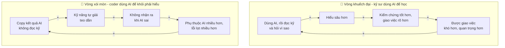

Cả hai đều là vòng tăng cường. Một vòng đi lên, một vòng đi xuống. Điều đáng sợ của vòng xói mòn là **lúc đầu nó trông giống hệt năng suất**: số PR tăng, ticket đóng nhanh. Phải vài tháng sau, khi lỗi tích lũy và người đó không tự debug được một sự cố, mọi người mới nhận ra.

### 6.3. Bảng so sánh hành vi

| Tình huống | 🔻 Coder bị AI thay thế | 🔺 Kỹ sư được AI khuếch đại |
|-----------|------------------------|----------------------------|
| Nhận ticket mơ hồ | Dán nguyên ticket vào AI | Hỏi rõ mục tiêu, người dùng, metric, rồi mới giao AI |
| AI đề xuất giải pháp | Chấp nhận phương án đầu tiên | Hỏi AI 2-3 phương án, tự so sánh trade-off |
| AI sinh code | "Chạy được là xong" | Đọc kỹ chỗ rủi ro, tự hỏi "nó có thể sai thế nào?" |
| Test xanh | Merge | Hỏi "test này có thực sự kiểm cái quan trọng không?" |
| Gặp bug | Dán lỗi vào AI, thử từng gợi ý | Đặt giả thuyết, dùng AI để kiểm giả thuyết nhanh |
| AI nói "đây là cách tốt nhất" | Tin | Hỏi "tốt nhất theo tiêu chí nào, trong bối cảnh nào?" |
| Sự cố production | "Code này AI viết mà" | "Tôi merge nó, tôi chịu trách nhiệm, đây là postmortem" |
| Thời gian tiết kiệm được nhờ AI | Làm thêm nhiều ticket giống vậy | Đầu tư vào hiểu hệ thống, nghiệp vụ, đo lường |
| Học công nghệ mới | Nhờ AI làm hộ, không cần học | Nhờ AI giải thích, làm bài tập nhỏ, tự kiểm hiểu biết |

### 6.4. Câu hỏi tự kiểm: "Giá trị gia tăng của tôi là gì?"

Hãy nhìn vào một PR gần đây của bạn có dùng AI và tự hỏi:

> **Nếu một người không biết gì về dự án gõ đúng prompt đầu tiên của tôi vào AI, kết quả có khác bao nhiêu so với PR cuối cùng của tôi?**

- Nếu **gần như không khác** → giá trị gia tăng của bạn trong PR đó gần bằng không. Đáng lo.
- Nếu **khác rất nhiều** - vì bạn đã đặt lại vấn đề, chọn hướng khác, phát hiện edge case, thêm kiểm chứng, loại bỏ phần thừa - thì đó chính là giá trị của bạn. Hãy làm nó **có chủ đích** hơn.

### 6.5. Năm thói quen hằng ngày của kỹ sư được khuếch đại

Không cần "giác ngộ" gì to tát. Vòng khuếch đại được xây từ những thói quen nhỏ, lặp lại mỗi ngày:

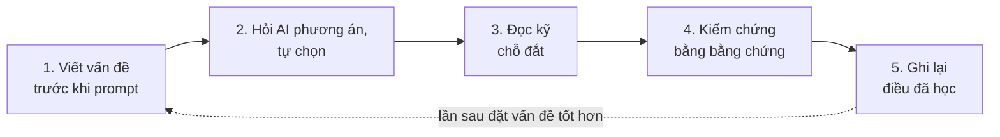

**Thói quen 1 - Viết vấn đề trước khi prompt.** Trước khi mở khung chat AI, viết 2-3 câu vào ghi chú: *"Vấn đề là... Thành công khi... Không làm..."*. Nếu bạn không viết được 3 câu này, bạn chưa sẵn sàng giao việc - cho AI hay cho người.

**Thói quen 2 - Hỏi phương án, tự chọn.** Thay vì "viết code làm X", thử hỏi: *"Cho tôi 3 cách làm X, kèm ưu nhược điểm của từng cách trong bối cảnh [mô tả]."* Rồi **bạn** chọn, và ghi một dòng vì sao. Thói quen này biến AI từ "người ra quyết định ngầm" thành "người tư vấn".

**Thói quen 3 - Đọc kỹ chỗ đắt.** Không phải dòng code nào cũng đáng đọc kỹ như nhau. Tập trung vào: biên của vòng lặp, xử lý lỗi, chỗ chạm tiền/dữ liệu/quyền, chỗ có concurrency, chỗ gọi ra ngoài (network, database). Đọc lướt phần còn lại.

**Thói quen 4 - Kiểm chứng bằng bằng chứng.** "Em thấy chạy ổn" không phải bằng chứng. Bằng chứng là: test có thể đỏ, số đo trước/sau, chạy trên dữ liệu giống thật, log cho thấy luồng đi đúng.

**Thói quen 5 - Ghi lại điều đã học.** Mỗi khi AI sai một cách đáng nhớ, hoặc bạn phát hiện một ràng buộc ngầm của hệ thống, ghi lại một dòng. Sau vài tháng, danh sách này trở thành **bối cảnh** quý giá - cho chính bạn, cho đồng nghiệp mới, và cho chính AI (khi bạn đưa nó vào spec hoặc tài liệu dự án).

!!! tip "Thử ngay trong tuần này"
    Chọn **một** thói quen trong năm thói quen trên (gợi ý: thói quen 1) và áp dụng cho mọi việc trong 5 ngày làm việc. Cuối tuần, so sánh: số lần phải sửa lại, số câu hỏi phát sinh giữa chừng, cảm giác "hiểu mình đang làm gì".

### 💡 Tips quan trọng

- **Đừng tranh đua tốc độ gõ với AI** - bạn sẽ thua. Hãy tranh đua ở chỗ AI yếu: bối cảnh, phán đoán, kiểm chứng, trách nhiệm.
- **Thời gian suy nghĩ trước khi code không phải là "chậm"** - nó là khoản đầu tư rẻ nhất trong toàn bộ vòng đời.
- **Câu hỏi hay hơn câu trả lời nhanh.** "Khi nào nó xảy ra?", "Ai bị ảnh hưởng?", "Bao nhiêu?", "Làm sao biết đã xong?" - bốn câu này giải quyết được rất nhiều ticket.
- **Dùng AI để học, không chỉ để làm.** Sau khi AI giải xong, hỏi tiếp: "Vì sao cách này đúng? Trường hợp nào nó sai? Có cách nào khác?"

---

## 📖 7. Tình huống trước / sau

Lý thuyết đủ rồi. Dưới đây là bốn tình huống thật (đã đổi tên) cho thấy "tư duy" trông như thế nào trong công việc. Mỗi tình huống có cách làm **trước** (bắt đầu từ code) và **sau** (bắt đầu từ tư duy).

### 7.1. Tình huống A - "Đơn hàng bị trùng"

**Bối cảnh:** App giao đồ ăn. CSKH báo: thỉnh thoảng một khách bị tạo **hai đơn giống hệt** và bị trừ tiền hai lần.

**❌ Trước:** Kỹ sư mở AI: *"Thêm kiểm tra: nếu cùng user đặt cùng món trong 1 phút thì chặn đơn thứ hai."* AI viết code trong 30 giây. Deploy. Tuần sau, CSKH báo: khách đặt **cố ý** hai suất cơm giống nhau cho hai người (hai lần bấm riêng) bị chặn. Đơn trùng vẫn xảy ra ở một số trường hợp khác.

**✅ Sau:** Kỹ sư hỏi: *"Đơn trùng xuất hiện **khi nào**?"* Xem log: các đơn trùng cách nhau 3-8 giây, đều xảy ra khi mạng của khách chập chờn. Vẽ lại luồng:

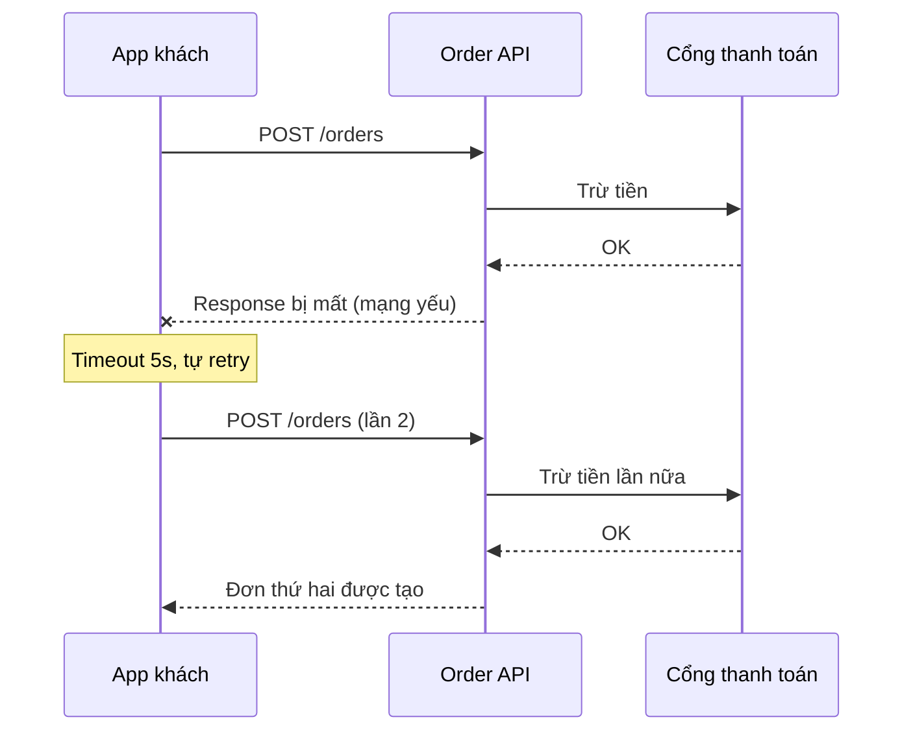

Vấn đề thật: **retry không có idempotency key** (khóa chống trùng). Giải pháp: client sinh `Idempotency-Key` một lần cho mỗi lần bấm "Đặt hàng", server lưu key và trả lại kết quả cũ nếu gặp key trùng. Giải pháp này **không chặn** khách cố ý đặt hai suất, và **chặn hoàn toàn** đơn trùng do retry.

**Tư duy đã dùng:** hỏi "khi nào" thay vì "làm sao chặn"; nhìn hệ thống (client retry + mạng + thanh toán) thay vì một hàm. Xem thêm idempotency ở [Backend - Bài 10](../backend/10-system-design.md).

### 7.2. Tình huống B - "Làm chức năng tìm kiếm"

**Bối cảnh:** Website bán sách, PM yêu cầu "thêm ô tìm kiếm sách".

**❌ Trước:** AI sinh: `SELECT * FROM books WHERE title LIKE '%' || :q || '%'`. Chạy tốt trên máy dev (500 sách). Trên production (2 triệu đầu sách), mỗi lần tìm mất 4 giây, CPU database lên 95% khi có 50 người tìm cùng lúc.

**✅ Sau:** Kỹ sư hỏi PM bốn câu trước khi code:

1. Khách tìm theo gì? (tên sách, tác giả, ISBN?) → *Chủ yếu tên sách và tác giả, gõ tiếng Việt không dấu.*
2. Có bao nhiêu sách? Bao nhiêu lượt tìm/giây giờ cao điểm? → *2 triệu sách, khoảng 30 lượt/giây.*
3. Kết quả cần sắp xếp thế nào? → *Sách bán chạy lên trước.*
4. Thành công nghĩa là gì? → *Tỷ lệ khách bấm vào kết quả sau khi tìm tăng; hiện tại 40% lượt tìm không ra gì.*

Câu trả lời số 1 ("tiếng Việt không dấu") đã loại `LIKE` ngay lập tức: "nha gia kim" phải ra "Nhà giả kim". Kỹ sư chọn full-text search có chuẩn hóa bỏ dấu (của PostgreSQL trước, cân nhắc search engine riêng nếu cần), rồi giao AI viết phần chuẩn hóa và query cụ thể.

**Tư duy đã dùng:** câu hỏi làm rõ (xem [Bài 3](./03-problem-framing.md)), ước lượng quy mô, định nghĩa thành công bằng metric.

### 7.3. Tình huống C - "Thêm cột vào bảng lớn"

**Bối cảnh:** Fintech, cần thêm cột `risk_score` vào bảng `transactions` (800 triệu dòng) và điền giá trị cho dữ liệu cũ.

**❌ Trước:** AI sinh migration: `ALTER TABLE ... ADD COLUMN ... DEFAULT 0 NOT NULL;` rồi `UPDATE transactions SET risk_score = compute(...)`. Test trên staging (10.000 dòng): 2 giây. Chạy trên production: câu `UPDATE` khóa bảng và chạy... 6 tiếng. Toàn bộ giao dịch bị treo. Sự cố cấp 1.

**✅ Sau:** Kỹ sư hỏi: *"Thao tác này trên 800 triệu dòng thì khóa gì, trong bao lâu? Nếu phải dừng giữa chừng thì sao? Quay lại được không?"* Kế hoạch:

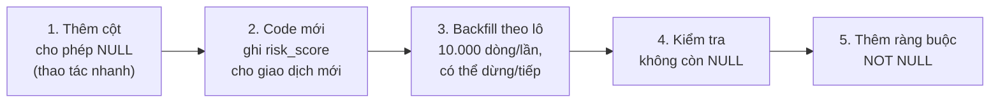

Mỗi bước đều **đảo ngược được** và **dừng được**. AI vẫn viết code cho từng bước - nhanh và tốt. Nhưng **chia bước thế nào** là quyết định của kỹ sư.

**Tư duy đã dùng:** nghĩ về quy mô, quyết định đảo ngược vs không đảo ngược ([Bài 4](./04-mental-models.md)), "nếu hỏng thì sao" ([Bài 5](./05-failure-thinking.md)).

### 7.4. Tình huống D - "Hệ thống chậm, thêm cache đi"

**Bối cảnh:** Hệ thống quản lý kho, API báo cáo tồn kho chậm. Sếp nói: *"Thêm Redis cache vào là xong."*

**❌ Trước:** AI thêm cache cho 6 API. Một tuần sau: số liệu tồn kho trên báo cáo lệch với thực tế, nhân viên kho xuất nhầm hàng đã hết. Team thêm logic xóa cache khi có thay đổi - ở 14 chỗ khác nhau. Hai tháng sau, không ai dám đụng vào logic xóa cache nữa.

**✅ Sau:** Kỹ sư **đo trước**: bật tracing cho API báo cáo. Kết quả: 85% thời gian nằm ở **một** câu query tính tổng tồn kho, quét toàn bộ bảng lịch sử nhập-xuất (40 triệu dòng) mỗi lần gọi. Giải pháp: duy trì một bảng `inventory_balance` được cập nhật trong cùng transaction với mỗi lần nhập/xuất. API báo cáo đọc bảng này: từ 3 giây xuống 15ms, **không có cache, không có dữ liệu cũ**.

**Tư duy đã dùng:** đo trước khi tối ưu; tìm nút thắt thật (Theory of Constraints); nhận ra cache là một "giải pháp" có hệ quả bậc hai (dữ liệu cũ, logic invalidation lan khắp nơi). Đây là một ví dụ của archetype "**fixes that fail**" mà bạn sẽ gặp ở [Bài 2](./02-systems-thinking-basics.md).

### 7.5. Điểm chung của bốn tình huống

| | Cách làm "trước" | Cách làm "sau" |
|-|------------------|----------------|
| Điểm bắt đầu | Một **giải pháp** (chặn trùng, LIKE, ALTER, cache) | Một **câu hỏi** (khi nào? ai? bao nhiêu? ở đâu?) |
| Phạm vi nhìn | Một hàm, một file | Cả luồng, cả hệ thống, cả người dùng |
| Vai trò của AI | Ra quyết định (vô tình) | Thực thi quyết định đã được suy nghĩ |
| Kiểm chứng | Test xanh trên dữ liệu nhỏ | Đo trên dữ liệu thật, nghĩ đến quy mô |
| Thời gian trước khi viết code | ~0 phút | 20-60 phút |
| Tổng thời gian đến khi **thực sự xong** | Dài (vì phải sửa lại, có sự cố) | Ngắn hơn |

Chú ý dòng cuối. Cách làm "sau" **chậm hơn lúc đầu và nhanh hơn về tổng thể**. Đây là một kiểu đánh đổi bạn sẽ gặp lại rất nhiều: tối ưu cục bộ (đóng ticket nhanh) vs tối ưu toàn cục (vấn đề được giải quyết thật).

---

## 📖 8. Chịu trách nhiệm: "AI viết" không phải là lời bào chữa

### 8.1. Ai chịu trách nhiệm?

Trong ngành hàng không, khi máy bay chạy chế độ lái tự động (autopilot), phi công **vẫn là người chịu trách nhiệm** về chuyến bay. Autopilot làm phần lớn công việc lái, nhưng phi công phải giám sát, hiểu hệ thống đang làm gì, và sẵn sàng tiếp quản ngay lập tức. Có những tai nạn hàng không xảy ra chính vì phi công quá quen với autopilot, đến lúc cần tự lái thì kỹ năng đã mai một và không hiểu máy đang ở trạng thái nào.

Phần mềm cũng vậy. Khi bạn bấm "Approve" hay "Merge", bạn đang ký tên: **"Tôi đã kiểm tra, và tôi chịu trách nhiệm."** Khách hàng bị trừ tiền hai lần không quan tâm code do ai viết.

### 8.2. Trách nhiệm trông như thế nào trong thực tế?

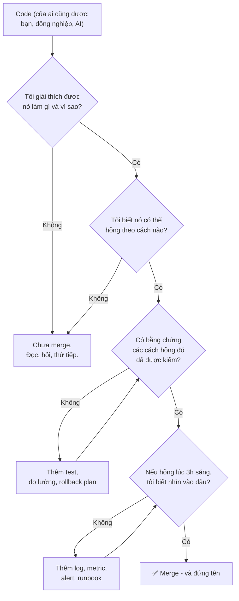

Bốn câu hỏi này không mới - kỹ sư giỏi luôn tự hỏi như vậy. Điều mới là: khi code được sinh ra **không qua đầu bạn**, bạn phải **chủ động** hỏi chúng, vì cảm giác "mình hiểu code này" không còn tự đến từ việc đã gõ từng dòng.

### 8.3. Trách nhiệm cũng là lợi thế cạnh tranh

Nghe thì "chịu trách nhiệm" có vẻ là gánh nặng. Nhưng hãy nhìn từ góc độ người thuê bạn: công ty không trả lương cho **code**, họ trả lương cho **kết quả mà họ có thể tin tưởng**. Khi code trở nên rẻ, thứ khan hiếm là **người mà khi họ nói "xong rồi, chạy đúng" thì nó thực sự xong và đúng**. Sự tin cậy đó tích lũy kép qua từng lần bạn giữ lời.

---

## 📖 9. Bản đồ cho phần còn lại của khóa học

Bốn tình huống ở mục 7 đã dùng gần như toàn bộ công cụ mà khóa học sẽ dạy. Bảng dưới đây nối chúng lại:

| Bạn đã thấy trong bài này | Học kỹ ở |
|--------------------------|----------|
| Retry tạo ra đơn trùng; vòng xoáy kỹ năng | [Bài 2 - Systems Thinking căn bản](./02-systems-thinking-basics.md): vòng phản hồi, retry storm |
| "Trang chậm" → "p99 của 2% reseller" | [Bài 3 - Đặt đúng vấn đề](./03-problem-framing.md) |
| Tìm nút thắt trước khi thêm cache; quyết định đảo ngược được | [Bài 4 - Mental models](./04-mental-models.md) |
| Migration khóa bảng 6 tiếng | [Bài 5 - Tư duy về thất bại](./05-failure-thinking.md) |
| Chọn full-text search vs search engine | [Bài 6 - Từ ý tưởng đến kiến trúc](./06-idea-to-architecture.md) |
| Spec cụ thể cho AI; review chỗ rủi ro | [Bài 7 - Làm việc với AI như một kỹ sư](./07-engineering-with-ai.md) |
| (Tính năng có LLM bên trong) | [Bài 8 - Xây hệ thống có AI bên trong](./08-building-ai-systems.md) |
| Test với user 3.000 đơn, hai đơn trùng timestamp | [Bài 9 - Tư duy kiểm chứng](./09-verification-mindset.md) |

---

## 🌍 Tình huống thực tế

### Câu chuyện: "Năng suất tăng gấp ba" ở một startup SaaS

Một startup SaaS quản lý bán hàng (khoảng 25 kỹ sư) triển khai trợ lý AI cho toàn đội. Ban giám đốc đặt mục tiêu: **tăng năng suất**, đo bằng **số PR merge mỗi tuần**.

**Tháng 1-2:** Số PR tăng từ ~120 lên ~350 mỗi tuần. Ban giám đốc rất hài lòng, chia sẻ con số trong buổi all-hands.

**Tháng 3:** Số sự cố production tăng gấp đôi. Thời gian review mỗi PR giảm từ 25 phút xuống 6 phút (vì quá nhiều PR, reviewer "lướt"). Hai senior than phiền rằng họ dành cả ngày review code mà không hiểu mục đích.

**Tháng 4:** Một sự cố nghiêm trọng: một PR "dọn dẹp code không dùng" do AI đề xuất đã xóa một đoạn xử lý múi giờ mà một khách hàng doanh nghiệp lớn ở Úc phụ thuộc vào. Không test nào bắt được, vì đoạn code đó vốn chưa có test. Khách hàng bị sai báo cáo doanh thu cả tháng.

**Tháng 5:** CTO mới vào, vẽ lên bảng:

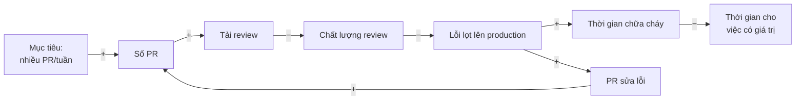

*(Dấu `+`: cùng chiều - cái này tăng thì cái kia tăng. Dấu `−`: ngược chiều - cái này tăng thì cái kia giảm. Bạn sẽ học cách vẽ sơ đồ này ở Bài 2.)*

Để ý vòng `Số PR → Tải review → Chất lượng review → Lỗi → PR sửa lỗi → Số PR`: lỗi tạo thêm PR, làm "năng suất" (theo metric) càng **tăng**. Metric đã trở thành mục tiêu, và nó không còn đo đúng thứ cần đo - đây chính là **định luật Goodhart** ([Bài 4](./04-mental-models.md)).

**Thay đổi CTO đưa ra:**

1. Bỏ metric "số PR". Thay bằng các chỉ số DORA (tần suất deploy, lead time, tỷ lệ thay đổi gây lỗi, thời gian khôi phục) - xem sách *Accelerate*.
2. Mỗi PR phải có mục "**Vấn đề và cách kiểm chứng**" 3-5 dòng, viết bởi người, không phải AI.
3. PR chạm vào thanh toán, múi giờ, phân quyền phải có test tương ứng **trước** khi thay đổi logic.
4. Dành 20% thời gian mỗi sprint để viết test cho các vùng "chưa ai hiểu".

**Ba tháng sau:** Số PR giảm về ~200/tuần (vẫn cao hơn trước AI), số sự cố giảm về dưới mức trước AI, và lead time từ ý tưởng đến production **ngắn hơn** so với giai đoạn "350 PR/tuần".

**Bài học:** AI đã thực sự giúp team nhanh hơn - nhưng chỉ khi tư duy về **hệ thống** (vòng phản hồi review, metric đúng, kiểm chứng) theo kịp tốc độ sinh code.

---

## ⚠️ Sai lầm thường gặp

### 1. "AI viết được rồi, không cần học nền tảng nữa"

❌ Bỏ qua cấu trúc dữ liệu, database, network vì "hỏi AI là xong".

✅ Học nền tảng để **đánh giá** đầu ra của AI. Không có nền tảng, bạn không phân biệt được câu trả lời đúng với câu trả lời "nghe đúng".

### 2. Đo năng suất bằng lượng code / số PR / số ticket

❌ "Tuần này em merge 30 PR!"

✅ Đo bằng **vấn đề được giải quyết** và **kết quả cho người dùng**. Một PR xóa 2.000 dòng code thừa có thể giá trị hơn 30 PR thêm tính năng.

### 3. Dán nguyên ticket mơ hồ vào AI

❌ "Làm tính năng export Excel cho trang đơn hàng."

✅ Làm rõ trước: ai export, export để làm gì, bao nhiêu dòng, định dạng nào, có giới hạn quyền không. Rồi mới giao AI một spec rõ ràng.

### 4. Tin vào sự tự tin của AI

❌ "AI nói đây là cách tốt nhất và an toàn."

✅ AI dùng giọng tự tin như nhau cho câu đúng và câu sai. Hỏi: "Bằng chứng là gì? Tôi kiểm tra điều này bằng cách nào?"

### 5. "Test xanh là xong"

❌ AI viết code và cũng viết test, test xanh, merge.

✅ Test do cùng một "người" viết với code thường có cùng điểm mù. Tự hỏi: "Test này có kiểm cái **quan trọng nhất** không? Có test nào **có thể đỏ** nếu code sai không?"

### 6. Hoảng loạn hoặc phủ nhận

❌ "AI sẽ lấy hết việc, học gì cũng vô ích" hoặc "AI vô dụng, tôi không dùng".

✅ Dùng AI hằng ngày **và** đầu tư có chủ đích vào kỹ năng tích lũy kép. Hai việc này bổ trợ nhau.

### 7. Đổ lỗi cho công cụ

❌ "Lỗi này do AI sinh code sai."

✅ "Tôi đã merge code chưa được kiểm chứng đủ. Lần sau tôi sẽ..." - người chịu trách nhiệm là người bấm merge.

### 8. Dùng thời gian tiết kiệm được để làm thêm việc giống hệt

❌ AI giúp làm xong ticket nhanh hơn → nhận thêm ticket cùng loại.

✅ Dành một phần thời gian tiết kiệm được để **hiểu hệ thống sâu hơn**: đọc dashboard, đọc postmortem, nói chuyện với người dùng, học nghiệp vụ.

---

## 🏋️ Bài tập

Các bài tập dưới đây chủ yếu là **tự suy ngẫm** về công việc của chính bạn. Không có đáp án "đúng" duy nhất - phần đáp án gợi ý giúp bạn so sánh và tự đánh giá. Hãy viết ra giấy hoặc file, đừng chỉ nghĩ trong đầu.

### Bài 1 (Dễ): Phân loại việc trong tuần

Liệt kê 10 việc bạn đã làm trong tuần vừa rồi (hoặc trong một dự án học tập gần đây). Với mỗi việc, ghi:

- Thuộc bước nào trong vòng đời (hiểu vấn đề / quyết định / viết code / kiểm chứng / vận hành)?
- AI có thể làm phần lớn việc này không? (Có / Một phần / Không)
- Nếu AI làm sai, bạn có phát hiện được không?

<details markdown="1">
<summary>Gợi ý cách đọc kết quả</summary>

- Nếu **hơn 60%** việc của bạn là "viết code" và AI "Có thể làm phần lớn" → bạn đang ở vùng dễ bị thay thế nhất. Hãy chủ động nhận thêm việc ở bước "hiểu vấn đề" và "kiểm chứng" (ví dụ: xin tham gia buổi làm rõ yêu cầu với PM, xin viết test plan).
- Nếu có nhiều việc mà "AI làm sai thì **không** phát hiện được" → đây là nơi bạn cần xây công cụ kiểm chứng (test, dashboard, so sánh dữ liệu).
- Ví dụ một bảng tốt:

| Việc | Bước | AI làm được? | Sai thì phát hiện? |
|------|------|-------------|-------------------|
| Viết API lấy danh sách voucher | Viết code | Có | Có (test) |
| Họp làm rõ quy tắc áp voucher chồng nhau | Hiểu vấn đề | Không | - |
| Sửa bug voucher áp sai cho đơn > 1 triệu | Kiểm chứng + code | Một phần | Có, nếu có test case biên |
| Viết script đối soát voucher đã dùng | Viết code | Có | **Không chắc** - cần so với số liệu kế toán |

</details>

### Bài 2 (Dễ): Viết lại prompt

Viết lại các yêu cầu sau thành một yêu cầu rõ ràng mà một AI (hoặc đồng nghiệp mới) có thể làm đúng. Bạn được phép **giả định** bối cảnh hợp lý, nhưng phải ghi rõ giả định.

1. "Tối ưu API này cho nhanh."
2. "Thêm tính năng gửi email cho khách."
3. "Fix bug login."

<details markdown="1">
<summary>Đáp án gợi ý cho câu 2</summary>

> **Bối cảnh (giả định):** Shop online, khách đặt hàng xong hiện không nhận được xác nhận nào ngoài màn hình cảm ơn; CSKH nhận ~200 cuộc gọi/ngày hỏi "đơn của tôi đặt được chưa".
>
> **Yêu cầu:** Gửi email xác nhận đơn hàng sau khi đơn chuyển sang trạng thái `CONFIRMED` (không gửi ở `PENDING`, vì đơn có thể bị hủy khi thanh toán thất bại).
>
> **Ràng buộc:**
> - Gửi **bất đồng bộ** qua queue có sẵn (`notifications`), không được làm chậm API đặt hàng.
> - Mỗi đơn chỉ gửi **đúng một** email kể cả khi event bị xử lý lại (dùng `order_id` làm khóa chống trùng).
> - Dùng template có sẵn trong `templates/order_confirmed.html`; không đưa thông tin thẻ thanh toán vào email.
>
> **Ngoài phạm vi:** SMS, push notification, email marketing.
>
> **Hoàn thành khi:** có test cho: gửi khi CONFIRMED, không gửi khi PENDING, không gửi trùng khi event lặp, retry khi dịch vụ email lỗi tạm thời.
>
> **Đo thành công:** số cuộc gọi CSKH hỏi trạng thái đơn giảm (theo dõi 2 tuần).

Để ý cấu trúc: bối cảnh → yêu cầu → ràng buộc → ngoài phạm vi → điều kiện hoàn thành → đo thành công. Bạn sẽ học cấu trúc đầy đủ ở [Bài 3](./03-problem-framing.md).
</details>

### Bài 3 (Trung bình): Phân tích một PR của chính bạn

Chọn một PR gần đây có dùng AI (hoặc một đoạn code bạn nhờ AI viết). Trả lời:

1. Prompt đầu tiên của bạn là gì? Nó đóng khung vấn đề đúng chưa?
2. Bạn đã thay đổi gì so với đầu ra đầu tiên của AI? Vì sao?
3. Có chỗ nào bạn **không thực sự hiểu** nhưng vẫn giữ lại không?
4. Theo phép thử ở mục 6.4, giá trị gia tăng của bạn trong PR đó là bao nhiêu (thấp / trung bình / cao)?

<details markdown="1">
<summary>Gợi ý tự đánh giá</summary>

- Nếu câu 2 là "không thay đổi gì" và câu 3 là "có" → đây là dấu hiệu của vòng xói mòn. Không cần tự trách, nhưng hãy đặt quy tắc: **không merge đoạn nào mình không giải thích được**.
- Nếu câu 2 có những thay đổi kiểu "thêm xử lý trường hợp X mà AI bỏ sót", "đổi hướng vì biết ràng buộc Y của hệ thống", "bỏ phần thừa" → đó là giá trị của bạn. Hãy ghi chú lại những loại thay đổi này: chúng cho bạn biết **AI hay thiếu gì** trong bối cảnh dự án của bạn, và bạn có thể đưa chúng vào spec từ đầu lần sau.
</details>

### Bài 4 (Trung bình): Bản đồ kỹ năng cá nhân

Vẽ một bảng hai cột: **kỹ năng mất giá** và **kỹ năng tích lũy kép** (dựa trên mục 5.1), điền các kỹ năng **bạn đang có**. Sau đó chọn **một** kỹ năng tích lũy kép bạn muốn đầu tư trong 3 tháng tới và viết kế hoạch cụ thể: làm gì mỗi tuần, đo tiến bộ thế nào.

<details markdown="1">
<summary>Ví dụ kế hoạch tốt</summary>

**Kỹ năng:** Kiến thức nghiệp vụ thanh toán (domain knowledge).

| Tuần | Việc làm | Bằng chứng tiến bộ |
|------|----------|-------------------|
| 1-2 | Đọc tài liệu tích hợp của cổng thanh toán công ty đang dùng, vẽ lại luồng thanh toán - hoàn tiền | Sơ đồ được senior xác nhận đúng |
| 3-4 | Đọc 5 postmortem gần nhất liên quan thanh toán | Viết 1 trang tóm tắt "các cách thanh toán của chúng ta từng hỏng" |
| 5-8 | Ngồi cùng team đối soát 2 buổi, hiểu cách họ đối chiếu tiền | Giải thích được cho người mới vì sao cần đối soát hằng ngày |
| 9-12 | Đề xuất một cải tiến nhỏ (ví dụ: alert khi lệch đối soát) | PR được merge, alert hoạt động |

Kế hoạch tốt có **việc cụ thể** và **bằng chứng kiểm chứng được** - chính là tư duy bạn đang học, áp dụng lên bản thân.
</details>

### Bài 5 (Khó): Phân tích trước/sau

Chọn một sự cố hoặc một tính năng "làm lại" ở nơi bạn làm việc (hoặc tìm một postmortem công khai trên Internet). Viết lại theo format của mục 7:

- **Bối cảnh**
- **Cách làm đã xảy ra** (bắt đầu từ giải pháp nào?)
- **Cách làm nếu bắt đầu từ câu hỏi** (những câu hỏi nào lẽ ra nên được hỏi?)
- **Tư duy đã thiếu** (đặt vấn đề? nhìn hệ thống? kiểm chứng? quy mô?)

<details markdown="1">
<summary>Tiêu chí tự chấm</summary>

Một bài phân tích tốt:

- [ ] Không đổ lỗi cho cá nhân - tập trung vào **quy trình và cách nghĩ**
- [ ] Chỉ ra được **câu hỏi cụ thể** (không phải "lẽ ra nên cẩn thận hơn")
- [ ] Có ít nhất một yếu tố **ngoài code** (người dùng, quy mô dữ liệu, quy trình review, metric...)
- [ ] Ước lượng được chi phí: nếu phát hiện sớm hơn thì tiết kiệm được gì
- [ ] Đề xuất được **một thay đổi hệ thống** (quy trình, checklist, test, alert) để lần sau không lặp lại, chứ không chỉ "lần sau chú ý hơn"
</details>

### Bài 6 (Khó): Thiết kế quy tắc dùng AI cho team

Bạn là tech lead của một team 6 người làm hệ thống ví điện tử. Hãy viết một bộ **quy tắc dùng AI** (không quá 1 trang) cho team. Bộ quy tắc phải: cho phép team tận dụng tối đa AI ở vùng an toàn, kiểm soát rủi ro ở vùng nguy hiểm, và **không biến thành thủ tục rườm rà** khiến mọi người lách luật.

<details markdown="1">
<summary>Đáp án gợi ý</summary>

**Quy tắc dùng AI - Team Ví**

1. **Mặc định: dùng thoải mái.** Viết code, test, tài liệu, script, giải thích code, brainstorm - không cần xin phép.
2. **Người merge là người chịu trách nhiệm.** "AI viết" không bao giờ là lý do trong postmortem.
3. **Vùng đỏ** (chạm vào số dư, giao dịch, phân quyền, mã hóa, dữ liệu cá nhân):
   - PR phải có mục "Vấn đề / Cách kiểm chứng / Cách rollback" do người viết.
   - Phải có test thể hiện **cách nó có thể sai** (số âm, trùng lặp, đồng thời, timeout).
   - Cần 1 reviewer đã từng làm vùng đó.
4. **Không đưa vào AI:** secret, dữ liệu khách hàng thật, log có số tài khoản. Dùng dữ liệu giả lập.
5. **Giải thích được mới merge:** reviewer có quyền hỏi "đoạn này làm gì?" - người viết phải trả lời được mà không mở AI.
6. **Mỗi tháng 1 buổi 30 phút:** chia sẻ một lần AI giúp rất tốt và một lần AI làm sai mà suýt lọt.

Để ý: quy tắc 1 làm cho bộ quy tắc **dễ được tuân thủ** (không cấm đoán chung chung); quy tắc 3 chỉ áp cho vùng rủi ro thật; quy tắc 6 tạo **vòng phản hồi học hỏi** cho cả team.
</details>

### Bài 7 (Khó, dài hạn): Nhật ký quyết định 30 ngày

Trong 30 ngày, mỗi khi bạn đưa ra một quyết định kỹ thuật (dù nhỏ: chọn thư viện, chọn cách xử lý lỗi, chấp nhận hay sửa đề xuất của AI), ghi một dòng:

```text
Ngày | Quyết định | Phương án bị loại | Lý do | Mức tự tin (1-5) | Kết quả (điền sau)
```

Sau 30 ngày, quay lại điền cột "Kết quả" và trả lời:

1. Bao nhiêu % quyết định mức tự tin 5 hóa ra đúng? Mức tự tin 2-3 thì sao?
2. Có quyết định nào bạn **để AI quyết thay** mà không nhận ra (không có "phương án bị loại")?
3. Kiểu quyết định nào bạn hay sai nhất?

<details markdown="1">
<summary>Vì sao bài tập này quan trọng</summary>

Đây là cách rèn **phán đoán** (judgment) - kỹ năng tích lũy kép quan trọng nhất và khó rèn nhất, vì phản hồi về một quyết định thường đến **rất muộn** (vài tuần, vài tháng). Không ghi lại thì bạn sẽ quên mình đã nghĩ gì lúc đó, và "học" sai từ kết quả (ví dụ: quyết định tốt nhưng gặp xui → kết luận nhầm là quyết định tệ).

Câu hỏi 2 thường gây bất ngờ nhất: nhiều người phát hiện ra 30-50% "quyết định" của mình thực chất là **chấp nhận mặc định của AI** mà không hề cân nhắc phương án khác. Không phải lúc nào điều đó cũng sai - nhưng bạn nên **biết** là mình đang làm vậy.

Độ trễ giữa hành động và phản hồi là một khái niệm then chốt của systems thinking - bạn sẽ gặp nó ở [Bài 2](./02-systems-thinking-basics.md) (delays).
</details>

---

## ✅ Checklist hoàn thành

- [ ] Nêu được ít nhất **5 việc AI làm tốt** và **5 việc AI làm kém** (hoặc không thể làm thay) trong phát triển phần mềm, kèm lý do
- [ ] Áp dụng được phép thử **"Sai thì phát hiện được không? Hậu quả? Sửa dễ không?"** trước khi giao việc cho AI
- [ ] Giải thích được vì sao **code rẻ đi nhưng quyết định sai đắt hơn** (nghịch lý Jevons, chi phí sửa sai theo thời điểm)
- [ ] Phân biệt được kỹ năng **mất giá nhanh** và kỹ năng **tích lũy kép**, và chọn được một kỹ năng để đầu tư
- [ ] Mô tả được **vòng khuếch đại** và **vòng xói mòn** khi dùng AI, và nhận ra mình đang ở vòng nào
- [ ] Phân tích được một tình huống theo format **trước/sau**: bắt đầu từ giải pháp vs bắt đầu từ câu hỏi
- [ ] Trả lời được **bốn câu hỏi chịu trách nhiệm** trước khi merge một đoạn code
- [ ] Hoàn thành ít nhất 3 bài tập ở trên (viết ra, không chỉ nghĩ)

---

**Bài tiếp theo**: [Bài 2: Systems Thinking căn bản](./02-systems-thinking-basics.md)
