# 📚 Bài 2: Systems Thinking căn bản

> "Một hệ thống không phải là tổng các thành phần của nó. Nó là **tích** của các tương tác giữa chúng." - phỏng theo Russell Ackoff

2 giờ 14 phút sáng, điện thoại on-call rung. Dashboard đỏ rực: tỷ lệ lỗi API thanh toán 85%. Kỹ sư on-call vào kiểm tra: database bình thường, CPU các service bình thường, không có deploy nào trong 6 tiếng qua. Mười phút trước, database có **một lần chậm 3 giây** do một tác vụ backup - và nó đã hồi phục ngay sau đó. Vậy tại sao, 10 phút sau, hệ thống vẫn sập?

Câu trả lời không nằm ở **thành phần** nào. Không có thành phần nào hỏng. Câu trả lời nằm ở **cách các thành phần tương tác**: client timeout → retry → tải tăng gấp ba → server chậm hơn → nhiều timeout hơn → nhiều retry hơn. Một cú vấp 3 giây đã kích hoạt một **vòng phản hồi** tự duy trì, và hệ thống bị kẹt trong trạng thái hỏng **dù nguyên nhân ban đầu đã biến mất**.

Đây là loại vấn đề mà tư duy "từng thành phần một" không bao giờ giải được. Bạn có thể soi từng dòng code, từng service, và mọi thứ đều "đúng". Muốn hiểu nó, bạn cần một cách nhìn khác: **tư duy hệ thống (systems thinking)**.

Bài này cho bạn bộ từ vựng và công cụ cơ bản của tư duy hệ thống - stock, flow, vòng phản hồi, độ trễ, mô hình tảng băng, các archetype - và áp dụng chúng vào những vấn đề rất thật của kỹ sư phần mềm.

## 🎯 Mục tiêu bài học

- Hiểu **hệ thống = thành phần + kết nối + mục đích**, và vì sao "mục đích" là thứ quyết định hành vi
- Dùng mô hình **stock & flow** (bồn tắm) để phân tích backlog, nợ kỹ thuật, hàng đợi, connection pool
- Nhận diện và vẽ **vòng phản hồi tăng cường (R)** và **cân bằng (B)** bằng **causal loop diagram** với nhãn `+`/`−`
- Hiểu vì sao **độ trễ** gây ra **dao động** (autoscaling, tuyển người, điều chỉnh vòi sen)
- Nhận ra **tính phi tuyến**, **ngưỡng**, **tính trồi (emergence)** và cách **vẽ ranh giới** hệ thống
- Dùng **mô hình tảng băng** (sự kiện → khuôn mẫu → cấu trúc → mô hình tư duy) để đi từ chữa cháy đến sửa gốc
- Phân tích các hệ thống phần mềm thật: **retry storm** (có mô phỏng chạy được bằng Go/Python), **autoscaling dao động**, **vòng nợ kỹ thuật**, **vòng kiệt sức on-call**, **cache hit ratio**
- Nhận diện bốn **system archetype**: fixes that fail, shifting the burden, limits to growth, tragedy of the commons

---

## 📖 1. Hệ thống là gì?

### 1.1. Định nghĩa của Donella Meadows

Trong cuốn *Thinking in Systems*, Donella Meadows định nghĩa:

> **Hệ thống** là một tập hợp các **thành phần** (elements) được **kết nối** (interconnections) với nhau một cách có tổ chức để đạt được một **mục đích** (purpose / function).

Ba yếu tố:

| Yếu tố | Ví dụ: đội bóng đá | Ví dụ: hệ thống checkout của shop online |
|--------|-------------------|---------------------------------------|
| **Thành phần** | Cầu thủ, HLV, sân, bóng | Service giỏ hàng, service thanh toán, database, cổng thanh toán, khách hàng |
| **Kết nối** | Luật chơi, chiến thuật, cách chuyền bóng, giao tiếp trên sân | API call, message queue, timeout, retry, quy tắc nghiệp vụ, SLA với cổng thanh toán |
| **Mục đích** | Thắng trận | Chuyển ý định mua của khách thành đơn hàng đã thanh toán, chính xác và nhanh |

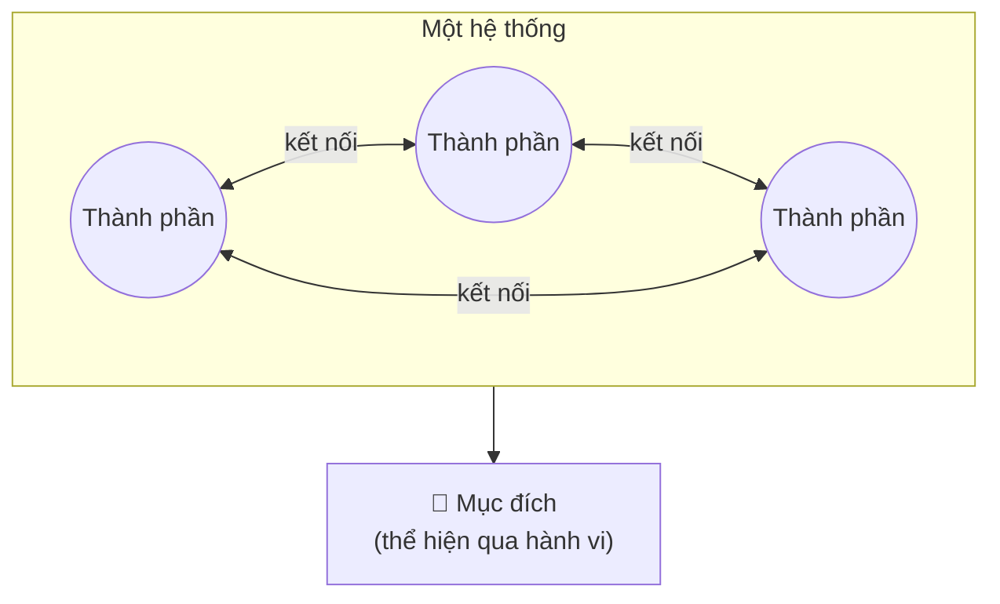

### 1.2. Thay đổi cái gì thì hệ thống thay đổi nhiều nhất?

Meadows đưa ra một quan sát bất ngờ:

- **Thay thành phần** thường **ít** thay đổi hệ thống. Đội bóng thay vài cầu thủ vẫn là đội bóng đó, chơi theo lối đó. Thay PostgreSQL bằng MySQL, hệ thống checkout vẫn hành xử gần như cũ.
- **Thay kết nối** thay đổi hệ thống **nhiều hơn**. Đổi luật chơi (ví dụ: không được dùng tay) thì cả trận đấu khác hẳn. Đổi chính sách retry từ "retry ngay 3 lần" sang "retry có backoff" thì hệ thống có thể chuyển từ "sập khi gặp sự cố nhỏ" sang "tự hồi phục".
- **Thay mục đích** thay đổi hệ thống **nhiều nhất**. Đội bóng có mục đích "không thua" sẽ chơi hoàn toàn khác đội có mục đích "thắng đậm". Một team kỹ thuật có mục đích ngầm "đóng nhiều ticket" sẽ tạo ra hệ thống hoàn toàn khác team có mục đích "giảm số lần khách phải gọi CSKH".

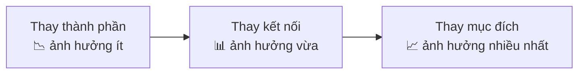

Đây là điều mà kỹ sư hay bỏ qua: khi gặp vấn đề, phản xạ đầu tiên là **thay thành phần** ("đổi sang database nhanh hơn", "viết lại bằng Go", "thêm Redis"). Trong khi đòn bẩy thường nằm ở **kết nối** (timeout, retry, giao thức giữa các team) và **mục đích** (metric, KPI, ưu tiên). Bạn sẽ học kỹ ý tưởng này qua **leverage points** ở [Bài 4](./04-mental-models.md).

### 1.3. Mục đích được suy ra từ hành vi, không phải từ lời nói

!!! warning "Một câu nổi tiếng"
    **"Mục đích của một hệ thống là những gì nó thực sự làm."** (The purpose of a system is what it does - Stafford Beer)

Công ty nói mục đích là "chất lượng là trên hết", nhưng thưởng cho người ship nhiều tính năng nhất và không ai bị hỏi gì khi gây sự cố → mục đích **thực sự** của hệ thống là "ship nhiều tính năng". Hành vi của mọi người sẽ đi theo mục đích thực sự, không phải khẩu hiệu.

Ví dụ trong phần mềm: một hệ thống alert được thiết kế "để phát hiện sự cố sớm", nhưng bắn 300 alert mỗi ngày, 95% là nhiễu. Hành vi thực tế của nó là: **dạy kỹ sư phớt lờ alert**. Đó chính là "mục đích" thực sự mà nó đang phục vụ.

---

## 📖 2. Tư duy tuyến tính vs tư duy hệ thống

Phần lớn chúng ta được dạy tư duy **tuyến tính**: A gây ra B, B gây ra C. Tìm nguyên nhân, loại bỏ nguyên nhân, xong.

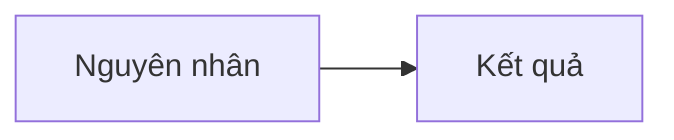

Tư duy tuyến tính rất hữu ích cho các lỗi cục bộ: `NullPointerException` ở dòng 42 vì biến chưa khởi tạo. Nhưng nó thất bại với các vấn đề **hệ thống**, nơi kết quả quay lại tác động lên nguyên nhân:

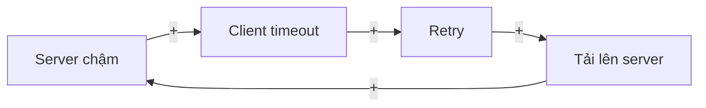

Trong vòng này, câu hỏi "**nguyên nhân** là gì?" trở nên kỳ lạ. Server chậm là nguyên nhân? Hay retry? Hay tải? Mỗi thứ vừa là nguyên nhân vừa là kết quả. Đây gọi là **nhân quả vòng tròn (circular causality)**.

| Tư duy tuyến tính | Tư duy hệ thống |
|------------------|-----------------|
| A gây ra B | A và B tác động qua lại |
| Tìm **một** nguyên nhân gốc | Tìm **cấu trúc** tạo ra hành vi |
| Nhìn vào **sự kiện** | Nhìn vào **khuôn mẫu theo thời gian** |
| Giải pháp: loại bỏ nguyên nhân | Giải pháp: thay đổi cấu trúc, kết nối, mục đích |
| Hệ quả đến ngay | Hệ quả có thể đến **muộn**, ở **chỗ khác** |
| "Ai làm hỏng?" | "Cấu trúc nào khiến việc hỏng là dễ xảy ra?" |

Không phải tư duy tuyến tính là sai. Nó là **trường hợp đặc biệt** của tư duy hệ thống, đúng khi vòng phản hồi yếu hoặc chậm đến mức có thể bỏ qua. Kỹ năng là **nhận ra khi nào** bạn đang ở trong một hệ thống có vòng phản hồi mạnh.

---

## 📖 3. Stock và Flow - mô hình bồn tắm

### 3.1. Bồn tắm

Hình dung một bồn tắm:

- **Lượng nước trong bồn** là **stock** (lượng tích trữ) - thứ bạn có thể đo tại một thời điểm.
- **Vòi nước chảy vào** là **inflow** (dòng vào) - tốc độ, đo bằng lít/phút.
- **Lỗ thoát nước** là **outflow** (dòng ra) - tốc độ, đo bằng lít/phút.

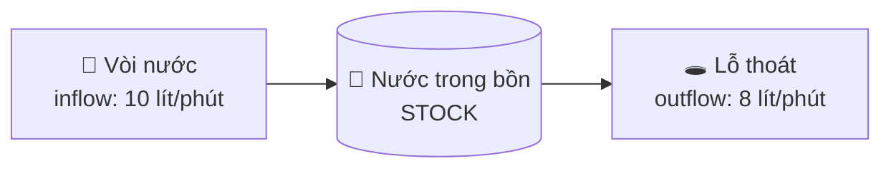

Ba quy luật đơn giản nhưng sâu sắc:

1. **Stock chỉ thay đổi qua flow.** Muốn bồn đầy hơn, chỉ có hai cách: tăng vòi hoặc giảm lỗ thoát.
2. **Stock tăng khi và chỉ khi inflow > outflow** - **bất kể** cả hai lớn hay nhỏ. Vòi 1.000 lít/phút, lỗ thoát 999 lít/phút, bồn vẫn đầy dần.
3. **Stock thay đổi chậm** (có quán tính). Dù bạn khóa vòi ngay, nước trong bồn không biến mất ngay. Stock là **bộ đệm** và cũng là **bộ nhớ** của hệ thống.

### 3.2. Stock và flow trong phần mềm

Khi đã quen, bạn sẽ thấy bồn tắm ở khắp nơi:

| Stock (lượng tích trữ) | Inflow (dòng vào) | Outflow (dòng ra) |
|----------------------|-------------------|-------------------|
| Số message trong Kafka (consumer lag) | Tốc độ producer gửi | Tốc độ consumer xử lý |
| Số bug đang mở | Bug mới được báo/tuần | Bug được sửa/tuần |
| Nợ kỹ thuật | Đường tắt, code vội | Refactor, xóa code thừa |
| Số connection đang dùng trong pool | Request cần connection | Request trả connection |
| Số user hoạt động | User mới, user quay lại | User rời bỏ (churn) |
| Kiến thức của team về hệ thống | Học, viết tài liệu, onboarding | Người nghỉ việc, quên, hệ thống thay đổi |
| Dung lượng ổ đĩa đã dùng | Log, dữ liệu ghi mới | Xóa log cũ, archive |
| Ngân sách cloud còn lại trong tháng | (cấp đầu tháng) | Chi phí chạy hằng ngày |

### 3.3. Ví dụ tính toán: backlog bug

Team của bạn nhận trung bình **30 bug mới/tuần** và sửa được **25 bug/tuần**. Hiện có 40 bug đang mở.

| Tuần | Bug mở đầu tuần | + Bug mới | − Bug sửa | Bug mở cuối tuần |
|------|----------------|-----------|-----------|-----------------|
| 1 | 40 | 30 | 25 | 45 |
| 2 | 45 | 30 | 25 | 50 |
| 4 | 55 | 30 | 25 | 60 |
| 12 | 95 | 30 | 25 | 100 |
| 52 | 295 | 30 | 25 | 300 |

Team rất chăm chỉ - sửa 25 bug/tuần là con số lớn! Nhưng backlog vẫn tăng đều 5 bug/tuần, mãi mãi. Sếp nhìn backlog 300 bug sau một năm và kết luận "team làm việc kém". Thực ra team làm việc **tốt**, chỉ là **inflow > outflow**.

Có hai đòn bẩy, và chúng **không** giống nhau:

- **Tăng outflow** (sửa nhanh hơn, thêm người): tốn kém, có giới hạn.
- **Giảm inflow** (ít bug được tạo ra hơn: test tốt hơn, review tốt hơn, sửa gốc thay vì vá): thường rẻ hơn và bền hơn.

Kỹ sư thường chỉ nghĩ đến đòn bẩy thứ nhất. Tư duy hệ thống nhắc bạn **nhìn cả hai vòi**.

!!! tip "Câu hỏi kỳ diệu khi thấy một thứ đang tăng mãi"
    "**Inflow của nó là gì, outflow là gì, và cái nào đang lớn hơn?**" Câu hỏi này áp dụng cho consumer lag, dung lượng đĩa, memory leak (inflow = cấp phát, outflow = giải phóng), số ticket CSKH, thậm chí cả số người trong team.

### 3.4. Stock là bộ đệm - và vì sao điều đó quan trọng

Stock cho phép inflow và outflow **tạm thời** không bằng nhau. Message queue là ví dụ điển hình: lúc flash sale, producer gửi 10.000 message/giây, consumer chỉ xử lý 3.000/giây. Queue (stock) phình to, nhưng hệ thống không sập - consumer xử lý dần khi tải giảm.

Nhưng bộ đệm có hai mặt:

- ✅ Hấp thụ đột biến, tách rời tốc độ của hai bên.
- ⚠️ **Che giấu vấn đề.** Nếu inflow > outflow **lâu dài**, queue phình mãi, đến lúc đầy đĩa hoặc độ trễ xử lý lên đến hàng giờ thì mới lộ ra. Đây là lý do bạn cần theo dõi **xu hướng của stock** (consumer lag tăng đều?) chứ không chỉ giá trị hiện tại.

---

## 📖 4. Vòng phản hồi (Feedback loops)

Vòng phản hồi xảy ra khi **một thay đổi của stock quay lại ảnh hưởng đến flow của chính nó**. Đây là khái niệm trung tâm của tư duy hệ thống.

### 4.1. Ký hiệu causal loop diagram (CLD)

Causal loop diagram (sơ đồ vòng nhân quả) dùng mũi tên có nhãn:

- **`+` (cùng chiều)**: A tăng → B tăng; A giảm → B giảm. Ví dụ: `Số user → (+) → Tải server`.
- **`−` (ngược chiều)**: A tăng → B giảm; A giảm → B tăng. Ví dụ: `Số server → (−) → CPU mỗi server`.

Lưu ý: `+` không có nghĩa "tốt", `−` không có nghĩa "xấu". Chúng chỉ nói về **chiều** của quan hệ.

Mỗi vòng khép kín có một **cực tính**:

- **Vòng tăng cường (Reinforcing, ký hiệu R)**: tự khuếch đại theo một chiều. Số dấu `−` trong vòng là **chẵn** (kể cả 0).
- **Vòng cân bằng (Balancing, ký hiệu B)**: tự kéo về một mục tiêu. Số dấu `−` trong vòng là **lẻ**.

!!! tip "Mẹo xác định loại vòng"
    Đếm số dấu `−` trong vòng: **chẵn → R** (tăng cường), **lẻ → B** (cân bằng). Hoặc làm "thí nghiệm tưởng tượng": giả sử một biến tăng lên, đi hết một vòng, xem nó quay lại làm chính nó tăng thêm (R) hay giảm đi (B).

### 4.2. Vòng tăng cường (R) - quả cầu tuyết

Vòng tăng cường giống quả cầu tuyết lăn xuống dốc: càng lăn càng to, càng to càng lăn nhanh. Nó tạo ra **tăng trưởng theo cấp số nhân** - hoặc **sụp đổ theo cấp số nhân**.

**Ví dụ tốt - hiệu ứng mạng của một app:**

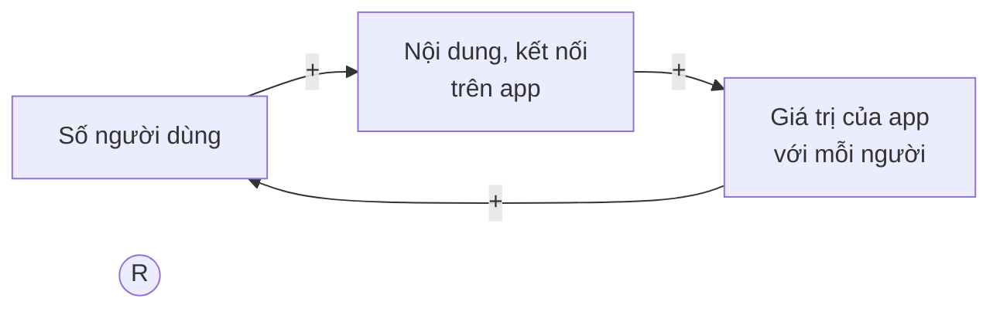

**Ví dụ xấu - vòng xoáy nợ kỹ thuật:**

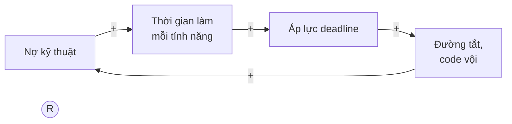

Bốn dấu `+`, không có dấu `−` → số dấu `−` là 0 (chẵn) → vòng tăng cường. Nợ càng nhiều, làm càng chậm, càng bị ép, càng code vội, càng nhiều nợ.

Đặc điểm quan trọng của vòng R: **lúc đầu trông vô hại**. Tăng trưởng theo cấp số nhân ở giai đoạn đầu trông gần như phẳng. Nợ kỹ thuật năm đầu tiên "không sao cả". Năm thứ ba, mỗi tính năng nhỏ mất 3 tuần.

### 4.3. Vòng cân bằng (B) - bộ điều nhiệt

Vòng cân bằng giống máy lạnh có bộ điều nhiệt: phòng nóng hơn mức cài đặt → máy chạy mạnh → phòng mát lại → máy chạy nhẹ đi. Nó luôn **kéo hệ thống về một mục tiêu**.

**Ví dụ - autoscaling:**

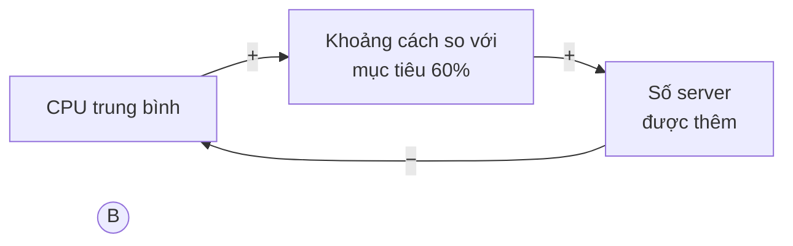

Một dấu `−` (lẻ) → vòng cân bằng. CPU cao → thêm server → CPU giảm về mục tiêu.

**Ví dụ - backpressure trong queue:**

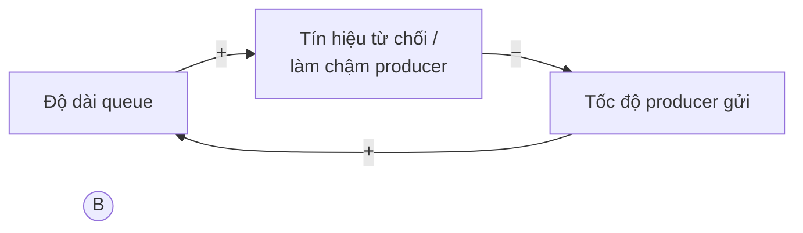

Hệ thống phần mềm khỏe mạnh có **nhiều vòng cân bằng** được thiết kế có chủ đích: rate limiter, circuit breaker, backpressure, autoscaling, connection pool có giới hạn. Chúng là "hệ miễn dịch" giữ hệ thống ổn định.

### 4.4. Hệ thống thật = nhiều vòng tương tác

Hệ thống thật hiếm khi chỉ có một vòng. Hành vi tổng thể phụ thuộc vào **vòng nào đang chiếm ưu thế** (dominant loop) tại từng thời điểm.

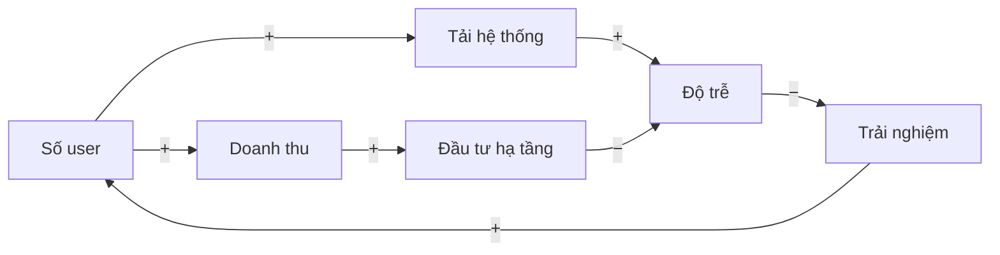

Trong sơ đồ này có:

- Vòng `User → Tải → Độ trễ → Trải nghiệm → User`: dấu `−` xuất hiện 1 lần → **B** (tăng trưởng tự hãm lại vì hệ thống chậm).
- Vòng `User → Doanh thu → Đầu tư → Độ trễ → Trải nghiệm → User`: dấu `−` xuất hiện 2 lần → **R** (tăng trưởng nuôi đầu tư, đầu tư nuôi tăng trưởng).

Startup tăng trưởng tốt khi vòng R mạnh hơn vòng B. Nếu đầu tư hạ tầng **chậm** hơn tốc độ tăng user (độ trễ!), vòng B chiếm ưu thế và tăng trưởng chững lại - đây là archetype **limits to growth** ở mục 11.

---

## 📖 5. Độ trễ (Delays) và dao động

### 5.1. Vòi sen nước nóng

Bạn tắm ở nhà nghỉ, vòi sen có bình nóng lạnh ở xa. Nước lạnh → vặn sang nóng. Chưa thấy nóng (nước nóng chưa chảy tới) → vặn thêm. Vẫn chưa nóng → vặn hết cỡ. Vài giây sau: **bỏng**. Vội vặn sang lạnh hết cỡ. Vài giây sau: **buốt**. Cứ thế dao động mãi.

Vấn đề không phải bạn vụng về. Vấn đề là **độ trễ** giữa hành động (vặn vòi) và phản hồi (cảm nhận nhiệt độ). Khi có độ trễ, vòng cân bằng **phản ứng quá mức** (overshoot) và tạo ra **dao động** (oscillation).

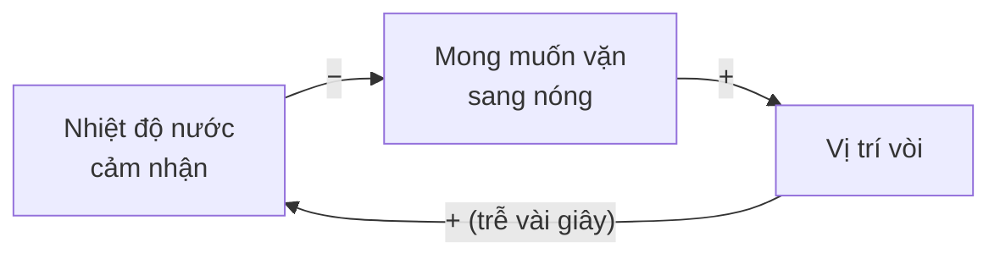

Trong CLD, người ta hay đánh dấu độ trễ bằng hai gạch `||` trên mũi tên; ở đây ta ghi chữ "trễ" cho dễ đọc.

### 5.2. Độ trễ ở khắp nơi trong phần mềm

| Độ trễ | Hệ quả khi bị bỏ qua |
|--------|---------------------|
| Server mới cần 2-5 phút để khởi động và warm-up | Autoscaler thêm server liên tục vì "chưa thấy CPU giảm" → thừa máy → rồi lại xóa quá nhiều |
| Metric được tổng hợp mỗi 1-5 phút | Quyết định dựa trên dữ liệu cũ |
| DNS / cache TTL | Thay đổi cấu hình "không có tác dụng", người ta sửa thêm, rồi tất cả cùng có tác dụng |
| Tuyển kỹ sư mất 2-4 tháng, onboarding thêm 3 tháng | Tuyển ồ ạt khi đang trễ deadline → team còn chậm hơn (định luật Brooks) |
| Nợ kỹ thuật phát tác sau 6-18 tháng | "Code vội chẳng sao cả" - vì hậu quả chưa đến |
| Khách rời bỏ sau vài tuần trải nghiệm tệ | Metric doanh thu tuần này vẫn đẹp dù sản phẩm đang xấu đi |

### 5.3. Autoscaling dao động - minh họa

Một service có 10 server, mỗi server xử lý tối đa 100 request/giây (rps). Mục tiêu CPU 60%. Quy tắc autoscaler (một cấu hình ngây thơ nhưng rất phổ biến):

- Mỗi phút, nhìn CPU trung bình - nhưng metric **trễ 2 phút**.
- Nếu CPU thấy > 75%: **thêm 10 server** (không tính các server đang khởi động).
- Nếu CPU thấy < 35%: giảm số server xuống mức "đủ để CPU về 60%" **theo con số nó thấy**.
- Server mới cần **3 phút** để sẵn sàng.

Ở phút 0, tải tăng từ 600 rps lên 1.200 rps (nhu cầu thật: 20 server). Diễn biến được tính tay theo đúng quy tắc trên:

| Phút | Server chạy | Đang khởi động | CPU thật | CPU autoscaler thấy (trễ 2') | Quyết định |
|------|------------|---------------|----------|-----------------------------|-----------|
| 0 | 10 | 0 | 120% (quá tải) | 60% | Không làm gì |
| 1 | 10 | 0 | 120% | 60% | Không làm gì |
| 2 | 10 | 0 | 120% | 120% | +10 |
| 3 | 10 | 10 | 120% | 120% | +10 (chưa thấy cải thiện) |
| 4 | 10 | 20 | 120% | 120% | +10 |
| 5 | 20 | 20 | 60% | 120% | +10 (CPU thật đã ổn, nhưng nó chưa thấy) |
| 6 | 30 | 20 | 40% | 120% | +10 |
| 7 | 40 | 20 | 30% | 60% | Không làm gì |
| 8 | 50 | 10 | 24% | 40% | Không làm gì |
| 9 | **60** | 0 | 20% | 30% | Giảm còn 30 (−30) |
| 10 | 30 | 0 | 40% | 24% | Giảm còn 12 (−18) |
| 11 | 12 | 0 | 100% | 20% | Giảm còn **4** (−8) |
| 12 | 4 | 0 | 300% (sập) | 40% | Không làm gì |
| 13 | 4 | 0 | 300% (sập) | 100% | +10... và vòng lặp bắt đầu lại |

Nhu cầu thật chỉ là 20 server. Hệ thống đã vọt lên **60** server (gấp 3 lần), rồi lao xuống **4** server và sập - trong khi tải **không hề thay đổi** kể từ phút 0. Không có thành phần nào hỏng: mọi server đều khỏe, autoscaler làm đúng quy tắc. Dao động "trồi" lên từ **vòng cân bằng + độ trễ**. Bạn vừa trả tiền cho 40 server thừa, vừa bị sập.

**Cách chữa** (đều là thay đổi **kết nối**, không phải thành phần):

- Tính cả server **đang khởi động** khi quyết định (nhìn vào "stock" thật, kể cả phần đang trên đường).
- **Cooldown**: sau khi scale, chờ đủ lâu (lâu hơn độ trễ) trước khi quyết định tiếp.
- Scale-down **chậm hơn** scale-up (bất đối xứng): thừa vài phút rẻ hơn thiếu vài phút.
- Giảm độ trễ: image khởi động nhanh hơn, metric chi tiết hơn.

!!! warning "Nguyên tắc vàng khi có độ trễ"
    **Phản ứng mạnh + độ trễ dài = dao động.** Khi biết có độ trễ, hãy phản ứng **nhỏ hơn, chậm hơn**, và **kiên nhẫn chờ** hệ thống phản hồi trước khi tác động thêm. Điều này đúng cho autoscaler, cho việc chỉnh cấu hình production, và cho cả việc quản lý con người.

---

## 📖 6. Tính phi tuyến và ngưỡng

### 6.1. Phi tuyến là gì?

Một quan hệ là **tuyến tính** khi tăng đầu vào gấp đôi thì đầu ra tăng gấp đôi. Trong hệ thống thật, hầu hết các quan hệ quan trọng là **phi tuyến**: có những vùng gần như không đổi, rồi đột ngột thay đổi rất mạnh.

Ví dụ đời thường: đường Nguyễn Trãi lúc 2 giờ chiều có 50% xe so với giờ cao điểm - xe chạy vèo vèo. Lúc 5 giờ chiều có 100% xe - không phải chậm gấp đôi, mà **đứng im**. Từ 80% lên 95% số xe, tốc độ không giảm 15%, mà giảm 80%.

### 6.2. Ví dụ kinh điển: cache hit ratio

Đây là ví dụ mà **mọi** kỹ sư backend nên tính được trong đầu.

Hệ thống có 10.000 request/giây, có cache phía trước database. Database chịu được tối đa khoảng 400 query/giây.

| Cache hit ratio | Tỷ lệ miss | Query xuống database/giây | Database |
|----------------|-----------|---------------------------|----------|
| 99% | 1% | 100 | 😌 Thoải mái (25% tải) |
| 98% | 2% | 200 | 🙂 Ổn (50%) |
| 96% | 4% | 400 | 😰 Chạm ngưỡng (100%) |
| 95% | 5% | 500 | 🔥 Quá tải |
| 90% | 10% | 1.000 | 💀 Sập |

Hit ratio giảm **"chỉ 1%"** từ 99% xuống 98% → tải database **tăng gấp đôi**. Giảm từ 99% xuống 95% → tải tăng **gấp năm**. Con người có xu hướng nhìn hit ratio (99% → 95% "vẫn cao mà") thay vì nhìn **miss ratio** (1% → 5% = gấp năm lần).

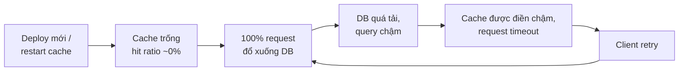

Đây là hiện tượng **thundering herd** (đàn trâu giẫm đạp) / **cold cache**: sau khi restart cache, toàn bộ tải đổ xuống database cùng lúc. Database chậm nên cache được điền chậm, và vòng phản hồi giữ hệ thống trong trạng thái quá tải. Cách chữa: warm-up cache trước khi nhận traffic, giới hạn số request cùng lúc đi xuống database cho cùng một key (request coalescing / single-flight), tăng traffic từ từ. Xem thêm ở [Backend - Bài 8: Caching](../backend/08-caching.md).

### 6.3. Ngưỡng và điểm tới hạn

Nhiều hệ thống có **ngưỡng** (threshold): dưới ngưỡng, mọi thứ ổn định; vượt ngưỡng, một vòng tăng cường kích hoạt và hệ thống chuyển sang trạng thái khác hẳn.

- Connection pool có 50 connection: 49 request đồng thời → ổn; 51 → request thứ 51 phải chờ, giữ thread lâu hơn, thread pool cạn, request khác cũng chờ...
- Bộ nhớ: dưới 90% → ổn; trên 95% → garbage collector chạy liên tục, CPU tăng vọt, xử lý chậm, request tồn đọng, bộ nhớ càng tăng.
- Hàng đợi và mức bận (utilization): ở 50% bận, độ trễ gấp đôi thời gian xử lý; ở 90%, gấp 10; ở 99%, gấp 100. Bạn sẽ tự mô phỏng điều này ở [Bài 4](./04-mental-models.md).

!!! tip "Hệ quả thực tế"
    Đừng ước lượng hệ thống bằng phép nhân tuyến tính kiểu "50% tải chạy ổn thì 90% tải chậm hơn một chút". **Luôn giữ khoảng dư (headroom)** và **test ở tải cao** để biết ngưỡng thật nằm ở đâu.

---

## 📖 7. Tính trồi (Emergence)

**Tính trồi** là khi hệ thống có hành vi mà **không thành phần nào** có, và không thành phần nào "muốn".

- **Kẹt xe**: không tài xế nào muốn kẹt xe. Mỗi người chỉ cố đi nhanh nhất có thể, chen vào chỗ trống. Kẹt xe "trồi" lên từ tương tác.
- **Đàn chim bay theo đội hình**: không con chim nào chỉ huy. Mỗi con chỉ theo vài quy tắc đơn giản với các con bên cạnh.

Trong phần mềm:

| Hiện tượng trồi | Cách nó xuất hiện |
|-----------------|------------------|
| **Cron 00:00 đồng loạt** | 200 service, mỗi team đặt job chạy "lúc nửa đêm cho ít người dùng". Tất cả cùng chạy lúc 00:00:00 → database quá tải mỗi đêm. Không team nào sai. |
| **Retry đồng bộ hóa** | Mọi client retry sau đúng 1 giây → sóng tải đồng loạt mỗi giây. Chữa: thêm **jitter** (ngẫu nhiên hóa). |
| **Metastable failure** | Hệ thống có hai trạng thái ổn định: "khỏe" và "kẹt". Một cú đẩy nhỏ chuyển nó sang trạng thái "kẹt" và nó **ở lại đó** (ví dụ retry storm ở mục 10). |
| **Kiến trúc giống cơ cấu tổ chức** | Không ai thiết kế, nhưng hệ thống dần có ranh giới giống ranh giới giữa các team (định luật Conway - [Bài 4](./04-mental-models.md)). |
| **Văn hóa "không ai dám xóa code cũ"** | Mỗi người đều hợp lý khi né rủi ro, kết quả là codebase phình mãi. |

Bài học: **không thể hiểu hành vi trồi bằng cách soi từng thành phần**. Bạn phải nhìn vào **tương tác**. Và nhiều khi, giải pháp là thêm một chút "nhiễu" hoặc phối hợp (jitter, phân bổ lịch cron, giới hạn đồng thời) chứ không phải sửa thành phần nào.

---

## 📖 8. Ranh giới hệ thống (Boundaries)

Để phân tích một hệ thống, bạn phải **vẽ ranh giới**: cái gì nằm trong, cái gì nằm ngoài. Không có ranh giới "đúng" tuyệt đối - chỉ có ranh giới **hữu ích cho câu hỏi đang hỏi**.

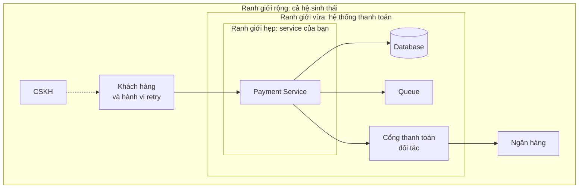

**Ranh giới quá hẹp** là lỗi phổ biến nhất của kỹ sư:

- "Service của tôi chạy đúng spec" - nhưng chính chính sách retry của service bạn đang làm sập cổng thanh toán của đối tác, khiến **mọi** khách hàng của đối tác bị ảnh hưởng, kể cả bạn.
- "Tối ưu cho team tôi" - nhưng team bạn đẩy việc khó sang team khác (ví dụ: đổi API không thông báo, để team mobile tự xử).
- "Không phải lỗi code" - nhưng khách hàng không quan tâm lỗi nằm ở đâu.

**Ranh giới quá rộng** cũng là vấn đề: bạn bị tê liệt vì "cái gì cũng liên quan". Quy tắc thực tế:

!!! tip "Vẽ ranh giới thế nào cho hữu ích"
    Bắt đầu từ **vấn đề** (hành vi bạn muốn hiểu), rồi đưa vào ranh giới **mọi thứ tham gia vào vòng phản hồi gây ra hành vi đó**. Nếu hành vi khách hàng (retry, bấm lại nút) nằm trong vòng phản hồi, thì khách hàng nằm trong ranh giới - dù họ không phải là "code của bạn".

**Externality (ngoại ứng)**: chi phí hành động của bạn mà người **ngoài ranh giới** phải trả. Log quá nhiều → team platform trả tiền lưu trữ. Query nặng trên database dùng chung → service khác chậm. Nhận diện ngoại ứng là bước đầu tiên để tránh **tragedy of the commons** (mục 11.4).

---

## 📖 9. Mô hình tảng băng (Iceberg model)

Khi có sự cố, phần lớn chúng ta chỉ nhìn thấy **phần nổi**. Mô hình tảng băng giúp bạn đào sâu xuống bốn tầng:

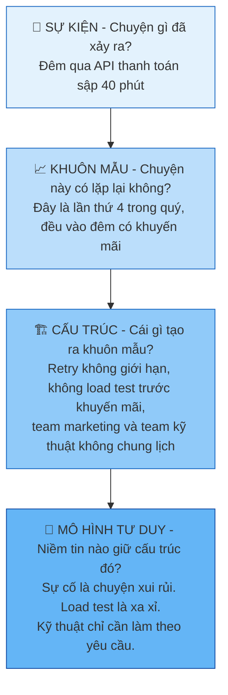

| Tầng | Câu hỏi | Kiểu hành động | Đòn bẩy |
|------|---------|---------------|---------|
| **Sự kiện** | Chuyện gì xảy ra? | **Phản ứng** - chữa cháy, restart, rollback | Thấp - sẽ lặp lại |
| **Khuôn mẫu** | Xu hướng theo thời gian là gì? | **Dự đoán** - chuẩn bị trước cho đêm khuyến mãi | Vừa |
| **Cấu trúc** | Vòng phản hồi, quy trình, kết nối nào tạo ra khuôn mẫu? | **Thiết kế lại** - retry budget, load test bắt buộc, lịch chung | Cao |
| **Mô hình tư duy** | Niềm tin, giả định nào sinh ra cấu trúc đó? | **Chuyển đổi** - thay đổi cách tổ chức nghĩ về độ tin cậy | Cao nhất (nhưng khó nhất) |

Hãy để ý: postmortem tệ dừng ở tầng sự kiện ("nguyên nhân: database chậm 3 giây; hành động: restart"). Postmortem tốt đi xuống ít nhất tầng cấu trúc. Bạn sẽ thực hành điều này ở [Bài 5](./05-failure-thinking.md).

---

## 📖 10. Hệ thống phần mềm qua lăng kính systems thinking

Bây giờ hãy áp dụng mọi thứ vào năm hiện tượng mà kỹ sư backend nào cũng sẽ gặp.

### 10.1. Retry storm - khi "tự hồi phục" lại làm sập hệ thống

Retry (thử lại) là một cơ chế **tốt**: mạng chập chờn, lỗi tạm thời, retry một lần là thành công. Nhưng khi **cả hệ thống** cùng gặp lỗi, retry biến thành vòng tăng cường:

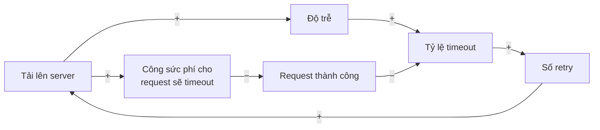

Vòng chính `Tải → Độ trễ → Timeout → Retry → Tải` toàn dấu `+` → **R**. Vòng phụ `Tải → Công sức phí → Thành công → Timeout → Retry → Tải` có hai dấu `−` (chẵn) → cũng là **R**. Hai vòng tăng cường chồng lên nhau.

Điều đáng sợ nhất: sau khi nguyên nhân ban đầu (database chậm 3 giây) đã hết, **hệ thống không tự hồi phục**. Nó bị kẹt ở trạng thái quá tải vì chính lượng retry. Hiện tượng này gọi là **metastable failure** (lỗi siêu bền): hệ thống có hai trạng thái ổn định, và một cú đẩy nhỏ đủ để chuyển từ "khỏe" sang "kẹt".

#### Mô phỏng

Hãy kiểm chứng bằng một mô phỏng nhỏ. Giả định:

- Mỗi giây có **80 request mới**. Server xử lý tối đa **100 request/giây** → bình thường dư 20%.
- Từ giây 5 đến giây 7, server gặp sự cố, chỉ còn xử lý **40 request/giây**. Từ giây 8, server **khỏe lại hoàn toàn**.
- Khi quá tải, server phí công cho những request sẽ timeout, nên số request thành công giảm: `thành công = cap × cap / tải`. (Đây là mô hình đơn giản hóa của hiện tượng "goodput sụp đổ" khi quá tải.)
- Client retry tối đa 3 lần. Hết 3 lần mà vẫn lỗi thì người dùng thấy lỗi.
- So sánh hai chính sách: **naive-retry** (retry mọi lỗi) và **retry-budget** (tổng retry mỗi giây không quá 10% số request mới; vượt quá thì báo lỗi luôn).

=== "Go"

    ```go
    // Mô phỏng retry storm: mỗi giây có 80 request mới, server xử lý tối đa 100/giây.
    // Giây 5-7 server gặp sự cố, chỉ còn 40/giây. Khi quá tải, server phí công vào
    // những request sẽ timeout, nên số request thành công = cap * cap / offered.
    package main

    import "fmt"

    func simulate(policy string) {
    	newReq := 80.0
    	pending := []float64{0, 0, 0} // pending[k]: request chờ gửi lại lần thứ k+1
    	fmt.Printf("--- %s ---\n", policy)
    	fmt.Println("giây  cap  tải  ok%  lỗi")
    	for t := 0; t < 16; t++ {
    		capacity := 100.0
    		if t >= 5 && t <= 7 {
    			capacity = 40.0
    		}
    		retries := append([]float64(nil), pending...)
    		userErr := 0.0
    		if policy == "retry-budget" {
    			// Tổng retry mỗi giây không vượt quá 10% số request mới.
    			total, limit := retries[0]+retries[1]+retries[2], 0.1*newReq
    			if total > limit {
    				userErr += total - limit // bị từ chối retry -> báo lỗi
    				for i := range retries {
    					retries[i] = retries[i] * limit / total
    				}
    			}
    		}
    		offered := newReq + retries[0] + retries[1] + retries[2]
    		good := offered
    		if offered > capacity {
    			good = capacity * capacity / offered
    		}
    		fail := 1 - good/offered
    		pending = []float64{newReq * fail, retries[0] * fail, retries[1] * fail}
    		userErr += retries[2] * fail // hết 3 lần retry -> user thấy lỗi
    		fmt.Printf("%4d %4.0f %4.0f %4.0f %4.0f\n", t, capacity, offered, 100*(1-fail), userErr)
    	}
    }

    func main() {
    	simulate("naive-retry")
    	simulate("retry-budget")
    }
    ```

=== "Python"

    ```python
    # Mô phỏng retry storm: mỗi giây có 80 request mới, server xử lý tối đa 100/giây.
    # Giây 5-7 server gặp sự cố, chỉ còn 40/giây. Khi quá tải, server phí công vào
    # những request sẽ timeout, nên số request thành công = cap * cap / offered.


    def simulate(policy):
        new = 80.0
        pending = [0.0, 0.0, 0.0]  # pending[k]: request chờ gửi lại lần thứ k+1
        print(f"--- {policy} ---")
        print("giây  cap  tải  ok%  lỗi")
        for t in range(16):
            cap = 40.0 if 5 <= t <= 7 else 100.0
            retries = list(pending)
            user_err = 0.0
            if policy == "retry-budget":
                # Tổng retry mỗi giây không vượt quá 10% số request mới.
                total, limit = sum(retries), 0.1 * new
                if total > limit:
                    user_err += total - limit  # bị từ chối retry -> báo lỗi
                    retries = [x * limit / total for x in retries]
            offered = new + sum(retries)
            good = offered if offered <= cap else cap * cap / offered
            fail = 1 - good / offered
            pending = [new * fail, retries[0] * fail, retries[1] * fail]
            user_err += retries[2] * fail  # hết 3 lần retry -> user thấy lỗi
            print(f"{t:4d} {cap:4.0f} {offered:4.0f} {100 * (1 - fail):4.0f} {user_err:4.0f}")


    simulate("naive-retry")
    simulate("retry-budget")
    ```

**Output** (giống hệt nhau ở cả hai ngôn ngữ):

```text
--- naive-retry ---
giây  cap  tải  ok%  lỗi
   0  100   80  100    0
   1  100   80  100    0
   2  100   80  100    0
   3  100   80  100    0
   4  100   80  100    0
   5   40   80   25    0
   6   40  140    8    0
   7   40  209    4    0
   8  100  281   13   46
   9  100  279   13   54
  10  100  269   14   51
  11  100  262   15   45
  12  100  259   15   44
  13  100  256   15   42
  14  100  255   15   42
  15  100  254   16   41
--- retry-budget ---
giây  cap  tải  ok%  lỗi
   0  100   80  100    0
   1  100   80  100    0
   2  100   80  100    0
   3  100   80  100    0
   4  100   80  100    0
   5   40   80   25    0
   6   40   88   21   52
   7   40   88   21   62
   8  100   88  100   62
   9  100   80  100    0
  10  100   80  100    0
  11  100   80  100    0
  12  100   80  100    0
  13  100   80  100    0
  14  100   80  100    0
  15  100   80  100    0
```

#### Đọc kết quả

- **naive-retry**: Từ giây 8, server đã **khỏe lại hoàn toàn** (cap = 100, lớn hơn 80 request mới). Nhưng tải vẫn ở mức ~255/giây - gấp **2,5 lần** năng lực - và chỉ ~15% lần thử thành công. Hệ thống **kẹt vĩnh viễn** ở trạng thái hỏng. Kỹ sư on-call nhìn vào: database khỏe, server khỏe, không có deploy... nhưng hệ thống vẫn sập. Đây chính là câu chuyện mở đầu bài học.
- **retry-budget**: Trong lúc sự cố, người dùng thấy lỗi (không tránh được - server chỉ còn 40% năng lực). Nhưng ngay khi server khỏe lại, **giây 9 hệ thống hồi phục hoàn toàn**. Retry budget đã **cắt đứt vòng tăng cường** bằng cách giới hạn lượng tải mà retry có thể thêm vào.

Chú ý một điều phản trực giác: trong sự cố, retry-budget báo lỗi **sớm hơn** cho người dùng (giây 6 đã có 52 lỗi). Nhìn cục bộ, nó có vẻ "tệ hơn". Nhìn toàn hệ thống, nó là thứ duy nhất cho phép hồi phục.

#### Các cách cắt vòng retry storm

| Kỹ thuật | Cách nó tác động lên vòng phản hồi |
|----------|----------------------------------|
| **Exponential backoff** | Dãn retry theo thời gian (1s, 2s, 4s...) → giảm cường độ của mũi tên `Retry → Tải` |
| **Jitter** | Ngẫu nhiên hóa thời điểm retry → tránh sóng tải đồng loạt (emergence) |
| **Retry budget** | Giới hạn tổng retry theo tỷ lệ request mới → chặn trần vòng R |
| **Circuit breaker** | Khi lỗi vượt ngưỡng, ngừng gọi hẳn một thời gian → cắt mũi tên `Timeout → Retry` |
| **Load shedding** | Server chủ động từ chối sớm (rẻ) khi quá tải thay vì xử lý dở (đắt) → giảm "công sức phí" |
| **Chỉ retry ở một tầng** | Tránh retry nhân lên qua nhiều tầng (3 tầng × 3 retry = 27 lần gọi xuống tầng dưới cùng!) |

Tất cả đều là thay đổi **kết nối**, không phải thay thành phần. Không cần database nhanh hơn hay server mạnh hơn.

### 10.2. Autoscaling dao động

Đã phân tích ở mục 5.3. Tóm tắt dưới dạng CLD:

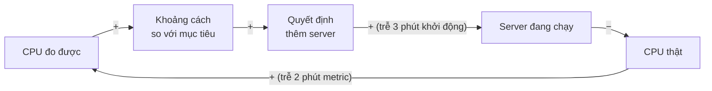

Một vòng **B** (một dấu `−`) với **hai độ trễ** → dao động. Cách chữa: tính cả server đang khởi động, cooldown, scale-down chậm.

### 10.3. Vòng nợ kỹ thuật

Mở rộng sơ đồ ở mục 4.2 với vòng cân bằng mà các team tốt cố tình xây dựng:

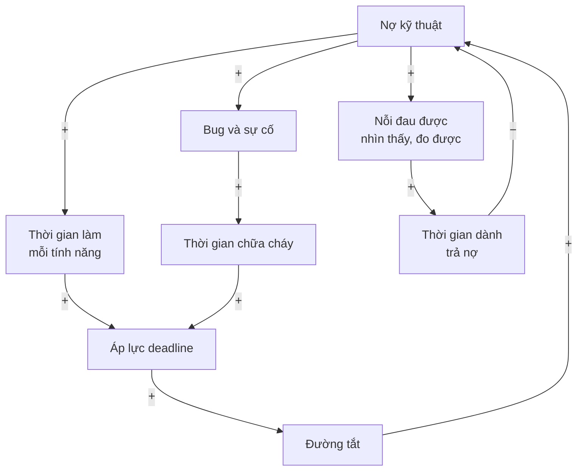

- Hai vòng **R**: `Nợ → Chậm → Áp lực → Đường tắt → Nợ` và `Nợ → Bug → Chữa cháy → Áp lực → Đường tắt → Nợ`.
- Một vòng **B**: `Nợ → Nỗi đau được nhìn thấy → Trả nợ → Nợ` (một dấu `−`).

Mấu chốt: vòng B chỉ hoạt động nếu nỗi đau **được nhìn thấy và đo được**. Nếu không ai đo "thời gian làm một tính năng" hay "số giờ chữa cháy", mũi tên `Nợ → Nỗi đau được nhìn thấy` rất yếu, và hai vòng R thắng. Đó là lý do các team tốt **đo** những thứ như lead time, tỷ lệ thay đổi gây lỗi, số giờ on-call - để làm vòng cân bằng mạnh lên. Xem thêm quản lý nợ kỹ thuật ở [Mindset - Bài 7](../mindset/07-tradeoffs-decisions.md).

### 10.4. Vòng kiệt sức on-call

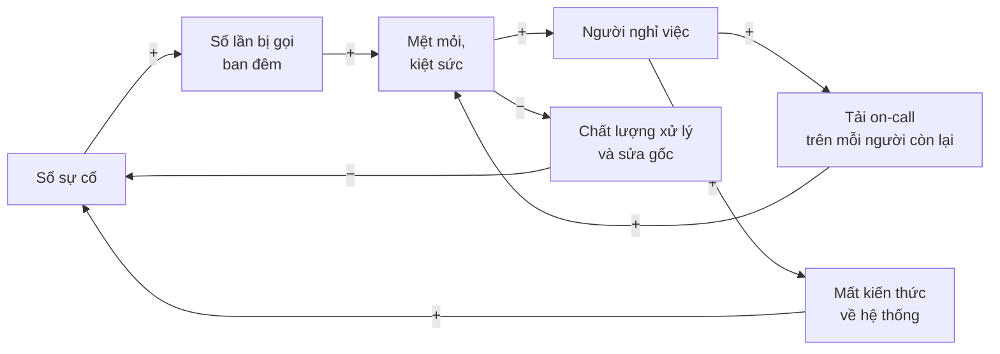

Có ba vòng R lồng nhau:

1. `Mệt mỏi → Nghỉ việc → Tải mỗi người → Mệt mỏi` (không có `−`).
2. `Sự cố → Bị gọi → Mệt mỏi → Chất lượng sửa gốc → Sự cố` (hai dấu `−`, chẵn).
3. `Sự cố → Bị gọi → Mệt mỏi → Nghỉ việc → Mất kiến thức → Sự cố` (không có `−`).

Một team on-call có thể đi từ "hơi mệt" đến "sụp đổ" trong vài tháng. Giải pháp kiểu "thưởng thêm tiền on-call" chỉ tác động yếu lên mũi tên `Mệt mỏi → Nghỉ việc`. Đòn bẩy thật là **giảm số sự cố** (sửa gốc, giảm alert nhiễu) và **bảo vệ thời gian sửa gốc** - tức là cắt vòng ở chỗ `Chất lượng → Sự cố`.

### 10.5. Cache hit ratio và thundering herd

Đã phân tích ở mục 6.2. Điểm then chốt về mặt hệ thống: cache tạo ra một **sự phụ thuộc ẩn**. Database được "thiết kế" cho tải 1% miss. Khi cache mất (restart, deploy, key hết hạn đồng loạt), database đột ngột phải chịu tải gấp 100 lần. Hệ thống có cache **hoạt động tốt hơn** trong điều kiện bình thường nhưng **dễ vỡ hơn** khi cache gặp sự cố - nếu không thiết kế cho trường hợp đó.

!!! note "Một mẫu hình lặp lại"
    Nhiều cơ chế tối ưu (cache, retry, autoscaling, connection pool) đều có cùng đặc điểm: **giúp ích trong điều kiện bình thường, gây hại trong điều kiện bất thường** nếu không có giới hạn. Kỹ sư có tư duy hệ thống luôn hỏi: "Cơ chế này hành xử thế nào **khi mọi thứ cùng hỏng một lúc**?"

---

## 📖 11. System archetypes - những cấu trúc lặp đi lặp lại

Peter Senge (trong *The Fifth Discipline*) và các nhà nghiên cứu systems thinking nhận ra rằng một số **cấu trúc vòng phản hồi** xuất hiện lặp đi lặp lại ở mọi lĩnh vực: kinh doanh, sinh thái, y tế... và phần mềm. Họ gọi chúng là **archetype** (nguyên mẫu). Nhận ra một archetype giống như bác sĩ nhận ra một hội chứng: bạn biết ngay nó sẽ diễn tiến thế nào và chữa ở đâu.

### 11.1. Fixes that fail - Giải pháp phản tác dụng

**Cấu trúc:** Một giải pháp nhanh làm giảm triệu chứng (vòng B), nhưng tạo ra **hệ quả phụ chậm** làm vấn đề quay lại, thường nặng hơn (vòng R có độ trễ).

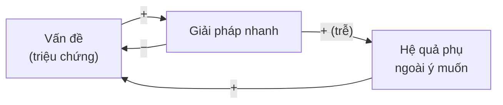

**Ví dụ phần mềm:**

| Vấn đề | Giải pháp nhanh | Hệ quả phụ (đến sau) |
|--------|----------------|---------------------|
| API chậm | Thêm cache | Dữ liệu cũ, logic invalidation rải khắp nơi, bug khó tái hiện |
| Service hay lỗi tạm thời | Thêm retry ở mọi tầng | Retry storm khi có sự cố lớn |
| Memory leak | Cron restart service mỗi đêm | Leak không bao giờ được sửa, restart gây lỗi cho request đang chạy, đến lúc leak nhanh hơn chu kỳ restart thì sập |
| Deadline gấp | Bỏ qua test | Bug tăng, chữa cháy nhiều hơn, deadline sau còn gấp hơn |
| Alert quá nhiều | Tăng ngưỡng alert | Bỏ lỡ sự cố thật |

**Cách thoát:** Trước khi áp dụng giải pháp nhanh, hỏi: "**Hệ quả bậc hai** của nó là gì, sau 3-6 tháng?" (xem tư duy bậc hai ở [Bài 4](./04-mental-models.md)). Dùng giải pháp nhanh để **mua thời gian**, đồng thời lên kế hoạch xử lý gốc - và **theo dõi** hệ quả phụ.

### 11.2. Shifting the burden - Chuyển gánh nặng

**Cấu trúc:** Có hai cách giải quyết vấn đề: giải pháp **triệu chứng** (nhanh, dễ) và giải pháp **gốc rễ** (chậm, khó). Dùng giải pháp triệu chứng mãi làm **teo đi khả năng** thực hiện giải pháp gốc rễ.

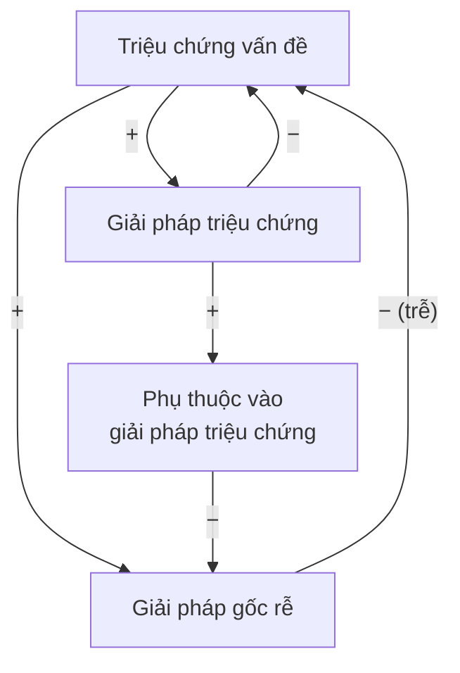

**Ví dụ phần mềm:**

- **"Anh hùng" trong team**: mỗi sự cố đều do anh A xử lý vì anh ấy biết hệ thống nhất (triệu chứng được giải nhanh). Không ai khác học, không có tài liệu, không có runbook (giải pháp gốc teo đi). Đến khi anh A nghỉ phép hoặc nghỉ việc...
- **Ops thủ công**: mỗi lần deploy, có người chạy 15 lệnh bằng tay. Nhanh hơn viết pipeline tự động "lần này". Nhưng càng làm tay, càng không có thời gian tự động hóa.
- **Dựa vào AI để sửa bug mà không hiểu**: mỗi bug được AI vá nhanh (triệu chứng). Team không bao giờ hiểu vì sao module đó hay lỗi (giải pháp gốc: hiểu và thiết kế lại). Kỹ năng debug teo dần - đây chính là "vòng xói mòn" ở [Bài 1](./01-why-thinking-matters.md).

**Cách thoát:** Vẫn dùng giải pháp triệu chứng khi cần (không thể để hệ thống sập), nhưng **dành nguồn lực có chủ đích** cho giải pháp gốc, và **đo** mức phụ thuộc (bao nhiêu % sự cố chỉ một người xử lý được?).

### 11.3. Limits to growth - Giới hạn tăng trưởng

**Cấu trúc:** Một vòng tăng cường tạo ra tăng trưởng, cho đến khi chạm một **giới hạn** - lúc đó một vòng cân bằng trỗi dậy và tăng trưởng chững lại hoặc đảo chiều.

```mermaid
flowchart LR
    EFF["Nỗ lực<br/>tăng trưởng"] -->|"+"| GROW["Kết quả<br/>tăng trưởng"]
    GROW -->|"+"| EFF
    GROW -->|"+"| SLOW["Tác động<br/>kìm hãm"]
    LIMIT["Giới hạn<br/>(tài nguyên)"] -->|"+"| SLOW
    SLOW -->|"−"| GROW
```

**Ví dụ phần mềm:**

- **Tăng trưởng user** gặp giới hạn **database đơn**: mọi thứ tốt đẹp cho đến khi write throughput chạm trần. Khi đó, đẩy marketing thêm chỉ làm hệ thống chậm hơn, user rời đi.
- **Tăng số người trong team**: 5 → 10 → 20 người, năng suất tăng... đến khi chi phí giao tiếp (số kênh giao tiếp ~ n²/2) và chi phí phối hợp vượt quá lợi ích. Thêm người làm chậm hơn.
- **Microservices**: tách service giúp team độc lập, nhanh hơn... đến khi số service vượt khả năng vận hành, debug một request đi qua 15 service mất cả ngày. Xem [Backend - Bài 14](../backend/14-architecture-microservices.md).

**Cách thoát:** Đừng đẩy mạnh vòng tăng trưởng thêm nữa. Hãy **tìm và nới giới hạn** - thường phải làm **trước khi** chạm tới nó, vì nới giới hạn cần thời gian (độ trễ!). Đây là lý do capacity planning quan trọng.

### 11.4. Tragedy of the commons - Bi kịch của mảnh đất chung

**Cấu trúc:** Nhiều bên cùng dùng một **tài nguyên chung có hạn**. Mỗi bên hành động hợp lý cho mình (dùng nhiều hơn), nhưng tổng hợp lại làm cạn kiệt tài nguyên, và **ai cũng chịu thiệt**.

```mermaid
flowchart TB
    A["Team A dùng<br/>tài nguyên chung"] -->|"+"| TOTAL["Tổng mức sử dụng"]
    B["Team B dùng<br/>tài nguyên chung"] -->|"+"| TOTAL
    TOTAL -->|"−"| AVAIL["Tài nguyên còn lại<br/>cho mỗi team"]
    AVAIL -->|"−"| A
    AVAIL -->|"−"| B
    GA["Lợi ích riêng<br/>của team A"] -->|"+"| A
    GB["Lợi ích riêng<br/>của team B"] -->|"+"| B
```

*(Đọc mũi tên `Tài nguyên còn lại → (−) → Team A dùng`: tài nguyên càng ít, team càng vội "giành phần" - dùng nhiều hơn trước khi hết.)*

**Ví dụ phần mềm:**

- **Database dùng chung** giữa nhiều service: mỗi team thêm vài query nặng "chỉ chạy một lúc thôi". Tổng lại, database chậm cho tất cả.
- **Cluster Kubernetes dùng chung**: mỗi team đặt resource request cao "cho chắc". Cluster đầy dù CPU thật chỉ dùng 20%.
- **Ngân sách lỗi (error budget) chung**, **rate limit chung của API đối tác**, **băng thông CI** (mỗi team thêm test chạy 40 phút)...
- **Sự chú ý của người dùng**: mỗi team gửi push notification "chỉ một cái thôi". Người dùng nhận 15 notification/ngày và tắt hết.

**Cách thoát:** (1) Làm cho chi phí **nhìn thấy được** với từng bên (dashboard chi phí theo team, hiển thị query nặng theo service); (2) **hạn mức** rõ ràng (quota, rate limit theo service); (3) **tách tài nguyên** khi có thể (mỗi service một database); (4) cơ chế **điều phối chung** (một nơi quản lý push notification cho toàn công ty).

### 11.5. Bảng tóm tắt archetype

| Archetype | Dấu hiệu nhận biết | Câu hỏi để thoát |
|-----------|-------------------|------------------|
| Fixes that fail | "Lần trước sửa rồi mà, sao lại bị, mà còn nặng hơn?" | Hệ quả bậc hai của giải pháp này là gì? |
| Shifting the burden | "Chỉ anh A/chỉ cách làm tay này mới xử lý được" | Giải pháp gốc là gì, và cái gì đang làm nó teo đi? |
| Limits to growth | "Càng cố đẩy càng không lên" | Giới hạn nào đang kìm hãm? Nới nó thế nào, từ khi nào? |
| Tragedy of the commons | "Ai cũng hợp lý, mà tổng thể thì tệ" | Chi phí chung có được nhìn thấy và phân bổ không? |

---

## 📖 12. Cách vẽ một causal loop diagram - từng bước

Vẽ CLD là kỹ năng cần luyện tập. Quy trình sau giúp bạn bắt đầu:

```mermaid
flowchart TD
    S1["1. Chọn hành vi cần giải thích<br/>(một thứ thay đổi theo thời gian)"] --> S2["2. Liệt kê các biến liên quan<br/>(danh từ, đo được tăng/giảm)"]
    S2 --> S3["3. Nối các biến bằng mũi tên<br/>nhân quả, gắn nhãn + hoặc −"]
    S3 --> S4["4. Tìm các vòng khép kín,<br/>xác định R hay B"]
    S4 --> S5["5. Đánh dấu độ trễ"]
    S5 --> S6["6. Kể lại câu chuyện<br/>theo từng vòng"]
    S6 --> S7["7. Tìm đòn bẩy:<br/>mũi tên nào cắt/làm yếu/thêm vào?"]
```

**Quy tắc đặt tên biến:**

- ✅ Dùng **danh từ** có thể tăng/giảm: "Số retry", "Độ trễ", "Mức mệt mỏi".
- ❌ Tránh động từ hay hành động: "Retry", "Làm chậm".
- ❌ Tránh tên đã chứa chiều: "Tăng độ trễ" (vì sẽ gây nhầm khi gắn `−`). Dùng "Độ trễ".
- ✅ Ưu tiên tên theo chiều trung tính hoặc tích cực: "Chất lượng review" thay vì "Review kém".

**Những lỗi hay gặp khi vẽ CLD:**

| Lỗi | Ví dụ | Sửa |
|-----|-------|-----|
| Nhầm tương quan với nhân quả | "Số kỹ sư → (+) → Số bug" | Bug tăng vì code nhiều hơn, không phải vì người. Thêm biến trung gian "Lượng code thay đổi" |
| Bỏ sót biến trung gian | "Deadline → (+) → Bug" | `Deadline gấp → (+) → Bỏ qua test → (+) → Bug` - giờ mới thấy đòn bẩy ở "bỏ qua test" |
| Vẽ quá nhiều | 40 biến, 80 mũi tên | Giữ 5-12 biến, chỉ những gì cần để giải thích hành vi đang hỏi |
| Không kiểm cực tính | Ghi `+` theo cảm giác | Thử nói: "Nếu A **tăng** thì B **tăng** hay **giảm**?" cho từng mũi tên |

!!! tip "Dùng AI để phản biện CLD, không phải để vẽ hộ"
    Sau khi tự vẽ, bạn có thể đưa sơ đồ (dạng chữ) cho AI và hỏi: "Có mũi tên nào sai cực tính không? Có vòng phản hồi quan trọng nào tôi bỏ sót không?" AI rất giỏi bổ sung các biến kinh điển mà bạn quên. Nhưng **bối cảnh** - vòng nào đang chiếm ưu thế ở công ty bạn - chỉ bạn biết.

---

## 🌍 Tình huống thực tế

### Đêm khuyến mãi 11/11 của một sàn thương mại điện tử

**Bối cảnh:** Một sàn thương mại điện tử cỡ vừa chuẩn bị cho đêm 11/11. Năm ngoái, trang web sập 2 tiếng lúc 0 giờ. Năm nay, ban giám đốc yêu cầu "không được sập".

**Cách tiếp cận theo sự kiện (năm ngoái):** Sau sự cố, team tăng gấp đôi số server và gấp đôi kích thước database. Postmortem kết luận: "Nguyên nhân: thiếu tài nguyên."

**Năm nay, một kỹ sư đề xuất phân tích theo tảng băng và vẽ CLD của sự cố năm ngoái:**

```mermaid
flowchart LR
    MKT["Push notification<br/>gửi lúc 0:00:00"] -->|"+"| SPIKE["Lượng truy cập<br/>đồng thời"]
    SPIKE -->|"+"| DBLOAD["Tải database"]
    DBLOAD -->|"+"| LAT["Độ trễ"]
    LAT -->|"+"| REFRESH["Khách bấm F5,<br/>app tự retry"]
    REFRESH -->|"+"| SPIKE
    LAT -->|"+"| CACHEMISS["Cache hết hạn<br/>đồng loạt lúc 0:00"]
    CACHEMISS -->|"+"| DBLOAD
```

**Phát hiện ở tầng cấu trúc:**

1. **Push notification gửi cho 3 triệu user cùng giây 0:00:00** → đỉnh tải nhân tạo (emergence do một quyết định của marketing).
2. **Giá khuyến mãi được cache với TTL kết thúc đúng lúc 0:00** → toàn bộ cache hết hạn cùng lúc (thundering herd).
3. **App mobile tự retry ngay lập tức** khi lỗi, không backoff, cộng với khách bấm F5 → vòng R.
4. Năm ngoái tăng gấp đôi server **không chạm vào** bất kỳ vòng nào ở trên - chỉ đẩy ngưỡng sập lên một chút.

**Các thay đổi năm nay (hầu hết là thay đổi kết nối, chi phí thấp):**

| Thay đổi | Tác động lên hệ thống |
|----------|----------------------|
| Gửi push notification rải đều trong 15 phút, theo nhóm user | Làm phẳng đỉnh tải |
| Warm-up cache giá khuyến mãi từ 23:50, TTL có jitter | Loại bỏ thundering herd |
| App: exponential backoff + jitter, tối đa 2 retry | Làm yếu vòng R |
| Hàng chờ ảo (virtual waiting room) khi tải > ngưỡng | Thêm vòng B: quá tải → cho khách chờ có thông báo, thay vì để họ bấm F5 |
| Load test với kịch bản "0:00 có 5 lần tải bình thường" | Biết ngưỡng thật trước khi đến đêm thật |

**Kết quả:** Đêm 11/11 năm nay, lượng truy cập cao hơn năm ngoái 60%, **số server ít hơn** năm ngoái (không cần gấp đôi), hệ thống không sập. Hàng chờ ảo được kích hoạt 4 phút lúc 0:02, khách chờ trung bình 40 giây.

**Bài học:** Tăng tài nguyên là thay đổi **thành phần**. Gửi notification rải đều, TTL có jitter, backoff là thay đổi **kết nối**. Đòn bẩy nằm ở kết nối.

---

## ⚠️ Sai lầm thường gặp

### 1. Tìm "một nguyên nhân gốc" duy nhất

❌ "Root cause: database chậm 3 giây."

✅ Sự cố hệ thống thường là kết quả của **nhiều yếu tố + vòng phản hồi**. Database chậm là **cú hích**; retry không giới hạn là **cấu trúc** giữ hệ thống ở trạng thái hỏng. Sửa cú hích thì lần sau cú hích khác sẽ gây ra sự cố tương tự.

### 2. Nhìn giá trị hiện tại thay vì xu hướng của stock

❌ "Consumer lag 50.000 message, vẫn ổn."

✅ "Consumer lag tăng đều 2.000 message/phút trong 3 giờ qua → inflow > outflow → sẽ đầy trong X giờ."

### 3. Phản ứng mạnh khi có độ trễ

❌ Chỉnh cấu hình production, chưa thấy tác dụng sau 30 giây, chỉnh tiếp, chỉnh tiếp...

✅ Biết độ trễ của hệ thống (TTL, thời gian khởi động, chu kỳ metric). Thay đổi một thứ, **chờ đủ lâu**, quan sát, rồi mới thay đổi tiếp.

### 4. Giả định quan hệ tuyến tính

❌ "50% CPU chạy ổn thì 85% chắc chậm hơn một chút."

✅ Hàng đợi, cache, GC, connection pool đều phi tuyến. Load test để tìm ngưỡng thật.

### 5. Vẽ ranh giới quá hẹp

❌ "Service của tôi trả lỗi đúng spec, retry là việc của client."

✅ "Chính sách retry của client nằm trong vòng phản hồi gây sự cố, nên nó nằm trong hệ thống tôi cần thiết kế."

### 6. Thay thành phần thay vì thay kết nối

❌ "Viết lại bằng Rust/chuyển sang database X là hết chậm."

✅ Kiểm tra trước: vấn đề nằm ở thành phần, hay ở **cách các thành phần tương tác** (N+1 query, retry, thiếu backpressure, cache đồng loạt hết hạn)?

### 7. Dừng ở tầng sự kiện

❌ Postmortem: "Nguyên nhân: deploy lỗi. Hành động: rollback."

✅ Hỏi tiếp: Có khuôn mẫu không (lần thứ mấy rồi)? Cấu trúc nào cho phép deploy lỗi lên production (thiếu canary? thiếu test?)? Niềm tin nào giữ cấu trúc đó ("canary tốn thời gian")?

### 8. Nhầm tương quan với nhân quả khi vẽ CLD

❌ "Các tháng có nhiều kỹ sư mới thì có nhiều sự cố → kỹ sư mới gây sự cố."

✅ Có thể cả hai cùng do một biến thứ ba: tháng có nhiều dự án lớn → tuyển nhiều người **và** thay đổi nhiều → nhiều sự cố.

---

## 🏋️ Bài tập

### Bài 1 (Dễ): Xác định loại vòng

Với mỗi vòng sau, xác định là **R** hay **B**, và giải thích bằng một câu.

1. `Số user → (+) → Đánh giá trên App Store → (+) → Số user mới → (+) → Số user`
2. `Độ dài queue → (+) → Số consumer được thêm (autoscale) → (+) → Tốc độ xử lý → (−) → Độ dài queue`
3. `Số bug → (+) → Thời gian chữa cháy → (−) → Thời gian viết test → (−) → Số bug`
4. `Giá cloud tháng này → (+) → Áp lực tối ưu chi phí → (+) → Số tài nguyên được dọn dẹp → (−) → Giá cloud tháng này`

<details markdown="1">
<summary>Đáp án</summary>

1. **R** - 0 dấu `−`. User càng nhiều, đánh giá càng nhiều, càng thu hút thêm user.
2. **B** - 1 dấu `−`. Queue dài → thêm consumer → xử lý nhanh → queue ngắn lại. Kéo về trạng thái cân bằng.
3. **R** - 2 dấu `−` (chẵn). Bug nhiều → chữa cháy nhiều → ít thời gian viết test → bug càng nhiều. Đây là một vòng xoáy đi xuống.
4. **B** - 1 dấu `−`. Chi phí cao → áp lực → dọn dẹp → chi phí giảm. (Lưu ý: vòng này thường có **độ trễ** lớn - hóa đơn đến cuối tháng - nên chi phí hay "vọt lố" trước khi được kéo về.)
</details>

### Bài 2 (Dễ): Stock và flow

Ổ đĩa log của một server có dung lượng 500 GB, hiện đã dùng 360 GB. Ứng dụng ghi 12 GB log/ngày. Một job xóa log cũ hơn 30 ngày chạy mỗi đêm. Tháng trước, team bật thêm log debug, lượng ghi tăng lên 18 GB/ngày.

1. Stock, inflow, outflow ở đây là gì?
2. Trước khi bật log debug, hệ thống ở trạng thái cân bằng ở mức bao nhiêu GB? (Giả sử job xóa hoạt động hoàn hảo.)
3. Sau khi bật log debug, mức cân bằng mới là bao nhiêu? Ổ đĩa có đầy không?
4. Nếu job xóa log bị lỗi (không ai biết) từ hôm nay, sau bao nhiêu ngày đĩa đầy (với 18 GB/ngày)?

<details markdown="1">
<summary>Đáp án</summary>

1. **Stock**: dung lượng đĩa đã dùng. **Inflow**: log ghi mới (GB/ngày). **Outflow**: log bị job xóa (GB/ngày).
2. Giữ log 30 ngày × 12 GB/ngày = **360 GB** - đúng bằng mức đang dùng. Ở trạng thái ổn định, mỗi đêm job xóa đúng lượng log của ngày thứ 31 (12 GB), bằng inflow, nên stock đứng yên.
3. 30 × 18 = **540 GB** > 500 GB → **đĩa sẽ đầy** trước khi đạt cân bằng. Thời điểm đầy phụ thuộc vào việc log cũ (12 GB/ngày) dần được thay bằng log mới (18 GB/ngày): stock tăng khoảng 6 GB/ngày cho đến khi toàn bộ 30 ngày là log mới. Từ 360 GB, cần (500 − 360) / 6 ≈ **23 ngày**. Bài học: thay đổi inflow có **hậu quả trễ** - bật log debug hôm nay, 3 tuần sau đĩa mới đầy, lúc đó không ai nhớ đến thay đổi này nữa.
4. Outflow = 0, inflow = 18 GB/ngày. Còn trống 500 − 360 = 140 GB → 140 / 18 ≈ 7,8 → đĩa đầy trong **ngày thứ 8**. Đây là lý do cần alert theo **xu hướng** ("đĩa sẽ đầy trong 7 ngày") chứ không chỉ theo ngưỡng ("đĩa > 90%").
</details>

### Bài 3 (Trung bình): Mở rộng mô phỏng retry storm

Chạy mô phỏng ở mục 10.1, rồi thử các thay đổi sau (sửa code, chạy lại, ghi nhận kết quả):

1. Giảm sự cố xuống chỉ **1 giây** (chỉ giây 5). Naive-retry có còn bị kẹt không?
2. Giữ sự cố 3 giây, nhưng giảm số request mới từ 80 xuống **50**/giây (hệ thống dư nhiều hơn). Naive-retry có hồi phục không?
3. Giảm số lần retry tối đa từ 3 xuống **1**. Chuyện gì xảy ra?

<details markdown="1">
<summary>Gợi ý và điều cần quan sát</summary>

- Không cần đoán - **chạy thử** là cách kiểm chứng (xem [Bài 9](./09-verification-mindset.md)). Thay điều kiện `5 <= t <= 7` thành `t == 5`; đổi `new = 80.0` thành `50.0`; với câu 3, giảm danh sách `pending` còn 1 phần tử và tính `user_err` từ `retries[0]`.
- Điều cần quan sát: hệ thống có **ngưỡng**. Với sự cố đủ ngắn hoặc khoảng dư đủ lớn, vòng R không đủ mạnh để giữ hệ thống ở trạng thái kẹt, và nó tự hồi phục. Vượt ngưỡng, nó kẹt. Đây chính là đặc trưng của **metastable failure**: cùng một hệ thống, cùng một cấu hình, nhưng kết cục phụ thuộc vào **độ lớn của cú hích**.
- Bài học thực tế: "Hệ thống đã từng chịu được sự cố nhỏ" **không chứng minh** nó chịu được sự cố lớn hơn một chút. Câu 2 cho thấy **khoảng dư (headroom)** là một cơ chế phòng vệ quan trọng.
</details>

### Bài 4 (Trung bình): Nhận diện archetype

Với mỗi tình huống, xác định archetype và đề xuất cách thoát:

1. Team mobile phát hiện app crash nhiều. Họ thêm `try/catch` bắt mọi exception ở tầng trên cùng để app không crash nữa. Tỷ lệ crash giảm về gần 0. Ba tháng sau, CSKH nhận nhiều phàn nàn "bấm nút không có phản ứng gì", "đơn hàng không được tạo mà không báo lỗi".
2. Công ty có một kỹ sư DBA duy nhất. Mọi migration đều phải qua anh ấy. Team ngày càng không biết viết migration an toàn. Anh ấy làm việc 60 giờ/tuần.
3. Mười team cùng gửi event vào một Kafka cluster chung. Mỗi team tăng retention lên 30 ngày "cho chắc". Cluster đầy đĩa.
4. Startup tăng trưởng 20%/tháng nhờ quảng cáo. Đến tháng thứ 8, dù tăng ngân sách quảng cáo gấp đôi, số user mới gần như không tăng; tỷ lệ user rời bỏ tăng vọt vì app chậm.

<details markdown="1">
<summary>Đáp án</summary>

1. **Fixes that fail.** Giải pháp nhanh (nuốt exception) làm giảm triệu chứng (crash), nhưng hệ quả phụ (lỗi bị che giấu, người dùng bị kẹt, dữ liệu không nhất quán) đến sau và tệ hơn. Cách thoát: bắt exception để **báo lỗi rõ ràng** cho người dùng và **gửi về hệ thống giám sát**, rồi sửa từng nguyên nhân crash.
2. **Shifting the burden.** Giải pháp triệu chứng = DBA làm hộ; giải pháp gốc = cả team biết viết migration an toàn (hướng dẫn, checklist, công cụ kiểm tra tự động). Càng dựa vào DBA, năng lực của team càng teo. Cách thoát: DBA dành thời gian **dạy** và **xây công cụ** (linter cho migration, template), chuyển từ "người làm" sang "người review", đo % migration không cần DBA can thiệp.
3. **Tragedy of the commons.** Cách thoát: quota đĩa theo team, dashboard dung lượng theo topic/team, mặc định retention ngắn và yêu cầu lý do khi muốn dài hơn.
4. **Limits to growth.** Vòng R (quảng cáo → user → doanh thu → quảng cáo) chạm giới hạn hạ tầng/hiệu năng. Đẩy thêm quảng cáo vô ích. Cách thoát: đầu tư vào giới hạn (hiệu năng, khả năng mở rộng), và lẽ ra nên làm từ tháng 5-6 vì cần thời gian.
</details>

### Bài 5 (Khó): Vẽ CLD cho một vấn đề của team

Chọn một vấn đề **thật** mà team bạn (hoặc nhóm học tập) đang gặp - ví dụ: "release luôn trễ", "code review mất quá lâu", "test hay chập chờn (flaky) và mọi người bỏ qua". Hãy:

1. Vẽ CLD với 5-10 biến, gắn `+`/`−` cho từng mũi tên.
2. Xác định từng vòng là R hay B.
3. Đánh dấu ít nhất một độ trễ.
4. Đề xuất **một** thay đổi kết nối (không phải thay thành phần) có thể cắt hoặc làm yếu vòng R chính.

<details markdown="1">
<summary>Ví dụ đáp án: "Test flaky và mọi người bỏ qua"</summary>

```mermaid
flowchart LR
    FLAKY["Số test flaky"] -->|"+"| RERUN["Số lần bấm<br/>re-run CI"]
    FLAKY -->|"−"| TRUST["Niềm tin vào CI"]
    TRUST -->|"−"| IGNORE["Thói quen bỏ qua<br/>test đỏ"]
    IGNORE -->|"+"| BUGS["Bug thật bị lọt"]
    IGNORE -->|"−"| FIX["Nỗ lực sửa<br/>test flaky"]
    FIX -->|"− (trễ)"| FLAKY
    RERUN -->|"+"| CITIME["Thời gian chờ CI"]
    CITIME -->|"+"| PRESSURE["Áp lực merge nhanh"]
    PRESSURE -->|"+"| IGNORE
```

- Vòng `Flaky → (−) Niềm tin → (−) Bỏ qua → (−) Sửa flaky → (−) Flaky`: 4 dấu `−` (chẵn) → **R**. Càng flaky, càng mất niềm tin, càng bỏ qua, càng ít người sửa, càng flaky.
- Vòng `Flaky → Re-run → Thời gian CI → Áp lực → Bỏ qua → (−) Sửa → (−) Flaky`: 2 dấu `−` → **R**.
- Độ trễ: sửa test flaky cần thời gian mới thấy niềm tin quay lại.

**Thay đổi kết nối đề xuất:** Tự động **cách ly (quarantine)** test flaky: test nào fail rồi pass khi re-run thì tự chuyển sang danh sách cách ly (không chặn merge), tạo ticket gán cho team sở hữu, và hiển thị số test bị cách ly trên dashboard của team. Điều này cắt mũi tên `Flaky → Niềm tin` (test đỏ còn lại luôn đáng tin) và làm mạnh mũi tên `→ Sửa flaky` (có người sở hữu, có số đo).
</details>

### Bài 6 (Khó): Phân tích tảng băng một sự cố công khai

Tìm một postmortem công khai của một công ty công nghệ (nhiều công ty lớn công bố postmortem về các sự cố của họ). Phân tích theo bốn tầng của mô hình tảng băng:

1. **Sự kiện**: chuyện gì xảy ra (một đoạn ngắn)?
2. **Khuôn mẫu**: có dấu hiệu nào cho thấy đây không phải lần đầu, hoặc có xu hướng dẫn đến nó?
3. **Cấu trúc**: vẽ CLD của vòng phản hồi chính. Có archetype nào không?
4. **Mô hình tư duy**: niềm tin/giả định nào có thể đã giữ cấu trúc đó tồn tại?
5. Hành động khắc phục trong postmortem nằm ở tầng nào? Bạn có đề xuất thêm gì ở tầng sâu hơn không?

<details markdown="1">
<summary>Tiêu chí tự chấm</summary>

- [ ] CLD có ít nhất một vòng khép kín, cực tính đúng
- [ ] Phân biệt rõ **cú hích** (trigger) và **cấu trúc duy trì** (vòng phản hồi giữ hệ thống ở trạng thái hỏng)
- [ ] Tầng mô hình tư duy được viết dưới dạng **niềm tin cụ thể** ("Chúng tôi tin rằng cấu hình thay đổi là an toàn hơn code thay đổi"), không chung chung ("thiếu cẩn thận")
- [ ] Nhận xét được hành động khắc phục của công ty nằm ở tầng nào - nhiều postmortem tốt có hành động ở cả tầng sự kiện (sửa ngay) lẫn tầng cấu trúc (thay đổi quy trình, công cụ)
</details>

---

## ✅ Checklist hoàn thành

- [ ] Định nghĩa được hệ thống gồm **thành phần, kết nối, mục đích**, và giải thích vì sao thay **kết nối/mục đích** thường có tác động lớn hơn thay **thành phần**
- [ ] Phân tích được một vấn đề bằng **stock & flow**: xác định stock, inflow, outflow, và cái nào đang lớn hơn
- [ ] Vẽ được **causal loop diagram** với nhãn `+`/`−`, xác định đúng vòng **R** và **B** bằng cách đếm dấu `−`
- [ ] Giải thích được vì sao **độ trễ** gây **dao động**, lấy ví dụ autoscaling, và nêu cách giảm dao động
- [ ] Tính được tác động phi tuyến của **cache hit ratio** lên tải database
- [ ] Nêu được ví dụ về **tính trồi** trong phần mềm (cron đồng loạt, retry đồng bộ, metastable failure)
- [ ] Vẽ **ranh giới** hệ thống phù hợp với câu hỏi, nhận diện **ngoại ứng**
- [ ] Phân tích một sự cố theo bốn tầng của **mô hình tảng băng**
- [ ] Chạy được **mô phỏng retry storm**, giải thích vì sao naive-retry bị kẹt còn retry-budget hồi phục
- [ ] Nhận diện được bốn archetype **fixes that fail, shifting the burden, limits to growth, tragedy of the commons** trong tình huống phần mềm và nêu cách thoát

---

**Bài tiếp theo**: [Bài 3: Đặt đúng vấn đề](./03-problem-framing.md)
