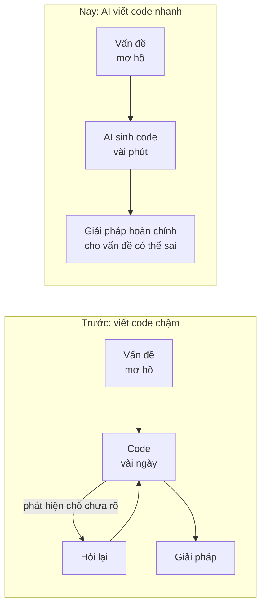
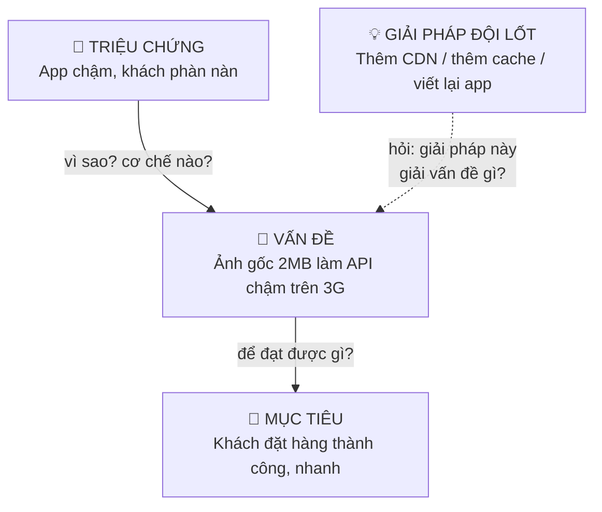
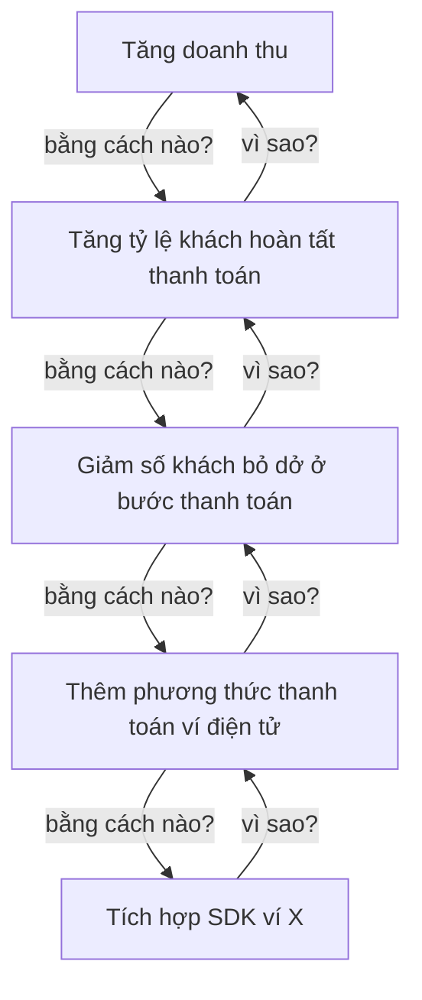
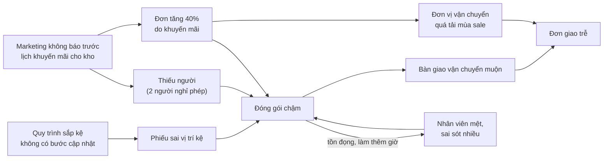
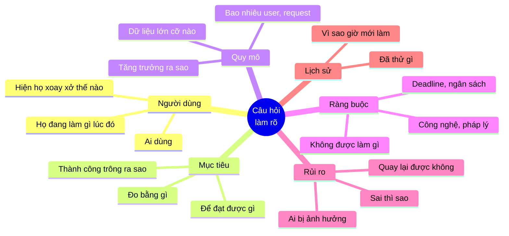
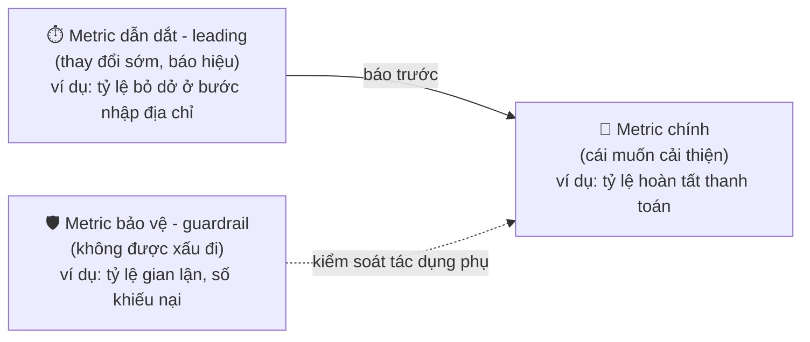
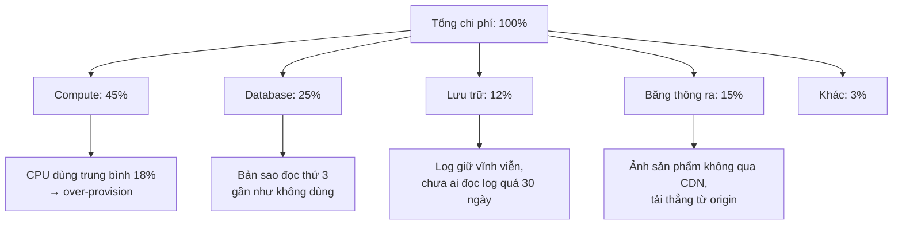
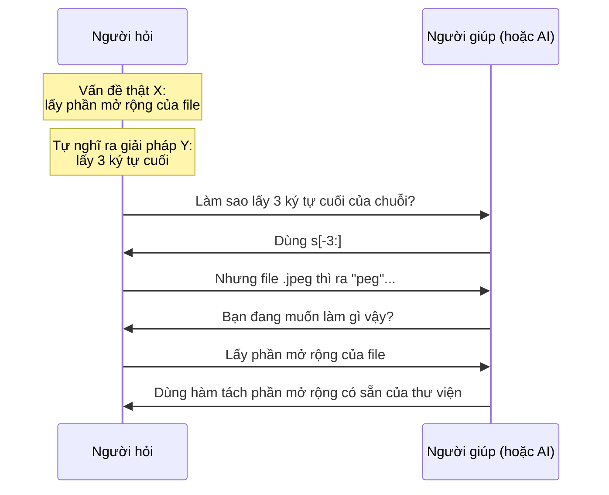
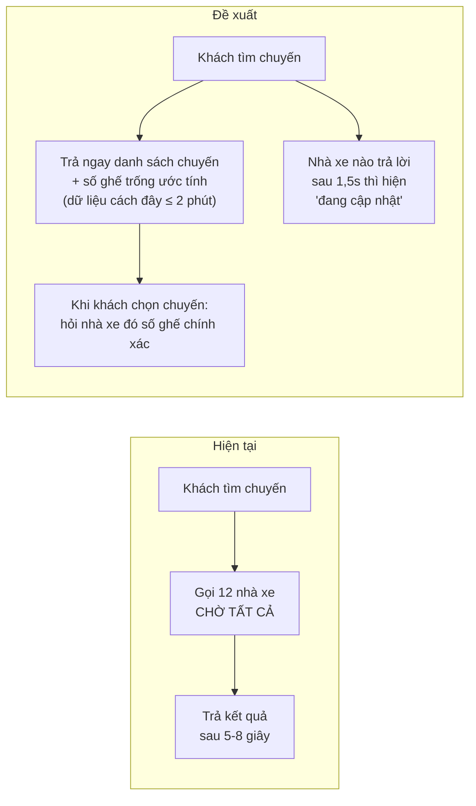
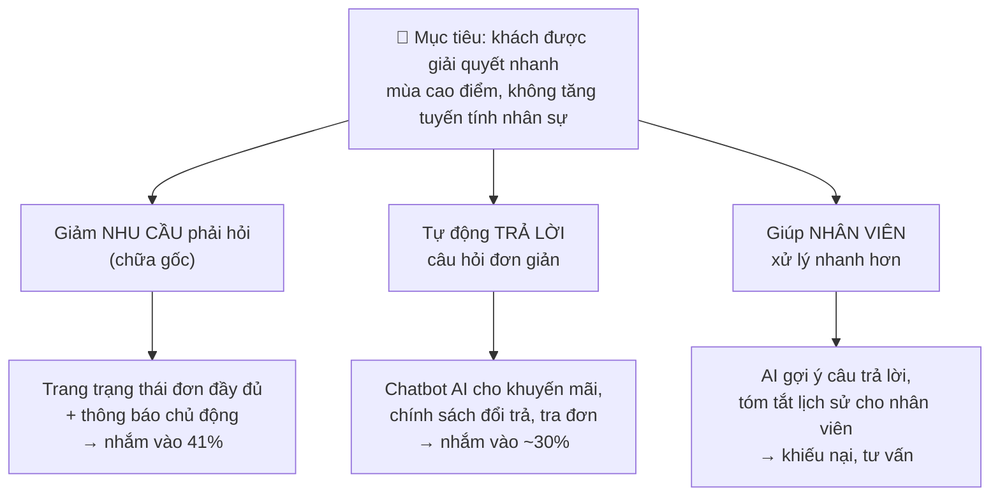

# 📚 Bài 3: Đặt đúng vấn đề

> "Một vấn đề được phát biểu tốt là một vấn đề đã được giải quyết một nửa." - Charles Kettering

Một tòa nhà văn phòng ở trung tâm thành phố nhận được rất nhiều lời phàn nàn: **thang máy quá chậm**. Người thuê than phiền phải chờ lâu vào giờ cao điểm, vài công ty dọa chuyển đi.

Ban quản lý mời các kỹ sư đến. Các kỹ sư đề xuất: thay động cơ mạnh hơn (rất đắt), thêm một thang máy mới (cực đắt, phải đục tường), hoặc lập trình lại thuật toán điều phối (đắt vừa, cải thiện ít). Tất cả đều xoay quanh câu hỏi: **"Làm sao để thang máy nhanh hơn?"**

Rồi một người khác đặt câu hỏi khác: **"Vì sao người ta khó chịu khi chờ thang máy?"** Câu trả lời: không phải vì chờ 40 giây, mà vì **40 giây đứng không làm gì thấy rất lâu**. Giải pháp: **lắp gương** cạnh cửa thang máy. Người ta soi gương, chỉnh tóc, ngắm người khác... và lời phàn nàn giảm hẳn. Chi phí: gần như bằng không.

Câu chuyện này (một câu chuyện kinh điển trong các sách về tư duy, có nhiều phiên bản) không nói rằng gương luôn là giải pháp đúng. Nó nói rằng: **cách bạn phát biểu vấn đề quyết định không gian giải pháp mà bạn sẽ tìm kiếm.** "Làm thang máy nhanh hơn" chỉ dẫn đến giải pháp về thang máy. "Làm việc chờ đợi bớt khó chịu" mở ra cả một thế giới giải pháp khác.

Trong thời đại AI, điều này càng quan trọng hơn bao giờ hết. AI là một cỗ máy giải quyết vấn đề cực kỳ mạnh - **trong không gian bạn chỉ cho nó**. Đưa cho AI vấn đề "làm thang máy nhanh hơn", nó sẽ cho bạn thiết kế động cơ tuyệt vời. Nó sẽ không tự hỏi lại bạn về cái gương.

## 🎯 Mục tiêu bài học

- Phân biệt **triệu chứng, vấn đề và mục tiêu**, di chuyển lên xuống "thang trừu tượng" bằng câu hỏi **vì sao** và **bằng cách nào**
- Dùng **5 Whys** đúng cách, biết giới hạn của nó, và khi nào cần **bản đồ nhân quả** thay thế
- Có một **bộ câu hỏi làm rõ** (question bank) để biến yêu cầu mơ hồ thành vấn đề rõ ràng
- Định nghĩa **metric thành công**, **ràng buộc**, **non-goal** cho một vấn đề
- Phân rã vấn đề theo **first principles** và áp dụng các **kỹ thuật reframe**
- Nhận diện **XY problem** và **thiên kiến giải pháp trước** (solution-first bias)
- Viết một **problem statement / spec một trang** mà một đồng nghiệp hoặc một **AI agent** có thể thực thi đúng
- Áp dụng toàn bộ vào hai tình huống: **"khách hàng than app chậm"** và **"làm chatbot AI cho CSKH"**

---

## 📖 1. Vì sao đặt vấn đề là kỹ năng số một?

### 1.1. Spec là "code" mới

Trước đây, khoảng cách giữa "hiểu vấn đề" và "có giải pháp chạy được" là hàng tuần viết code. Trong khoảng thời gian đó, người kỹ sư liên tục **va chạm với thực tế**: viết đến đâu, phát hiện chỗ chưa rõ đến đó, quay lại hỏi PM. Việc viết code chậm vô tình tạo ra **nhiều điểm kiểm tra** cho việc đặt vấn đề.

Bây giờ, AI có thể đi từ một đoạn mô tả đến hàng trăm dòng code trong vài phút. Những điểm kiểm tra tự nhiên kia biến mất. Nếu vấn đề được phát biểu sai, bạn nhận được **một giải pháp hoàn chỉnh, sạch sẽ, có test, cho vấn đề sai** - và nó trông thuyết phục đến mức dễ được merge.



Vì vậy, có một câu nói đang ngày càng đúng: **"Spec là code mới."** Đoạn mô tả vấn đề bạn đưa cho AI (hoặc cho đồng nghiệp) chính là "chương trình" quyết định kết quả. Viết nó cẩn thận như viết code.

### 1.2. Chi phí của việc giải sai vấn đề

| Sai lầm | Chi phí |
|---------|---------|
| Giải đúng vấn đề, giải pháp chưa tối ưu | Thấp - có thể cải thiện dần |
| Giải đúng vấn đề, giải pháp có bug | Vừa - sửa bug |
| **Giải sai vấn đề, giải pháp hoàn hảo** | **Cao nhất** - toàn bộ công sức bị lãng phí, **và** vấn đề thật vẫn còn đó, **và** giờ có thêm code phải bảo trì |

Dòng cuối là dòng nguy hiểm nhất, vì nó **trông giống thành công**: code đẹp, test xanh, demo chạy tốt. Chỉ vài tuần sau, khi metric không nhúc nhích, người ta mới nhận ra.

---

## 📖 2. Triệu chứng, vấn đề, mục tiêu

### 2.1. Ba tầng

Hầu hết yêu cầu đến tay kỹ sư ở dạng **triệu chứng** hoặc **giải pháp**, hiếm khi ở dạng **vấn đề**.

| Tầng | Định nghĩa | Ví dụ |
|------|-----------|-------|
| **Triệu chứng** (symptom) | Điều người ta **quan sát** hoặc **cảm thấy** | "App chậm", "Khách phàn nàn nhiều", "Server hay sập" |
| **Vấn đề** (problem) | **Cơ chế** gây ra triệu chứng, đủ cụ thể để hành động | "API danh sách sản phẩm có p99 = 6s với khách ở mạng 3G vì trả về ảnh gốc 2MB" |
| **Mục tiêu** (goal) | **Kết quả** mà doanh nghiệp/người dùng thực sự muốn | "Khách tìm được sản phẩm và đặt hàng nhanh, kể cả ở mạng yếu" → đo bằng tỷ lệ chuyển đổi |

Và một tầng nữa hay bị nhầm là vấn đề:

| **Giải pháp đội lốt yêu cầu** | Một cách làm cụ thể được phát biểu như thể nó là vấn đề | "Thêm Redis", "Chuyển sang microservices", "Làm chatbot AI" |



### 2.2. Thang trừu tượng: "Vì sao?" đi lên, "Bằng cách nào?" đi xuống

Một công cụ đơn giản và mạnh mẽ: với bất kỳ phát biểu nào, bạn có thể:

- Hỏi **"Vì sao?"** (hoặc "để làm gì?") → đi **lên** tầng mục tiêu, không gian giải pháp **rộng ra**.
- Hỏi **"Bằng cách nào?"** → đi **xuống** tầng giải pháp, cụ thể hơn, không gian **hẹp lại**.



Ticket bạn nhận thường ở tầng thấp nhất: "Tích hợp SDK ví X". Hỏi "vì sao" hai lần, bạn đến "giảm số khách bỏ dở ở bước thanh toán". Ở tầng này, bạn có thể thấy những giải pháp khác: có thể khách bỏ dở vì **phí ship hiện ra quá muộn**, hoặc vì **form bắt nhập lại địa chỉ**, chứ không phải vì thiếu ví. Dữ liệu sẽ cho biết.

!!! tip "Đi lên bao nhiêu tầng là đủ?"
    Đi lên cho đến tầng mà **bạn (hoặc team) có quyền và khả năng tác động**. Đi lên đến "tăng doanh thu" thì quá rộng cho một kỹ sư. "Giảm số khách bỏ dở ở bước thanh toán" là tầng phù hợp: đủ rộng để thấy nhiều giải pháp, đủ hẹp để hành động và đo được.

### 2.3. Không phải lúc nào cũng phải đi lên

Có những lúc ticket "Tích hợp SDK ví X" **chính là** việc cần làm: đã có dữ liệu cho thấy 30% khách hỏi về ví X, đối tác đã ký hợp đồng, có deadline pháp lý. Đặt vấn đề không có nghĩa là **nghi ngờ mọi thứ** hay biến mọi ticket thành cuộc tranh luận triết học. Nó có nghĩa là **biết** ticket này phục vụ mục tiêu gì - để khi gặp lựa chọn trong lúc làm (ví dụ: làm tính năng lưu ví cho lần sau hay không?), bạn chọn đúng.

Một quy tắc thực tế: **thời gian đặt vấn đề tỷ lệ với chi phí và độ không chắc chắn của việc cần làm.** Sửa lỗi chính tả: 0 phút. Tính năng 2 ngày: 15-30 phút. Dự án 3 tháng: vài ngày.

---

## 📖 3. 5 Whys và bản đồ nhân quả

### 3.1. 5 Whys

Kỹ thuật **5 Whys** (5 lần hỏi "tại sao") có nguồn gốc từ hệ thống sản xuất của Toyota. Ý tưởng: hỏi "tại sao" liên tiếp để đi từ triệu chứng xuống nguyên nhân sâu hơn.

**Ví dụ: "Đơn hàng giao trễ nhiều trong tuần này"**

1. **Tại sao đơn giao trễ?** → Vì đơn được bàn giao cho đơn vị vận chuyển muộn 1-2 ngày.
2. **Tại sao bàn giao muộn?** → Vì kho đóng gói chậm, tồn đọng 3.000 đơn.
3. **Tại sao kho đóng gói chậm?** → Vì phiếu xuất kho in ra bị sai vị trí kệ, nhân viên phải đi tìm hàng.
4. **Tại sao phiếu sai vị trí kệ?** → Vì tuần trước kho sắp xếp lại kệ, nhưng dữ liệu vị trí trên hệ thống chưa được cập nhật.
5. **Tại sao dữ liệu chưa cập nhật?** → Vì quy trình sắp xếp lại kệ không có bước cập nhật hệ thống; việc này dựa vào một người nhớ làm, và người đó nghỉ phép.

Đến câu thứ 5, ta có một vấn đề **có thể hành động ở tầng cấu trúc**: quy trình thiếu một bước, phụ thuộc vào trí nhớ một người. (Để ý: không dừng ở câu 4 với kết luận "nhân viên quên cập nhật" - đó là đổ lỗi, không phải nguyên nhân.)

### 3.2. Giới hạn của 5 Whys

5 Whys rất hữu ích để **bắt đầu**, nhưng có những điểm yếu nghiêm trọng:

| Giới hạn | Vì sao nguy hiểm |
|----------|-----------------|
| **Chỉ đi theo một chuỗi** | Sự cố thật thường có **nhiều nguyên nhân góp phần**. 5 Whys chọn một nhánh và bỏ qua các nhánh khác |
| **Tuyến tính** | Không thể hiện được **vòng phản hồi** (bạn đã học ở [Bài 2](./02-systems-thinking-basics.md)) |
| **Phụ thuộc người hỏi** | Hai người khác nhau hỏi 5 Whys cho cùng một sự cố thường ra hai kết quả khác nhau |
| **Dễ dừng ở con người** | "Tại sao? - Vì anh A quên" → dừng lại, đổ lỗi, không sửa cấu trúc |
| **Con số 5 là tùy ý** | Có khi 3 lần là đủ, có khi cần 7 lần |

### 3.3. Bản đồ nhân quả (causal map)

Với vấn đề phức tạp, thay vì một chuỗi, hãy vẽ **bản đồ**: nhiều nguyên nhân, nhiều nhánh, và các vòng phản hồi.



Bản đồ này cho thấy những điều 5 Whys bỏ sót:

- Có **ba** nguyên nhân góp phần vào đóng gói chậm, không phải một.
- Có một **vòng tăng cường**: đóng gói chậm → tồn đọng → làm thêm giờ → mệt → sai sót → càng chậm.
- Có một nguyên nhân **tổ chức** chung (marketing không báo trước lịch) ảnh hưởng đến hai nhánh.

Sửa duy nhất "quy trình sắp kệ" (kết luận của 5 Whys) sẽ giúp, nhưng đợt khuyến mãi sau, đơn vẫn trễ.

!!! tip "Khi nào dùng cái gì?"
    - **5 Whys**: vấn đề tương đối đơn giản, cần câu trả lời nhanh, hoặc để **khởi động** cuộc thảo luận.
    - **Bản đồ nhân quả**: sự cố lặp lại, nhiều team liên quan, có dấu hiệu vòng phản hồi, hoặc khi sửa "nguyên nhân gốc" lần trước không hiệu quả.
    - Mẹo: chạy 5 Whys **nhiều lần**, mỗi lần bắt đầu từ một nhánh khác nhau, rồi gộp lại thành bản đồ.

---

## 📖 4. Bộ câu hỏi làm rõ (Question bank)

### 4.1. Vì sao cần một bộ câu hỏi soạn sẵn?

Khi nhận một yêu cầu, áp lực thời gian khiến chúng ta muốn bắt tay vào làm ngay. Một bộ câu hỏi soạn sẵn giống như **checklist của phi công** trước khi cất cánh: không phải vì phi công không biết, mà vì dưới áp lực, con người dễ bỏ sót.

Bạn không cần hỏi **tất cả** câu hỏi cho **mọi** yêu cầu. Hãy chọn những câu phù hợp với độ lớn và rủi ro của việc cần làm.

### 4.2. Bộ câu hỏi theo nhóm



**🧑 Người dùng và bối cảnh**

- Ai sẽ dùng tính năng này? (Khách lẻ? Shop bán hàng? Nhân viên nội bộ? Hệ thống khác?)
- Họ đang ở **tình huống** nào khi cần nó? (Đang vội trên điện thoại? Ngồi ở bàn làm việc với 3 màn hình?)
- **Hiện tại** họ giải quyết việc này thế nào? (Câu này cực kỳ quý: cách xoay xở hiện tại cho biết nhu cầu thật và mức độ đau.)
- Có bao nhiêu người gặp vấn đề này? Một khách VIP hay 30% người dùng?

**🎯 Mục tiêu và thành công**

- Làm việc này **để đạt được gì**? Nếu làm xong mà con số nào không thay đổi thì coi là thất bại?
- Làm sao biết đã **thành công**? Đo bằng gì, sau bao lâu?
- Nếu chỉ được làm **một phần nhỏ** của yêu cầu, phần nào quan trọng nhất?
- Có metric nào **không được phép xấu đi** khi làm việc này? (guardrail)

**📏 Quy mô và con số**

- Bao nhiêu người dùng, bao nhiêu request/giây, bao nhiêu dữ liệu - **hôm nay** và **sau 1 năm**?
- Trường hợp **lớn nhất** là gì? (User có nhiều đơn nhất có bao nhiêu đơn? File lớn nhất nặng bao nhiêu?)
- Độ trễ chấp nhận được là bao nhiêu? Cần chính xác đến mức nào?

**🚧 Ràng buộc**

- Deadline là gì, và nó **cứng** hay **mềm**? Chuyện gì xảy ra nếu trễ?
- Có ràng buộc về công nghệ, ngân sách, pháp lý (dữ liệu cá nhân, hóa đơn điện tử, quy định ngân hàng)?
- Có gì **không được phép thay đổi**? (API công khai, schema dùng chung, hợp đồng với đối tác)

**⚠️ Rủi ro và thất bại**

- Nếu tính năng này **sai**, chuyện gì xảy ra? Ai bị ảnh hưởng?
- Có **quay lại được** không? (Feature flag? Rollback? Hay đã gửi email cho 1 triệu khách rồi?)
- Phần nào chúng ta **ít chắc chắn nhất**?

**📜 Lịch sử và bối cảnh tổ chức**

- Vấn đề này có từ bao giờ? **Vì sao bây giờ** mới làm?
- Đã từng thử giải quyết chưa? Vì sao không thành công?
- Ai khác đang làm việc liên quan? Ai cần được biết?

### 4.3. Cách hỏi sao cho không thành "tra hỏi"

Hỏi quá nhiều câu, theo kiểu chất vấn, có thể khiến PM hoặc khách hàng thấy khó chịu ("Sao không làm đi mà hỏi nhiều thế?"). Một số mẹo:

1. **Nói rõ vì sao bạn hỏi**: "Em hỏi để chọn đúng cách làm - nếu dữ liệu chỉ vài nghìn dòng thì cách đơn giản là đủ, còn nếu vài triệu thì phải làm khác."
2. **Đề xuất giả định thay vì hỏi trống**: thay vì "Cần bao nhiêu dòng?", hãy hỏi "Em giả định file export tối đa khoảng 50.000 dòng, đúng không ạ?". Người nghe chỉ cần xác nhận hoặc sửa.
3. **Hỏi câu rẻ trước**: câu nào tự tra được (dashboard, log, database, tài liệu) thì tự tra, đừng hỏi người.
4. **Gom câu hỏi**: gửi một tin nhắn với 4-5 câu thay vì 5 tin nhắn rời rạc.
5. **Ghi lại câu trả lời** vào ticket/spec - để người sau (và AI) không phải hỏi lại.

!!! note "Khi không ai trả lời được"
    Đôi khi không ai biết câu trả lời (ví dụ: "sau 1 năm sẽ có bao nhiêu user?"). Khi đó, đừng đứng yên. **Ghi rõ giả định** ("Giả định: dưới 100.000 user trong 12 tháng tới") và **thiết kế để dễ thay đổi** nếu giả định sai. Một giả định được viết ra có thể bị kiểm tra và phản bác; một giả định ngầm thì không.

---

## 📖 5. Metric thành công, ràng buộc, non-goal

### 5.1. Metric thành công

Một vấn đề chưa có metric thành công là một vấn đề **chưa có điểm kết thúc**. Bạn sẽ không biết khi nào dừng, và không ai biết bạn đã thành công hay chưa.

**Metric tốt có các đặc điểm:**

| Đặc điểm | ❌ Ví dụ kém | ✅ Ví dụ tốt |
|----------|-------------|-------------|
| **Cụ thể** | "App nhanh hơn" | "p95 thời gian mở màn hình sản phẩm < 1,5s trên Android tầm trung" |
| **Đo được ngay bây giờ** | "Khách hài lòng hơn" (chưa có cách đo) | "Tỷ lệ đánh giá 1-2 sao nhắc đến 'chậm' giảm" (có dữ liệu review) |
| **Gắn với mục tiêu thật** | "Số dòng code được refactor" | "Thời gian trung bình làm một tính năng ở module X" |
| **Có baseline** | "Giảm lỗi thanh toán" | "Giảm tỷ lệ lỗi thanh toán từ 2,1% xuống dưới 0,5%" |
| **Có thời hạn đo** | "Sẽ tăng chuyển đổi" | "Sau 4 tuần A/B test, chuyển đổi tăng ít nhất 1 điểm %" |

**Ba loại metric nên có cùng lúc:**



- **Metric chính**: thứ bạn muốn thay đổi.
- **Metric bảo vệ (guardrail)**: thứ **không được** xấu đi. Đây là cách phòng tránh định luật Goodhart (khi một metric thành mục tiêu, nó dễ bị "chơi gian" - xem [Bài 4](./04-mental-models.md)). Ví dụ: tăng tỷ lệ hoàn tất thanh toán bằng cách bỏ bước xác thực OTP thì metric chính đẹp, nhưng gian lận tăng vọt.
- **Metric dẫn dắt (leading)**: thay đổi **sớm hơn** metric chính, giúp bạn biết đang đi đúng hướng mà không phải chờ vài tháng.

### 5.2. Ràng buộc (constraints)

Ràng buộc là những giới hạn mà giải pháp **phải** tuân theo. Phân biệt hai loại:

| Loại | Ví dụ | Cách xử lý |
|------|-------|-----------|
| **Ràng buộc cứng** | Quy định pháp luật về dữ liệu cá nhân; hợp đồng SLA với đối tác; API công khai đang có 200 khách hàng tích hợp | Không thương lượng được. Thiết kế quanh nó |
| **Ràng buộc mềm** | "Deadline cuối tháng"; "Team quen dùng PostgreSQL"; "Ngân sách 5 triệu/tháng" | Có thể thương lượng nếu có lý do đủ mạnh. **Hỏi** xem nó cứng đến đâu |

Nhiều ràng buộc tưởng là cứng hóa ra là mềm. "Deadline cuối tháng" - hỏi lại thì là "sếp muốn demo trong buổi họp với nhà đầu tư cuối tháng", nghĩa là chỉ cần **demo được luồng chính**, chưa cần chạy production cho mọi khách. Đó là một vấn đề hoàn toàn khác (và dễ hơn nhiều).

### 5.3. Non-goal - viết ra những gì **không** làm

**Non-goal** (mục tiêu loại trừ) là danh sách những thứ **có vẻ liên quan nhưng cố tình không làm** trong phạm vi này. Đây là một trong những phần **bị đánh giá thấp nhất** và **có giá trị nhất** của một spec.

Vì sao non-goal quan trọng?

1. **Ngăn phạm vi phình to (scope creep)**: "À tiện thì làm luôn..." là câu nói giết chết deadline.
2. **Làm rõ trade-off**: viết "Không hỗ trợ offline trong phiên bản này" buộc mọi người đối diện và đồng ý với quyết định đó **trước**, thay vì tranh cãi **sau**.
3. **Đặc biệt quan trọng với AI agent**: AI có xu hướng **làm thừa** - thêm tính năng "cho đầy đủ", thêm cấu hình "cho linh hoạt", refactor code xung quanh "cho sạch". Non-goal là cách bạn nói rõ "đừng đụng vào".

**Ví dụ non-goal cho tính năng "Export đơn hàng ra Excel":**

```text
Non-goals:
- Không hỗ trợ export định dạng PDF hoặc CSV trong phiên bản này.
- Không hỗ trợ export quá 50.000 dòng (hiển thị thông báo yêu cầu lọc thêm).
- Không lên lịch export tự động định kỳ.
- Không thay đổi API danh sách đơn hàng hiện có.
- Không refactor module báo cáo cũ (kể cả khi thấy code chưa đẹp).
```

---

## 📖 6. Phân rã theo first principles

### 6.1. Ôn lại

First principles (nguyên lý gốc) là cách **phân rã vấn đề xuống những sự thật cơ bản**, thay vì suy luận theo lối mòn ("người ta thường làm thế này"). Bạn đã gặp kỹ thuật này ở [Mindset - Bài 2: Giải quyết vấn đề](../mindset/02-problem-solving.md). Ở đây ta dùng nó cho việc **đặt vấn đề**.

### 6.2. Ví dụ: "Chi phí cloud quá cao, cần cắt giảm 30%"

**Lối mòn:** "Mua reserved instance", "Chuyển sang nhà cung cấp rẻ hơn", "Tắt môi trường staging buổi tối". Đây là các giải pháp phổ biến, có thể đúng, nhưng là **đoán**.

**First principles:** Chi phí cloud được tạo thành từ đâu?

```text
Chi phí = Σ (lượng tài nguyên × đơn giá × thời gian sử dụng)
                 │                │            │
                 │                │            └─ có chạy khi không cần không?
                 │                └─ có trả giá cao hơn cần thiết không? (on-demand vs reserved)
                 └─ có dùng nhiều hơn cần thiết không? (over-provision, dữ liệu thừa)
```

Rồi phân rã tiếp theo **dữ liệu thật** của hóa đơn:



Giờ vấn đề không còn là "cắt 30% chi phí" chung chung, mà là bốn vấn đề cụ thể, mỗi cái có giải pháp và con số riêng. Có thể chỉ cần sửa hai trong số đó là đủ 30%.

### 6.3. Ví dụ: ước lượng giới hạn vật lý

First principles cũng giúp **kiểm tra tính khả thi** trước khi làm. PM muốn "gửi thông báo khuyến mãi cho 2 triệu user trong vòng 1 phút".

- 2.000.000 / 60 giây ≈ **33.000 thông báo/giây**.
- Dịch vụ push hiện tại giới hạn bao nhiêu request/giây? Giả sử 5.000/giây → cần **~7 phút**, không phải 1 phút.
- Và nếu 2 triệu người nhận cùng lúc, giả sử 5% mở app trong 1 phút đầu → **100.000 người mở app trong 60 giây** ≈ 1.700 người/giây mở app, mỗi người gọi ~10 API → 17.000 request/giây vào backend. Hệ thống chịu được không?

Hai phép tính 30 giây đã biến "gửi trong 1 phút" thành một cuộc trò chuyện khác: "**Vì sao** cần 1 phút? Nếu gửi rải trong 15 phút thì có ảnh hưởng mục tiêu kinh doanh không?" (Đây chính là bài học của đêm 11/11 ở [Bài 2](./02-systems-thinking-basics.md).)

---

## 📖 7. Kỹ thuật reframe - nhìn vấn đề từ góc khác

**Reframe** (đóng khung lại) là phát biểu lại vấn đề theo một cách khác để mở ra giải pháp mới. Câu chuyện cái gương ở đầu bài là một reframe. Dưới đây là bộ kỹ thuật bạn có thể dùng có chủ đích.

| Kỹ thuật | Câu hỏi | Ví dụ |
|----------|---------|-------|
| **Đổi chủ thể** | Vấn đề của **ai**? Nếu nhìn từ người khác thì sao? | "Hệ thống chậm" (góc kỹ sư) → "Khách không biết đơn đã đặt được chưa" (góc khách) → hiển thị trạng thái rõ ràng có thể giải quyết phần lớn sự lo lắng |
| **Đi lên mục tiêu** | Để đạt được gì? | "Làm báo cáo Excel cho sếp" → "Sếp cần biết doanh thu theo kênh mỗi sáng thứ Hai" → có thể là một email tự động 5 dòng |
| **Đảo ngược (inversion)** | Làm sao để chắc chắn **thất bại**? | "Làm sao để onboarding tốt?" → "Làm sao để người mới chắc chắn bỏ cuộc trong tuần đầu?" → liệt kê ra rồi tránh từng thứ |
| **Bỏ giải pháp khỏi đề bài** | Phát biểu lại mà không nhắc tới công nghệ | "Cần thêm Kafka" → "Hai service cần trao đổi sự kiện mà không phụ thuộc thời gian chạy của nhau" → có thể là bảng outbox + polling |
| **Thay đổi ràng buộc** | Nếu chỉ có **1 ngày**? Nếu **không được viết code**? Nếu có **gấp 10** ngân sách? | "Nếu không được viết code, ta giải quyết vấn đề này thế nào?" → thường phát hiện giải pháp quy trình rẻ hơn |
| **Phóng to / thu nhỏ** | Đây có phải một phần của vấn đề lớn hơn? Có phần nhỏ nào giải trước được? | "Sửa bug này" → "Đây là bug thứ 5 trong module này, module có vấn đề thiết kế?" |
| **Ai đã giải rồi?** | Ngành khác, công ty khác giải vấn đề tương tự thế nào? | Hàng chờ ảo khi quá tải - học từ cách bán vé concert |
| **Đổi metric** | Nếu đo bằng thứ khác thì vấn đề trông thế nào? | "Thời gian phản hồi trung bình" → "p99" → phát hiện vấn đề chỉ ở 1% user (như câu chuyện ở [Bài 1](./01-why-thinking-matters.md)) |

!!! tip "Một bài tập reframe nhanh"
    Với bất kỳ vấn đề nào, hãy viết ra **ít nhất 3 cách phát biểu khác nhau** trước khi chọn một. Nếu bạn chỉ nghĩ ra được một cách, khả năng cao bạn đang mắc kẹt trong cách đóng khung đầu tiên mà bạn nghe được.

---

## 📖 8. XY problem và thiên kiến giải pháp trước

### 8.1. XY problem

**XY problem** là một hiện tượng rất phổ biến trên các diễn đàn lập trình:

1. Người dùng muốn giải quyết vấn đề **X**.
2. Họ nghĩ rằng giải pháp là **Y**.
3. Họ không biết làm Y, nên đi hỏi về **Y**.
4. Người giúp đỡ tốn thời gian giúp về Y, trong khi Y có thể không phải là cách tốt để giải X.



**XY problem trong thời đại AI còn nguy hiểm hơn.** Một người giúp đỡ là con người thường sẽ hỏi lại "bạn đang muốn làm gì?". AI thì thường **trả lời thẳng câu hỏi Y** - và trả lời rất tốt. Bạn nhận được cách lấy 3 ký tự cuối hoàn hảo, kèm test, và không bao giờ biết rằng `.jpeg` sẽ làm hỏng nó.

**XY problem trong ticket:**

| Ticket (Y) | Vấn đề thật (X) có thể là |
|-----------|-------------------------|
| "Tăng timeout của API lên 60 giây" | Một query chậm cần tối ưu; hoặc tác vụ nên chạy bất đồng bộ |
| "Thêm cột `is_deleted` vào bảng users" | Cần ẩn tài khoản đã đóng - nhưng có ràng buộc pháp lý về xóa dữ liệu cá nhân không? |
| "Cho phép upload file 500MB" | Khách cần chia sẻ video sản phẩm - có thể chỉ cần cho dán link YouTube |
| "Viết script chạy lại các job bị lỗi mỗi giờ" | Job lỗi vì lý do gì? Script này là "fixes that fail" ([Bài 2](./02-systems-thinking-basics.md)) |

**Cách phòng tránh:**

- Khi **hỏi** (người hoặc AI): luôn nêu cả **X** (mục tiêu) lẫn **Y** (cách bạn đang thử). "Tôi muốn lấy phần mở rộng của file để phân loại ảnh; tôi đang thử lấy 3 ký tự cuối - có cách nào tốt hơn không?"
- Khi **nhận** yêu cầu: hỏi "**Việc này giúp giải quyết điều gì?**" trước khi hỏi "làm thế nào".

### 8.2. Thiên kiến giải pháp trước (solution-first bias)

Não người thích giải pháp. Ngay khi nghe một vấn đề, chúng ta đã nghĩ ra một giải pháp - thường là giải pháp **quen thuộc nhất**, công nghệ **mới học gần nhất**, hoặc giải pháp **đã từng thành công** ở dự án trước. ("Khi trong tay chỉ có cái búa, cái gì cũng trông giống cái đinh.")

Dấu hiệu bạn đang mắc thiên kiến này:

- Bạn mô tả vấn đề bằng **tên công nghệ** ("vấn đề là chúng ta chưa có Kafka").
- Bạn chỉ có **một** phương án và đang đi tìm lý do để biện minh cho nó.
- Bạn hào hứng với **cách làm** hơn là với **kết quả**.
- Bạn bỏ qua dữ liệu không ủng hộ phương án của mình.

**Thuốc giải:**

1. **Viết vấn đề trước, không nhắc đến giải pháp.** Nếu không viết được câu vấn đề mà không có tên công nghệ, bạn chưa hiểu vấn đề.
2. **Luôn có ít nhất 2-3 phương án**, kể cả phương án "không làm gì" và phương án "không viết code".
3. **Định nghĩa tiêu chí so sánh trước khi so sánh** - để không chọn tiêu chí theo phương án mình thích. Xem ma trận quyết định ở [Mindset - Bài 7](../mindset/07-tradeoffs-decisions.md).

---

## 📖 9. Viết problem statement một trang

### 9.1. Template

Đây là template một trang mà bạn có thể dùng cho mọi việc từ 2 ngày trở lên. Nó vừa để người đọc, vừa để giao cho AI agent.

```markdown
# [Tên ngắn gọn của vấn đề]

## 1. Bối cảnh
2-4 câu: hệ thống/sản phẩm nào, ai dùng, vì sao bây giờ quan trọng.

## 2. Vấn đề
Phát biểu vấn đề KHÔNG nhắc đến giải pháp.
Ai bị ảnh hưởng, bị ảnh hưởng thế nào, bao nhiêu.

## 3. Bằng chứng
Số liệu, log, dashboard, phản hồi khách hàng. (Link nếu có.)

## 4. Mục tiêu và metric
- Metric chính: [từ X → Y, đo bằng gì, sau bao lâu]
- Guardrail: [những gì không được xấu đi]
- Leading metric (nếu có)

## 5. Ràng buộc
- Cứng: ...
- Mềm: ...

## 6. Non-goals
- Không làm ...

## 7. Giả định và câu hỏi mở
- Giả định: ... (cách kiểm chứng: ...)
- Câu hỏi chưa có câu trả lời: ... (ai trả lời, khi nào)

## 8. Phương án đã cân nhắc
- A: ... (ưu / nhược)
- B: ...
- Đề xuất: ... vì ...

## 9. Định nghĩa hoàn thành và cách kiểm chứng
- [ ] Điều kiện chấp nhận cụ thể, kiểm tra được
- [ ] Test / đo lường sẽ chạy để chứng minh
```

### 9.2. Bổ sung khi người thực thi là AI agent

AI agent thông minh, nhanh, nhưng **không có bối cảnh** bạn có, và có những xu hướng riêng (làm thừa, tự tin khi không chắc, ít khi dừng lại để hỏi). Khi spec dành cho AI agent, bổ sung các mục sau:

```markdown
## 10. Bối cảnh kỹ thuật cho người thực thi
- File/module liên quan: ...
- Quy ước của dự án cần tuân theo: (cách xử lý lỗi, cách đặt tên, thư viện được dùng)
- Lệnh để chạy test: ...

## 11. Ranh giới
- ĐƯỢC sửa: [danh sách thư mục/file]
- KHÔNG được sửa: [schema DB, API công khai, file cấu hình X...]
- Không thêm dependency mới khi chưa hỏi.

## 12. Điều kiện dừng và hỏi
Dừng lại và báo cáo (thay vì tự quyết) nếu:
- Cần thay đổi nằm ngoài ranh giới ở mục 11
- Phát hiện yêu cầu mâu thuẫn với code hiện có
- Test hiện có bị fail trước khi bắt đầu

## 13. Kết quả cần bàn giao
- Code + test
- Tóm tắt: đã thay đổi gì, vì sao, còn rủi ro gì, đã kiểm chứng bằng cách nào
```

Mục 11 và 12 là những mục mà người viết spec cho người thường bỏ qua (vì đồng nghiệp có "lẽ thường"), nhưng lại **quan trọng nhất** với AI agent. Bạn sẽ đào sâu cách làm việc với AI agent ở [Bài 7](./07-engineering-with-ai.md).

### 9.3. Ví dụ: spec tệ vs spec tốt

**❌ Spec tệ:**

```text
Làm tính năng export đơn hàng ra Excel cho trang admin. Cần nhanh và đẹp.
Deadline thứ 6.
```

Vấn đề của spec này: không biết ai dùng, để làm gì, bao nhiêu dòng, cột nào, "nhanh" là bao nhiêu, "đẹp" là gì, ai được phép export (dữ liệu khách hàng!). Một AI agent nhận spec này sẽ tự đoán tất cả - và mỗi lần đoán là một lần có thể sai.

**✅ Spec tốt:**

```markdown
# Export đơn hàng cho team đối soát

## 1. Bối cảnh
Team đối soát (5 người) mỗi sáng phải đối chiếu đơn hàng ngày hôm trước với
sao kê của cổng thanh toán. Hiện họ copy từng trang (20 đơn/trang) từ admin
dán vào Excel, mất ~2 giờ/ngày.

## 2. Vấn đề
Team đối soát không có cách lấy danh sách đơn của một ngày ở dạng bảng tính,
nên tốn ~10 giờ/tuần làm thủ công và hay sót đơn (3 lần sót trong tháng trước).

## 3. Bằng chứng
- Phỏng vấn trưởng team đối soát ngày 02/10.
- 3 ticket "lệch đối soát do sót đơn" trong tháng 9.

## 4. Mục tiêu và metric
- Chính: thời gian đối soát hằng ngày từ ~2 giờ xuống < 30 phút (hỏi lại team sau 2 tuần).
- Guardrail: chỉ người có quyền "Đối soát" mới export được; không lộ số thẻ.

## 5. Ràng buộc
- Cứng: không xuất số thẻ/CVV (chỉ 4 số cuối); ghi log ai export, lúc nào.
- Mềm: deadline thứ 6 (team đối soát sẽ dùng từ thứ 2 tuần sau).

## 6. Non-goals
- Không export PDF/CSV, không lên lịch tự động, không thêm bộ lọc ngoài "khoảng ngày".
- Không thay đổi API danh sách đơn hiện có.

## 7. Giả định và câu hỏi mở
- Giả định: tối đa ~15.000 đơn/ngày (ngày sale lớn nhất năm ngoái: 11.200).
- Câu hỏi mở: cột "phí cổng thanh toán" có cần không? → hỏi trưởng team đối soát.

## 8. Phương án
- A: Sinh file đồng bộ trong request. Đơn giản; rủi ro timeout nếu > 15.000 dòng.
- B: Job nền sinh file, gửi link tải. Phức tạp hơn.
- Đề xuất: A, giới hạn khoảng ngày tối đa 3 ngày; chuyển sang B nếu cần sau này.

## 9. Định nghĩa hoàn thành
- [ ] Người có quyền "Đối soát" chọn khoảng ngày (tối đa 3 ngày) và tải file .xlsx.
- [ ] Cột: mã đơn, thời gian, khách hàng, tổng tiền, phương thức TT, mã giao dịch cổng TT, trạng thái.
- [ ] Người không có quyền nhận lỗi 403; mỗi lần export ghi audit log.
- [ ] Test: 0 đơn, 1 đơn, 15.000 đơn (< 10 giây), người không có quyền, khoảng ngày > 3 ngày.
```

Để ý: spec tốt **không dài hơn nhiều** so với một ticket thông thường. Nó chỉ chứa **đúng những thông tin** mà người thực thi (người hoặc AI) cần để không phải đoán.

---

## 🌍 Tình huống thực tế

### Tình huống A: "Khách hàng than app chậm"

**Bối cảnh:** Bạn là kỹ sư ở một app đặt vé xe khách. Giám đốc sản phẩm chuyển tiếp một loạt đánh giá 1 sao trên cửa hàng ứng dụng: *"App chậm quá"*, *"Lag kinh khủng"*, *"Đợi mãi không load"*. Yêu cầu: **"Tối ưu app cho nhanh, trong sprint này."**

**Bước 1 - Không nhảy vào code. Đặt câu hỏi.**

| Câu hỏi | Cách trả lời | Kết quả tìm được |
|---------|-------------|-----------------|
| "Chậm" ở **màn hình nào**, **thao tác nào**? | Đọc 120 đánh giá 1-2 sao gần nhất, phân loại | 70% nhắc đến lúc **tìm chuyến** hoặc **chọn ghế**; 15% nhắc đến **thanh toán**; còn lại chung chung |
| Chậm **bao nhiêu**? Với **ai**? | Dashboard APM + phân tích theo thiết bị, mạng | API tìm chuyến: p50 = 400ms, **p95 = 7s**. Các request chậm tập trung vào **tuyến Tết** (Hà Nội - Thanh Hóa, TP.HCM - miền Tây) |
| Từ **khi nào**? | So sánh theo thời gian | Bắt đầu tăng từ 3 tuần trước - trùng với lúc mở bán vé Tết |
| Vì sao tuyến Tết chậm? | Trace một request chậm | API tìm chuyến gọi **đồng bộ** sang hệ thống của 12 nhà xe để lấy số ghế trống; vài nhà xe phản hồi 5-8 giây khi tải cao |

**Bước 2 - Phát biểu lại vấn đề.**

- ❌ Phát biểu ban đầu: "App chậm."
- ⚠️ Phát biểu kỹ thuật hơn nhưng vẫn là giải pháp: "Cần cache kết quả tìm chuyến."
- ✅ Phát biểu vấn đề: "Trong mùa cao điểm, API tìm chuyến chờ đồng bộ phản hồi từ **nhà xe chậm nhất** trong 12 nhà xe, nên khách tìm các tuyến đông phải chờ 5-8 giây; khách có xu hướng thoát app trước khi thấy kết quả."

**Bước 3 - Reframe để mở rộng không gian giải pháp.**

- **Đổi chủ thể (góc khách)**: Khách cần gì khi tìm chuyến? Cần thấy **danh sách chuyến** nhanh. Số ghế trống **chính xác đến từng ghế** chỉ cần khi chọn ghế.
- **Đổi metric**: Đo "thời gian đến khi khách thấy kết quả đầu tiên" thay vì "thời gian API trả về toàn bộ".
- **Bỏ giải pháp khỏi đề bài**: không phải "làm sao để 12 nhà xe phản hồi nhanh hơn" (ngoài tầm kiểm soát), mà "làm sao để khách không phải chờ nhà xe chậm nhất".



**Bước 4 - Problem statement (rút gọn).**

```markdown
# Tìm chuyến chậm trong mùa cao điểm

## Vấn đề
API tìm chuyến chờ đồng bộ 12 nhà xe; mùa Tết, nhà xe chậm nhất phản hồi 5-8s,
nên p95 tìm chuyến = 7s. 70% đánh giá 1-2 sao gần đây nhắc đến tìm chuyến/chọn ghế.

## Metric
- Chính: p95 "thời gian đến khi thấy danh sách chuyến" < 1,5s (tuyến cao điểm).
- Guardrail: tỷ lệ "chọn ghế xong mới báo hết ghế" không vượt quá 2%.
- Leading: tỷ lệ khách thoát ở màn hình kết quả tìm kiếm.

## Ràng buộc
- Cứng: không thể thay đổi API của nhà xe. Đặt chỗ cuối cùng PHẢI xác nhận với nhà xe.
- Mềm: muốn có trước đợt mở bán vé Tết đợt 2 (3 tuần nữa).

## Non-goals
- Không tối ưu màn hình thanh toán (15% phàn nàn, xử lý sau).
- Không viết lại app, không đổi framework mobile.

## Phương án
- A: Cache toàn bộ kết quả 5 phút → nhanh nhưng số ghế sai nhiều giờ cao điểm.
- B: Số ghế ước tính (cập nhật nền mỗi 2 phút) cho danh sách + hỏi chính xác khi chọn chuyến;
     timeout 1,5s cho mỗi nhà xe, quá hạn thì hiện "đang cập nhật".
- Đề xuất: B.

## Định nghĩa hoàn thành
- [ ] Load test 2.000 lượt tìm/phút với 2 nhà xe giả lập phản hồi 8s: p95 < 1,5s.
- [ ] Khi chọn chuyến, số ghế luôn lấy trực tiếp từ nhà xe.
- [ ] Dashboard theo dõi 3 metric trên.
```

**Kết quả:** Thay vì "tối ưu app" chung chung (có thể dẫn đến cả sprint tối ưu code giao diện vốn không phải nút thắt), team giải quyết đúng nút thắt và có cách đo rõ ràng.

### Tình huống B: "Làm tính năng AI chatbot cho CSKH"

**Bối cảnh:** Một sàn thương mại điện tử mỹ phẩm. CEO vừa dự một hội thảo về AI, quay về và nói: **"Chúng ta cần chatbot AI cho chăm sóc khách hàng. Đối thủ có rồi. Làm trong tháng này."**

Đây là một yêu cầu ở dạng **giải pháp đội lốt yêu cầu** điển hình. Nhưng đừng vội từ chối - CEO có thể đúng! Việc của bạn là **tìm ra vấn đề mà giải pháp này đang nhắm tới**, để làm cho nó thành công.

**Bước 1 - Đi lên thang trừu tượng: "Để đạt được gì?"**

Bạn hẹn CEO và trưởng CSKH 30 phút. Các câu hỏi và câu trả lời:

- *"Nếu chatbot thành công, sau 3 tháng con số nào thay đổi?"* → CEO: "Giảm chi phí CSKH. Mùa sale phải thuê thêm 15 người thời vụ, vẫn không kịp, khách chờ 2 tiếng mới được trả lời."
- *"Khách chờ lâu ảnh hưởng gì?"* → Trưởng CSKH: "Khách hủy đơn, đánh giá xấu. Và nhân viên kiệt sức, nghỉ việc nhiều."
- *"Hiện có bao nhiêu yêu cầu CSKH mỗi ngày, ngày sale bao nhiêu?"* → "Ngày thường 1.200, ngày sale 6.000."

Mục tiêu thật dần rõ: **"Khách được giải quyết vấn đề nhanh trong mùa cao điểm mà không cần tăng tuyến tính số nhân viên."** Chatbot là **một** giải pháp khả dĩ.

**Bước 2 - Nhìn dữ liệu: khách thực sự hỏi gì?**

Bạn lấy mẫu 1.000 hội thoại CSKH gần nhất và phân loại (có thể dùng AI để phân loại sơ bộ, rồi kiểm tra lại một mẫu bằng tay):

| Loại yêu cầu | Tỷ lệ | Cần gì để giải quyết |
|-------------|-------|---------------------|
| "Đơn của tôi đang ở đâu?" | 41% | Tra trạng thái đơn và vận chuyển |
| Đổi trả, hoàn tiền | 18% | Kiểm tra chính sách + tạo yêu cầu + đôi khi cần người phán quyết |
| Tư vấn sản phẩm (da dầu dùng gì...) | 14% | Kiến thức sản phẩm, có rủi ro tư vấn sai |
| Hỏi về khuyến mãi, mã giảm giá | 12% | Tra thông tin khuyến mãi |
| Khiếu nại (hàng giả, hàng hỏng, giao sai) | 9% | Cần người, cần xử lý cảm xúc, có rủi ro pháp lý và thương hiệu |
| Khác | 6% | Đa dạng |

**Bước 3 - Reframe.**

Nhìn bảng trên, một câu hỏi nảy ra: *"Vì sao 41% khách phải hỏi 'đơn tôi đâu'?"* Kiểm tra thì thấy: trang trạng thái đơn chỉ hiện "Đang giao", không có mã vận đơn, không có ngày giao dự kiến, và không có thông báo khi đơn đổi trạng thái.

Đây là một reframe mạnh: **phần lớn yêu cầu CSKH không phải là "câu hỏi cần trả lời", mà là "thông tin bị thiếu" trên sản phẩm.** Một chatbot trả lời "đơn của bạn đang ở bước X" là chữa triệu chứng. Hiển thị rõ trạng thái và chủ động thông báo là chữa gốc - và rẻ hơn, chắc chắn hơn một chatbot.



**Bước 4 - Đề xuất với CEO.**

Bạn **không** nói "chatbot là ý tồi". Bạn nói: *"Chatbot là một phần của giải pháp. Dữ liệu cho thấy nếu ta làm thêm trang trạng thái đơn và thông báo chủ động, có thể giảm phần lớn trong 41% yêu cầu - nhanh hơn và an toàn hơn. Chatbot nên tập trung vào khuyến mãi và chính sách đổi trả, và **luôn chuyển cho người** khi gặp khiếu nại. Phần khiếu nại và tư vấn da, AI hỗ trợ nhân viên chứ không trả lời trực tiếp khách - vì rủi ro tư vấn sai."*

**Bước 5 - Problem statement cho phần chatbot.**

```markdown
# Trợ lý AI trả lời câu hỏi khuyến mãi và đổi trả

## Vấn đề
Mùa sale có ~6.000 yêu cầu CSKH/ngày; ~30% là câu hỏi về khuyến mãi và chính sách
đổi trả có câu trả lời nằm sẵn trong tài liệu, nhưng khách vẫn chờ trung bình 2 giờ.

## Metric
- Chính: tỷ lệ hội thoại thuộc 2 nhóm trên được giải quyết không cần người
  (containment) ≥ 50% sau 4 tuần.
- Guardrail:
  - CSAT của hội thoại có chatbot không thấp hơn hội thoại chỉ có người.
  - 0 trường hợp chatbot hứa hẹn sai chính sách (ví dụ hứa hoàn tiền khi không đủ điều kiện)
    trong mẫu kiểm tra hằng tuần 200 hội thoại.
  - Khách luôn có nút "Gặp nhân viên" ở mọi bước.
- Leading: tỷ lệ khách bấm "Gặp nhân viên" trong 2 tin nhắn đầu.

## Ràng buộc
- Cứng: chỉ trả lời dựa trên tài liệu chính sách hiện hành; không tư vấn sản phẩm
  cho da/sức khỏe; không truy cập dữ liệu thanh toán; tuân thủ quy định bảo vệ dữ liệu cá nhân.
- Mềm: có bản đầu tiên trong 4 tuần, trước đợt sale lớn.

## Non-goals
- Không xử lý khiếu nại (chuyển người ngay khi phát hiện).
- Không tư vấn sản phẩm.
- Không thay thế trang trạng thái đơn (làm riêng, song song).

## Giả định và câu hỏi mở
- Giả định: tài liệu chính sách hiện có là đầy đủ và cập nhật → cần CSKH xác nhận.
- Câu hỏi: ai chịu trách nhiệm cập nhật tài liệu khi chính sách đổi? Chatbot cần biết
  chính sách nào áp dụng cho đơn đặt trước ngày thay đổi?

## Định nghĩa hoàn thành
- [ ] Bộ đánh giá 300 câu hỏi thật (đã ẩn danh) với câu trả lời chuẩn do CSKH duyệt;
      chatbot đạt ≥ 90% đúng, 0 câu hứa hẹn sai chính sách.
- [ ] Luồng chuyển người hoạt động, kèm tóm tắt hội thoại cho nhân viên.
- [ ] Dashboard 3 metric trên; quy trình kiểm tra mẫu hằng tuần.
```

Để ý những phần mà một yêu cầu "làm chatbot AI" ban đầu **hoàn toàn không có**: guardrail về hứa hẹn sai chính sách, bộ đánh giá với câu trả lời chuẩn, luồng chuyển người, ai cập nhật tài liệu. Đây chính là những chỗ các dự án chatbot thất bại trong thực tế. Bạn sẽ học cách xây hệ thống có AI bên trong một cách nghiêm túc ở [Bài 8](./08-building-ai-systems.md).

---

## ⚠️ Sai lầm thường gặp

### 1. Nhận giải pháp như nhận vấn đề

❌ Ticket: "Thêm Redis cache" → bắt tay cài Redis.

✅ Hỏi: "Cache này để giải quyết vấn đề gì? Đo được không? Có cách nào khác không?" - rồi mới quyết định.

### 2. Đặt vấn đề quá lâu, không bao giờ bắt đầu

❌ Ba tuần viết tài liệu, phỏng vấn, phân tích cho một tính năng 2 ngày.

✅ Thời gian đặt vấn đề **tỷ lệ với chi phí và độ không chắc chắn**. Với việc nhỏ, 15 phút với bộ câu hỏi là đủ. Khi không chắc, làm một **prototype nhỏ để học** rồi đặt lại vấn đề.

### 3. Metric không có baseline hoặc không đo được

❌ "Mục tiêu: cải thiện trải nghiệm người dùng."

✅ "Mục tiêu: tỷ lệ thoát ở màn hình tìm kiếm từ 38% xuống dưới 25%, đo trên dashboard X, sau 4 tuần."

### 4. Không có guardrail metric

❌ Chỉ đo metric chính → tối ưu bằng mọi giá → tác dụng phụ không ai thấy.

✅ Luôn hỏi: "Cách **rẻ nhất, gian nhất** để làm đẹp metric này là gì?" Rồi đặt guardrail chặn đúng cách đó.

### 5. Không viết non-goal

❌ Phạm vi phình dần: "tiện thì làm thêm...". AI agent tự thêm tính năng, refactor code xung quanh.

✅ Viết rõ những gì **không làm**, đặc biệt những thứ "có vẻ liên quan".

### 6. Dừng 5 Whys ở con người

❌ "Tại sao? - Vì bạn A deploy nhầm." → Kết luận: nhắc bạn A cẩn thận hơn.

✅ Hỏi tiếp: "Tại sao hệ thống **cho phép** deploy nhầm mà không có gì chặn lại?"

### 7. Hỏi AI câu Y thay vì câu X

❌ "Viết regex lấy 3 ký tự cuối của tên file."

✅ "Tôi cần lấy phần mở rộng của file để phân loại ảnh (jpg, jpeg, png, webp). Cách tốt nhất trong Python là gì?"

### 8. Spec cho AI thiếu ranh giới và điều kiện dừng

❌ "Sửa bug X trong module thanh toán." → AI sửa bug, tiện thể đổi schema, thêm thư viện, refactor 12 file.

✅ Nêu rõ: được sửa gì, không được sửa gì, khi nào phải dừng lại và hỏi.

---

## 🏋️ Bài tập

### Bài 1 (Dễ): Phân loại triệu chứng - vấn đề - mục tiêu - giải pháp

Phân loại mỗi phát biểu sau:

1. "Khách phàn nàn không nhận được mã OTP."
2. "Chuyển hệ thống gửi SMS sang nhà cung cấp B."
3. "Tăng tỷ lệ khách đăng ký thành công lên 90%."
4. "Nhà cung cấp SMS A bị nhà mạng X chặn tin nhắn có chứa đường link từ tuần trước, nên 25% khách dùng mạng X không nhận được OTP."
5. "Tỷ lệ đăng ký thành công giảm từ 85% xuống 70%."

<details markdown="1">
<summary>Đáp án</summary>

1. **Triệu chứng** - điều khách quan sát được.
2. **Giải pháp** - một cách làm cụ thể. Có thể đúng, nhưng chưa chắc (có thể chỉ cần bỏ link khỏi tin nhắn OTP!).
3. **Mục tiêu** - kết quả mong muốn, có metric.
4. **Vấn đề** - cơ chế cụ thể, có phạm vi (mạng X, 25%), đủ để hành động. Để ý: phát biểu này mở ra giải pháp rẻ hơn câu 2 - **bỏ đường link khỏi nội dung OTP**.
5. **Triệu chứng** (ở dạng số liệu) - là bằng chứng, chưa phải cơ chế.
</details>

### Bài 2 (Dễ): Đi lên thang trừu tượng

Với mỗi ticket, hỏi "vì sao/để làm gì" ít nhất 2 lần (tự giả định câu trả lời hợp lý), rồi đề xuất **một giải pháp khác** ở tầng cao hơn:

1. "Thêm nút 'In hóa đơn' vào trang chi tiết đơn hàng."
2. "Tăng giới hạn upload ảnh đại diện từ 2MB lên 10MB."
3. "Thêm cột 'Ghi chú nội bộ' vào trang quản lý khách hàng."

<details markdown="1">
<summary>Đáp án gợi ý cho câu 1</summary>

- Thêm nút "In hóa đơn" → **để làm gì?** → Khách doanh nghiệp cần hóa đơn để kế toán ghi nhận chi phí.
- → **Để làm gì?** → Họ cần **hóa đơn hợp lệ về thuế** gửi cho phòng kế toán.
- Ở tầng này: một bản in trang web không phải là hóa đơn hợp lệ. Giải pháp thật có thể là **tích hợp xuất hóa đơn điện tử** và gửi email tự động cho địa chỉ kế toán của khách. Nút "In" có thể vẫn hữu ích, nhưng không giải quyết vấn đề chính.

(Đây là một ví dụ nơi việc đi lên thang trừu tượng phát hiện ra một **ràng buộc pháp lý** mà ticket ban đầu không hề nhắc tới.)
</details>

### Bài 3 (Trung bình): Viết câu hỏi làm rõ

Bạn nhận ticket: **"Làm tính năng thông báo cho người dùng khi có khuyến mãi."** Viết **8 câu hỏi làm rõ**, mỗi nhóm trong bộ câu hỏi (mục 4.2) ít nhất một câu, và với mỗi câu, ghi **vì sao câu trả lời có thể thay đổi cách làm**.

<details markdown="1">
<summary>Đáp án gợi ý</summary>

| # | Nhóm | Câu hỏi | Vì sao nó thay đổi cách làm |
|---|------|---------|---------------------------|
| 1 | Người dùng | Thông báo cho tất cả user hay chỉ user quan tâm đến danh mục đó? | Quyết định có cần hệ thống phân nhóm/sở thích không |
| 2 | Người dùng | User nhận qua kênh nào: push, email, SMS, trong app? | Mỗi kênh có hạ tầng, chi phí, ràng buộc khác nhau |
| 3 | Mục tiêu | Thành công đo bằng gì - tỷ lệ mở, đơn hàng phát sinh? | Quyết định cần tracking gì |
| 4 | Mục tiêu | Metric nào không được xấu đi - tỷ lệ tắt thông báo, gỡ app? | Cần giới hạn tần suất (frequency cap) |
| 5 | Quy mô | Bao nhiêu user, gửi trong bao lâu? | Gửi 2 triệu push "cùng lúc" cần thiết kế khác (xem mục 6.3) |
| 6 | Ràng buộc | Có quy định nào về giờ gửi, opt-in, nội dung quảng cáo? | Ràng buộc pháp lý về tin nhắn quảng cáo, cần cơ chế từ chối nhận |
| 7 | Rủi ro | Nếu gửi nhầm (sai nội dung, sai giá), làm sao thu hồi/đính chính? | Cần bước duyệt, gửi thử cho nhóm nhỏ trước |
| 8 | Lịch sử | Đã từng gửi thông báo khuyến mãi chưa? Kết quả ra sao? | Học từ lần trước, có thể đã có hạ tầng |
</details>

### Bài 4 (Trung bình): Phát hiện XY problem

Với mỗi câu hỏi sau, đoán vấn đề X thật sự có thể là gì, và viết lại câu hỏi để hỏi AI theo cách tốt hơn:

1. "Làm sao để tắt foreign key check khi insert dữ liệu trong MySQL?"
2. "Làm sao tăng `max_connections` của PostgreSQL lên 5.000?"
3. "Làm sao để `setTimeout` chạy đúng sau 0 mili giây?"

<details markdown="1">
<summary>Đáp án gợi ý</summary>

1. **X có thể là**: import dữ liệu theo thứ tự sai (bảng con trước bảng cha), hoặc dữ liệu có bản ghi mồ côi. Tắt FK check sẽ cho phép dữ liệu hỏng vào database. **Hỏi lại**: "Tôi đang import dữ liệu từ hệ thống cũ gồm bảng orders và order_items, bị lỗi foreign key. Cách import an toàn và phát hiện bản ghi mồ côi là gì?"
2. **X có thể là**: ứng dụng bị lỗi "too many connections" vì mỗi request mở connection mới hoặc không trả connection. 5.000 connection PostgreSQL sẽ tốn rất nhiều RAM và có thể làm database chậm hơn. **Hỏi lại**: "Ứng dụng của tôi (20 instance) bị lỗi too many connections khi tải cao. Nên dùng connection pool thế nào, cỡ bao nhiêu là hợp lý?"
3. **X có thể là**: muốn một đoạn code chạy sau khi giao diện cập nhật, hoặc đang cố "sửa" một race condition bằng cách trì hoãn. **Hỏi lại**: "Tôi cần chạy hàm X sau khi danh sách trên giao diện đã render xong. Cách đúng là gì?" - và nếu đây là race condition, cần sửa thứ tự thực thi chứ không phải chỉnh thời gian chờ.
</details>

### Bài 5 (Trung bình): Reframe

Viết **3 cách phát biểu khác nhau** cho mỗi vấn đề sau, dùng ít nhất 3 kỹ thuật reframe khác nhau ở mục 7:

1. "Code review trong team mất quá lâu, PR chờ trung bình 3 ngày."
2. "Kỹ sư mới mất 2 tháng mới đóng góp được."

<details markdown="1">
<summary>Đáp án gợi ý cho câu 1</summary>

- **Đổi metric**: "PR **lớn** chờ lâu, PR nhỏ được review trong vài giờ" → vấn đề có thể là kích thước PR chứ không phải người review. (Cần kiểm tra bằng dữ liệu: thời gian chờ theo số dòng thay đổi.)
- **Đảo ngược**: "Làm sao để PR chắc chắn bị chờ lâu nhất?" → PR rất lớn, không có mô tả, gán cho một người đang bận nhất, không ai biết PR đang chờ mình → liệt kê ra rồi tránh từng thứ.
- **Đổi chủ thể**: "Reviewer không có khoảng thời gian không bị gián đoạn để review" → vấn đề nằm ở lịch làm việc, không phải ở quy trình review.
- **Phóng to**: "Lead time từ commit đến production là 6 ngày, review chỉ là một phần" → có thể nút thắt thật nằm ở chỗ khác (CI chậm, chờ release hằng tuần) - xem Theory of Constraints ở [Bài 4](./04-mental-models.md).
</details>

### Bài 6 (Khó): Viết problem statement đầy đủ

Chọn một trong hai tình huống, viết **problem statement một trang** theo template ở mục 9.1 (tự giả định số liệu hợp lý và ghi rõ là giả định):

- **(a)** "Hệ thống gửi email hóa đơn hay gửi trùng: khách nhận 2-3 email cho cùng một đơn."
- **(b)** "Sếp muốn có dashboard để biết 'team kỹ thuật có đang làm việc hiệu quả không'."

<details markdown="1">
<summary>Gợi ý và tiêu chí tự chấm</summary>

**Gợi ý cho (b):** Đây là một cái bẫy Goodhart kinh điển. Nếu dashboard đo số commit, số PR, số dòng code → kỹ sư sẽ tối ưu những con số đó (đặc biệt dễ khi có AI!). Hãy đi lên thang trừu tượng: sếp muốn biết điều này **để làm gì**? Có thể là để quyết định có tuyển thêm người không, hoặc vì một dự án đang trễ. Metric hợp lý hơn có thể là các chỉ số DORA (tần suất deploy, lead time, tỷ lệ thay đổi gây lỗi, thời gian khôi phục) và **kết quả kinh doanh** của các tính năng đã ship. Non-goal quan trọng: "Không đo năng suất của **từng cá nhân**."

**Tiêu chí tự chấm:**

- [ ] Phần "Vấn đề" không nhắc đến giải pháp hay tên công nghệ
- [ ] Có ít nhất một metric chính **có baseline và thời hạn**
- [ ] Có ít nhất một **guardrail**
- [ ] Có ít nhất 2 **non-goal** cụ thể
- [ ] Giả định được **ghi rõ**, kèm cách kiểm chứng
- [ ] Có ít nhất 2 **phương án**, kèm lý do chọn
- [ ] "Định nghĩa hoàn thành" kiểm tra được bằng test hoặc đo lường
</details>

### Bài 7 (Khó): Spec cho AI agent

Lấy problem statement ở Bài 6 (hoặc spec "Export đơn hàng" ở mục 9.3), bổ sung các mục 10-13 (bối cảnh kỹ thuật, ranh giới, điều kiện dừng, kết quả bàn giao) để giao cho một AI agent. Sau đó, **thử nghiệm thật**: đưa spec cho một trợ lý AI (với một codebase nhỏ của bạn hoặc một dự án mẫu) và so sánh kết quả với khi đưa một câu yêu cầu một dòng.

<details markdown="1">
<summary>Những gì nên quan sát</summary>

- Với yêu cầu một dòng: AI có **tự đoán** những gì? Đoán đúng bao nhiêu phần? Có làm **thừa** (thêm tính năng, refactor) không?
- Với spec đầy đủ: AI có **tôn trọng ranh giới** không? Có **dừng lại hỏi** khi gặp điều kiện dừng không?
- Bản tóm tắt bàn giao của AI có giúp bạn **review nhanh hơn** không?
- Ghi lại: phần nào của spec tạo ra khác biệt lớn nhất? Đó là phần bạn nên luôn viết kỹ. Thường thì đó là **non-goal**, **ranh giới**, và **định nghĩa hoàn thành có test cụ thể**.
</details>

---

## ✅ Checklist hoàn thành

- [ ] Phân biệt được **triệu chứng, vấn đề, mục tiêu** và **giải pháp đội lốt yêu cầu**
- [ ] Dùng câu hỏi **"vì sao?"** để đi lên và **"bằng cách nào?"** để đi xuống thang trừu tượng, và biết dừng ở tầng phù hợp
- [ ] Áp dụng **5 Whys** mà không dừng ở việc đổ lỗi cho con người; biết khi nào cần **bản đồ nhân quả**
- [ ] Có bộ **câu hỏi làm rõ** theo 6 nhóm và biết cách hỏi không thành "tra hỏi" (nêu giả định, hỏi câu rẻ trước)
- [ ] Định nghĩa được **metric chính, guardrail, leading metric** cho một vấn đề
- [ ] Phân biệt **ràng buộc cứng** và **mềm**; viết được **non-goal**
- [ ] Phân rã một vấn đề theo **first principles**, kiểm tra tính khả thi bằng ước lượng nhanh
- [ ] Áp dụng ít nhất 3 **kỹ thuật reframe** để tạo ra nhiều cách phát biểu vấn đề
- [ ] Nhận diện **XY problem** khi hỏi và khi nhận yêu cầu
- [ ] Viết được **problem statement một trang**, và bổ sung **ranh giới, điều kiện dừng** khi giao cho AI agent

---

**Bài tiếp theo**: [Bài 4: Mental models cho kỹ sư](./04-mental-models.md)
