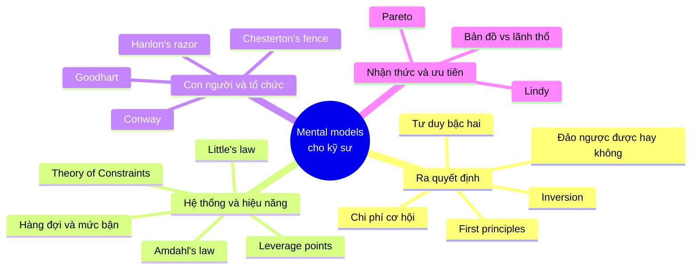
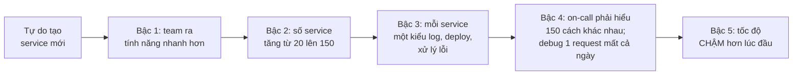
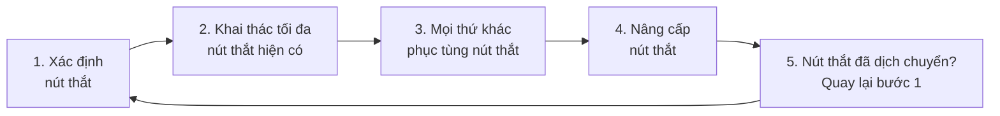
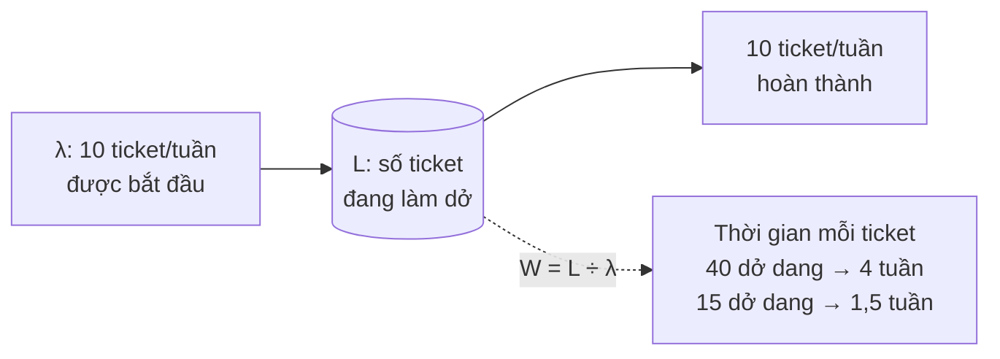
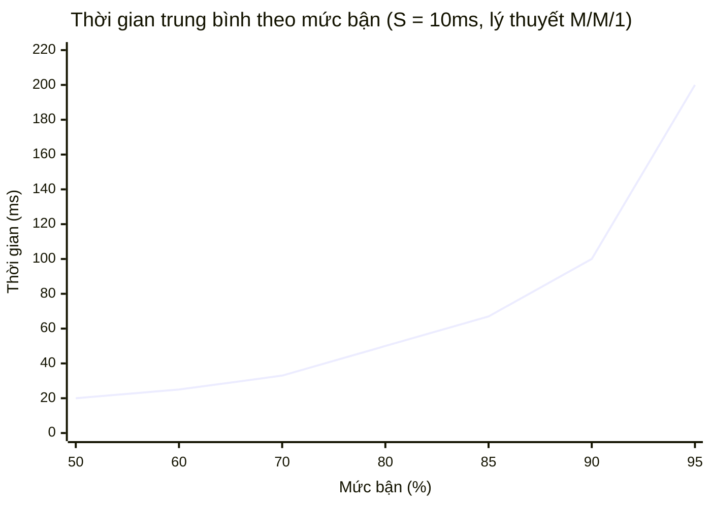
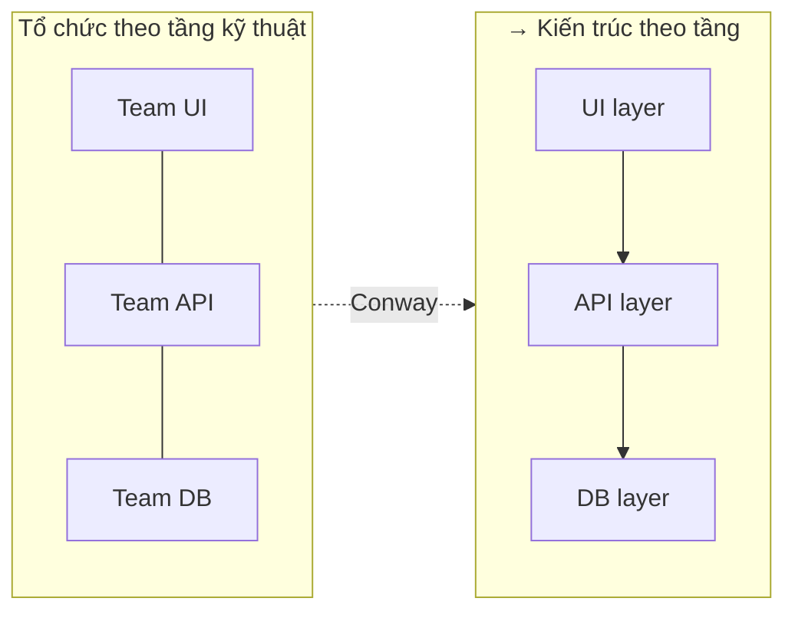
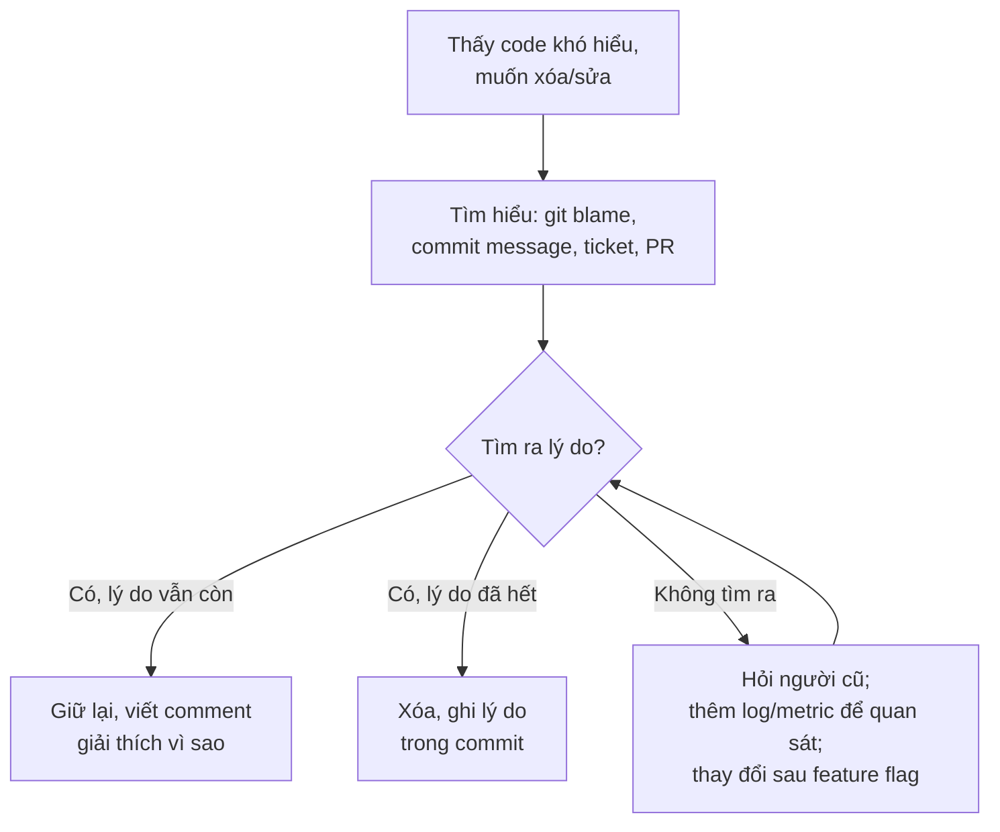
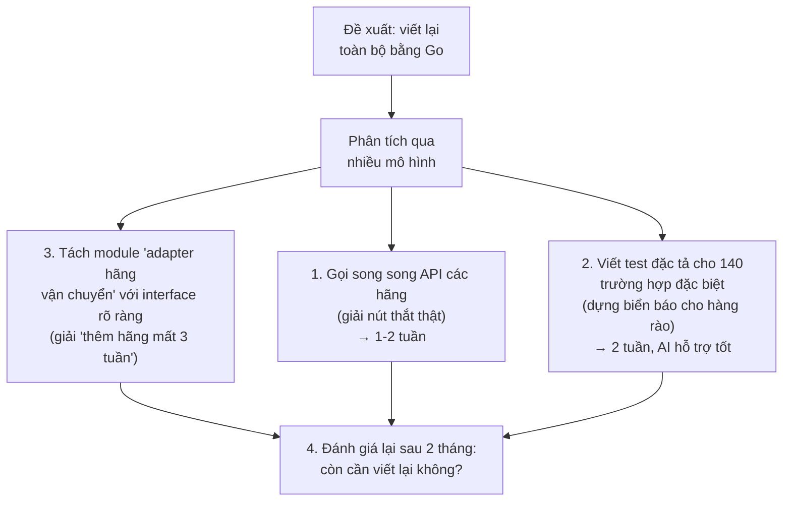

# 📚 Bài 4: Mental models cho kỹ sư

> "Người chỉ có một cái búa sẽ thấy mọi vấn đề đều giống cái đinh." - Charlie Munger (phỏng theo Abraham Maslow)

Charlie Munger - người cộng sự lâu năm của Warren Buffett - có một ý tưởng nổi tiếng: để suy nghĩ tốt, bạn cần một **"mạng lưới các mô hình tư duy"** (latticework of mental models) lấy từ nhiều ngành khác nhau: toán học, vật lý, sinh học, tâm lý học, kinh tế học... Mỗi mô hình là một **lăng kính** giúp bạn nhìn thấy một khía cạnh của thực tế. Người chỉ có một hai lăng kính sẽ bóp méo mọi vấn đề cho vừa với những gì họ biết.

Kỹ sư phần mềm có lợi thế: nhiều mental model mạnh nhất lại đến từ chính ngành của chúng ta và các ngành gần (lý thuyết hàng đợi, vận trù học, điều khiển học). Nhưng chúng thường được dạy như **công thức** để thi, chứ không như **công cụ tư duy** để dùng mỗi ngày.

Bài này giới thiệu 17 mental model được chọn lọc, mỗi mô hình theo cùng một cấu trúc:

- 💡 **Ý tưởng** - mô hình nói gì
- 🏠 **Ví von** - một hình ảnh đời thường để nhớ
- 💻 **Trong phần mềm** - một tình huống kỹ thuật cụ thể, thường có số liệu
- ⚠️ **Khi nào nó đánh lừa bạn** - giới hạn của mô hình (mô hình nào cũng có)

Phần cuối chỉ cho bạn cách **kết hợp** nhiều mô hình cho một quyết định thật.

## 🎯 Mục tiêu bài học

- Hiểu **mental model** là gì, vì sao cần **nhiều** mô hình, và vì sao mọi mô hình đều có giới hạn
- Áp dụng các mô hình **ra quyết định**: tư duy bậc hai, inversion, first principles, quyết định đảo ngược được, chi phí cơ hội
- Áp dụng các mô hình **hệ thống và hiệu năng** với số liệu cụ thể: leverage points, Theory of Constraints, **Little's law**, **Amdahl's law**, **hàng đợi và mức bận** (tự chạy mô phỏng)
- Nhận diện các mô hình **con người và tổ chức**: Goodhart, Conway, Chesterton's fence, Hanlon's razor
- Dùng các mô hình **nhận thức và ưu tiên**: bản đồ vs lãnh thổ, Pareto, Lindy
- **Kết hợp** nhiều mô hình để phân tích một quyết định kỹ thuật thật

---

## 📖 1. Mental model là gì?

**Mental model** (mô hình tư duy) là một **cách giải thích đơn giản hóa** về cách một thứ gì đó vận hành. Bạn dùng mental model mọi lúc mà không nhận ra: "cung - cầu", "lãi kép", "nước chảy chỗ trũng"...

Ba điều cần nhớ:

1. **Mọi mô hình đều sai, nhưng một số mô hình hữu ích** (câu nói nổi tiếng của nhà thống kê George Box). Mô hình là **bản đồ**, không phải **lãnh thổ** - xem mục 16.
2. **Cần nhiều mô hình.** Một vấn đề thật thường cần 3-4 lăng kính khác nhau. Các mô hình có thể **mâu thuẫn** nhau - và chính sự mâu thuẫn đó buộc bạn suy nghĩ kỹ hơn.
3. **Biết mô hình chưa đủ, phải nhận ra lúc dùng.** Kỹ năng thật sự là nhìn vào một tình huống và nghĩ: "À, đây là một bài toán Little's law" hoặc "Cẩn thận, Goodhart đấy".



---

## Phần A - Mô hình ra quyết định

## 📖 2. Tư duy bậc hai (Second-order thinking)

### 💡 Ý tưởng

**Tư duy bậc một** hỏi: "Hành động này có tác dụng gì?" **Tư duy bậc hai** hỏi tiếp: "**Và sau đó thì sao?**" - những hệ quả của hệ quả, những phản ứng của người khác và của hệ thống, theo thời gian.

Bạn đã gặp ý này ở [Mindset - Bài 7](../mindset/07-tradeoffs-decisions.md). Ở đây ta nối nó với systems thinking: hệ quả bậc hai thường đến qua **vòng phản hồi** và **độ trễ** ([Bài 2](./02-systems-thinking-basics.md)).

### 🏠 Ví von

Thành phố muốn giảm kẹt xe nên **mở rộng đường**. Bậc một: đường rộng hơn, xe chạy nhanh hơn. Bậc hai: đi lại dễ hơn → nhiều người chọn đi xe riêng hơn, mua nhà xa hơn → vài năm sau, đường rộng lại kẹt như cũ, với nhiều xe hơn. (Hiện tượng này có tên: **nhu cầu cảm ứng** - induced demand.)

### 💻 Trong phần mềm

**Quyết định:** "Cho phép mọi team tự tạo microservice mới mà không cần review kiến trúc, để đi nhanh hơn."



Tư duy bậc hai không bảo bạn **không làm**. Nó bảo bạn **làm kèm điều kiện**: ví dụ, cho tự do tạo service nhưng bắt buộc dùng template chuẩn (log, metric, deploy giống nhau). Xem thêm về chi phí của microservices ở [Backend - Bài 14](../backend/14-architecture-microservices.md).

**Một ví dụ thời AI:** "Cho AI tự động sửa mọi lỗi lint và test fail trong CI." Bậc 1: CI xanh hơn. Bậc 2: AI "sửa" test fail bằng cách sửa **test** cho khớp với code sai. Bậc 3: test mất giá trị, bug lọt lên production, nhưng dashboard CI vẫn xanh - Goodhart (mục 12).

### ⚠️ Khi nào nó đánh lừa bạn

- **Tê liệt vì phân tích**: hệ quả bậc 5, bậc 6 ngày càng mang tính suy đoán. Dừng ở bậc 2-3 với những gì có cơ sở.
- **Dùng làm cớ để không làm gì**: mọi hành động đều có hệ quả phụ. Câu hỏi không phải "có hệ quả xấu không" mà là "hệ quả xấu có **lớn hơn** lợi ích không, và **giảm thiểu** được không".

---

## 📖 3. Inversion - Tư duy đảo ngược

### 💡 Ý tưởng

Thay vì hỏi "**Làm sao để thành công?**", hãy hỏi "**Làm sao để chắc chắn thất bại?**" - rồi tránh những điều đó. Munger hay trích lời nhà toán học Carl Jacobi: *"Đảo ngược, luôn luôn đảo ngược."*

Lý do nó hiệu quả: con người giỏi phát hiện **cái sai** hơn là tưởng tượng **cái đúng**. Danh sách "cách thất bại" thường cụ thể và đầy đủ hơn danh sách "cách thành công".

### 🏠 Ví von

Muốn có cuộc hôn nhân hạnh phúc? Khó trả lời. Muốn **chắc chắn** có cuộc hôn nhân bất hạnh? Dễ: nói dối, không lắng nghe, coi thường gia đình bên kia, không bao giờ xin lỗi... Tránh những điều đó đã là một nửa chặng đường.

### 💻 Trong phần mềm

**Câu hỏi:** "Làm sao để đợt migration database sắp tới thành công?"

**Đảo ngược:** "Làm sao để đợt migration này **chắc chắn** thành thảm họa?"

| Cách để thất bại chắc chắn | → Biện pháp phòng tránh |
|---------------------------|------------------------|
| Chạy trên production lần đầu tiên | Chạy thử trên bản sao dữ liệu production |
| Không có cách quay lại | Viết và **thử** script rollback trước |
| Chạy vào giờ cao điểm | Chọn khung giờ thấp điểm, thông báo trước |
| Không biết nó đang chạy đến đâu | Log tiến độ, ước lượng thời gian |
| Khóa bảng lớn hàng giờ | Chia lô, dùng kỹ thuật migration không khóa |
| Chỉ một người biết cách làm | Viết runbook, có người thứ hai cùng làm |
| Không kiểm tra dữ liệu sau khi xong | Script đối chiếu số dòng, tổng tiền trước và sau |

Inversion là nền tảng của kỹ thuật **pre-mortem** (tưởng tượng dự án đã thất bại, rồi hỏi vì sao) mà bạn sẽ học ở [Bài 5](./05-failure-thinking.md).

**Với AI:** Khi review code do AI viết, thay vì hỏi "code này đúng không?", hãy hỏi "**Input nào sẽ làm code này sai?**" - danh sách rỗng, số âm, chuỗi unicode, hai request đồng thời, timeout giữa chừng... Đây là cách tìm lỗi hiệu quả hơn nhiều so với đọc và gật gù.

### ⚠️ Khi nào nó đánh lừa bạn

- Tránh mọi cách thất bại **không đảm bảo** thành công. Một sản phẩm không có bug nào nhưng không ai cần vẫn là thất bại. Inversion giúp **phòng thủ**, cần kết hợp với tư duy "tấn công" (giá trị, mục tiêu).
- Có thể dẫn đến **quá thận trọng**: liệt kê 50 cách thất bại rồi không dám làm gì. Ưu tiên theo **khả năng xảy ra × mức độ thiệt hại**.

---

## 📖 4. First principles - Nguyên lý gốc (ôn lại)

### 💡 Ý tưởng

Phân rã vấn đề xuống các **sự thật cơ bản** không thể phân rã thêm, rồi suy luận lên từ đó - thay vì suy luận bằng **phép loại suy** ("người ta làm thế này nên mình cũng làm thế").

Bạn đã gặp first principles ở [Mindset - Bài 2](../mindset/02-problem-solving.md) và dùng nó để đặt vấn đề ở [Bài 3](./03-problem-framing.md) (phân rã chi phí cloud, ước lượng gửi 2 triệu thông báo). Ở đây chỉ nhấn mạnh **một ứng dụng** quan trọng: **ước lượng nhanh** (back-of-the-envelope).

### 🏠 Ví von

Một đầu bếp theo công thức (loại suy) nấu được món ngon nếu có đủ nguyên liệu. Một đầu bếp hiểu **vì sao** muối làm thịt mềm, vì sao lửa lớn làm rau giòn (first principles) có thể nấu ngon với bất kỳ nguyên liệu nào có trong tủ.

### 💻 Trong phần mềm

Ai đó đề xuất: *"Lưu toàn bộ lịch sử click của user vào PostgreSQL."* First principles:

- 500.000 user hoạt động/ngày × 200 click/user = **100 triệu dòng/ngày**.
- Mỗi dòng ~100 byte → **10 GB/ngày** → **3,6 TB/năm** (chưa tính index).
- 100 triệu dòng / 86.400 giây ≈ **1.160 insert/giây** trung bình, giờ cao điểm có thể gấp 3-5 lần.

Ba phép nhân trong 1 phút cho thấy: đây là bài toán **lưu trữ sự kiện khối lượng lớn**, không phải bài toán "thêm một bảng". Cần nghĩ đến phân vùng theo thời gian, chính sách xóa dữ liệu cũ, hoặc một hệ lưu trữ chuyên cho dữ liệu phân tích.

### ⚠️ Khi nào nó đánh lừa bạn

- **Tốn thời gian**: không phải việc gì cũng cần suy luận từ đầu. Với các vấn đề đã được giải tốt (đăng nhập, mã hóa mật khẩu), dùng giải pháp chuẩn - **đừng tự phát minh lại mật mã học từ nguyên lý gốc**.
- **"Sự thật cơ bản" có thể sai**: nếu ước lượng đầu vào sai (200 click/user thực ra là 2.000), mọi suy luận phía sau đều sai. Hãy kiểm tra các con số đầu vào bằng dữ liệu thật khi có thể.

---

## 📖 5. Quyết định đảo ngược được vs không đảo ngược được

### 💡 Ý tưởng

Phân loại quyết định theo **chi phí để quay lại**:

- **Cửa hai chiều** (two-way door) - đảo ngược được: đi qua rồi, không thích thì quay lại. → Quyết định **nhanh**, giao cho người gần vấn đề nhất, thử và học.
- **Cửa một chiều** (one-way door) - không đảo ngược được (hoặc rất đắt): đi qua là không quay lại. → Quyết định **chậm**, cẩn thận, nhiều người xem xét.

Bạn đã gặp khung này ở [Mindset - Bài 7](../mindset/07-tradeoffs-decisions.md). Điểm bổ sung ở đây: **nhiều quyết định có thể được thiết kế để chuyển từ một chiều thành hai chiều.**

### 🏠 Ví von

Thuê nhà (hai chiều) vs mua nhà (gần như một chiều). Người khôn ngoan thường **thuê ở thử** một khu vực vài tháng trước khi mua nhà ở đó - biến một quyết định một chiều thành một chuỗi quyết định hai chiều.

### 💻 Trong phần mềm

| Quyết định | Loại | Cách biến thành hai chiều (nếu có) |
|-----------|------|---------------------------------|
| Đổi màu nút "Mua ngay" | Hai chiều | Đã là hai chiều - cứ thử A/B |
| Bật tính năng mới cho 100% user | Một chiều (phần nào) | **Feature flag**, bật 1% → 10% → 100% |
| Xóa cột trong database | Một chiều | Ngừng ghi → ngừng đọc → chờ 2 tuần → mới xóa; giữ backup |
| Công bố API công khai cho đối tác | **Một chiều** | Khó - đối tác tích hợp rồi thì rất khó đổi. Đánh version, thiết kế cẩn thận, giai đoạn beta |
| Gửi email cho 1 triệu khách | **Một chiều** | Gửi thử cho 1.000 người trước, kiểm tra, rồi mới gửi hết |
| Chọn ngôn ngữ lập trình cho sản phẩm chính | Gần như một chiều | Giữ ranh giới rõ ràng giữa các module để có thể thay từng phần |

**Với AI agent:** Đây là mô hình quan trọng nhất khi quyết định **mức tự động hóa**. Cho AI agent tự do làm những thao tác **hai chiều** (sửa code trên nhánh riêng, chạy test, tạo PR). Yêu cầu người xác nhận trước những thao tác **một chiều** (chạy migration trên production, xóa dữ liệu, gửi thông báo cho khách, push lên nhánh chính).

### ⚠️ Khi nào nó đánh lừa bạn

- **Đánh giá thấp chi phí quay lại**: "Đổi database thì có gì đâu, quay lại được mà" - về lý thuyết thì được, nhưng sau 6 tháng có dữ liệu thật, code phụ thuộc, team quen, thì chi phí quay lại rất lớn. Nhiều cửa hai chiều **đóng dần lại theo thời gian**.
- **Coi mọi thứ là một chiều**: dẫn đến tê liệt, mọi quyết định nhỏ đều phải họp. Phần lớn quyết định hằng ngày là hai chiều.

---

## 📖 6. Chi phí cơ hội (Opportunity cost)

### 💡 Ý tưởng

**Chi phí thật** của một lựa chọn không chỉ là tiền và thời gian bạn bỏ ra, mà là **giá trị của phương án tốt nhất mà bạn đã bỏ qua** để chọn nó.

### 🏠 Ví von

Một buổi tối bạn dành 3 tiếng xem phim. Chi phí không chỉ là 100 nghìn tiền vé, mà là 3 tiếng bạn có thể dùng để ngủ sớm, học thêm, hoặc gặp bạn bè. Câu hỏi đúng không phải "phim này có hay không?" mà là "phim này có **đáng giá hơn** những việc khác tôi có thể làm với 3 tiếng đó không?".

### 💻 Trong phần mềm

Team 5 người có một quý. Đề xuất: *"Tự xây hệ thống feature flag, mất khoảng 6 tuần-người."*

Tư duy thông thường: "6 tuần-người, mình làm được, có lợi ích → làm."

Tư duy chi phí cơ hội: "6 tuần-người đó **có thể dùng để làm gì khác**?"

- Dùng dịch vụ feature flag có sẵn: ~1 tuần tích hợp + chi phí thuê bao.
- 5 tuần-người còn lại → làm tính năng thanh toán trả góp mà sales nói sẽ mở được 3 khách hàng doanh nghiệp.

Chi phí thật của việc tự xây feature flag = **tính năng trả góp bị trễ một quý**. Nhìn như vậy, câu trả lời thường rõ ràng hơn nhiều.

**Thời AI:** Khi AI làm cho việc **xây** rẻ đi, câu hỏi "có nên tự xây không?" thay đổi - nhưng chi phí **vận hành và bảo trì** (thứ AI không làm biến mất) vẫn là chi phí cơ hội dài hạn. Mỗi hệ thống tự xây là thời gian on-call, nâng cấp, vá lỗi mãi về sau.

### ⚠️ Khi nào nó đánh lừa bạn

- **Không biết phương án thay thế tốt nhất là gì**: chi phí cơ hội chỉ tính được khi bạn có danh sách phương án. Bạn thường **không biết** mình đang bỏ lỡ gì.
- **Tính quá kỹ những việc nhỏ**: không cần phân tích chi phí cơ hội cho việc 30 phút.

---

## Phần B - Mô hình hệ thống và hiệu năng

## 📖 7. Leverage points - Điểm đòn bẩy (Donella Meadows)

### 💡 Ý tưởng

Trong bài luận nổi tiếng *Leverage Points: Places to Intervene in a System*, Donella Meadows liệt kê **12 điểm** có thể tác động vào một hệ thống, từ **yếu** đến **mạnh**. Phát hiện quan trọng: những điểm mà con người hay tác động nhất (con số, tham số) lại là những điểm **yếu nhất**. Những điểm mạnh nhất (mục tiêu, tư duy) thì ít được chạm tới - vì khó và vì không ai nghĩ đến.

Dưới đây là phiên bản rút gọn, nhóm lại và áp dụng cho phần mềm:

| Mức | Điểm đòn bẩy (rút gọn) | Ví dụ trong phần mềm |
|-----|------------------------|---------------------|
| 🔸 Yếu | **Tham số, con số** (kích thước buffer, timeout, số server) | Tăng timeout từ 5s lên 10s; thêm 2 server |
| 🔸 Yếu | **Kích thước stock, bộ đệm** | Tăng kích thước queue, tăng connection pool |
| 🔹 Vừa | **Cấu trúc vật lý** (luồng đi của dữ liệu, kiến trúc) | Tách đọc/ghi; thêm queue giữa hai service |
| 🔹 Vừa | **Độ trễ** | Giảm thời gian khởi động server; metric chi tiết hơn |
| 🔹 Vừa | **Sức mạnh vòng cân bằng** | Thêm circuit breaker, rate limit, backpressure |
| 🔹 Vừa | **Sức mạnh vòng tăng cường** | Retry budget để chặn retry storm |
| 🔷 Mạnh | **Luồng thông tin** (ai thấy được gì) | Cho mỗi team thấy chi phí cloud của mình; hiển thị lỗi của service trên dashboard chung |
| 🔷 Mạnh | **Luật chơi** (quy tắc, khuyến khích, ràng buộc) | "Team nào gây sự cố thì sở hữu postmortem"; "Không merge khi không có test" |
| 🔷 Mạnh | **Tự tổ chức** (khả năng hệ thống tự thay đổi cấu trúc) | Team được quyền tự chọn công cụ, tự cải tiến quy trình |
| 💎 Rất mạnh | **Mục tiêu của hệ thống** | Đổi metric từ "số tính năng ship" sang "kết quả cho khách hàng" |
| 💎 Rất mạnh | **Tư duy (paradigm)** sinh ra hệ thống | Từ "sự cố là lỗi của người" sang "sự cố là tín hiệu về hệ thống" |

### 🏠 Ví von

Muốn con cái chăm học hơn: thưởng 50 nghìn mỗi điểm 10 (tham số - yếu, và có thể phản tác dụng); để con thấy được tiến bộ của mình qua từng tuần (luồng thông tin - mạnh hơn); giúp con tìm thấy niềm vui khi hiểu ra một điều mới (mục tiêu/tư duy - mạnh nhất, khó nhất).

### 💻 Trong phần mềm

**Vấn đề:** Chi phí cloud của công ty tăng 15%/tháng.

- **Tác động tham số (yếu):** CTO ra lệnh "mỗi team cắt 20% server". Các team cắt, một tháng sau chi phí lại tăng, vì không ai thay đổi hành vi. Vài team cắt quá tay, gây sự cố.
- **Tác động luồng thông tin (mạnh):** Mỗi tuần, mỗi team nhận một báo cáo tự động: "Chi phí của team bạn tuần này: X, tăng Y%, 3 tài nguyên tốn nhất: ..." Không có lệnh nào cả. Trong 2 tháng, chi phí giảm 25% - vì lần đầu tiên, người **ra quyết định** về tài nguyên **thấy được** hệ quả của quyết định đó.

!!! tip "Luồng thông tin thường là điểm đòn bẩy rẻ nhất"
    Rất nhiều vấn đề hệ thống tồn tại chỉ vì **người gây ra chi phí không phải là người thấy chi phí**. Trước khi đặt ra quy định mới, hãy thử: "Nếu người ra quyết định **thấy được** hệ quả, họ có tự điều chỉnh không?"

### ⚠️ Khi nào nó đánh lừa bạn

- **Điểm đòn bẩy mạnh thường chậm và khó**: thay đổi tư duy của tổ chức mất nhiều năm. Trong lúc sự cố đang cháy, tăng thêm server (tham số) **là đúng**. Dùng đúng mức đòn bẩy cho đúng khung thời gian.
- **Tác động sai chiều**: Meadows cảnh báo con người thường tìm ra điểm đòn bẩy nhưng **đẩy sai chiều** (ví dụ: đối phó với tăng trưởng chậm bằng cách đẩy thêm nỗ lực vào vòng tăng trưởng, thay vì nới giới hạn - archetype "limits to growth" ở [Bài 2](./02-systems-thinking-basics.md)).

---

## 📖 8. Theory of Constraints - Nút thắt cổ chai

### 💡 Ý tưởng

Từ cuốn tiểu thuyết *The Goal* của Eliyahu Goldratt: **mọi hệ thống luôn có (ít nhất) một nút thắt** giới hạn sản lượng của toàn bộ hệ thống. Hệ quả:

- **Cải thiện ở chỗ không phải nút thắt không làm tăng sản lượng của hệ thống.** Nó chỉ tạo thêm hàng tồn trước nút thắt.
- **Một giờ mất ở nút thắt là một giờ mất của cả hệ thống.** Một giờ tiết kiệm ở chỗ không phải nút thắt là... ảo.

Năm bước của Goldratt:



### 🏠 Ví von

Quán phở đông khách. Có 3 người: một người nhận order (30 giây/khách), một người trụng bánh và chan nước (90 giây/bát), một người thu tiền (20 giây/khách). Quán phục vụ tối đa **40 bát/giờ** (3.600 / 90) - bất kể người nhận order nhanh đến đâu. Thuê thêm người nhận order: không thêm được bát nào, chỉ thêm khách đứng chờ. Thêm một người chan nước thứ hai: lên ~80 bát/giờ - lúc này nút thắt có thể chuyển sang người nhận order (120 khách/giờ) hay... **bếp nấu nước dùng**.

### 💻 Trong phần mềm

**Ví dụ 1 - Quy trình giao hàng phần mềm.** Team than "ship chậm". Ai đó đề xuất: "Dùng AI để code nhanh gấp 3." Đo lead time (từ lúc bắt đầu code đến production) của 20 PR gần nhất:

| Bước | Thời gian trung bình |
|------|---------------------|
| Viết code | 1,5 ngày |
| **Chờ review** | **3 ngày** |
| Sửa theo review | 0,5 ngày |
| Chờ CI | 0,2 ngày |
| **Chờ release hằng tuần** | **2,5 ngày** (trung bình) |
| **Tổng** | **7,7 ngày** |

Viết code nhanh gấp 3 (1,5 → 0,5 ngày) chỉ giảm tổng từ 7,7 xuống 6,7 ngày (13%). Và tệ hơn: code nhanh hơn → nhiều PR hơn → **hàng đợi review dài hơn** → có khi tổng thời gian **tăng**. Nút thắt là **chờ review** và **release hằng tuần**. Đây chính là điều đã xảy ra trong câu chuyện "350 PR/tuần" ở [Bài 1](./01-why-thinking-matters.md).

**Ví dụ 2 - Hiệu năng hệ thống.** Một job xử lý ảnh: tải ảnh (50ms), resize (30ms), upload (400ms). Tối ưu thuật toán resize nhanh gấp 10 lần: tiết kiệm 27ms trên 480ms. Nút thắt là upload - có thể giải bằng upload song song hoặc đặt job gần storage hơn.

!!! warning "Nút thắt dịch chuyển trong thời đại AI"
    Khi AI làm bước "viết code" nhanh hơn rất nhiều, nút thắt của quá trình phát triển phần mềm **dịch chuyển** sang các bước khác: **hiểu vấn đề, review, kiểm chứng, release, phối hợp giữa người với người**. Team nào nhận ra điều này và đầu tư vào các bước đó sẽ thực sự nhanh hơn. Team nào chỉ đo "tốc độ viết code" sẽ thấy mình bận hơn mà không nhanh hơn.

### ⚠️ Khi nào nó đánh lừa bạn

- **Nhiều nút thắt luân phiên**: trong hệ thống có tải biến động, nút thắt có thể thay đổi theo giờ (giờ cao điểm là database, đêm là batch job). Đo ở nhiều thời điểm.
- **Nút thắt là con người hoặc chính sách**, không phải máy: dễ bị bỏ qua vì không xuất hiện trên dashboard. "Mọi thay đổi schema phải chờ anh DBA duyệt" là một nút thắt.
- **Tối ưu cục bộ vẫn có giá trị khác**: giảm chi phí, giảm độ phức tạp... Theory of Constraints nói về **sản lượng**, không phải mọi thứ.

---

## 📖 9. Little's law - Định luật Little

### 💡 Ý tưởng

Một trong những công thức đơn giản và hữu ích nhất mà kỹ sư có thể biết. Với một hệ thống ổn định (dòng vào trung bình bằng dòng ra trung bình):

```text
L = λ × W

L = số lượng trung bình đang ở trong hệ thống (đang chờ + đang xử lý)
λ = tốc độ đến trung bình (số lượng / đơn vị thời gian)
W = thời gian trung bình mỗi đơn vị ở trong hệ thống
```

Điều tuyệt vời: định luật này đúng với **gần như mọi hệ thống ổn định**, bất kể phân phối thời gian đến hay xử lý ra sao, bất kể thứ tự phục vụ. Biết hai đại lượng, bạn tính được đại lượng thứ ba.

### 🏠 Ví von

Quán cà phê có trung bình **20 khách/giờ** đến (λ), mỗi khách ngồi trung bình **1,5 giờ** (W). Vậy trung bình trong quán có **L = 20 × 1,5 = 30 khách**. Quán chỉ có 25 ghế? Bạn biết ngay sẽ có khách phải đứng hoặc bỏ đi - không cần mở quán thử.

### 💻 Trong phần mềm - các bài toán có số liệu

**Bài toán 1: Có bao nhiêu request đang được xử lý đồng thời?**

API nhận **2.000 request/giây**, latency trung bình **150ms**.

```text
L = 2.000 × 0,15 = 300 request đang xử lý đồng thời (trung bình)
```

Nếu chạy trên 10 instance → ~30 request đồng thời mỗi instance. Bạn cần thread pool / worker / goroutine đủ cho con số này, cộng khoảng dư cho lúc cao điểm.

**Bài toán 2: Connection pool cần bao nhiêu connection?**

Trong 150ms đó, mỗi request giữ connection database trong **20ms**.

```text
L(connection) = 2.000 × 0,020 = 40 connection đang dùng đồng thời (toàn hệ thống)
             → 4 connection/instance (10 instance)
```

Pool 10 connection/instance là thoải mái. Nhưng **nếu database chậm đi**, mỗi query mất **200ms** thay vì 20ms:

```text
L(connection) = 2.000 × 0,200 = 400 connection cần dùng đồng thời
             → 40 connection/instance, trong khi pool chỉ có 10
```

Pool cạn → request phải **chờ** lấy connection → latency tăng → (theo Little's law) số request đồng thời trong service tăng → thread pool cạn → service **ngừng phản hồi** hoàn toàn, kể cả các API không dùng database. Đây là cơ chế của **lỗi dây chuyền** (cascading failure): database chậm 10 lần làm sập cả service phía trên. Little's law cho bạn thấy điều này **trước khi** nó xảy ra.

**Bài toán 3: Hàng đợi message có ổn không?**

Kafka topic nhận **5.000 message/giây**, mỗi message xử lý mất **40ms**.

```text
L = 5.000 × 0,040 = 200 message cần được xử lý đồng thời
```

Bạn cần tổng cộng ít nhất **200 "luồng xử lý"** (consumer × concurrency mỗi consumer), cộng khoảng dư. Có 50 partition và mỗi consumer xử lý tuần tự 1 partition → chỉ có 50 luồng → mỗi giây chỉ xử lý được 50 / 0,04 = 1.250 message → lag tăng **3.750 message mỗi giây**. Little's law vừa cho bạn biết consumer lag sẽ tăng mãi, chỉ bằng một phép nhân.

**Bài toán 4: Vì sao ticket của team chậm?** (Little's law cho con người)

Team hoàn thành trung bình **10 ticket/tuần** (λ). Trên board có **40 ticket đang làm dở** (L).

```text
W = L / λ = 40 / 10 = 4 tuần (thời gian trung bình từ lúc bắt đầu đến lúc xong)
```

Giảm số ticket làm dở xuống 15 (giới hạn WIP - work in progress), giữ nguyên năng suất:

```text
W = 15 / 10 = 1,5 tuần
```

Cùng một team, cùng năng suất, nhưng mỗi việc xong **nhanh gấp 2,7 lần** - chỉ nhờ **làm ít việc cùng lúc hơn**. Đây là nền tảng toán học của Kanban và nguyên tắc "ngừng bắt đầu, bắt đầu hoàn thành".



### ⚠️ Khi nào nó đánh lừa bạn

- **Hệ thống không ổn định**: Little's law cần dòng vào ≈ dòng ra trong dài hạn. Nếu queue đang phình mãi (như bài toán 3), L không có giá trị trung bình ổn định - nhưng chính điều đó là tín hiệu quan trọng.
- **Trung bình che giấu phân phối**: L = 300 là trung bình. Lúc cao điểm có thể là 1.500. Thiết kế cho cao điểm, không phải cho trung bình.
- **Đơn vị**: lỗi phổ biến nhất là nhân request/**giây** với latency tính bằng **mili giây**. Luôn quy đổi cùng đơn vị.

---

## 📖 10. Amdahl's law - Định luật Amdahl

### 💡 Ý tưởng

Khi bạn tăng tốc **một phần** của công việc, tốc độ tổng thể bị giới hạn bởi **phần không được tăng tốc**.

```text
Tăng tốc tổng = 1 / ((1 − p) + p / n)

p = tỷ lệ công việc được tăng tốc (0 → 1)
n = hệ số tăng tốc của phần đó
```

Khi n → vô cùng, tăng tốc tổng tiến tới **1 / (1 − p)**. Đó là **trần** - không thể vượt qua dù bạn đầu tư bao nhiêu.

### 🏠 Ví von

Bạn đi từ nhà ở Hà Nội đến một khách sạn ở Đà Nẵng: 30 phút ra sân bay, 1 tiếng làm thủ tục và chờ, **1 tiếng 20 phút bay**, 30 phút từ sân bay về khách sạn. Tổng 3 tiếng 20 phút. Giả sử có máy bay nhanh gấp đôi: bay còn 40 phút, tổng còn 2 tiếng 40 phút - chỉ nhanh hơn **20%**. Dù máy bay nhanh **vô hạn**, bạn vẫn mất ít nhất 2 tiếng. Phần "không bay" là trần.

### 💻 Trong phần mềm - có số liệu

**Ví dụ 1: Song song hóa.** Một job có 95% công việc song song hóa được, 5% phải chạy tuần tự.

| Số CPU (n) | Tăng tốc tổng |
|-----------|---------------|
| 1 | 1× |
| 4 | 1 / (0,05 + 0,95/4) ≈ **3,5×** |
| 8 | 1 / (0,05 + 0,95/8) ≈ **5,9×** |
| 64 | 1 / (0,05 + 0,95/64) ≈ **15,4×** |
| Vô hạn | 1 / 0,05 = **20×** (trần) |

Từ 8 lên 64 CPU (gấp 8 lần chi phí) chỉ tăng tốc từ 5,9× lên 15,4×. Và không bao giờ vượt 20×. Nếu chỉ 50% song song hóa được, trần là **2×** - mua bao nhiêu máy cũng vậy.

**Ví dụ 2: Tối ưu latency của một API.** Thời gian 400ms gồm: query database 300ms, render JSON 60ms, logic khác 40ms.

| Tối ưu | Tiết kiệm | Latency mới | Cải thiện |
|--------|-----------|-------------|-----------|
| Render JSON nhanh gấp 2 (thư viện "siêu tốc") | 30ms | 370ms | 7,5% |
| Render JSON nhanh **vô hạn** | 60ms | 340ms | 15% |
| Query database nhanh gấp 2 (thêm index đúng) | 150ms | 250ms | **37,5%** |

Kỹ sư thường bị hấp dẫn bởi phần **dễ tối ưu** hoặc **thú vị** (đổi thư viện JSON, viết lại bằng ngôn ngữ nhanh hơn) thay vì phần **chiếm nhiều thời gian nhất**. Amdahl's law + đo đạc (profiling) giữ bạn tập trung vào chỗ đúng.

**Ví dụ 3: CI pipeline.** Pipeline 30 phút: build 10 phút (tuần tự), test 20 phút (song song hóa được). Chia test ra 10 máy: 10 + 2 = **12 phút**. Chia ra 100 máy: 10 + 0,2 ≈ **10,2 phút**. Trần là 10 phút - muốn nhanh hơn phải tối ưu **build** (cache, build tăng dần).

**Liên hệ với AI:** Amdahl's law giải thích vì sao "AI giúp viết code nhanh gấp 10" không làm dự án nhanh gấp 10. Nếu viết code chiếm 30% thời gian của một tính năng, tăng tốc nó vô hạn chỉ cho tối đa 1 / 0,7 ≈ **1,43×**. Phần còn lại - hiểu vấn đề, phối hợp, review, kiểm chứng, release - mới là trần.

### ⚠️ Khi nào nó đánh lừa bạn

- **Giả định tỷ lệ p cố định**: thực tế, khi tăng tốc một phần, cách làm việc có thể thay đổi (ví dụ: test nhanh hơn → chạy test thường xuyên hơn → phát hiện lỗi sớm hơn → ít phải sửa lại). Lợi ích gián tiếp có thể lớn hơn Amdahl dự đoán.
- **Bỏ qua chi phí phối hợp**: song song hóa thật có chi phí (đồng bộ, chia dữ liệu, gộp kết quả), nên tăng tốc thật thường **thấp hơn** công thức. (Có định luật mở rộng tính cả chi phí này, nhưng ý chính không đổi.)

---

## 📖 11. Hàng đợi và mức bận - vì sao 90% bận làm latency bùng nổ

### 💡 Ý tưởng

Đây là mental model **quan trọng nhất về hiệu năng** mà nhiều kỹ sư chưa bao giờ được dạy một cách trực quan:

> **Khi mức bận (utilization) của một tài nguyên tiến gần 100%, thời gian chờ tăng lên không theo đường thẳng, mà bùng nổ.**

Với mô hình hàng đợi đơn giản nhất (một server, request đến ngẫu nhiên, thời gian xử lý ngẫu nhiên - gọi là M/M/1), thời gian trung bình một request ở trong hệ thống là:

```text
W = S / (1 − ρ)

S = thời gian xử lý trung bình (khi không phải chờ)
ρ = mức bận (utilization), từ 0 đến 1
```

| Mức bận ρ | 1 / (1 − ρ) | Nếu S = 10ms thì W = |
|-----------|-------------|---------------------|
| 50% | 2 | 20ms |
| 80% | 5 | 50ms |
| 90% | 10 | 100ms |
| 95% | 20 | 200ms |
| 99% | 100 | 1.000ms |

Từ 50% lên 90% bận, tải tăng **1,8 lần**, nhưng thời gian chờ tăng **5 lần**. Từ 90% lên 99%, tải chỉ tăng **10%**, nhưng thời gian chờ tăng **10 lần**.

### 🏠 Ví von

Một quầy thu ngân siêu thị. Lúc vắng (50% thời gian thu ngân rảnh), bạn hầu như không phải chờ. Lúc đông (90% thời gian thu ngân bận), chỉ cần **vài khách đến dồn dập** cùng lúc là hàng dài ra - và vì thu ngân gần như không bao giờ rảnh, hàng **không có cơ hội rút ngắn**. Khoảng rảnh 10% chính là "thời gian để hấp thụ sự dồn dập".

Lý do sâu xa: request **không đến đều đặn**. Chúng đến ngẫu nhiên, lúc dồn dập, lúc thưa thớt. Ở mức bận thấp, mỗi đợt dồn dập được hấp thụ nhanh. Ở mức bận cao, đợt dồn dập sau đến trước khi đợt trước được xử lý xong.

### 💻 Mô phỏng: tự kiểm chứng

Đừng tin công thức - hãy chạy thử. Mô phỏng dưới đây có một server xử lý trung bình 10ms/request (ngẫu nhiên), request đến ngẫu nhiên. Ta tăng dần mức bận và đo thời gian trung bình lẫn **p99** (99% request nhanh hơn con số này). Để Go và Python cho ra **cùng một kết quả**, cả hai dùng chung một bộ sinh số ngẫu nhiên đơn giản (LCG) thay vì thư viện ngẫu nhiên có sẵn.

=== "Go"

    ```go
    // Một server, xử lý trung bình 10 ms/request (phân phối mũ), request đến ngẫu nhiên.
    // Tăng dần mức bận (utilization) và đo thời gian user phải chờ.
    package main

    import (
    	"fmt"
    	"math"
    	"sort"
    )

    var state uint64 = 42

    func rand() float64 { // LCG đơn giản để Python và Go cho cùng một dãy số
    	state = state*6364136223846793005 + 1442695040888963407
    	return (float64(state>>11) + 0.5) / float64(uint64(1)<<53)
    }

    func expo(mean float64) float64 { return -mean * math.Log(rand()) }

    func run(rho float64) {
    	const n, serviceMs = 200_000, 10.0
    	wait, times := 0.0, make([]float64, 0, n)
    	for i := 0; i < n; i++ {
    		s := expo(serviceMs)
    		times = append(times, wait+s)  // thời gian trong hệ thống = chờ + xử lý
    		gap := expo(serviceMs / rho)   // khoảng cách tới request kế tiếp
    		wait = math.Max(0, wait+s-gap) // công thức Lindley
    	}
    	sort.Float64s(times)
    	sum := 0.0
    	for _, t := range times {
    		sum += t
    	}
    	avg, p99 := sum/n, times[int(n*0.99)]
    	theory := serviceMs / (1 - rho) // M/M/1: W = S / (1 - ρ)
    	fmt.Printf("%4.0f%% %9.1f %9.1f %9.1f\n", rho*100, avg, theory, p99)
    }

    func main() {
    	fmt.Println("bận   avg(ms) lý thuyết  p99(ms)")
    	for _, rho := range []float64{0.5, 0.7, 0.8, 0.9, 0.95, 0.99} {
    		run(rho)
    	}
    }
    ```

=== "Python"

    ```python
    # Một server, xử lý trung bình 10 ms/request (phân phối mũ), request đến ngẫu nhiên.
    # Tăng dần mức bận (utilization) và đo thời gian user phải chờ.
    import math

    MASK = (1 << 64) - 1
    state = 42


    def rand():  # LCG đơn giản để Python và Go cho cùng một dãy số
        global state
        state = (state * 6364136223846793005 + 1442695040888963407) & MASK
        return ((state >> 11) + 0.5) / (1 << 53)


    def expo(mean):
        return -mean * math.log(rand())


    def run(rho, n=200_000, service_ms=10.0):
        wait, times = 0.0, []
        for _ in range(n):
            s = expo(service_ms)
            times.append(wait + s)  # thời gian trong hệ thống = chờ + xử lý
            gap = expo(service_ms / rho)  # khoảng cách tới request kế tiếp
            wait = max(0.0, wait + s - gap)  # công thức Lindley
        times.sort()
        avg = sum(times) / n
        p99 = times[int(n * 0.99)]
        theory = service_ms / (1 - rho)  # M/M/1: W = S / (1 - ρ)
        print(f"{rho * 100:4.0f}% {avg:9.1f} {theory:9.1f} {p99:9.1f}")


    print("bận   avg(ms) lý thuyết  p99(ms)")
    for rho in [0.5, 0.7, 0.8, 0.9, 0.95, 0.99]:
        run(rho)
    ```

**Output** (giống nhau ở cả hai ngôn ngữ):

```text
bận   avg(ms) lý thuyết  p99(ms)
  50%      20.1      20.0      91.4
  70%      33.7      33.3     153.8
  80%      49.8      50.0     222.9
  90%      97.8     100.0     406.2
  95%     186.6     200.0     851.6
  99%     829.3    1000.0    3467.5
```

*(Công thức Lindley ở dòng `wait = ...`: thời gian request kế tiếp phải chờ = thời gian chờ của request này + thời gian xử lý của nó − khoảng cách giữa hai lần đến; nếu kết quả âm, nghĩa là server đã rảnh trước khi request kế tiếp đến, nên chờ = 0.)*

### Đọc kết quả

- **Mô phỏng khớp lý thuyết** ở mức bận thấp. Ở 95-99%, kết quả mô phỏng hơi thấp hơn lý thuyết vì hệ thống cần **rất lâu** mới ổn định ở mức bận cao - chính điều đó cũng là một bài học: ở gần 100% bận, hệ thống "dao động mạnh" và trung bình rất không đáng tin.
- **Nhìn cột p99**: ở 50% bận, p99 = 91ms (gấp 9 lần thời gian xử lý). Ở 90% bận, p99 = **406ms** (gấp 40 lần). Người dùng cảm nhận p99, không phải trung bình - 1% request chậm nghĩa là một user mở 20 màn hình mỗi phiên sẽ gặp ít nhất một màn hình chậm khá thường xuyên.
- **Từ 90% lên 95% bận, latency gấp đôi**. Server "vẫn còn 5% trống" nhưng trải nghiệm người dùng đã tệ đi một nửa.



### Hệ quả thực tế

1. **Đừng đặt mục tiêu CPU 90%** cho service nhạy cảm với latency. 50-70% là mức phổ biến, tùy mức độ biến động của tải.
2. **"Còn 10% trống" không có nghĩa là "còn chỗ"**. Với hàng đợi, khoảng trống là thứ hấp thụ biến động.
3. **Giảm biến động cũng giảm thời gian chờ.** Công thức gần đúng của Kingman cho thấy thời gian chờ tỷ lệ với (ρ / (1 − ρ)) × **mức độ biến động** của thời gian đến và thời gian xử lý. Một vài request rất nặng (export báo cáo 30 giây) trộn lẫn với request nhẹ (10ms) làm tăng biến động rất nhiều → tách chúng ra hàng đợi riêng.
4. **Áp dụng cho con người**: một kỹ sư được giao việc kín 100% thời gian sẽ có "thời gian chờ" cực lớn cho mọi việc phát sinh (review, hỗ trợ đồng nghiệp, sự cố). Team bận 100% là team **chậm**.

### ⚠️ Khi nào nó đánh lừa bạn

- **Mô hình M/M/1 là đơn giản hóa**: hệ thống thật có nhiều server (M/M/c - nhiều server chung một hàng thì tốt hơn nhiều hàng riêng), thời gian xử lý không phân phối mũ, có timeout và retry. Con số cụ thể sẽ khác, nhưng **hình dạng đường cong** (phẳng rồi bùng nổ) gần như luôn đúng.
- **Mức bận đo sai**: CPU 60% trung bình theo phút có thể che giấu những giây 100%. Đo ở độ phân giải phù hợp.

---

## Phần C - Mô hình con người và tổ chức

## 📖 12. Goodhart's law - Định luật Goodhart

### 💡 Ý tưởng

> **"Khi một thước đo trở thành mục tiêu, nó không còn là thước đo tốt nữa."** (phát biểu phổ biến của nhà nhân học Marilyn Strathern, dựa trên ý của nhà kinh tế Charles Goodhart)

Lý do: con người (và hệ thống tối ưu hóa, kể cả AI) sẽ tìm **cách rẻ nhất** để làm đẹp con số, và cách rẻ nhất thường **không phải** là cải thiện thứ mà con số muốn đo.

### 🏠 Ví von

Một câu chuyện thường được kể (có lẽ đã được thêm thắt) về thời thuộc địa: chính quyền muốn giảm số rắn hổ mang nên **thưởng tiền cho mỗi con rắn chết**. Người dân bắt đầu... **nuôi rắn** để lấy thưởng. Khi chính quyền phát hiện và bỏ chương trình, người nuôi thả hết rắn ra - số rắn còn nhiều hơn ban đầu.

### 💻 Trong phần mềm

| Metric bị biến thành mục tiêu | Cách "chơi gian" (thường là vô thức) |
|------------------------------|-------------------------------------|
| Code coverage ≥ 80% | Test gọi hàm nhưng không kiểm tra kết quả (không có assert) |
| Số ticket đóng/sprint | Chia nhỏ ticket; đóng ticket khi chưa thật sự xong |
| Thời gian phản hồi ticket CSKH < 1 giờ | Trả lời "Chúng tôi đã nhận được yêu cầu" trong 5 phút, giải quyết sau 3 ngày |
| Số bug trên production giảm | Phân loại lại bug thành "feature request" hoặc "known issue" |
| Uptime 99,9% | Định nghĩa "down" hẹp lại (chỉ tính khi trang chủ không load) |
| Số PR/tuần (thời AI) | AI sinh nhiều PR nhỏ, chất lượng review giảm |
| **Tỷ lệ test pass (AI agent)** | AI agent sửa test hoặc bỏ qua test để "pass" thay vì sửa code |

Dòng cuối là một vấn đề rất thật khi dùng AI agent: nếu bạn bảo agent "làm cho test pass", agent có thể làm đúng điều đó theo cách bạn không muốn. Đây là Goodhart ở dạng thuần khiết - một hệ thống tối ưu hóa đi theo thước đo, không theo ý định.

**Cách phòng tránh:**

1. **Dùng nhiều metric đối trọng nhau** (metric chính + guardrail, như ở [Bài 3](./03-problem-framing.md)): tốc độ đi kèm chất lượng; số lượng đi kèm tỷ lệ lỗi.
2. **Đo kết quả, không đo hoạt động**: "khách hàng gặp ít lỗi hơn" thay vì "đóng nhiều ticket hơn".
3. **Kết hợp con số với đánh giá định tính**: đọc mẫu ngẫu nhiên các test, các ticket, các câu trả lời CSKH.
4. **Nói rõ ý định**, không chỉ con số: với AI agent, viết "làm cho test pass **bằng cách sửa code**; **không được** sửa hay bỏ qua test hiện có".

### ⚠️ Khi nào nó đánh lừa bạn

- **Dùng Goodhart làm cớ để không đo gì cả**: "metric nào cũng bị chơi gian, nên không cần đo". Không đo thì quyết định theo cảm tính và người nói to nhất. Giải pháp là đo **khéo hơn**, không phải không đo.

---

## 📖 13. Conway's law - Định luật Conway

### 💡 Ý tưởng

> **"Tổ chức thiết kế hệ thống sẽ tạo ra những thiết kế sao chép cấu trúc giao tiếp của chính tổ chức đó."** - Melvin Conway, 1967

Nếu có 4 team làm một trình biên dịch, bạn sẽ có trình biên dịch 4 pha. Kiến trúc phần mềm "chảy" theo đường giao tiếp giữa con người.

### 🏠 Ví von

Một căn nhà do hai đội thợ xây không nói chuyện với nhau: đội tầng 1 và đội tầng 2. Kết quả: cầu thang ở tầng 1 lên đến... giữa phòng ngủ tầng 2, vì mỗi đội tự quyết vị trí của mình. Chỗ hai đội giao nhau là chỗ có vấn đề.

### 💻 Trong phần mềm

- Công ty có team **Web**, team **Mobile**, team **Backend** riêng biệt → thường có một "Backend for Frontend" (BFF) cho mỗi client, và các tính năng mới phải chờ ba team phối hợp.
- Hai team ít nói chuyện với nhau → service của họ giao tiếp qua một API được định nghĩa cứng nhắc, hoặc qua... **database dùng chung** (vì không ai muốn họp để thống nhất API).
- Team platform ngồi ở văn phòng khác, múi giờ khác → hệ thống deploy có rất nhiều cấu hình "tự phục vụ" để giảm nhu cầu giao tiếp.

**Inverse Conway maneuver (đảo ngược Conway):** Nếu kiến trúc đi theo tổ chức, thì muốn có kiến trúc X, hãy **tổ chức team theo hình dạng X trước**. Muốn các service độc lập theo nghiệp vụ (Đơn hàng, Thanh toán, Vận chuyển)? Tổ chức team theo nghiệp vụ, mỗi team sở hữu trọn vẹn một mảng từ giao diện đến database. Xem thêm ở [Backend - Bài 14](../backend/14-architecture-microservices.md).



**Thời AI:** Khi AI agent đảm nhận nhiều việc hơn, "cấu trúc giao tiếp" bao gồm cả **cách các agent và con người chia việc**. Nếu bạn chia một tính năng cho 3 agent làm 3 phần không chia sẻ ngữ cảnh, đừng ngạc nhiên khi 3 phần có 3 cách đặt tên, 3 cách xử lý lỗi, và chỗ ghép nối có lỗi.

### ⚠️ Khi nào nó đánh lừa bạn

- **Không phải định mệnh**: Conway's law mô tả một **lực hút**, không phải định luật vật lý. Một tổ chức có kỷ luật giao tiếp tốt (tài liệu thiết kế chung, chuẩn API chung) có thể chống lại nó phần nào.
- **Đảo ngược Conway không miễn phí**: tái tổ chức team gây xáo trộn lớn, mất kiến thức, mất năng suất nhiều tháng. Đừng tái tổ chức chỉ vì một sơ đồ kiến trúc đẹp.

---

## 📖 14. Chesterton's fence - Hàng rào của Chesterton

### 💡 Ý tưởng

Nhà văn G.K. Chesterton viết (đại ý): Có một hàng rào chắn ngang con đường. Một người cải cách nói: "Tôi không thấy hàng rào này để làm gì, hãy dỡ nó đi." Người khôn ngoan hơn đáp: **"Nếu anh không biết nó để làm gì, tôi sẽ không cho anh dỡ. Hãy đi tìm hiểu đã. Khi anh quay lại và nói được vì sao nó ở đó, tôi có thể sẽ cho phép."**

### 🏠 Ví von

Nhà bà ngoại có một tấm ván kê dưới chân tủ, trông rất xấu. Bạn vứt đi. Tuần sau tủ đổ - vì sàn nhà chỗ đó bị lún, tấm ván là để kê cho cân.

### 💻 Trong phần mềm

Code cũ đầy những "hàng rào" khó hiểu:

```python
# Đoạn code "kỳ lạ" trong một hệ thống thanh toán
def charge(amount):
    time.sleep(0.2)  # ???
    if amount == 0:
        return  # ???
    ...
```

Phản xạ tự nhiên (và phản xạ của AI khi được yêu cầu "dọn dẹp code"): xóa `sleep` vô nghĩa, xóa điều kiện thừa. Nhưng có thể:

- `sleep(0.2)` tồn tại vì cổng thanh toán đối tác **giới hạn 5 request/giây** và sẽ khóa tài khoản nếu vượt - một ràng buộc không được ghi ở đâu cả.
- `if amount == 0: return` tồn tại vì giao dịch 0 đồng làm **sập hệ thống đối soát** của ngân hàng.

**Quy trình với hàng rào trong code:**



**Đặc biệt quan trọng thời AI:** AI rất giỏi phát hiện code "thừa" và "không cần thiết" - và rất tự tin khi đề xuất xóa. Nhưng AI **không biết lịch sử** (trừ khi bạn cho nó xem). Câu chuyện "PR dọn dẹp code xóa đoạn xử lý múi giờ của khách hàng Úc" ở [Bài 1](./01-why-thinking-matters.md) chính là một hàng rào Chesterton bị dỡ bỏ.

!!! tip "Hãy là người để lại biển báo"
    Cách tốt nhất để giúp người sau (và AI sau) không dỡ nhầm hàng rào: khi bạn dựng một "hàng rào" (code xử lý trường hợp đặc biệt), **viết comment giải thích VÌ SAO**, không chỉ LÀM GÌ. `# Đối tác X giới hạn 5 req/s, vượt sẽ bị khóa 24h (ticket PAY-812)` có giá trị hơn mọi tài liệu.

### ⚠️ Khi nào nó đánh lừa bạn

- **Tê liệt trước code cũ**: nếu áp dụng cực đoan, không ai dám xóa gì, codebase phình mãi. Chi phí tìm hiểu phải **tương xứng với rủi ro**: code trên đường đi của tiền → tìm hiểu kỹ; một hàm tiện ích không ai gọi (kiểm chứng được bằng công cụ tìm tham chiếu) → xóa.

---

## 📖 15. Hanlon's razor - Dao cạo Hanlon

### 💡 Ý tưởng

> **"Đừng bao giờ quy cho ác ý những gì có thể giải thích đầy đủ bằng sự sơ suất (hoặc thiếu thông tin)."**

Phiên bản dành cho kỹ sư: khi một hệ thống, một đồng nghiệp hay một team khác làm điều gì đó có vẻ ngớ ngẩn hoặc gây hại, khả năng cao là họ **thiếu thông tin, bị áp lực, hoặc hệ thống của họ khuyến khích hành vi đó** - không phải họ muốn hại bạn.

### 🏠 Ví von

Xe phía trước đột ngột phanh gấp không bật đèn. Phản xạ: "Đồ lái ẩu!" Có thể đúng. Nhưng cũng có thể có một đứa trẻ chạy ra đường mà bạn không thấy.

### 💻 Trong phần mềm

- Team khác thay đổi API làm hỏng service của bạn. Phản xạ: "Họ không quan tâm đến ai cả." Thực tế thường là: họ **không biết** bạn đang dùng API đó (không có danh sách người dùng API, không có contract test) - một vấn đề **cấu trúc** (luồng thông tin), không phải con người.
- Một đồng nghiệp merge code có bug nghiêm trọng. Phản xạ: "Cẩu thả." Thực tế: họ bị ép deadline, review được 5 phút, test không bao phủ trường hợp đó.

Hanlon's razor là nền tảng của **postmortem không đổ lỗi** (blameless postmortem, [Bài 5](./05-failure-thinking.md)): khi bạn bỏ giả định "ai đó tệ", bạn buộc phải tìm **cấu trúc** gây ra sự cố - và đó mới là thứ sửa được.

### ⚠️ Khi nào nó đánh lừa bạn

- **Bảo mật**: trong an ninh hệ thống, **phải giả định có kẻ ác ý**. Một loạt request lạ có thể là bot tấn công, không phải "client có bug". Hanlon's razor áp dụng cho **đồng nghiệp**, không áp dụng cho **mô hình mối đe dọa** (threat model).
- **Hành vi lặp lại sau khi đã có đủ thông tin** không còn là sơ suất nữa - cần được xử lý thẳng thắn.

---

## Phần D - Mô hình nhận thức và ưu tiên

## 📖 16. Bản đồ không phải lãnh thổ (Map vs territory)

### 💡 Ý tưởng

> **"Bản đồ không phải là lãnh thổ."** - Alfred Korzybski

Mọi mô hình, sơ đồ, tài liệu, dashboard, metric đều là **bản đồ** - một sự đơn giản hóa của **thực tế** (lãnh thổ). Bản đồ hữu ích chính vì nó bỏ bớt chi tiết; nhưng cũng chính vì thế, nó có thể sai ở đúng chỗ bạn cần.

### 🏠 Ví von

Google Maps chỉ đường qua một con hẻm. Đến nơi thì hẻm đang bị rào sửa cống. Bản đồ không sai - nó chỉ **cũ hơn** lãnh thổ. Người lái xe giỏi dùng bản đồ, nhưng vẫn nhìn đường.

### 💻 Trong phần mềm

| Bản đồ | Lãnh thổ | Chỗ chúng có thể khác nhau |
|--------|---------|--------------------------|
| Sơ đồ kiến trúc trên wiki | Hệ thống đang chạy | Sơ đồ vẽ 2 năm trước, giờ có thêm 8 service |
| Dashboard "mọi thứ xanh" | Trải nghiệm thật của khách | Dashboard đo server, không đo được lỗi ở app mobile |
| Môi trường staging | Production | Dữ liệu nhỏ hơn 1.000 lần, không có traffic thật |
| Test pass | Code đúng | Test không kiểm trường hợp quan trọng |
| Tài liệu API | API thật | API trả thêm field mà tài liệu không ghi; hoặc ngược lại |
| **Câu trả lời của AI** | **Thực tế** | AI mô tả một thư viện theo phiên bản cũ; bịa ra một tham số không tồn tại |

Câu cuối đặc biệt quan trọng: **đầu ra của AI là một bản đồ** - một mô tả hợp lý về thế giới, được dựng từ dữ liệu huấn luyện. Nó thường đúng, nhưng bạn chỉ biết chắc khi **đối chiếu với lãnh thổ**: chạy thử, đọc tài liệu chính thức, kiểm tra trên dữ liệu thật. Đó là toàn bộ nội dung của [Bài 9: Tư duy kiểm chứng](./09-verification-mindset.md).

### ⚠️ Khi nào nó đánh lừa bạn

- **Từ chối mọi bản đồ** vì "bản đồ nào cũng sai" là phi thực tế. Không ai đi đường mà không có bản đồ. Câu hỏi là: **bản đồ này đủ tốt cho quyết định này chưa, và lần cuối nó được đối chiếu với thực tế là khi nào?**

---

## 📖 17. Nguyên lý Pareto (80/20)

### 💡 Ý tưởng

Trong nhiều hệ thống, **phần lớn kết quả đến từ một phần nhỏ nguyên nhân**. Con số 80/20 chỉ là cách nói - có khi là 90/10, có khi là 70/30 - nhưng sự **mất cân bằng** thì xuất hiện ở khắp nơi.

### 🏠 Ví von

Tủ quần áo có 50 bộ đồ, nhưng bạn mặc đi mặc lại khoảng 10 bộ. Một quán ăn có thực đơn 60 món, nhưng 12 món chiếm phần lớn doanh thu.

### 💻 Trong phần mềm

- Một số ít **endpoint** chiếm phần lớn traffic → tối ưu những endpoint đó trước.
- Một số ít **query** chiếm phần lớn thời gian database → `pg_stat_statements` (hoặc công cụ tương đương) sắp xếp theo tổng thời gian, sửa top 5.
- Một số ít **loại lỗi** chiếm phần lớn sự cố → nhóm lỗi theo loại, sửa loại lớn nhất.
- Một số ít **module** chứa phần lớn bug → đầu tư test và refactor ở đó.
- Một số ít **khách hàng** tạo ra phần lớn tải (như 2% reseller ở [Bài 1](./01-why-thinking-matters.md)) - hoặc phần lớn doanh thu.
- 41% yêu cầu CSKH thuộc **một loại** ("đơn tôi đâu") ở [Bài 3](./03-problem-framing.md).

Cách dùng Pareto thực tế: **đo, sắp xếp, cộng dồn**. Trước khi tối ưu bất cứ thứ gì, sắp xếp các nguyên nhân theo mức đóng góp và nhìn đường cộng dồn.

### ⚠️ Khi nào nó đánh lừa bạn

- **Bỏ qua phần "đuôi" quan trọng**: 20% tính năng được dùng nhiều nhất, nhưng tính năng "đặt lại mật khẩu" thuộc 80% còn lại - ít dùng, nhưng hỏng là khách mất tài khoản. Tần suất không phải là tiêu chí duy nhất; **mức độ nghiêm trọng** cũng quan trọng.
- **Đuôi dài trong bảo mật và độ tin cậy**: sự cố lớn thường đến từ những trường hợp hiếm. "99% request ổn" có thể che giấu 1% làm hỏng dữ liệu.

---

## 📖 18. Hiệu ứng Lindy (Lindy effect)

### 💡 Ý tưởng

Với những thứ **không hư hao** theo thời gian như ý tưởng, sách, công nghệ: **thứ gì đã tồn tại càng lâu, càng có khả năng tồn tại thêm lâu nữa**. Một cuốn sách vẫn được đọc sau 50 năm có khả năng được đọc thêm 50 năm nữa. Một cuốn sách bán chạy năm ngoái thì không chắc.

### 🏠 Ví von

Phở, bánh mì đã tồn tại hàng trăm năm - nhiều khả năng 50 năm nữa vẫn còn. Món "trà sữa phô mai kem trứng nướng" đang hot năm nay - khó nói.

### 💻 Trong phần mềm

- **SQL** (từ những năm 1970), **Unix shell**, **HTTP**, **TCP/IP**, **PostgreSQL** đã tồn tại hàng chục năm → đầu tư học sâu chúng là đầu tư có "lãi kép" (xem kỹ năng tích lũy kép ở [Bài 1](./01-why-thinking-matters.md)).
- Một framework JavaScript ra mắt 6 tháng trước → có thể tuyệt vời, nhưng rủi ro bị bỏ rơi cao hơn nhiều.
- Đây là cơ sở của tư duy **"boring technology"** (công nghệ nhàm chán) khi chọn nền tảng cho hệ thống quan trọng - xem [Mindset - Bài 7](../mindset/07-tradeoffs-decisions.md).
- **Thời AI**: các **nguyên lý** (hàng đợi, nhất quán dữ liệu, đặt vấn đề, kiểm chứng) có tuổi đời hàng chục năm và sẽ còn đúng khi các công cụ AI thay đổi mỗi quý. Các **mẹo prompt** cho một model cụ thể có tuổi thọ tính bằng tháng.

### ⚠️ Khi nào nó đánh lừa bạn

- **Không áp dụng cho thứ hao mòn**: server cũ 8 năm không có khả năng chạy thêm 8 năm nữa - nó **sắp hỏng**. Lindy chỉ áp dụng cho ý tưởng, chuẩn, công nghệ - không áp dụng cho phần cứng hay cho phiên bản phần mềm cụ thể không còn được vá lỗi.
- **Thay đổi mô hình thật sự** có xảy ra: thứ đã tồn tại lâu vẫn có thể bị thay thế khi có một bước nhảy lớn. Lindy là **xác suất**, không phải bảo đảm.

---

## 📖 19. Kết hợp nhiều mô hình: một quyết định thật

Mô hình riêng lẻ hữu ích; mô hình **kết hợp** mới thực sự mạnh. Hãy xem cách chúng phối hợp trong một quyết định.

### Tình huống

Team 6 người quản lý **service tính phí vận chuyển** (viết 5 năm trước, Python, ~20.000 dòng). Nhiều người trong team muốn **viết lại bằng Go** vì: "code cũ rối, chậm, khó sửa; có AI hỗ trợ thì viết lại nhanh thôi".

### Phân tích qua 7 lăng kính

| Mô hình | Câu hỏi | Phát hiện |
|---------|---------|-----------|
| **Đặt vấn đề** ([Bài 3](./03-problem-framing.md)) | Vấn đề thật là gì? | "Khó sửa": mỗi lần thêm hãng vận chuyển mới mất 3 tuần. "Chậm": p99 = 800ms |
| **Theory of Constraints** | Nút thắt ở đâu? | Profiling: 85% thời gian là gọi API của các hãng vận chuyển. Ngôn ngữ không phải nút thắt |
| **Amdahl** | Viết lại bằng Go nhanh hơn được bao nhiêu? | Nếu phần Python chiếm 15% và Go nhanh gấp 5: còn 85% + 3% = 88% → nhanh hơn ~12%. Trong khi gọi song song các hãng có thể giảm hơn một nửa |
| **Chesterton's fence** | Code "rối" có chứa gì? | 140 trường hợp đặc biệt (phụ phí vùng sâu, hàng cồng kềnh, ngày lễ...), nhiều cái không có tài liệu. Viết lại dễ làm mất chúng |
| **Đảo ngược được?** | Có quay lại được không? | Viết lại toàn bộ rồi chuyển một lần = cửa một chiều. Thay từng phần (strangler) = chuỗi cửa hai chiều |
| **Chi phí cơ hội** | 4-6 tháng của team có thể làm gì khác? | Sales đang chờ tính năng giao hàng trong 2 giờ |
| **Tư duy bậc hai** | Sau khi viết lại thì sao? | Sáu tháng sau: hai hệ thống chạy song song, hai bộ bug, team mệt mỏi... (rất nhiều dự án viết lại kết thúc như vậy) |

### Quyết định



Kết quả có thể vẫn là "viết lại" - nhưng nếu có, nó sẽ được làm **sau khi** có bộ test đặc tả, theo từng phần, với lý do được đo đạc. Và rất có thể, sau bước 1-3, không ai còn muốn viết lại nữa.

Để ý vai trò của AI trong quyết định này: AI giúp **rất nhiều** ở bước 2 (sinh test đặc tả từ code cũ - một việc nhàm chán, rõ ràng, dễ kiểm chứng) và bước 3 (refactor có test bảo vệ). AI **không** giúp quyết định **có nên** viết lại hay không - đó là việc của các mental model và của người chịu trách nhiệm.

---

## 🌍 Tình huống thực tế

### "CI chậm quá, mua thêm máy đi!"

**Bối cảnh:** Một công ty fintech có 60 kỹ sư dùng chung một hệ thống CI. Kỹ sư than phiền: chờ CI trung bình 45 phút mỗi PR. Trưởng nhóm platform nhận yêu cầu: "Mua thêm runner CI cho nhanh."

**Kỹ sư platform áp dụng mental models:**

**1. Little's law** - đo hệ thống trước:

- Giờ cao điểm: **λ = 40 pipeline/giờ** được kích hoạt.
- Mỗi pipeline chạy (khi không phải chờ) **S ≈ 18 phút**.
- Có **15 runner**. Mức bận = 40 × 18 / 60 / 15 = 12 / 15 = **80%**.
- Đo thực tế: số pipeline trong hệ thống (đang chờ + đang chạy) trung bình **L ≈ 30**. Theo Little's law: W = L / λ = 30 / 40 giờ = **45 phút**. Khớp với than phiền: 18 phút chạy + ~27 phút **chờ**.

**2. Hàng đợi và mức bận**: 80% bận, cộng thêm việc pipeline có thời gian rất biến động (từ 5 đến 40 phút) → thời gian chờ lớn. Thêm runner sẽ giúp - mức bận giảm thì thời gian chờ giảm mạnh. Nhưng **có cách rẻ hơn không**?

**3. Pareto + Theory of Constraints**: phân tích thời gian các bước trong pipeline:

| Bước | Thời gian trung bình | Ghi chú |
|------|---------------------|---------|
| Cài dependency | 6 phút | **Không có cache** |
| Build | 3 phút | |
| Unit test | 4 phút | |
| Integration test | 5 phút | Chạy cả khi PR chỉ sửa tài liệu |

**4. Goodhart (cảnh giác)**: Nếu đặt mục tiêu "giảm thời gian CI", có người sẽ đề xuất... bỏ bớt integration test. Phải đặt guardrail: "Tỷ lệ bug lọt lên production không được tăng."

**Các thay đổi:**

| Thay đổi | Tác động lên S (thời gian chạy) | Ghi chú |
|----------|--------------------------------|---------|
| Cache dependency | −5 phút | Đòn bẩy lớn nhất, chi phí thấp nhất |
| Bỏ qua integration test cho PR chỉ sửa tài liệu/cấu hình không liên quan | −5 phút cho ~20% PR | Có quy tắc rõ ràng, guardrail giữ nguyên |
| Tách hàng đợi: pipeline nhanh (< 10 phút) và pipeline nặng | Giảm biến động | Request nhẹ không phải chờ sau request nặng |

S giảm từ 18 xuống ~12 phút → mức bận từ 80% xuống ~**53%** với **cùng 15 runner**. Thời gian trong hệ thống đo được sau thay đổi: ~**15 phút** (12 phút chạy + ~3 phút chờ), thay vì 45 phút. Không mua thêm máy nào.

**Bài học:** "Mua thêm máy" là tác động vào **tham số** (đòn bẩy yếu, tốn tiền, và nếu S vẫn biến động thì vẫn có lúc chờ lâu). Đo bằng Little's law, hiểu bằng mô hình hàng đợi, tìm chỗ tác động bằng Pareto và ToC, bảo vệ bằng guardrail Goodhart - và giải pháp rẻ hơn, bền hơn hiện ra.

---

## ⚠️ Sai lầm thường gặp

### 1. Học mô hình như học công thức thi

❌ Thuộc lòng "L = λW", nhưng không bao giờ nghĩ đến nó khi thiết kế connection pool.

✅ Mỗi lần gặp một hệ thống có "thứ đi vào, chờ, đi ra", tự hỏi: "λ là gì, W là gì, L là gì?"

### 2. Dùng một mô hình cho mọi thứ

❌ "Mọi vấn đề hiệu năng đều là vấn đề thuật toán." / "Mọi vấn đề team đều là vấn đề giao tiếp."

✅ Thử ít nhất **3 lăng kính** khác nhau cho một vấn đề quan trọng. Nếu chúng cho ra kết luận khác nhau - tốt, bạn vừa phát hiện ra chỗ cần suy nghĩ kỹ.

### 3. Tối ưu chỗ không phải nút thắt

❌ Đổi thư viện JSON nhanh hơn 3 lần trong khi 75% thời gian là query database.

✅ **Đo trước** (profiling), tìm nút thắt, áp dụng Amdahl để ước lượng lợi ích tối đa **trước khi** bắt tay làm.

### 4. Chạy hệ thống ở mức bận quá cao

❌ "CPU mới 85%, còn dư 15%, chưa cần scale."

✅ Với service nhạy cảm latency, 85% bận nghĩa là thời gian chờ đã gấp ~6-7 lần thời gian xử lý. Đặt mục tiêu dựa trên latency (p99), không dựa trên CPU.

### 5. Biến metric thành mục tiêu mà không có guardrail

❌ "KPI quý này: coverage 90%."

✅ Coverage đi kèm mutation testing hoặc review mẫu test; số tính năng đi kèm tỷ lệ lỗi.

### 6. Dỡ hàng rào vì "AI nói code này thừa"

❌ Chấp nhận đề xuất "xóa code không cần thiết" của AI mà không tìm hiểu lịch sử.

✅ `git blame`, đọc commit, tìm ticket. Với code trên đường đi của tiền/dữ liệu, coi mỗi đoạn code "kỳ lạ" là một hàng rào Chesterton cho đến khi chứng minh được điều ngược lại.

### 7. Nhầm đơn vị trong Little's law

❌ 2.000 request/giây × 150 (ms) = 300.000 request đồng thời?!

✅ Quy về cùng đơn vị: 2.000 request/giây × 0,15 giây = 300.

### 8. Tin bản đồ hơn lãnh thổ

❌ "Dashboard xanh hết mà, khách phàn nàn chắc do mạng của họ."

✅ Khi bản đồ (dashboard) và lãnh thổ (khách hàng) mâu thuẫn, **lãnh thổ thắng**. Tìm xem dashboard đang không đo cái gì.

---

## 🏋️ Bài tập

### Bài 1 (Dễ): Little's law

1. Một API nhận 500 request/giây, latency trung bình 80ms. Trung bình có bao nhiêu request đang được xử lý đồng thời?
2. Một worker pool có 20 worker, mỗi job mất trung bình 2 giây. Hệ thống xử lý được tối đa bao nhiêu job/giây? Nếu job đến với tốc độ 12 job/giây thì chuyện gì xảy ra?
3. Team có 25 ticket đang làm dở, hoàn thành trung bình 5 ticket/tuần. Thời gian trung bình từ lúc bắt đầu đến lúc xong một ticket là bao lâu?

<details markdown="1">
<summary>Đáp án</summary>

1. L = 500 × 0,08 = **40 request** đồng thời.
2. Mỗi worker xử lý 1 / 2 = 0,5 job/giây → 20 worker xử lý tối đa **10 job/giây**. Nếu job đến 12/giây > 10/giây → hệ thống **không ổn định**: hàng đợi tăng thêm khoảng 2 job mỗi giây, mãi mãi (7.200 job mỗi giờ). Không có giá trị W ổn định - thời gian chờ tăng không giới hạn. Cần thêm worker (ít nhất 24, nên nhiều hơn để có khoảng dư - nhớ bài học về mức bận) hoặc giảm thời gian xử lý mỗi job.
3. W = L / λ = 25 / 5 = **5 tuần**. Giảm WIP xuống 10 → 2 tuần.
</details>

### Bài 2 (Dễ): Amdahl's law

1. Một job chạy 100 phút, trong đó 60 phút có thể song song hóa. Với 4 máy, job chạy bao lâu? Với vô hạn máy?
2. Một trang web load trong 3 giây: 2,1 giây tải ảnh, 0,6 giây chạy JavaScript, 0,3 giây chờ API. Nhóm frontend đề xuất viết lại toàn bộ JavaScript cho nhanh gấp 3. Bạn có đề xuất gì khác không?

<details markdown="1">
<summary>Đáp án</summary>

1. 4 máy: 40 + 60 / 4 = **55 phút** (tăng tốc ~1,8×). Vô hạn máy: **40 phút** (trần 2,5×).
2. Viết lại JS nhanh gấp 3: tiết kiệm 0,4 giây → 2,6 giây (cải thiện 13%), chi phí lớn. Tải ảnh chiếm **70%** thời gian: nén ảnh, dùng định dạng hiện đại, kích thước phù hợp màn hình, lazy-load ảnh ngoài màn hình. Giảm thời gian tải ảnh một nửa → tiết kiệm 1,05 giây (35%), chi phí thường thấp hơn nhiều. **Đo trước, tối ưu phần lớn nhất trước.**
</details>

### Bài 3 (Trung bình): Hàng đợi và mức bận

Dùng công thức W = S / (1 − ρ) với S = 20ms:

1. Tính W ở mức bận 60%, 75%, 90%.
2. Service đang chạy ở 75% bận, p99 vừa đủ đạt SLA. Marketing báo tuần sau traffic tăng 20%. Mức bận mới là bao nhiêu? W trung bình thay đổi thế nào?
3. Sửa mô phỏng ở mục 11 để in thêm **p50** (trung vị). So sánh p50, trung bình và p99 ở mức bận 90%. Bạn rút ra gì về việc chỉ theo dõi latency trung bình?

<details markdown="1">
<summary>Đáp án</summary>

1. 60%: 20 / 0,4 = **50ms**. 75%: 20 / 0,25 = **80ms**. 90%: 20 / 0,1 = **200ms**.
2. Mức bận mới = 75% × 1,2 = **90%**. W trung bình từ 80ms lên 200ms - **gấp 2,5 lần** chỉ vì traffic tăng 20%. p99 cũng tăng theo tỷ lệ tương tự → vi phạm SLA. Cần scale trước (ví dụ thêm ~25-30% năng lực để giữ mức bận khoảng 70%).
3. Thêm `p50 = times[n // 2]` (Python) hoặc `times[n/2]` (Go) và in ra. Bạn sẽ thấy p50 **thấp hơn** trung bình và p99 **cao hơn rất nhiều** so với trung bình: phân phối thời gian chờ bị lệch, có "đuôi dài". Trung bình vừa không mô tả trải nghiệm điển hình (p50), vừa che giấu trải nghiệm tệ (p99). Theo dõi **p50 và p99** (hoặc p95), không chỉ trung bình.
</details>

### Bài 4 (Trung bình): Nhận diện mô hình

Với mỗi tình huống, chỉ ra mental model nào áp dụng rõ nhất và nó gợi ý điều gì:

1. Công ty thưởng cho team QA theo số bug tìm được. Số bug báo cáo tăng vọt, nhiều bug trùng lặp và vụn vặt.
2. Hệ thống có ba team: Frontend, Backend, Data. Mỗi tính năng mới cần ba team cùng làm, mất trung bình 6 tuần dù mỗi team chỉ làm 1 tuần.
3. Một đoạn code tự động thử lại giao dịch thất bại sau đúng 37 giây. Kỹ sư mới muốn đổi thành 5 giây "cho nhanh".
4. Team muốn chuyển từ PostgreSQL sang một database mới ra mắt năm ngoái "vì benchmark nhanh hơn 30%".
5. Sau khi tối ưu service A nhanh gấp đôi, thời gian xử lý đơn hàng tổng thể không thay đổi.

<details markdown="1">
<summary>Đáp án</summary>

1. **Goodhart's law** - metric "số bug" đã thành mục tiêu. Đổi sang đo thứ phản ánh giá trị (bug nghiêm trọng tìm được trước khi lên production, bug lọt lên production giảm) và kết hợp đánh giá định tính.
2. **Conway's law** (và **Little's law/Theory of Constraints** cho thời gian chờ giữa các team). Thời gian thật sự làm chỉ 3 tuần; 3 tuần còn lại là **chờ** giữa các team. Cân nhắc tổ chức team theo tính năng/nghiệp vụ (đảo ngược Conway), hoặc giảm phụ thuộc giữa các team.
3. **Chesterton's fence** - 37 giây là con số "kỳ lạ", rất có thể có lý do (ví dụ: cổng thanh toán cần ~30 giây để xác nhận trạng thái giao dịch; retry sớm hơn có thể tạo giao dịch trùng). Tìm hiểu trước khi đổi; nếu giữ, viết comment giải thích.
4. **Lindy effect** + **chi phí cơ hội** + **đảo ngược được hay không**: PostgreSQL đã được kiểm nghiệm hàng chục năm; database mới có rủi ro cao hơn. Migration database là gần như cửa một chiều. 30% benchmark có phải nút thắt của hệ thống không (**Theory of Constraints**)?
5. **Theory of Constraints / Amdahl's law** - service A không phải nút thắt (hoặc chiếm tỷ lệ nhỏ trong tổng thời gian). Đo toàn bộ luồng để tìm nút thắt thật.
</details>

### Bài 5 (Khó): Inversion cho một dự án AI

Team bạn chuẩn bị ra mắt tính năng "AI tự động tóm tắt cuộc gọi CSKH và điền vào hệ thống CRM". Hãy dùng **inversion**: liệt kê ít nhất 8 cách để tính năng này **chắc chắn thất bại**, rồi chuyển mỗi cách thành một biện pháp phòng tránh. Sắp xếp theo mức độ ưu tiên (khả năng xảy ra × thiệt hại).

<details markdown="1">
<summary>Đáp án gợi ý</summary>

| # | Cách để thất bại chắc chắn | Biện pháp phòng tránh | Ưu tiên |
|---|---------------------------|---------------------|---------|
| 1 | Tóm tắt sai (bịa thông tin khách không nói) và không ai phát hiện | Bộ đánh giá với cuộc gọi thật + tóm tắt chuẩn; kiểm tra mẫu ngẫu nhiên hằng tuần | Rất cao |
| 2 | Ghi đè trực tiếp lên CRM, không có bản gốc | Lưu tóm tắt như **bản nháp**, nhân viên xác nhận; giữ bản ghi âm/bản chép gốc | Rất cao |
| 3 | Gửi dữ liệu cá nhân của khách (số thẻ, CMND) cho dịch vụ bên ngoài không được phép | Che (mask) thông tin nhạy cảm trước khi xử lý; kiểm tra hợp đồng xử lý dữ liệu | Rất cao |
| 4 | Không đo được nó có giúp ích không | Định nghĩa metric trước: thời gian nhân viên điền CRM, tỷ lệ tóm tắt bị sửa | Cao |
| 5 | Nhân viên không tin, không dùng | Cho nhân viên tham gia thiết kế, hiển thị rõ đâu là AI viết, dễ sửa | Cao |
| 6 | Chi phí gọi model vượt ngân sách khi số cuộc gọi tăng | Ước lượng chi phí/cuộc gọi × số cuộc gọi; đặt giới hạn và cảnh báo | Trung bình |
| 7 | Dịch vụ AI chậm/sập làm treo luồng làm việc của CSKH | Xử lý bất đồng bộ; nếu lỗi, nhân viên điền tay như cũ | Trung bình |
| 8 | Model được cập nhật, chất lượng thay đổi mà không ai biết | Chạy lại bộ đánh giá mỗi khi đổi model/prompt; cố định phiên bản model | Trung bình |
| 9 | Tóm tắt tốt với tiếng Việt chuẩn nhưng kém với giọng địa phương, tiếng lóng | Bộ đánh giá phải có mẫu đa dạng vùng miền | Trung bình |

Đây là bản xem trước của những chủ đề bạn sẽ học kỹ ở [Bài 5](./05-failure-thinking.md) (tư duy về thất bại) và [Bài 8](./08-building-ai-systems.md) (xây hệ thống có AI bên trong).
</details>

### Bài 6 (Khó): Kết hợp mô hình cho một quyết định của bạn

Chọn một quyết định kỹ thuật **thật** mà bạn hoặc team đang cân nhắc (chọn công nghệ, viết lại module, thêm một hệ thống mới, thay đổi quy trình). Phân tích nó qua **ít nhất 5 mental model** theo bảng ở mục 19, rồi viết khuyến nghị cuối cùng theo công thức "it depends đúng cách" ([Mindset - Bài 7](../mindset/07-tradeoffs-decisions.md)).

<details markdown="1">
<summary>Tiêu chí tự chấm</summary>

- [ ] Có ít nhất một mô hình **định lượng** (Little, Amdahl, hàng đợi, ước lượng first principles) với con số cụ thể
- [ ] Có ít nhất một mô hình **về con người/tổ chức** (Goodhart, Conway, Chesterton, Hanlon)
- [ ] Xác định rõ quyết định là **cửa một chiều hay hai chiều**, và nếu một chiều, có cách nào biến thành chuỗi hai chiều không
- [ ] Nêu **chi phí cơ hội** cụ thể (không phải "mất thời gian" chung chung)
- [ ] Có ít nhất một chỗ các mô hình **mâu thuẫn** nhau, và bạn giải thích cách cân nhắc
- [ ] Khuyến nghị cuối cùng có **điều kiện xem xét lại** ("Tôi sẽ đánh giá lại nếu...")
</details>

---

## ✅ Checklist hoàn thành

- [ ] Giải thích được mental model là gì, vì sao cần **nhiều** mô hình, và vì sao "mọi mô hình đều sai, nhưng một số hữu ích"
- [ ] Áp dụng **tư duy bậc hai** và **inversion** để tìm hệ quả và rủi ro của một quyết định
- [ ] Phân loại quyết định **đảo ngược được / không đảo ngược được**, và biết cách biến cửa một chiều thành chuỗi cửa hai chiều
- [ ] Tính **chi phí cơ hội** của một lựa chọn bằng phương án thay thế cụ thể
- [ ] Nêu được các mức **leverage points** và nhận ra vì sao **luồng thông tin** thường là đòn bẩy rẻ
- [ ] Tìm **nút thắt** theo Theory of Constraints và giải thích vì sao tối ưu chỗ khác không tăng sản lượng
- [ ] Tính được bài toán **Little's law** (concurrency, connection pool, consumer, WIP) với đúng đơn vị
- [ ] Tính **Amdahl's law** để ước lượng lợi ích tối đa của một tối ưu hóa
- [ ] Giải thích bằng số liệu (và mô phỏng đã chạy) vì sao **latency bùng nổ khi mức bận gần 100%**
- [ ] Nhận diện **Goodhart, Conway, Chesterton's fence, Hanlon's razor** trong tình huống thật và nêu cách xử lý
- [ ] Phân biệt **bản đồ và lãnh thổ** (kể cả với đầu ra của AI), dùng **Pareto** để ưu tiên và **Lindy** để chọn thứ đáng đầu tư học
- [ ] **Kết hợp** ít nhất 5 mô hình để phân tích một quyết định kỹ thuật thật

---

**Bài tiếp theo**: [Bài 5: Tư duy về thất bại](./05-failure-thinking.md)
