# 📚 Bài 5: Tư duy về thất bại

> "Mọi thứ đều hỏng, lúc nào cũng vậy." - Werner Vogels, CTO Amazon

Đêm 11/11, một sàn thương mại điện tử nhỏ ở TP.HCM chạy flash sale. Đến 20:00, trang chủ vẫn mở được, nút "Mua ngay" vẫn bấm được, nhưng đơn không vào. Dashboard CPU xanh. Database xanh. Không có service nào "chết". Phải 40 phút sau team mới tìm ra: nhà cung cấp SMS OTP trả lời chậm 25 giây thay vì 300ms, toàn bộ worker của service thanh toán bị giữ lại chờ OTP, và các request còn lại xếp hàng đến khi hết hạn.

Không có thành phần nào **hỏng** theo nghĩa thông thường. Hệ thống vẫn hỏng.

Bài 1-4 dạy bạn nhìn hệ thống như một tổng thể có vòng phản hồi, có ranh giới, có mô hình tư duy. Bài này dùng chính những công cụ đó cho câu hỏi quan trọng nhất của người vận hành: **hệ thống này sẽ hỏng thế nào, và khi nó hỏng thì thiệt hại lớn đến đâu?**

Khi AI viết được phần lớn code "đường hạnh phúc" (happy path) trong vài giây, giá trị của kỹ sư dịch chuyển sang đúng chỗ AI hay bỏ sót: **những con đường không hạnh phúc**. AI sinh code gọi API rất nhanh. Nó hiếm khi tự hỏi "nếu API đó trả lời sau 30 giây thì sao?".

## 🎯 Mục tiêu bài học

- Chấp nhận tiền đề **"mọi thứ đều hỏng"** và chuyển câu hỏi từ "có hỏng không" sang "hỏng thế nào"
- Thuộc **danh mục failure mode** thường gặp: dependency chết, chậm mà không chết, hỏng một phần, retry khuếch đại, thundering herd, dữ liệu hỏng, lỗi người, thay đổi config, đồng hồ/múi giờ, quota, AI model suy giảm
- Hiểu **blast radius** (bán kính thiệt hại) và các kỹ thuật cô lập: bulkhead, cell
- Chạy được một buổi **pre-mortem** theo mẫu, và chấm điểm rủi ro bằng **FMEA rút gọn**
- Biết các nguyên tắc **thiết kế để chịu lỗi**: timeout, idempotency, graceful degradation, kill switch, rollback
- Luyện ba câu hỏi thử thách: **10x tải**, **3 giờ sáng**, **dependency nói dối**
- Đọc **timeline sự cố** để thấy chỗ mất thời gian thật sự
- Nhận diện **bình thường hóa sai lệch (normalization of deviance)** và dùng **mô hình pho mát Thụy Sĩ**

!!! note "Bài này không lặp lại kỹ thuật"
    Cách cài timeout, retry với backoff + jitter, circuit breaker, bulkhead, idempotency key đã có code đầy đủ trong [Bài System Design §11-12](../backend/10-system-design.md). SLO, alert, postmortem đã có trong [Bài Observability & Reliability](../backend/11-observability-reliability.md). Bài này dạy **cách nghĩ** để biết khi nào cần những kỹ thuật đó, và cái gì chúng không che được.

---

## 📖 1. Mọi thứ đều hỏng - câu hỏi là hỏng thế nào

### 1.1. Toán của sự lạc quan

Giả sử mỗi thành phần trong hệ thống của bạn "rất tốt": sẵn sàng 99.9% (mỗi tháng chỉ hỏng khoảng 43 phút). Một request đặt hàng đi qua: load balancer, API gateway, service đơn hàng, service tồn kho, service thanh toán, cổng thanh toán bên ngoài, database, Redis, service gửi SMS.

9 thành phần nối tiếp, mỗi cái 99.9%:

```text
0.999 ^ 9 ≈ 0.991  →  khoảng 6.5 giờ "có gì đó hỏng" mỗi tháng
```

Không thành phần nào tệ. Tổng thể vẫn hỏng thường xuyên hơn bạn nghĩ. (Toán chi tiết của "những con số 9" có ở [System Design §9](../backend/10-system-design.md).)

Đây chính là bài học của Bài 2: **thuộc tính của hệ thống không bằng thuộc tính của từng phần**. Độ tin cậy là thuộc tính nổi lên (emergent property) - nó nằm ở cách các phần nối với nhau.

### 1.2. Từ "có hỏng không" sang "hỏng thế nào"

Người mới hỏi: *"Code này có bug không?"*. Người có kinh nghiệm hỏi:

1. **Nó hỏng theo những cách nào?** (failure mode)
2. **Khi hỏng, ai bị ảnh hưởng và bao nhiêu?** (blast radius)
3. **Bao lâu thì mình biết?** (detection)
4. **Bao lâu thì mình chặn được thiệt hại?** (mitigation)
5. **Hỏng xong có để lại hậu quả lâu dài không?** (dữ liệu sai, tiền sai, niềm tin mất)

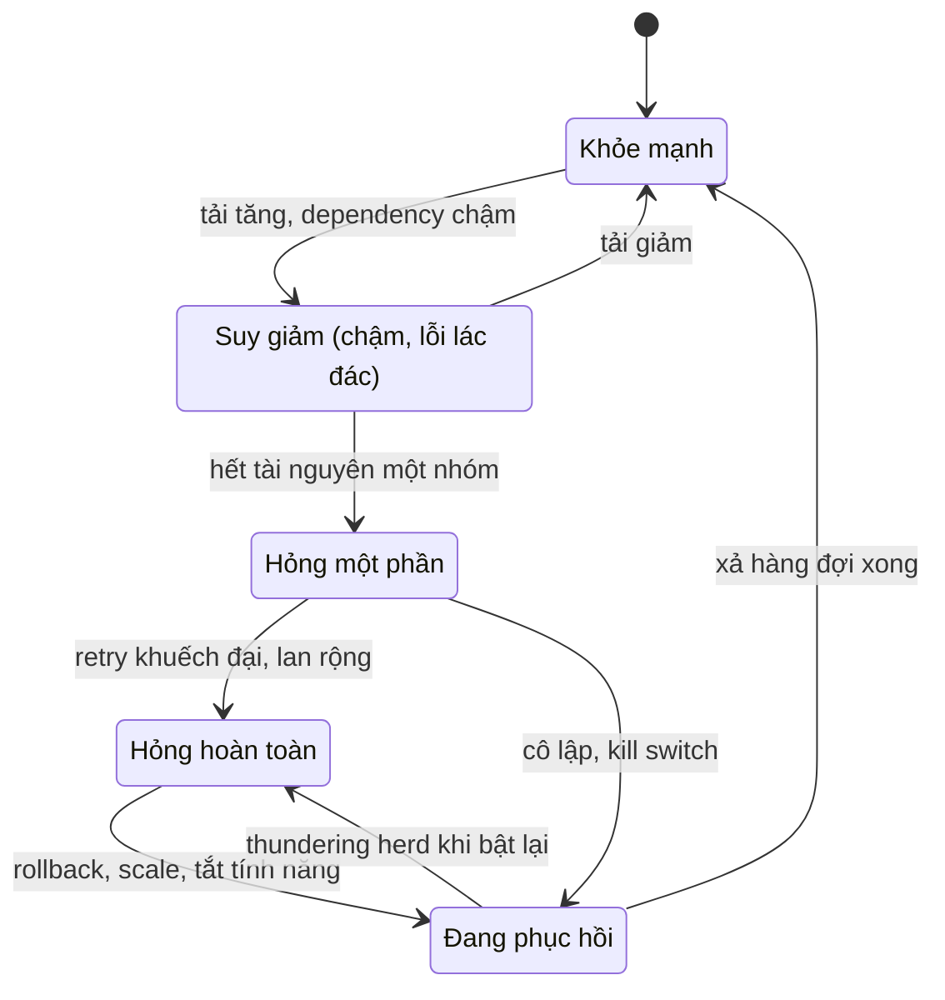

Hãy để ý: hệ thống thật hiếm khi nhảy thẳng từ "khỏe" sang "chết". Nó **trượt dần** qua các trạng thái trung gian. Phần lớn thiệt hại xảy ra ở các trạng thái giữa - nơi dashboard vẫn "xanh một nửa" và mọi người chưa chắc có sự cố hay không.

### 1.3. Hỏng không phải ngoại lệ - hỏng là đầu vào thiết kế

Kỹ sư xây cầu không thiết kế cầu "không bao giờ chịu gió mạnh". Họ thiết kế cầu **chịu được gió cấp 12** và biết chính xác chuyện gì xảy ra ở cấp 13. Kỹ sư phần mềm cũng nên như vậy:

| Tư duy cũ | Tư duy hệ thống |
|---|---|
| "Mình sẽ test kỹ để không có lỗi" | "Lỗi sẽ có. Mình thiết kế để lỗi nhỏ, hiện sớm, sửa nhanh" |
| "Service X uptime 99.99% mà" | "Khi X hỏng (sẽ có ngày đó), mình làm gì?" |
| "Lỗi này hiếm lắm" | "Hiếm × 10 triệu request/ngày = vài lần mỗi ngày" |
| "Lỗi do người vận hành" | "Hệ thống cho phép một người làm sai dễ đến vậy - đó là lỗi thiết kế" |

!!! tip "Câu thần chú"
    **Hiếm × quy mô = thường xuyên.** Một sự kiện xác suất một phần triệu, với 50 triệu request mỗi ngày, xảy ra 50 lần mỗi ngày.

---

## 📖 2. Danh mục failure mode - bộ "bệnh án" bạn cần thuộc

Bác sĩ giỏi không chẩn đoán từ con số không - họ có trong đầu một danh sách bệnh thường gặp và đối chiếu triệu chứng. Kỹ sư cũng cần một danh mục như vậy. Khi review một thiết kế (hay một đoạn code AI vừa sinh), bạn lướt qua danh mục này và hỏi: "cái nào áp dụng ở đây?".

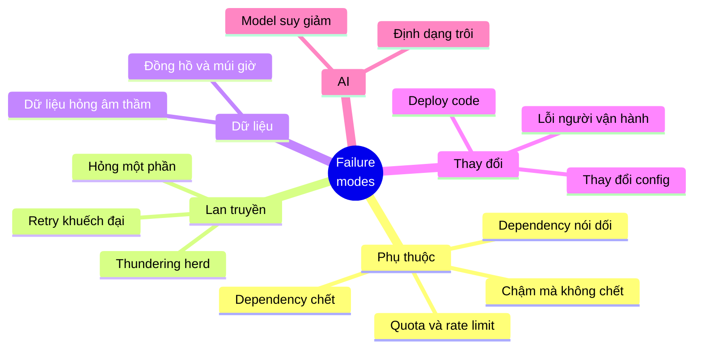

Bảng tóm tắt trước, chi tiết sau:

| # | Failure mode | Triệu chứng điển hình | Vì sao nguy hiểm |
|---|---|---|---|
| 1 | Dependency chết | Lỗi kết nối, 5xx | Dễ thấy - thường là loại *ít* nguy hiểm nhất |
| 2 | Chậm mà không chết | Latency p99 tăng vọt, thread/connection pool cạn | Không ai báo lỗi, tài nguyên bị giữ lại |
| 3 | Hỏng một phần | Một số user lỗi, một số không; tiền trừ mà đơn không có | Khó tái hiện, dữ liệu lệch |
| 4 | Retry khuếch đại | Tải lên dependency tăng gấp nhiều lần khi nó yếu | Biến sự cố nhỏ thành sập toàn bộ |
| 5 | Thundering herd | Tải dồn cùng một thời điểm (cache hết hạn, khởi động lại) | Hệ thống chết đúng lúc vừa hồi phục |
| 6 | Dữ liệu hỏng | Số liệu sai, không có lỗi nào | Lan vào backup, báo cáo, hệ khác |
| 7 | Lỗi người | Lệnh chạy nhầm môi trường, xóa nhầm | Quyền lớn + thao tác tay = thảm họa nhanh |
| 8 | Thay đổi config | Sự cố ngay sau khi đổi flag/config | Config thường không qua review, test như code |
| 9 | Đồng hồ / múi giờ | Lỗi vào nửa đêm, cuối tháng, đổi giờ | Chỉ xuất hiện vào thời điểm đặc biệt |
| 10 | Quota / giới hạn | Lỗi 429, "disk full", "too many open files" | Giới hạn vô hình đến khi chạm vào |
| 11 | AI model suy giảm | Câu trả lời kém đi, định dạng sai, chậm hơn | Không có exception, chất lượng tụt âm thầm |

### 2.1. Dependency chết (dead dependency)

Database không kết nối được, service bên ngoài trả 503. Đây là failure mode "dễ thương" nhất vì **nó lên tiếng**: có exception, có log lỗi, có alert.

Câu hỏi cần trả lời trước khi nó xảy ra:

- Dependency này là **bắt buộc** hay **tùy chọn** cho tính năng? (Không có gợi ý sản phẩm thì vẫn bán được; không có database đơn hàng thì không.)
- Khi nó chết, mình **trả gì cho user**? Lỗi rõ ràng, dữ liệu cũ trong cache, hay ẩn tính năng?
- Mình có **thử lại vô tội vạ** không? (xem 2.4)

### 2.2. Chậm mà không chết (slow, not dead) - kẻ giết người thầm lặng

Đây là failure mode gây sập hệ thống nhiều nhất trong thực tế, đúng như câu chuyện mở bài. Một dependency **chết hẳn** trả lỗi sau 1ms - service của bạn nhận lỗi, giải phóng tài nguyên, đi tiếp. Một dependency **chậm** giữ kết nối của bạn 30 giây. Trong 30 giây đó, mỗi request mới lại chiếm thêm một worker.

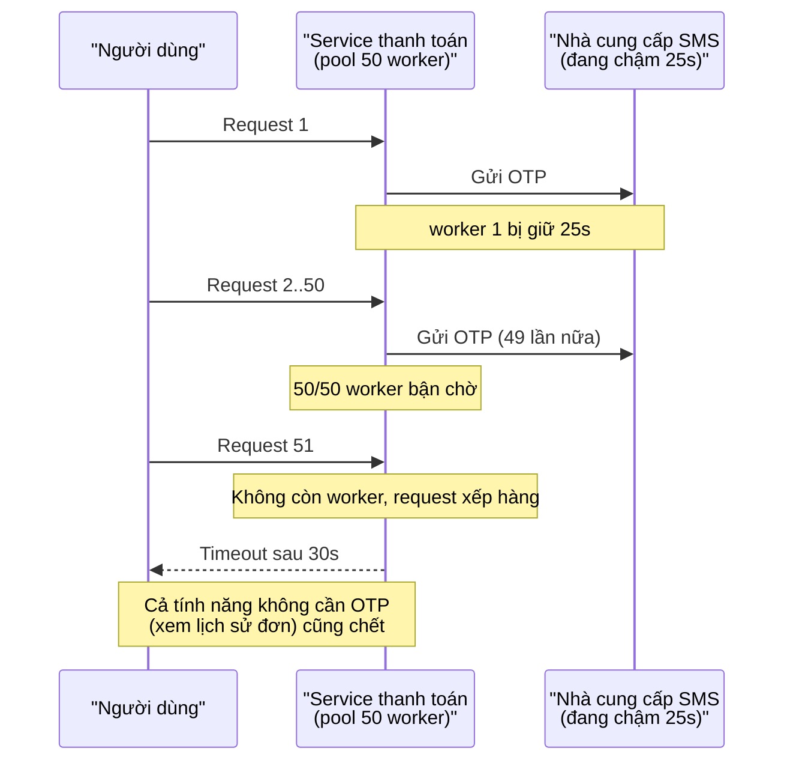

Tính nhanh bằng **định luật Little** (Little's Law): số request đang xử lý = tốc độ đến × thời gian xử lý.

```text
Bình thường:  100 req/s × 0.3 s  = 30 request đồng thời  → pool 50 thừa sức
SMS chậm:     100 req/s × 25 s   = 2.500 request đồng thời → pool 50 cạn sau 0.5 giây
```

Độ trễ tăng 80 lần, nhu cầu tài nguyên tăng 80 lần. Không có dòng log lỗi nào cho đến khi timeout.

!!! warning "Vì sao code AI hay dính lỗi này"
    Các thư viện HTTP mặc định thường **không có timeout** hoặc timeout rất dài (Go `http.Client{}` không timeout; Python `requests.get(url)` chờ vô hạn). Code mẫu trên mạng - nguồn học của AI - hiếm khi đặt timeout. Khi review, câu đầu tiên hãy hỏi: **"Lời gọi mạng này chờ tối đa bao lâu?"**

**Phòng thủ:** timeout ở mọi lời gọi mạng, bulkhead tách pool theo dependency (để SMS chậm không ăn hết worker của "xem lịch sử đơn"), circuit breaker mở khi latency vượt ngưỡng. Code chi tiết: [System Design §11](../backend/10-system-design.md).

### 2.3. Hỏng một phần (partial failure)

Trong một máy tính, một thao tác thường hoặc xong hoặc không. Trong hệ phân tán, có trạng thái thứ ba: **không biết**. Bạn gửi lệnh trừ tiền sang cổng thanh toán, mạng đứt, bạn không nhận được phản hồi. Tiền đã trừ chưa? Không biết.

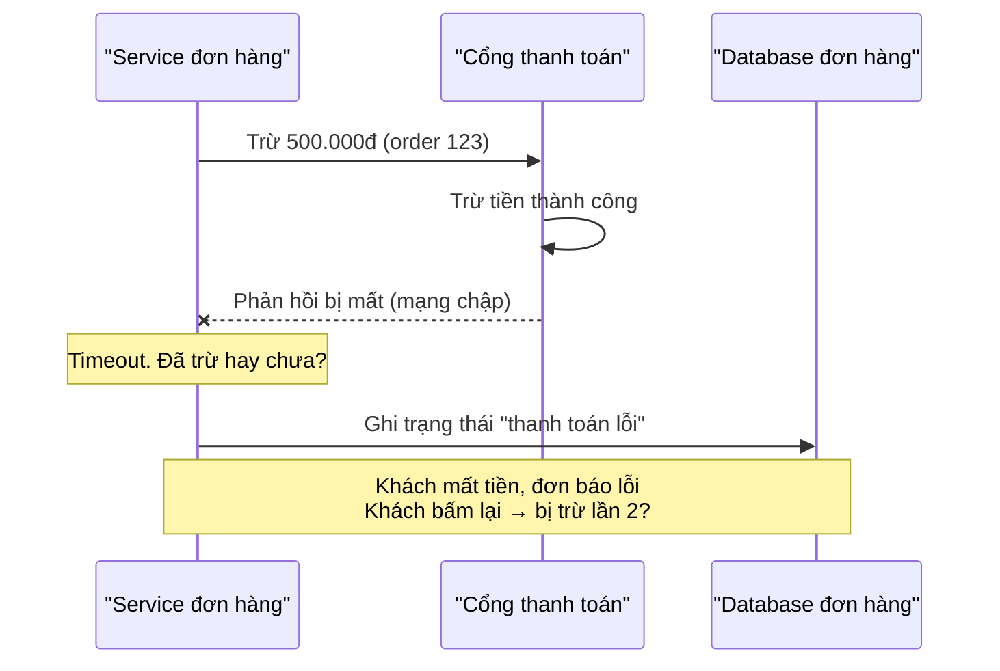

Những dạng hỏng một phần thường gặp:

- **Ghi hai nơi, thành công một nơi**: cập nhật database xong, gửi message lên queue thất bại (hoặc ngược lại). Đây là lý do có pattern outbox.
- **Một số node hỏng**: 1/10 server bị đầy disk, 10% request lỗi ngẫu nhiên - user thấy "lúc được lúc không".
- **Một số user hỏng**: chỉ user có tên chứa ký tự đặc biệt, chỉ đơn có hơn 100 món, chỉ khách ở một shard.
- **Phản hồi mất nhưng hành động đã xảy ra**: như sơ đồ trên.

**Phòng thủ:** idempotency key cho mọi thao tác có tác dụng phụ (tiền, email, kho); một nguồn sự thật (source of truth) rõ ràng; job đối soát (reconciliation) định kỳ so sánh hai bên; trạng thái "đang xử lý / chưa rõ" trong mô hình dữ liệu thay vì chỉ có "thành công / thất bại".

!!! tip "Trạng thái 'chưa rõ' là trạng thái hợp lệ"
    Nếu mô hình dữ liệu của bạn chỉ có `PAID` và `FAILED`, bạn sẽ buộc phải **đoán** khi timeout. Thêm `PENDING_CONFIRMATION` và một job hỏi lại cổng thanh toán. Đoán sai về tiền đắt hơn nhiều so với chờ thêm 2 phút.

### 2.4. Retry khuếch đại (retry amplification)

Retry là bản năng: lỗi thì thử lại. Với một lời gọi riêng lẻ, retry giúp vượt qua lỗi thoáng qua. Với cả hệ thống, retry có thể là **vòng phản hồi dương** (Bài 2) đẩy dependency đang yếu xuống vực.

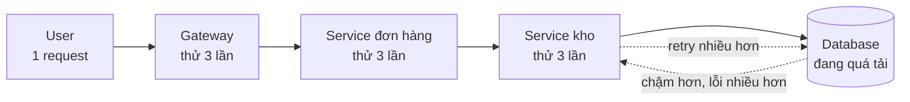

Khi database chết hẳn: 3 × 3 × 3 = **27 lệnh** cho mỗi request của user. Nhưng thú vị hơn là khi database chỉ **yếu**. Đoạn code dưới tính chính xác số lệnh DB kỳ vọng cho mỗi request, với xác suất lỗi `p` mỗi lần gọi DB và mỗi tầng thử tối đa 3 lần:

=== "Python"

    ```python
    def through_layer(p_fail, e_succ, e_fail, attempts):
        """Một tầng gọi tầng dưới, thử tối đa `attempts` lần.
        Trả về (xác suất thất bại, số lệnh DB kỳ vọng khi thành công, khi thất bại)."""
        p_ok = 1 - p_fail
        new_fail = p_fail ** attempts
        new_e_fail = attempts * e_fail
        total = 0.0
        for k in range(1, attempts + 1):  # thành công ở lần thử thứ k
            total += p_fail ** (k - 1) * p_ok * ((k - 1) * e_fail + e_succ)
        new_e_succ = total / (1 - new_fail) if new_fail < 1 else 0.0
        return new_fail, new_e_succ, new_e_fail


    def db_calls_per_request(p, layers, attempts=3):
        f, es, ef = p, 1.0, 1.0  # một lần gọi DB trần
        for _ in range(layers):
            f, es, ef = through_layer(f, es, ef, attempts)
        return (1 - f) * es + f * ef, f


    print("p_lỗi_DB  1 tầng  2 tầng  3 tầng  (mỗi tầng thử tối đa 3 lần)")
    for p in [0.0, 0.1, 0.5, 0.9, 1.0]:
        row = [db_calls_per_request(p, n)[0] for n in (1, 2, 3)]
        print(f"{p:7.1f}  " + "  ".join(f"{x:6.2f}" for x in row))

    calls, fail = db_calls_per_request(0.9, 3)
    print(f"\nDB lỗi 90%: mỗi request của user tạo {calls:.2f} lệnh DB, "
          f"user vẫn thấy lỗi {fail:.1%}")
    ```

=== "Go"

    ```go
    package main

    import (
    	"fmt"
    	"math"
    )

    // throughLayer: một tầng gọi tầng dưới, thử tối đa attempts lần.
    func throughLayer(pFail, eSucc, eFail float64, attempts int) (float64, float64, float64) {
    	pOK := 1 - pFail
    	newFail := math.Pow(pFail, float64(attempts))
    	newEFail := float64(attempts) * eFail
    	total := 0.0
    	for k := 1; k <= attempts; k++ { // thành công ở lần thử thứ k
    		total += math.Pow(pFail, float64(k-1)) * pOK * (float64(k-1)*eFail + eSucc)
    	}
    	newESucc := 0.0
    	if newFail < 1 {
    		newESucc = total / (1 - newFail)
    	}
    	return newFail, newESucc, newEFail
    }

    func dbCallsPerRequest(p float64, layers, attempts int) (float64, float64) {
    	f, es, ef := p, 1.0, 1.0 // một lần gọi DB trần
    	for i := 0; i < layers; i++ {
    		f, es, ef = throughLayer(f, es, ef, attempts)
    	}
    	return (1-f)*es + f*ef, f
    }

    func main() {
    	fmt.Println("p_lỗi_DB  1 tầng  2 tầng  3 tầng  (mỗi tầng thử tối đa 3 lần)")
    	for _, p := range []float64{0.0, 0.1, 0.5, 0.9, 1.0} {
    		fmt.Printf("%7.1f  ", p)
    		for n := 1; n <= 3; n++ {
    			c, _ := dbCallsPerRequest(p, n, 3)
    			if n > 1 {
    				fmt.Print("  ")
    			}
    			fmt.Printf("%6.2f", c)
    		}
    		fmt.Println()
    	}
    	calls, fail := dbCallsPerRequest(0.9, 3, 3)
    	fmt.Printf("\nDB lỗi 90%%: mỗi request của user tạo %.2f lệnh DB, user vẫn thấy lỗi %.1f%%\n",
    		calls, fail*100)
    }
    ```

Output (giống nhau ở cả hai ngôn ngữ):

```text
p_lỗi_DB  1 tầng  2 tầng  3 tầng  (mỗi tầng thử tối đa 3 lần)
    0.0    1.00    1.00    1.00
    0.1    1.11    1.11    1.11
    0.5    1.75    2.00    2.00
    0.9    2.71    6.13    9.42
    1.0    3.00    9.00   27.00

DB lỗi 90%: mỗi request của user tạo 9.42 lệnh DB, user vẫn thấy lỗi 5.8%
```

Đọc bảng này như một kỹ sư hệ thống:

- Khi DB khỏe (p = 0.1), retry gần như miễn phí: chỉ thêm 11% tải. Đó là lý do retry trông vô hại trong môi trường dev.
- Khi DB **đang quá tải** (p = 0.9) - đúng lúc nó cần được nghỉ nhất - ba tầng retry **nhân tải lên 9.4 lần**. DB đang hấp hối nhận thêm gấp 9 lần việc, và càng không thể hồi phục.
- Retry che giấu lỗi rất tốt (user chỉ thấy 5.8% lỗi) - nên dashboard phía user có vẻ "ổn", trong khi DB đang bị đánh sập.

**Phòng thủ:** chỉ retry ở **một tầng** (thường là tầng gần dependency nhất hoặc tầng ngoài cùng, không phải mọi tầng); **retry budget** (tối đa 10% request được phép là retry); exponential backoff + jitter; circuit breaker để ngừng gọi hẳn khi dependency rõ ràng đang chết; chỉ retry lỗi **thoáng qua** (timeout, 503), không retry 400.

### 2.5. Thundering herd (đàn trâu đạp đất)

Một nghìn con trâu đứng yên thì không sao. Một nghìn con cùng chạy qua một cây cầu thì cầu sập. Thundering herd là khi **nhiều client cùng làm một việc vào cùng một thời điểm**:

- **Cache stampede**: key "trang chủ" trong Redis hết hạn lúc 20:00:00, 5.000 request cùng thấy cache miss và cùng query database.
- **Hồi phục đồng loạt**: service sập 10 phút, khi bật lại, toàn bộ client (đã retry, đã xếp hàng) dồn vào cùng lúc - và đánh sập nó lần nữa.
- **Cron đồng bộ**: 200 server cùng chạy job báo cáo lúc 00:00.
- **Mobile app**: thông báo push gửi tới 2 triệu máy, 30% mở app trong 60 giây đầu.

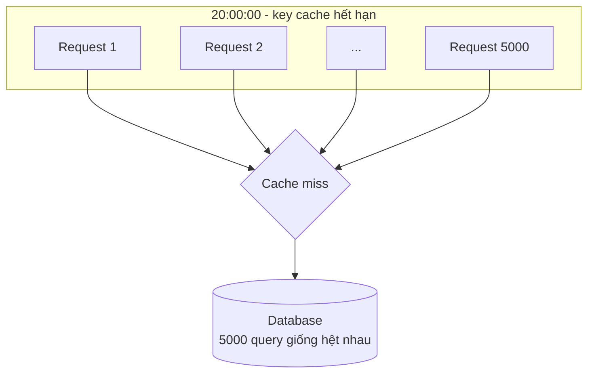

**Phòng thủ:** thêm **jitter** (ngẫu nhiên hóa) vào TTL, retry, cron; **request coalescing / single-flight** (chỉ một request đi lấy dữ liệu, các request khác chờ kết quả đó); làm mới cache **trước** khi hết hạn; khi hồi phục, **mở van từ từ** (cho 10% traffic, rồi 50%, rồi 100%) thay vì mở toang.

### 2.6. Dữ liệu hỏng âm thầm (data corruption)

Một service sập thì bạn biết ngay. Một bug ghi `price = 0` cho 3% sản phẩm thì có thể **vài tuần** sau mới có người để ý - khi đó dữ liệu sai đã lan vào backup, báo cáo doanh thu, kho dữ liệu, email gửi khách.

Đây là failure mode **đắt nhất** vì:

1. **Không có tín hiệu lỗi**: hệ thống vẫn chạy "bình thường".
2. **Lan truyền**: dữ liệu sai được hệ thống khác đọc và nhân lên.
3. **Backup không cứu được**: nếu bạn chỉ giữ backup 7 ngày mà phát hiện sau 10 ngày, backup nào cũng sai.
4. **Sửa phải làm tay**: không có nút "undo" cho 30.000 dòng bị ghi đè.

Các nguồn thường gặp: migration chạy sai, hai process ghi cùng một dòng (race condition), đơn vị lẫn lộn (đồng vs nghìn đồng, giây vs mili-giây), `float` cho tiền ([Bẫy production](../backend/16-production-traps.md)), encode ký tự tiếng Việt sai, script "sửa nhanh" chạy trên production.

**Phòng thủ:** ràng buộc ở tầng database (`CHECK price > 0`, `NOT NULL`, foreign key) - đây là lưới an toàn cuối cùng không phụ thuộc vào code ứng dụng; **bất biến** được kiểm tra định kỳ (tổng tiền vào = tổng tiền ra + số dư); audit log / event log cho phép dựng lại trạng thái; backup giữ đủ lâu và **thử khôi phục** định kỳ; soft delete thay vì xóa hẳn cho dữ liệu quan trọng.

### 2.7. Lỗi người (human error)

Kỹ sư chạy `DELETE FROM orders` trên terminal tưởng là staging nhưng là production. Ai đó gõ nhầm số 0 khi scale cluster từ 10 xuống 1 thay vì lên 100.

Tư duy hệ thống nói: **"lỗi người" là triệu chứng, không phải nguyên nhân gốc**. Câu hỏi đúng không phải "ai làm sai?" mà là "hệ thống nào cho phép một thao tác sai đơn giản gây ra thiệt hại lớn như vậy?".

| Thay vì | Hãy thiết kế |
|---|---|
| "Mọi người phải cẩn thận hơn" | Prompt terminal production màu đỏ, tên khác hẳn staging |
| "Đừng chạy lệnh nguy hiểm" | Lệnh nguy hiểm cần xác nhận lại tên môi trường, hoặc cần 2 người |
| "Đọc kỹ trước khi deploy" | Deploy qua pipeline, không có quyền ghi tay vào production |
| "Kiểm tra số trước khi scale" | Giới hạn thay đổi mỗi lần (không giảm quá 50% một lần) |
| "Nhớ backup trước khi migrate" | Pipeline migration tự tạo snapshot, không có snapshot thì không chạy |

### 2.8. Thay đổi config

Nhiều nghiên cứu sự cố ở các công ty lớn cho thấy phần lớn sự cố bắt nguồn từ **thay đổi** - deploy code, đổi config, đổi hạ tầng - chứ không phải từ lỗi "tự nhiên phát sinh". Trong đó, config là loại thay đổi **bị xem nhẹ nhất**: code thì có review, có test, có canary; config thì "chỉ là đổi một con số".

Ví dụ điển hình:

- Đổi timeout từ `30s` thành `30` - và hệ thống hiểu là 30 **mili-giây**.
- Bật feature flag cho 100% thay vì 10% vì nhầm ô.
- Thêm một rule firewall chặn nhầm dải IP của chính database.
- Đổi config ở một nơi, quên rằng một service khác cũng đọc config đó.

**Phòng thủ:** **config là code** - lưu trong git, review, validate schema (đơn vị bắt buộc: `30s`, không chấp nhận số trần), rollout từ từ như deploy code, rollback được trong 1 phút.

### 2.9. Đồng hồ và múi giờ

Thời gian là nguồn lỗi kinh điển vì nó **chỉ lộ ra vào thời điểm đặc biệt**:

- Job chạy lúc `00:00` theo giờ server (UTC) = 07:00 sáng Việt Nam - báo cáo "doanh thu hôm qua" thiếu 7 tiếng.
- Đồng hồ hai server lệch nhau 2 giây: event B có timestamp **trước** event A dù xảy ra sau. Sắp xếp theo timestamp cho ra thứ tự sai.
- Ngày 29/2, ngày 31 của tháng 30 ngày, tuần thứ 53, năm nhuận.
- Token hết hạn tính bằng giờ địa phương ở client nhưng kiểm tra bằng UTC ở server.
- Đổi giờ mùa hè (DST) ở thị trường nước ngoài: một giờ xuất hiện hai lần, một giờ không tồn tại.

Quy tắc gốc ("lưu UTC, hiện giờ địa phương") có trong [Bẫy production §2](../backend/16-production-traps.md). Tư duy hệ thống bổ sung: **đừng dùng đồng hồ để sắp thứ tự sự kiện giữa các máy** - dùng sequence number, version, hoặc để database cấp thứ tự. Và khi đặt lịch cron, luôn hỏi "**theo múi giờ nào?**".

### 2.10. Quota và giới hạn vô hình

Mọi tài nguyên đều có giới hạn, và hầu hết giới hạn đều **vô hình cho đến khi bạn chạm vào**:

| Giới hạn | Triệu chứng khi chạm |
|---|---|
| Rate limit API bên ngoài (SMS, thanh toán, AI) | 429 Too Many Requests, đúng giờ cao điểm |
| Connection pool database | Request chờ, rồi timeout |
| File descriptor (`ulimit -n`) | "too many open files" |
| Disk | Log không ghi được, database dừng nhận ghi |
| ID tự tăng kiểu `INT` 32-bit | Sau 2,1 tỷ dòng: không insert được nữa |
| Quota cloud (số máy, IP, bucket) | Autoscale "chạy" nhưng không tạo được máy mới |
| Chứng chỉ TLS, domain | Hết hạn đúng ngày - mọi kết nối HTTPS lỗi |
| Ngân sách token AI theo tháng | Tính năng AI ngừng giữa tháng |

**Phòng thủ:** lập **danh sách giới hạn** cho mỗi hệ thống (đây là bài tập rất đáng làm); cảnh báo ở 70-80% chứ không phải 100%; chứng chỉ tự gia hạn và có cảnh báo trước 30 ngày; biết trước quota của nhà cung cấp và xin nâng **trước** đợt sale.

### 2.11. AI model suy giảm

Đây là failure mode mới, và rất khác các loại trên: khi bạn gọi một mô hình AI, **không có exception khi câu trả lời sai**. Mô hình trả về JSON hợp lệ với nội dung tệ hơn hôm qua, và mọi metric kỹ thuật đều xanh.

Các dạng cụ thể:

- **Nhà cung cấp cập nhật model** dưới cùng một tên (alias như `latest`): phong cách trả lời đổi, định dạng đổi, tỉ lệ từ chối đổi.
- **Định dạng trôi**: 99% câu trả lời đúng JSON schema, 1% có thêm câu "Đây là kết quả:" ở đầu - parser của bạn vỡ.
- **Dữ liệu đầu vào đổi**: model phân loại ticket được đánh giá trên dữ liệu năm ngoái, nay khách hỏi về sản phẩm mới.
- **Latency và chi phí**: prompt dài dần theo thời gian (ai cũng thêm "một dòng hướng dẫn nữa"), độ trễ và hóa đơn tăng.
- **Quota/rate limit** của nhà cung cấp AI chạm vào giờ cao điểm.

**Phòng thủ:** ghim phiên bản model cụ thể; bộ **eval** (tập test chất lượng) chạy định kỳ và mỗi khi đổi model hoặc prompt; validate output bằng schema và có nhánh xử lý khi không hợp lệ; có **đường lui** khi AI không khả dụng (quy tắc đơn giản, chuyển cho người). Bài 8 sẽ đi sâu chủ đề này.

### 💡 Tips quan trọng

- Khi review thiết kế, đi qua 11 mục trên như một checklist - mất 10 phút, tiết kiệm nhiều đêm thức trắng.
- Failure mode nguy hiểm nhất là failure mode **không phát ra tín hiệu**: chậm, hỏng một phần, dữ liệu sai, AI suy giảm. Với mỗi cái, hỏi "**mình sẽ biết bằng cách nào?**".
- Phần lớn sự cố lớn là **chuỗi** nhiều failure mode: chậm → cạn pool → retry → herd. Đừng phân tích từng cái một cách cô lập.

---

## 📖 3. Blast radius - khi hỏng thì hỏng đến đâu?

Bạn không thể ngăn mọi thứ hỏng. Nhưng bạn **có thể** quyết định khi một thứ hỏng thì **bao nhiêu thứ khác hỏng theo**. Đó là blast radius - bán kính vụ nổ.

### 3.1. Câu hỏi cốt lõi

Với mỗi thành phần, hỏi:

> "Nếu cái này hỏng hoàn toàn, **bao nhiêu % user** và **bao nhiêu % tính năng** bị ảnh hưởng?"

| Thiết kế | Một thành phần hỏng | Blast radius |
|---|---|---|
| Một database chung cho mọi tính năng | DB chậm | 100% user, 100% tính năng |
| Pool riêng cho từng dependency | SMS chậm | Chỉ tính năng cần OTP |
| Chia user thành 4 cell độc lập | Cell 2 hỏng | 25% user |
| Feature flag cho tính năng mới | Tính năng mới lỗi | Tắt trong 30 giây, 0% sau đó |

### 3.2. Bulkhead - vách ngăn khoang tàu

Tàu biển được chia thành nhiều khoang kín nước. Thủng một khoang, nước chỉ tràn vào khoang đó, tàu vẫn nổi. Titanic chìm một phần vì vách ngăn không đủ cao - nước tràn từ khoang này sang khoang khác.

Trong phần mềm, bulkhead là **tách tài nguyên** để một phần cạn kiệt không kéo theo phần khác:

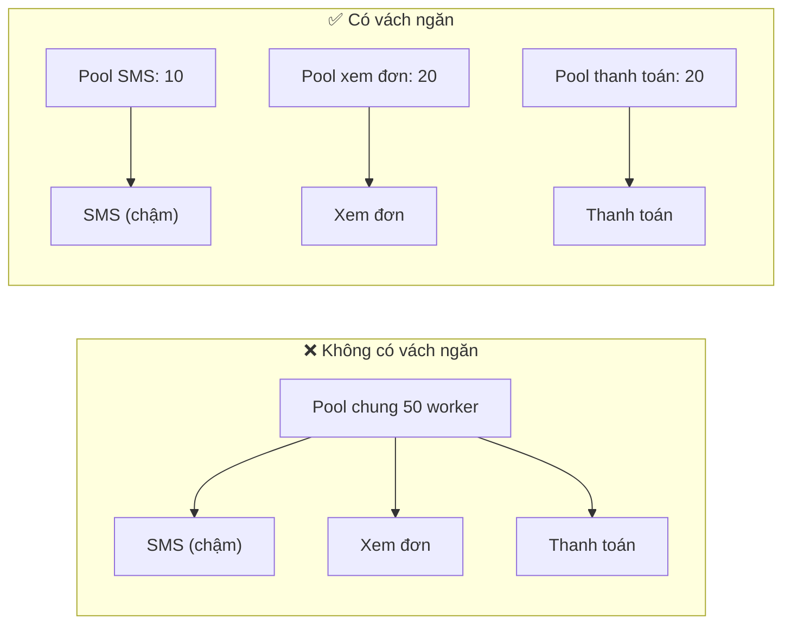

Bên trái: SMS chậm ăn hết 50 worker, cả ba tính năng chết. Bên phải: SMS chậm ăn hết 10 worker của nó, hai tính năng còn lại vẫn chạy.

Vách ngăn có thể ở nhiều cấp:

- **Trong process**: pool/semaphore riêng cho từng dependency.
- **Giữa các process**: tách worker xử lý ảnh khỏi web server, để job nặng không làm chậm API.
- **Giữa các khách hàng**: hàng đợi riêng cho khách lớn, để một khách gửi 1 triệu job không làm các khách khác chờ.
- **Giữa các môi trường**: tài khoản cloud riêng cho production, để một script dọn dẹp ở dev không chạm vào production.

### 3.3. Cell-based architecture - chia nhỏ cả hệ thống

Bulkhead tách **tài nguyên**. Cell tách **toàn bộ bản sao hệ thống**. Mỗi cell là một bản đầy đủ (app + database + cache) phục vụ một nhóm user. Một lớp định tuyến mỏng quyết định user nào thuộc cell nào.

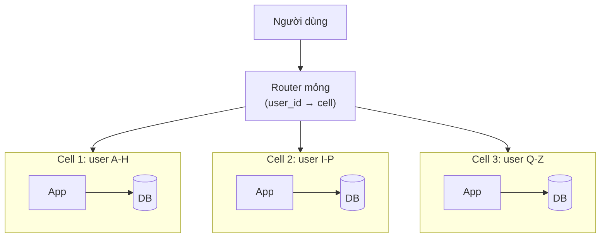

Lợi ích:

- Một bug dữ liệu, một deploy lỗi, một khách "gây bão" chỉ ảnh hưởng **một cell**.
- Deploy theo từng cell: cell 1 trước, quan sát 1 giờ, rồi mới đến cell khác. Cell 1 chính là canary tự nhiên.
- Mỗi cell có kích thước giới hạn, nên bạn **đã test được** ở đúng quy mô đó - không có bất ngờ "chưa bao giờ chạy với ngần này dữ liệu".

Cái giá: vận hành nhiều bản sao, router là điểm hỏng chung (phải giữ nó cực kỳ đơn giản), truy vấn xuyên cell (báo cáo toàn hệ thống) phức tạp hơn. Với hệ thống nhỏ, cell là quá mức cần thiết - nhưng **tư duy** cell (một lỗi có thể chỉ ảnh hưởng một nhóm user không?) thì luôn hữu ích.

### 3.4. Các cách thu nhỏ blast radius theo thời gian

Blast radius không chỉ là "bao nhiêu người", mà còn "**bao lâu**". Một lỗi ảnh hưởng 100% user trong 30 giây có thể ít tệ hơn lỗi ảnh hưởng 5% user trong 3 ngày.

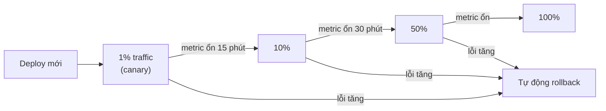

| Kỹ thuật | Thu nhỏ theo |
|---|---|
| Canary / rollout từ từ | Số user bị ảnh hưởng |
| Feature flag + kill switch | Thời gian tồn tại của lỗi |
| Tự động rollback theo metric | Thời gian phát hiện + khắc phục |
| Rate limit theo khách | Thiệt hại một khách gây ra cho khách khác |
| Giới hạn thay đổi mỗi lần | Độ lớn của một thao tác sai |

!!! tip "Câu hỏi khi review bất kỳ thay đổi nào"
    "**Nếu thay đổi này sai, tệ nhất là gì, cho bao nhiêu người, trong bao lâu, và mình quay lại bằng cách nào?**" Nếu câu trả lời cho phần cuối là "không quay lại được", thay đổi đó cần được đối xử như cửa một chiều (xem [Trade-off & ra quyết định](../mindset/07-tradeoffs-decisions.md)).

---

## 📖 4. Pre-mortem - tưởng tượng thất bại trước khi nó xảy ra

### 4.1. Ý tưởng

Postmortem là phân tích **sau** khi chết. Pre-mortem (do nhà tâm lý học Gary Klein đề xuất) là phân tích **trước** khi bắt đầu, với một mẹo tâm lý quan trọng:

> Thay vì hỏi "**có thể** có gì sai?", bạn nói: "Hãy tưởng tượng 3 tháng nữa, dự án này **đã thất bại thảm hại**. Hãy viết lại câu chuyện vì sao nó thất bại."

Tại sao mẹo này hiệu quả? Vì khi được hỏi "có rủi ro gì không?", mọi người trong team ngại làm người phá đám, và não người thiên về lạc quan cho kế hoạch của chính mình. Khi thất bại được **giả định là sự thật**, việc tìm lý do trở thành một bài tập sáng tạo, không còn là sự phản đối. Người im lặng nhất phòng họp thường có câu trả lời hay nhất.

### 4.2. Quy trình 6 bước (45-60 phút)

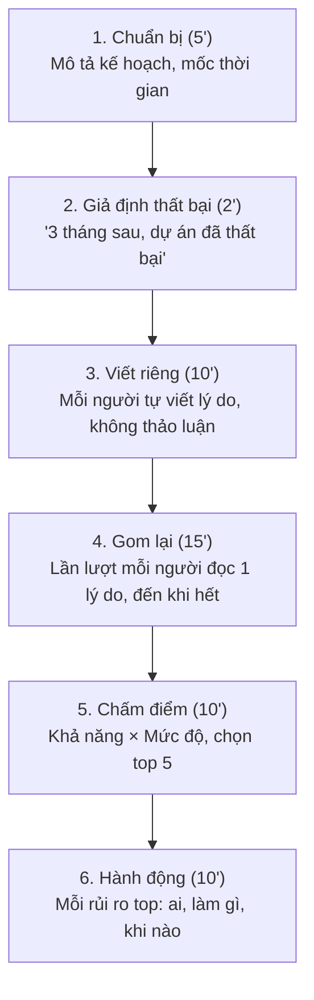

Vài nguyên tắc vận hành:

- **Viết riêng trước khi nói** (bước 3) là bắt buộc. Nếu thảo luận ngay, ý kiến của người nói đầu tiên (thường là sếp) sẽ định hướng cả phòng.
- **Mời người ngoài team**: CS (chăm sóc khách hàng), vận hành, kế toán. Họ thấy những failure mode mà kỹ sư không thấy.
- **Không phản bác trong bước 4**. Chỉ ghi lại.
- **Kết quả phải là hành động có chủ**, không phải danh sách lo âu.

### 4.3. Mẫu pre-mortem

```text
PRE-MORTEM: [Tên dự án / thay đổi]
Ngày: ____    Người điều phối: ____    Thành phần: ____

1. KẾ HOẠCH (1 đoạn)
   Chúng ta sẽ làm gì, khi nào ra mắt, thành công trông như thế nào (con số).

2. GIẢ ĐỊNH
   "Hôm nay là [ngày + 3 tháng]. Dự án đã thất bại. [Mô tả cụ thể thất bại]."

3. LÝ DO THẤT BẠI (gom từ mọi người)
   | # | Lý do | Nhóm (kỹ thuật/con người/quy trình/bên ngoài) | Khả năng 1-5 | Mức độ 1-5 |

4. TOP RỦI RO (điểm cao nhất hoặc mức độ = 5)
   | Rủi ro | Phòng ngừa (giảm khả năng) | Giảm nhẹ (giảm thiệt hại) | Tín hiệu sớm | Chủ | Hạn |

5. ĐIỀU KIỆN DỪNG / ROLLBACK
   "Nếu [tín hiệu] vượt [ngưỡng] trong [thời gian], chúng ta [hành động]."

6. NHỮNG GÌ CHÚNG TA CHẤP NHẬN (rủi ro biết nhưng không xử lý, và vì sao)
```

Mục 6 rất quan trọng và hay bị bỏ qua. **Chấp nhận rủi ro một cách có ý thức** khác hẳn với **không biết có rủi ro**.

### 4.4. Ví dụ hoàn chỉnh: chuyển nhà cung cấp SMS OTP trước mùa sale

**Bối cảnh.** Một shop online cỡ vừa (khoảng 30.000 đơn/ngày, 150.000 đơn/ngày dịp sale) dùng nhà cung cấp SMS A để gửi OTP xác nhận thanh toán. Nhà cung cấp B rẻ hơn 40%. Kế hoạch: chuyển 100% sang B vào ngày 1/11, trước đợt sale 11/11.

**Giả định:** *"Hôm nay là 15/11. Việc chuyển sang B là một thảm họa. Đêm 11/11 chúng ta mất khoảng 40% đơn trong 2 giờ, và tiết kiệm cả năm không bù được thiệt hại một đêm."*

**Lý do mọi người viết ra** (đã gom và loại trùng):

| # | Lý do thất bại | Nhóm | Khả năng | Mức độ |
|---|---|---|---|---|
| 1 | B chịu tải tốt ở 30k/ngày nhưng nghẽn ở 150k/ngày, độ trễ lên 20-30 giây | Bên ngoài | 4 | 5 |
| 2 | Code tích hợp B không có timeout, SMS chậm làm cạn worker thanh toán | Kỹ thuật | 3 | 5 |
| 3 | B gửi tốt cho Viettel nhưng tỉ lệ đến máy Vinaphone/Mobifone thấp | Bên ngoài | 3 | 4 |
| 4 | B có rate limit 50 SMS/giây mà hợp đồng không ghi rõ | Bên ngoài | 3 | 5 |
| 5 | Không ai theo dõi tỉ lệ "OTP gửi đi / OTP được nhập" - không phát hiện được SMS không đến | Quy trình | 4 | 4 |
| 6 | Không có đường quay về A vì đã hủy hợp đồng A | Quy trình | 2 | 5 |
| 7 | Brandname (tên người gửi) của B chưa đăng ký xong, khách thấy số lạ và nghĩ là lừa đảo | Bên ngoài | 2 | 3 |
| 8 | Template tin nhắn có dấu tiếng Việt bị tính 2 tin, chi phí gấp đôi dự tính | Kỹ thuật | 3 | 2 |
| 9 | On-call đêm 11/11 không biết hệ thống SMS mới, không có runbook | Con người | 3 | 3 |

**Top rủi ro và hành động:**

| Rủi ro | Phòng ngừa | Giảm nhẹ | Tín hiệu sớm | Chủ | Hạn |
|---|---|---|---|---|---|
| #1, #4 B nghẽn / rate limit | Load test với B ở 3x tải sale; xin B cam kết bằng văn bản về throughput | Giữ A làm dự phòng | p95 latency gửi SMS lớn hơn 3s | Minh | 20/10 |
| #2 Cạn worker | Timeout 3s; pool riêng cho SMS; gửi SMS bất đồng bộ qua queue | Circuit breaker chuyển sang A | Pool SMS sử dụng trên 80% | Lan | 25/10 |
| #5 SMS không đến mà không biết | Metric "tỉ lệ OTP được xác nhận trong 2 phút" theo nhà mạng | Nút "gửi lại qua nhà cung cấp khác" | Tỉ lệ xác nhận dưới 85% | Huy | 25/10 |
| #6 Không quay lại được | Giữ hợp đồng A tối thiểu đến hết tháng 12 | Feature flag chọn nhà cung cấp, đổi trong 1 phút | - | Trang (PM) | 15/10 |

**Điều kiện dừng:** *"Nếu tỉ lệ OTP xác nhận dưới 85% trong 10 phút liên tục, hoặc p95 gửi SMS trên 5 giây, on-call chuyển flag về A ngay, không cần hỏi ai."*

**Chấp nhận:** rủi ro #8 (chi phí tăng do tin có dấu) - chấp nhận trong đợt sale, xử lý template sau.

**Một quyết định lớn nảy ra từ pre-mortem:** team đổi kế hoạch thành **chuyển dần** - 10% traffic sang B từ 1/11, giữ 90% ở A trong đợt sale, chuyển hết sau 11/11 nếu số liệu tốt. Tiết kiệm chậm 1 tháng, đổi lại không đặt cược cả mùa sale vào một nhà cung cấp chưa được kiểm chứng.

!!! tip "Dấu hiệu một pre-mortem tốt"
    Kết quả thay đổi **kế hoạch**, không chỉ thêm việc vào backlog. Nếu sau pre-mortem mọi thứ vẫn y nguyên, hoặc kế hoạch thật sự đã tốt, hoặc buổi họp chưa đủ thẳng thắn.

---

## 📖 5. FMEA rút gọn - chấm điểm rủi ro có hệ thống

### 5.1. FMEA là gì

FMEA (Failure Mode and Effects Analysis - phân tích dạng hỏng và tác động) xuất phát từ ngành hàng không và ô tô. Bản đầy đủ rất nặng nề. Bản rút gọn cho phần mềm chỉ cần một bảng, với mỗi failure mode chấm 3 điểm từ 1 đến 5:

| Điểm | Severity (S) - mức độ | Likelihood (L) - khả năng | Detectability (D) - khó phát hiện |
|---|---|---|---|
| 1 | Không ai để ý | Gần như không bao giờ | Alert ngay trong vài giây |
| 2 | Bất tiện nhỏ, có cách khác | Vài năm một lần | Alert trong vài phút |
| 3 | Một tính năng hỏng cho một nhóm user | Vài lần mỗi năm | Dashboard thấy nếu có người nhìn |
| 4 | Tính năng chính hỏng, mất doanh thu | Hàng tháng | Phải khách phàn nàn mới biết |
| 5 | Mất tiền/dữ liệu, pháp lý, mất niềm tin | Hàng tuần hoặc chắc chắn ở quy mô lớn | Không phát hiện được, hoặc phát hiện sau nhiều ngày |

Lưu ý chiều của **D**: điểm **càng cao càng tệ** (càng khó phát hiện). Đây là điểm hay bị hiểu ngược.

**Risk Priority Number (RPN) = S × L × D**, từ 1 đến 125.

### 5.2. Ví dụ: tính năng thanh toán đơn hàng

| Failure mode | Tác động | S | L | D | RPN | Hành động |
|---|---|---|---|---|---|---|
| Cổng thanh toán timeout, không rõ đã trừ tiền | Khách bị trừ mà không có đơn | 5 | 3 | 4 | **60** | Trạng thái PENDING + job đối soát mỗi 5 phút |
| Khách bấm "thanh toán" hai lần | Bị trừ tiền hai lần | 5 | 4 | 3 | **60** | Idempotency key theo order_id |
| Webhook từ cổng thanh toán đến trễ hoặc trùng | Đơn kẹt trạng thái chờ, hoặc xử lý hai lần | 4 | 4 | 3 | **48** | Webhook idempotent + polling dự phòng |
| Làm tròn tiền sai khi áp mã giảm giá | Lệch vài đồng, sai báo cáo kế toán | 3 | 3 | 5 | **45** | Dùng số nguyên, kiểm tra bất biến tổng |
| Database chính chết | Không đặt được hàng | 4 | 2 | 1 | **8** | Đã có replica + failover (giữ nguyên) |
| Trang thanh toán chậm 3 giây | Một phần khách bỏ giỏ hàng | 3 | 3 | 2 | **18** | Theo dõi, chưa ưu tiên |

Nhìn bảng, điều thú vị là **"database chính chết"** - thứ mọi người hay lo nhất - lại có RPN thấp nhất, vì nó dễ phát hiện và đã có phòng bị. Trong khi "làm tròn tiền sai" - thứ không ai bàn trong họp - lại cao vì **D = 5**: có thể nhiều tháng không ai phát hiện.

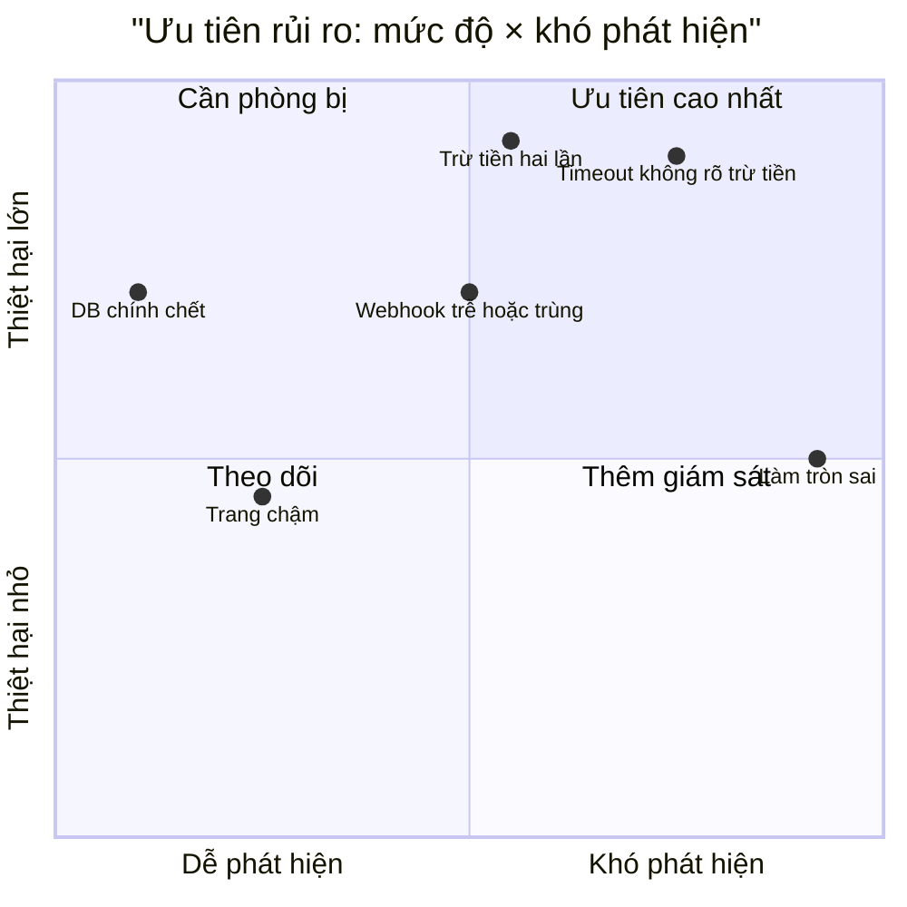

### 5.3. Đừng tin RPN một cách máy móc

RPN là công cụ **sắp xếp cuộc thảo luận**, không phải phép đo khoa học:

- Các thang 1-5 là **thứ tự**, không phải tỉ lệ - "S = 4" không có nghĩa là tệ gấp đôi "S = 2". Nhân chúng với nhau chỉ là quy ước.
- **Luật vượt quyền:** mọi failure mode có **S = 5** đều phải có hành động, bất kể RPN. Một rủi ro mất dữ liệu khách với L = 1, D = 1 (RPN = 5) vẫn cần một kế hoạch.
- Giá trị lớn nhất của FMEA nằm ở **cuộc tranh luận khi chấm điểm**: khi hai người chấm L = 1 và L = 4 cho cùng một dòng, đó là lúc team phát hiện họ hiểu hệ thống khác nhau.

### 5.4. Ba đòn bẩy để giảm rủi ro

Mỗi hành động trong FMEA nên nhắm rõ vào một trong ba điểm:

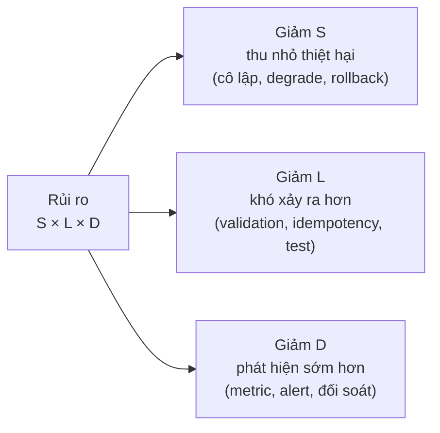

Thường thì **giảm D là rẻ nhất**: thêm một metric và một alert tốn vài giờ. Và nó có giá trị nhân lên: một lỗi phát hiện sau 5 phút ít thiệt hại hơn hẳn lỗi phát hiện sau 5 ngày.

---

## 📖 6. Thiết kế để chịu lỗi - năm nguyên tắc

Phần kỹ thuật chi tiết có trong [System Design §11-12](../backend/10-system-design.md) và [Observability §9](../backend/11-observability-reliability.md). Ở đây là **tư duy** đằng sau mỗi nguyên tắc - để bạn biết hỏi gì khi review một thiết kế hoặc một đoạn code AI sinh ra.

### 6.1. Timeout - mọi sự chờ đợi đều phải có hạn

**Nguyên tắc:** không có lời gọi mạng nào được phép chờ vô hạn. Và timeout phải được **tính theo ngân sách** từ trên xuống, không đặt tùy hứng ở từng tầng.

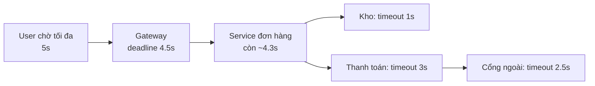

Lỗi kinh điển: tầng ngoài timeout 5 giây, tầng trong timeout 30 giây. Khi tầng ngoài đã bỏ cuộc và trả lỗi cho user, tầng trong **vẫn tiếp tục làm** 25 giây nữa - tốn tài nguyên cho một kết quả không ai chờ. Cách sửa: truyền **deadline** xuyên suốt (Go `context.WithTimeout`, gRPC deadline) để tầng trong biết còn bao nhiêu thời gian.

### 6.2. Idempotency - làm lại không gây hại

**Nguyên tắc:** mọi thao tác có tác dụng phụ đều có thể bị gọi **nhiều hơn một lần** - do retry, do user bấm hai lần, do queue giao lại message. Thiết kế sao cho gọi lần hai **không gây thêm tác dụng**.

Câu hỏi khi review: "**Nếu dòng này chạy hai lần thì sao?**" Áp dụng cho: trừ tiền, cộng điểm, gửi email/SMS, trừ kho, tạo đơn, gọi webhook.

Đây cũng là điều kiện **tiên quyết** để retry an toàn. Retry trên thao tác không idempotent là đổi một lỗi dễ thấy (thất bại) lấy một lỗi khó thấy (làm hai lần).

### 6.3. Graceful degradation - hỏng có kiểm soát

**Nguyên tắc:** khi một phần hỏng, hệ thống **giảm chất lượng** thay vì **tắt hẳn**. Thiết kế trước một "thang suy giảm":

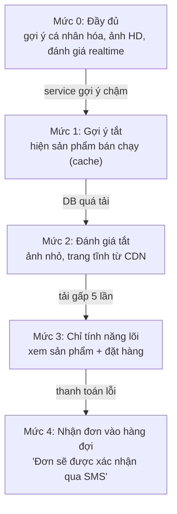

Mỗi mức cần trả lời: điều kiện vào, điều kiện ra, ai quyết định (tự động hay người), và **đã được thử chưa**. Một kế hoạch suy giảm chưa từng chạy thử thì nhiều khả năng không chạy được khi cần.

### 6.4. Kill switch - nút tắt khẩn cấp

**Nguyên tắc:** mọi tính năng mới, mọi tích hợp bên ngoài, mọi job nặng đều cần một cách **tắt trong vài giây mà không cần deploy**.

Kill switch tốt có các đặc điểm:

- **Không phụ thuộc vào thứ đang hỏng**: nếu flag lưu trong database đang chết thì flag vô dụng. Cần giá trị mặc định an toàn khi không đọc được flag.
- **On-call được quyền bật mà không cần hỏi ai** - quyết định trước trong runbook.
- **Được thử định kỳ**: một nút chưa bao giờ được bấm thì không ai biết nó còn hoạt động.
- **Tắt có nghĩa rõ ràng**: tắt "gợi ý AI" thì hiện gì thay thế? Tắt "gửi email marketing" thì email đang trong hàng đợi đi đâu?

### 6.5. Rollback - đường quay về

**Nguyên tắc:** trước mỗi thay đổi, biết chính xác **cách quay lại** và **mất bao lâu**. Thay đổi không quay lại được cần mức cẩn trọng khác hẳn.

| Loại thay đổi | Rollback | Độ khó |
|---|---|---|
| Deploy code stateless | Deploy lại bản cũ | Dễ (phút) |
| Feature flag | Tắt flag | Rất dễ (giây) |
| Config | Revert commit config | Dễ, nếu config nằm trong git |
| Thêm cột database | Bỏ qua cột | Dễ |
| Đổi tên / xóa cột | Không thể nếu code cũ cần cột đó | **Khó** |
| Migration ghi đè dữ liệu | Khôi phục backup (mất dữ liệu mới) | **Rất khó** |
| Gửi email/SMS cho khách | Không thể | **Không thể** |

Với thay đổi database, dùng pattern **expand - migrate - contract** để mọi bước đều quay lại được:

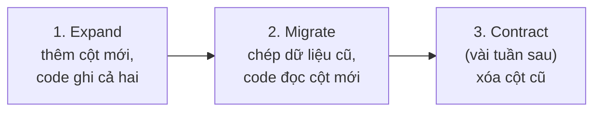

Ở bước 1 và 2, quay lại bản code cũ luôn an toàn vì cột cũ vẫn còn đầy đủ. Chỉ bước 3 là cửa một chiều - và bạn đi qua nó khi đã chắc chắn.

---

## 📖 7. Ba câu hỏi thử thách mọi thiết kế

Khi xem một thiết kế, hãy đặt nó vào ba hoàn cảnh khắc nghiệt. Đây là cách nhanh nhất để lộ ra những giả định ngầm.

### 7.1. "Ở 10x tải thì sao?"

Không phải "hệ thống có scale không?" (câu hỏi quá chung), mà: "**cái gì gãy đầu tiên** khi tải gấp 10?"

- Connection pool database: 20 connection, 10x request đồng thời → cần 200?
- Quota bên ngoài: SMS 50/giây, sale cần 400/giây?
- Một query đang chạy 50ms trên 100k dòng - trên 1 triệu dòng thì sao? Có full scan không?
- Job chạy mỗi đêm mất 2 giờ - 10x dữ liệu là 20 giờ, chồng lên job đêm sau?
- Bảng nào lớn nhanh nhất? Log, event, session?
- Có thao tác nào là O(n²) theo số user, số sản phẩm, số follower không?

!!! tip "Nguyên tắc 10x"
    Hệ thống thiết kế tốt cho tải X thường chạy được ở 2-3X với chút tinh chỉnh, nhưng **gãy kiến trúc** ở khoảng 10X. Đừng thiết kế cho 100X từ đầu (lãng phí), nhưng hãy biết **cái gì gãy ở 10X** để có kế hoạch. Bài 6 đi sâu vào chuyện này.

### 7.2. "Lúc 3 giờ sáng thì sao?"

3 giờ sáng là thời điểm tượng trưng cho: **người vận hành đang ngủ, mệt, không có ai để hỏi**.

- Alert này có đánh thức đúng người không? Người đó có đủ quyền và thông tin để xử lý không?
- Có runbook không? Runbook có được viết cho người **chưa từng thấy hệ thống này** không?
- Hệ thống có **tự hồi phục** được không (restart, failover, xả hàng đợi) hay phải có người?
- Lỗi này có thể chờ đến sáng không? Nếu có thì đừng đánh thức ai - gửi vào hàng đợi ticket.
- Có job nào chạy vào ban đêm (backup, báo cáo, đồng bộ) có thể va chạm với nhau?
- Người duy nhất hiểu hệ thống này có đang đi nghỉ phép không? (bus factor)

### 7.3. "Khi dependency nói dối thì sao?"

Đây là câu hỏi khó nhất và hay bị bỏ qua nhất. Ta thường kiểm tra dependency **không trả lời**. Ít khi kiểm tra dependency **trả lời sai**:

| Dependency nói dối thế nào | Ví dụ |
|---|---|
| Trả 200 OK nhưng body là trang lỗi HTML | CDN/proxy trả trang "bảo trì" với status 200 |
| Báo thành công nhưng thực ra chưa làm | API gửi SMS trả "queued" nhưng không bao giờ gửi |
| Dữ liệu cũ | Cache, replica trễ 10 phút |
| Dữ liệu sai định dạng | Giá tiền dạng chuỗi `"1.500.000"` thay vì số |
| Thứ tự sai | Webhook đến theo thứ tự "đã giao" trước "đã gửi" |
| Health check xanh nhưng không phục vụ được | Process sống, nhưng mất kết nối database |
| AI trả lời tự tin nhưng sai | Mô hình tóm tắt bịa ra một điều khoản không có trong hợp đồng |

Phòng thủ: **validate ở biên** (kiểm tra schema, phạm vi giá trị, mọi dữ liệu từ ngoài vào); **đối soát** với nguồn sự thật thứ hai; health check **sâu** (thực sự thử truy vấn); không tin trạng thái "thành công" cho những việc quan trọng mà xác nhận lại bằng kết quả cuối (khách có nhập OTP không, không chỉ là API SMS báo "đã gửi").

---

## 📖 8. Đọc timeline sự cố - thời gian mất ở đâu?

Postmortem có template chuẩn trong [Observability §10](../backend/11-observability-reliability.md). Ở đây ta tập trung vào một kỹ năng: **đọc timeline để thấy chỗ hệ thống (và tổ chức) chậm**.

### 8.1. Các mốc quan trọng

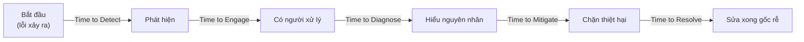

Điều quan trọng: **mitigate (chặn thiệt hại) không cần đợi diagnose (hiểu nguyên nhân)**. Nếu sự cố bắt đầu ngay sau một deploy, rollback trước rồi điều tra sau. Nhiều team mất hàng giờ vì muốn "hiểu rõ đã" trong khi khách vẫn đang lỗi.

### 8.2. Ví dụ: đêm flash sale ở đầu bài

Timeline (giờ Việt Nam):

| Giờ | Sự kiện |
|---|---|
| 19:55 | Nhà cung cấp SMS bắt đầu chậm (biết được sau khi xem lại log của họ) |
| 20:00 | Flash sale bắt đầu, traffic gấp 6 lần |
| 20:02 | Pool worker thanh toán cạn. Đơn bắt đầu timeout |
| 20:09 | Alert "tỉ lệ lỗi 5xx" bắn - đã bị cấu hình gửi vào kênh Slack chung, không ai để ý |
| 20:18 | CS báo lên: "khách phàn nàn không đặt được hàng" |
| 20:21 | On-call (Đức) mở dashboard. CPU, DB, memory đều xanh |
| 20:30 | Đức nghi DB, gọi thêm người. Kiểm tra slow query - không có gì |
| 20:38 | Lan xem trace của một request lỗi: 25 giây nằm ở span `sms.send` |
| 20:41 | Quyết định: tắt OTP cho đơn dưới 2 triệu đồng (có sẵn flag, nhưng không ai nhớ) |
| 20:42 | Đơn bắt đầu vào lại |
| 20:55 | Tỉ lệ lỗi về bình thường. Còn lại hàng đợi đơn cần xử lý |
| 22:30 | Thêm timeout 3s + pool riêng cho SMS, deploy |

```mermaid
gantt
    title "Sự cố flash sale - thời gian mất ở đâu"
    dateFormat HH:mm
    axisFormat %H:%M
    section "Khách bị ảnh hưởng"
    "Đơn lỗi"                    :crit, 20:02, 40m
    section "Phát hiện"
    "Alert bị bỏ lỡ"              :20:02, 16m
    section "Chẩn đoán"
    "Nghi sai chỗ (DB)"           :20:21, 17m
    "Tìm ra SMS qua trace"        :20:38, 3m
    section "Khắc phục"
    "Bật flag tắt OTP"            :20:41, 1m
```

### 8.3. Đọc timeline như một kỹ sư hệ thống

Đặt các con số cạnh nhau:

- **Time to detect: 16 phút** (20:02 → 20:18) - và người phát hiện là **khách hàng**, không phải hệ thống. Alert có bắn nhưng đi vào sai kênh.
- **Time to diagnose: 20 phút** (20:18 → 20:38) - phần lớn thời gian nghi sai chỗ, vì dashboard chỉ có metric tài nguyên (CPU, RAM), không có metric **latency theo dependency**.
- **Time to mitigate: 3 phút** sau khi hiểu - nhanh, vì đã có sẵn flag. Nhưng không ai nhớ có flag đó - mất thêm thời gian.

Bài học rút ra **không phải** "SMS provider tệ" (họ sẽ còn chậm nữa) mà là ba lỗ hổng hệ thống:

1. Alert quan trọng đi vào kênh nhiều nhiễu → sửa routing alert.
2. Dashboard không cho thấy latency từng dependency → thêm metric RED theo dependency.
3. Kill switch tồn tại nhưng không ai biết → đưa vào runbook, diễn tập.

Và một lỗ hổng thiết kế: không timeout, không bulkhead (đã sửa lúc 22:30).

!!! tip "Quy tắc đọc timeline"
    Tìm **khoảng trống dài nhất** giữa hai mốc liên tiếp. Đó là nơi đầu tư cải thiện mang lại nhiều nhất. Thường thì khoảng đó không nằm ở phần "sửa code", mà ở **phát hiện** và **chẩn đoán**. Kỹ năng chẩn đoán có hệ thống được bàn kỹ trong [Bài Debugging](../mindset/05-debugging.md).

---

## 📖 9. Bình thường hóa sai lệch (normalization of deviance)

### 9.1. Câu chuyện Challenger

Năm 1986, tàu con thoi Challenger nổ tung 73 giây sau khi phóng. Nguyên nhân kỹ thuật: vòng đệm cao su (O-ring) mất đàn hồi trong thời tiết lạnh. Nhưng điều đáng sợ hơn là **NASA đã biết về vấn đề O-ring từ nhiều năm trước**. Các lần phóng trước, O-ring đã bị xói mòn một phần. Mỗi lần như vậy, tàu vẫn về an toàn - và mỗi lần an toàn, mức xói mòn đó lại được coi là "chấp nhận được".

Nhà xã hội học Diane Vaughan gọi hiện tượng này là **normalization of deviance**: một sai lệch so với tiêu chuẩn, lặp lại nhiều lần mà không có hậu quả, dần dần được coi là **bình thường**.

### 9.2. Phiên bản phần mềm

Bạn chắc chắn đã thấy những điều này:

- **Test flaky**: "Test đó đỏ thỉnh thoảng thôi, chạy lại là xanh." Một ngày nó đỏ vì bug thật - và cũng được chạy lại cho xanh.
- **Alert bị phớt lờ**: kênh alert có 200 tin mỗi ngày, ai cũng mute. Tin thứ 201 là sự cố thật.
- **Warning log**: "Log đó lúc nào cũng có, kệ nó."
- **Disk 85%**: "Nó 85% ba tháng nay rồi, chưa sao."
- **Bỏ qua review cho thay đổi 'nhỏ'**: "Chỉ đổi config thôi mà."
- **Deploy thứ Sáu chiều**: "Lần trước có sao đâu."
- **Merge code AI không đọc kỹ**: "Mấy lần trước nó đúng hết mà." (Bài 7 sẽ quay lại điểm này.)

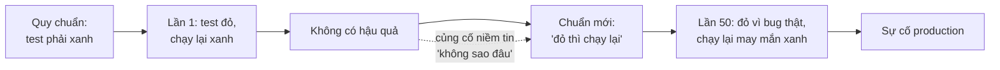

Đây là một **vòng phản hồi** (Bài 2): mỗi lần sai lệch không gây hậu quả, niềm tin "không sao đâu" được củng cố, ngưỡng chấp nhận được dịch chuyển thêm một chút.

### 9.3. Chống lại thế nào

- **Gọi tên sai lệch**: khi thấy "à cái đó lúc nào cũng vậy", dừng lại và hỏi "**nó có được thiết kế để như vậy không?**". Nếu không - đó là sai lệch.
- **Không có trạng thái "đỏ bình thường"**: test flaky phải được sửa hoặc xóa (có chủ, có hạn), không được chạy lại vô hạn. Alert không ai hành động thì xóa alert.
- **Đếm**: "Tuần này test flaky làm CI đỏ 14 lần" có sức nặng hơn "thỉnh thoảng đỏ".
- **Người mới là tài sản**: người mới vào team chưa bị "nhờn". Khi họ hỏi "sao cái này lại như vậy?", đó là tín hiệu quý - đừng trả lời "lúc nào cũng thế mà".
- **Thành công không phải bằng chứng an toàn**: "Lần trước có sao đâu" chỉ nói lần trước may mắn. Hỏi: "**lần trước có cái gì đã cứu chúng ta?**"

---

## 📖 10. Mô hình pho mát Thụy Sĩ (Swiss cheese model)

### 10.1. Ý tưởng

James Reason, nhà nghiên cứu an toàn người Anh, mô tả hệ thống phòng thủ như **những lát pho mát Thụy Sĩ** xếp chồng lên nhau. Mỗi lát là một lớp phòng thủ (review, test, canary, alert...). Mỗi lát đều có **lỗ** - không lớp nào hoàn hảo. Sự cố xảy ra khi **các lỗ thẳng hàng**, cho phép mối nguy đi xuyên qua tất cả các lớp.

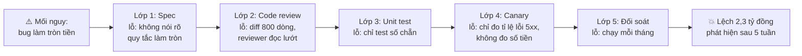

### 10.2. Hệ quả cho cách nghĩ

**1. Không có "nguyên nhân gốc" duy nhất.** Postmortem kết luận "nguyên nhân: dev viết sai hàm làm tròn" là phân tích nông. Bug là mối nguy. Sự cố xảy ra vì **năm lớp phòng thủ cùng có lỗ**. Bịt bất kỳ lỗ nào cũng đã chặn được sự cố.

**2. Lớp nào cũng đáng đầu tư, nhưng không lớp nào đủ.** Đừng tranh luận "test hay review quan trọng hơn" - chúng bắt những loại lỗi khác nhau. Câu hỏi đúng là: "**các lỗ của các lớp có độc lập với nhau không?**".

**3. Các lỗ thường tương quan - và đó là nguy hiểm thật sự.** Nếu cùng một người viết spec, code, test và review cho chính mình, các lỗ thẳng hàng một cách tự nhiên - cùng một hiểu lầm đi xuyên mọi lớp. Tương tự: nếu AI viết code **và** AI viết test cho code đó dựa trên cùng một hiểu lầm về yêu cầu, hai lớp phòng thủ có thể có **cùng một lỗ**. Đây là nền tảng cho phần "tests as contracts" ở Bài 7.

**4. Lỗ thay đổi theo thời gian.** Normalization of deviance (mục 9) chính là quá trình các lỗ **to dần ra** một cách âm thầm.

### 10.3. Áp dụng: thiết kế các lớp phòng thủ độc lập

| Lớp | Bắt được | Lỗ điển hình | Cách làm lỗ độc lập hơn |
|---|---|---|---|
| Spec có bất biến | Hiểu sai yêu cầu | Bất biến không được viết ra | Bất biến viết bởi người hiểu nghiệp vụ |
| Code review | Logic sai, thiết kế kém | Diff quá lớn, reviewer mệt | Diff nhỏ, reviewer khác người viết |
| Test | Hồi quy, edge case | Test cùng hiểu lầm với code | Property test, test do người khác viết |
| Canary | Lỗi chỉ lộ ở production | Chỉ đo metric kỹ thuật | Đo cả metric nghiệp vụ (số đơn, số tiền) |
| Ràng buộc DB | Dữ liệu vô lý | Không thể diễn tả mọi quy tắc | Kết hợp với job kiểm tra bất biến |
| Đối soát | Lệch số liệu | Chạy quá thưa | Chạy hàng giờ cho dữ liệu tiền |

---

## 🌍 Tình huống thực tế

### Tình huống 1: "Tính năng AI tóm tắt đơn khiếu nại"

Team CS muốn dùng AI tóm tắt email khiếu nại và tự gán mức ưu tiên. Một dev dựng xong trong 2 ngày bằng cách gọi API của một nhà cung cấp AI. Demo rất ấn tượng.

Áp danh mục failure mode:

- **Chậm mà không chết**: API AI có lúc mất 20 giây. Code gọi đồng bộ trong request xử lý email đến → hàng đợi email nghẽn. *Sửa: xử lý bất đồng bộ, timeout 10 giây, không có tóm tắt thì vẫn tạo ticket.*
- **Quota**: đợt sale, email khiếu nại gấp 8 lần, chạm rate limit. *Sửa: biết quota trước, hàng đợi có giới hạn tốc độ.*
- **AI suy giảm / nói dối**: AI gán "ưu tiên thấp" cho một email đe dọa kiện. *Sửa: từ khóa nhạy cảm (luật sư, kiện, báo chí) luôn được đẩy lên cao bằng quy tắc, không phụ thuộc AI; AI chỉ được **nâng** ưu tiên, không được **hạ** dưới mức quy tắc.*
- **Blast radius**: nếu AI chết, CS vẫn làm việc bình thường như trước khi có AI. *Kill switch: một flag tắt toàn bộ phần AI.*
- **Dữ liệu**: email khách chứa số điện thoại, địa chỉ - gửi sang nhà cung cấp bên ngoài có ổn về pháp lý không?

Hai ngày code, nửa ngày tư duy về thất bại - và nửa ngày đó quyết định tính năng có an toàn để chạy thật hay không.

### Tình huống 2: Migration "chỉ thêm một cột"

Dev cần thêm cột `discount_cents` vào bảng `orders` (40 triệu dòng) với giá trị mặc định `0`. Migration chạy tốt ở staging (50.000 dòng) trong 2 giây.

Câu hỏi "ở 10x tải / ở production thì sao?": trên một số phiên bản database, thêm cột có default có thể phải ghi lại cả bảng và **khóa bảng** trong suốt quá trình - 40 triệu dòng có thể là hàng chục phút không ai đặt hàng được. *Sửa: kiểm tra hành vi của đúng phiên bản database đang dùng; thêm cột nullable trước, backfill theo lô nhỏ, rồi mới đặt default/NOT NULL; chạy ngoài giờ cao điểm; có timeout cho lock.*

Bài học: "chạy được ở staging" chỉ chứng minh **cú pháp đúng**. Nó không chứng minh gì về hành vi ở quy mô thật.

---

## ⚠️ Sai lầm thường gặp

| Sai lầm | Hệ quả | Thay bằng |
|---|---|---|
| Chỉ thiết kế cho "dependency chết", quên "dependency chậm" | Cạn pool, sập dây chuyền | Timeout + bulkhead cho mọi lời gọi mạng |
| Retry ở mọi tầng | Khuếch đại tải gấp hàng chục lần khi có sự cố | Retry ở một tầng, có budget, có jitter |
| Retry thao tác không idempotent | Trừ tiền hai lần, gửi email hai lần | Idempotency trước, retry sau |
| Postmortem kết luận "lỗi người" | Không sửa được gì, người ta giấu lỗi lần sau | Hỏi "hệ thống nào cho phép lỗi này dễ đến vậy?" |
| Chỉ tìm một "nguyên nhân gốc" | Bỏ qua các lớp phòng thủ khác cũng có lỗ | Dùng mô hình pho mát: liệt kê mọi lớp |
| Kill switch, kế hoạch degrade chưa bao giờ thử | Không hoạt động khi cần | Diễn tập định kỳ (game day) |
| Đợi hiểu nguyên nhân mới khắc phục | Khách lỗi thêm hàng giờ | Mitigate trước (rollback, tắt flag), điều tra sau |
| Chấp nhận "đỏ bình thường" (test flaky, alert nhiễu) | Tín hiệu thật bị chìm | Sửa hoặc xóa, không có trạng thái thứ ba |
| Coi config là "không phải code" | Sự cố từ thay đổi không review | Config trong git, review, validate, rollout từ từ |
| Pre-mortem thành buổi liệt kê lo âu | Không ai làm gì | Mỗi rủi ro top có chủ và hạn |

---

## 🏋️ Bài tập

### Bài tập 1: Nhận diện failure mode (⭐ Dễ)

Với mỗi triệu chứng, gọi tên failure mode trong danh mục mục 2:

1. Mỗi ngày đúng 7:00 sáng, API chậm 2 phút rồi bình thường.
2. Sau khi một service khởi động lại, nó chết lại ngay trong 10 giây, lặp lại nhiều lần.
3. Báo cáo doanh thu tháng lệch 0,3% so với sao kê ngân hàng.
4. Từ thứ Ba, chatbot hỗ trợ trả lời dài gấp đôi và hay kèm câu "Tôi là trợ lý AI..." - không ai đổi code.
5. Tính năng upload ảnh lỗi "no space left on device" trên 2/8 server.

<details markdown="1"><summary>Đáp án</summary>

1. **Đồng hồ / thundering herd**: rất có thể là cron chạy lúc 00:00 UTC (= 7:00 giờ Việt Nam) - một job nặng như báo cáo, backup - hoặc nhiều job cùng chạy một lúc. Kiểm tra lịch cron theo UTC.
2. **Thundering herd khi hồi phục**: request dồn ứ (retry từ client, hàng đợi) đổ vào ngay khi service lên, đánh sập nó trước khi nó "ấm" (cache trống, pool chưa mở hết). Cần mở van từ từ, readiness probe, backoff + jitter phía client.
3. **Dữ liệu hỏng âm thầm**: làm tròn tiền, `float`, giao dịch hoàn tiền không được ghi, timezone cắt ngày sai (đơn 23:30 ngày 31 bị tính sang tháng sau). Cần đối soát và bất biến.
4. **AI model suy giảm**: nhà cung cấp cập nhật model dưới alias. Ghim phiên bản, chạy eval.
5. **Quota (disk) + hỏng một phần**: chỉ một số node, nên user thấy "lúc được lúc không". Thiếu alert disk ở mức 80%, thiếu log rotation.

</details>

### Bài tập 2: Tính blast radius (⭐ Dễ)

Một app đặt đồ ăn có: API server (pool chung 100 worker) gọi 4 dependency: menu (nội bộ), giá ship (API đối tác), thanh toán (cổng ngoài), gợi ý món (AI). Nếu API gợi ý món chậm 30 giây, điều gì xảy ra với tính năng "xem đơn đang giao"? Đề xuất 2 thay đổi để "xem đơn đang giao" không bị ảnh hưởng.

<details markdown="1"><summary>Đáp án</summary>

Pool chung 100 worker → các request gọi gợi ý món chiếm worker 30 giây mỗi cái → pool cạn → "xem đơn đang giao" (không cần gợi ý) cũng phải xếp hàng và timeout. Blast radius = 100% tính năng.

Thay đổi:

1. **Timeout ngắn** (ví dụ 2 giây) cho lời gọi gợi ý, khi lỗi thì trả danh sách món bán chạy (cache) - graceful degradation.
2. **Bulkhead**: pool/semaphore riêng cho gợi ý (ví dụ tối đa 15 lời gọi đồng thời), vượt quá thì bỏ qua gợi ý ngay. Hoặc tải gợi ý bất đồng bộ từ phía client, tách hẳn khỏi request chính.

Thêm điểm: circuit breaker cho gợi ý; kill switch tắt gợi ý.

</details>

### Bài tập 3: Retry ở đâu? (⭐⭐ Trung bình)

Chuỗi gọi: Mobile app → API Gateway → Service đơn hàng → Service kho → PostgreSQL. Hiện tại **cả 4 tầng** đều retry 3 lần với backoff cố định 100ms. Dùng code ở mục 2.4 (hoặc tính tay), cho biết khi PostgreSQL chết hẳn, mỗi lần user bấm nút tạo ra bao nhiêu query? Đề xuất cấu hình retry mới và giải thích.

<details markdown="1"><summary>Đáp án</summary>

PostgreSQL chết hẳn (p = 1): 3⁴ = **81 query** cho mỗi lần bấm. Thêm nữa, backoff **cố định** 100ms làm mọi client retry đồng bộ → thundering herd.

Đề xuất:

- **Mobile app**: retry tối đa 1-2 lần, backoff mũ + jitter, chỉ cho lỗi mạng/503, và chỉ cho request có idempotency key.
- **Gateway, service đơn hàng**: **không retry** (fail fast), truyền deadline xuống.
- **Service kho → PostgreSQL**: retry 1 lần cho lỗi thoáng qua (ví dụ mất kết nối, serialization failure), kèm circuit breaker.
- Retry budget: retry không vượt quá 10% tổng request.

Kết quả khi DB chết: khoảng 2 × 2 = 4 query mỗi lần bấm, và circuit breaker mở sau vài giây thì về gần 0.

</details>

### Bài tập 4: Chấm FMEA (⭐⭐ Trung bình)

Hệ thống đặt lịch khám của một phòng khám (sẽ gặp lại ở Bài 6). Chấm S, L, D và RPN cho 4 failure mode dưới đây, sắp xếp ưu tiên, và đề xuất một hành động cho failure mode xếp đầu:

1. Hai bệnh nhân đặt trùng một khung giờ của cùng một bác sĩ.
2. SMS nhắc lịch không gửi được.
3. Bác sĩ nghỉ đột xuất, lịch đã đặt không được hủy/thông báo.
4. Trang đặt lịch chậm 4 giây vào sáng thứ Hai.

<details markdown="1"><summary>Một cách chấm (có thể khác, quan trọng là lý lẽ)</summary>

| Failure mode | S | L | D | RPN |
|---|---|---|---|---|
| 1. Đặt trùng | 4 | 3 | 4 | 48 |
| 3. Bác sĩ nghỉ không thông báo | 4 | 3 | 4 | 48 |
| 2. SMS không gửi | 3 | 3 | 4 | 36 |
| 4. Trang chậm | 2 | 4 | 2 | 16 |

- **Đặt trùng**: S = 4 (bệnh nhân đến mà không được khám, mất uy tín), D = 4 (chỉ biết khi hai người cùng đến). Hành động: ràng buộc `UNIQUE(doctor_id, slot_start)` ở database - lưới an toàn không phụ thuộc code; giữ chỗ tạm thời có hạn khi đang điền form.
- **Bác sĩ nghỉ**: đây là failure mode **quy trình**, không phải kỹ thuật - nhưng hệ thống nên có thao tác "bác sĩ nghỉ ngày X" tự hủy và gửi tin cho mọi bệnh nhân bị ảnh hưởng.
- **SMS không gửi**: D = 4 nếu không đo "tỉ lệ đến", giảm D bằng cách theo dõi delivery report.
- **Trang chậm**: dễ thấy, ảnh hưởng nhỏ - theo dõi.

Lưu ý luật vượt quyền: không có S = 5 ở đây. Nếu hệ thống có thanh toán đặt cọc, "trừ tiền mà không có lịch" sẽ là S = 5.

</details>

### Bài tập 5: Pre-mortem cho chính dự án của bạn (⭐⭐ Trung bình)

Chọn một tính năng bạn sắp làm (hoặc vừa làm). Viết pre-mortem theo mẫu mục 4.3: ít nhất 6 lý do thất bại, chọn top 3, mỗi cái có phòng ngừa, giảm nhẹ, tín hiệu sớm. Viết thêm một **điều kiện dừng** cụ thể đến mức on-call có thể làm theo mà không cần hỏi ai.

<details markdown="1"><summary>Gợi ý tự kiểm tra</summary>

- Lý do có trải đều 4 nhóm (kỹ thuật, con người, quy trình, bên ngoài) không? Nếu tất cả là kỹ thuật, bạn đang bỏ sót.
- Có ít nhất một lý do thuộc loại "không phát ra tín hiệu" (chậm, sai dữ liệu, không đến tay user) không?
- Điều kiện dừng có **con số**, **thời gian** và **hành động** không? "Nếu thấy có vấn đề thì rollback" là không đạt. "Nếu tỉ lệ đơn thành công dưới 95% trong 10 phút sau deploy, tắt flag `new_checkout`" là đạt.
- Kế hoạch có **thay đổi** sau pre-mortem không?

</details>

### Bài tập 6: Phân tích sự cố bằng mô hình pho mát (⭐⭐⭐ Khó)

Sự cố: Một dev dùng AI sinh script dọn dữ liệu: "xóa các tài khoản chưa xác thực email quá 30 ngày". Script (Python) lấy các tài khoản tạo trước 30 ngày, rồi lọc bằng `if not acc.email_verified: delete(acc)`. Nhưng tài khoản đăng nhập bằng Google có `email_verified = NULL` trong database (vì không cần xác thực), và trong Python `not None` là `True`. Script chạy trên production lúc 23:00, xóa 18.000 tài khoản Google thật. Backup gần nhất từ 6 giờ trước. Phát hiện sáng hôm sau khi khách báo không đăng nhập được.

a) Liệt kê ít nhất 5 lớp phòng thủ đã có lỗ (hoặc không tồn tại).
b) Với mỗi lớp, đề xuất cách bịt lỗ.
c) Viết một câu "nguyên nhân" cho postmortem **không** đổ lỗi cho cá nhân.

<details markdown="1"><summary>Đáp án tham khảo</summary>

Một chi tiết đáng chú ý trước: nếu điều kiện được viết trong SQL (`WHERE email_verified = false`), tài khoản `NULL` sẽ **không** bị xóa, vì `NULL = false` không đúng trong SQL. Lọc trong Python thì `not None` là `True`. **Ngữ nghĩa của "không có giá trị" khác nhau giữa SQL và ngôn ngữ lập trình**, và người review phải đọc đúng dòng thực sự chạy, ở đúng ngôn ngữ đó.

a) + b) Các lớp:

| Lớp | Lỗ | Bịt lỗ |
|---|---|---|
| Spec | "Chưa xác thực" không định nghĩa cho tài khoản OAuth | Viết rõ bất biến: "không bao giờ xóa tài khoản có đăng nhập OAuth" |
| Mô hình dữ liệu | `NULL` mang nghĩa "không áp dụng" lẫn với "chưa" | Cột `auth_provider`, `email_verified NOT NULL` với nghĩa rõ ràng |
| Review | Script "chạy một lần" không qua review | Mọi thao tác ghi trên production qua review, kể cả script |
| Dry run | Chạy thẳng `DELETE` | Chạy `SELECT COUNT(*)` + xem mẫu trước; số lượng bất thường (18.000) phải dừng lại |
| Giới hạn blast radius | Xóa tất cả trong một lần | Xóa theo lô, có giới hạn tối đa (ví dụ 500/lần), soft delete |
| Thời điểm | 23:00, không ai theo dõi | Chạy giờ hành chính, có người thứ hai |
| Khôi phục | Hard delete, backup 6 giờ trước | Soft delete 30 ngày; point-in-time recovery |
| Phát hiện | Khách báo | Metric "số tài khoản bị xóa/ngày" có alert khi bất thường |

c) "Một script dọn dữ liệu xóa nhầm 18.000 tài khoản vì định nghĩa 'chưa xác thực' không bao gồm trường hợp tài khoản OAuth, và quy trình chạy script trên production không có bước dry-run, giới hạn số lượng hay review - nên một hiểu lầm về dữ liệu đi thẳng đến thao tác không thể hoàn tác."

Chú ý: việc script do AI sinh ra **không** phải nguyên nhân. Một script do người viết cũng có thể sai y hệt. Nguyên nhân là các lớp phòng thủ quanh thao tác nguy hiểm.

</details>

### Bài tập 7: Thiết kế thang suy giảm (⭐⭐⭐ Khó)

Thiết kế thang suy giảm 4-5 mức (như mục 6.3) cho một ứng dụng **ví điện tử** trong ngày lương về (traffic gấp 10). Với mỗi mức: điều kiện vào, tính năng bị tắt, tính năng **không bao giờ** được tắt, và ai quyết định chuyển mức.

<details markdown="1"><summary>Gợi ý</summary>

Bắt đầu bằng câu hỏi: tính năng nào là **lõi bất khả xâm phạm**? Với ví: xem số dư, chuyển tiền, thanh toán QR. Những thứ có thể tắt: lịch sử giao dịch chi tiết (chỉ hiện 10 giao dịch gần nhất), khuyến mãi, gợi ý, thống kê chi tiêu, banner.

Một điểm tinh tế: ở mức thấp nhất, có nên cho chuyển tiền vào **hàng đợi** ("giao dịch đang được xử lý") không? Với ví, điều này nguy hiểm hơn với shop - người dùng có thể chuyển lại lần nữa vì tưởng chưa chuyển. Cần idempotency phía client và thông báo cực rõ. Có thể quyết định ngược lại: **từ chối rõ ràng** tốt hơn **nhận mơ hồ**.

Ai quyết định: mức 1-2 tự động theo metric; mức 3 trở lên do incident commander quyết định, đã được cấp quyền trước trong runbook.

</details>

---

## ✅ Checklist hoàn thành

- [ ] Tôi kể được ít nhất 8 failure mode và cách phát hiện từng cái
- [ ] Tôi giải thích được vì sao "chậm" nguy hiểm hơn "chết", dùng định luật Little
- [ ] Tôi tính được hệ số khuếch đại của retry nhiều tầng và biết đặt retry ở đâu
- [ ] Tôi phân biệt được bulkhead và cell, và biết hỏi "blast radius là bao nhiêu?"
- [ ] Tôi đã điều phối (hoặc tự làm) một pre-mortem theo mẫu, có hành động và điều kiện dừng
- [ ] Tôi chấm được FMEA và biết luật vượt quyền cho S = 5
- [ ] Mỗi thiết kế tôi review, tôi hỏi về timeout, idempotency, degrade, kill switch, rollback
- [ ] Tôi đặt thiết kế vào ba hoàn cảnh: 10x tải, 3 giờ sáng, dependency nói dối
- [ ] Tôi đọc timeline sự cố và tìm được khoảng trống dài nhất
- [ ] Tôi nhận ra ít nhất một "sai lệch đã bị bình thường hóa" trong team mình
- [ ] Tôi vẽ được mô hình pho mát cho một sự cố và không dừng ở "lỗi người"

**Bài tiếp theo**: [Bài 6: Từ ý tưởng đến kiến trúc](./06-idea-to-architecture.md)
