# 📚 Bài 6: Từ ý tưởng đến kiến trúc

> "Nếu bạn không biết mình đang đi đâu, con đường nào cũng đưa bạn đến đó." - Lewis Carroll (diễn ý)

Chị Hạnh là bác sĩ, chủ một phòng khám nhi ở Thủ Đức với 5 bác sĩ. Chị nhắn cho bạn: *"Em ơi, làm giúp chị cái app đặt lịch khám nhé. Bệnh nhân gọi điện đông quá, lễ tân không nghe kịp."*

Năm 2026, bạn có thể mở một công cụ AI, gõ "tạo app đặt lịch khám bệnh với React + Node + PostgreSQL", và sau một giờ có một ứng dụng chạy được: đăng ký, đăng nhập, chọn bác sĩ, chọn giờ, xác nhận. Trông rất chuyên nghiệp.

Rồi bạn mang đến phòng khám, và lễ tân hỏi:

- "Bé nhà chị A có 2 anh em, mẹ đặt cho cả hai thì sao?"
- "Bác sĩ Tuấn chiều thứ Năm khám ở bệnh viện, có tuần có tuần không."
- "Khám tiêm chủng mất 10 phút, khám tổng quát mất 30 phút - sao app chia đều 15 phút?"
- "Ông bà nội đặt cho cháu nhưng không biết dùng app, vẫn gọi điện. Lễ tân nhập vào đâu?"
- "Mỗi sáng thứ Hai có 40 cuộc gọi trong 15 phút đầu. App có chịu nổi không?" (Câu này thì dễ - 40 request chẳng là gì.)

Code đã viết xong. Nhưng **nó giải quyết một bài toán khác** với bài toán thật.

Bài 3 dạy cách **đặt đúng vấn đề**. Bài 5 dạy cách **nghĩ về thất bại**. Bài này nối tất cả lại thành một **quy trình lặp lại được**: từ một câu nói mơ hồ đến một kiến trúc bạn có thể giải thích, bảo vệ, và giao cho người khác (hoặc cho AI) xây.

## 🎯 Mục tiêu bài học

- Nắm quy trình 9 bước: **ý tưởng → yêu cầu → ràng buộc → ước lượng → phân rã → ranh giới & hợp đồng → luồng dữ liệu → quyết định (ADR) → rủi ro**
- Phân biệt **yêu cầu chức năng**, **thuộc tính chất lượng** (có con số) và **non-goals**
- Làm **ước lượng năng lực** (capacity estimate) đủ tốt để ra quyết định, có code minh họa
- **Phân rã** hệ thống theo miền nghiệp vụ, theo dữ liệu, và theo **tốc độ thay đổi**
- Viết **hợp đồng (contract)** giữa các phần: API, event, bất biến
- Vẽ sơ đồ kiểu **C4** (context, container) và **sequence diagram** bằng Mermaid
- Đi trọn một ví dụ (hệ thống đặt lịch khám) ở **3 quy mô**: 100, 100.000, 10 triệu người dùng - thấy rõ cái gì đổi, cái gì không
- Cân bằng giữa **"thứ đơn giản nhất chạy được"** và **chuẩn bị cho tương lai**
- Dùng AI trong thiết kế đúng vai: **mở rộng lựa chọn và phản biện**, còn **con người ra quyết định**

!!! note "Liên hệ với Bài System Design"
    [Bài System Design §2](../backend/10-system-design.md) có quy trình 7 bước kiểu phỏng vấn, tập trung vào kỹ thuật scale (load balancer, sharding, cache...). Bài này đi **trước** và **rộng** hơn: làm sao từ một câu nói của khách hàng đến chỗ biết **có cần** những kỹ thuật đó hay không. Kiến trúc microservices chi tiết có ở [Bài Kiến trúc & Microservices](../backend/14-architecture-microservices.md).

---

## 📖 1. Quy trình tổng quan - và vì sao nó là vòng lặp

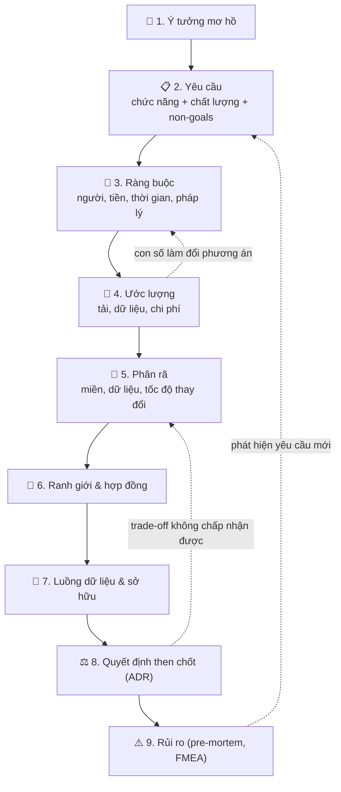

Các mũi tên đứt nét là phần quan trọng nhất. Thiết kế **không phải thác nước** (waterfall). Bước 4 có thể cho thấy chi phí SMS là vấn đề lớn nhất - quay lại bước 3. Bước 9 có thể lộ ra một yêu cầu chưa ai nói - quay lại bước 2.

Mỗi bước tạo ra một **sản phẩm cụ thể** (artifact), để người khác đọc và phản biện được:

| Bước | Sản phẩm | Độ dài điển hình |
|---|---|---|
| 1. Ý tưởng | Problem statement 3-5 câu | Nửa trang |
| 2. Yêu cầu | Danh sách use case + bảng chất lượng có số + non-goals | 1-2 trang |
| 3. Ràng buộc | Bảng ràng buộc | Nửa trang |
| 4. Ước lượng | Bảng số + giả định | Nửa trang (hoặc một đoạn script) |
| 5. Phân rã | Sơ đồ module/miền | 1 sơ đồ |
| 6. Ranh giới | Hợp đồng API/event cho mỗi ranh giới chính | 1-3 trang |
| 7. Luồng dữ liệu | Sequence diagram cho 2-3 luồng chính + bảng sở hữu dữ liệu | 2-3 sơ đồ |
| 8. Quyết định | 3-5 ADR | Mỗi ADR nửa trang |
| 9. Rủi ro | Top 5 rủi ro + hành động | Nửa trang |

Tổng cộng 6-10 trang cho một hệ thống vừa. Nghe nhiều? So với vài tháng code sai hướng, đây là khoản đầu tư rẻ nhất bạn từng làm. Và trong thời đại AI, **chính tài liệu này** là thứ bạn giao cho AI để nó sinh code đúng hướng (Bài 7).

!!! tip "Độ sâu tỉ lệ với rủi ro"
    App đặt lịch cho một phòng khám: mỗi bước chỉ vài dòng, cả quy trình làm trong một buổi chiều. Nền tảng đặt lịch toàn quốc: mỗi bước có thể là một tài liệu riêng và vài tuần. **Quy trình giữ nguyên, độ sâu thay đổi.**

---

## 📖 2. Bước 1 - Từ ý tưởng mơ hồ đến vấn đề rõ ràng

Kỹ năng ở bước này đã có trong Bài 3. Ở đây ta áp dụng vào ví dụ.

### 2.1. Cuộc trò chuyện với chị Hạnh

Thay vì hỏi "chị muốn app có những tính năng gì?" (chị sẽ liệt kê tính năng của app đặt lịch spa chị từng dùng), hãy hỏi về **vấn đề** và **hiện trạng**:

| Câu hỏi | Câu trả lời | Điều bạn học được |
|---|---|---|
| "Hiện tại một ngày phòng khám nhận bao nhiêu cuộc gọi đặt lịch?" | "Khoảng 80-100, sáng thứ Hai có khi 150" | Tải rất nhỏ |
| "Bao nhiêu % cuộc gọi bị nhỡ?" | "Chắc 30%, giờ cao điểm thì nhiều hơn" | Đây là **vấn đề thật**: mất bệnh nhân |
| "Lịch hiện ghi ở đâu?" | "Sổ giấy, với một file Excel chung" | Có dữ liệu cũ cần chuyển |
| "Chuyện gì làm chị đau đầu nhất?" | "Bệnh nhân đặt rồi không đến. Có ngày 20% không đến, bác sĩ ngồi không" | **Vấn đề thứ hai**, có thể lớn hơn |
| "Ai sẽ dùng hệ thống?" | "Phụ huynh, lễ tân, bác sĩ xem lịch" | 3 nhóm người dùng |
| "Thành công trông như thế nào sau 3 tháng?" | "Lễ tân bớt nghe điện, ít người bỏ hẹn" | Có thể đo được |

### 2.2. Problem statement

```text
VẤN ĐỀ
Phòng khám nhi 5 bác sĩ đang mất bệnh nhân vì khoảng 30% cuộc gọi đặt lịch
bị nhỡ vào giờ cao điểm, và lãng phí khoảng 15-20% khung giờ khám vì bệnh
nhân đặt rồi không đến.

NGƯỜI DÙNG
- Phụ huynh (đặt lịch cho 1 hoặc nhiều con, đa số dùng điện thoại)
- Lễ tân (nhập lịch cho người gọi điện, xác nhận, xếp lại lịch)
- Bác sĩ (xem lịch của mình trong ngày)

THÀNH CÔNG SAU 3 THÁNG
- Ít nhất 50% lịch hẹn được đặt online
- Tỉ lệ không đến giảm từ khoảng 18% xuống dưới 10%
- Lễ tân đánh giá công việc "nhẹ hơn" (khảo sát đơn giản)
```

Để ý: problem statement **không nhắc đến công nghệ**. Và nó đã lộ ra một điều quan trọng: vấn đề "không đến" có thể được giải quyết bằng **SMS nhắc lịch** - một tính năng nhỏ, nhưng giá trị có thể lớn hơn cả phần đặt lịch online.

---

## 📖 3. Bước 2 - Yêu cầu: chức năng, chất lượng, và những gì KHÔNG làm

### 3.1. Yêu cầu chức năng (functional requirements)

Viết dưới dạng **use case** hoặc user story, ưu tiên bằng **MoSCoW** (Must / Should / Could / Won't):

| # | Use case | Ưu tiên |
|---|---|---|
| F1 | Phụ huynh xem khung giờ trống theo bác sĩ và loại khám | Must |
| F2 | Phụ huynh đặt lịch cho một trẻ (một tài khoản quản lý nhiều trẻ) | Must |
| F3 | Lễ tân đặt lịch thay cho người gọi điện | Must |
| F4 | Hệ thống gửi SMS xác nhận và nhắc lịch trước 1 ngày + 2 giờ | Must |
| F5 | Phụ huynh hủy/đổi lịch đến trước 2 giờ | Must |
| F6 | Bác sĩ xem lịch khám trong ngày | Must |
| F7 | Lễ tân cấu hình lịch làm việc của bác sĩ (kể cả ngoại lệ, nghỉ đột xuất) | Must |
| F8 | Khi bác sĩ nghỉ đột xuất, thông báo cho mọi bệnh nhân bị ảnh hưởng | Should |
| F9 | Đặt cọc online để giảm không đến | Could |
| F10 | Lưu hồ sơ bệnh án | **Won't** (dùng phần mềm phòng khám hiện có) |

### 3.2. Thuộc tính chất lượng (quality attributes) - phải có con số

"Hệ thống phải nhanh và ổn định" không phải yêu cầu - không ai kiểm tra được nó. Mỗi thuộc tính cần một **kịch bản đo được**:

| Thuộc tính | Kịch bản cụ thể | Mục tiêu |
|---|---|---|
| Tính đúng | Hai người đặt cùng một khung giờ cùng lúc | **Không bao giờ** đặt trùng |
| Sẵn sàng | Giờ làm việc 7h-19h | 99,5% (khoảng 1,8 giờ hỏng/tháng chấp nhận được, vì vẫn còn điện thoại) |
| Độ trễ | Xem khung giờ trống trên 4G | p95 dưới 1 giây |
| Bảo mật | Thông tin trẻ em, số điện thoại | Chỉ phụ huynh của trẻ và nhân viên phòng khám xem được |
| Dễ dùng | Phụ huynh lần đầu đặt lịch | Dưới 2 phút, không cần tạo mật khẩu |
| Vận hành | Người duy trì | Một dev bán thời gian vận hành được |

Để ý dòng **sẵn sàng**: 99,5% thay vì "99,99%". Đây là một quyết định thiết kế quan trọng - nó cho phép một kiến trúc đơn giản. Nếu app hỏng, phụ huynh vẫn gọi điện được như trước. Cao hơn mức cần thiết là **lãng phí**, không phải "chất lượng cao".

Và dòng **tính đúng** có chữ "không bao giờ". Đây là **bất biến** (invariant) - thứ phải đúng trong mọi hoàn cảnh. Bất biến là những dòng quan trọng nhất trong cả tài liệu, vì chúng quyết định thiết kế dữ liệu và là thứ đầu tiên bạn kiểm tra khi review code (của người hay của AI).

### 3.3. Non-goals - những gì cố ý KHÔNG làm

```text
NON-GOALS (phiên bản đầu)
- Không thay thế phần mềm quản lý phòng khám / bệnh án hiện có
- Không có ứng dụng mobile native - dùng web chạy tốt trên điện thoại
- Không hỗ trợ nhiều phòng khám (multi-tenant) - chỉ một phòng khám
- Không thanh toán online (xem xét lại sau 3 tháng dựa trên tỉ lệ không đến)
- Không có chat với bác sĩ
```

Non-goals bảo vệ dự án khỏi **phình phạm vi** (scope creep), và - rất quan trọng khi làm với AI - chúng nói cho AI biết **đừng thêm gì**. Không có non-goals, một công cụ AI được yêu cầu "làm app đặt lịch khám" sẽ vui vẻ thêm chat, thanh toán, đánh giá bác sĩ, và hệ thống phân quyền 6 vai trò.

---

## 📖 4. Bước 3 - Ràng buộc: những bức tường không thể dời

Yêu cầu nói **cần làm gì**. Ràng buộc nói **phải làm trong giới hạn nào**. Ràng buộc thường quyết định kiến trúc mạnh hơn yêu cầu.

| Loại | Ràng buộc | Hệ quả thiết kế |
|---|---|---|
| Con người | 1 dev, bán thời gian; không có DevOps | Ít thành phần nhất có thể, dịch vụ managed |
| Tiền | Ngân sách vận hành dưới 1 triệu đồng/tháng (chưa tính SMS) | Một server nhỏ hoặc PaaS; không Kubernetes |
| Thời gian | Có bản dùng được trong 6 tuần | Bỏ mọi thứ không phải Must |
| Pháp lý | Dữ liệu cá nhân của trẻ em, số điện thoại phụ huynh | Tuân thủ quy định bảo vệ dữ liệu cá nhân (Nghị định 13/2023/NĐ-CP); lưu ở Việt Nam nếu được; mã hóa; nhật ký truy cập |
| Hệ thống có sẵn | Phần mềm phòng khám cũ không có API | Không tích hợp tự động, lễ tân nhập tay ở phía đó |
| Người dùng | Phụ huynh nhiều độ tuổi, có ông bà | Đăng nhập bằng OTP số điện thoại, không mật khẩu |
| Kênh liên lạc | SMS brandname cần đăng ký mất 1-2 tuần | Bắt đầu thủ tục ngay tuần 1 |

!!! tip "Ràng buộc ẩn nguy hiểm nhất"
    Ràng buộc nguy hiểm nhất là ràng buộc **không ai nói ra** vì "ai cũng biết". Ở đây: *"Bác sĩ không muốn học phần mềm mới - họ chỉ muốn xem lịch trên điện thoại."* Câu này không nằm trong yêu cầu, nhưng nó loại bỏ ngay ý tưởng "bác sĩ tự quản lý lịch trên hệ thống".

---

## 📖 5. Bước 4 - Ước lượng năng lực: số liệu để ra quyết định

Ước lượng không cần chính xác. Nó cần **đúng bậc độ lớn** (order of magnitude) để trả lời: "**Phương án đơn giản có đủ không?**". Kỹ thuật ước lượng chi tiết có ở [System Design §2.2](../backend/10-system-design.md).

Script dưới tính các con số chính ở 3 quy mô. Điều quan trọng nhất trong script không phải phép tính - mà là **các giả định được ghi rõ ở đầu**, để người khác có thể nói "giả định số 3 sai rồi".

=== "Python"

    ```python
    # Ước lượng "mặt sau phong bì" cho hệ thống đặt lịch khám ở 3 quy mô.
    # Mọi con số đầu vào là GIẢ ĐỊNH - ghi rõ để người khác phản biện được.
    BOOKINGS_PER_USER_MONTH = 0.5   # trung bình 2 tháng khám 1 lần
    VIEWS_PER_BOOKING = 20          # xem bác sĩ, xem slot, đổi ngày...
    ACTIVE_HOURS = 12               # 7h-19h
    PEAK_FACTOR = 5                 # sáng thứ Hai gấp 5 lần trung bình giờ hoạt động
    BYTES_PER_BOOKING = 2_000       # 1 dòng lịch + lịch sử trạng thái + index
    YEARS_KEPT = 5
    SMS_PER_BOOKING = 2             # xác nhận + nhắc lịch
    SMS_PRICE_VND = 800             # giả định giá tin brandname


    def estimate(users):
        bookings_day = users * BOOKINGS_PER_USER_MONTH / 30
        active_seconds = ACTIVE_HOURS * 3600
        write_peak = bookings_day / active_seconds * PEAK_FACTOR
        read_peak = write_peak * VIEWS_PER_BOOKING
        storage_gb = bookings_day * 365 * YEARS_KEPT * BYTES_PER_BOOKING / 1e9
        sms_cost_month = bookings_day * 30 * SMS_PER_BOOKING * SMS_PRICE_VND
        return bookings_day, write_peak, read_peak, storage_gb, sms_cost_month


    print(f"{'users':>10} {'lịch/ngày':>10} {'ghi/s đỉnh':>11} {'đọc/s đỉnh':>11} "
          f"{'GB 5 năm':>9} {'SMS/tháng (đ)':>15}")
    for users in (100, 100_000, 10_000_000):
        b, w, r, gb, sms = estimate(users)
        print(f"{users:>10,} {b:>10,.0f} {w:>11.4f} {r:>11.3f} {gb:>9.2f} {sms:>15,.0f}")
    ```

=== "Go"

    ```go
    // Ước lượng "mặt sau phong bì" cho hệ thống đặt lịch khám ở 3 quy mô.
    // Mọi con số đầu vào là GIẢ ĐỊNH - ghi rõ để người khác phản biện được.
    package main

    import (
    	"fmt"
    	"strconv"
    )

    const (
    	bookingsPerUserMonth = 0.5   // trung bình 2 tháng khám 1 lần
    	viewsPerBooking      = 20    // xem bác sĩ, xem slot, đổi ngày...
    	activeHours          = 12    // 7h-19h
    	peakFactor           = 5     // sáng thứ Hai gấp 5 lần trung bình giờ hoạt động
    	bytesPerBooking      = 2_000 // 1 dòng lịch + lịch sử trạng thái + index
    	yearsKept            = 5
    	smsPerBooking        = 2   // xác nhận + nhắc lịch
    	smsPriceVND          = 800 // giả định giá tin brandname
    )

    // group thêm dấu phẩy ngăn cách hàng nghìn: 1667 -> "1,667"
    func group(x float64) string {
    	s := strconv.FormatFloat(x, 'f', 0, 64)
    	out := ""
    	for i, c := range s {
    		if i > 0 && (len(s)-i)%3 == 0 {
    			out += ","
    		}
    		out += string(c)
    	}
    	return out
    }

    func main() {
    	fmt.Printf("%10s %10s %11s %11s %9s %15s\n",
    		"users", "lịch/ngày", "ghi/s đỉnh", "đọc/s đỉnh", "GB 5 năm", "SMS/tháng (đ)")
    	for _, users := range []float64{100, 100_000, 10_000_000} {
    		bookingsDay := users * bookingsPerUserMonth / 30
    		activeSeconds := float64(activeHours * 3600)
    		writePeak := bookingsDay / activeSeconds * peakFactor
    		readPeak := writePeak * viewsPerBooking
    		storageGB := bookingsDay * 365 * yearsKept * bytesPerBooking / 1e9
    		smsCost := bookingsDay * 30 * smsPerBooking * smsPriceVND
    		fmt.Printf("%10s %10s %11.4f %11.3f %9.2f %15s\n",
    			group(users), group(bookingsDay), writePeak, readPeak, storageGB, group(smsCost))
    	}
    }
    ```

Output (giống nhau ở cả hai ngôn ngữ):

```text
     users  lịch/ngày  ghi/s đỉnh  đọc/s đỉnh  GB 5 năm   SMS/tháng (đ)
       100          2      0.0002       0.004      0.01          80,000
   100,000      1,667      0.1929       3.858      6.08      80,000,000
10,000,000    166,667     19.2901     385.802    608.33   8,000,000,000
```

### 5.1. Đọc con số như một kiến trúc sư

Đây là phần thú vị. Hãy nhìn kỹ:

1. **Ngay cả ở 10 triệu người dùng, tải trung bình rất nhỏ**: khoảng 20 lần ghi/giây và 400 lần đọc/giây lúc cao điểm. Một PostgreSQL trên một máy chủ vừa phải xử lý con số này dễ dàng. **Tải trung bình không phải là thứ làm hệ thống này khó.**
2. **Dữ liệu cũng nhỏ**: 600 GB sau 5 năm ở quy mô lớn nhất - vừa một ổ đĩa.
3. **Chi phí SMS mới là con số lớn**: 8 tỷ đồng/tháng ở quy mô lớn nhất. Ở quy mô 100.000 người dùng, 80 triệu đồng/tháng - có thể lớn hơn **toàn bộ** chi phí hạ tầng. Một quyết định kiến trúc (dùng thông báo qua Zalo OA hoặc push notification thay cho SMS ở chỗ có thể) đáng giá hơn mọi tối ưu database.

Bài học: **ước lượng thường làm thay đổi câu hỏi**. Bạn bắt đầu với "làm sao scale database?" và kết thúc với "làm sao giảm chi phí thông báo?".

### 5.2. Trung bình nói dối - tìm đỉnh nhọn

Trung bình có thể che mất điểm khó thật sự. Ở quy mô nền tảng toàn quốc, có một kịch bản mà trung bình không thấy:

> **Mở sổ khám bác sĩ nổi tiếng.** Một giáo sư nhi khoa nổi tiếng mở 30 suất khám tháng sau, đúng 7:00 sáng ngày 1. Có 50.000 phụ huynh cùng chờ bấm.

Đây không còn là bài toán "400 đọc/giây" mà là **50.000 người tranh 30 chỗ trong 10 giây** - giống bán vé concert. Nó cần thiết kế riêng: hàng đợi ảo (virtual waiting room), giữ chỗ tạm, chống bot. Nhưng chỉ cho **luồng đó**, không phải cả hệ thống.

!!! tip "Hai câu hỏi sau mỗi ước lượng"
    1. "Con số nào **lớn nhất** so với khả năng/ngân sách?" - đó là chỗ đáng thiết kế kỹ.
    2. "Trung bình đang **che giấu** đỉnh nào?" - giờ mở bán, ngày lương, sự kiện, bot.

---

## 📖 6. Bước 5 - Phân rã: chia hệ thống thành các phần

Phân rã tốt làm cho mỗi phần **dễ hiểu một mình** và **thay đổi được một mình**. Có ba lăng kính, dùng cả ba.

### 6.1. Lăng kính 1: theo miền nghiệp vụ (domain)

Hỏi: "Phòng khám có những **khái niệm** nào, và chúng nhóm lại với nhau thế nào?". Lắng nghe ngôn ngữ của người dùng: lễ tân nói "lịch làm việc của bác sĩ", "suất khám", "lịch hẹn", "nhắc lịch".

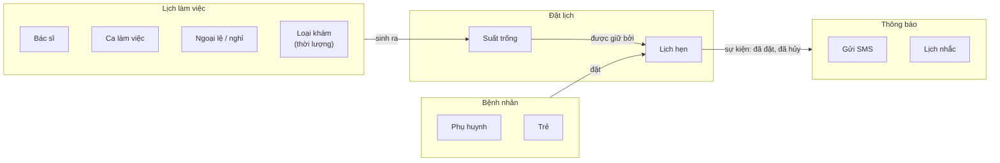

Bốn miền, mỗi miền có từ vựng riêng. Lưu ý **"Suất trống" không được lưu trữ** - nó được **tính** từ lịch làm việc trừ đi lịch hẹn đã có. Đây là một quyết định quan trọng: nếu lưu sẵn mọi suất trống, mỗi lần bác sĩ đổi lịch làm việc phải sinh lại hàng nghìn dòng.

### 6.2. Lăng kính 2: theo dữ liệu - ai là chủ?

Mỗi mẩu dữ liệu nên có **đúng một chủ** (owner) - nơi duy nhất được ghi nó. Các nơi khác chỉ đọc hoặc nhận bản sao.

| Dữ liệu | Chủ (được ghi) | Ai đọc | Ghi chú |
|---|---|---|---|
| Ca làm việc, ngoại lệ | Lịch làm việc | Đặt lịch | Lễ tân sửa |
| Lịch hẹn | Đặt lịch | Thông báo, màn hình bác sĩ | Nguồn sự thật cho "suất đã có người" |
| Phụ huynh, trẻ | Bệnh nhân | Đặt lịch, Thông báo | Dữ liệu nhạy cảm nhất |
| Trạng thái gửi SMS | Thông báo | Lễ tân (xem đã nhắc chưa) | |

Khi hai phần cùng muốn **ghi** một dữ liệu, đó là dấu hiệu ranh giới vẽ sai.

### 6.3. Lăng kính 3: theo tốc độ thay đổi

Lăng kính này hay bị quên nhưng cực kỳ hữu ích: **tách những thứ thay đổi với tốc độ khác nhau**.

| Thành phần | Thay đổi bao lâu một lần | Ai yêu cầu thay đổi |
|---|---|---|
| Quy tắc chống đặt trùng | Gần như không bao giờ | - |
| Mô hình lịch hẹn | Vài năm | Kỹ sư |
| Quy tắc hủy (trước 2 giờ? 4 giờ?), thời lượng loại khám | Hàng tháng | Chủ phòng khám |
| Nội dung tin nhắn SMS | Hàng tuần | Lễ tân, marketing |
| Giao diện | Liên tục | Mọi người |

Hệ quả thiết kế: thứ thay đổi hàng tuần (nội dung SMS, quy tắc hủy) nên là **dữ liệu/cấu hình**, sửa được mà không cần deploy. Thứ không bao giờ đổi (chống đặt trùng) nên được bảo vệ ở **tầng sâu nhất** - ràng buộc database. Tách như vậy, mỗi lần chị Hạnh muốn đổi câu chữ tin nhắn, không ai phải đụng vào code đặt lịch.

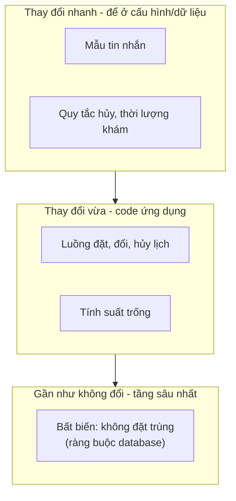

### 6.4. Phân rã thành module, chưa phải thành service

Bốn miền ở trên **không có nghĩa là bốn microservice**. Với 1 dev bán thời gian, bốn service là bốn thứ phải deploy, giám sát, và gỡ lỗi qua mạng. Phân rã ở đây là **module trong một ứng dụng** (modular monolith): mỗi module có package riêng, bảng riêng, và chỉ gọi nhau qua interface rõ ràng.

Ranh giới module tốt hôm nay chính là đường cắt service sẵn sàng cho ngày mai - **nếu** có ngày đó. Thảo luận đầy đủ về khi nào nên tách service có trong [Bài Kiến trúc & Microservices](../backend/14-architecture-microservices.md).

---

## 📖 7. Bước 6 - Ranh giới và hợp đồng

### 7.1. Hợp đồng là gì

Ranh giới giữa hai phần chỉ có ý nghĩa nếu có **hợp đồng** (contract): một mô tả chính xác "phần A hứa gì với phần B". Hợp đồng tốt gồm:

1. **Hình dạng** (shape): input/output, kiểu dữ liệu, trường bắt buộc.
2. **Ngữ nghĩa** (semantics): gọi hai lần thì sao? Lỗi nào có thể trả về? Thứ tự có đảm bảo không?
3. **Bất biến**: điều gì luôn đúng trước và sau khi gọi.
4. **Chất lượng**: độ trễ, giới hạn tốc độ.

Phần lớn tài liệu API chỉ có (1). Phần lớn bug tích hợp nằm ở (2) và (3).

### 7.2. Ví dụ: hợp đồng của module Đặt lịch

```text
HỢP ĐỒNG: Đặt lịch (Booking)

BookAppointment(patient_id, doctor_id, slot_start, visit_type, idempotency_key)
  → Appointment | lỗi

  Tiền điều kiện:
    - slot_start nằm trong ca làm việc của bác sĩ, không trùng ngoại lệ nghỉ
    - slot_start cách hiện tại ít nhất 30 phút
  Bất biến (luôn đúng sau mọi lời gọi, kể cả gọi song song):
    - Không có hai lịch hẹn ACTIVE chồng lấn thời gian của cùng một bác sĩ
    - Một trẻ không có hai lịch ACTIVE cùng một ngày với cùng loại khám
  Ngữ nghĩa:
    - Idempotent theo idempotency_key: gọi lại trả về đúng lịch hẹn đã tạo
    - Thành công → phát sự kiện AppointmentBooked (ít nhất một lần)
  Lỗi có thể trả về:
    - SLOT_TAKEN      (người khác vừa đặt - client nên tải lại suất trống)
    - OUTSIDE_SCHEDULE
    - DUPLICATE_FOR_CHILD
    - TOO_LATE
  Chất lượng:
    - p95 dưới 300ms

Sự kiện AppointmentBooked { appointment_id, doctor_id, patient_id, slot_start, booked_at }
  - Có thể đến hơn một lần → người nhận phải xử lý idempotent theo appointment_id
  - Không đảm bảo thứ tự giữa các lịch hẹn khác nhau
```

Để ý những dòng như "**có thể đến hơn một lần**" và "**không đảm bảo thứ tự**". Đây là những lời hứa (hoặc không hứa) mà người dùng module cần biết để viết đúng. Module Thông báo đọc hợp đồng này sẽ biết ngay: phải chống gửi SMS hai lần.

### 7.3. Hợp đồng trong code

Hợp đồng sống tốt nhất khi nó **vừa là tài liệu vừa được kiểm tra**. Trong code, nó thường là một interface cộng với kiểu lỗi rõ ràng. Phần còn lại (bất biến) được khóa bằng test và ràng buộc database - Bài 7 sẽ đi sâu cách biến bất biến thành test.

=== "Go"

    ```go
    // Package booking: chỉ module này được ghi bảng appointments.
    package booking

    import (
    	"context"
    	"errors"
    	"time"
    )

    var (
    	ErrSlotTaken         = errors.New("slot đã có người đặt")
    	ErrOutsideSchedule   = errors.New("ngoài lịch làm việc")
    	ErrDuplicateForChild = errors.New("trẻ đã có lịch cùng loại trong ngày")
    	ErrTooLate           = errors.New("quá sát giờ khám")
    )

    type Appointment struct {
    	ID        int64
    	DoctorID  int64
    	PatientID int64
    	StartsAt  time.Time
    	EndsAt    time.Time
    	Status    string // ACTIVE, CANCELLED, DONE
    }

    type BookRequest struct {
    	PatientID      int64
    	DoctorID       int64
    	SlotStart      time.Time // luôn là UTC
    	VisitType      string
    	IdempotencyKey string
    }

    // Service là hợp đồng mà các module khác (và handler HTTP) được phép dùng.
    // Bất biến: không có hai lịch ACTIVE chồng lấn của cùng một bác sĩ.
    type Service interface {
    	Book(ctx context.Context, req BookRequest) (Appointment, error)
    	Cancel(ctx context.Context, appointmentID int64, reason string) error
    	FreeSlots(ctx context.Context, doctorID int64, day time.Time, visitType string) ([]time.Time, error)
    }
    ```

=== "Python"

    ```python
    # booking/contract.py - chỉ module này được ghi bảng appointments.
    from dataclasses import dataclass
    from datetime import date, datetime
    from typing import Protocol


    class SlotTaken(Exception): """Slot đã có người đặt."""
    class OutsideSchedule(Exception): """Ngoài lịch làm việc."""
    class DuplicateForChild(Exception): """Trẻ đã có lịch cùng loại trong ngày."""
    class TooLate(Exception): """Quá sát giờ khám."""


    @dataclass(frozen=True)
    class BookRequest:
        patient_id: int
        doctor_id: int
        slot_start: datetime  # luôn là UTC, có tzinfo
        visit_type: str
        idempotency_key: str


    class BookingService(Protocol):
        """Hợp đồng mà các module khác được phép dùng.
        Bất biến: không có hai lịch ACTIVE chồng lấn của cùng một bác sĩ."""

        def book(self, req: BookRequest) -> "Appointment": ...
        def cancel(self, appointment_id: int, reason: str) -> None: ...
        def free_slots(self, doctor_id: int, day: date, visit_type: str) -> list[datetime]: ...
    ```

### 7.4. Nguyên tắc vẽ ranh giới

- **Ranh giới ở chỗ ít trao đổi nhất.** Nếu hai module gọi nhau 20 lần cho mỗi thao tác, chúng thuộc về nhau.
- **Giấu quyết định dễ thay đổi sau ranh giới** (David Parnas, 1972). Nhà cung cấp SMS sẽ đổi - giấu nó sau interface `Notifier`. Không module nào khác được biết tên nhà cung cấp.
- **Hợp đồng ổn định hơn cài đặt.** Đổi cách tính suất trống thoải mái; đổi ý nghĩa của `SLOT_TAKEN` thì phải báo mọi bên.
- **Cẩn thận với hợp đồng ngầm.** "Module thông báo đọc thẳng bảng appointments" là một hợp đồng ngầm - bất kỳ thay đổi schema nào cũng có thể làm vỡ nó mà không ai biết.

---

## 📖 8. Vẽ kiến trúc: sơ đồ kiểu C4

Mô hình C4 (Simon Brown) vẽ kiến trúc ở 4 mức thu phóng, giống Google Maps: **Context** (quốc gia), **Container** (thành phố), **Component** (khu phố), **Code** (ngôi nhà). Hầu hết thời gian bạn chỉ cần hai mức đầu.

### 8.1. Mức 1 - Context: hệ thống và thế giới xung quanh

Ai dùng hệ thống? Hệ thống nói chuyện với hệ thống bên ngoài nào? Không có chi tiết kỹ thuật.

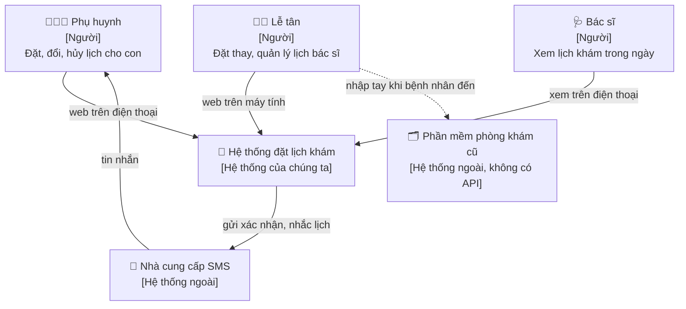

Sơ đồ này nói được với **chị Hạnh**. Nếu chị không hiểu sơ đồ context, nó quá kỹ thuật.

Một điều sơ đồ context làm lộ ra: đường nét đứt giữa lễ tân và phần mềm cũ. Đó là **công việc thủ công vẫn còn lại** - một phần của hệ thống tổng thể (gồm cả người) mà phần mềm của chúng ta không giải quyết. Tư duy hệ thống (Bài 2) nói: hãy vẽ cả nó ra.

### 8.2. Mức 2 - Container: các khối triển khai

"Container" ở đây là **đơn vị chạy riêng** (ứng dụng web, database, worker), không phải Docker container.

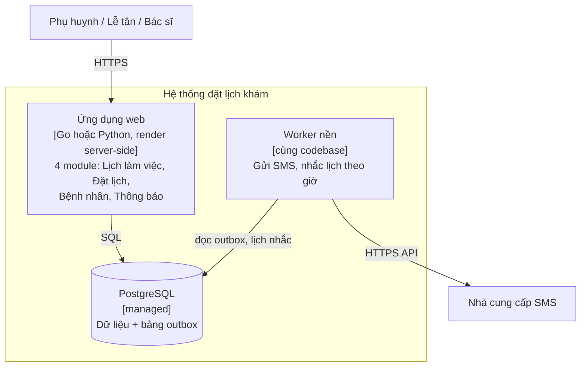

Ba container. Không có Redis (chưa cần cache với 4 request/giây), không có message broker (bảng outbox trong PostgreSQL đủ dùng), không có Kubernetes.

### 8.3. Sequence diagram cho luồng quan trọng nhất

Sơ đồ container cho thấy **cấu trúc**. Sequence diagram cho thấy **hành vi** - và là nơi bất biến, lỗi, retry hiện ra rõ nhất.

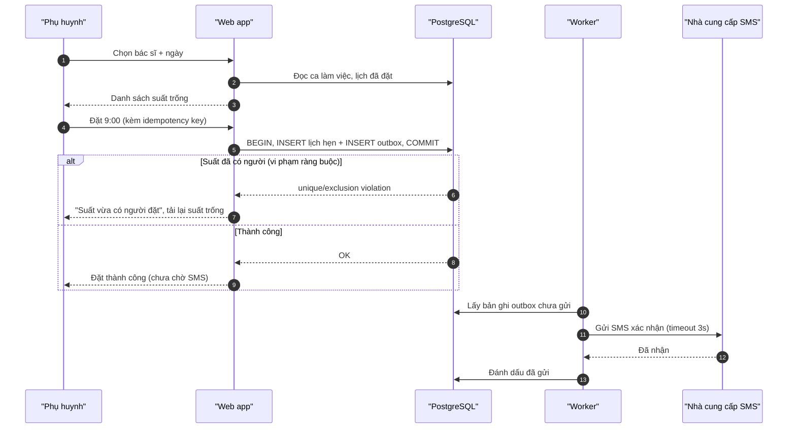

Những gì sơ đồ này nói rõ (và một đoạn văn mô tả dễ bỏ sót):

- **Bất biến chống đặt trùng nằm ở database** (bước 5), không phải ở bước "kiểm tra suất trống" (bước 2). Kiểm tra ở bước 2 chỉ để hiện giao diện; giữa bước 2 và bước 5, người khác có thể đã đặt.
- **Lịch hẹn và yêu cầu gửi SMS được ghi trong cùng một transaction** (pattern outbox) - không có tình huống "đặt được mà không bao giờ có SMS" hay "có SMS mà không có lịch".
- **Phụ huynh không phải chờ SMS** - nhà cung cấp SMS chậm (Bài 5!) không ảnh hưởng đến việc đặt lịch.

### 8.4. Mô hình dữ liệu cốt lõi

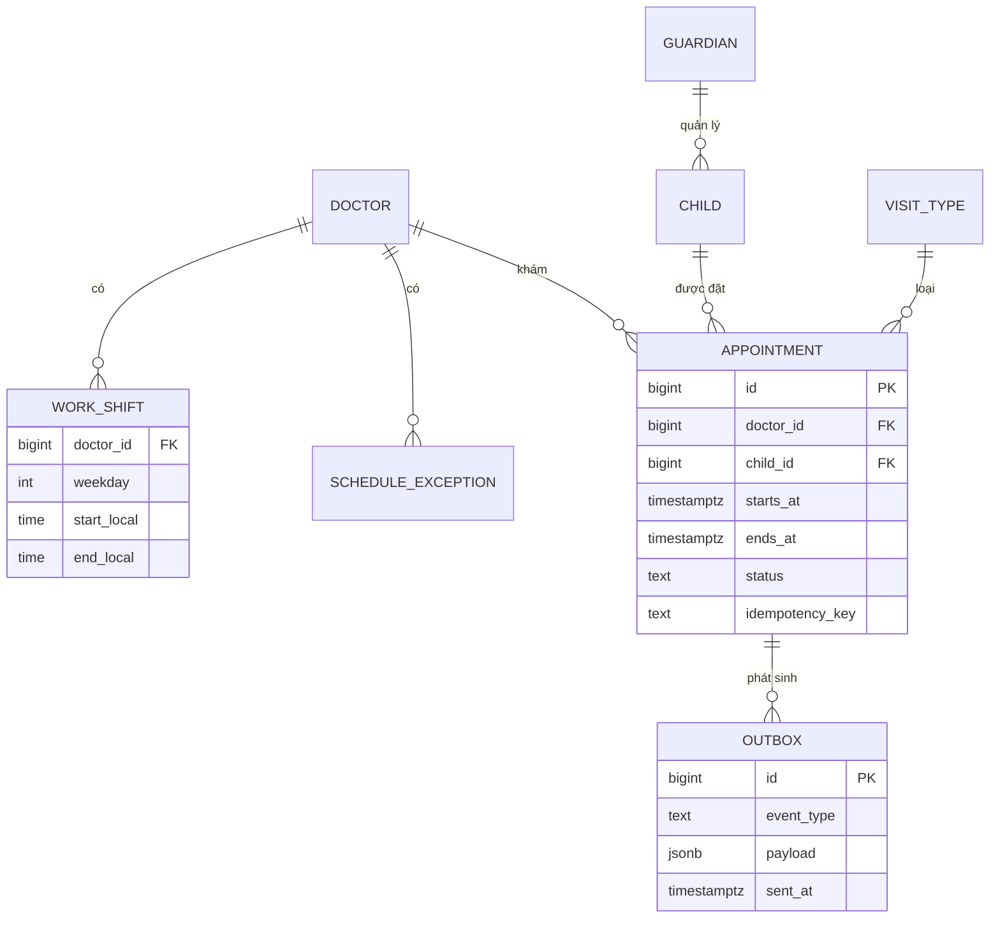

Chi tiết đáng chú ý: `starts_at`/`ends_at` là `timestamptz` (thời điểm tuyệt đối), còn ca làm việc lưu `time` **theo giờ địa phương** ("thứ Hai 8:00-12:00"). Hai khái niệm thời gian khác nhau - và đó là chỗ hay sinh bug ([Bẫy production §2](../backend/16-production-traps.md)). Vì các lịch hẹn có độ dài khác nhau (10 phút, 30 phút), bất biến "không chồng lấn" cần ràng buộc theo **khoảng thời gian** (ví dụ PostgreSQL exclusion constraint trên `tstzrange`), không chỉ `UNIQUE(doctor_id, starts_at)`.

---

## 📖 9. Bước 7 - Luồng dữ liệu và quyền sở hữu

Sơ đồ sequence cho một luồng. Ở bước này, nhìn **toàn bộ dữ liệu đi đâu**, đặc biệt dữ liệu nhạy cảm.

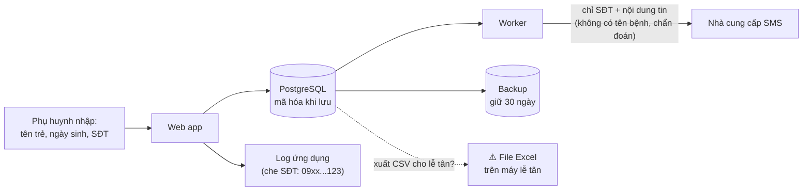

Câu hỏi cho mỗi mũi tên:

- **Dữ liệu gì** đi qua? Có cần hết không? (Nhà cung cấp SMS **không cần** biết bé khám gì.)
- **Ai** đọc được ở đầu kia? (Log thường được nhiều người xem hơn database.)
- **Giữ bao lâu**? Xóa thế nào khi phụ huynh yêu cầu?
- Mũi tên nét đứt "xuất CSV" - một yêu cầu rất hay gặp ("cho chị xuất Excel") và cũng là nơi dữ liệu thoát khỏi mọi kiểm soát của hệ thống. Không cấm, nhưng phải là **quyết định có ý thức** (ADR) với giới hạn: ai được xuất, xuất trường nào, có ghi log không.

---

## 📖 10. Bước 8 - Quyết định then chốt và ADR

Cách viết ADR và ma trận quyết định có trong [Trade-off & ra quyết định](../mindset/07-tradeoffs-decisions.md). Ở đây là cách **chọn những quyết định nào đáng viết ADR**.

### 10.1. Quyết định nào đáng ghi lại?

Viết ADR khi quyết định có **ít nhất một** trong các đặc điểm:

- **Khó đảo ngược** (cửa một chiều): chọn database, mô hình dữ liệu cốt lõi, định dạng ID công khai.
- **Có phương án hợp lý khác** mà người sau sẽ thắc mắc: "sao không dùng Redis để giữ chỗ?".
- **Đi ngược thói quen**: "sao không dùng microservices / React / Kafka như mọi người?".
- **Đánh đổi một thuộc tính chất lượng**: chấp nhận 99,5% thay vì 99,9%.

Danh sách ADR cho hệ thống đặt lịch phiên bản đầu:

| ADR | Quyết định | Loại cửa |
|---|---|---|
| 001 | Modular monolith, một codebase, một database | Hai chiều (tách sau được nếu ranh giới module sạch) |
| 002 | Chống đặt trùng bằng exclusion constraint trong PostgreSQL | Một chiều (gắn chặt với PostgreSQL) |
| 003 | Gửi SMS bất đồng bộ qua bảng outbox, không dùng message broker | Hai chiều |
| 004 | Đăng nhập bằng OTP qua số điện thoại, không mật khẩu | Hai chiều, nhưng tốn tiền SMS |
| 005 | Suất trống được tính, không lưu sẵn | Hai chiều |

### 10.2. Một ADR đầy đủ

```text
ADR-002: Chống đặt trùng lịch bằng ràng buộc trong PostgreSQL

Trạng thái: Đã chấp nhận (2026-03-10)

Bối cảnh
  Bất biến quan trọng nhất của hệ thống: không có hai lịch hẹn ACTIVE chồng
  lấn thời gian của cùng một bác sĩ. Lịch hẹn có độ dài khác nhau (10-45 phút).
  Đặt lịch có thể đến từ web phụ huynh và từ lễ tân cùng lúc.
  Hiện có một instance ứng dụng, nhưng có thể chạy 2+ instance sau này.

Các phương án
  A. Kiểm tra trong code: SELECT xem có chồng lấn không, rồi INSERT
  B. Khóa trong ứng dụng (mutex) theo doctor_id
  C. Khóa phân tán trong Redis
  D. Exclusion constraint trên (doctor_id, tstzrange(starts_at, ends_at))
     với điều kiện status = 'ACTIVE'

Quyết định
  Chọn D.

Lý do
  - A sai khi có 2 request song song (cả hai cùng SELECT thấy trống).
  - B sai ngay khi có instance thứ hai.
  - C thêm một thành phần phải vận hành, và vẫn có cửa sổ lỗi khi khóa hết
    hạn giữa chừng.
  - D được database đảm bảo trong mọi trường hợp, kể cả script sửa tay,
    kể cả code do người khác (hoặc AI) viết sau này mà quên kiểm tra.

Hệ quả
  + Bất biến không thể bị vi phạm bởi bất kỳ đường ghi nào.
  + Code đơn giản: INSERT, bắt lỗi vi phạm, trả SLOT_TAKEN.
  - Gắn với PostgreSQL (extension btree_gist). Đổi database sẽ phải thiết kế lại.
  - Lỗi từ database cần được dịch sang lỗi nghiệp vụ cẩn thận.

Xem lại khi
  Một bác sĩ có hơn khoảng 100 lượt đặt/giây cho cùng một khung
  (kịch bản "mở sổ bác sĩ nổi tiếng" ở quy mô toàn quốc).
```

Dòng "**kể cả code do AI viết sau này mà quên kiểm tra**" là một lý do rất thời sự. Khi code được sinh ngày càng nhanh, **bất biến nên được đặt ở tầng mà code mới không thể vô tình đi vòng qua**.

---

## 📖 11. Bước 9 - Rủi ro

Áp dụng trực tiếp công cụ của Bài 5. Với hệ thống đặt lịch, một pre-mortem 30 phút với chị Hạnh và lễ tân cho ra:

| Rủi ro | Nhóm | Hành động |
|---|---|---|
| Phụ huynh lớn tuổi không dùng web, vẫn gọi điện | Con người | Lễ tân dùng **cùng hệ thống** để đặt thay - không có hai sổ lịch |
| Lễ tân vẫn dùng song song sổ giấy "cho chắc" → hai nguồn sự thật | Quy trình | Ngày chuyển đổi rõ ràng; in lịch ngày từ hệ thống |
| SMS brandname chưa duyệt kịp | Bên ngoài | Nộp hồ sơ tuần 1; phương án tạm: Zalo OA hoặc gọi điện |
| Bác sĩ đổi lịch làm việc mà không báo lễ tân | Quy trình | Bác sĩ chỉ xem; mọi thay đổi qua lễ tân; báo cáo "lịch bị ảnh hưởng" khi đổi ca |
| Một dev duy nhất nghỉ việc | Con người | Tài liệu này + ADR + runbook 1 trang; hạ tầng managed |
| Đặt trùng | Kỹ thuật | Đã xử lý bằng ADR-002 |

Để ý: **chỉ một trong sáu rủi ro là kỹ thuật thuần túy**, và nó đã được xử lý. Với hệ thống nhỏ, rủi ro lớn nhất gần như luôn nằm ở con người và quy trình chuyển đổi.

---

## 📖 12. Cùng một bài toán ở 3 quy mô

Giờ ta mở rộng: cùng ý tưởng "đặt lịch khám", nhưng ở ba quy mô khác nhau. Đây là cách tốt nhất để hiểu **cái gì thực sự làm kiến trúc thay đổi**.

### 12.1. Quy mô A: 100 người dùng - một phòng khám

Đúng như các mục trên. Thực ra ở quy mô này, câu hỏi đầu tiên nên là: **có cần xây không?**

- Có sẵn dịch vụ đặt lịch dạng SaaS giá vài trăm nghìn/tháng không? Google Calendar appointment schedule + nhắc tự động có đủ không?
- Nếu xây: một ứng dụng, một database managed, một worker - như mục 8.2.

### 12.2. Quy mô B: 100.000 người dùng - chuỗi 60 phòng khám

Chuỗi phòng khám nhi ở 3 thành phố. Yêu cầu mới xuất hiện **không phải vì tải** (vẫn chỉ 4 lần đọc/giây lúc đỉnh!) mà vì **tổ chức**:

- Nhiều phòng khám, mỗi nơi có lễ tân, quy tắc riêng → **multi-tenant**, phân quyền theo phòng khám.
- Bác sĩ làm ở 2-3 cơ sở → lịch làm việc xuyên cơ sở, bất biến chống trùng phải tính cả việc di chuyển.
- Báo cáo cho ban giám đốc: tỉ lệ không đến theo cơ sở, theo bác sĩ.
- Tích hợp với phần mềm phòng khám mới (có API) → đồng bộ hai chiều.
- Đội 4-6 dev, có người trực → cần CI/CD, môi trường staging, giám sát, SLO.
- Chi phí SMS 80 triệu/tháng → cần kênh rẻ hơn (Zalo OA, push qua app).

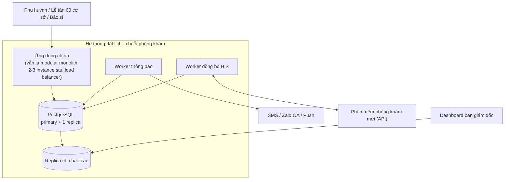

**Vẫn không cần microservices.** Thay đổi chính: chạy nhiều instance (để deploy không gián đoạn và chịu lỗi, không phải để chịu tải), replica cho báo cáo (để truy vấn nặng không làm chậm đặt lịch - đây là **bulkhead** ở tầng dữ liệu), kênh thông báo đa dạng, và worker đồng bộ.

### 12.3. Quy mô C: 10 triệu người dùng - nền tảng toàn quốc

Một nền tảng kết nối bệnh nhân với 5.000 phòng khám và bệnh viện trên cả nước. Thay đổi bản chất:

- **Hai phía thị trường** (marketplace): phòng khám là khách hàng trả tiền, bệnh nhân là người dùng. Phòng khám có hệ thống riêng → hàng trăm kiểu tích hợp.
- **Tìm kiếm**: "bác sĩ nhi gần tôi, có lịch thứ Bảy, nhận bảo hiểm X" → cần search engine riêng.
- **Đỉnh nhọn**: mở sổ bác sĩ nổi tiếng (mục 5.2) → hàng đợi ảo cho luồng đó.
- **Nhiều đội** (40-80 kỹ sư) → ranh giới đội trở thành ranh giới service (định luật Conway).
- **Pháp lý và bảo mật** ở mức cao hơn hẳn: kiểm toán, phân tách dữ liệu, ứng phó sự cố rò rỉ.
- **Sẵn sàng cao hơn**: nhiều phòng khám chỉ nhận đặt lịch qua nền tảng → 99,9%+.

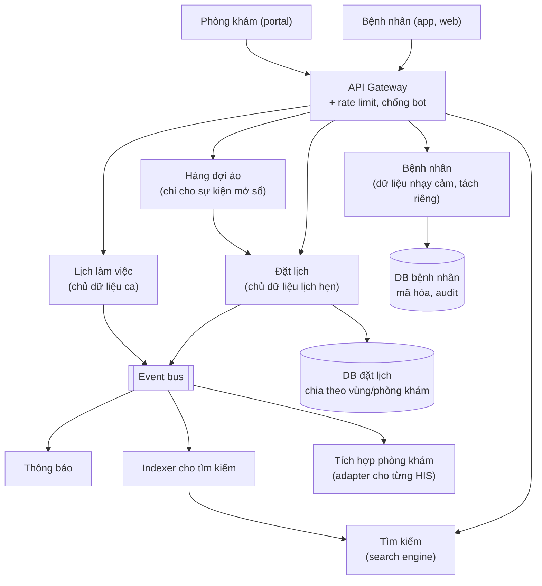

### 12.4. Cái gì đổi, cái gì KHÔNG đổi

Đây là bảng quan trọng nhất của bài:

| Khía cạnh | 100 người dùng | 100.000 | 10 triệu |
|---|---|---|---|
| **Bất biến chống đặt trùng** | Ràng buộc DB | Ràng buộc DB | Ràng buộc DB (trong từng phân vùng) |
| **Miền nghiệp vụ** | 4 module | 4 module + Báo cáo + Tích hợp | Các miền đó thành service + Tìm kiếm |
| **Hợp đồng `Book()`** | Như mục 7.2 | Thêm `clinic_id` | Thêm `clinic_id`, vẫn cùng ngữ nghĩa |
| Số thành phần triển khai | 3 | 6-7 | 20+ |
| Database | 1 managed | Primary + replica | Nhiều DB, chia theo miền và vùng |
| Thông báo | Outbox + worker | Outbox + worker, nhiều kênh | Event bus, service riêng |
| Đội | 1 người | 4-6 người | 40-80 người, nhiều đội |
| Sẵn sàng | 99,5% | 99,9% | 99,95% |
| Rủi ro lớn nhất | Người dùng không chuyển đổi | Tích hợp, chi phí SMS | Đỉnh nhọn, bảo mật, phối hợp đội |

Đọc theo hàng:

- **Ba dòng đầu gần như không đổi.** Bất biến, miền nghiệp vụ, và ngữ nghĩa của hợp đồng là **bản chất của bài toán** - chúng đúng ở mọi quy mô. Nếu bạn làm đúng chúng ở quy mô A, bạn mang chúng theo đến quy mô C.
- **Các dòng còn lại thay đổi hoàn toàn**, nhưng lý do thay đổi phần lớn **không phải là tải**. Là **tổ chức** (số đội), **độ sẵn sàng cần thiết**, **chi phí**, **tích hợp**, và **đỉnh nhọn**.

!!! tip "Bài học cốt lõi"
    **Đầu tư nhiều vào thứ không đổi (bất biến, miền, hợp đồng). Đầu tư ít vào thứ sẽ đổi (hạ tầng, số thành phần).** Quy mô A với ranh giới module sạch và hợp đồng rõ có thể tiến hóa lên B rồi C. Quy mô A viết "nhanh" với mọi thứ trộn lẫn sẽ phải viết lại.

---

## 📖 13. "Thứ đơn giản nhất chạy được" vs chuẩn bị cho tương lai

### 13.1. Hai cái bẫy đối xứng

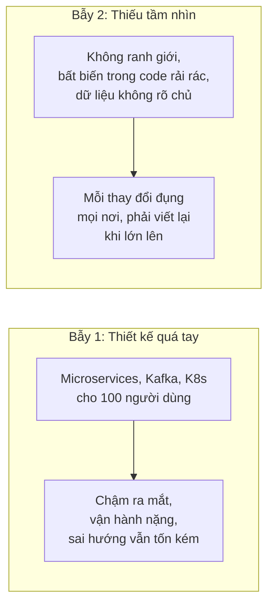

Cả hai bẫy đều phổ biến, và AI làm **bẫy 1** dễ rơi vào hơn bao giờ hết: sinh ra 8 microservice với Docker Compose, Kafka, Redis giờ chỉ tốn vài phút. Chi phí không còn nằm ở **viết** - nó nằm ở **vận hành, hiểu, và thay đổi** tất cả những thứ đó trong nhiều năm.

### 13.2. Phân biệt: làm sớm hay để sau?

| Đáng làm ngay từ đầu (khó sửa sau) | Để sau được (dễ thêm khi cần) |
|---|---|
| Bất biến ở tầng database | Cache |
| Ranh giới module, hợp đồng rõ | Tách service |
| Mô hình dữ liệu cốt lõi (thời gian, tiền, ID) | Message broker |
| Idempotency cho thao tác có tác dụng phụ | Read replica, sharding |
| Lưu UTC, định danh không lộ thông tin | Search engine |
| Logging có cấu trúc, request ID | Hệ thống phân quyền phức tạp |
| Bảo mật dữ liệu nhạy cảm | Đa vùng, đa đám mây |
| Cách deploy và rollback | Autoscaling |

Quy tắc: cột trái là **cửa một chiều hoặc gần như một chiều** - rẻ khi làm sớm, cực đắt khi làm muộn (hãy thử thêm idempotency cho một hệ thống thanh toán đã chạy 2 năm). Cột phải là **cửa hai chiều** - thêm vào khi có bằng chứng cần.

### 13.3. "Đường nối" (seams) - chuẩn bị rẻ cho tương lai

Bạn không cần xây cho quy mô C. Nhưng bạn có thể để lại **đường nối** - chỗ mà sau này cắt ra dễ dàng:

- Module Thông báo chỉ nhận sự kiện qua bảng outbox → sau này thay bảng outbox bằng event bus mà các module khác không biết.
- Mọi bảng có `clinic_id` ngay từ đầu (dù chỉ có một phòng khám) → chuyển sang multi-tenant không phải migration toàn bộ. *(Đây là một đánh đổi: thêm chút phức tạp hôm nay. Chỉ đáng làm nếu khả năng mở rộng sang nhiều phòng khám là thật - và chị Hạnh có nhắc đến chuyện mở cơ sở 2.)*
- Nhà cung cấp SMS sau interface `Notifier` → thêm Zalo OA là thêm một cài đặt.

!!! tip "Câu hỏi kiểm tra"
    Với mỗi thứ "chuẩn bị cho tương lai", hỏi: "**Nếu tương lai đó không đến, mình mất bao nhiêu? Nếu đến mà mình chưa chuẩn bị, mình mất bao nhiêu?**". Chỉ chuẩn bị khi vế sau lớn hơn hẳn vế trước.

---

## 📖 14. Dùng AI trong thiết kế: mở rộng lựa chọn, con người quyết định

AI rất giỏi ở một số phần của quy trình này, và rất nguy hiểm ở một số phần khác.

### 14.1. AI giúp được gì - theo từng bước

| Bước | AI giúp tốt | AI dễ sai / không thay được |
|---|---|---|
| 1. Ý tưởng | Gợi ý câu hỏi để hỏi khách hàng | Không biết chị Hạnh thật sự đau ở đâu |
| 2. Yêu cầu | Liệt kê use case, edge case thường gặp của "app đặt lịch" | Không biết yêu cầu riêng của phòng khám này; hay thêm tính năng không cần |
| 3. Ràng buộc | Nhắc các loại ràng buộc (pháp lý, vận hành) | Không biết ngân sách, kỹ năng đội, chính trị nội bộ |
| 4. Ước lượng | Kiểm tra phép tính, gợi ý con số tham khảo | Con số tham khảo có thể sai bậc độ lớn - **luôn kiểm lại** |
| 5-6. Phân rã, hợp đồng | Đề xuất 2-3 cách phân rã để so sánh; soạn nháp hợp đồng | Mặc định nghiêng về kiến trúc "phổ biến trên mạng" (microservices) |
| 7. Luồng dữ liệu | Vẽ sequence diagram từ mô tả | Bỏ sót luồng lỗi nếu bạn không hỏi |
| 8. Quyết định | Liệt kê phương án và ưu nhược | **Không chịu trách nhiệm.** Không biết bối cảnh mà ADR cần |
| 9. Rủi ro | Đóng vai người phản biện, chạy pre-mortem giả lập | Không thay được cuộc trò chuyện với lễ tân |

### 14.2. Vòng lặp thiết kế cùng AI

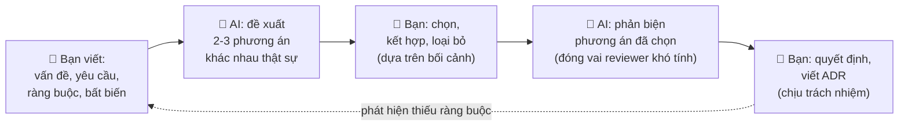

Một vài cách hỏi hiệu quả:

```text
[Mở rộng lựa chọn]
"Đây là yêu cầu, ràng buộc và bất biến của hệ thống [dán]. Đề xuất 3 kiến trúc
KHÁC NHAU VỀ BẢN CHẤT, trong đó ít nhất một phương án đơn giản nhất có thể
(một ứng dụng, một database). Với mỗi phương án: nó gãy ở đâu đầu tiên khi
tải tăng 10 lần, và chi phí vận hành cho đội 1 người."

[Phản biện]
"Đóng vai một kỹ sư vận hành đã trực đêm 10 năm. Đọc thiết kế này và liệt kê
5 cách nó sẽ hỏng lúc 3 giờ sáng, xếp theo mức độ nghiêm trọng. Không khen."

[Kiểm tra bất biến]
"Với bất biến 'không có hai lịch ACTIVE chồng lấn của cùng một bác sĩ',
liệt kê mọi đường ghi dữ liệu trong thiết kế có thể vi phạm nó."

[Kiểm tra ước lượng]
"Đây là giả định và phép tính của tôi [dán]. Chỉ ra giả định nào đáng ngờ
nhất và nếu nó sai 10 lần thì kết luận có đổi không."
```

### 14.3. Những cạm bẫy khi thiết kế cùng AI

- **Mặc định theo đám đông**: AI học từ những gì được viết nhiều nhất trên mạng - và trên mạng, bài viết về microservices nhiều hơn bài viết về "một PostgreSQL là đủ". Nếu không nêu ràng buộc (1 dev, 1 triệu/tháng), bạn sẽ nhận một kiến trúc cho công ty 200 kỹ sư.
- **Tự tin với con số**: "PostgreSQL xử lý được khoảng X giao dịch/giây" - con số này phụ thuộc phần cứng, truy vấn, cấu hình. Dùng làm điểm khởi đầu, đo lại khi quan trọng.
- **Thiếu bối cảnh không nói ra**: AI không biết chị Hạnh định mở cơ sở 2, không biết lễ tân ghét đổi phần mềm. Chất lượng output bị giới hạn bởi bối cảnh bạn đưa vào - đó là lý do bước 1-3 phải do bạn làm.
- **Nhầm "nghe hợp lý" với "đúng"**: một bản thiết kế viết trôi chảy, có sơ đồ, có thuật ngữ - dễ được chấp nhận mà không ai phản biện. Áp dụng câu hỏi của Bài 5: nó hỏng thế nào?
- **Đẩy trách nhiệm**: "AI đề xuất dùng X" không bao giờ là lý do trong ADR. Lý do phải là bối cảnh và trade-off **mà bạn hiểu và bảo vệ được**.

!!! warning "Ranh giới trách nhiệm"
    AI là đồng nghiệp tuyệt vời để **mở rộng không gian lựa chọn** và **tìm lỗ hổng**. Nhưng quyết định kiến trúc là lời cam kết với đội, với khách hàng, với người sẽ trực đêm. Người ký tên dưới ADR là người chịu trách nhiệm - và đó phải là một con người hiểu vì sao.

---

## 🌍 Tình huống thực tế

### Tình huống 1: "Làm giống Shopee cho shop của em"

Một chủ shop thời trang online (khoảng 300 đơn/ngày, bán qua Facebook và Zalo) muốn "một hệ thống quản lý đơn hàng như Shopee". Một bạn dev dùng AI sinh ra kiến trúc 9 microservice: user, product, cart, order, payment, inventory, shipping, notification, search - với Kafka và Elasticsearch.

Áp quy trình:

- **Vấn đề thật** (bước 1): hỏi ra, chủ shop đang đau vì: nhập đơn từ tin nhắn Facebook bằng tay vào Excel, hay nhầm size, không biết hàng nào còn, và đối soát tiền COD với đơn vị vận chuyển mất cả buổi chiều thứ Bảy.
- **Ước lượng** (bước 4): 300 đơn/ngày = khoảng 0,01 đơn/giây. 9 microservice cho tải này là vô lý.
- **Phân rã theo tốc độ thay đổi** (bước 5): bảng giá ship và quy tắc khuyến mãi đổi hàng tuần → cấu hình. Mô hình đơn hàng và tồn kho thì ổn định.
- **Kiến trúc** (bước 6-8): một ứng dụng, một database, tích hợp API của đơn vị vận chuyển để lấy trạng thái và đối soát COD. Tính năng giá trị nhất hóa ra là **đối soát COD tự động** - không có trong danh sách 9 service ban đầu.

Kết quả: một hệ thống mà một người vận hành được, giải quyết đúng 3 nỗi đau, làm trong 5 tuần. Kiến trúc 9 service có thể "trông chuyên nghiệp" hơn, nhưng nó giải quyết vấn đề của Shopee, không phải vấn đề của shop này.

### Tình huống 2: Hệ thống "đơn giản" không có bất biến

Một startup làm app đặt sân cầu lông. Phiên bản đầu do một freelancer làm rất nhanh: kiểm tra sân trống bằng `SELECT`, rồi `INSERT`. Chạy tốt 6 tháng với 20 sân.

Rồi họ chạy khuyến mãi "giờ vàng 50%" lúc 20:00 tối thứ Sáu. 15 phút đầu: 43 trường hợp hai nhóm cùng đặt một sân một giờ. Chủ sân phải gọi điện xin lỗi từng nhóm. Startup mất hợp đồng với 3 chủ sân.

Bài học: thiết kế ban đầu **đơn giản là đúng**, nhưng nó bỏ qua **bất biến** - thứ duy nhất trong bảng 12.4 không bao giờ được phép đơn giản hóa. Thêm một ràng buộc database ngay từ đầu tốn 30 phút. Thêm sau sự cố tốn một tuần (dọn dữ liệu trùng trước khi tạo được ràng buộc) và ba khách hàng.

---

## ⚠️ Sai lầm thường gặp

| Sai lầm | Hệ quả | Thay bằng |
|---|---|---|
| Bắt đầu từ công nghệ ("dùng Next.js + Kafka") | Giải quyết sai bài toán | Bắt đầu từ problem statement không nhắc công nghệ |
| Yêu cầu chất lượng không có số ("phải nhanh") | Không ai biết khi nào là đủ | Kịch bản + con số đo được |
| Không viết non-goals | Phình phạm vi, AI thêm tính năng thừa | Danh sách non-goals rõ ràng |
| Đặt mục tiêu sẵn sàng cao hơn mức cần | Kiến trúc phức tạp, đắt không cần thiết | Hỏi "khi hệ thống hỏng, người dùng làm gì?" |
| Chỉ ước lượng tải trung bình | Gãy ở đỉnh nhọn | Tìm kịch bản đỉnh: mở bán, ngày lương, bot |
| Phân rã theo lớp kỹ thuật (controller/service/repo) thay vì theo miền | Mỗi tính năng đụng mọi lớp | Phân rã theo miền, dữ liệu, tốc độ thay đổi |
| Bất biến chỉ nằm trong code ứng dụng | Đường ghi mới (script, code mới, AI) đi vòng qua | Đặt bất biến ở tầng sâu nhất có thể (ràng buộc DB) |
| Hợp đồng chỉ có hình dạng, không có ngữ nghĩa | Bug tích hợp: gọi hai lần, sai thứ tự | Ghi rõ idempotency, thứ tự, lỗi có thể trả về |
| Coi 4 miền = 4 microservice | Vận hành nặng cho đội nhỏ | Modular monolith, tách khi có lý do |
| Chấp nhận kiến trúc AI đề xuất mà không nêu ràng buộc | Kiến trúc cho công ty khác | Đưa ràng buộc vào, yêu cầu phương án đơn giản nhất |

---

## 🏋️ Bài tập

### Bài tập 1: Viết problem statement (⭐ Dễ)

Một quán cà phê có 3 chi nhánh nói: *"Anh muốn có app tích điểm cho khách."* Viết 5 câu hỏi bạn sẽ hỏi chủ quán trước khi nghĩ về app, và giải thích mỗi câu hỏi để tìm ra điều gì.

<details markdown="1"><summary>Gợi ý</summary>

1. "Anh muốn khách quay lại nhiều hơn, hay muốn biết khách là ai?" - phân biệt mục tiêu giữ chân với mục tiêu thu thập dữ liệu.
2. "Hiện tại bao nhiêu % khách là khách quen?" - nếu đã 70% thì tích điểm ít tác dụng.
3. "Anh đã thử thẻ giấy đóng dấu chưa? Kết quả ra sao?" - có thể giải pháp giấy đã đủ, hoặc cho biết vấn đề thật (thẻ bị mất? nhân viên quên đóng dấu?).
4. "Nhân viên thu ngân sẽ làm thêm thao tác gì? Giờ cao điểm có kịp không?" - ràng buộc vận hành; nếu thêm 15 giây mỗi đơn vào giờ cao điểm, nhân viên sẽ bỏ qua.
5. "Sau 3 tháng, con số nào cho thấy app thành công?" - tiêu chí đo được.

Rất có thể kết luận là dùng tính năng tích điểm có sẵn trong phần mềm bán hàng (POS) quán đang dùng, hoặc Zalo OA - không xây app.

</details>

### Bài tập 2: Phân loại theo tốc độ thay đổi (⭐ Dễ)

Với hệ thống quản lý đơn hàng của một shop online nhỏ, xếp các thứ sau vào 3 nhóm (nhanh / vừa / gần như không đổi) và nói mỗi nhóm nên nằm ở đâu: bảng phí ship theo tỉnh, quy tắc "tổng tiền đơn = tổng dòng - giảm giá + ship", mã giảm giá đang chạy, trạng thái đơn (mới, đang giao, đã giao, hoàn), nội dung tin nhắn xác nhận đơn, bất biến "tồn kho không âm", giao diện trang sản phẩm.

<details markdown="1"><summary>Đáp án</summary>

- **Nhanh** (cấu hình/dữ liệu, sửa không cần deploy): bảng phí ship, mã giảm giá đang chạy, nội dung tin nhắn, giao diện (qua deploy frontend thường xuyên).
- **Vừa** (code ứng dụng): máy trạng thái đơn hàng (thêm trạng thái "đổi hàng" thỉnh thoảng), luồng xử lý.
- **Gần như không đổi** (tầng sâu nhất): quy tắc tính tổng tiền (code được test kỹ, một chỗ duy nhất), bất biến "tồn kho không âm" (`CHECK (stock >= 0)` + `UPDATE ... WHERE stock >= qty`).

</details>

### Bài tập 3: Ước lượng và tìm con số lớn nhất (⭐⭐ Trung bình)

Sửa script ở mục 5 cho bài toán **app giao đồ ăn cho một thành phố**: 500.000 người dùng hoạt động/tháng, mỗi người 6 đơn/tháng, 30 lượt xem/đơn, giờ cao điểm trưa và tối (giả định 70% đơn trong 4 giờ), mỗi đơn có tài xế gửi vị trí GPS mỗi 5 giây trong 30 phút giao. Tính: đơn/ngày, lượt ghi đơn/giây giờ đỉnh, **lượt cập nhật GPS/giây giờ đỉnh**. Con số nào lớn nhất? Nó gợi ý gì cho kiến trúc?

<details markdown="1"><summary>Đáp án</summary>

- Đơn/ngày: 500.000 × 6 / 30 = **100.000 đơn/ngày**.
- Đơn giờ đỉnh: 70% × 100.000 / (4 × 3600) ≈ **4,9 đơn/giây** (có thể thêm hệ số đỉnh trong giờ, ví dụ ×2 → khoảng 10/giây).
- Đọc: khoảng 10 × 30 = **300 lượt đọc/giây**.
- GPS: số đơn đang giao đồng thời giờ đỉnh ≈ 4,9 đơn/giây × 1.800 giây (theo định luật Little) ≈ 8.800 đơn đang giao. Mỗi đơn 1 cập nhật/5 giây → **khoảng 1.760 cập nhật GPS/giây**.

**GPS lớn gấp hàng trăm lần đơn hàng.** Kiến trúc nên tách luồng vị trí khỏi luồng đơn hàng: dữ liệu vị trí là dữ liệu tạm thời, giá trị cũ vô dụng sau vài giây → lưu trong bộ nhớ (Redis, hoặc service chuyên dụng), không ghi từng điểm vào database đơn hàng; chỉ lưu lộ trình rút gọn sau khi giao xong. Đây là ví dụ phân rã theo **dữ liệu có đặc tính khác nhau** (bước 5).

</details>

### Bài tập 4: Viết hợp đồng (⭐⭐ Trung bình)

Viết hợp đồng (theo mẫu mục 7.2) cho thao tác `ReserveStock(order_id, items)` của module Kho trong hệ thống đơn hàng shop online. Phải có: tiền điều kiện, bất biến, ngữ nghĩa khi gọi lại, các lỗi có thể trả về, và cách giữ chỗ hết hạn.

<details markdown="1"><summary>Một cách viết</summary>

```text
ReserveStock(order_id, items: [(sku, qty)]) → Reservation | lỗi

Tiền điều kiện:
  - qty > 0 với mọi dòng; không có sku trùng trong items
Bất biến:
  - available(sku) = on_hand(sku) - tổng reserved ACTIVE(sku) >= 0 với mọi sku
  - Giữ chỗ là tất cả-hoặc-không: hoặc mọi dòng được giữ, hoặc không dòng nào
Ngữ nghĩa:
  - Idempotent theo order_id: gọi lại với cùng order_id trả về Reservation cũ
    (kể cả nếu items khác → trả lỗi ORDER_ITEMS_MISMATCH, không giữ thêm)
  - Giữ chỗ hết hạn sau 15 phút nếu không có ConfirmReservation(order_id);
    job dọn mỗi phút trả lại hàng; sự kiện ReservationExpired phát ra
  - ConfirmReservation sau khi đã hết hạn → lỗi RESERVATION_EXPIRED
Lỗi:
  - INSUFFICIENT_STOCK (kèm danh sách sku thiếu)
  - UNKNOWN_SKU
  - ORDER_ITEMS_MISMATCH
Chất lượng:
  - p95 dưới 200ms; giữ chỗ cho tối đa 50 dòng mỗi lần
```

</details>

### Bài tập 5: Ba quy mô cho bài toán của bạn (⭐⭐⭐ Khó)

Chọn bài toán **quản lý đơn hàng cho shop online** (hoặc một bài toán bạn quen). Làm bảng như mục 12.4 cho 3 quy mô: một shop (300 đơn/ngày), một thương hiệu 50 cửa hàng + online (20.000 đơn/ngày), một sàn thương mại điện tử (2 triệu đơn/ngày). Xác định: 3 thứ **không đổi** ở cả ba quy mô, 3 thứ thay đổi nhiều nhất và **lý do thật** khiến chúng thay đổi (tải, tổ chức, chi phí, sẵn sàng, tích hợp hay đỉnh nhọn?).

<details markdown="1"><summary>Gợi ý</summary>

Không đổi (bản chất bài toán): bất biến tồn kho không âm và đơn không bị trừ tiền hai lần (idempotency), máy trạng thái đơn hàng (mới → đã xác nhận → đang giao → đã giao / hoàn), ranh giới miền (đơn hàng, kho, thanh toán, vận chuyển).

Thay đổi:

- **Tồn kho**: một bảng → tồn kho đa kho/đa cửa hàng (lý do: **tổ chức** - có 50 cửa hàng) → dịch vụ tồn kho với giữ chỗ phân tán (lý do: **đỉnh nhọn** flash sale + **tải**).
- **Thanh toán**: COD + chuyển khoản đối soát tay → cổng thanh toán (lý do: **tích hợp**, **chi phí** nhân công đối soát) → nhiều cổng, ví, trả góp (lý do: **sản phẩm** và **sẵn sàng**).
- **Đội và triển khai**: 1 người, 1 ứng dụng → 5-8 người, modular monolith + vài worker → hàng trăm kỹ sư, service theo đội (lý do: **tổ chức**, định luật Conway).

Kiểm tra: nếu mọi lý do bạn viết đều là "tải", hãy xem lại - tải thường chỉ là một trong sáu lý do.

</details>

### Bài tập 6: Thiết kế cùng AI, rồi phản biện (⭐⭐⭐ Khó)

1. Viết yêu cầu, ràng buộc, bất biến và non-goals cho một hệ thống bạn chọn (tối đa 1 trang).
2. Hỏi một công cụ AI theo mẫu "mở rộng lựa chọn" ở mục 14.2, nhận 3 phương án.
3. Tự chọn một phương án, viết ADR.
4. Hỏi AI theo mẫu "phản biện". Với mỗi điểm AI nêu: bạn **đồng ý và sửa**, **đồng ý nhưng chấp nhận rủi ro** (ghi vào ADR), hay **không đồng ý** (vì sao - AI thiếu bối cảnh gì)?

<details markdown="1"><summary>Tiêu chí tự đánh giá</summary>

- Ba phương án AI đưa có **thật sự khác nhau** không, hay là ba biến thể của cùng một kiến trúc? Nếu giống nhau, prompt của bạn thiếu ràng buộc hoặc thiếu yêu cầu "một phương án đơn giản nhất".
- ADR của bạn có phần "lý do" dựa trên **bối cảnh của bạn** (đội, ngân sách, bất biến), không phải "phương án này phổ biến/hiện đại"?
- Trong phần phản biện, có ít nhất một điểm bạn **không đồng ý** với lý do rõ ràng? Nếu bạn đồng ý với mọi điểm, hoặc thiết kế ban đầu quá yếu, hoặc bạn chưa đánh giá độc lập.
- Có điểm nào AI nêu mà bạn **không nghĩ tới**? Ghi lại - đó là giá trị thật của bước phản biện.

</details>

---

## ✅ Checklist hoàn thành

- [ ] Tôi viết được problem statement không nhắc đến công nghệ, có tiêu chí thành công đo được
- [ ] Tôi phân biệt yêu cầu chức năng, thuộc tính chất lượng (có số) và non-goals
- [ ] Tôi liệt kê được ràng buộc về người, tiền, thời gian, pháp lý, hệ thống có sẵn
- [ ] Tôi viết được script ước lượng với giả định rõ ràng, và tìm được con số lớn nhất và đỉnh nhọn
- [ ] Tôi phân rã hệ thống theo ba lăng kính: miền, dữ liệu, tốc độ thay đổi
- [ ] Tôi viết được hợp đồng có hình dạng, ngữ nghĩa, bất biến, lỗi và chất lượng
- [ ] Tôi vẽ được sơ đồ context, container và sequence cho luồng chính
- [ ] Tôi biết quyết định nào đáng viết ADR và viết được một ADR đầy đủ
- [ ] Tôi giải thích được cái gì đổi và cái gì không đổi khi hệ thống lớn lên 100.000 lần
- [ ] Tôi phân biệt được thứ nên làm sớm (cửa một chiều) và thứ để sau (cửa hai chiều)
- [ ] Tôi dùng AI để mở rộng lựa chọn và phản biện, nhưng tự viết và chịu trách nhiệm cho quyết định

**Bài tiếp theo**: [Bài 7: Làm việc với AI như một kỹ sư](./07-engineering-with-ai.md)
