# 📚 Bài 9: Tư duy kiểm chứng

> "Nguyên tắc đầu tiên là bạn không được tự lừa mình - và bạn chính là người dễ bị lừa nhất." - Richard Feynman

Trong thời đại AI, **tạo ra** thứ gì đó trở nên rẻ chưa từng có: một đoạn code, một bản phân tích, một bản thiết kế, một câu trả lời nghe rất chuyên nghiệp - chỉ mất vài giây. Nhưng có một thứ không rẻ đi: **biết chắc thứ đó đúng**.

Khi khâu sản xuất rẻ, nút thắt cổ chai dịch chuyển sang khâu **kiểm chứng**. Kỹ sư tạo ra giá trị không phải vì họ viết được nhiều code hơn AI, mà vì họ **biết cách phát hiện khi nào mình (hoặc AI) sai** - trước khi khách hàng phát hiện.

Bài này là bộ công cụ cho việc đó: từ câu hỏi tư duy đơn giản nhất ("làm sao tôi biết mình sai?") đến thí nghiệm A/B, property test, chaos engineering, và cách đọc benchmark trên mạng mà không bị dắt mũi.

## 🎯 Mục tiêu bài học

- Biến câu hỏi **"Làm sao tôi biết nếu mình sai?"** thành thói quen
- Phân biệt các **bậc bằng chứng**: giai thoại → log → metrics → thí nghiệm có kiểm soát
- Viết các tuyên bố **có thể bác bỏ được** (falsifiable)
- Nhận diện **thiên kiến xác nhận**, **bỏ qua tỉ lệ nền**, survivorship bias, hồi quy về trung bình
- **Đo trước khi tối ưu**, dùng định luật Amdahl để biết tối ưu chỗ nào đáng
- Hiểu vì sao **trung bình nói dối** - percentile p50/p99 và **Simpson's paradox** (có code chạy được)
- Thiết kế **thí nghiệm A/B** với guardrail metrics, tránh các bẫy phổ biến
- Kiểm chứng **code** (test, property test, fuzzing, invariant, assertion), **hệ thống** (observability, synthetic check, chaos) và **output của AI** (spot check, đáp án tham chiếu, lấy mẫu)
- Đọc **benchmark và tuyên bố trên mạng** bằng con mắt hoài nghi có phương pháp

---

## 📖 1. Câu hỏi quan trọng nhất

### 1.1. Hai kỹ sư, một sự cố

API danh sách sản phẩm chậm. Hai kỹ sư cùng điều tra.

**Kỹ sư A** đoán: "Chắc do database". Thêm cache Redis. Deploy. Mở trang web, thấy nhanh. Báo cáo: "Đã sửa xong".

**Kỹ sư B** hỏi trước khi sửa: *"Nếu giả thuyết 'do database' là sai, mình sẽ thấy gì?"* - Mình sẽ thấy thời gian query DB **nhỏ** so với tổng thời gian request. Cô ấy mở trace: query DB chỉ 15ms trên tổng 900ms; 800ms nằm ở việc gọi service tính khuyến mãi cho **từng** sản phẩm một (N+1 call). Cache Redis của kỹ sư A chỉ "nhanh" vì anh ấy mở trang **lần thứ hai** - lần đầu vẫn chậm, và người dùng thật thì phần lớn là lần đầu.

Khác biệt không nằm ở kiến thức kỹ thuật. Khác biệt là **kỹ sư B chủ động tìm cách chứng minh mình sai**.

### 1.2. Vòng lặp kiểm chứng

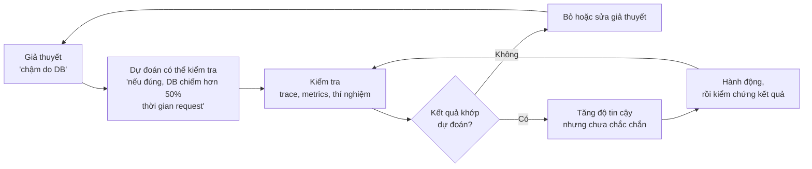

!!! tip "Ba câu hỏi bỏ túi"
    1. **"Nếu mình sai, mình sẽ thấy gì?"** - viết ra trước khi nhìn dữ liệu.
    2. **"Bằng chứng này có xuất hiện ngay cả khi mình sai không?"** - nếu có, nó không chứng minh gì.
    3. **"Có cách giải thích nào khác cho cùng dữ liệu này?"** - liệt kê ít nhất 2.

### 1.3. Vì sao điều này quan trọng hơn trong thời đại AI?

AI tạo ra câu trả lời **nghe đúng** với tốc độ cực nhanh. Một đoạn code AI viết trông sạch sẽ, có comment, có tên biến đẹp - những tín hiệu mà não chúng ta quen coi là "dấu hiệu của chất lượng". Nhưng **độ trôi chảy không phải bằng chứng của sự đúng đắn**. Như đã bàn ở [Bài 7](./07-engineering-with-ai.md) và [Làm việc với AI](../mindset/11-working-with-ai.md), trách nhiệm kiểm chứng vẫn nằm ở người merge code.

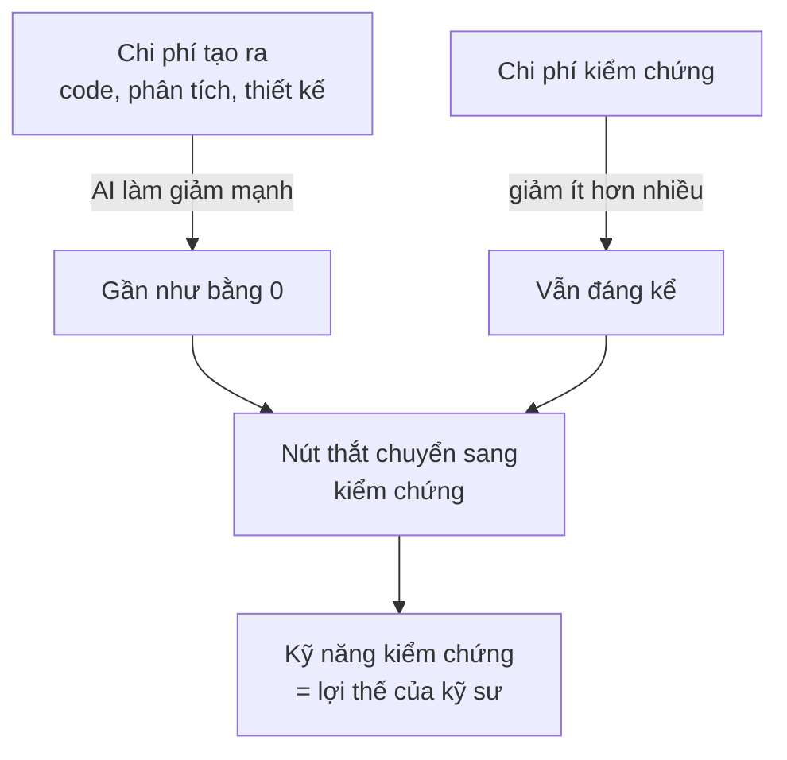

---

## 📖 2. Thang bằng chứng

Không phải mọi bằng chứng đều có trọng lượng như nhau. Hãy hình dung một chiếc thang:

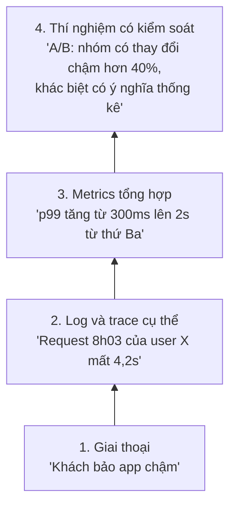

| Bậc | Trả lời được | Không trả lời được | Chi phí |
|---|---|---|---|
| **Giai thoại** | Có vấn đề **có thể** tồn tại | Bao nhiêu người bị? Có phải chỉ một người? | Rất thấp |
| **Log/trace** | Chuyện gì xảy ra với **request cụ thể** này | Có phổ biến không? | Thấp |
| **Metrics** | Vấn đề **lớn cỡ nào**, từ **khi nào** | Nguyên nhân là gì? (tương quan ≠ nhân quả) | Trung bình |
| **Thí nghiệm có kiểm soát** | Thay đổi X **gây ra** Y bao nhiêu | Tác động dài hạn, ngoài phạm vi thí nghiệm | Cao |

### 2.1. Giai thoại không vô dụng - chỉ là chưa đủ

Một tin nhắn "app không thanh toán được" từ khách là **tín hiệu** đáng để điều tra, không phải là **kết luận**. Ngược lại, "metrics không thấy gì" cũng không có nghĩa giai thoại sai - có thể metrics của bạn không đo đúng thứ đó (ví dụ: chỉ đo lỗi phía server, trong khi lỗi nằm ở app phía client).

### 2.2. Tương xứng bằng chứng với độ lớn quyết định

Áp dụng khung **cửa một chiều / cửa hai chiều** ở [Trade-off và ra quyết định](../mindset/07-tradeoffs-decisions.md):

| Quyết định | Bằng chứng cần | Ví dụ |
|---|---|---|
| Cửa hai chiều, rẻ, dễ đảo ngược | Log + phán đoán là đủ | Đổi timeout từ 5s xuống 3s, có feature flag |
| Cửa hai chiều nhưng ảnh hưởng nhiều người | Metrics trước/sau + canary | Đổi thuật toán gợi ý sản phẩm |
| Cửa một chiều, đắt | Thí nghiệm, prototype, đo trên tải thật | Chuyển database, đổi kiến trúc thanh toán |

!!! warning "Hai lỗi đối xứng"
    **Thiếu bằng chứng**: quyết định lớn dựa trên một cảm giác. **Thừa bằng chứng**: chạy A/B 4 tuần cho việc đổi màu một nút trong trang admin nội bộ. Kiểm chứng cũng tốn tiền - chọn mức phù hợp.

---

## 📖 3. Tuyên bố có thể bác bỏ

Nhà triết học Karl Popper đưa ra tiêu chí: một tuyên bố **khoa học** phải có thể bị chứng minh là sai (falsifiable). "Ngày mai trời có thể mưa hoặc không" luôn đúng - và vì vậy vô dụng.

Trong kỹ thuật, rất nhiều tuyên bố nghe hay nhưng không thể bác bỏ:

| Tuyên bố không bác bỏ được | Viết lại để kiểm chứng được |
|---|---|
| "Refactor này giúp hệ thống ổn định hơn" | "Sau refactor, số incident liên quan tới module thanh toán giảm từ 4/tháng xuống tối đa 1/tháng trong quý tới" |
| "Cache giúp trang nhanh hơn" | "p95 latency của `/products` giảm từ 800ms xuống dưới 200ms với cache hit rate trên 85%" |
| "AI coding tool giúp team năng suất hơn" | "Lead time từ commit tới production giảm 20% mà tỉ lệ change failure không tăng quá 2 điểm phần trăm" |
| "Chatbot mới tốt hơn" | "Tỉ lệ giải quyết không cần nhân viên tăng ít nhất 5 điểm %, tỉ lệ khiếu nại không tăng" |
| "Microservices giúp scale tốt hơn" | "Hệ thống chịu được 3x traffic hiện tại với p99 dưới 500ms và chi phí hạ tầng tăng không quá 2x" |

Một tuyên bố tốt có: **chỉ số cụ thể**, **ngưỡng**, **thời gian**, và thường kèm **ràng buộc** (cải thiện cái này mà không làm hỏng cái kia).

!!! tip "Viết tiêu chí thành công TRƯỚC khi làm"
    Nếu viết sau, bạn sẽ vô thức chọn chỉ số nào đẹp nhất. Đây là lý do design doc tốt (xem [Bài 6](./06-idea-to-architecture.md)) có mục **Success metrics** viết trước khi code.

---

## 📖 4. Những cái bẫy trong đầu chúng ta

### 4.1. Thiên kiến xác nhận (confirmation bias)

Khi đã tin một điều, chúng ta **tìm, nhớ và diễn giải** bằng chứng theo hướng ủng hộ niềm tin đó.

Trong debug: bạn tin lỗi do thư viện X → bạn grep log tìm "X" → thấy vài dòng warning của X → "Đấy, đúng rồi!". Bạn không hỏi: những warning đó có xuất hiện cả **lúc hệ thống bình thường** không? (Thường là có.)

**Thuốc giải**:

- So sánh với **nhóm đối chứng**: log lúc lỗi so với log lúc bình thường
- **Viết dự đoán trước** khi nhìn dữ liệu
- Nhờ đồng nghiệp đóng vai **"luật sư của quỷ"** (devil's advocate)
- Khi dùng AI: đừng hỏi "có phải lỗi do X không?" (câu hỏi dẫn dắt - AI rất dễ đồng ý); hãy hỏi "liệt kê 5 nguyên nhân có thể và bằng chứng phân biệt chúng"

### 4.2. Bỏ qua tỉ lệ nền (base rate neglect)

Một hệ thống phát hiện gian lận thẻ có quảng cáo: *"Phát hiện đúng 99% giao dịch gian lận, chỉ báo nhầm 1% giao dịch hợp lệ"*. Nghe tuyệt vời. Khi hệ thống báo động một giao dịch, xác suất nó **thật sự** là gian lận là bao nhiêu?

Hầu hết mọi người đoán ~99%. Hãy tính với **tỉ lệ nền**: chỉ 0,1% giao dịch là gian lận.

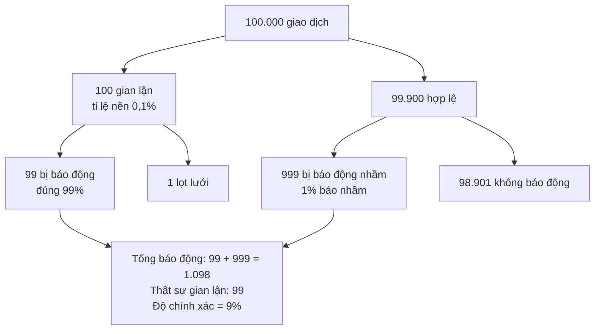

**Chỉ 9% cảnh báo là thật.** Đội vận hành sẽ nhận 10 cảnh báo mà 9 cái là nhầm - và sau một tháng, họ bắt đầu bỏ qua cảnh báo (alert fatigue). Đây chính là lý do hệ thống alert được thiết kế kém sẽ "kêu cho có" (xem [Observability](../backend/11-observability-reliability.md)).

Áp dụng rộng hơn:

- "Test này fail thì 95% là có bug" - nhưng nếu test **flaky** và fail ngẫu nhiên 3% số lần, trong khi bug thật hiếm, phần lớn lần fail là nhiễu.
- "Bộ phát hiện prompt injection chính xác 98%" - trên 1 triệu tin nhắn mà chỉ 50 tin là tấn công, bạn sẽ chặn nhầm khoảng 20.000 khách hàng bình thường.

### 4.3. Survivorship bias - chỉ thấy kẻ sống sót

"Công ty X dùng microservices và thành công rực rỡ, vậy ta cũng nên dùng". Bạn không nghe về 100 công ty dùng microservices quá sớm và chết vì độ phức tạp - họ không viết blog. Tương tự: "Đoạn code cũ này chạy 10 năm không lỗi" - có thể vì chưa ai dùng nhánh code đó.

### 4.4. Hồi quy về trung bình

Tuần này có 9 incident - tệ nhất năm. Team áp dụng quy trình review mới. Tuần sau còn 3 incident. Quy trình mới hiệu quả?

**Chưa chắc.** Những tuần cực đoan thường được theo sau bởi tuần bình thường hơn, **dù bạn có làm gì hay không**. Vì ta thường hành động **đúng lúc mọi thứ tệ nhất**, ta dễ gán công cho hành động. Thuốc giải: so với **xu hướng dài hạn** và với **nhóm không áp dụng thay đổi**.

### 4.5. Post hoc - "sau nó nên do nó"

"Deploy lúc 14h, lỗi tăng lúc 14h05 → deploy gây lỗi". Rất thường đúng, nên đáng kiểm tra đầu tiên - nhưng cũng có thể lúc 14h là khi đối tác chạy batch, hoặc chiến dịch marketing bắt đầu. Kiểm chứng: rollback có làm lỗi biến mất không? Lỗi có xuất hiện ở các instance **chưa** nhận bản deploy không?

---

## 📖 5. Đo trước khi tối ưu

### 5.1. Trực giác về hiệu năng thường sai

Lập trình viên kinh nghiệm cũng đoán sai chỗ chậm. Lý do: hệ thống hiện đại có quá nhiều tầng (cache CPU, GC, network, disk, lock, connection pool) để trực giác bao quát được. Quy trình đúng (chi tiết ở [Trade-off và ra quyết định](../mindset/07-tradeoffs-decisions.md)):

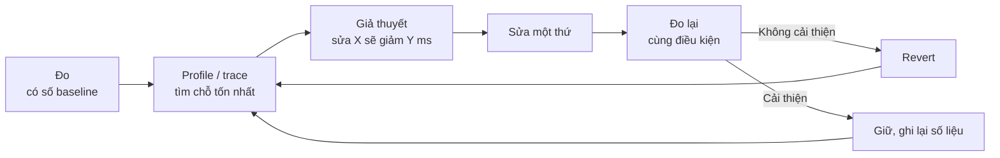

### 5.2. Định luật Amdahl: tối ưu chỗ nhỏ thì lợi ích nhỏ

Nếu một phần chiếm tỉ lệ **p** thời gian và bạn làm nó nhanh hơn **s** lần, tổng thời gian còn:

```text
Thời gian mới = (1 - p) + p / s
```

**Ví dụ**: một request 1.000ms gồm: query DB 100ms (10%), gọi service khuyến mãi 700ms (70%), render JSON 200ms (20%).

| Tối ưu | Tính | Thời gian mới | Cải thiện |
|---|---|---|---|
| DB nhanh gấp 10 lần (thêm index, mất 1 tuần) | 900 + 100/10 | 910ms | **9%** |
| Service khuyến mãi nhanh gấp 2 lần (gọi batch thay vì N+1) | 300 + 700/2 | 650ms | **35%** |
| Render JSON nhanh gấp 10 lần (đổi thư viện) | 800 + 200/10 | 820ms | **18%** |

Làm phần lớn nhất nhanh **gấp đôi** có lợi hơn làm phần nhỏ nhanh **gấp mười**. Bạn chỉ biết phần nào lớn nhất khi **đo**.

---

## 📖 6. Khi con số nói dối: trung bình, percentile và Simpson's paradox

### 6.1. Trung bình che giấu đuôi dài

Hai service có **cùng latency trung bình ~100ms**. Một cái đều đều; một cái 96% request rất nhanh và 4% request rất chậm. Dashboard chỉ hiện "trung bình" sẽ nói hai cái như nhau. Người dùng thì không nghĩ vậy.

Và khi một trang gọi **nhiều lần** tới service có đuôi dài (fan-out), xác suất **ít nhất một** lần bị chậm tăng rất nhanh: `1 - (1 - 0,04)^n`.

### 6.2. Simpson's paradox: tổng ngược chiều với từng phần

Công ty triển khai bot CSKH mới song song với bot cũ. Báo cáo tổng: bot cũ giải quyết được 82,6% ticket, bot mới chỉ 78,0%. Sếp muốn bỏ bot mới. Nhưng khi tách theo độ khó của ticket...

Chương trình dưới đây dùng dữ liệu **tất định** (không random) để ai chạy cũng ra cùng con số:

=== "Go"

    ```go
    package main

    import (
    	"fmt"
    	"math"
    	"sort"
    	"strings"
    )

    // percentile dùng nearest-rank: giá trị nhỏ nhất mà >= p% số mẫu <= nó.
    func percentile(sorted []int, p float64) int {
    	k := int(math.Ceil(p / 100 * float64(len(sorted))))
    	if k < 1 {
    		k = 1
    	}
    	return sorted[k-1]
    }

    func report(name string, vals []int) {
    	s := append([]int(nil), vals...)
    	sort.Ints(s)
    	sum := 0
    	for _, v := range s {
    		sum += v
    	}
    	mean := float64(sum) / float64(len(s))
    	fmt.Printf("%-14s mean=%7.1f  p50=%5d  p95=%5d  p99=%5d  max=%5d\n",
    		name, mean, percentile(s, 50), percentile(s, 95), percentile(s, 99), s[len(s)-1])
    }

    func main() {
    	// 1000 request mỗi service, dữ liệu tất định để ai chạy cũng ra cùng số
    	var a, b []int
    	for i := 0; i < 1000; i++ {
    		a = append(a, 95+(i*7)%11) // đều đều ~100ms
    		if i%100 < 96 {
    			b = append(b, 40+(i*7)%11) // 96% nhanh
    		} else {
    			b = append(b, 1300+(i*13)%200) // 4% rất chậm
    		}
    	}
    	fmt.Println("== Phần 1: trung bình che giấu đuôi dài (ms)")
    	report("Service A", a)
    	report("Service B", b)

    	slow := 0
    	for _, v := range b {
    		if v > 1000 {
    			slow++
    		}
    	}
    	slowB := float64(slow) / float64(len(b))
    	fmt.Printf("Tỉ lệ request B > 1s: %.1f%%\n", slowB*100)
    	for _, fanout := range []int{1, 5, 10, 20} {
    		pHit := 1 - math.Pow(1-slowB, float64(fanout))
    		fmt.Printf("  trang gọi %2d lần tới B -> %4.1f%% lượt tải trang bị chậm > 1s\n", fanout, pHit*100)
    	}

    	fmt.Println()
    	fmt.Println("== Phần 2: Simpson's paradox - bot mới vs bot cũ (ticket giải quyết được)")
    	type seg struct {
    		name  string
    		ok, n int
    	}
    	bots := []struct {
    		name string
    		segs []seg
    	}{
    		{"Bot mới", []seg{{"dễ", 81, 87}, {"khó", 192, 263}}},
    		{"Bot cũ", []seg{{"dễ", 234, 270}, {"khó", 55, 80}}},
    	}
    	for _, bot := range bots {
    		var parts []string
    		totOK, totN := 0, 0
    		for _, s := range bot.segs {
    			parts = append(parts, fmt.Sprintf("%s: %3d/%3d = %4.1f%%", s.name, s.ok, s.n, float64(s.ok)/float64(s.n)*100))
    			totOK += s.ok
    			totN += s.n
    		}
    		fmt.Printf("%-8s | %s | TỔNG: %d/%d = %4.1f%%\n", bot.name, strings.Join(parts, " | "),
    			totOK, totN, float64(totOK)/float64(totN)*100)
    	}
    }
    ```

=== "Python"

    ```python
    import math


    def percentile(sorted_vals, p):
        """Nearest-rank: giá trị nhỏ nhất mà >= p% số mẫu nằm dưới hoặc bằng nó."""
        k = math.ceil(p / 100 * len(sorted_vals))
        return sorted_vals[max(k, 1) - 1]


    def report(name, vals):
        s = sorted(vals)
        mean = sum(s) / len(s)
        print(f"{name:<14} mean={mean:7.1f}  p50={percentile(s, 50):5d}  "
              f"p95={percentile(s, 95):5d}  p99={percentile(s, 99):5d}  max={s[-1]:5d}")


    # 1000 request mỗi service, dữ liệu tất định (không random) để ai chạy cũng ra cùng số
    service_a = [95 + (i * 7) % 11 for i in range(1000)]                  # đều đều ~100ms
    service_b = [40 + (i * 7) % 11 if i % 100 < 96 else 1300 + (i * 13) % 200
                 for i in range(1000)]                                    # 96% nhanh, 4% rất chậm

    print("== Phần 1: trung bình che giấu đuôi dài (ms)")
    report("Service A", service_a)
    report("Service B", service_b)

    slow_b = sum(v > 1000 for v in service_b) / len(service_b)
    print(f"Tỉ lệ request B > 1s: {slow_b:.1%}")
    for fanout in (1, 5, 10, 20):
        p_hit = 1 - (1 - slow_b) ** fanout
        print(f"  trang gọi {fanout:2d} lần tới B -> {p_hit:5.1%} lượt tải trang bị chậm > 1s")

    print()
    print("== Phần 2: Simpson's paradox - bot mới vs bot cũ (ticket giải quyết được)")
    data = {  # (giải quyết, tổng)
        "Bot mới": {"dễ": (81, 87), "khó": (192, 263)},
        "Bot cũ":  {"dễ": (234, 270), "khó": (55, 80)},
    }
    for bot, seg in data.items():
        parts = []
        tot_ok = tot_n = 0
        for name, (ok, n) in seg.items():
            parts.append(f"{name}: {ok:3d}/{n:3d} = {ok / n:5.1%}")
            tot_ok, tot_n = tot_ok + ok, tot_n + n
        print(f"{bot:<8} | {' | '.join(parts)} | TỔNG: {tot_ok}/{tot_n} = {tot_ok / tot_n:5.1%}")
    ```

Output (giống hệt nhau ở cả hai ngôn ngữ):

```text
== Phần 1: trung bình che giấu đuôi dài (ms)
Service A      mean=  100.0  p50=  100  p95=  105  p99=  105  max=  105
Service B      mean=   99.9  p50=   45  p95=   50  p99= 1461  max= 1487
Tỉ lệ request B > 1s: 4.0%
  trang gọi  1 lần tới B ->  4.0% lượt tải trang bị chậm > 1s
  trang gọi  5 lần tới B -> 18.5% lượt tải trang bị chậm > 1s
  trang gọi 10 lần tới B -> 33.5% lượt tải trang bị chậm > 1s
  trang gọi 20 lần tới B -> 55.8% lượt tải trang bị chậm > 1s

== Phần 2: Simpson's paradox - bot mới vs bot cũ (ticket giải quyết được)
Bot mới  | dễ:  81/ 87 = 93.1% | khó: 192/263 = 73.0% | TỔNG: 273/350 = 78.0%
Bot cũ   | dễ: 234/270 = 86.7% | khó:  55/ 80 = 68.8% | TỔNG: 289/350 = 82.6%
```

### 6.3. Đọc kết quả

**Phần 1 - percentile:**

- Trung bình của A và B gần như bằng nhau (100,0 và 99,9ms). Nếu dashboard chỉ có "avg latency", bạn sẽ kết luận hai service tương đương.
- **p50** của B (45ms) còn đẹp hơn A rất nhiều. **p95** của B (50ms) cũng đẹp. Chỉ **p99** mới lộ ra 4% request mất gần 1,5 giây. Bài học: **chọn percentile phù hợp với tỉ lệ vấn đề** - một vấn đề ảnh hưởng 4% request sẽ vô hình ở p95.
- Một trang gọi B 10 lần thì **1/3 lượt tải trang bị chậm**. Đuôi dài của từng service trở thành **thân chính** của trải nghiệm người dùng. Đây là lý do các hệ thống lớn quan tâm p99, p99.9 chứ không phải trung bình.

**Phần 2 - Simpson's paradox:**

- Ở **từng nhóm**, bot mới đều tốt hơn: ticket dễ 93,1% so với 86,7%; ticket khó 73,0% so với 68,8%.
- Nhưng **tổng** thì bot mới thua: 78,0% so với 82,6%.
- Lý do: bot mới được giao **nhiều ticket khó hơn** (263/350 = 75% là ticket khó) trong khi bot cũ chủ yếu nhận ticket dễ (270/350 = 77%). Tỉ lệ tổng bị chi phối bởi **cơ cấu** chứ không phải chất lượng.

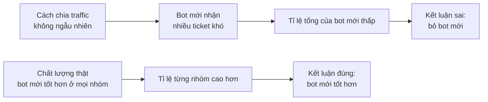

!!! warning "Phòng Simpson's paradox"
    1. **Phân bổ ngẫu nhiên** (randomize) khi so sánh - đây là lý do A/B test cần chia ngẫu nhiên, không để "bot mới xử lý kênh chat, bot cũ xử lý email".
    2. Luôn **tách theo các biến gây nhiễu** quan trọng (độ khó, nền tảng, khu vực, khách mới/cũ) trước khi kết luận.
    3. Hỏi: **"Cơ cấu hai nhóm có giống nhau không?"**

---

## 📖 7. Thiết kế thí nghiệm

Khi cần biết thay đổi X có **gây ra** kết quả Y không, công cụ mạnh nhất là **thí nghiệm có kiểm soát** - trong sản phẩm số thường là **A/B test**. Góc nhìn sản phẩm của A/B test ở [Product thinking](../mindset/09-product-thinking.md); ở đây ta tập trung vào **tư duy kiểm chứng**.

### 7.1. Cấu trúc một thí nghiệm

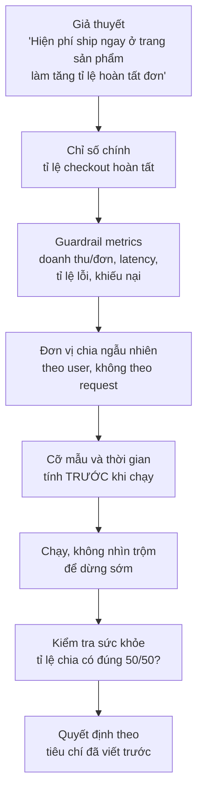

### 7.2. Các thành phần quan trọng

**Chỉ số chính (primary metric)**: **một** chỉ số bạn muốn thay đổi. Nhiều chỉ số chính = nhiều cơ hội "thắng" do may mắn.

**Guardrail metrics**: những chỉ số **không được xấu đi**. Tăng tỉ lệ checkout bằng cách giấu phí ship tới bước cuối có thể làm tăng... khiếu nại và hoàn đơn. Guardrail bảo vệ bạn khỏi **chiến thắng giả**.

**Đơn vị ngẫu nhiên**: chia theo **user** (một người luôn thấy cùng một phiên bản), không theo request - nếu không, cùng một người lúc thấy A lúc thấy B, trải nghiệm rối và dữ liệu nhiễu.

**Cỡ mẫu**: quy tắc kinh nghiệm cho tỉ lệ chuyển đổi (độ mạnh 80%, mức ý nghĩa 5%):

```text
n mỗi nhóm ≈ 16 × p × (1 - p) / δ²

Ví dụ: tỉ lệ hiện tại p = 5%, muốn phát hiện mức tăng tuyệt đối δ = 0,5 điểm % (5% → 5,5%)
n ≈ 16 × 0,05 × 0,95 / 0,005² = 0,76 / 0,000025 ≈ 30.400 người MỖI nhóm
```

Nếu shop của bạn chỉ có 2.000 khách/ngày, thí nghiệm này cần khoảng **một tháng**. Biết trước con số giúp bạn quyết định: chạy, hay chọn thay đổi lớn hơn (δ lớn hơn → cần ít mẫu hơn rất nhiều, vì δ nằm ở mẫu số và bị bình phương).

### 7.3. Những cái bẫy kinh điển

| Bẫy | Chuyện gì xảy ra | Cách tránh |
|---|---|---|
| **Nhìn trộm (peeking)** | Xem kết quả mỗi ngày, dừng ngay khi thấy "có ý nghĩa" → tỉ lệ kết luận sai tăng vọt | Cố định cỡ mẫu trước, hoặc dùng phương pháp thống kê cho phép xem liên tục |
| **Sample ratio mismatch** | Chia 50/50 nhưng thực tế 52/48 → có bug trong phân nhóm (vd. nhóm B bị crash nên ít log hơn) | Luôn kiểm tra tỉ lệ chia trước khi đọc kết quả |
| **Hiệu ứng mới lạ** | Người dùng tò mò bấm tính năng mới vài ngày đầu | Chạy đủ dài (ít nhất 1-2 chu kỳ tuần) |
| **Nhiều chỉ số, nhiều phân khúc** | Kiểm tra 20 phân khúc, kiểu gì cũng có 1 cái "có ý nghĩa" do ngẫu nhiên | Khai báo trước phân khúc quan trọng; coi phát hiện khác là giả thuyết cho lần sau |
| **Nhóm bị ảnh hưởng lẫn nhau** | Test giá trên sàn: người bán ở nhóm A phản ứng, ảnh hưởng cả nhóm B | Chia theo cụm (khu vực, thời gian) |

### 7.4. Khi không thể A/B

Không phải lúc nào cũng A/B được: đổi database, thay đổi pháp lý, sự cố. Các phương án thay thế, xếp theo độ tin cậy giảm dần:

- **Canary có so sánh**: 5% instance chạy phiên bản mới, so với 95% còn lại **cùng thời điểm**
- **So sánh trước/sau có đối chứng**: so với khu vực/nhóm không thay đổi trong cùng giai đoạn (difference-in-differences)
- **Trước/sau đơn thuần**: yếu nhất - mùa vụ, marketing, sự kiện ngoài có thể giải thích thay đổi

---

## 📖 8. Kiểm chứng code

Nền tảng về test ở [Testing và chất lượng](../mindset/06-testing-quality.md). Ở đây ta nhìn bằng góc tư duy kiểm chứng: **mỗi kỹ thuật bắt được loại sai nào?**

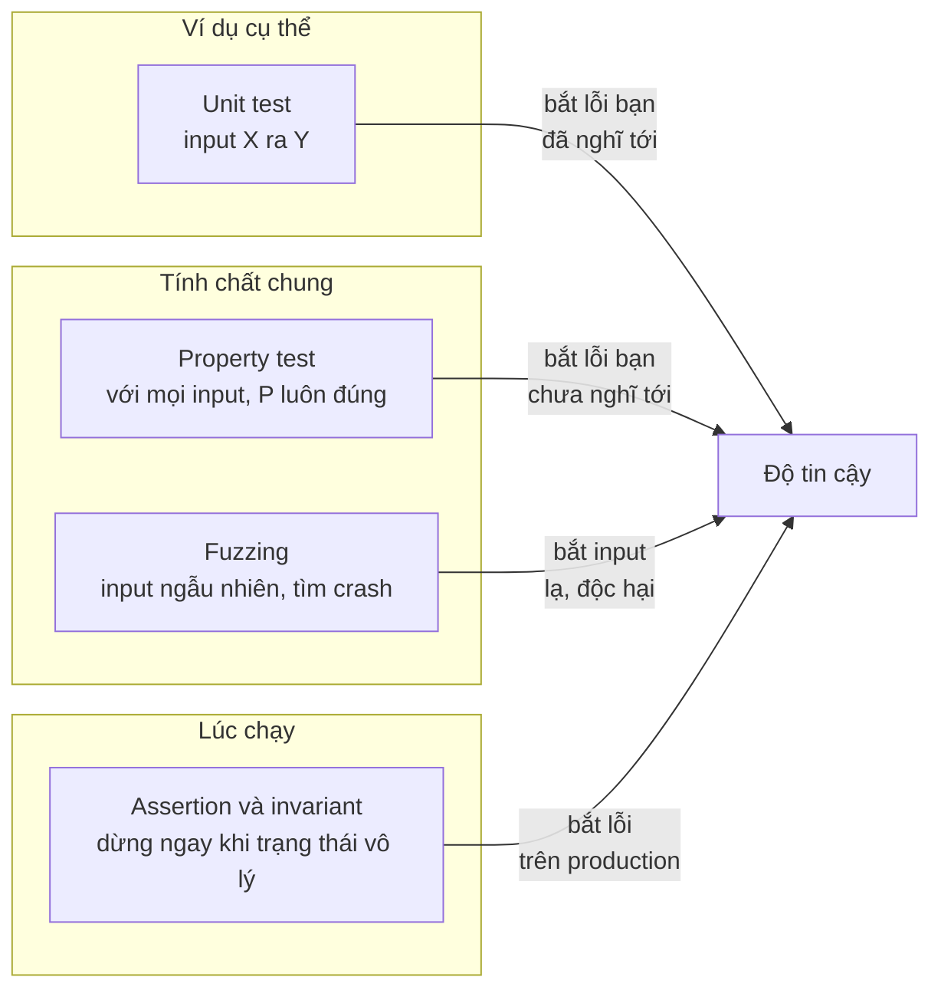

### 8.1. Vì sao unit test "bằng tay" không đủ - nhất là với code AI viết

Khi viết test bằng ví dụ, ta chọn những con số "đẹp": 300.000đ chia 3 người. AI cũng vậy - nó tạo test cùng lúc với code, từ cùng một cách hiểu (có thể sai). Test và code **chia sẻ cùng điểm mù**.

**Property-based testing** đổi câu hỏi: thay vì "với input này, output là gì?", ta hỏi **"tính chất nào phải luôn đúng, với mọi input?"**

Ví dụ: hàm **chia hóa đơn** cho nhóm bạn đi ăn (số tiền tính bằng đồng, số nguyên). Tính chất phải đúng:

1. Số phần = số người
2. Tổng các phần = tổng hóa đơn (không ai "ăn chặn" 1 đồng nào)
3. Không ai trả số âm
4. Chênh lệch giữa người trả nhiều nhất và ít nhất không quá 1 đồng (công bằng)

Ta không cần biết đáp án cụ thể cho từng input - chỉ cần kiểm tra **tính chất**. Ví dụ dưới đây kiểm tra **vét cạn** mọi tổ hợp nhỏ (0-1.000 đồng, 1-10 người) để output tất định; thư viện property testing thật sẽ sinh input ngẫu nhiên và **thu nhỏ** (shrink) phản ví dụ.

=== "Go"

    ```go
    package main

    import (
    	"fmt"
    	"strings"
    )

    // splitBillAI: phiên bản AI gợi ý - làm tròn phần mỗi người, người cuối "gánh" phần lệch.
    func splitBillAI(total, n int) []int {
    	each := (total + n/2) / n // làm tròn nửa lên, số nguyên
    	parts := make([]int, n)
    	for i := 0; i < n-1; i++ {
    		parts[i] = each
    	}
    	parts[n-1] = total - each*(n-1)
    	return parts
    }

    // splitBillFixed: chia đều, r người đầu tiên trả thêm 1 đồng.
    func splitBillFixed(total, n int) []int {
    	base, r := total/n, total%n
    	parts := make([]int, n)
    	for i := range parts {
    		parts[i] = base
    		if i < r {
    			parts[i]++
    		}
    	}
    	return parts
    }

    // checkProperties: các tính chất PHẢI đúng với mọi input - không cần biết đáp án cụ thể.
    func checkProperties(parts []int, total, n int) string {
    	if len(parts) != n {
    		return "sai số người"
    	}
    	sum, lo, hi := 0, parts[0], parts[0]
    	for _, p := range parts {
    		sum += p
    		lo, hi = min(lo, p), max(hi, p)
    	}
    	switch {
    	case sum != total:
    		return "tổng không khớp"
    	case lo < 0:
    		return "có người trả số âm"
    	case hi-lo > 1:
    		return "chênh lệch quá 1 đồng"
    	}
    	return ""
    }

    func show(parts []int) string {
    	s := make([]string, len(parts))
    	for i, p := range parts {
    		s[i] = fmt.Sprint(p)
    	}
    	return "[" + strings.Join(s, ", ") + "]"
    }

    func main() {
    	fns := []struct {
    		name string
    		fn   func(int, int) []int
    	}{{"split_bill_ai", splitBillAI}, {"split_bill_fixed", splitBillFixed}}

    	for _, f := range fns {
    		fails, first := 0, ""
    		for total := 0; total <= 1000; total++ { // kiểm tra vét cạn miền nhỏ
    			for n := 1; n <= 10; n++ {
    				if err := checkProperties(f.fn(total, n), total, n); err != "" {
    					fails++
    					if first == "" {
    						first = fmt.Sprintf("total=%d, n=%d -> %s (%s)", total, n, show(f.fn(total, n)), err)
    					}
    				}
    			}
    		}
    		fmt.Printf("%s: %d / 10010 input vi phạm\n", f.name, fails)
    		if first != "" {
    			fmt.Println("  phản ví dụ nhỏ nhất:", first)
    		}
    	}

    	// Ví dụ cụ thể mà unit test "bằng tay" hay chọn - đều PASS với bản lỗi:
    	for _, c := range [][2]int{{300_000, 3}, {100_000, 4}, {250_000, 2}} {
    		fmt.Printf("split_bill_ai(%d, %d) = %s\n", c[0], c[1], show(splitBillAI(c[0], c[1])))
    	}
    }
    ```

=== "Python"

    ```python
    def split_bill_ai(total: int, n: int) -> list[int]:
        """Phiên bản AI gợi ý: làm tròn phần mỗi người, người cuối 'gánh' phần lệch."""
        each = (total + n // 2) // n          # làm tròn nửa lên, số nguyên
        return [each] * (n - 1) + [total - each * (n - 1)]


    def split_bill_fixed(total: int, n: int) -> list[int]:
        """Chia đều, r người đầu tiên trả thêm 1 đồng."""
        base, r = divmod(total, n)
        return [base + 1] * r + [base] * (n - r)


    def check_properties(parts, total, n):
        """Các tính chất PHẢI đúng với mọi input - không cần biết đáp án cụ thể."""
        if len(parts) != n:
            return "sai số người"
        if sum(parts) != total:
            return "tổng không khớp"
        if min(parts) < 0:
            return "có người trả số âm"
        if max(parts) - min(parts) > 1:
            return "chênh lệch quá 1 đồng"
        return None


    for fn in (split_bill_ai, split_bill_fixed):
        fails, first = 0, None
        for total in range(0, 1001):          # kiểm tra vét cạn miền nhỏ
            for n in range(1, 11):
                err = check_properties(fn(total, n), total, n)
                if err:
                    fails += 1
                    if first is None:
                        first = (total, n, fn(total, n), err)
        print(f"{fn.__name__}: {fails} / 10010 input vi phạm")
        if first:
            total, n, parts, err = first
            print(f"  phản ví dụ nhỏ nhất: total={total}, n={n} -> {parts} ({err})")

    # Ví dụ cụ thể mà unit test "bằng tay" hay chọn - đều PASS với bản lỗi:
    for total, n in ((300_000, 3), (100_000, 4), (250_000, 2)):
        print(f"split_bill_ai({total}, {n}) = {split_bill_ai(total, n)}")
    ```

Output (giống hệt nhau ở cả hai ngôn ngữ):

```text
split_bill_ai: 3714 / 10010 input vi phạm
  phản ví dụ nhỏ nhất: total=2, n=4 -> [1, 1, 1, -1] (có người trả số âm)
split_bill_fixed: 0 / 10010 input vi phạm
split_bill_ai(300000, 3) = [100000, 100000, 100000]
split_bill_ai(100000, 4) = [25000, 25000, 25000, 25000]
split_bill_ai(250000, 2) = [125000, 125000]
```

Ba unit test "đẹp" đều pass. Kiểm tra tính chất tìm ra **37% input vi phạm**, trong đó có trường hợp vô lý: 2 đồng chia 4 người thì một người **trả -1 đồng**. Với tiền thật tính theo nghìn đồng: hóa đơn 250.000đ chia 6 người thì 5 người trả 42.000đ, người cuối chỉ trả 40.000đ (chia công bằng phải là 42-42-42-42-41-41). Sai vài nghìn đồng, nhưng đây đúng là loại bug khiến người dùng chụp màn hình đăng lên mạng và mất niềm tin.

!!! tip "Công cụ thật"
    Python: thư viện **Hypothesis** (`@given(st.integers(...))`). Go: **fuzzing tích hợp** từ Go 1.18 (`func FuzzSplit(f *testing.F)`, chạy `go test -fuzz=FuzzSplit`) - sinh input ngẫu nhiên, lưu lại input gây lỗi thành test hồi quy. Khi nhờ AI viết code, hãy nhờ nó **liệt kê các tính chất bất biến** trước - rồi tự kiểm tra danh sách đó có hợp lý không.

### 8.2. Fuzzing - ném rác vào xem có vỡ không

Fuzzing sinh hàng triệu input ngẫu nhiên hoặc biến dị (chuỗi rỗng, chuỗi cực dài, ký tự Unicode lạ, số âm, JSON lồng 1.000 tầng) để tìm **crash, treo, lỗi bộ nhớ**. Đặc biệt hữu ích cho: parser, hàm xử lý input từ người dùng, hàm giải mã file tải lên. Fuzzing không cần biết output đúng - chỉ cần "không được crash".

### 8.3. Invariant và assertion - kiểm chứng ngay trên production

Test chạy trước khi deploy. Nhưng có những trạng thái vô lý chỉ xuất hiện với dữ liệu thật. **Invariant** là điều luôn phải đúng với hệ thống:

- Tổng tiền các dòng trong đơn hàng = tổng tiền đơn hàng
- Số dư ví không bao giờ âm
- Đơn ở trạng thái `SHIPPED` phải có mã vận đơn
- Tổng tiền vào - tổng tiền ra = chênh lệch số dư (đối soát)

Hai cách dùng:

1. **Assertion trong code**: kiểm tra ngay tại chỗ, fail nhanh (thà từ chối một giao dịch còn hơn ghi sai sổ)
2. **Job đối soát định kỳ**: quét dữ liệu tìm vi phạm invariant, cảnh báo - bắt được lỗi do nhiều thành phần phối hợp sai, mà không đoạn code đơn lẻ nào thấy

---

## 📖 9. Kiểm chứng hệ thống đang chạy

Code đúng chưa đủ - hệ thống gồm code + cấu hình + hạ tầng + dữ liệu + người dùng thật. Kiểm chứng hệ thống trả lời: **"Ngay lúc này, hệ thống có đang làm đúng việc của nó không?"**

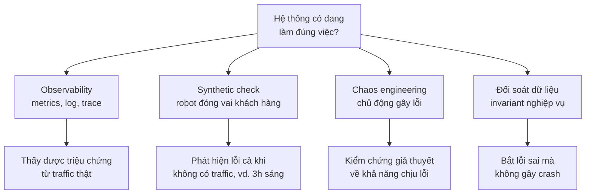

### 9.1. Observability

Chi tiết ở [Observability và reliability](../backend/11-observability-reliability.md). Ở góc kiểm chứng: dashboard của bạn chỉ trả lời được những câu hỏi bạn **đã nghĩ tới khi thiết kế nó**. Hãy tự hỏi: *"Nếu hệ thống đang hỏng theo kiểu X, chỉ số nào sẽ thay đổi?"* - nếu không có chỉ số nào, bạn đang mù với kiểu hỏng X.

### 9.2. Synthetic check - robot khách hàng

Mỗi phút, một script đóng vai khách: đăng nhập tài khoản test, tìm sản phẩm, thêm vào giỏ, thanh toán bằng thẻ test, kiểm tra email xác nhận. Nếu bất kỳ bước nào fail hoặc chậm, cảnh báo.

Ưu điểm: phát hiện lỗi **trước** khi khách thật gặp, kể cả lúc 3 giờ sáng không có traffic. Kiểm tra cả **luồng nghiệp vụ end-to-end**, không chỉ "server còn sống" (health check trả 200 OK nhưng nút thanh toán bị lỗi JavaScript thì health check không biết).

### 9.3. Chaos engineering - kiểm chứng bằng cách chủ động phá

Chaos engineering **không phải** là "phá lung tung xem sao". Nó là **thí nghiệm khoa học**:

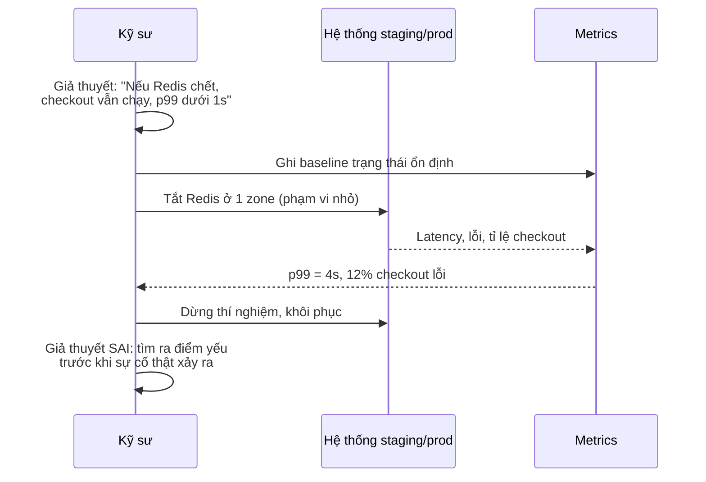

Các bước: (1) định nghĩa **trạng thái ổn định** bằng số liệu, (2) đặt **giả thuyết** hệ thống vẫn ổn định khi có sự cố X, (3) gây sự cố với **phạm vi nhỏ nhất** (blast radius), có nút dừng khẩn cấp, (4) so sánh, (5) sửa điểm yếu. Bắt đầu ở staging, với **game day** có cả team tham gia. Đây là cách kiểm chứng các giả định ở [Bài 5: Tư duy về thất bại](./05-failure-thinking.md).

---

## 📖 10. Kiểm chứng output của AI

AI là nguồn tạo ra nhiều thứ cần kiểm chứng nhất trong công việc hằng ngày của kỹ sư hiện đại. Cách tiếp cận phụ thuộc vào **khối lượng** và **hậu quả khi sai**.

### 10.1. Ma trận chọn cách kiểm chứng

| Tình huống | Cách kiểm chứng |
|---|---|
| Một đoạn code AI viết cho bạn | Đọc hiểu từng dòng, chạy, viết test cho edge case, kiểm tra tính chất (Mục 8) |
| AI trả lời câu hỏi kỹ thuật ("thư viện X có hỗ trợ Y không?") | Kiểm tra tài liệu chính thức, đọc source, thử một ví dụ nhỏ |
| AI tóm tắt tài liệu dài | Đối chiếu ngẫu nhiên vài ý với bản gốc; đặc biệt kiểm tra con số, tên riêng, phủ định ("không được" bị tóm thành "được") |
| Hệ thống AI xử lý hàng nghìn việc mỗi ngày | Lấy mẫu ngẫu nhiên + đáp án tham chiếu + eval tự động ([Bài 8](./08-building-ai-systems.md)) |
| AI trích dẫn nguồn | Mở từng nguồn: có tồn tại không? có nói đúng điều được trích không? |

### 10.2. Lấy mẫu: kiểm bao nhiêu là đủ?

Bạn kiểm tra ngẫu nhiên 100 câu trả lời của chatbot, **không thấy lỗi nào**. Có thể kết luận tỉ lệ lỗi là 0%?

Không. **Quy tắc số 3** (rule of three): nếu kiểm **n** mẫu ngẫu nhiên và không thấy lỗi nào, với độ tin cậy 95%, tỉ lệ lỗi thật có thể lên tới khoảng **3/n**.

| Số mẫu kiểm, 0 lỗi | Tỉ lệ lỗi thật có thể lên tới (95%) | Với 50.000 câu trả lời/ngày |
|---|---|---|
| 30 | ~10% | ~5.000 câu sai/ngày |
| 100 | ~3% | ~1.500 câu sai/ngày |
| 300 | ~1% | ~500 câu sai/ngày |
| 3.000 | ~0,1% | ~50 câu sai/ngày |

Bài học: "Em test 20 câu, không câu nào sai" **không phải** là bằng chứng chatbot an toàn để phục vụ hàng chục nghìn khách. Muốn chứng minh tỉ lệ lỗi thấp, cần **rất nhiều** mẫu - đó là lý do eval tự động và guardrail quan trọng.

### 10.3. Đáp án tham chiếu và lấy mẫu phân tầng

- **Đáp án tham chiếu** (reference answers): chuyên gia viết đáp án đúng cho một tập câu hỏi; so câu trả lời AI với đáp án (bằng người hoặc giám khảo AI đã hiệu chuẩn).
- **Lấy mẫu phân tầng**: thay vì lấy 300 mẫu ngẫu nhiên toàn bộ (có thể chỉ được 5 câu về bảo hành), lấy đủ mẫu **cho từng nhóm quan trọng**: 100 câu về hoàn tiền, 100 câu về bảo hành, 100 câu tiếng Việt không dấu...
- **Lấy mẫu theo rủi ro**: ưu tiên kiểm những câu trả lời có từ khóa nhạy cảm (tiền, pháp lý, sức khỏe), độ tự tin thấp, hoặc khách phản hồi tiêu cực - **nhưng** luôn giữ một phần lấy mẫu ngẫu nhiên thuần, để không bỏ sót loại lỗi bạn chưa biết.

---

## 📖 11. Kiểm chứng tuyên bố và benchmark trên mạng

"Framework X nhanh gấp 10 lần framework Y!" - "Database Z xử lý 1 triệu query/giây!" - "Công cụ AI này tăng năng suất 55%!"

Mỗi ngày bạn đọc hàng chục tuyên bố như vậy. Bộ câu hỏi kiểm chứng:

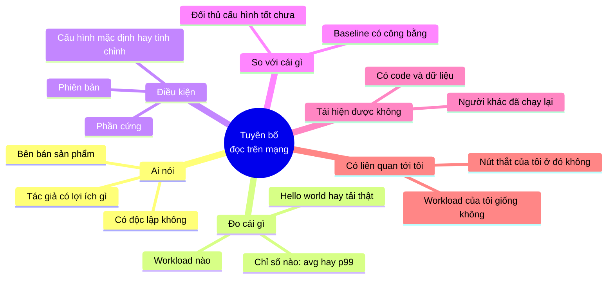

### 11.1. Ví dụ phân tích một benchmark

> *"Framework A xử lý 500.000 request/giây, nhanh gấp 10 lần framework B (50.000 request/giây)."*

Câu hỏi kiểm chứng:

1. **Workload**: endpoint trả về chuỗi "Hello World" cố định. API thật của bạn query database mất 20ms → nút thắt là DB, không phải framework. Khác biệt 10 lần ở tầng framework có thể chỉ còn khác biệt 2% ở tầng ứng dụng (định luật Amdahl, Mục 5.2).
2. **Cấu hình**: framework B chạy chế độ debug, log mọi request ra console.
3. **Chỉ số**: throughput trung bình - không nói gì về p99.
4. **Tác giả**: người viết benchmark là tác giả của framework A.
5. **Tái hiện**: không công bố code benchmark.

Kết luận hợp lý: **tuyên bố này không cung cấp thông tin hữu ích cho quyết định của bạn**. Nếu thực sự cân nhắc, hãy tự benchmark với **workload đại diện** của chính bạn.

### 11.2. Tuyên bố về năng suất và nghiên cứu

Với những tuyên bố kiểu "tăng năng suất X%":

- **Đo năng suất bằng gì?** Số dòng code, số PR, thời gian hoàn thành một bài tập nhỏ - hay giá trị giao cho khách hàng?
- **Nhóm tham gia là ai?** Sinh viên làm bài tập mới hay kỹ sư làm việc với codebase lớn quen thuộc?
- **Có đo chất lượng không?** Nhanh hơn 50% nhưng bug tăng gấp đôi thì sao? (Case study 4 ở [Bài 10](./10-case-studies.md) đào sâu tình huống này.)
- **Thời gian theo dõi bao lâu?** Hiệu quả tuần đầu khác hiệu quả sau 6 tháng (nợ kỹ thuật tích tụ).

!!! tip "Thái độ đúng: hoài nghi có phương pháp, không phải hoài nghi mọi thứ"
    Mục tiêu không phải bác bỏ mọi thứ bạn đọc. Mục tiêu là biết **mức độ tin** phù hợp: "Đây là tín hiệu thú vị, đáng thử nghiệm nhỏ trên workload của mình" khác với "Đây là sự thật, cả team chuyển sang ngay".

---

## 🌍 Tình huống thực tế

### Tình huống 1: "Tối ưu xong, nhanh hơn 40%!"

Một kỹ sư báo: sau khi đổi thư viện JSON, API nhanh hơn 40%. Bằng chứng: chạy benchmark trên laptop trước và sau. Câu hỏi kiểm chứng: lần đo "trước" có chạy lúc laptop đang build Docker không? Đo mấy lần? Trên production, JSON chiếm bao nhiêu % thời gian request? Kết quả điều tra: chạy lại 10 lần mỗi bên trên máy sạch, chênh lệch còn 6% ở microbenchmark; trên production, JSON chiếm 3% thời gian request → cải thiện thực tế **0,2%**. Vẫn có thể giữ thay đổi, nhưng **không** nên báo cáo "nhanh hơn 40%".

### Tình huống 2: Dashboard xanh, khách kêu

Mọi chỉ số xanh: error rate 0,1%, latency trung bình 120ms. Nhưng CSKH nhận nhiều phàn nàn "app quay mãi không thanh toán được". Điều tra: lỗi xảy ra ở SDK cổng thanh toán **phía app**, timeout sau 30s, không bao giờ tới server → server không thấy lỗi. Bài học: giai thoại (bậc 1) đúng, metrics (bậc 3) mù vì **đo sai chỗ**. Sửa: thêm metrics phía client và synthetic check cho luồng thanh toán trên app thật.

### Tình huống 3: A/B test "thắng" nhưng doanh thu giảm

Team thử popup giảm giá 10% cho khách sắp rời trang. Chỉ số chính - tỉ lệ đặt hàng - tăng 8%, có ý nghĩa thống kê. Nhưng guardrail **doanh thu ròng/khách** giảm 3%: khách quen vốn đã định mua cũng nhận giảm giá. Nhờ có guardrail metric, team không triển khai rộng, mà thử lại chỉ với khách mới.

### Tình huống 4: AI khẳng định "hàm này thread-safe"

Bạn hỏi trợ lý AI: "map trong đoạn code này có an toàn khi nhiều goroutine cùng ghi không?" AI trả lời tự tin: "Có, vì đã dùng mutex". Bạn kiểm chứng: đọc code, thấy mutex chỉ bọc phần ghi, phần đọc ở hàm khác không có khóa. Chạy `go test -race` → race detector báo lỗi ngay. Bài học: với câu hỏi có **công cụ kiểm chứng tự động** (race detector, type checker, test), hãy chạy công cụ thay vì tin câu trả lời.

---

## ⚠️ Sai lầm thường gặp

### Sai lầm 1: Tìm bằng chứng ủng hộ thay vì bằng chứng bác bỏ
Hỏi "nếu mình sai, mình sẽ thấy gì?" và đi tìm chính điều đó.

### Sai lầm 2: Dùng trung bình để báo cáo latency
Trung bình che giấu đuôi dài. Báo cáo p50, p95, p99 - và chọn percentile phù hợp với quy mô vấn đề.

### Sai lầm 3: So sánh hai nhóm có cơ cấu khác nhau
Simpson's paradox. Chia ngẫu nhiên hoặc tách theo biến gây nhiễu.

### Sai lầm 4: Bỏ qua tỉ lệ nền
"Chính xác 99%" vô nghĩa nếu không biết sự kiện cần phát hiện hiếm cỡ nào.

### Sai lầm 5: Tối ưu trước khi đo
Định luật Amdahl: tối ưu phần nhỏ thì lợi ích nhỏ, dù nhanh gấp 10 lần.

### Sai lầm 6: Nhìn trộm A/B test và dừng sớm
Cố định cỡ mẫu trước. Kiểm tra sample ratio mismatch.

### Sai lầm 7: Không có guardrail metrics
Thắng chỉ số chính bằng cách làm hỏng thứ khác là thua.

### Sai lầm 8: Tin test do AI viết cùng lúc với code
Test và code có chung điểm mù. Thêm property test và edge case do chính bạn nghĩ ra.

### Sai lầm 9: "Kiểm 20 mẫu không lỗi, vậy là an toàn"
Quy tắc số 3: tỉ lệ lỗi vẫn có thể lên tới ~15%.

### Sai lầm 10: Tin benchmark hello-world
Tự benchmark với workload của chính bạn trước khi ra quyết định đắt.

---

## 🏋️ Bài tập

### Bài tập 1 (Dễ): Viết lại thành tuyên bố bác bỏ được

1. "Hệ thống mới sẽ nhanh hơn"
2. "Code review giúp giảm bug"
3. "Chuyển sang Kubernetes giúp tiết kiệm chi phí"
4. "Prompt mới làm chatbot thông minh hơn"

<details markdown="1">
<summary>Đáp án gợi ý</summary>

1. "p95 latency của 5 API chính giảm ít nhất 30% so với baseline tuần 1/10, đo trên production trong 7 ngày sau deploy."
2. "Trong 3 tháng, tỉ lệ PR có review bắt buộc gây incident thấp hơn ít nhất 30% so với 3 tháng trước khi áp dụng, với số PR tương đương." (Lưu ý biến gây nhiễu: loại PR có thay đổi không?)
3. "Chi phí hạ tầng hằng tháng giảm ít nhất 15% sau 6 tháng, tính cả chi phí nhân sự vận hành cluster, với cùng mức traffic."
4. "Trên eval set 300 case: accuracy tăng ít nhất 3 điểm, không case critical nào fail, tỉ lệ chuyển nhân viên trong canary không tăng."

</details>

### Bài tập 2 (Dễ): Tỉ lệ nền

Hệ thống phát hiện tài khoản bot có độ nhạy 95% (bắt được 95% bot) và tỉ lệ báo nhầm 2%. Trong 1.000.000 tài khoản, có 5.000 bot. Khi hệ thống gắn cờ một tài khoản, xác suất nó thật sự là bot là bao nhiêu? Nếu tự động khóa mọi tài khoản bị gắn cờ, bao nhiêu người thật bị khóa?

<details markdown="1">
<summary>Đáp án</summary>

- Bot bị gắn cờ: 5.000 × 95% = 4.750
- Người thật bị gắn cờ: 995.000 × 2% = 19.900
- Xác suất thật sự là bot: 4.750 / (4.750 + 19.900) ≈ **19,3%**
- Tự động khóa → **19.900 người thật** bị khóa. Nên dùng cờ để **đưa vào hàng đợi xem xét** hoặc yêu cầu xác minh thêm (captcha), không khóa ngay.

</details>

### Bài tập 3 (Trung bình): Amdahl

Một job xử lý báo cáo mất 60 phút: đọc dữ liệu 10 phút, xử lý 45 phút, ghi kết quả 5 phút. Bạn có 3 lựa chọn, mỗi cái mất 1 tuần: (a) đọc nhanh gấp 5 lần, (b) xử lý song song nhanh gấp 3 lần, (c) ghi nhanh gấp 10 lần. Chọn cái nào? Nếu làm cả (a) và (b)?

<details markdown="1">
<summary>Đáp án</summary>

- (a): 2 + 45 + 5 = 52 phút (giảm 13%)
- (b): 10 + 15 + 5 = 30 phút (giảm 50%) ← chọn
- (c): 10 + 45 + 0,5 = 55,5 phút (giảm 7,5%)
- (a)+(b): 2 + 15 + 5 = 22 phút. Lúc này "đọc" và "ghi" chiếm tỉ trọng lớn hơn - nút thắt dịch chuyển, cần đo lại trước bước tiếp theo.

</details>

### Bài tập 4 (Trung bình): Mở rộng mô phỏng

Sửa chương trình ở Mục 6.2:

1. Thêm Service C: 99% request 30ms, 1% request 5.000ms. Tính mean, p50, p95, p99, p99.9. Percentile nào lộ ra vấn đề?
2. Tạo dữ liệu Simpson's paradox của riêng bạn trong bối cảnh khác: tỉ lệ thanh toán thành công của cổng A và cổng B, tách theo thẻ nội địa / thẻ quốc tế.

<details markdown="1">
<summary>Gợi ý</summary>

1. Mean ≈ 0,99 × 30 + 0,01 × 5.000 ≈ 80ms - trông còn "đẹp" hơn A. p50/p95/p99 đều 30ms (với nearest-rank trên 1.000 mẫu, p99 là phần tử thứ 990, vẫn trong vùng nhanh nếu đúng 1% chậm). Chỉ **p99.9** và **max** lộ ra 5 giây. Bài học: 1% vấn đề cần nhìn p99.9.
2. Ví dụ: Cổng A: nội địa 900/950 (94,7%), quốc tế 30/50 (60%), tổng 930/1000 (93%). Cổng B: nội địa 190/200 (95%), quốc tế 520/800 (65%), tổng 710/1000 (71%). Ở đây B tốt hơn ở **cả hai** nhóm nhưng tổng thấp hơn nhiều vì xử lý chủ yếu thẻ quốc tế.

</details>

### Bài tập 5 (Khó): Thiết kế thí nghiệm

Team muốn kiểm chứng: "Thêm gợi ý sản phẩm do AI tạo ở trang giỏ hàng làm tăng giá trị đơn hàng trung bình". Thiết kế thí nghiệm: giả thuyết, chỉ số chính, ít nhất 3 guardrail metrics, đơn vị chia ngẫu nhiên, ước lượng thời gian chạy, tiêu chí quyết định, và 2 rủi ro làm sai lệch kết quả.

<details markdown="1">
<summary>Đáp án gợi ý</summary>

- Giả thuyết: gợi ý AI ở giỏ hàng tăng giá trị đơn trung bình ít nhất 3% mà không giảm tỉ lệ hoàn tất checkout.
- Chỉ số chính: giá trị đơn trung bình **trên mỗi người vào giỏ hàng** (không chỉ trên đơn thành công - để tránh thiên lệch nếu ít người hoàn tất hơn).
- Guardrail: tỉ lệ hoàn tất checkout; thời gian tải trang giỏ hàng (p95); tỉ lệ trả hàng sau 14 ngày; chi phí gọi model trên mỗi đơn.
- Đơn vị: user (đã đăng nhập) hoặc thiết bị.
- Thời gian: ít nhất 2 tuần (bao trọn chu kỳ tuần), tính cỡ mẫu theo độ biến thiên của giá trị đơn hàng.
- Tiêu chí: triển khai nếu chỉ số chính tăng có ý nghĩa thống kê và không guardrail nào xấu đi quá ngưỡng đã định.
- Rủi ro: (1) diễn ra trùng đợt sale lớn - hành vi khác thường; (2) gợi ý chậm làm trang chậm → ảnh hưởng do latency chứ không phải do nội dung gợi ý; (3) sample ratio mismatch nếu widget lỗi ở một số trình duyệt.

</details>

### Bài tập 6 (Khó): Viết property test cho code của bạn

Chọn một hàm bạn (hoặc AI) đã viết gần đây: phân trang, tính phí ship, gộp khoảng thời gian, áp mã giảm giá... Liệt kê ít nhất 4 tính chất bất biến, viết property test (Hypothesis cho Python, fuzz test cho Go), và ghi lại: có tìm ra lỗi không?

<details markdown="1">
<summary>Gợi ý tính chất cho hàm áp mã giảm giá</summary>

- Giá sau giảm không bao giờ âm
- Giá sau giảm không bao giờ lớn hơn giá trước giảm
- Áp cùng một mã hai lần không giảm thêm (idempotent) nếu mã chỉ dùng một lần
- Thứ tự áp nhiều mã (nếu cho phép) cho cùng kết quả - hoặc nếu không, quy tắc thứ tự được định nghĩa rõ
- Tổng giảm giá không vượt mức trần của chương trình

</details>

---

## ✅ Checklist hoàn thành

- [ ] Tự động hỏi "Nếu mình sai, mình sẽ thấy gì?" trước khi kết luận
- [ ] Phân biệt 4 bậc bằng chứng và chọn mức phù hợp với độ lớn quyết định
- [ ] Viết tuyên bố có chỉ số, ngưỡng, thời gian và ràng buộc
- [ ] Nhận diện thiên kiến xác nhận, tỉ lệ nền, survivorship bias, hồi quy về trung bình, post hoc
- [ ] Áp dụng định luật Amdahl để chọn chỗ tối ưu
- [ ] Chạy mô phỏng và giải thích vì sao p99 lộ vấn đề mà trung bình và p95 che giấu
- [ ] Giải thích Simpson's paradox và cách phòng tránh
- [ ] Thiết kế A/B test có chỉ số chính, guardrail, đơn vị ngẫu nhiên, cỡ mẫu
- [ ] Viết property test và hiểu vì sao nó bắt được lỗi mà unit test ví dụ bỏ sót
- [ ] Biết dùng invariant, synthetic check và chaos engineering để kiểm chứng hệ thống
- [ ] Dùng quy tắc số 3 khi đánh giá kết quả lấy mẫu output AI
- [ ] Phân tích một benchmark trên mạng bằng bộ câu hỏi kiểm chứng

---

💡 **Tips ghi nhớ**:

- **"Nếu mình sai, mình sẽ thấy gì?"** - câu hỏi đáng giá nhất của kỹ sư
- **Độ trôi chảy không phải bằng chứng của sự đúng đắn** - nhất là với AI
- **Trung bình nói dối - nhìn percentile và tách nhóm**
- **Đo trước, tối ưu sau - và tối ưu phần lớn nhất**
- **Viết tiêu chí thành công trước khi nhìn dữ liệu**
- **Kiểm tra tính chất, không chỉ ví dụ**
- **0 lỗi trong n mẫu nghĩa là tỉ lệ lỗi có thể tới 3/n**

**Bài tiếp theo**: [Bài 10: Case study tổng hợp](./10-case-studies.md)
