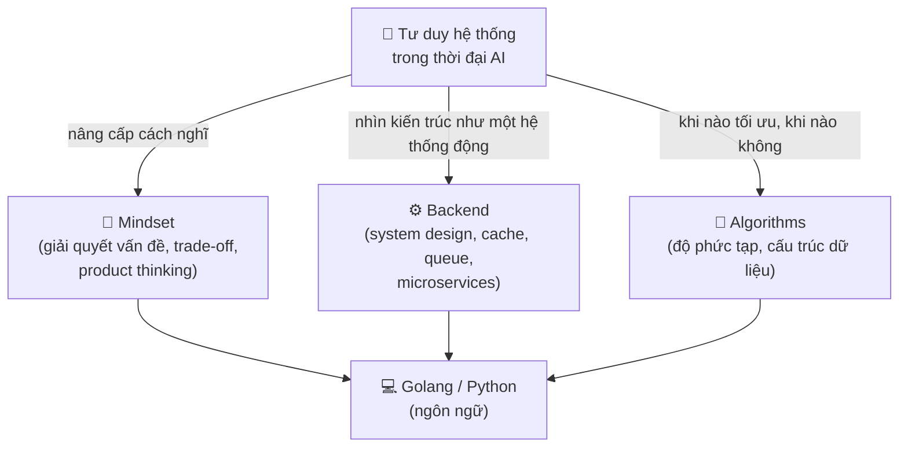
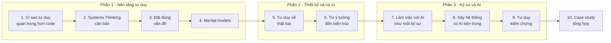
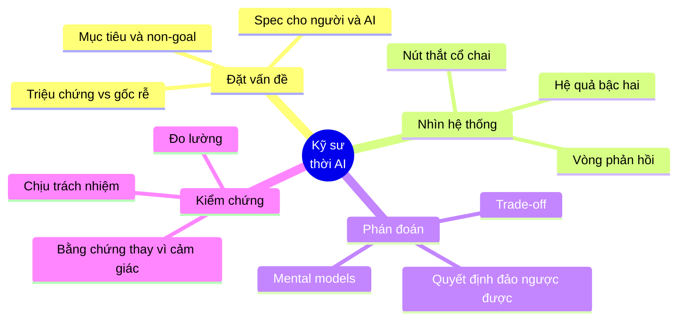
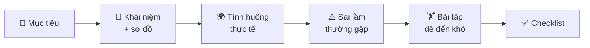

# 🧠 Tư duy hệ thống trong thời đại AI

> "Khi việc viết code trở nên rẻ, thứ đắt nhất còn lại là **quyết định nên viết cái gì, vì sao, và làm sao biết nó đúng**."

Chào mừng bạn đến với khóa học **Tư duy hệ thống trong thời đại AI** - một khóa học gần như **không dạy cú pháp**, không dạy framework, cũng không dạy "prompt thần thánh". Khóa học này dạy thứ mà AI chưa làm thay bạn được: **cách nghĩ**.

Năm 2020, một kỹ sư giỏi là người gõ ra được nhiều code chạy đúng trong thời gian ngắn. Năm 2026, một trợ lý AI có thể sinh ra vài trăm dòng code chạy được trong vài chục giây. Vậy giá trị của kỹ sư nằm ở đâu?

Câu trả lời của khóa học này:

- **Đặt đúng vấn đề** - trước khi ai (người hay máy) bắt tay vào giải.
- **Nhìn thấy cả hệ thống** - vòng phản hồi, nút thắt cổ chai, độ trễ, hệ quả bậc hai.
- **Phán đoán khi không chắc chắn** - chọn phương án khi thông tin luôn thiếu.
- **Kiểm chứng và chịu trách nhiệm** - biết cách chứng minh một thứ là đúng, và đứng tên cho kết quả.

AI làm cho **code rẻ đi**. Nhưng nó không làm cho **quyết định sai rẻ đi** - ngược lại, khi code được sinh ra nhanh gấp 10 lần, một quyết định sai cũng được nhân bản nhanh gấp 10 lần.

---

## 🎯 Khóa học này dành cho ai?

| Bạn là... | Bạn sẽ nhận được |
|-----------|------------------|
| 🌱 **Sinh viên / fresher** đang lo "AI có lấy mất việc của mình không?" | Một bản đồ rõ ràng về những kỹ năng **tăng giá trị** khi AI mạnh lên, thay vì mất giá |
| 💻 **Developer 1-3 năm** đã dùng Copilot/Claude/Cursor hằng ngày | Cách chuyển từ "người gõ code nhanh" sang "người ra quyết định đúng", biết khi nào tin và khi nào nghi ngờ AI |
| 🏗️ **Senior / Tech lead** | Ngôn ngữ và công cụ (causal loop, leverage points, mental models) để giải thích cho team **vì sao** một quyết định đúng |
| 🧭 **PM / Engineering manager** | Hiểu cách kỹ sư nghĩ về hệ thống, đặt vấn đề cho team (và cho AI agent) rõ ràng hơn |

**Yêu cầu trước:** Không bắt buộc gì. Một số ví dụ có mô phỏng nhỏ bằng **Python** và **Go** (đặt trong tab, bạn chọn ngôn ngữ quen thuộc) - nếu bạn chưa đọc được code, cứ bỏ qua phần code và đọc phần giải thích, bạn vẫn nắm được ý chính.

!!! note "Khóa học này KHÔNG phải là..."
    - ❌ Không phải khóa "prompt engineering" - prompt thay đổi mỗi quý, tư duy thì không.
    - ❌ Không phải khóa "AI sẽ thay thế lập trình viên" hay "AI chỉ là hype" - chúng ta nhìn thẳng vào điểm mạnh **và** điểm yếu thật của AI.
    - ❌ Không phải lý thuyết suông - mỗi khái niệm đều đi kèm **tình huống thật** ở các công ty phần mềm (thương mại điện tử, fintech, giao đồ ăn, SaaS...) và **bài tập**.

---

## 🔗 Liên hệ với các khóa học khác

Khóa học này là **lớp tư duy nằm phía trên** các khóa kỹ thuật. Nó không thay thế, mà **kết nối** chúng lại.

| Khóa học | Quan hệ với khóa này |
|----------|---------------------|
| [🧭 Mindset](../mindset/README.md) | Mindset dạy **quy trình** giải quyết vấn đề, clean code, trade-off của một người kỹ sư. Khóa này đi **sâu hơn một tầng**: nhìn vấn đề như một **hệ thống có vòng phản hồi**, và đặt mọi thứ trong bối cảnh có AI. Nên đọc [Bài 2: Giải quyết vấn đề](../mindset/02-problem-solving.md) và [Bài 7: Trade-off](../mindset/07-tradeoffs-decisions.md) trước hoặc song song. |
| [⚙️ Backend](../backend/README.md) | Backend dạy **các viên gạch** (database, cache, queue, microservices). Khóa này dạy cách nhìn **tòa nhà** khi các viên gạch tương tác: retry storm, autoscaling dao động, hàng đợi bùng nổ ở 90% tải... |
| [🧮 Algorithms](../algorithms/README.md) | Algorithms dạy tối ưu **một đoạn code**. Khóa này dạy tối ưu **đúng chỗ**: định luật Amdahl, Theory of Constraints - tối ưu chỗ không phải nút thắt là phí công. |

---

## 🗺️ Lộ trình học

| # | Bài học | Nội dung chính |
|---|---------|----------------|
| 1 | [Vì sao tư duy quan trọng hơn code](./01-why-thinking-matters.md) | AI làm tốt gì, kém gì; đường cong chi phí "code rẻ, quyết định sai đắt"; kỹ sư được AI khuếch đại vs coder bị AI thay thế |
| 2 | [Systems Thinking căn bản](./02-systems-thinking-basics.md) | Stock & flow, vòng phản hồi tăng cường/cân bằng, độ trễ, mô hình tảng băng, các archetype; mô phỏng retry storm |
| 3 | [Đặt đúng vấn đề](./03-problem-framing.md) | Triệu chứng vs vấn đề vs mục tiêu, bộ câu hỏi làm rõ, metric & non-goal, viết problem statement một trang cho người hoặc AI agent thực thi |
| 4 | [Mental models cho kỹ sư](./04-mental-models.md) | Tư duy bậc hai, inversion, leverage points, Theory of Constraints, Little's law, Amdahl, hàng đợi ở 90% tải, Goodhart, Conway, Chesterton... |
| 5 | [Tư duy về thất bại](./05-failure-thinking.md) | Mọi hệ thống đều hỏng - thiết kế để hỏng một cách êm: blast radius, pre-mortem, postmortem không đổ lỗi |
| 6 | [Từ ý tưởng đến kiến trúc](./06-idea-to-architecture.md) | Đi từ một câu "em muốn làm app..." đến bản kiến trúc có lý do cho từng quyết định |
| 7 | [Làm việc với AI như một kỹ sư](./07-engineering-with-ai.md) | Giao việc cho AI agent, chia nhỏ, review, giữ quyền quyết định và trách nhiệm |
| 8 | [Xây hệ thống có AI bên trong](./08-building-ai-systems.md) | Khi LLM là một thành phần của hệ thống: tính bất định, chi phí, đánh giá, guardrail |
| 9 | [Tư duy kiểm chứng](./09-verification-mindset.md) | "Chạy được" chưa phải "đúng": test, đo lường, bằng chứng - đặc biệt với code do AI viết |
| 10 | [Case study tổng hợp](./10-case-studies.md) | Áp dụng mọi công cụ của khóa học vào các tình huống thật từ đầu đến cuối |

### Bản đồ khóa học

!!! tip "Cách học hiệu quả"
    - **Học theo thứ tự** ở Phần 1 - các bài sau dùng lại từ vựng (vòng phản hồi, nút thắt, leverage point...) của Phần 1.
    - **Làm bài tập bằng giấy bút trước**, rồi mới mở đáp án. Tư duy chỉ lớn lên khi bạn tự vật lộn với nó.
    - **Áp dụng ngay vào công việc**: sau mỗi bài, chọn một sự cố/tính năng gần đây ở công ty và vẽ lại nó bằng công cụ vừa học.
    - **Đừng dùng AI để làm bài tập hộ**. Hãy dùng AI để **phản biện** đáp án của bạn sau khi bạn đã tự làm.

---

## 🧩 Bốn năng lực cốt lõi

Cả khóa học xoay quanh bốn năng lực. Mỗi bài rèn một hoặc nhiều năng lực trong số đó:

| Năng lực | Rèn ở bài | Câu hỏi đặc trưng |
|----------|-----------|-------------------|
| 🎯 Đặt vấn đề | 1, 3, 6 | "Chúng ta thực sự đang giải quyết vấn đề gì? Làm sao biết đã giải xong?" |
| 🔄 Nhìn hệ thống | 2, 4, 5, 8 | "Nếu làm điều này, cái gì khác sẽ thay đổi theo? Sau 3 tháng thì sao?" |
| ⚖️ Phán đoán | 4, 6, 7 | "Với thông tin hiện có, phương án nào ít hối tiếc nhất? Có quay lại được không?" |
| 🔍 Kiểm chứng | 5, 7, 9 | "Bằng chứng nào cho thấy nó đúng? Nếu nó sai, ta sẽ phát hiện ra bằng cách nào?" |

---

## 📊 Tự đánh giá trước khi học

Chấm điểm bản thân cho từng câu (1 = hoàn toàn không, 5 = luôn luôn). Làm lại bảng này sau khi học xong khóa để thấy sự thay đổi.

| # | Câu hỏi tự đánh giá | Điểm (1-5) |
|---|---------------------|-----------|
| 1 | Trước khi code (hoặc nhờ AI code), tôi viết ra được **vấn đề và tiêu chí thành công** trong 3-5 câu | |
| 2 | Khi nhận ticket "làm tính năng X", tôi hỏi **"để đạt mục tiêu gì?"** trước khi hỏi "làm thế nào?" | |
| 3 | Tôi vẽ được **vòng phản hồi** của một sự cố gần đây (ví dụ: retry làm quá tải làm thêm retry) | |
| 4 | Tôi biết hệ thống mình làm có **nút thắt cổ chai** ở đâu, và có số liệu chứng minh | |
| 5 | Tôi giải thích được vì sao server ở **90% CPU** thì latency tăng vọt dù vẫn "còn 10%" | |
| 6 | Khi đề xuất giải pháp, tôi nêu được **hệ quả bậc hai** (sau 3-6 tháng) của nó | |
| 7 | Tôi phân biệt được quyết định **đảo ngược được** và **không đảo ngược được**, và xử lý chúng khác nhau | |
| 8 | Với code do AI sinh ra, tôi **kiểm chứng** bằng test/đo lường chứ không chỉ "đọc thấy ổn" | |
| 9 | Tôi viết được một **spec** đủ rõ để một AI agent hoặc một đồng nghiệp mới làm đúng mà không cần hỏi lại | |
| 10 | Khi một metric được đặt làm KPI, tôi nghĩ ngay đến cách nó có thể bị **"chơi gian"** (Goodhart) | |

**Cách đọc kết quả:**

- **10-20 điểm**: Khóa học này được viết cho bạn. Học tuần tự từ Bài 1.
- **21-35 điểm**: Bạn có nền tảng tốt. Tập trung vào Bài 2, 4, 9 để hệ thống hóa.
- **36-50 điểm**: Bạn đã nghĩ như một senior. Đọc lướt, làm bài tập khó, và dùng khóa học để **dạy lại** người khác.

---

## 📚 Sách nên đọc

Khóa học này đứng trên vai của những cuốn sách dưới đây. Bạn không cần đọc hết trước - hãy đọc **song song** khi một bài học làm bạn tò mò.

| Sách | Tác giả | Vì sao nên đọc | Liên quan bài |
|------|---------|----------------|---------------|
| **Thinking in Systems: A Primer** | Donella Meadows | Cuốn nhập môn kinh điển về systems thinking: stock, flow, feedback, leverage points. Mỏng, dễ đọc, không cần toán | 2, 4 |
| **The Fifth Discipline** | Peter Senge | Đưa systems thinking vào tổ chức; giới thiệu các "system archetype" (fixes that fail, shifting the burden...) | 2, 5 |
| **Poor Charlie's Almanack** | Charlie Munger (Peter Kaufman biên tập) | Nguồn gốc của ý tưởng "latticework of mental models" - dùng nhiều mô hình từ nhiều ngành để ra quyết định | 4 |
| **The Goal** | Eliyahu M. Goldratt | Tiểu thuyết về một nhà máy, dạy Theory of Constraints (nút thắt cổ chai) dễ hiểu nhất từng có | 4, 6 |
| **An Elegant Puzzle** | Will Larson | Systems thinking áp dụng vào quản lý đội ngũ kỹ sư: kích thước team, nợ kỹ thuật, migration | 2, 6 |
| **Designing Data-Intensive Applications** | Martin Kleppmann | Nền tảng hệ thống dữ liệu phân tán - để "nhìn hệ thống" thì phải hiểu các thành phần của nó | 5, 6, 8 |
| **Accelerate** | Nicole Forsgren, Jez Humble, Gene Kim | Dữ liệu nghiên cứu về những gì thực sự làm team phần mềm hiệu quả (4 chỉ số DORA) - ví dụ tuyệt vời về đo lường đúng | 4, 9 |

!!! tip "Nếu chỉ đọc một cuốn"
    Hãy đọc **Thinking in Systems** của Donella Meadows. Khoảng 200 trang, và nó sẽ thay đổi cách bạn nhìn mọi sự cố production.

---

## 🧪 Cách mỗi bài học được tổ chức

Mỗi bài học có cùng cấu trúc để bạn dễ theo dõi:

- **Sơ đồ Mermaid** được dùng rất nhiều: tư duy hệ thống là tư duy bằng **hình**, không phải bằng danh sách gạch đầu dòng.
- **Code** chỉ xuất hiện khi nó **minh họa** một động lực của hệ thống (ví dụ mô phỏng retry storm, mô phỏng hàng đợi). Tất cả code đều đã được chạy thật và output in trong bài là output thật.
- **Đáp án** bài tập được giấu trong khối có thể mở ra - hãy tự làm trước.

---

## ✅ Checklist hoàn thành khóa học

Khi hoàn thành khóa học, bạn có thể tự tin đánh dấu:

- [ ] Giải thích được vì sao trong thời đại AI, **tư duy** là lợi thế cạnh tranh của kỹ sư, và nêu được 3 việc AI làm tốt, 3 việc AI làm kém
- [ ] Vẽ được **causal loop diagram** cho một sự cố hoặc một vấn đề của team, chỉ ra vòng tăng cường và vòng cân bằng
- [ ] Phân biệt **triệu chứng - vấn đề - mục tiêu**, và viết được **problem statement một trang** có metric, ràng buộc, non-goal
- [ ] Áp dụng ít nhất 8 **mental model** (Little's law, Amdahl, Theory of Constraints, Goodhart, Conway, Chesterton's fence...) vào ví dụ phần mềm cụ thể
- [ ] Làm **pre-mortem** và viết **postmortem không đổ lỗi** cho một sự cố
- [ ] Đi từ một ý tưởng mơ hồ đến bản kiến trúc với **lý do** cho từng quyết định
- [ ] Giao việc cho AI agent bằng spec rõ ràng, **review và kiểm chứng** kết quả thay vì tin mù quáng
- [ ] Thiết kế hệ thống có thành phần AI với **đánh giá, guardrail và kiểm soát chi phí**
- [ ] Hoàn thành ít nhất 2 **case study tổng hợp** ở Bài 10

---

**Bắt đầu thôi**: [Bài 1: Vì sao tư duy quan trọng hơn code](./01-why-thinking-matters.md)
